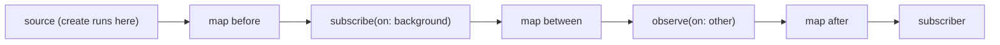
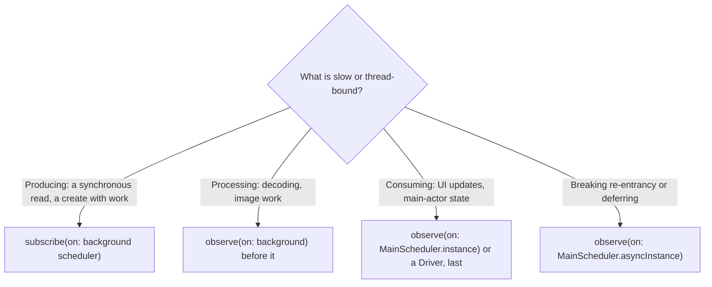

RxSwift does not choose threads. As [Observables and Observers](/rxswift-observables-observers/#nothing-happens-until-you-subscribe) measured, a chain is a set of nested function calls, and events travel through it on whatever thread sent them. A wrapped network callback delivers on URLSession's queue, a timer on the scheduler it was given, a button tap on the main thread. Moving work somewhere else is explicit, and it is done with **schedulers** and two operators: `observe(on:)`, which moves the delivery of events, and `subscribe(on:)`, which moves the work of subscribing.

In Swift 6 this stopped being a performance detail. A closure written in main-actor code is isolated to the main actor, and Swift checks that at runtime: if RxSwift calls it on a background thread, the process stops. This article measures where each part of a chain runs under every combination of the two operators, shows the two Swift 6 crashes they can produce and four ways to avoid them, compares RxSwift's schedulers, and measures what a thread hop costs and what happens when a fast producer feeds a slow consumer across one.

<!--more-->

The examples use RxSwift 6.10.2 in Swift 6 language mode and were compiled and run with the Swift 6.4 toolchain from Xcode 27.1 on macOS 26. Paste the blocks in order into one `main.swift` of an executable target that depends on `RxSwift` and `RxBlocking`, together with the `record` helper from [Observables and Observers](/rxswift-observables-observers/). RxSwift is imported with `@preconcurrency`, because several examples pass observables and subjects to background queues.

<!-- check-uses: rx-record -->
```swift
@preconcurrency import RxSwift
import RxBlocking
import Foundation
import Synchronization
```

The measurements record the name of the current dispatch queue, or "main" on the main thread. The helpers are declared `nonisolated` so that the closures built inside them carry no main-actor isolation; why that matters is the subject of the Swift 6 section:

```swift
nonisolated func currentQueue() -> String {
    if pthread_main_np() == 1 { return "main" }
    return String(cString: __dispatch_queue_get_label(nil))
}

final class Trace: Sendable {
    private let entries = Mutex<[String]>([])
    func note(_ step: String) { entries.withLock { $0.append("\(step): \(currentQueue())") } }
    var all: [String] { entries.withLock { $0 } }
}

nonisolated func traced(_ trace: Trace, _ step: String) -> (Int) -> Int {
    { value in trace.note(step); return value }
}
```

## The schedulers

A scheduler is an object that runs a unit of work, now or later, on some execution context. RxSwift ships these:

| Scheduler | Runs work on | Serial |
| --- | --- | --- |
| `MainScheduler.instance` | the main queue; immediately if already on the main thread | yes |
| `MainScheduler.asyncInstance` | the main queue, always asynchronously | yes |
| `SerialDispatchQueueScheduler` | a serial dispatch queue (its own or one you pass) | yes |
| `ConcurrentDispatchQueueScheduler` | a concurrent dispatch queue | no |
| `OperationQueueScheduler` | an `OperationQueue`, honoring its concurrency limit | depends |
| `CurrentThreadScheduler.instance` | the current thread, through a trampoline queue | yes |
| `ConcurrentMainScheduler.instance` | the main queue, for `subscribe(on:)` | yes |
| `TestScheduler` (RxTest) | a virtual clock | yes |

Every time-based operator takes a scheduler argument, because the scheduler is also the clock: `debounce(.milliseconds(300), scheduler: MainScheduler.instance)` waits on the main queue, and the same chain with a `TestScheduler` waits on a virtual clock, which is how [Time Operators](/rxswift-time-operators/) measured everything exactly.

## `observe(on:)` moves everything below it

`observe(on:)` changes the thread for every event that passes it: the closures of operators after it, and the subscriber's closures, run on its scheduler. Operators before it are unaffected:

```swift
let downstream = Trace()
let downstreamValues = try Observable.of(1)
    .map(traced(downstream, "before observe(on:)"))
    .observe(on: SerialDispatchQueueScheduler(internalSerialQueueName: "work"))
    .map(traced(downstream, "after observe(on:)"))
    .toBlocking().toArray()
assert(downstreamValues == [1])
assert(downstream.all == ["before observe(on:): main", "after observe(on:): work"])
```

Several `observe(on:)` operators in one chain each move events again, so a chain can do expensive work on a background queue and then come back for the UI:

```swift
let roundTrip = Trace()
_ = try Observable.of(1)
    .observe(on: SerialDispatchQueueScheduler(internalSerialQueueName: "decode"))
    .map(traced(roundTrip, "decode"))
    .observe(on: MainScheduler.instance)
    .map(traced(roundTrip, "render"))
    .toBlocking().toArray()
assert(roundTrip.all == ["decode: decode", "render: main"])
```

`toBlocking()` runs the main run loop while it waits, which is why the main-queue delivery could happen here even though the main thread was "blocked".

## `subscribe(on:)` moves the source

`subscribe(on:)` changes where the *subscription* happens. Subscribing travels up the chain to the source, so `subscribe(on:)` moves the source's subscription work, the closure of an `Observable.create`, and with it any elements a synchronous source emits from that closure. Its position in the chain does not matter, and when there are several, the one closest to the source wins, because it is the last to move the subscription before the source runs. The source below is built in a `nonisolated` function; written directly in this file's top-level code, its closure would be a main-actor closure, and moving it to a background queue is one of the two crashes described in the Swift 6 section:

```swift
nonisolated func tracedSource(_ trace: Trace) -> Observable<Int> {
    Observable.create { observer in
        trace.note("create")
        observer.onNext(1)
        observer.onCompleted()
        return Disposables.create()
    }
}

let upstream = Trace()
_ = try tracedSource(upstream)
    .map(traced(upstream, "map before"))
    .subscribe(on: SerialDispatchQueueScheduler(internalSerialQueueName: "background"))
    .map(traced(upstream, "map between"))
    .observe(on: SerialDispatchQueueScheduler(internalSerialQueueName: "other"))
    .map(traced(upstream, "map after observe(on:)"))
    .subscribe(on: SerialDispatchQueueScheduler(internalSerialQueueName: "ignored"))
    .toBlocking().toArray()

assert(upstream.all == [
    "create: background",
    "map before: background",
    "map between: background",                // no observe(on:) yet, so the source's thread continues
    "map after observe(on:): other",
])
```

The queue called "ignored" never appeared: its `subscribe(on:)` only moved the subscription as far as the next `subscribe(on:)` up the chain. And "map between" ran on "background" even though it is below the `subscribe(on:)`, because nothing moved the elements after the source emitted them there.

`subscribe(on:)` only matters for sources that do work or emit when subscribed: a synchronous `create`, `of`, `from`, a file read wrapped in `create`. For sources that emit later from their own threads, such as a network callback or a UI control, it changes nothing about where elements arrive.



Everything to the left of `observe(on:)` runs where the source runs, which `subscribe(on:)` decides; everything to the right runs on the `observe(on:)` scheduler.

## `MainScheduler.instance` and `asyncInstance`

`MainScheduler.instance` has an optimization that matters: when it is asked to schedule work while already on the main thread, with nothing of its own queued, it runs the work *immediately*. `asyncInstance` always dispatches:

```swift
var immediate: [String] = []
let immediateSubscription = Observable.of("x").observe(on: MainScheduler.instance)
    .subscribe(onNext: { immediate.append($0) })
assert(immediate == ["x"])                         // delivered before subscribe returned

var deferred: [String] = []
let deferredSubscription = Observable.of("x").observe(on: MainScheduler.asyncInstance)
    .subscribe(onNext: { deferred.append($0) })
assert(deferred == [])                             // not yet: queued on the main queue
RunLoop.main.run(until: Date().addingTimeInterval(0.05))
assert(deferred == ["x"])
```

The synchronous path is what lets a `Driver` configure a view before its first frame, as [Driver and Signal](/rxswift-driver-signal/#the-first-element-can-be-synchronous) measured. The asynchronous one is what breaks a re-entrant feedback loop, as [`BehaviorSubject`](/rxswift-behaviorsubject/#feedback-loops-and-stale-subscribers) used. Choose `instance` for UI delivery and `asyncInstance` when the point is to *defer*.

## Order is preserved, even on a concurrent queue

`observe(on:)` with a `ConcurrentDispatchQueueScheduler` could, in principle, deliver elements concurrently and out of order. RxSwift prevents both: for schedulers that are not serial, `observe(on:)` keeps its own queue of pending events and delivers them one at a time, in order:

```swift
nonisolated func orderSurvives() -> Bool {
    let delivered = try? Observable.from(Array(0..<2_000))
        .observe(on: ConcurrentDispatchQueueScheduler(qos: .userInitiated))
        .toBlocking().toArray()
    return delivered == Array(0..<2_000)
}

let orderedRuns = (0..<20).filter { _ in orderSurvives() }.count
assert(orderedRuns == 20)
```

All 20 runs delivered 2,000 elements in order. That differs from Combine, where `receive(on:)` with a concurrent queue reordered elements in every one of 20 runs, as [Schedulers: `receive(on:)` and `subscribe(on:)`](/combine-schedulers-receive-subscribe-on/) measured. The grammar's "one event at a time" rule, from [Observables and Observers](/rxswift-observables-observers/#the-grammar), is upheld by RxSwift's operator rather than left to the scheduler. A concurrent scheduler still gives parallelism *between* chains, and for `subscribe(on:)` and time operators, just not within one chain's delivery.

## What a hop costs, and what it hides

Each element that crosses an `observe(on:)` costs a dispatch. Pushing 100,000 elements through a chain with and without a hop to a serial queue:

```swift
nonisolated func secondsToDeliver(_ count: Int, hop: Bool) -> Double {
    let start = ContinuousClock.now
    let source = Observable.range(start: 0, count: count)
    let chain = hop ? source.observe(on: SerialDispatchQueueScheduler(qos: .userInitiated)) : source
    _ = try? chain.toBlocking().last()
    let elapsed = ContinuousClock.now - start
    return Double(elapsed.components.seconds) + Double(elapsed.components.attoseconds) / 1e18
}

let withoutHop = secondsToDeliver(100_000, hop: false)
let withHop = secondsToDeliver(100_000, hop: true)
print("100,000 elements:", withoutHop, "s without a hop,", withHop, "s with one")
assert(withHop > withoutHop)
```

In a debug build, the hop added about 0.17 seconds to 0.28, or roughly 1.7 microseconds per element. That is negligible for UI events and noticeable for a stream of sensor samples, which is one more reason to filter *before* `observe(on:)`, as [Filtering Operators](/rxswift-filtering-operators/#filter) recommends.

The hop also hides a cost. A producer that calls `onNext` synchronously is slowed down by a slow consumer, because sending *is* calling the consumer. Put an `observe(on:)` between them and the producer no longer waits; the events queue up instead. Here a producer sends 20,000 elements as fast as it can to a consumer that takes 100 microseconds per element:

```swift
nonisolated func backlogWhenProducerFinishes() -> (sent: Int, handled: Int) {
    let handled = Atomic(0)
    let allHandled = DispatchSemaphore(value: 0)
    let readings = PublishSubject<Int>()
    let subscription = readings
        .observe(on: SerialDispatchQueueScheduler(qos: .userInitiated))
        .subscribe(onNext: { _ in
            usleep(100)                                   // a slow consumer
            if handled.add(1, ordering: .relaxed).newValue == 20_000 { allHandled.signal() }
        })
    for value in 0..<20_000 { readings.onNext(value) }
    let handledWhenDone = handled.load(ordering: .relaxed)
    allHandled.wait()
    subscription.dispose()
    return (20_000, handledWhenDone)
}

let backlog = backlogWhenProducerFinishes()
print("handled when the producer finished:", backlog.handled, "of", backlog.sent)
assert(backlog.handled < backlog.sent / 2)
```

When the producer finished, the consumer had handled about 200 of the 20,000 elements, and the other 19,800 were waiting in `observe(on:)`'s queue, in memory. This is the $$(\lambda - \mu)\,t$$ growth from [Observables and Observers](/rxswift-observables-observers/#no-backpressure), made visible: RxSwift has no demand, so a queue is the only place for the difference to go. If the producer never stops, the queue never shrinks.

## Swift 6: main-actor closures on background threads

Closures written in main-actor code are isolated to the main actor. That includes closures in top-level code, like this file, and in any method of a `@MainActor` type, such as a view model or a view controller. Swift 6 adds a check to each such closure that verifies, when the closure runs, that it is on the main actor's executor. RxSwift is compiled without strict concurrency checking, so the compiler cannot see that RxSwift will call the closure elsewhere, and the check is all that is left. It stops the process with `EXC_BREAKPOINT`, in `_swift_task_checkIsolatedSwift`.

Two placements produce the crash. A subscriber closure below an `observe(on:)` to a background scheduler:

<!-- skip-check -->
```swift
// Crashes: the onNext closure is main-actor isolated and runs on the "work" queue
var lastValue = 0
let crashingSubscription = Observable.of(1)
    .observe(on: SerialDispatchQueueScheduler(internalSerialQueueName: "work"))
    .subscribe(onNext: { lastValue = $0 })
```

And a `create` closure, written in main-actor code, moved to a background thread by `subscribe(on:)`:

<!-- skip-check -->
```swift
// Crashes: the create closure is main-actor isolated and runs where subscribe(on:) sends it
let crashingSource = Observable<Int>.create { observer in
    observer.onNext(1)
    return Disposables.create()
}
.subscribe(on: SerialDispatchQueueScheduler(internalSerialQueueName: "background"))
.subscribe()
```

The second closure touches nothing but its observer; the check does not care. It fires because the closure's *declared* isolation does not match the thread. There are four ways to write chains that never trigger it.

**1. Deliver to main-actor closures on the main thread.** End every chain that reaches main-actor code with `observe(on: MainScheduler.instance)`, or convert it to a `Driver` or `Signal`, which do that and also forbid errors:

```swift
var safeValue = 0
let safeSubscription = Observable.of(2)
    .observe(on: SerialDispatchQueueScheduler(internalSerialQueueName: "work"))
    .observe(on: MainScheduler.instance)
    .subscribe(onNext: { safeValue = $0 })
RunLoop.main.run(until: Date().addingTimeInterval(0.05))
assert(safeValue == 2)
```

That fixes the subscriber, but not operator closures between the two `observe(on:)` calls. Whether a closure is main-actor isolated does not depend on what it touches; a non-`Sendable` closure written in main-actor code is isolated, full stop. Even this one, which touches nothing at all, stops the process on the "work" queue:

<!-- skip-check -->
```swift
// Crashes: a closure written in main-actor code is isolated even when it touches nothing
let crashingMap = Observable.of(1)
    .observe(on: SerialDispatchQueueScheduler(internalSerialQueueName: "work"))
    .map { $0 * 2 }
    .subscribe()
```

So the background part of a chain needs one of the next two ways.

**2. Build background work in non-isolated code.** Closures written in a `nonisolated` function, an extension of a non-isolated type, or a `Sendable` service class are not main-actor closures and carry no check, which is how every background chain in this article was written. Keeping the background half of a chain in a service, and only the final `observe(on: MainScheduler.instance)` and the subscription in the view model, is a structure that scales.

**3. Mark the closure `@Sendable`.** A `@Sendable` closure is not inferred to be isolated, so it has no check, and the compiler then requires that it touch only `Sendable` state:

```swift
let delivered = Atomic(0)
let sendableSubscription = Observable.of(1)
    .observe(on: SerialDispatchQueueScheduler(internalSerialQueueName: "work"))
    .subscribe(onNext: { @Sendable value in delivered.add(value, ordering: .relaxed) })
RunLoop.main.run(until: Date().addingTimeInterval(0.05))
assert(delivered.load(ordering: .relaxed) == 1)
```

**4. Use `MainScheduler` for `subscribe(on:)` when the source is main-actor code**, or move the source into non-isolated code as in the second way.

The rule underneath all four: know which thread each closure in a chain runs on, which this article's traces show how to find, and make sure every main-actor closure is on the main thread side of the last `observe(on:)`.

## Choosing where work runs



| RxSwift | Combine |
| --- | --- |
| `observe(on:)` | `receive(on:)` |
| `subscribe(on:)` | `subscribe(on:)` |
| `MainScheduler.instance` | `DispatchQueue.main` (always async) or `RunLoop.main` |
| order kept on concurrent schedulers | reordered on concurrent queues |
| `TestScheduler` | no built-in test scheduler |

[Schedulers: `receive(on:)` and `subscribe(on:)`](/combine-schedulers-receive-subscribe-on/) measures the Combine side, including the same Swift 6 crash.

```swift
withExtendedLifetime((immediateSubscription, deferredSubscription, safeSubscription,
                      sendableSubscription)) {}
```

## Summary

- `observe(on:)` moves every event below it; several can be chained. `subscribe(on:)` moves the subscription and a synchronous source's work; position does not matter, and the one closest to the source wins.
- `MainScheduler.instance` runs immediately when already on the main thread; `asyncInstance` always defers.
- `observe(on:)` with a concurrent scheduler kept 2,000 elements in order in 20 of 20 runs, unlike Combine's `receive(on:)`.
- A hop cost about 1.7 µs per element in a debug build, and hid a backlog: a fast producer finished with about 200 of 20,000 elements handled and the rest queued.
- In Swift 6, main-actor closures that RxSwift calls on a background thread, below an `observe(on:)` or inside a `create` moved by `subscribe(on:)`, stop the process. Deliver to them on the main thread, build background work in non-isolated code, or use `@Sendable` closures.

## Exercise

Write a debugging operator `assertQueue(_ name: String)` that checks, for every event, that it is delivered on the dispatch queue with the given label (or on the main thread for `"main"`), and calls `assertionFailure` with the actual label otherwise. Place it at each step of the traced chain from this article and confirm it passes, then move the `observe(on:)` one step earlier and see which assertion fails. Finally, use it to find, in a chain of your own that ends in a view model, the first closure that would trip Swift 6's isolation check.

## Further reading

- [Schedulers](https://github.com/ReactiveX/RxSwift/blob/main/Documentation/Schedulers.md) in the RxSwift documentation, on `observe(on:)`, `subscribe(on:)`, and each scheduler type.
- The [`ObserveOn.swift`](https://github.com/ReactiveX/RxSwift/blob/main/RxSwift/Observables/ObserveOn.swift) source, where the ordering queue for non-serial schedulers is implemented.
- [SE-0423: Dynamic actor isolation enforcement from non-strict-concurrency contexts](https://github.com/swiftlang/swift-evolution/blob/main/proposals/0423-dynamic-actor-isolation.md), which introduced the runtime check measured here.
- [Schedulers: `receive(on:)` and `subscribe(on:)`](/combine-schedulers-receive-subscribe-on/) for the Combine side.

Previous: [Error Handling](/rxswift-error-handling/). Next: [RxCocoa: Binding Observables to UIKit](/rxswift-rxcocoa-uikit/).

Return to the [RxSwift roadmap](/rxswift/).
