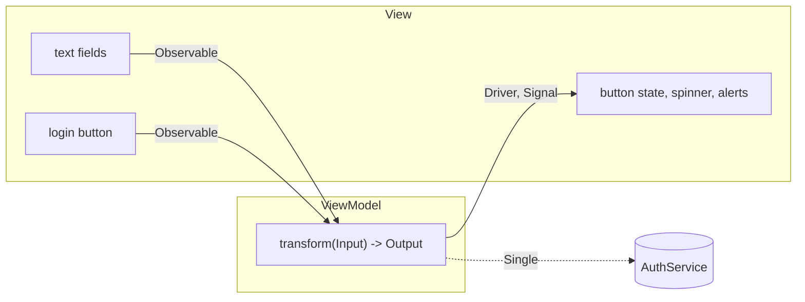

Model-View-ViewModel is the architecture most RxSwift apps use, and RxSwift is a large part of why. The view model holds the screen's logic as observable chains: it takes the user's input as streams, and produces what the screen should show as streams. The view controller shrinks to a list of bindings. And because the logic is chains with injected dependencies and an injected clock, it can be tested on a virtual timeline, millisecond by millisecond, without a simulator, a network, or a single `sleep`.

This article builds one screen that way, a login form with validation, a loading state, error messages, and protection against double taps, and measures it. The view model runs on a virtual clock in a plain test, where every output's timeline is asserted exactly. The view controller runs in the iOS simulator with real `UITextField`s and a real `UIButton`. Along the way it measures the mistake that makes MVVM screens send duplicate requests, an output exposed as a plain `Observable` instead of a `Driver` or a `Signal`, and covers the Swift 6 isolation questions a `@MainActor` view model raises.

<!--more-->

The examples use RxSwift 6.10.2 in Swift 6 language mode and were compiled and run with the Swift 6.4 toolchain from Xcode 27.1. The view model and its tests ran on macOS 26 in an executable target that depends on `RxSwift`, `RxRelay`, `RxCocoa`, and `RxTest`, together with `timeline` from [Filtering Operators](/rxswift-filtering-operators/#a-clock-you-control). The view controller ran in a test bundle on an iPhone 17 simulator with iOS 27.

<!-- check-uses: rx-timeline -->
```swift
import RxSwift
import RxRelay
import RxCocoa
import RxTest
import Foundation
```

## The shape

A view model in this style is a function from inputs to outputs:



Inputs are observables of what the user does. Outputs are `Driver`s for state the screen shows and `Signal`s for things that happen once, following [Driver and Signal](/rxswift-driver-signal/#driver-or-signal-state-or-event). The view model has no reference to the view, no UIKit import, and no subscriptions of its own: it describes chains, and the view subscribes to them. Dependencies, here an authentication service, are passed in, so a test can replace them.

## The service

The view model talks to the network through a protocol that returns a `Single`, the trait for "one result or an error" from [`Single`, `Maybe`, and `Completable`](/rxswift-single-maybe-completable/):

```swift
enum LoginError: Error { case wrongPassword }

protocol AuthService {
    func logIn(email: String, password: String) -> Single<String>    // the user's name
}
```

## Tracking activity

A loading spinner should be visible while any login request is running. RxSwift's example app has a well-known helper for that, `ActivityIndicator`; a minimal version counts the subscriptions currently running through it:

```swift
final class ActivityTracker {
    private let running = BehaviorRelay(value: 0)

    var isActive: Driver<Bool> {
        running.asDriver().map { $0 > 0 }.distinctUntilChanged()
    }

    func track<Element>(_ work: Single<Element>) -> Single<Element> {
        work.do(
            onSubscribe: { [running] in running.accept(running.value + 1) },
            onDispose: { [running] in running.accept(running.value - 1) }
        )
    }
}
```

`onDispose` runs on success, failure, and cancellation alike, as [Subscribing](/rxswift-subscribing/#the-four-closures) measured for `onDisposed`, so the count cannot leak. The read-modify-write on the relay is the pattern [Relays](/rxswift-relays/#the-read-modify-write-trap) warned about; it is safe here only because every login starts and ends on the main thread, which the view model's Drivers guarantee for the chain that uses it.

## The view model

```swift
@MainActor struct LoginViewModel {
    struct Input {
        let email: Observable<String>
        let password: Observable<String>
        let loginTaps: Observable<Void>
    }

    struct Output {
        let isLoginEnabled: Driver<Bool>
        let isLoading: Driver<Bool>
        let errorMessage: Signal<String>
        let loggedInUser: Signal<String>
    }

    let auth: AuthService

    func transform(_ input: Input) -> Output {
        let activity = ActivityTracker()
        let errors = PublishRelay<String>()

        let credentials = Observable.combineLatest(input.email, input.password)
        let isValid = credentials.map { email, password in
            email.contains("@") && password.count >= 8
        }

        let loggedInUser = input.loginTaps
            .withLatestFrom(Observable.combineLatest(credentials, isValid))
            .filter { _, isValid in isValid }
            .map { credentials, _ in credentials }
            .flatMapFirst { [auth] email, password in
                activity.track(auth.logIn(email: email, password: password))
                    .asObservable()
                    .catch { error in
                        errors.accept("Login failed: \(error)")
                        return .empty()
                    }
            }

        let isLoading = activity.isActive
        let isLoginEnabled = Observable.combineLatest(isValid, isLoading.asObservable()) { $0 && !$1 }
            .asDriver(onErrorJustReturn: false)
            .distinctUntilChanged()

        return Output(
            isLoginEnabled: isLoginEnabled,
            isLoading: isLoading,
            errorMessage: errors.asSignal(),
            loggedInUser: loggedInUser.asSignal(onErrorSignalWith: .empty())
        )
    }
}
```

Each line applies something from an earlier article:

- `combineLatest` keeps the validity current as either field changes, from [Combining Operators](/rxswift-combining-operators/#combinelatest-the-latest-of-each-whenever-any-changes).
- `withLatestFrom` reads the credentials *at the moment of the tap*, rather than logging in on every keystroke.
- `flatMapFirst` ignores taps while a login is running, which is double-tap protection without timing guesses, from [Transforming Operators](/rxswift-transforming-operators/#flatmapfirst-ignore-while-busy).
- The `catch` is *inside* the `flatMapFirst`, so a failed login produces an error message and leaves the chain of taps alive, from [Error Handling](/rxswift-error-handling/#catch-where-ending-is-acceptable).
- Every output is a `Driver` or a `Signal`, so the view's closures run on the main thread and the outputs are shared.

`transform` captures only `auth`, explicitly, and never `self`. It is a pure function of its inputs and dependencies, so there is no retain cycle to create and nothing to dispose inside the view model.

## Testing on a virtual clock

To test the view model, the inputs become hot test observables with exact times, the service becomes a fake whose responses take a known virtual time, and the outputs are recorded. `Driver` and `Signal` normally deliver through `MainScheduler`, which would leave the virtual clock; RxCocoa's `SharingScheduler.mock(scheduler:)` makes them use the test scheduler for the duration of a closure:

```swift
final class FakeAuth: AuthService {
    private let scheduler: TestScheduler
    private(set) var passwordsTried: [String] = []

    init(scheduler: TestScheduler) { self.scheduler = scheduler }

    func logIn(email: String, password: String) -> Single<String> {
        passwordsTried.append(password)
        let response: [Recorded<Event<String>>] = password == "correct horse"
            ? [.next(300, "Ada"), .completed(300)]            // 300 ms to succeed
            : [.error(300, LoginError.wrongPassword)]          // 300 ms to fail
        return scheduler.createColdObservable(response).asObservable().asSingle()
    }
}
```

The scenario: the user types an email at 100 ms, a short password at 150, a long wrong one at 200, and taps "Log in" at 300 and again, impatiently, at 350. After the failure, they type the right password at 800 and tap at 900 and, again, at 1000:

```swift
let clock = TestScheduler(initialClock: 0, resolution: 0.001, simulateProcessingDelay: false)
let fakeAuth = FakeAuth(scheduler: clock)
let enabled = clock.createObserver(Bool.self)
let loading = clock.createObserver(Bool.self)
let errorMessages = clock.createObserver(String.self)
let users = clock.createObserver(String.self)
let testBag = DisposeBag()

SharingScheduler.mock(scheduler: clock) {
    let email = clock.createHotObservable([.next(100, "ada@example.com")])
    let password = clock.createHotObservable([
        .next(150, "short"), .next(200, "wrong password"), .next(800, "correct horse"),
    ])
    let taps = clock.createHotObservable([.next(300, ()), .next(350, ()), .next(900, ()), .next(1_000, ())])

    let output = LoginViewModel(auth: fakeAuth).transform(.init(
        email: email.asObservable(), password: password.asObservable(), loginTaps: taps.asObservable()
    ))
    clock.scheduleAt(0) {
        output.isLoginEnabled.drive(enabled).disposed(by: testBag)
        output.isLoading.drive(loading).disposed(by: testBag)
        output.errorMessage.emit(to: errorMessages).disposed(by: testBag)
        output.loggedInUser.emit(to: users).disposed(by: testBag)
    }
    clock.start()
}
```

The recorded timelines:

```swift
assert(timeline(enabled.events) == ["false@150", "true@200", "false@300", "true@600", "false@900", "true@1200"])
assert(timeline(loading.events) == ["false@0", "true@300", "false@600", "true@900", "false@1200"])
assert(timeline(errorMessages.events) == ["Login failed: wrongPassword@600"])
assert(timeline(users.events) == ["Ada@1200"])
assert(fakeAuth.passwordsTried == ["wrong password", "correct horse"])
```

Read across, they tell the whole story of the screen:

| Time (ms) | Event | Button enabled | Loading | Output |
| --- | --- | --- | --- | --- |
| 100 | email typed | (no password yet) | false | |
| 150 | short password | false | | |
| 200 | long password | true | | |
| 300 | tap | false | true | request 1 starts |
| 350 | second tap | | | ignored by `flatMapFirst` |
| 600 | request 1 fails | true | false | "Login failed: wrongPassword" |
| 800 | correct password | (still true) | | |
| 900 | tap | false | true | request 2 starts |
| 1000 | second tap | | | ignored |
| 1200 | request 2 succeeds | true | false | "Ada" |

Two taps out of four reached the service, the failure did not end the screen, and the button was disabled exactly while a request ran. The test ran in a few milliseconds of real time and covered 1.2 seconds of user time, including two network round trips. Nothing in it depends on the simulator.

## The view controller

The view controller creates the inputs from its controls and binds the outputs to them. Everything in it is a binding:

<!-- ios -->
```swift
import UIKit

final class LoginViewController: UIViewController {
    let emailField = UITextField()
    let passwordField = UITextField()
    let loginButton = UIButton(type: .system)
    let spinner = UIActivityIndicatorView()
    let statusLabel = UILabel()

    private let viewModel: LoginViewModel
    private let bag = DisposeBag()

    init(viewModel: LoginViewModel) {
        self.viewModel = viewModel
        super.init(nibName: nil, bundle: nil)
    }
    required init?(coder: NSCoder) { fatalError("init(coder:) is not supported") }

    override func viewDidLoad() {
        super.viewDidLoad()
        // Layout omitted: add the five views to a stack view.

        let output = viewModel.transform(.init(
            email: emailField.rx.text.orEmpty.asObservable(),
            password: passwordField.rx.text.orEmpty.asObservable(),
            loginTaps: loginButton.rx.tap.asObservable()
        ))

        output.isLoginEnabled.drive(loginButton.rx.isEnabled).disposed(by: bag)
        output.isLoading.drive(spinner.rx.isAnimating).disposed(by: bag)
        output.errorMessage.emit(to: statusLabel.rx.text).disposed(by: bag)
        output.loggedInUser.map { "Welcome, \($0)" }.emit(to: statusLabel.rx.text).disposed(by: bag)
    }
}
```

`UIViewController` is `@MainActor`, so every closure written in it is a main-actor closure. That is safe here because every output is a `Driver` or a `Signal`, which deliver on the main thread. `rx.text.orEmpty` turns the field's optional text into a `String`, and the binders `rx.isEnabled`, `rx.isAnimating`, and `rx.text` are covered in [RxCocoa: Binding Observables to UIKit](/rxswift-rxcocoa-uikit/).

To check the whole screen, a test in the simulator drives the real controls. The fake service here answers on the main queue after 50 milliseconds of real time:

<!-- ios -->
```swift
final class MainQueueAuth: AuthService {
    func logIn(email: String, password: String) -> Single<String> {
        let result: Single<String> = password == "correct horse" ? .just("Ada") : .error(LoginError.wrongPassword)
        return result.delay(.milliseconds(50), scheduler: MainScheduler.instance)
    }
}

@MainActor func enter(_ text: String, into field: UITextField) {
    field.text = text
    field.sendActions(for: .editingChanged)                    // what a keystroke sends
}
```

<!-- ios -->
```swift
let screen = LoginViewController(viewModel: LoginViewModel(auth: MainQueueAuth()))
screen.loadViewIfNeeded()
assert(screen.loginButton.isEnabled == false)

enter("ada@example.com", into: screen.emailField)
enter("correct horse", into: screen.passwordField)
assert(screen.loginButton.isEnabled)

screen.loginButton.sendActions(for: .touchUpInside)
assert(screen.loginButton.isEnabled == false && screen.spinner.isAnimating)

RunLoop.main.run(until: Date().addingTimeInterval(0.2))
assert(screen.statusLabel.text == "Welcome, Ada")
assert(screen.loginButton.isEnabled && !screen.spinner.isAnimating)
```

The button was disabled on load, enabled after typing, disabled with a running spinner straight after the tap, and back to enabled with the welcome message once the response arrived.

## The duplicate-request mistake

Outputs are shared because `Driver` and `Signal` share. An output exposed as a plain `Observable` is not shared, and every subscriber gets its own run of the chain, including its own request. A view that binds the same output to two places, a label and an analytics call, sends two logins per tap:

```swift
let sharingClock = TestScheduler(initialClock: 0, resolution: 0.001, simulateProcessingDelay: false)
let countingAuth = FakeAuth(scheduler: sharingClock)
let sharingBag = DisposeBag()
let tapsForSharing = sharingClock.createHotObservable([.next(100, ())])

let unshared = tapsForSharing.asObservable()
    .flatMapFirst { countingAuth.logIn(email: "ada@example.com", password: "correct horse").asObservable() }
sharingClock.scheduleAt(0) {
    unshared.subscribe().disposed(by: sharingBag)              // the welcome label
    unshared.subscribe().disposed(by: sharingBag)              // analytics
}
sharingClock.start()
assert(countingAuth.passwordsTried.count == 2)                 // one tap, two requests
```

One tap, two requests. With `asSignal(onErrorSignalWith: .empty())` on `unshared`, as the view model does, the two subscribers share one request. If an output must be a plain `Observable`, end it with `share()`. The rule for view models: every output is a `Driver`, a `Signal`, or explicitly shared.

## The other style: relays in, drivers out

Many RxSwift codebases use a stateful variant instead of `transform`: the view model exposes `PublishRelay`s as inputs, which the view binds into, and `Driver`s as outputs, built once in `init`. [Relays](/rxswift-relays/#relays-in-a-view-model) showed a small one. The two styles compare like this:

| | `transform(Input) -> Output` | Relays in, Drivers out |
| --- | --- | --- |
| View model state | none; all in the chains | relays and a dispose bag |
| Inputs can come from | any observable, decided by the caller | only the relays |
| Testing | pass hot observables, record outputs | accept into relays, record outputs |
| Can be called twice | yes, two independent chains | one set of chains |
| Fits | screens built at once | inputs from several places over time |

Both work with everything in this article. The transform style makes it harder to create retain cycles and hidden state, because there is no `self` to capture; the relay style is easier to integrate with code that calls the view model imperatively.

## MVVM after RxSwift

The same architecture appears in SwiftUI with `@Observable` view models, where the outputs are plain properties and SwiftUI tracks which ones a view reads, and in Combine with `@Published` properties. [Combine vs. the Observation Framework in SwiftUI](/combine-vs-observation-swiftui/) compares those. What RxSwift's version keeps over both is the inputs as streams: double-tap protection, debouncing, and cancellation stay one operator each, and the whole screen remains testable on a virtual clock.

```swift
withExtendedLifetime((testBag, sharingBag)) {}
```

## Summary

- An RxSwift view model is a function from input observables to output `Driver`s and `Signal`s, with injected dependencies and no reference to the view.
- `combineLatest` derives validity, `withLatestFrom` reads credentials at the tap, `flatMapFirst` ignores taps while busy, and `catch` inside the flattening keeps the screen alive after a failure.
- `SharingScheduler.mock(scheduler:)` puts Drivers and Signals on the virtual clock. The login scenario's timelines were asserted to the millisecond: two of four taps reached the service, and the button was disabled exactly while requests ran.
- In the simulator, the same view model drove real `UITextField`s, a `UIButton`, a spinner, and a label.
- An output exposed as a plain `Observable` ran its request once per subscriber: two requests for one tap. Expose `Driver`s, `Signal`s, or shared observables.

## Exercise

Add a "Forgot password?" flow to `LoginViewModel`: an input of taps, an output `Signal<String>` with a confirmation message, and a service method that returns a `Completable`. Requests should be debounced by 500 ms with the injected scheduler, so the debounce is testable too. Write the virtual-time test first, with exact timelines for a user who taps three times in 200 ms and then once more two seconds later, and only then implement the view model to pass it.

## Further reading

- The [RxExample app](https://github.com/ReactiveX/RxSwift/tree/main/RxExample) in the RxSwift repository, whose GitHub sign-up example uses this architecture and contains the original `ActivityIndicator`.
- [Testing](https://github.com/ReactiveX/RxSwift/blob/main/Documentation/UnitTests.md) in the RxSwift documentation, on testing view models with `TestScheduler`.
- [Combine vs. the Observation Framework in SwiftUI](/combine-vs-observation-swiftui/) for the same architecture in SwiftUI.

Previous: [RxCocoa: Binding Observables to UIKit](/rxswift-rxcocoa-uikit/). Next: [Writing Custom Reactive Extensions](/rxswift-custom-reactive-extensions/).

Return to the [RxSwift roadmap](/rxswift/).
