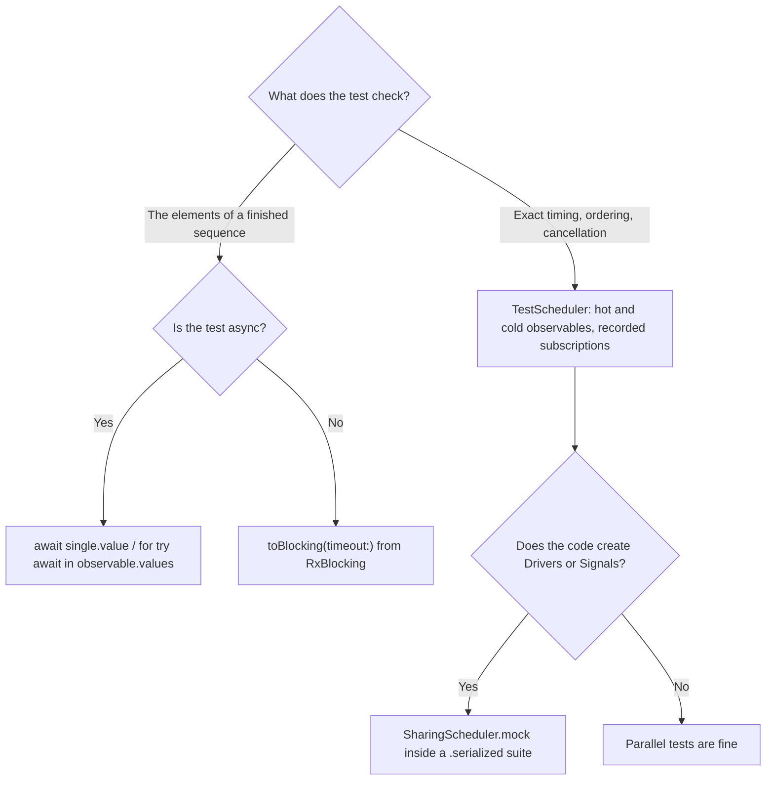

Reactive code is about *when*: when a debounced query fires, when a stale request is cancelled, when a retry happens, in what order two streams interleave. Tests that run against the real clock can only check *when* by sleeping, and sleeping makes a suite slow and flaky at the same time. RxSwift ships two libraries that remove the problem from opposite directions. **RxTest** replaces the clock: a `TestScheduler` runs virtual time, so a test can describe input at exact milliseconds and assert output at exact milliseconds, and a five-second scenario runs in microseconds. **RxBlocking** replaces the waiting: it turns an observable into a blocking call, for tests that only care about *what* a finished sequence produced.

This article is a Swift package with a view model under test and six test files, run with `swift test`. It covers hot and cold test observables and the default times of `start` that trip up new users, testing a debounced, cancelling search view model with exact timelines and recorded subscriptions, RxBlocking and its timeouts, `async` tests as the modern alternative, and RxTest's XCTest helpers. It also documents a crash that is easy to walk into with Swift Testing: `SharingScheduler.mock`, the standard way to test `Driver`s, crashed the test process in three runs out of three when tests ran in parallel.

<!--more-->

The examples use RxSwift 6.10.2 in Swift 6 language mode and were compiled and run with the Swift 6.4 toolchain from Xcode 27.1 on macOS 26. Each block below belongs to the file named above it, in a package whose `Package.swift` is shown first; `swift test` runs everything.

<!-- skip-check -->
```swift
// swift-tools-version: 6.0
import PackageDescription

let package = Package(
    name: "Library",
    platforms: [.macOS(.v15)],
    dependencies: [.package(url: "https://github.com/ReactiveX/RxSwift.git", exact: "6.10.2")],
    targets: [
        .target(name: "Library", dependencies: [
            .product(name: "RxSwift", package: "RxSwift"),
            .product(name: "RxRelay", package: "RxSwift"),
            .product(name: "RxCocoa", package: "RxSwift"),
        ]),
        .testTarget(name: "LibraryTests", dependencies: [
            "Library",
            .product(name: "RxTest", package: "RxSwift"),
            .product(name: "RxBlocking", package: "RxSwift"),
        ]),
    ]
)
```

RxTest and RxBlocking belong in the test target only. RxTest links XCTest, which an app target should not.

## The code under test

The view model turns a stream of search-field text into results. It trims and debounces the text, skips duplicates, searches only for queries of two or more characters, cancels a running search when a newer query arrives, and turns failures into an error message without ending the stream. Its scheduler is injected, which is the one design decision that makes it testable:

<!-- file: Sources/Library/SearchViewModel.swift -->
```swift
import Foundation
import RxSwift
import RxRelay
import RxCocoa

public protocol SearchService {
    func search(_ query: String) -> Single<[String]>
}

public struct SearchViewModel {
    public struct Output {
        public let results: Driver<[String]>
        public let errorMessage: Signal<String>
    }

    private let service: SearchService
    private let scheduler: SchedulerType

    public init(service: SearchService, scheduler: SchedulerType) {
        self.service = service
        self.scheduler = scheduler
    }

    public func transform(query: Observable<String>) -> Output {
        let errors = PublishRelay<String>()
        let results = query
            .map { $0.trimmingCharacters(in: .whitespaces) }
            .debounce(.milliseconds(300), scheduler: scheduler)
            .distinctUntilChanged()
            .flatMapLatest { [service] query -> Observable<[String]> in
                guard query.count >= 2 else { return .just([]) }
                return service.search(query).asObservable()
                    .catch { _ in
                        errors.accept("Search for \(query) failed")
                        return .empty()
                    }
            }
        return Output(
            results: results.asDriver(onErrorJustReturn: []),
            errorMessage: errors.asSignal()
        )
    }
}
```

## `TestScheduler`, hot and cold

A `TestScheduler` is a scheduler with a virtual clock, measured in integer ticks. Its `resolution` says how much real time one tick stands for; with `0.001`, one tick is a millisecond, so the view model's `.milliseconds(300)` debounce means 300 ticks. With `simulateProcessingDelay: false`, scheduling "now" really means now; the default, `true`, adds a tick to some operations, which makes timelines harder to read. The [operator articles](/rxswift-filtering-operators/#a-clock-you-control) used the same settings.

The scheduler makes two kinds of test sources, and the difference between them is the single most common source of confusion in RxTest:

- `createHotObservable` emits at **absolute** times, whether or not anyone is subscribed, like a subject or a UI control.
- `createColdObservable` emits at times **relative to each subscription**, and starts over for every subscriber, like a network request.

And `start` has defaults: it creates the observable under test at tick 100, subscribes at 200, and disposes at 1,000. All three show up in one test:

<!-- file: Tests/LibraryTests/HotAndColdTests.swift -->
```swift
import Testing
import RxSwift
import RxTest

@Suite struct HotAndColdTests {
    @Test func hotEventsBeforeTheDefaultSubscriptionAreMissed() {
        let scheduler = TestScheduler(initialClock: 0)
        let hot = scheduler.createHotObservable([
            .next(150, "missed"), .next(250, "seen"), .next(1_100, "after disposal"),
        ])
        let observer = scheduler.start { hot.asObservable() }    // created 100, subscribed 200, disposed 1000

        #expect(observer.events == [.next(250, "seen")])
        #expect(hot.subscriptions == [Subscription(200, 1_000)])
    }

    @Test func coldEventsAreRelativeToTheSubscription() {
        let scheduler = TestScheduler(initialClock: 0)
        let cold = scheduler.createColdObservable([.next(10, "a"), .next(20, "b"), .completed(30)])
        let observer = scheduler.start { cold.asObservable() }

        #expect(observer.events == [.next(210, "a"), .next(220, "b"), .completed(230)])
        #expect(cold.subscriptions == [Subscription(200, 230)])
    }

    @Test func eachSubscriberOfAColdObservableStartsOver() {
        let scheduler = TestScheduler(initialClock: 0)
        let cold = scheduler.createColdObservable([.next(10, "a"), .completed(10)])
        let first = scheduler.createObserver(String.self)
        let second = scheduler.createObserver(String.self)
        let bag = DisposeBag()
        scheduler.scheduleAt(100) { cold.asObservable().subscribe(first).disposed(by: bag) }
        scheduler.scheduleAt(500) { cold.asObservable().subscribe(second).disposed(by: bag) }
        scheduler.start()

        #expect(first.events == [.next(110, "a"), .completed(110)])
        #expect(second.events == [.next(510, "a"), .completed(510)])
        #expect(cold.subscriptions == [Subscription(100, 110), Subscription(500, 510)])
    }

    @Test func aRawSubscriptionStaysOpenUntilDisposed() {
        let scheduler = TestScheduler(initialClock: 0)
        let cold = scheduler.createColdObservable([.next(10, "a"), .completed(10)])
        let observer = scheduler.createObserver(String.self)
        let bag = DisposeBag()
        scheduler.scheduleAt(100) { cold.subscribe(observer).disposed(by: bag) }   // no asObservable()
        scheduler.start()

        #expect(observer.events == [.next(110, "a"), .completed(110)])
        #expect(cold.subscriptions == [Subscription(100)])                         // never disposed
    }
}
```

The hot event at 150 was missed because the subscription happened at 200, and the event at 1,100 because the subscription was disposed at 1,000. A test that puts its first hot event at 100 and wonders why nothing arrives is fighting these defaults; either schedule events after 200 or call `start(created: 0, subscribed: 0, disposed: ...)` explicitly, as the rest of this article does.

The `subscriptions` property records every subscription to a test observable as a pair of times, subscribe and dispose. It turns "was the request cancelled?" into an assertion, as the next section uses.

The last test shows a detail of how those times are recorded. A test observable is an `ObservableType`, not an RxSwift `Observable`, and its disposal time is set only when its subscription is *disposed*. Going through `asObservable()`, or any operator, puts an RxSwift sink in between, and RxSwift sinks dispose their subscription after a terminal event, so the record closes at the completion, 110. Subscribing an observer to the test observable directly skips that sink, nothing disposes the subscription after completion, and the record stays open: `Subscription(100)` has no end time until the bag is gone.

## Testing the view model on a timeline

The fake service answers each query with a cold test observable, so the test controls each request's latency and result, and can inspect when each request was subscribed and disposed:

<!-- file: Tests/LibraryTests/FakeSearchService.swift -->
```swift
import RxSwift
import RxTest
import Library

final class FakeSearchService: SearchService {
    private let scheduler: TestScheduler
    private(set) var requests: [String: TestableObservable<[String]>] = [:]

    init(scheduler: TestScheduler) { self.scheduler = scheduler }

    func search(_ query: String) -> Single<[String]> {
        let response: [Recorded<Event<[String]>>] = query == "boom"
            ? [.error(200, SearchFailure.serverError)]
            : [.next(600, ["\(query) 1", "\(query) 2"]), .completed(600)]
        let request = scheduler.createColdObservable(response)
        requests[query] = request
        return request.asObservable().asSingle()
    }
}

enum SearchFailure: Error { case serverError }
```

The scenario types "s", "sw", and "swi" quickly, pauses, then types "swift" while the search for "swi" is still running, then types "boom", which fails. `Driver`s deliver through RxCocoa's `SharingScheduler`, which defaults to the main scheduler; `SharingScheduler.mock(scheduler:)` points it at the test scheduler for the duration of a closure:

<!-- file: Tests/LibraryTests/SearchViewModelTests.swift -->
```swift
import Testing
import RxSwift
import RxCocoa
import RxTest
import Library

/// Every suite that builds a view model creates Drivers, which depend on the global SharingScheduler,
/// so all of them are nested in this one serialized suite.
@Suite(.serialized) struct ViewModelTests {}

extension ViewModelTests {
    @Suite struct Search {
        @Test @MainActor func debouncesCancelsStaleSearchesAndSurvivesErrors() {
            let scheduler = TestScheduler(initialClock: 0, resolution: 0.001, simulateProcessingDelay: false)
            let service = FakeSearchService(scheduler: scheduler)
            let results = scheduler.createObserver([String].self)
            let errors = scheduler.createObserver(String.self)
            let bag = DisposeBag()

            SharingScheduler.mock(scheduler: scheduler) {
                let typing = scheduler.createHotObservable([
                    .next(100, "s"), .next(150, "sw"), .next(200, "swi"),   // debounced: "swi" at 500
                    .next(700, "swift"),                                      // debounced: "swift" at 1000
                    .next(1_200, "swift "),                                   // trims to "swift": a duplicate
                    .next(2_000, "boom"),                                     // debounced: "boom" at 2300
                ])
                let output = SearchViewModel(service: service, scheduler: scheduler)
                    .transform(query: typing.asObservable())
                scheduler.scheduleAt(0) {
                    output.results.drive(results).disposed(by: bag)
                    output.errorMessage.emit(to: errors).disposed(by: bag)
                }
                scheduler.start()
            }

            #expect(results.events == [.next(1_600, ["swift 1", "swift 2"])])
            #expect(errors.events == [.next(2_500, "Search for boom failed")])
            #expect(service.requests["swi"]?.subscriptions == [Subscription(500, 1_000)])   // cancelled
            #expect(service.requests["swift"]?.subscriptions == [Subscription(1_000, 1_600)])
            #expect(service.requests.keys.sorted() == ["boom", "swi", "swift"])        // no request for "s" or "sw"
        }
    }
}
```

The test is `@MainActor` for a reason that has nothing to do with time. `drive` and `emit` must be called on the main thread, as [Driver and Signal](/rxswift-driver-signal/#main-thread-delivery-and-why-swift-6-cares) measured, and Swift Testing runs tests on background threads unless told otherwise. Without the attribute, the whole test process stopped with ``Fatal error: `drive*` family of methods can be only called from `MainThread`.`` XCTest runs its test methods on the main thread and does not need it.

Every assertion is a time. The three quick keystrokes produced one search, at 500 ms. The search for "swi" was subscribed at 500 and disposed at 1,000, when the debounced "swift" arrived and `flatMapLatest` cancelled it, so its results never reached the screen. At 1,200 the user added a trailing space; it was trimmed, debounced to 1,500, and dropped by `distinctUntilChanged` as a duplicate of "swift", so it neither started a search nor cancelled the one running, which delivered at 1,600. "boom" failed at 2,500, and the failure became an error message without ending the stream. The test covers two and a half seconds of user time and ran in about a millisecond.

The first version of this test typed the trailing-space "swift " *after* "boom" and expected it to be dropped as a duplicate. It was not: `distinctUntilChanged` compares each element only with the previous one, which by then was "boom", so the view model correctly searched for "swift" a second time, at 3,300. The timeline test caught the wrong expectation immediately, with the exact time of the unexpected request, which is the kind of mistake that survives a test written against the real clock.

### Why the suite is `.serialized`

`SharingScheduler.mock` works by replacing a global, the function RxCocoa uses to make the scheduler for every new `Driver` and `Signal`, and restoring it when the closure returns. Swift Testing runs tests in parallel by default. Two tests mocking at the same time can therefore create a `Driver` with *the other test's* `TestScheduler`, and a `TestScheduler` refuses to be used from a thread other than the one it was created on. Here are 100 parallel tests, each mocking its own scheduler:

<!-- skip-check -->
```swift
// Crashes: parallel tests that each call SharingScheduler.mock share one global
@Suite struct ParallelMockTests {
    @Test(arguments: 0..<100)
    func mockedDriver(index: Int) {
        let scheduler = TestScheduler(initialClock: 0, resolution: 0.001, simulateProcessingDelay: false)
        SharingScheduler.mock(scheduler: scheduler) {
            let source = scheduler.createColdObservable([.next(10, "title \(index)"), .completed(20)])
            let observer = scheduler.start(created: 0, subscribed: 0, disposed: 1_000) {
                source.asObservable()
                    .delay(.milliseconds(100), scheduler: scheduler)
                    .asDriver(onErrorJustReturn: "")
                    .asObservable()
            }
            #expect(observer.events == [.next(110, "title \(index)"), .completed(120)])
        }
    }
}
```

In three runs, all three crashed the test process, each printing `VirtualTimeScheduler.swift:225: Fatal error: Executing on the wrong thread. Please ensure all work on the same thread.` between 15 and 18 times before it died. With `@Suite(.serialized)`, all 100 cases passed in 11 milliseconds.

`.serialized` only serializes the tests *within* its suite, and the mock affects every `Driver` created anywhere while it is active. This article's own package hit that: with the search test in a serialized suite of its own, the leak tests below, in a different suite, built view models, and therefore `Driver`s, while the search test's mock was active, and the run crashed with the same fatal error. The fix used above is a serialized parent suite, `ViewModelTests`, with every suite that builds a view model nested inside it through extensions; Swift Testing applies `.serialized` to nested suites too. The alternative is view models that do not create `Driver`s at all, exposing plain observables built on the injected scheduler and leaving `asDriver()` to the view. XCTest runs a test target's tests one at a time unless parallel testing is turned on, so XCTest suites do not hit this by default.

## RxBlocking: when only the result matters

Not every test cares about time. To check that a chain produces the right elements, RxBlocking's `toBlocking()` subscribes and blocks the current thread until the sequence completes, then returns what it produced:

<!-- file: Tests/LibraryTests/BlockingTests.swift -->
```swift
import Testing
import Foundation
import RxSwift
import RxBlocking

@Suite struct BlockingTests {
    @Test func collectsAllElements() throws {
        let squares = Observable.of(1, 2, 3).map { $0 * $0 }
        #expect(try squares.toBlocking().toArray() == [1, 4, 9])
        #expect(try squares.toBlocking().first() == 1)
        #expect(try squares.toBlocking().last() == 9)
    }

    @Test func waitsForAsynchronousSources() throws {
        let delayed = Observable.just("done")
            .delay(.milliseconds(50), scheduler: ConcurrentDispatchQueueScheduler(qos: .userInitiated))
        #expect(try delayed.toBlocking(timeout: 1).single() == "done")
    }

    @Test func materializeReportsFailuresWithoutThrowing() {
        let failing = Observable.concat(.just(1), .error(BlockingFailure.broken))
        let result = failing.toBlocking().materialize()
        guard case .failed(let elements, let error) = result else {
            Issue.record("expected a failure")
            return
        }
        #expect(elements == [1])
        #expect(error as? BlockingFailure == .broken)
    }

    @Test func aTimeoutStopsASequenceThatNeverCompletes() {
        let endless = Observable<Int>.never()
        #expect(throws: RxError.self) {
            _ = try endless.toBlocking(timeout: 0.2).toArray()
        }
    }
}

enum BlockingFailure: Error { case broken }
```

`toBlocking()` without a timeout waits forever, so a sequence that never completes, a subject, a `Driver` from a relay, an `interval`, hangs the test run. Always pass a timeout. And because it blocks, RxBlocking is only for sources that do their work on another thread or a scheduler that runs while the current thread waits; RxBlocking runs the current thread's run loop while it waits, which is why sources that deliver on `MainScheduler` still complete when the test blocks the main thread.

## `async` tests: the modern alternative

Swift Testing and XCTest both support `async` tests, and RxSwift's concurrency bridges from [`Single`, `Maybe`, and `Completable`](/rxswift-single-maybe-completable/#bridging-to-asyncawait) make them a natural replacement for RxBlocking: `try await single.value` and `for try await element in observable.values` suspend instead of blocking a thread:

<!-- file: Tests/LibraryTests/AsyncBridgeTests.swift -->
```swift
import Testing
import Foundation
import RxSwift

@Suite struct AsyncBridgeTests {
    @Test func awaitsASingle() async throws {
        let request = Single.just(["ada", "grace"])
            .delay(.milliseconds(20), scheduler: ConcurrentDispatchQueueScheduler(qos: .userInitiated))
        let names = try await request.value
        #expect(names == ["ada", "grace"])
    }

    @Test func iteratesAnObservable() async throws {
        var collected: [Int] = []
        for try await value in Observable.of(3, 2, 1).values {
            collected.append(value)
        }
        #expect(collected == [3, 2, 1])
    }

    @Test func surfacesErrorsAsThrows() async {
        await #expect(throws: AsyncFailure.self) {
            _ = try await Single<Int>.error(AsyncFailure.offline).value
        }
    }
}

enum AsyncFailure: Error { case offline }
```

For checking *what* a chain produces, these read better than RxBlocking and do not tie up a thread. For checking *when*, only `TestScheduler` gives exact answers; an `async` test against real delays is as slow and as flaky as sleeping.

## XCTest and RxTest's helpers

RxTest was written for XCTest, and it ships an `XCTAssertEqual` overload for recorded events that prints a readable diff when timelines differ. It works alongside Swift Testing in the same target:

<!-- file: Tests/LibraryTests/XCTestStyleTests.swift -->
```swift
import XCTest
import RxSwift
import RxTest

final class XCTestStyleTests: XCTestCase {
    func testScanInVirtualTime() {
        let scheduler = TestScheduler(initialClock: 0)
        let taps = scheduler.createHotObservable([.next(210, 1), .next(220, 1), .next(230, 1), .completed(240)])
        let observer = scheduler.start { taps.scan(0, accumulator: +) }

        XCTAssertEqual(observer.events, [
            .next(210, 1), .next(220, 2), .next(230, 3), .completed(240),
        ])
    }

    func testEventsWithoutTimes() {
        let scheduler = TestScheduler(initialClock: 0)
        let source = scheduler.createColdObservable([.next(5, "a"), .next(9, "b"), .completed(10)])
        let observer = scheduler.start { source.asObservable() }

        XCTAssertEqual(observer.events.compactMap(\.value.element), ["a", "b"])  // only the elements
    }
}
```

The second test shows a useful pattern when the times are not the point: map the recorded events to their elements, or use `Recorded.events(...)` to build expected arrays.

## Leaks

A last thing every RxSwift test suite should check is that chains end. The `subscriptions` property already does that for test observables: a subscription whose second time is `Int.max` was never disposed. For the objects under test, a weak reference after the test's scope does the same:

<!-- file: Tests/LibraryTests/LeakTests.swift -->
```swift
import Testing
import RxSwift
import RxCocoa
import RxTest
import Library

extension ViewModelTests {
    @Suite struct Leaks {
        @Test func requestsAreDisposedWhenTheSubscriptionEnds() {
            let scheduler = TestScheduler(initialClock: 0, resolution: 0.001, simulateProcessingDelay: false)
            let service = FakeSearchService(scheduler: scheduler)
            let typing = scheduler.createHotObservable([.next(100, "swift")])
            SharingScheduler.mock(scheduler: scheduler) {
                _ = scheduler.start(created: 0, subscribed: 0, disposed: 700) {
                    SearchViewModel(service: service, scheduler: scheduler)
                        .transform(query: typing.asObservable())
                        .results.asObservable()
                }
            }
            // The search started at 400 and was still running when the test disposed at 700.
            #expect(service.requests["swift"]?.subscriptions == [Subscription(400, 700)])
            #expect(typing.subscriptions == [Subscription(0, 700)])
        }

        @Test func theServiceIsReleasedWithTheChain() {
            weak var weakService: FakeSearchService?
            do {
                let scheduler = TestScheduler(initialClock: 0, resolution: 0.001, simulateProcessingDelay: false)
                let service = FakeSearchService(scheduler: scheduler)
                weakService = service
                let typing = scheduler.createHotObservable([.next(100, "rx")])
                SharingScheduler.mock(scheduler: scheduler) {
                    _ = scheduler.start(created: 0, subscribed: 0, disposed: 2_000) {
                        SearchViewModel(service: service, scheduler: scheduler)
                            .transform(query: typing.asObservable())
                            .results.asObservable()
                    }
                }
            }
            #expect(weakService == nil)
        }
    }
}
```

The first test's expectations are the disposal times: the request and the typing stream were both released at 700, the moment the test disposed the chain, which is what a screen's dispose bag would do when the screen closes.

Both tests mock the sharing scheduler, and the second one needs it for a reason worth knowing. Without the mock, the `Driver` inside the view model delivers through the real `MainScheduler`, and because a Swift Testing test runs on a background thread, the result element was handed to the main queue instead of being delivered on the spot. Measured that way, the weak reference was still alive when the expectation ran, and the test failed; with the mock, the same test passed. Most likely the work waiting on the main queue was still holding the chain, and with it the service. A leak test has to make sure nothing is still in flight on a real scheduler when it checks, which the virtual clock guarantees.

## Choosing a tool



Combine has no built-in test scheduler; the Combine roadmap builds one in [Time: `debounce`, `throttle`, `delay`](/combine-debounce-throttle-delay/#a-scheduler-whose-clock-you-control) and tests a similar search view model in [Testing Publishers](/combine-testing-publishers/). RxTest's `TestScheduler`, with hot and cold observables and recorded subscriptions included, is one of the strongest reasons RxSwift code is pleasant to test.

## Summary

- `TestScheduler` runs a virtual clock; with `resolution: 0.001` a tick is a millisecond, and `simulateProcessingDelay: false` keeps timelines exact.
- Hot test observables emit at absolute times, cold ones relative to each subscription. `start` defaults to created 100, subscribed 200, disposed 1,000, so hot events before 200 are missed.
- `subscriptions` records when each test observable was subscribed and disposed: the stale "swi" search was cancelled at 1,000 ms, exactly when "swift" arrived.
- The search view model's whole behavior, debouncing, cancellation, error recovery, and deduplication, was asserted to the millisecond in one test.
- `SharingScheduler.mock` swaps a global: 100 parallel Swift Testing cases crashed the process in three runs of three. Put every suite that creates `Driver`s inside one `.serialized` parent suite.
- Swift Testing runs tests off the main thread, so a test that calls `drive` must be `@MainActor`, and a leak test must not leave work queued on the real main scheduler.
- RxBlocking's `toBlocking(timeout:)` returns a finished sequence's elements; always pass a timeout. `async` tests with `value` and `values` are the modern alternative.
- RxTest's `XCTAssertEqual` works for recorded events in XCTest; Swift Testing compares them with `#expect` because `Recorded` is `Equatable`.
- The package's 14 Swift Testing tests and 2 XCTest tests, covering several seconds of virtual time each, ran in 0.2 seconds.

## Exercise

Add a retry to the view model: a failed search should be retried twice with exponential backoff of 200 and 400 ms, on the injected scheduler, before the error message is shown. Write the timeline test first, asserting the three subscriptions of the failing request with their exact times, the time of the error message, and that typing a new query during a backoff cancels the pending retry. Then check, with a weak reference, that no closure in the retry logic keeps the service alive.

## Further reading

- [Unit Tests](https://github.com/ReactiveX/RxSwift/blob/main/Documentation/UnitTests.md) in the RxSwift documentation, on `TestScheduler`, hot and cold observables, and RxBlocking.
- The [RxTest](https://github.com/ReactiveX/RxSwift/tree/main/RxTest) and [RxBlocking](https://github.com/ReactiveX/RxSwift/tree/main/RxBlocking) sources.
- [Swift Testing: parallelization](https://developer.apple.com/documentation/testing/parallelization), on how tests run in parallel and the `.serialized` trait.
- [Testing Publishers](/combine-testing-publishers/) for the Combine side.

Previous: [Writing Custom Reactive Extensions](/rxswift-custom-reactive-extensions/).

Return to the [RxSwift roadmap](/rxswift/).
