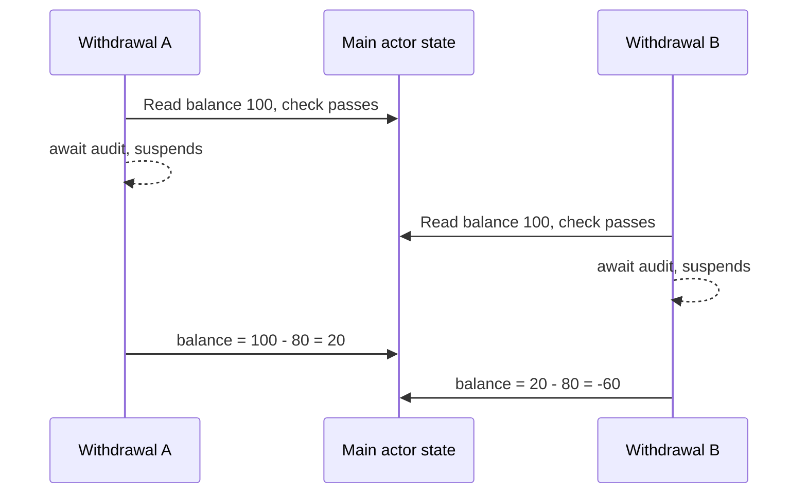
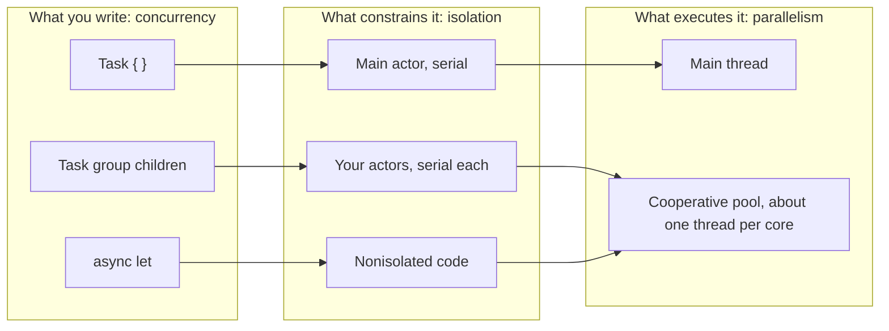

Concurrency and parallelism are often used as synonyms, and the confusion is expensive. Teams add tasks to make a CPU-bound loop faster and see no change, or they move a network call "to the background" and are surprised when two responses overwrite each other on the main thread, where nothing was supposedly running at the same time.

The two words describe different properties. **Concurrency** is about structure: a program has several activities whose lifetimes overlap. **Parallelism** is about execution: at a given instant, more than one activity is actually running on separate hardware. Swift's concurrency features let you express the first. The runtime decides how much of the second you get.

<!--more-->

The examples use Swift 6 language mode and were compiled and run with the Swift 6.4 toolchain on macOS 26. The Swift blocks build on one another: paste them in order into one `main.swift` to run the assertions. `Mutex` comes from the `Synchronization` module and requires iOS 18, macOS 15, or later.

## Two definitions that do not overlap

A useful formulation comes from Rob Pike's talk [*Concurrency is not Parallelism*](https://go.dev/blog/waza-talk): concurrency is *dealing with* lots of things at once, parallelism is *doing* lots of things at once.

Stated more precisely for an app:

- Two activities are **concurrent** when each one starts before the other finishes. Their lifetimes overlap, and their individual steps may interleave in any order the program permits.
- Two activities run **in parallel** when steps from both execute at the same physical instant, on different CPU cores.

Parallelism therefore requires concurrency: you cannot run two things at the same instant without their lifetimes overlapping. The reverse does not hold. A single core, or a single serial actor, can host many concurrent activities by switching between them, and never runs two of them at once.

The timelines below show the same three jobs run three ways. Time flows left to right; each bar is a job holding a CPU.

```mermaid
gantt
    accTitle: The same three jobs executed sequentially, concurrently on one core, and in parallel on three cores
    dateFormat x
    axisFormat %L ms
    section Sequential, one core
    Job A           :a1, 0, 120
    Job B           :b1, after a1, 120
    Job C           :c1, after b1, 120
    section Concurrent, one core
    A part 1        :ca1, 0, 40
    B part 1        :cb1, after ca1, 40
    C part 1        :cc1, after cb1, 40
    A part 2        :ca2, after cc1, 40
    B part 2        :cb2, after ca2, 40
    C part 2        :cc2, after cb2, 40
    A part 3        :ca3, after cc2, 40
    B part 3        :cb3, after ca3, 40
    C part 3        :cc3, after cb3, 40
    section Parallel, three cores
    Job A           :pa, 0, 120
    Job B           :pb, 0, 120
    Job C           :pc, 0, 120
```



The interleaved schedule finishes all three jobs no sooner than the sequential one. If the jobs only compute, concurrency on one core buys nothing in total time. What it does buy is responsiveness: every job makes progress early, and no job waits 240 ms before taking its first step. That is why concurrency matters even on hardware with one core, and why the main thread of an app can stay responsive while it hosts many activities.

## Concurrency without parallelism: one serial actor

The main actor is the clearest example of concurrency without parallelism. It runs one piece of work at a time. Several tasks can be *in progress* on it, but only one is ever *executing*.

To observe this, the probe below records how many probed sections are executing at any instant. It uses a `Mutex` so the probe itself is safe to call from any thread.

```swift
import Synchronization

/// Records the peak number of probed sections executing at the same instant.
final class OverlapProbe: Sendable {
    private struct State {
        var active = 0
        var peak = 0
    }

    private let state = Mutex(State())

    func enter() {
        state.withLock { state in
            state.active += 1
            state.peak = max(state.peak, state.active)
        }
    }

    func exit() {
        state.withLock { $0.active -= 1 }
    }

    var peak: Int {
        state.withLock { $0.peak }
    }
}

/// CPU-bound busy work whose result depends on every iteration.
func spin(iterations: Int) -> UInt64 {
    var x: UInt64 = 0x9E37_79B9_7F4A_7C15
    for _ in 0..<iterations {
        x ^= x << 13
        x ^= x >> 7
        x ^= x << 17
    }
    return x
}
```

Now start four child tasks whose work is isolated to the main actor. Each one computes in three slices and calls `Task.yield()` between slices, which gives the actor a chance to run something else.

```swift
/// Main-actor-isolated, so every access to `entries` is serialized by the actor.
@MainActor
final class TraceLog {
    var entries: [Int] = []
}

/// Runs on the main actor: three CPU slices with a yield between each.
@MainActor
func runSlices(worker: Int, trace: TraceLog, probe: OverlapProbe) async {
    for _ in 0..<3 {
        probe.enter()
        _ = spin(iterations: 20_000)
        trace.entries.append(worker)
        probe.exit()
        await Task.yield()
    }
}

@MainActor
func interleaveOnMainActor(workers: Int, probe: OverlapProbe) async -> [Int] {
    let trace = TraceLog()
    await withTaskGroup(of: Void.self) { group in
        for worker in 0..<workers {
            group.addTask {
                await runSlices(worker: worker, trace: trace, probe: probe)
            }
        }
    }
    return trace.entries
}

let mainActorProbe = OverlapProbe()
let trace = await interleaveOnMainActor(workers: 4, probe: mainActorProbe)
assert(mainActorProbe.peak == 1, "The main actor never runs two sections at once")
assert(trace.count == 12)
print("Main actor trace:", trace)
```

Every child task is concurrent with the others: all four are alive at the same time, and the printed trace usually shows their slices interleaved. But the probe's peak is exactly one. The main actor is a *serial* executor, so it never runs two of those sections simultaneously.

The trace is shared by several child tasks. It lives in a main-actor-isolated class, and the only function that touches it is isolated to the main actor, so the compiler can prove the accesses never overlap and no lock is needed. Each child task starts, hops onto the main actor to call `runSlices`, and gives the actor back at every `await`. Capturing a plain local `var trace: [Int]` in the child closures instead is rejected: the closure is a `sending` parameter, and the compiler will not let a mutable local escape into a task, because the enclosing function could keep accessing that variable while the task runs. The interleaving order, by contrast, is not part of the contract: do not write code or tests that depend on the exact sequence of worker numbers.

## Parallelism: the same work off the actor

Remove the main-actor annotation from the child tasks and they run on Swift's global concurrent executor. That executor has a pool of threads roughly as wide as the number of CPU cores. Now sections can execute at the same instant.

```swift
func spreadAcrossCores(workers: Int, probe: OverlapProbe) async -> [UInt64] {
    await withTaskGroup(of: UInt64.self) { group in
        for worker in 0..<workers {
            group.addTask {
                probe.enter()
                defer { probe.exit() }
                return spin(iterations: 400_000 + worker)
            }
        }
        var results: [UInt64] = []
        for await value in group {
            results.append(value)
        }
        return results
    }
}

let poolProbe = OverlapProbe()
let results = await spreadAcrossCores(workers: 8, probe: poolProbe)
assert(results.count == 8)
assert(poolProbe.peak >= 1)
print("Peak simultaneous sections on the global executor:", poolProbe.peak)
```

On a multicore Mac or iPhone, the printed peak is typically greater than one. The assertion only claims "at least one" because nothing in the language *promises* parallelism. A busy device, a low-power mode, or a single available core can legitimately run the eight tasks one after another. Concurrency is the property you write; parallelism is an opportunity the runtime may or may not take.

Look at what changed and what did not. Both versions use the same task group, the same number of tasks, and the same `await` points. The *structure* is identical. Only the *isolation* differs: one version funnels every task through a serial actor, and the other lets the executor spread them across threads.

## Waiting is where concurrency pays off

The slice experiment used CPU-bound work, where interleaving cannot reduce total time. Most app work is not like that. A network request spends nearly all of its lifetime waiting: for DNS, for a TLS handshake, for the server, for bytes on a radio. Waiting does not need a CPU.

When an `async` function suspends on such a wait, the actor or thread it was using is free to run other work. That makes overlapping waits nearly free, even on a single serial actor:

```swift
@MainActor
func overlappingWaits(count: Int, each delay: Duration) async -> Duration {
    let clock = ContinuousClock()
    let start = clock.now
    await withTaskGroup(of: Void.self) { group in
        for _ in 0..<count {
            group.addTask {
                await pauseOnMainActor(for: delay)
            }
        }
    }
    return start.duration(to: clock.now)
}

@MainActor
func pauseOnMainActor(for delay: Duration) async {
    try? await Task.sleep(for: delay)
}

let waited = await overlappingWaits(count: 5, each: .milliseconds(100))
assert(waited < .milliseconds(400), "Five 100 ms waits overlap instead of adding up")
print("Five overlapping 100 ms waits took", waited)
```

Five sleeps on the main actor take roughly 100 ms in total, not 500 ms. No parallelism is involved: every sleep is issued from main-actor-isolated code, and the main actor runs one thing at a time. The speedup comes entirely from not holding the actor while waiting.

This is the key practical distinction:

| Workload | What helps | Why |
| --- | --- | --- |
| Waiting on I/O, timers, other processes | Concurrency | Waits overlap; no CPU is consumed while suspended |
| Pure computation on independent data | Parallelism | Only more cores can do more arithmetic per second |
| Computation that touches shared mutable state | Neither, until state is partitioned | Serialized access limits both, see below |
| UI updates | Neither; keep it serial | UIKit and SwiftUI require main-actor access |

## Little's law: how much concurrency you need

For I/O-heavy work, the amount of concurrency you need follows from throughput and latency, not from the number of cores. [Little's law](https://en.wikipedia.org/wiki/Little%27s_law) relates the average number of items in a system, $$L$$, to the arrival rate $$\lambda$$ and the average time each item spends in the system, $$W$$:

$$
L = \lambda W.
$$

Suppose a photo grid needs to load 40 thumbnails per second while the user scrolls, and each request takes 250 ms on a typical connection. To sustain that rate, the app needs on average

$$
L = 40\,\tfrac{\text{requests}}{\text{s}} \times 0.25\,\text{s} = 10
$$

requests in flight at once. Sequential loading caps throughput at $$1/W = 4$$ thumbnails per second no matter how many cores the device has. Ten concurrent requests on a single serial actor would meet the target. A hundred would not make the radio faster; they would only queue up inside `URLSession` and on the server.

Little's law gives a sizing argument for concurrency limits: the ideal number of in-flight operations is the target throughput multiplied by the latency. Beyond that, extra concurrency adds memory, contention, and cancellation work without adding throughput.

## Amdahl's law: how much parallelism can help

For CPU-bound work, the question flips. Suppose a fraction $$s$$ of the work is inherently serial, such as reading a file header, merging results, or updating one shared structure, and the rest parallelizes perfectly across $$P$$ cores. [Amdahl's law](https://en.wikipedia.org/wiki/Amdahl%27s_law) bounds the speedup:

$$
S(P) \le \frac{1}{s + \dfrac{1 - s}{P}}.
$$

With a serial fraction of 10% on a six-core device:

$$
S(6) \le \frac{1}{0.1 + 0.9/6} = \frac{1}{0.25} = 4.
$$

As $$P \to \infty$$ the bound approaches $$1/s = 10$$. The serial part dominates quickly. Efficiency, $$E = S(P)/P$$, falls as cores are added, so the last cores contribute the least.

The work-span model refines this for task graphs. If $$T_1$$ is the total work and $$T_\infty$$ is the longest chain of dependent steps (the *span*), then on $$P$$ cores

$$
T_P \ge \max\!\left(\frac{T_1}{P},\; T_\infty\right).
$$

A task group whose children are independent has a short span. A pipeline where each step needs the previous step's output has a span close to its total work, and adding cores cannot help it. The [parallel MapReduce article](/swift-parallel-mapreduce/) applies these bounds to a real partition-and-combine workload.

Real devices also impose costs that neither law models: task creation, copying inputs, cache misses when data moves between cores, thermal throttling, and the efficiency cores on Apple silicon that run slower than the performance cores. Treat both laws as upper bounds, then measure.

## Concurrency creates races even without parallelism

It is tempting to conclude that serial execution is automatically safe. It is safe from **data races**: two threads accessing the same memory at the same time, with at least one write and no synchronization. Swift 6's compiler eliminates those. It is not safe from **race conditions**: outcomes that depend on the order in which concurrent activities interleave.

Any `await` is a point where other work on the same actor may run. State observed before the `await` can be stale after it.

```swift
@MainActor
final class Wallet {
    private(set) var balance: Int

    init(balance: Int) {
        self.balance = balance
    }

    /// Checks the balance, suspends, then deducts. Another withdrawal can run during the suspension.
    func withdrawCheckingFirst(_ amount: Int, audit: () async -> Void) async -> Bool {
        guard balance >= amount else { return false }
        await audit()
        balance -= amount
        return true
    }
}

let wallet = Wallet(balance: 100)
let slowAudit: @MainActor () async -> Void = {
    try? await Task.sleep(for: .milliseconds(50))
}
async let first = wallet.withdrawCheckingFirst(80, audit: slowAudit)
async let second = wallet.withdrawCheckingFirst(80, audit: slowAudit)
let approvals = await [first, second]
assert(approvals == [true, true])
assert(wallet.balance == -60, "Both withdrawals passed the check before either deducted")
```

The wallet is isolated to the main actor and never touched by two threads at once. The compiler accepts it without a warning, and Thread Sanitizer would report nothing. Yet the balance goes negative because both withdrawals pass the `guard` before either one reaches the subtraction.



The fix is not a lock or a different thread. It is to make the invariant-preserving step happen without a suspension in the middle: reserve the money first, then perform the slow work, then roll back if the work fails.

```swift
extension Wallet {
    /// Deducts synchronously, so no other work can observe the old balance after the check.
    func withdrawReservingFirst(_ amount: Int, audit: () async -> Bool) async -> Bool {
        guard balance >= amount else { return false }
        balance -= amount
        if await audit() {
            return true
        }
        balance += amount
        return false
    }
}

let safeWallet = Wallet(balance: 100)
let approvingAudit: @MainActor () async -> Bool = {
    try? await Task.sleep(for: .milliseconds(50))
    return true
}
async let firstSafe = safeWallet.withdrawReservingFirst(80, audit: approvingAudit)
async let secondSafe = safeWallet.withdrawReservingFirst(80, audit: approvingAudit)
let safeApprovals = await [firstSafe, secondSafe]
assert(safeApprovals.filter { $0 }.count == 1)
assert(safeWallet.balance == 20)
```

Between `guard` and `balance -= amount` there is no `await`, so no other main-actor work can run in between. That synchronous region is the unit of atomicity on an actor. The [actor reentrancy article](/swift-actor-reentrancy/) develops this pattern in depth.

The lesson is general: concurrency introduces *ordering* problems, parallelism additionally introduces *simultaneity* problems. Swift's type system now handles the second category for you. The first category remains a design responsibility.

## How Swift separates the two concerns

Swift's concurrency model maps cleanly onto this distinction.

You describe **concurrency** with language constructs:

- `async` functions mark where work may suspend.
- `async let` and task groups create child tasks whose lifetimes overlap with their parent's.
- `Task { }` creates work whose lifetime is independent of the current scope.

You constrain **parallelism** with isolation:

- An actor, including the main actor, runs at most one piece of its isolated work at a time.
- Non-isolated work runs on the global concurrent executor, which may use several threads.
- `Sendable` checking ensures that values crossing between parallel contexts cannot be mutated from two places at once.

And the **runtime** decides the actual degree of parallelism. The global executor's pool is sized to the hardware rather than to the number of tasks, so creating a thousand tasks does not create a thousand threads. A thousand concurrent tasks waiting on the network cost little; a thousand CPU-bound tasks will be run a few at a time.



This division is deliberate. Code that is correct under concurrency stays correct when the runtime adds or removes parallelism. Your tests may pass on a two-core CI runner and an eight-core laptop because the program's meaning does not depend on how many cores ran it. When a test result *does* change with core count, you have found a race condition.

## Choosing the right tool

When you reach for concurrency features, start from the question the work actually poses:

1. **Is the work mostly waiting?** Network, disk, timers, XPC, and user input are waits. Use `async` functions and enough concurrency to overlap the waits. Little's law sizes the concurrency limit. Running on the main actor is fine as long as the *waiting* is not done by blocking a thread.
2. **Is the work CPU-bound and divisible?** Image filtering, parsing large documents, and numeric kernels can use parallelism. Partition them into independent chunks, run the chunks as child tasks off the main actor, and combine results in one place. Amdahl's law sizes the expected gain.
3. **Does the work mutate shared state?** Partition the state so each task owns its own portion, or isolate it in an actor and accept that access to it is serialized. Shared state is the serial fraction in Amdahl's law.
4. **Does the work update UI?** Keep it on the main actor. Move the *preparation* off, and bring only finished values back.

A common misstep is to treat "background" as a synonym for "faster." Moving a 5 ms JSON decode off the main actor improves responsiveness because the main actor is free during those 5 ms. It does not make the decode itself any faster, and the hop there and back adds a small cost. Moving it off is right when the main actor has better things to do, which, for a scrolling list, it usually does.

## Summary

- Concurrency is overlapping lifetimes; parallelism is simultaneous execution. Parallelism needs concurrency, but not the reverse.
- Concurrency shortens total time when work waits; only parallelism shortens it when work computes.
- Little's law, $$L = \lambda W$$, sizes concurrency for I/O. Amdahl's law and the work-span bound limit what parallelism can deliver for computation.
- A serial actor gives you concurrency without parallelism. That rules out data races but not race conditions across `await`.
- In Swift you write the concurrency, isolation constrains it, and the runtime chooses the parallelism.

## Exercise

Write a function that downloads `n` simulated resources, each taking a random delay between 50 and 300 ms, while never having more than `k` in flight. Measure total duration for `k` = 1, 4, 16, and 64 with `n` = 64. Plot the result against the Little's-law prediction, then replace the simulated delay with CPU-bound `spin` calls and repeat. Explain why the curves diverge and where each one flattens.

## Further reading

- The Swift book's [Concurrency chapter](https://docs.swift.org/swift-book/documentation/the-swift-programming-language/concurrency/).
- [SE-0296: Async/await](https://github.com/swiftlang/swift-evolution/blob/main/proposals/0296-async-await.md) and [SE-0304: Structured concurrency](https://github.com/swiftlang/swift-evolution/blob/main/proposals/0304-structured-concurrency.md).
- [Swift concurrency: Behind the scenes](https://developer.apple.com/videos/play/wwdc2021/10254/), WWDC21, on the cooperative thread pool.
- The earlier overview, [Swift Concurrency: async/await, Tasks, and Actors](/swift-concurrency/).

Next: [Threads, Dispatch Queues, and Swift Tasks](/swift-threads-dispatch-queues-tasks/).

Return to the [Concurrency roadmap](/swift-concurrency-roadmap/).
