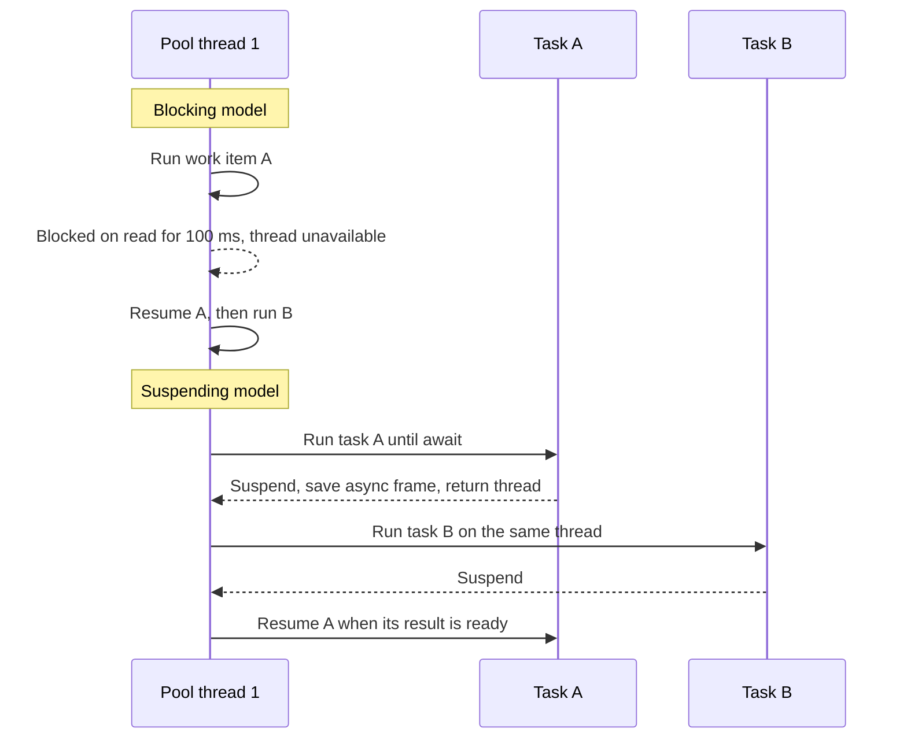

A Swift task is not a thread, and a dispatch queue is not a thread either. Each is a different layer of abstraction over the same hardware. Threads are execution resources managed by the kernel. Dispatch queues are scheduling structures that borrow threads from a pool. Tasks are units of asynchronous work that occupy a thread only while they are actually running.

The differences matter most when work *waits*. A blocked thread holds memory and a scheduling slot while doing nothing. A blocked dispatch work item holds a thread. A suspended task holds neither. This article measures those differences on real hardware, maps the GCD idioms you already know onto Swift concurrency, and shows where the two models still have to meet.

<!--more-->

The examples use Swift 6 language mode and were compiled and run with the Swift 6.4 toolchain on macOS 26, on an Apple M1 Ultra with 20 CPU cores. Measured numbers are from that machine and will differ on yours; the *shape* of the results is what matters. The Swift blocks build on one another in a single `main.swift`. `Mutex` requires iOS 18, macOS 15, or later, and `pthread_mach_thread_np` is Darwin-specific.

## Layer one: threads

A thread is the unit the kernel schedules onto a CPU core. Each thread has its own stack, its own register state, and an entry in the scheduler's run queues. When a thread blocks, waiting on a lock, a semaphore, a `read` system call, or a sleep, the kernel takes it off the core and schedules another runnable thread. When the wait ends, the thread becomes runnable again.

That model is simple and general, but every thread has a cost even when it is idle:

- **Memory.** Apple's [Threading Programming Guide](https://developer.apple.com/library/archive/documentation/Cocoa/Conceptual/Multithreading/CreatingThreads/CreatingThreads.html) lists a default stack of 512 KiB for secondary threads. That is reserved virtual address space; pages are committed as they are touched. With $$N$$ threads and stack reservation $$S$$, address space for stacks alone is $$N \times S$$, so 100 threads reserve about 50 MiB.
- **Kernel bookkeeping.** Each thread has kernel data structures and appears in every scheduling decision.
- **Context switches.** Moving a core from one thread to another saves and restores registers, and often costs cache and TLB warmth. Individually cheap, they add up when hundreds of threads contend for a few cores.

Threads are the right tool when you need an execution context with a fixed identity: a real-time audio render thread, a thread that owns a run loop, or a C library that stores state in thread-local storage. For ordinary application work, creating threads directly is almost never the right level of abstraction.

## Layer two: dispatch queues

Grand Central Dispatch (GCD) replaced "create a thread for this" with "submit this block to a queue." A queue is a FIFO list of work items. GCD drains queues using a pool of worker threads that it manages.

- A **serial** queue runs one work item at a time, in submission order. It is the classic GCD tool for protecting state: if only blocks on `queue` touch a dictionary, the dictionary never sees two accesses at once.
- A **concurrent** queue may run many work items at once, on several pool threads.
- The **main** queue is a serial queue bound to the main thread.
- **Quality of service** (`.userInteractive` down to `.background`) tells the system how urgent the work is.

Here is the serial-queue idiom for a small cache. It will reappear when we translate it to an actor.

```swift
import Foundation
import Synchronization

/// The GCD idiom: a private serial queue is the only code that touches `storage`.
final class QueueCache: @unchecked Sendable {
    private let queue = DispatchQueue(label: "cache.storage")
    private var storage: [String: Int] = [:]

    func set(_ value: Int, for key: String) {
        queue.async { self.storage[key] = value }
    }

    func value(for key: String) -> Int? {
        queue.sync { storage[key] }
    }
}

let queueCache = QueueCache()
queueCache.set(42, for: "answer")
assert(queueCache.value(for: "answer") == 42)
```

Notice the `@unchecked Sendable`. The class *is* safe to share, but only because every access to `storage` goes through `queue`. The compiler cannot see that discipline. If a future edit reads `storage` outside the queue, nothing stops it. GCD gives you a correct pattern; it does not give you a checked one.

## When dispatched work blocks: thread explosion

GCD's pool grows when its threads block. If every worker is stuck waiting, the queue cannot make progress, so the system adds threads. This keeps blocked work from deadlocking the pool, but it means blocking calls on concurrent queues translate into thread creation.

To see this, record the identity of each OS thread that runs a work item:

```swift
/// Collects the distinct OS threads that called `record()`.
final class ThreadCensus: Sendable {
    private let ids = Mutex<Set<UInt32>>([])

    func record() {
        let id = pthread_mach_thread_np(pthread_self())
        ids.withLock { _ = $0.insert(id) }
    }

    var distinctThreads: Int {
        ids.withLock { $0.count }
    }
}

extension DispatchGroup {
    /// Suspends until every work item in the group has finished, without blocking a thread.
    func finished() async {
        await withCheckedContinuation { (continuation: CheckedContinuation<Void, Never>) in
            notify(queue: .global()) { @Sendable in
                continuation.resume()
            }
        }
    }
}
```

The `@Sendable` on the `notify` closure is not decoration. It is the subject of a later section.

Now submit 100 work items that each block their thread for 100 ms, standing in for a synchronous file read or a legacy network call:

```swift
func blockingWorkOnGCD(items: Int, census: ThreadCensus) async -> Duration {
    let queue = DispatchQueue(label: "blocking.work", attributes: .concurrent)
    let group = DispatchGroup()
    let clock = ContinuousClock()
    let start = clock.now
    for _ in 0..<items {
        queue.async(group: group) {
            census.record()
            Thread.sleep(forTimeInterval: 0.1)
        }
    }
    await group.finished()
    return start.duration(to: clock.now)
}

let gcdCensus = ThreadCensus()
let gcdElapsed = await blockingWorkOnGCD(items: 100, census: gcdCensus)
print("GCD:", gcdCensus.distinctThreads, "threads,", gcdElapsed)
```

On the 20-core test machine this printed **100 threads** and about 0.11 seconds. GCD created one thread per blocked work item, five times the number of cores. Raising the count to 200 produced 100 threads and two rounds of about 0.1 seconds each. That ceiling is a kernel limit on this macOS installation (`sysctl kern.wq_max_constrained_threads` reported 100). The exact limit is an implementation detail, but the behavior is the point: **with GCD, blocking work costs threads.**

Thread explosion is not an exotic failure. It is the default outcome when code dispatches many blocking operations, such as reading files from a slow network volume, calling synchronous networking libraries, or waiting on semaphores inside blocks. The symptoms are high memory, lots of context switching, and, at the limit, work that stalls because the pool cannot grow any further.

## Layer three: tasks

A Swift task is a unit of asynchronous work with its own priority, cancellation state, and task-local values. While it runs, it executes on a thread. When it reaches an `await` that actually suspends, it saves the state it needs in heap-allocated *async frames* and gives the thread back. Resuming later is closer to calling a function than to a kernel context switch: an executor picks up the task's next *job* and runs it on whatever thread that executor uses.



The global concurrent executor that runs non-isolated tasks uses a **cooperative thread pool** with about one thread per CPU core. It does not grow when tasks wait, because tasks are expected not to block. A thousand tasks waiting on the network need no more threads than ten.

Run the same experiment with tasks that *suspend* instead of block:

```swift
func suspendingWorkOnTasks(items: Int, census: ThreadCensus) async -> Duration {
    let clock = ContinuousClock()
    let start = clock.now
    await withTaskGroup(of: Void.self) { group in
        for _ in 0..<items {
            group.addTask {
                census.record()
                try? await Task.sleep(for: .milliseconds(100))
                census.record()
            }
        }
    }
    return start.duration(to: clock.now)
}

let taskCensus = ThreadCensus()
let taskElapsed = await suspendingWorkOnTasks(items: 100, census: taskCensus)
let cores = ProcessInfo.processInfo.activeProcessorCount
assert(taskCensus.distinctThreads <= cores, "Suspended tasks do not consume extra threads")
print("Tasks:", taskCensus.distinctThreads, "threads,", taskElapsed, "on", cores, "cores")
```

On the test machine, across several runs, this used between **7 and 15 threads** and finished in about 0.11 seconds, the same elapsed time as GCD with a fraction of the threads. The census records before and after the sleep, so it includes every thread that ever ran one of the tasks. A task can resume on a different thread than the one it suspended on; that is normal.

## The pool assumes forward progress

The cooperative pool's fixed width is a contract. The runtime promises not to create more threads than cores, and your code promises that a task running on the pool will either finish or suspend in a reasonable time. Swift calls this the **forward-progress** requirement.

What happens when a task breaks the contract and blocks its thread?

```swift
func blockingWorkOnTasks(items: Int, census: ThreadCensus) async -> Duration {
    let clock = ContinuousClock()
    let start = clock.now
    await withTaskGroup(of: Void.self) { group in
        for _ in 0..<items {
            group.addTask {
                census.record()
                usleep(100_000)   // Blocks the pool thread. Never do this in real code.
            }
        }
    }
    return start.duration(to: clock.now)
}

let blockedCensus = ThreadCensus()
let blockedElapsed = await blockingWorkOnTasks(items: 40, census: blockedCensus)
assert(blockedCensus.distinctThreads <= cores, "The cooperative pool does not grow when tasks block")
print("Blocking tasks:", blockedCensus.distinctThreads, "threads,", blockedElapsed)
```

On the test machine: **20 threads**, exactly the core count, and about 0.21 seconds. The pool did not grow, so 40 blocking jobs ran in two waves. If $$n$$ tasks each block for $$d$$ on a pool of width $$w$$, the elapsed time is at least

$$
T \ge \left\lceil \frac{n}{w} \right\rceil d.
$$

On a six-core iPhone the same 40 tasks would take at least $$\lceil 40/6 \rceil \times 100\,\text{ms} = 700\,\text{ms}$$, and during that time *every other* non-isolated task in the process would wait for a free thread. Main-actor code is affected too: the [executors article](/swift-executors/) measures a 20 ms main-actor `Task.sleep` taking 140 ms while the pool is blocked, because the sleep's wake-up passes through the pool. That is the real cost of blocking in Swift concurrency: not extra threads, but starvation of unrelated work. If the blocked tasks are waiting for something that another task on the pool must produce, the result is a deadlock. The [deadlocks article](/swift-deadlocks-blocking-waits/) covers that failure in detail.

The compiler helps by marking the most common blocking calls as unavailable from asynchronous contexts. In Swift 6 mode, each of these is a compile error inside an `async` function:

| Call | Diagnostic suggestion |
| --- | --- |
| `Thread.sleep(forTimeInterval:)` | Use `Task.sleep(until:clock:)` |
| `DispatchSemaphore.wait()` | Await a task handle |
| `DispatchGroup.wait()` | Use a task group |
| `Thread.current` | Not available from async contexts |

C functions like `usleep`, `read`, and `pthread_mutex_lock`, and synchronous wrappers around them, carry no such annotation. The compiler cannot tell a fast synchronous call from a slow blocking one.

## Mapping GCD idioms to Swift concurrency

Most GCD patterns have a direct counterpart. The counterpart usually adds something GCD lacked: compile-time checking, cancellation, or structure.

| GCD idiom | Swift concurrency | What changes |
| --- | --- | --- |
| Private serial queue guarding state | `actor` | Compiler-checked isolation; reentrant at `await` |
| `DispatchQueue.main.async { }` | `@MainActor` function, or `Task { @MainActor in }` | Isolation is part of the type, checked statically |
| `DispatchGroup` + `notify` | `async let` or a task group | Results and errors flow back; children cancel together |
| `DispatchWorkItem.cancel()` | `Task.cancel()` | Cooperative, propagates to child tasks |
| `asyncAfter(deadline:)` | `try await Task.sleep(for:)` | Sleeping is cancellable and does not hold a thread |
| `DispatchSemaphore` as a concurrency limit | Task group that adds a child when one finishes | No blocked threads |
| QoS classes | `TaskPriority` | Priority escalates when higher-priority work awaits |
| Concurrent queue with barrier writes | Actor, or `Mutex` for short critical sections | No hand-rolled reader/writer protocol |

The serial-queue cache becomes an actor:

```swift
/// The actor idiom: the compiler enforces that only isolated code touches `storage`.
actor ActorCache {
    private var storage: [String: Int] = [:]

    func set(_ value: Int, for key: String) {
        storage[key] = value
    }

    func value(for key: String) -> Int? {
        storage[key]
    }
}

let actorCache = ActorCache()
await actorCache.set(42, for: "answer")
let cachedAnswer = await actorCache.value(for: "answer")
assert(cachedAnswer == 42)
```

No `@unchecked`. The actor is `Sendable` by construction, and reading `storage` from outside the actor is a compile error rather than a latent bug.

One semantic difference deserves emphasis. A serial queue runs each block **to completion** before starting the next. An actor runs each *job* to completion, but an actor method that contains an `await` is split into several jobs, and other calls can run on the actor between them. That property, **reentrancy**, avoids the deadlocks that `queue.sync` from inside the same queue produces, but it means state can change across an `await` inside an actor method. The [actor reentrancy article](/swift-actor-reentrancy/) treats it in depth.

## The isolation trap at the GCD boundary

Code that mixes GCD and Swift concurrency must respect a rule that did not exist before Swift 6: **closures inherit the isolation of the context they are written in, unless they are `@Sendable` or explicitly annotated otherwise.**

Most GCD APIs mark their closure parameters `@Sendable`, so a block passed to `queue.async` is non-isolated. But not every Dispatch API does. In the macOS 26 SDK, `DispatchGroup.notify(queue:execute:)` takes a plain `@escaping @convention(block)` closure. Write that closure in main-actor-isolated code, such as top-level code in `main.swift`, a `@MainActor` view model, or a SwiftUI view, and it is inferred to be `@MainActor`:

<!-- skip-check -->
```swift
// Compiles in Swift 6 mode, then traps at runtime when the notify block runs.
let group = DispatchGroup()
DispatchQueue.global().async(group: group) { /* work */ }
await withCheckedContinuation { (continuation: CheckedContinuation<Void, Never>) in
    group.notify(queue: .global()) {      // inferred @MainActor
        continuation.resume()
    }
}
```

The program compiles. When GCD later runs the block on a global-queue thread, the process stops with a breakpoint trap. In Swift 6 mode the compiler inserts a runtime executor check into synchronous isolated closures that may be invoked by code it cannot verify ([SE-0423](https://github.com/swiftlang/swift-evolution/blob/main/proposals/0423-dynamic-actor-isolation.md)). The check fails because a `@MainActor` closure is running off the main thread, and the runtime stops the process rather than let a data race proceed silently.

Two fixes are correct, depending on intent:

- If the block does not need main-actor state, mark it `@Sendable`, as the `finished()` helper above does. A `@Sendable` closure is non-isolated, and the compiler checks that it captures only `Sendable` values.
- If the block does need the main actor, notify on `.main`, so the runtime check holds.

This trap appears most often during Swift 6 migration, in code that worked for years. It is not a regression: the old code was reading main-actor state from a background thread all along. The [Swift 6 migration article](/swift-6-data-race-safety-migration/) lists other boundaries where the same check appears.

## Bridging blocking work without starving the pool

Some calls must block: a synchronous C library, a file API on a slow network volume, an XPC call without an async variant. Do not make those calls from a task on the cooperative pool. Give them threads that are allowed to block, and suspend the task until they finish:

```swift
enum LegacyIO {
    /// Threads on this queue are allowed to block. Its width bounds how many threads blocking can consume.
    static let queue = DispatchQueue(label: "legacy.blocking-io", qos: .utility)
}

/// A synchronous API that blocks its caller, standing in for a legacy library.
func legacyChecksum(_ bytes: [UInt8]) -> UInt32 {
    usleep(20_000)
    return bytes.reduce(0) { $0 &+ UInt32($1) }
}

/// Async wrapper: the task suspends while a GCD thread does the blocking.
func checksum(_ bytes: [UInt8]) async -> UInt32 {
    await withCheckedContinuation { continuation in
        LegacyIO.queue.async {
            continuation.resume(returning: legacyChecksum(bytes))
        }
    }
}

let sums = await withTaskGroup(of: UInt32.self) { group in
    for seed in 0..<4 {
        group.addTask { await checksum([UInt8](repeating: UInt8(seed), count: 10)) }
    }
    var collected: [UInt32] = []
    for await sum in group { collected.append(sum) }
    return collected.sorted()
}
assert(sums == [0, 10, 20, 30])
```

The task calling `checksum` suspends inside `withCheckedContinuation`, which returns its pool thread. The blocking happens on a thread owned by `LegacyIO.queue`, which is a serial queue, so blocking can consume at most one extra thread. That is a deliberate choice. A concurrent queue here would reintroduce thread explosion under load; if the legacy API tolerates parallel calls, cap the parallelism explicitly instead.

This pattern trades latency for safety: the four calls above run one after another on the serial queue. When that matters, use a small fixed set of serial queues, or an actor with a [custom executor](/swift-executors/) backed by a dedicated thread. Continuations themselves have rules, such as resuming exactly once, which the [checked continuations article](/swift-checked-continuations/) covers.

## When threads still matter

Swift concurrency hides threads, but it does not abolish them. Keep thinking in threads when:

- **An API is thread-affine.** Run-loop-based APIs, such as `Timer` scheduled on a run loop, older `NSStream` code, and some C libraries, expect calls from the same thread that set them up. A task can resume on a different thread after any suspension, so it cannot provide that guarantee. Use the main actor (bound to the main thread) or a dedicated thread.
- **State is stored per thread.** Thread-local storage is unreliable across `await` for the same reason. Use `@TaskLocal` for values that should follow a logical operation; task-local values are inherited by child tasks and by `Task { }`.
- **Code runs under real-time constraints.** An audio render callback must not allocate, take locks, or wait. Swift concurrency's runtime does all three internally. Keep real-time code on its own thread, and communicate with lock-free structures.
- **You are diagnosing.** Instruments, backtraces, and Thread Sanitizer report threads. Knowing that one task can appear on several threads, and that one pool thread runs many tasks, is necessary to read those reports correctly.

## Summary

- Threads are kernel execution resources with real memory and scheduling cost.
- Dispatch queues schedule blocks onto a managed pool. When those blocks block, the pool grows: 100 threads for 100 sleeping work items on the test machine.
- Tasks give their thread back when they suspend. The cooperative pool stays near the core count no matter how many tasks wait.
- The pool's fixed width requires forward progress. Blocking a task's thread starves other work: $$T \ge \lceil n/w \rceil d$$.
- Actors replace serial queues with compiler-checked isolation, at the cost of reentrancy across `await`.
- At the GCD boundary, closures inherit isolation unless marked `@Sendable`. A main-actor closure run on a background queue traps in Swift 6.
- Route unavoidable blocking calls to threads that may block, and bridge them with a continuation.

## Exercise

Take the `QueueCache` class and add a method `func valueOrLoad(_ key: String, load: () -> Int) -> Int` that computes a missing value inside `queue.sync`. Then translate it to `ActorCache` with an `async` loader. Explain why the GCD version never runs two loads for the same key, why the actor version can, and change the actor version so that concurrent callers for the same key share one load. The [actor reentrancy article](/swift-actor-reentrancy/) contains a reference solution.

## Further reading

- [Swift concurrency: Behind the scenes](https://developer.apple.com/videos/play/wwdc2021/10254/), WWDC21, on the cooperative pool and forward progress.
- [Modernizing Grand Central Dispatch Usage](https://developer.apple.com/videos/play/wwdc2017/706/), WWDC17, on thread explosion and queue hierarchies.
- [SE-0423: Dynamic actor isolation enforcement](https://github.com/swiftlang/swift-evolution/blob/main/proposals/0423-dynamic-actor-isolation.md).
- [SE-0340: Unavailable from async attribute](https://github.com/swiftlang/swift-evolution/blob/main/proposals/0340-swift-noasync.md), the mechanism behind the blocking-call errors.

Previous: [Concurrency vs. Parallelism](/swift-concurrency-vs-parallelism/). Next: [Suspending Functions with `async` and `await`](/swift-async-await-suspension/).

Return to the [Concurrency roadmap](/swift-concurrency-roadmap/).
