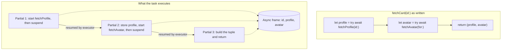
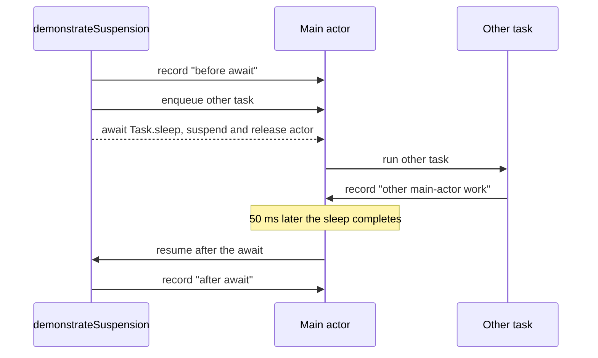

An `async` function is a function that may give up its thread partway through and continue later. `await` marks each place where that can happen. Those two facts explain almost everything about how asynchronous Swift code behaves: why it reads top to bottom, why it does not block threads, why state can change "in the middle" of a function, and why you cannot call an `async` function from a synchronous one without creating a task.

This article treats suspension as the central idea. It looks at what the compiler does with an `async` function, where code runs after it resumes, which guarantees `await` gives you and which it does not, and how to cross the boundary between synchronous and asynchronous code without breaking either side.

<!--more-->

The examples use Swift 6 language mode and were compiled and run with the Swift 6.4 toolchain on macOS 26. The Swift blocks build on one another in one `main.swift`. Features that arrived in Swift 6.2, `nonisolated(nonsending)` and `@concurrent`, are labeled where they appear.

## From callbacks to a straight line

Before Swift 5.5, an operation that waited for something took a completion handler. Composing several such operations nested the code and spread error handling across every level:

```swift
import Foundation

struct Profile: Equatable, Sendable {
    let id: Int
    let name: String
}

struct Avatar: Equatable, Sendable {
    let profileID: Int
    let byteCount: Int
}

enum LoadError: Error, Equatable {
    case notFound(Int)
}

/// Callback-style APIs, each finishing later on a background queue.
func loadProfile(id: Int, completion: @escaping @Sendable (Result<Profile, LoadError>) -> Void) {
    DispatchQueue.global().asyncAfter(deadline: .now() + .milliseconds(20)) {
        completion(id > 0 ? .success(Profile(id: id, name: "User \(id)")) : .failure(.notFound(id)))
    }
}

func loadAvatar(for profile: Profile, completion: @escaping @Sendable (Result<Avatar, LoadError>) -> Void) {
    DispatchQueue.global().asyncAfter(deadline: .now() + .milliseconds(20)) {
        completion(.success(Avatar(profileID: profile.id, byteCount: 1_024)))
    }
}

/// Composition: every step nests, and every level must forward failures by hand.
func loadCard(id: Int, completion: @escaping @Sendable (Result<(Profile, Avatar), LoadError>) -> Void) {
    loadProfile(id: id) { profileResult in
        switch profileResult {
        case .failure(let error):
            completion(.failure(error))
        case .success(let profile):
            loadAvatar(for: profile) { avatarResult in
                switch avatarResult {
                case .failure(let error):
                    completion(.failure(error))
                case .success(let avatar):
                    completion(.success((profile, avatar)))
                }
            }
        }
    }
}
```

Nothing in the type system guarantees that `completion` is called exactly once on every path. Forgetting the `.failure` forwarding in one branch would compile and leave the caller waiting forever.

The same composition with `async` functions:

```swift
func fetchProfile(id: Int) async throws -> Profile {
    try await Task.sleep(for: .milliseconds(20))
    guard id > 0 else { throw LoadError.notFound(id) }
    return Profile(id: id, name: "User \(id)")
}

func fetchAvatar(for profile: Profile) async throws -> Avatar {
    try await Task.sleep(for: .milliseconds(20))
    return Avatar(profileID: profile.id, byteCount: 1_024)
}

func fetchCard(id: Int) async throws -> (Profile, Avatar) {
    let profile = try await fetchProfile(id: id)
    let avatar = try await fetchAvatar(for: profile)
    return (profile, avatar)
}

let card = try await fetchCard(id: 7)
assert(card.0 == Profile(id: 7, name: "User 7"))
assert(card.1.profileID == 7)

do {
    _ = try await fetchCard(id: 0)
    assertionFailure("A missing profile must throw")
} catch LoadError.notFound(let id) {
    assert(id == 0)
}
```

The function returns exactly once or throws exactly once; the compiler enforces it the same way it does for synchronous code. Errors propagate with ordinary `try`. Control flow, including loops, `defer`, and early returns, works as it does everywhere else.

For completeness, here is the callback version driven from async code. `withCheckedThrowingContinuation` suspends the caller until the callback fires; the [checked continuations article](/swift-checked-continuations/) covers it in depth.

```swift
let callbackCard = try await withCheckedThrowingContinuation { continuation in
    loadCard(id: 7) { result in
        continuation.resume(with: result.map { $0 })
    }
}
assert(callbackCard.0 == card.0 && callbackCard.1 == card.1)
```

## What the compiler does with `async`

An ordinary function keeps its local variables on the thread's stack. That stack frame must stay in place until the function returns, so a synchronous function that waits must block its thread.

An `async` function is compiled differently. The compiler splits its body at each potential suspension point into a sequence of *partial functions*, sometimes called continuations. Local variables that live across a suspension point are stored in an *async frame* allocated by the task, not on the thread stack. When the function suspends, the current partial function returns, the thread is free, and the task records which partial function runs next.



Each arrow labeled "resumed by executor" is a moment when the task is not running at all. It could resume on a different thread from the one it started on. That is why APIs that depend on thread identity, such as `Thread.current`, are unavailable in `async` functions in Swift 6 mode, as the [threads article](/swift-threads-dispatch-queues-tasks/) shows.

## A suspension point is a gap other work can fill

The practical meaning of `await` is: *at this line, the current function may pause, and other code may run on the same actor before it continues.* The following experiment makes the gap visible. It runs on the main actor, schedules another main-actor task, and then suspends.

```swift
/// Main-actor-isolated event log. All access is serialized by the main actor.
@MainActor
final class EventLog {
    private(set) var events: [String] = []

    func record(_ event: String) {
        events.append(event)
    }
}

@MainActor
func demonstrateSuspension(log: EventLog) async {
    log.record("before await")
    let other = Task { log.record("other main-actor work") }
    try? await Task.sleep(for: .milliseconds(50))
    log.record("after await")
    await other.value
}

let suspensionLog = EventLog()
await demonstrateSuspension(log: suspensionLog)
assert(suspensionLog.events == ["before await", "other main-actor work", "after await"])
```

`Task { }` created on the main actor runs on the main actor, but it cannot start while `demonstrateSuspension` is executing. The main actor runs one job at a time. The other task gets its turn exactly when `demonstrateSuspension` suspends at the `await`.



Two consequences follow, and both are guarantees you can design around:

1. **Between two `await`s, code on an actor runs without interruption.** No other code isolated to the same actor can run in that stretch. This synchronous region is the unit of atomicity.
2. **Across an `await`, any state shared through the actor may have changed.** A value you read before the `await` is a snapshot, not a live fact.

The second point is the source of most real-world concurrency bugs in Swift 6 code, because the compiler does not flag it. Data-race safety prevents simultaneous access; it does not prevent interleaving. The [concurrency vs. parallelism article](/swift-concurrency-vs-parallelism/) shows a wallet that overdraws for exactly this reason, and the [actor reentrancy article](/swift-actor-reentrancy/) gives patterns for keeping invariants across suspension points.

## `await` marks a *potential* suspension

Not every `await` actually suspends. If the callee completes without waiting, and no change of executor is needed, the call can proceed like a normal function call.

```swift
@MainActor
func finishesImmediately(log: EventLog) async {
    log.record("callee")
}

@MainActor
func demonstratePotentialSuspension(log: EventLog) async {
    log.record("start")
    let other = Task { log.record("other") }
    await finishesImmediately(log: log)
    log.record("after a call that did not suspend")
    await Task.yield()
    log.record("after yield")
    await other.value
}

let potentialLog = EventLog()
await demonstratePotentialSuspension(log: potentialLog)
print(potentialLog.events)
```

On the test toolchain this prints the other task's event *after* "after a call that did not suspend", and before "after yield." Calling a main-actor function from the main actor needed no executor change, and the callee never waited, so the main actor was never released. `Task.yield()` explicitly suspends and lets other queued work run.

Do not build correctness on the first observation. The language promises only that suspension *can* happen at an `await`, not that it won't. Treat every `await` as a point where the world may change; treat the absence of `await` as the guarantee.

## Where code runs after it resumes

When an `async` function resumes, it continues on the executor dictated by **its own isolation**, not by whoever called it and not by whatever it awaited:

- A function isolated to the main actor always resumes on the main actor.
- A method on an actor always resumes on that actor.
- A non-isolated `async` function, in Swift 6 language mode by default, runs on the global concurrent executor ([SE-0338](https://github.com/swiftlang/swift-evolution/blob/main/proposals/0338-clarify-execution-non-actor-async.md)).

Swift 6.2 adds two ways to say exactly what a non-isolated `async` function should do ([SE-0461](https://github.com/swiftlang/swift-evolution/blob/main/proposals/0461-async-function-isolation.md)):

- `nonisolated(nonsending)` runs the function on the **caller's** executor.
- `@concurrent` always runs it on the global concurrent executor, off any actor.

The experiment below asks each kind of function whether it is on the main thread, calling all of them from the main actor:

```swift
func isMainThread() -> Bool {
    pthread_main_np() != 0
}

func plainNonisolated() async -> Bool {
    isMainThread()
}

nonisolated(nonsending) func runsOnCallersExecutor() async -> Bool {
    isMainThread()
}

@concurrent func runsConcurrently() async -> Bool {
    isMainThread()
}

@MainActor
func whereDidEachRun() async -> [String: Bool] {
    let plain = await plainNonisolated()
    let nonsending = await runsOnCallersExecutor()
    let concurrent = await runsConcurrently()
    return ["plain": plain, "nonsending": nonsending, "concurrent": concurrent, "caller after": isMainThread()]
}

let placement = await whereDidEachRun()
assert(placement["nonsending"] == true)
assert(placement["concurrent"] == false)
assert(placement["caller after"] == true, "A main-actor function resumes on the main actor")
print(placement)
```

On the test machine, `plain` printed `false`: under default Swift 6 rules a plain non-isolated `async` function leaves the caller's actor. Compiling the same file with `-enable-upcoming-feature NonisolatedNonsendingByDefault` changed `plain` to `true`. That upcoming feature makes `nonisolated(nonsending)` the default for non-isolated `async` functions. It is part of the "Approachable Concurrency" build setting in Xcode 26.

The two defaults trade off differently:

| Non-isolated async function | Runs on | Good for | Watch out for |
| --- | --- | --- | --- |
| Swift 6 default | Global executor | Keeping CPU work off the caller's actor | Arguments must be `Sendable`, since they cross isolation |
| `nonisolated(nonsending)` (6.2) | Caller's executor | Helpers that just await other things; non-`Sendable` arguments | CPU-heavy work would block the caller's actor |
| `@concurrent` (6.2) | Global executor, explicitly | Decoding, image processing, other real computation | Same `Sendable` requirements as the old default |

When a project enables `NonisolatedNonsendingByDefault`, audit functions that do real computation and mark them `@concurrent`, or they will quietly start running on the main actor when called from UI code. The [executor article](/swift-executors/) returns to this decision.

## Sequential by default

`await` waits for the callee to finish before the next line runs. Two independent calls written on consecutive lines therefore run one after the other, and their latencies add:

$$
T_{\text{sequential}} = \sum_{i=1}^{n} t_i, \qquad T_{\text{concurrent}} \approx \max_{i} t_i.
$$

```swift
func fetchSettings() async throws -> [String: Bool] {
    try await Task.sleep(for: .milliseconds(100))
    return ["notifications": true]
}

func fetchBadgeCount() async throws -> Int {
    try await Task.sleep(for: .milliseconds(100))
    return 3
}

let sequentialClock = ContinuousClock()
let sequentialStart = sequentialClock.now
let settings = try await fetchSettings()
let badges = try await fetchBadgeCount()
let sequentialElapsed = sequentialStart.duration(to: sequentialClock.now)
assert(settings["notifications"] == true && badges == 3)
assert(sequentialElapsed >= .milliseconds(200), "Consecutive awaits add their latencies")
```

This is a feature: sequential code is easy to reason about, and when the second call depends on the first, as `fetchAvatar` depends on `fetchProfile`, it is the only correct order. When calls are independent, express that independence explicitly with `async let` or a task group, as the [next article](/swift-async-let/) does. Swift never makes calls concurrent behind your back.

## The rest of the `async` surface

Functions are not the only declarations that can suspend.

**Read-only computed properties and subscripts** can be `async` and `throws`:

```swift
struct ProfileReference {
    let id: Int

    var resolved: Profile {
        get async throws {
            try await fetchProfile(id: id)
        }
    }
}

let resolvedName = try await ProfileReference(id: 3).resolved.name
assert(resolvedName == "User 3")
```

Only getters can be effectful; there are no `async` setters. If assigning a value requires waiting, model it as a method.

**Initializers** can be `async`, which is useful when an object cannot be valid until something has been loaded. **Closures** are `async` when their body contains `await`, and their type says so: `() async throws -> Profile`.

**Protocol requirements** can be `async`, and a synchronous implementation can satisfy them. The reverse is not allowed, because a synchronous caller cannot suspend.

```swift
protocol ProfileSource: Sendable {
    func profile(id: Int) async throws -> Profile
}

/// Satisfies an async requirement synchronously, which is always allowed.
struct FixtureProfiles: ProfileSource {
    let profiles: [Int: Profile]

    func profile(id: Int) throws -> Profile {
        guard let profile = profiles[id] else { throw LoadError.notFound(id) }
        return profile
    }
}

struct RemoteProfiles: ProfileSource {
    func profile(id: Int) async throws -> Profile {
        try await fetchProfile(id: id)
    }
}

let sources: [any ProfileSource] = [FixtureProfiles(profiles: [5: Profile(id: 5, name: "User 5")]), RemoteProfiles()]
for source in sources {
    let loaded = try await source.profile(id: 5)
    assert(loaded.name == "User 5")
}
```

Making a protocol requirement `async` is a commitment for every caller, who now needs an asynchronous context. It is the right choice when *some* implementation genuinely needs to wait. It is the wrong choice when it is only a guess about the future.

**Typed throws** compose with `async`: `func parse() async throws(ParseError) -> Document` is valid in Swift 6. Be aware that cancellation is reported by throwing `CancellationError`, and `Task.sleep` throws untyped errors, so a typed-throws signature has to decide how cancellation maps into its error type.

## Crossing from synchronous to asynchronous code

`await` is only allowed in an asynchronous context: inside an `async` function, an `async` closure, or top-level code. A synchronous function cannot call an `async` function directly, because it has no way to suspend: its frame lives on the thread stack.

App entry points are mostly synchronous. A button action, a `viewDidLoad`, and a delegate callback are all ordinary functions. The bridge is `Task`, which starts a new asynchronous context and returns immediately:

```swift
@MainActor
final class ProfileScreen {
    private(set) var title = "Loading"
    private var loadTask: Task<Void, Never>?

    /// Called synchronously by the UI framework.
    func didAppear(profileID: Int) {
        loadTask?.cancel()
        loadTask = Task {
            do {
                title = try await fetchProfile(id: profileID).name
            } catch {
                title = "Unavailable"
            }
        }
    }

    func waitUntilLoaded() async {
        await loadTask?.value
    }
}

let screen = ProfileScreen()
screen.didAppear(profileID: 9)
assert(screen.title == "Loading", "didAppear returns before the task has started")
await screen.waitUntilLoaded()
assert(screen.title == "User 9")
```

Three properties of this bridge are worth noticing:

- `didAppear` returns before the task body even starts. The task is queued on the main actor and cannot run until the current main-actor job finishes.
- The task inherits the main actor's isolation from its context, so it can assign `title` directly and resumes on the main actor after the `await`.
- The task's lifetime is no longer tied to `didAppear`. Something must own it: here, the `loadTask` property, which cancels the previous load. Choosing that owner is the subject of the [task lifetime article](/swift-task-lifetime-ownership/).

What you must not do is bridge in the other direction by *blocking*: starting a task and then waiting for it with a semaphore so that a synchronous function can return its result. On the main actor, that deadlocks if the task needs the main actor. Elsewhere, it occupies a cooperative-pool thread. Swift 6 marks `DispatchSemaphore.wait()` unavailable in async code for this reason, but nothing prevents a synchronous function from doing it. If a synchronous API must return a value that is only available asynchronously, the API needs to change.

## Long synchronous stretches and `Task.yield()`

Because an actor only switches work at suspension points, a long synchronous loop on the main actor freezes everything else on it. Either move the computation off the actor with a `@concurrent` function, or, if it must touch actor state as it goes, insert explicit suspension points:

```swift
@MainActor
func importRows(_ count: Int, yieldingEvery stride: Int, log: EventLog) async -> Int {
    var imported = 0
    for row in 0..<count {
        imported += row % 2
        if row % stride == stride - 1 {
            await Task.yield()
        }
    }
    log.record("import finished")
    return imported
}

let importLog = EventLog()
let importer = Task { await importRows(10_000, yieldingEvery: 1_000, log: importLog) }
let interjection = Task { @MainActor in importLog.record("UI update during import") }
_ = await importer.value
await interjection.value
assert(importLog.events.first == "UI update during import")
```

`Task.yield()` suspends the current task and lets other work of the same or higher priority run first. It does not guarantee a context switch if nothing else is waiting, and it does not sleep. Treat it as a fairness tool for actor-bound loops, not as a performance tool: a yield every few milliseconds of work keeps the UI responsive without measurably slowing the loop.

## Summary

- `async` means a function can suspend; `await` marks every place where it might.
- The compiler splits an `async` function into partial functions sharing a heap-allocated frame, which is why suspension frees the thread.
- Between `await`s, actor-isolated code runs without interruption. Across an `await`, shared state may change.
- After resuming, a function runs on its own isolation's executor. Non-isolated `async` functions leave the caller's actor under default Swift 6 rules; `nonisolated(nonsending)` and `@concurrent` make the choice explicit in Swift 6.2.
- Consecutive `await`s are sequential. Concurrency must be requested explicitly.
- Cross from synchronous to asynchronous code with a `Task` that has an owner, never with a blocking wait.

## Exercise

Write an `async` function `firstAvailableProfile(ids: [Int]) async throws -> Profile` that tries each identifier in order and returns the first that loads, throwing the last error if none does. Then add an `EventLog` parameter and record before and after each `await`. Start a second main-actor task that removes one identifier from a shared list while the first function runs, and explain, using the suspension-point rules above, which identifiers the first function can observe as removed.

## Further reading

- [SE-0296: Async/await](https://github.com/swiftlang/swift-evolution/blob/main/proposals/0296-async-await.md), including the rationale for explicit `await`.
- [SE-0310: Effectful read-only properties](https://github.com/swiftlang/swift-evolution/blob/main/proposals/0310-effectful-readonly-properties.md).
- [SE-0338](https://github.com/swiftlang/swift-evolution/blob/main/proposals/0338-clarify-execution-non-actor-async.md) and [SE-0461](https://github.com/swiftlang/swift-evolution/blob/main/proposals/0461-async-function-isolation.md) on where non-isolated `async` functions run.
- [Meet async/await in Swift](https://developer.apple.com/videos/play/wwdc2021/10132/), WWDC21.

Previous: [Threads, Dispatch Queues, and Swift Tasks](/swift-threads-dispatch-queues-tasks/). Next: [Running Independent Work with `async let`](/swift-async-let/).

Return to the [Concurrency roadmap](/swift-concurrency-roadmap/).
