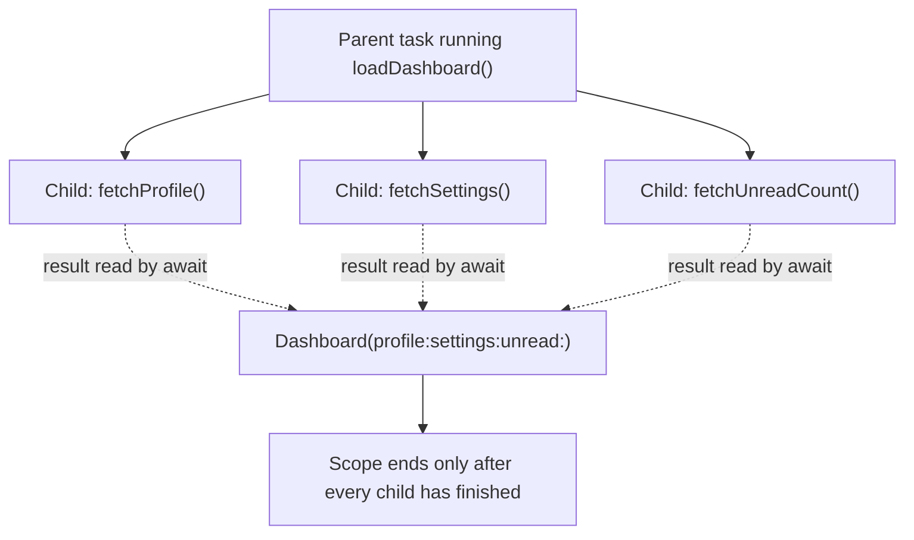
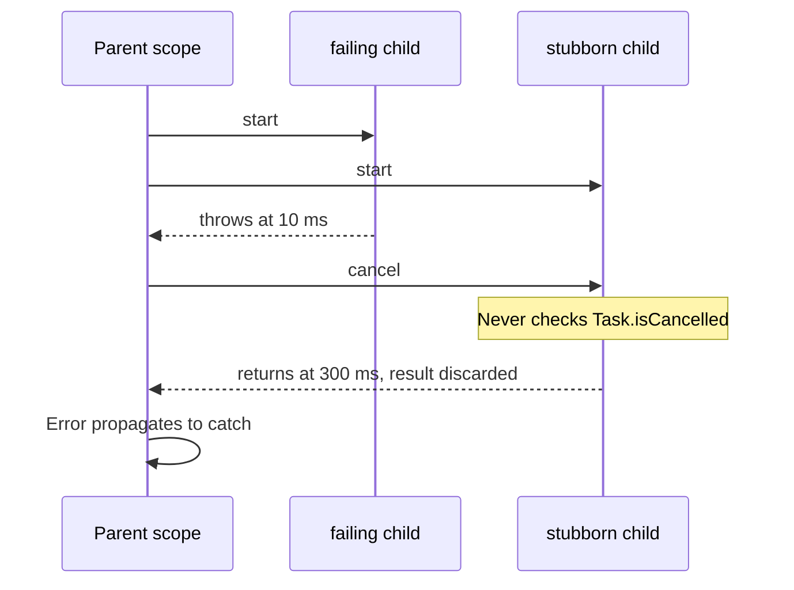

Consecutive `await` statements run one after another. That default is safe, but when a screen needs three independent pieces of data, it makes the user wait for the sum of three latencies instead of the longest one. `async let` is the smallest tool Swift offers for saying "start this now, I will need the result later."

It looks like a variable declaration, and that resemblance hides real machinery: each `async let` creates a child task, binds that task's lifetime to the enclosing scope, and makes cancellation and error propagation automatic. This article shows what `async let` creates, measures how await order changes failure latency, and documents three pitfalls that compile without a warning.

<!--more-->

The examples use Swift 6 language mode and were compiled and run with the Swift 6.4 toolchain on macOS 26. Timings in the text come from that machine. The Swift blocks build on one another in one `main.swift`; the assertions use generous tolerances so they hold on slower hardware.

## From sum to maximum

A dashboard needs a profile, settings, and an unread count. None depends on the others. The simulated services below each take a configurable time:

```swift
import Foundation

struct Profile: Equatable, Sendable { let name: String }
struct Settings: Equatable, Sendable { let compactLayout: Bool }
struct Dashboard: Equatable, Sendable {
    let profile: Profile
    let settings: Settings
    let unread: Int
}

enum ServiceError: Error, Equatable {
    case unavailable(String)
}

func fetchProfile(after delay: Duration = .milliseconds(100)) async throws -> Profile {
    try await Task.sleep(for: delay)
    return Profile(name: "Ada")
}

func fetchSettings(after delay: Duration = .milliseconds(100)) async throws -> Settings {
    try await Task.sleep(for: delay)
    return Settings(compactLayout: true)
}

func fetchUnreadCount(after delay: Duration = .milliseconds(100)) async throws -> Int {
    try await Task.sleep(for: delay)
    return 4
}

func elapsed<T>(_ operation: () async throws -> T) async rethrows -> (T, Duration) {
    let clock = ContinuousClock()
    let start = clock.now
    let value = try await operation()
    return (value, start.duration(to: clock.now))
}
```

Written with plain `await`, the latencies add up:

```swift
func loadDashboardSequentially() async throws -> Dashboard {
    let profile = try await fetchProfile()
    let settings = try await fetchSettings()
    let unread = try await fetchUnreadCount()
    return Dashboard(profile: profile, settings: settings, unread: unread)
}

let (sequential, sequentialTime) = try await elapsed { try await loadDashboardSequentially() }
assert(sequentialTime >= .milliseconds(300))
```

With `async let`, each call starts immediately in its own child task. The `await` moves to the point where the values are consumed:

```swift
func loadDashboard() async throws -> Dashboard {
    async let profile = fetchProfile()
    async let settings = fetchSettings()
    async let unread = fetchUnreadCount()
    return try await Dashboard(profile: profile, settings: settings, unread: unread)
}

let (concurrent, concurrentTime) = try await elapsed { try await loadDashboard() }
assert(concurrent == sequential)
assert(concurrentTime < .milliseconds(250), "Three 100 ms calls overlap")
print("sequential:", sequentialTime, "concurrent:", concurrentTime)
```

On the test machine: about 0.31 seconds sequentially, 0.10 seconds with `async let`. In general, for independent operations with latencies $$t_1, \dots, t_n$$,

$$
T_{\text{sequential}} = \sum_{i} t_i \quad\longrightarrow\quad T_{\texttt{async let}} \approx \max_i t_i .
$$

Notice what the declarations do *not* contain: no `try` and no `await`. The right-hand side of an `async let` is evaluated in the child task, so its effects are reported where you read the binding. The single `try await` in front of the `Dashboard` initializer covers all three reads.

## What `async let` creates

Each `async let` creates a **child task** of the current task. A child task:

- starts running as soon as it is created, concurrently with the parent;
- inherits the parent's priority and task-local values;
- is cancelled when the parent is cancelled;
- cannot outlive the scope that declared it.



The child does **not** inherit the parent's actor isolation. Its initializer expression runs as non-isolated code unless the expression itself calls something isolated. From a main-actor function, `async let x = someSynchronousFunction()` evaluates that function off the main actor. On the test toolchain, a synchronous `pthread_main_np()` check inside an `async let` initializer started from the main actor returned `false`. Calling a `@MainActor` function from the initializer hops back to the main actor for that call.

Because the child runs concurrently with the parent, values captured by the initializer must be safe to share across that boundary. Region-based isolation ([SE-0414](https://github.com/swiftlang/swift-evolution/blob/main/proposals/0414-region-based-isolation.md)) lets the compiler accept many non-`Sendable` captures when it can prove the parent will not use them concurrently, and rejects the ones it cannot prove.

Reading the same binding more than once is allowed. The first read waits for the child; later reads return the stored value, though the syntax still requires `await`.

## Await order decides when you hear about failure

When one of several `async let` children throws, the error reaches the parent only when the parent reads *that* binding. The parent reads bindings in the order its expression evaluates them, left to right. A fast failure behind a slow success waits for the slow success.

```swift
func failsQuickly() async throws -> Int {
    try await Task.sleep(for: .milliseconds(10))
    throw ServiceError.unavailable("unread")
}

func slowSuccess() async throws -> Int {
    try await Task.sleep(for: .milliseconds(300))
    return 1
}

func timeToFailure(readFailingFirst: Bool) async -> Duration {
    let clock = ContinuousClock()
    let start = clock.now
    do {
        async let slow = slowSuccess()
        async let failing = failsQuickly()
        if readFailingFirst {
            _ = try await failing + slow
        } else {
            _ = try await slow + failing
        }
    } catch {
        return start.duration(to: clock.now)
    }
    return .zero
}

let slowFirst = await timeToFailure(readFailingFirst: false)
let failingFirst = await timeToFailure(readFailingFirst: true)
assert(slowFirst >= .milliseconds(250))
assert(failingFirst < .milliseconds(200))
print("error after reading slow first:", slowFirst, "failing first:", failingFirst)
```

Measured: about 300 ms when the slow child is read first, about 15 ms when the failing child is read first. In the slow-first case, the failing child finished at 10 ms, but nobody looked at it for another 290 ms.

`async let` has no "whichever finishes first" operation. If the order of results is unknown in advance and early failure matters, use a task group, whose `next()` returns children in completion order, as the [task groups article](/swift-task-groups/) shows. With `async let`, read the binding most likely to fail, or the cheapest to fail, first.

## Leaving the scope cancels and waits

What happens to children that are still running when the scope exits, whether because of an early `return`, a thrown error, or simply never reading a binding? Swift does two things, in order:

1. It **cancels** every child that has not been awaited.
2. It **awaits** every such child before the scope actually exits.

In the failing-first example above, `slow` was still sleeping when the error propagated. Its `Task.sleep` saw the cancellation and threw immediately, so the implicit await was nearly instant. But cancellation is cooperative: a child that ignores it keeps running, and the scope waits for it.

```swift
/// CPU-bound work that never checks for cancellation.
func ignoresCancellation(for duration: Duration) async -> Int {
    let clock = ContinuousClock()
    let deadline = clock.now + duration
    var spins = 0
    while clock.now < deadline {
        spins &+= 1
    }
    return spins
}

func failureBehindStubbornSibling() async -> Duration {
    let clock = ContinuousClock()
    let start = clock.now
    do {
        async let stubborn = ignoresCancellation(for: .milliseconds(300))
        async let failing = failsQuickly()
        _ = try await failing + stubborn
    } catch {
        return start.duration(to: clock.now)
    }
    return .zero
}

let stubbornDelay = await failureBehindStubbornSibling()
assert(stubbornDelay >= .milliseconds(250), "The scope waits for children that ignore cancellation")
```

The failing child threw at 10 ms, and the parent read it first. Yet the `catch` ran only after about 300 ms, because the scope could not exit while `stubborn` was still running. This is the structured-concurrency guarantee doing its job: no child task outlives its scope. The cost of the guarantee is that a child's responsiveness to cancellation becomes part of its parent's latency.



The [cooperative cancellation article](/swift-cooperative-cancellation/) shows how to make CPU-bound children check for cancellation at a sensible granularity.

## Pitfall: `async let _` is cancelled immediately

Because unread children are cancelled at scope exit, an `async let` you never read does not run "in the background." If the scope ends right away, the child is cancelled right away:

```swift
actor CancellationFlag {
    private(set) var wasCancelled = false

    func markCancelled() {
        wasCancelled = true
    }
}

func fireAndForgetAttempt(flag: CancellationFlag) async {
    async let _ = {
        do {
            try await Task.sleep(for: .milliseconds(200))
        } catch {
            await flag.markCancelled()
        }
    }()
}

let flag = CancellationFlag()
let (_, forgetTime) = await elapsed { await fireAndForgetAttempt(flag: flag) }
let forgottenWorkWasCancelled = await flag.wasCancelled
assert(forgottenWorkWasCancelled)
assert(forgetTime < .milliseconds(100))
```

The function returned in well under a millisecond on the test machine, and the child was cancelled before its sleep finished. If you want work to continue after the current scope ends, that is an *unstructured* task with a lifetime owner of its own, discussed in the [task lifetime article](/swift-task-lifetime-ownership/). `async let` is never fire-and-forget.

## Pitfall: one binding is one task

A tuple pattern looks like a way to start two things at once. It isn't. One `async let` declaration creates one child task, and that task evaluates the right-hand expression the normal way, left to right:

```swift
func pairInOneTask() async throws -> Int {
    async let (first, second) = (try slowSuccess(), try slowSuccess())
    return try await first + second
}

func pairInTwoTasks() async throws -> Int {
    async let first = slowSuccess()
    async let second = slowSuccess()
    return try await first + second
}

let (_, oneTask) = try await elapsed { try await pairInOneTask() }
let (_, twoTasks) = try await elapsed { try await pairInTwoTasks() }
assert(oneTask >= .milliseconds(550), "Both calls ran sequentially inside one child task")
assert(twoTasks < .milliseconds(500))
print("tuple binding:", oneTask, "two bindings:", twoTasks)
```

The tuple version took 0.63 seconds on the test machine, the two-binding version 0.30. The rule to remember: **concurrency comes from the number of `async let` declarations, not from the number of calls on their right-hand sides.**

## Pitfall: early exit still pays for cancellation latency

Consider a function that starts an expensive fetch and later decides it does not need it. If the decision is to *return early*, scope exit cancels the fetch, which is good. If the decision is to *throw*, the same thing happens. But in both cases, the function's latency includes however long the fetch takes to *respond to cancellation*. For network and sleep calls that is fast. For a child that decodes a 40 MB JSON document without checking for cancellation, it is the whole decode. Start expensive children only once you know you will probably need them.

## Partial results instead of all-or-nothing

With a single `try await` over all bindings, one failure discards every other result. A dashboard often prefers to degrade: show the profile even if the unread count is unavailable. Capture each child's outcome as a `Result` and decide afterwards. Swift 6.4 adds an asynchronous `Result(catching:)` initializer for exactly this ([SE-0530](https://github.com/swiftlang/swift-evolution/blob/main/proposals/0530-async-result-support.md)); it back-deploys, so it works on every OS version that supports Swift concurrency. With an older compiler, a five-line helper with `do`/`catch` does the same job.

```swift
struct PartialDashboard: Sendable {
    let profile: Profile
    let settings: Settings?
    let unread: Int?
}

func loadDashboardTolerantly(unreadFails: Bool) async throws -> PartialDashboard {
    async let profile = fetchProfile()
    async let settings = Result { try await fetchSettings() }
    async let unread = Result {
        if unreadFails { throw ServiceError.unavailable("unread") }
        return try await fetchUnreadCount()
    }
    return try await PartialDashboard(
        profile: profile,
        settings: try? settings.get(),
        unread: try? unread.get()
    )
}

let degraded = try await loadDashboardTolerantly(unreadFails: true)
assert(degraded.profile.name == "Ada")
assert(degraded.settings == Settings(compactLayout: true))
assert(degraded.unread == nil)
```

The profile is still required: if it fails, the whole function throws. The other two are optional. This makes the failure policy explicit per dependency instead of an accident of `try` placement.

Be careful with cancellation in tolerant code. A `Result` wrapper also catches `CancellationError`. If the parent is cancelled, `settings` becomes `nil` and the function returns a partial dashboard instead of throwing. When that matters, check `Task.isCancelled` before returning partial results, and throw `CancellationError` instead.

## Fan-out and tail latency

Concurrency turns a sum of latencies into a maximum, but the maximum of several random latencies is worse than any one of them. If each of $$n$$ independent calls completes within time $$t$$ with probability $$F(t)$$, then all of them complete within $$t$$ with probability

$$
P\big(\max_i T_i \le t\big) = F(t)^n .
$$

Suppose each service meets a 300 ms target 99% of the time. A screen that fans out to five such services meets the target only

$$
0.99^5 \approx 0.951
$$

of the time: the single service's 99th percentile has become the combined screen's 95th. The same arithmetic applies to failures. If each call fails independently with probability $$p$$, an all-or-nothing composition fails with probability $$1 - (1 - p)^n$$. Five calls at 1% each fail together about 4.9% of the time.

These numbers are the quantitative argument for the tolerant pattern above, and for per-dependency timeouts. Fan-out multiplies the tail, a phenomenon described in Dean and Barroso's [*The Tail at Scale*](https://research.google/pubs/the-tail-at-scale/). Mark the dependencies the screen cannot live without, and let the rest fail or time out independently.

## `async let`, task groups, or `Task`?

| Need | Tool |
| --- | --- |
| A fixed, small number of independent operations, known at compile time | `async let` |
| A number of operations known only at run time | Task group |
| Results in completion order, first-to-finish, or early exit | Task group |
| Bounded concurrency over many items | Task group with a refill loop |
| Work that must continue after the current scope returns | `Task { }` with an explicit owner |
| Work started from synchronous code | `Task { }`, which can then use `async let` inside |

`async let` and task groups are both *structured*: their children cannot outlive the scope, cancellation propagates, and errors flow to the parent. `async let` trades flexibility for brevity and static types: each binding has its own type, while a task group's children share one result type.

## Summary

- Each `async let` starts a child task immediately; reading the binding with `await` waits for it.
- Independent latencies go from a sum to a maximum, but fan-out widens the tail: $$F(t)^n$$.
- Errors surface when a binding is read, in evaluation order. Read the likely or fast failure first, or use a task group.
- At scope exit, unread children are cancelled and then awaited. A child that ignores cancellation delays its parent's return or throw.
- `async let _` is cancelled immediately. A tuple pattern is one child task, so its calls run sequentially.
- Wrap optional dependencies in `Result` to degrade instead of failing, and treat cancellation deliberately when you do.

## Exercise

Extend `loadDashboardTolerantly` so that each optional dependency has its own deadline: settings must arrive within 150 ms and unread counts within 80 ms, or the dashboard shows `nil` for them. Implement the deadline without `Task.sleep` in the main path by racing each fetch against a timer in a small task group. Verify that a slow unread service no longer delays the profile, and that cancelling the parent still throws `CancellationError` rather than returning a partial dashboard.

## Further reading

- [SE-0317: async let bindings](https://github.com/swiftlang/swift-evolution/blob/main/proposals/0317-async-let.md), including the rules for implicit cancellation and awaiting.
- [SE-0304: Structured concurrency](https://github.com/swiftlang/swift-evolution/blob/main/proposals/0304-structured-concurrency.md).
- [Explore structured concurrency in Swift](https://developer.apple.com/videos/play/wwdc2021/10134/), WWDC21.

Previous: [Suspending Functions with `async` and `await`](/swift-async-await-suspension/). Next: [Structured Concurrency and Child-Task Lifetimes](/swift-structured-concurrency/).

Return to the [Concurrency roadmap](/swift-concurrency-roadmap/).
