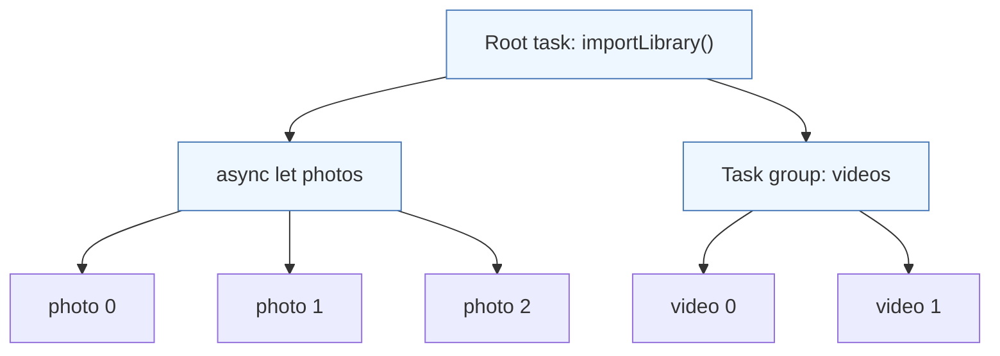
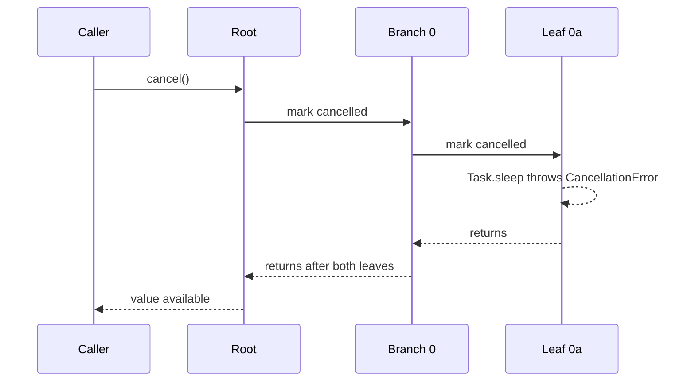

Structured programming made control flow follow the shape of the source code: a block is entered at the top and left at the bottom, and a function call returns to the line that made it. Structured concurrency applies the same rule to concurrent work. A child task begins inside a scope and is guaranteed to have finished by the time that scope ends.

That one rule produces a tree of tasks with properties you can rely on: when a function returns, none of the work it started is still running; cancelling a parent reaches every descendant; an error in one branch reaches the parent and stops the siblings; context such as priority and task-local values flows down automatically. This article demonstrates each property with a running program, and shows where the guarantees end.

<!--more-->

The examples use Swift 6 language mode and were compiled and run with the Swift 6.4 toolchain on macOS 26. The Swift blocks build on one another in one `main.swift`. `Mutex` requires iOS 18, macOS 15, or later.

## The rule, and why it matters

Swift's structured concurrency ([SE-0304](https://github.com/swiftlang/swift-evolution/blob/main/proposals/0304-structured-concurrency.md)) has two ways to create child tasks: `async let` bindings and task groups. Both obey the same constraint: **a child task cannot outlive the scope that created it.** At the end of the scope, any child that has not completed is cancelled, then awaited.

The argument for this rule is the same one Edsger Dijkstra made against `goto`, applied by Nathaniel J. Smith to concurrency in [*Notes on structured concurrency*](https://vorpus.org/blog/notes-on-structured-concurrency-or-go-statement-considered-harmful/). If a function can start work that keeps running after it returns, then calling the function no longer tells you when its effects are complete. You cannot reason locally about resource lifetimes, error handling, or cancellation, because some of the function's behavior escapes into the future.

With structured concurrency, the function signature tells the whole story again: when `importLibrary()` returns, every task it started has finished.



Cancellation travels down the edges of this tree. Errors and results travel up. Priority and task-local values are copied down at creation. A task created with `Task { }` or `Task.detached { }` starts a *new* tree and is not connected to these edges at all.

## A timeline to observe lifetimes

To check lifetime claims, each task records named events against a shared clock:

```swift
import Foundation
import Synchronization

/// Records named events and when they happened, safely from any task.
final class Timeline: Sendable {
    struct Event: Sendable {
        let name: String
        let offset: Duration
    }

    private let clock = ContinuousClock()
    private let origin: ContinuousClock.Instant
    private let events = Mutex<[Event]>([])

    init() {
        origin = clock.now
    }

    func mark(_ name: String) {
        let offset = origin.duration(to: clock.now)
        events.withLock { $0.append(Event(name: name, offset: offset)) }
    }

    func offset(of name: String) -> Duration? {
        events.withLock { events in events.first { $0.name == name }?.offset }
    }

    func names(withPrefix prefix: String) -> [String] {
        events.withLock { events in events.map(\.name).filter { $0.hasPrefix(prefix) } }
    }
}
```

Now a small importer that uses both kinds of child task. Photos are imported by an `async let` that itself runs a task group; videos by a second task group:

```swift
func importItems(_ kind: String, count: Int, each delay: Duration, timeline: Timeline) async throws -> Int {
    try await withThrowingTaskGroup(of: Void.self) { group in
        for index in 0..<count {
            group.addTask {
                timeline.mark("\(kind) \(index) start")
                try await Task.sleep(for: delay * (index + 1))
                timeline.mark("\(kind) \(index) end")
            }
        }
        try await group.waitForAll()
        return count
    }
}

func importLibrary(timeline: Timeline) async throws -> Int {
    timeline.mark("parent start")
    defer { timeline.mark("parent end") }
    async let photos = importItems("photo", count: 3, each: .milliseconds(30), timeline: timeline)
    let videos = try await importItems("video", count: 2, each: .milliseconds(50), timeline: timeline)
    return try await photos + videos
}

let importTimeline = Timeline()
let imported = try await importLibrary(timeline: importTimeline)
assert(imported == 5)

let parentEnd = importTimeline.offset(of: "parent end")!
for name in importTimeline.names(withPrefix: "photo") + importTimeline.names(withPrefix: "video") where name.hasSuffix("end") {
    assert(importTimeline.offset(of: name)! <= parentEnd, "\(name) finished inside its parent's lifetime")
}
```

Every child's end event comes before the parent's `defer` runs. That is not a coincidence of timing: `withThrowingTaskGroup` cannot return until its children finish, and the `async let` is awaited before the function returns. If the function had forgotten to read `photos`, scope exit would cancel and await it anyway.

This property is what lets you write `defer` cleanup in an `async` function with confidence. When the `defer` runs, no structured child is still touching the resources it is about to release.

## Cancellation flows down the whole tree

Cancelling a task sets a flag on it and on every structured descendant, recursively. Each task then notices the flag in its own way: `Task.sleep` throws `CancellationError`, `Task.checkCancellation()` throws, `Task.isCancelled` becomes `true`.

The tree below has a root, two branches created by a task group, and two leaves per branch created by `async let`. Each leaf would sleep for five seconds if left alone.

```swift
func leaf(_ name: String, timeline: Timeline) async {
    do {
        try await Task.sleep(for: .seconds(5))
        timeline.mark("\(name) finished")
    } catch {
        timeline.mark("\(name) cancelled")
    }
}

func branchyWork(timeline: Timeline) async {
    await withTaskGroup(of: Void.self) { group in
        for branch in 0..<2 {
            group.addTask {
                async let first: Void = leaf("leaf \(branch)a", timeline: timeline)
                async let second: Void = leaf("leaf \(branch)b", timeline: timeline)
                _ = await (first, second)
            }
        }
    }
}

let cancelTimeline = Timeline()
let root = Task {
    await branchyWork(timeline: cancelTimeline)
}
try await Task.sleep(for: .milliseconds(50))
root.cancel()
await root.value

let leaves = cancelTimeline.names(withPrefix: "leaf")
assert(leaves.count == 4)
assert(leaves.allSatisfy { $0.hasSuffix("cancelled") }, "Cancelling the root reached every grandchild")
assert(cancelTimeline.offset(of: leaves.last!)! < .seconds(1))
```

One call to `root.cancel()` reached four grandchildren through two levels of structure, and `await root.value` returned in about 50 ms instead of five seconds. No branch needed a reference to the leaves, and no leaf needed a reference to the root.



The time the parent needs to finish after cancellation is governed by its slowest descendant. If $$r_v$$ is the time task $$v$$ itself takes to respond to cancellation, then the time for a subtree rooted at $$v$$ to drain is

$$
R(v) = \max\!\Big(r_v,\; \max_{c \,\in\, \text{children}(v)} R(c)\Big).
$$

One leaf that never checks for cancellation makes $$R(\text{root})$$ equal to that leaf's remaining run time. Structure propagates the *request* instantly; *responding* is each task's responsibility. The [cooperative cancellation article](/swift-cooperative-cancellation/) covers how to respond well.

## Unstructured tasks are not part of the tree

A `Task { }` created inside a child task is not that child's child. It is a new root. It may inherit priority, task-local values, and, depending on where it is written, actor isolation, but it does not inherit *cancellation*, and nobody waits for it.

```swift
final class HandleBox: Sendable {
    private let handle = Mutex<Task<Void, Never>?>(nil)

    func store(_ task: Task<Void, Never>) {
        handle.withLock { $0 = task }
    }

    func await() async {
        let task = handle.withLock { $0 }
        await task?.value
    }
}

func workThatLeaksATask(timeline: Timeline, box: HandleBox) async {
    async let child: Void = leaf("structured child", timeline: timeline)
    box.store(Task {
        do {
            try await Task.sleep(for: .milliseconds(200))
            timeline.mark("unstructured finished")
        } catch {
            timeline.mark("unstructured cancelled")
        }
    })
    await child
}

let escapeTimeline = Timeline()
let escapeBox = HandleBox()
let escapingRoot = Task {
    await workThatLeaksATask(timeline: escapeTimeline, box: escapeBox)
}
try await Task.sleep(for: .milliseconds(20))
escapingRoot.cancel()
await escapingRoot.value
assert(escapeTimeline.offset(of: "structured child cancelled") != nil)
assert(escapeTimeline.offset(of: "unstructured finished") == nil, "Still running after its creator returned")

await escapeBox.await()
assert(escapeTimeline.offset(of: "unstructured finished") != nil, "Cancelling the creator did not cancel it")
```

When `escapingRoot` finished, the structured child had been cancelled, as expected, but the unstructured task was still running. It completed normally 200 ms later, unaffected by the cancellation. The only reason the program could wait for it at all is that a handle was stored in `HandleBox`. Without that, the task would be unreachable: still running, uncancellable, and invisible to whoever called `workThatLeaksATask`.

That is exactly the "work escapes into the future" problem structured concurrency exists to prevent. Unstructured tasks are sometimes necessary, but each one needs an explicit owner that can cancel it. The [task lifetime article](/swift-task-lifetime-ownership/) is about choosing that owner.

## Context flows down at creation

A child task copies its parent's **priority** and **task-local values** when it is created. Task-local values are the structured replacement for thread-local storage: values bound for the duration of an operation and visible to everything that operation runs, however it is split across tasks and threads.

```swift
enum RequestContext {
    @TaskLocal static var requestID: String?
}

func currentRequestIDs() async -> [String?] {
    async let fromAsyncLet = RequestContext.requestID
    let fromGroup = await withTaskGroup(of: String?.self) { group in
        group.addTask { RequestContext.requestID }
        return await group.next()!
    }
    let fromTask = await Task { RequestContext.requestID }.value
    let fromDetached = await Task.detached { RequestContext.requestID }.value
    return [await fromAsyncLet, fromGroup, fromTask, fromDetached]
}

let observedIDs = await RequestContext.$requestID.withValue("req-42") {
    await currentRequestIDs()
}
assert(observedIDs == ["req-42", "req-42", "req-42", nil])
assert(RequestContext.requestID == nil, "The binding ends with the withValue scope")
```

Both kinds of structured child see `req-42`. So does `Task { }`, which copies task-local values even though it is unstructured. `Task.detached` sees nothing: detaching means starting with an empty context. The binding itself is scoped. Outside `withValue`, the value is gone, which is another instance of the same structural idea.

Task-local values are ideal for tracing identifiers, logging context, and test configuration. They are not a place for mutable state: the value is read-only to children, and rebinding it in a child affects only that child's subtree.

## Errors flow up and cancel siblings

When a child task in a throwing task group fails, the error reaches the parent when the parent consumes that child's result with `next()` or `for try await`. If the error then leaves the group's body, the group cancels the remaining children and waits for them before rethrowing.

```swift
enum ImportError: Error {
    case corrupt(String)
}

func importWithOneCorruptFile(timeline: Timeline) async throws {
    try await withThrowingTaskGroup(of: Void.self) { group in
        group.addTask {
            try await Task.sleep(for: .milliseconds(20))
            throw ImportError.corrupt("clip.mov")
        }
        for index in 0..<3 {
            group.addTask {
                await leaf("sibling \(index)", timeline: timeline)
            }
        }
        for try await _ in group {}
    }
}

let errorTimeline = Timeline()
do {
    try await importWithOneCorruptFile(timeline: errorTimeline)
    assertionFailure("The corrupt file must fail the import")
} catch ImportError.corrupt(let name) {
    assert(name == "clip.mov")
}
let siblings = errorTimeline.names(withPrefix: "sibling")
assert(siblings.count == 3 && siblings.allSatisfy { $0.hasSuffix("cancelled") })
```

The three healthy siblings would each have slept for five seconds. Instead, the failure cancelled them, and the function threw after about 20 ms.

The way the body consumes results matters more than it looks. Replace `for try await _ in group {}` with `try await group.waitForAll()` and the behavior changes: on the test toolchain, `waitForAll()` on a throwing group waited for *every* child to finish and only then rethrew the first error. With one-second siblings, the failing version took 1.04 seconds and all three siblings ran to completion; the `for try await` version took 0.03 seconds and all three were cancelled. When a failure should stop the group, consume with `next()` or `for try await`, or call `group.cancelAll()` yourself.

There is a second subtlety: the error propagates only *when the parent consumes it*. A throwing task group whose body never calls `next()` or `waitForAll()` reaches the end of its body and implicitly awaits the remaining children, discarding their results *and their errors*. A child's failure that nobody reads is silently lost. The [task groups article](/swift-task-groups/) demonstrates this and shows the discarding task group, which treats any child error as fatal.

## What structure costs, and what it does not cover

Structured concurrency is not free:

- **Latency coupling.** A parent cannot finish before its slowest child. This is the guarantee, and it is also a cost when one child is slow to respond to cancellation.
- **Shape constraints.** A child cannot be handed to another object to finish later. Work that must outlive a view, a request handler, or a function call does not fit and needs an unstructured task with an owner.
- **Uniform result types in groups.** All children of a task group return the same type, which pushes heterogeneous work toward enums or `async let`.

And it does not cover everything:

- **Effects already performed are not rolled back.** Cancelling a child after it wrote to disk or sent a network request does not undo the write. Cancellation stops future work; compensating for past work is application logic.
- **Unstructured tasks escape.** As shown above, `Task { }` inside a structured child is not cancelled with it.
- **Callback-based APIs are outside the tree.** A continuation bridging a callback does not cancel the underlying operation unless you connect them with a cancellation handler, as the [cancellation handlers article](/swift-cancellation-handlers-cleanup/) shows.

## Structure in UI code

SwiftUI's `.task` modifier is the clearest example of structured lifetimes in app code. The task starts when the view appears and is cancelled when the view disappears. Any `async let` or task group inside it is part of that task's tree, so leaving a screen cancels everything the screen started.

<!-- skip-check -->
```swift
struct LibraryView: View {
    @State private var count = 0

    var body: some View {
        Text("\(count) items")
            .task {
                // Cancelled automatically when the view goes away, along with every child task.
                count = (try? await importLibrary(timeline: Timeline())) ?? 0
            }
    }
}
```

Compare that with `onAppear { Task { ... } }`, which creates an unstructured task that keeps running after the view disappears unless something stores and cancels it. When a framework offers a structured entry point, prefer it.

## Summary

- Structured child tasks, `async let` and task groups, cannot outlive the scope that created them. When a function returns, its structured work is done.
- Cancellation propagates to every structured descendant at once; the subtree drains in $$R(v) = \max(r_v, \max_c R(c))$$.
- Errors propagate upward when the parent consumes them, and an error leaving a group cancels the remaining siblings.
- Priority and task-local values flow down at creation. `Task { }` copies them; `Task.detached` starts empty.
- `Task { }` inside a child is a new root: not cancelled with the child and not awaited by it.
- Prefer framework entry points that are structured, such as SwiftUI's `.task`, over ad hoc unstructured tasks.

## Exercise

Write `func mirror(folders: [String]) async throws -> Int` that copies each folder in a child task, and inside each folder copies files in grandchild tasks. Use `Timeline` to prove three properties: no file copy event is recorded after `mirror` returns, cancelling the caller's task stops all copies within 100 ms, and a single failing file cancels the other files in the same folder but, if you choose so, not the other folders. Decide which of those failure policies the function should have, and implement it with the appropriate group type at each level.

## Further reading

- [SE-0304: Structured concurrency](https://github.com/swiftlang/swift-evolution/blob/main/proposals/0304-structured-concurrency.md).
- [SE-0311: Task-local values](https://github.com/swiftlang/swift-evolution/blob/main/proposals/0311-task-locals.md).
- Nathaniel J. Smith, [*Notes on structured concurrency, or: Go statement considered harmful*](https://vorpus.org/blog/notes-on-structured-concurrency-or-go-statement-considered-harmful/).
- [Explore structured concurrency in Swift](https://developer.apple.com/videos/play/wwdc2021/10134/), WWDC21.

Previous: [Running Independent Work with `async let`](/swift-async-let/). Next: [Creating Tasks and Choosing Their Lifetime Owner](/swift-task-lifetime-ownership/).

Return to the [Concurrency roadmap](/swift-concurrency-roadmap/).
