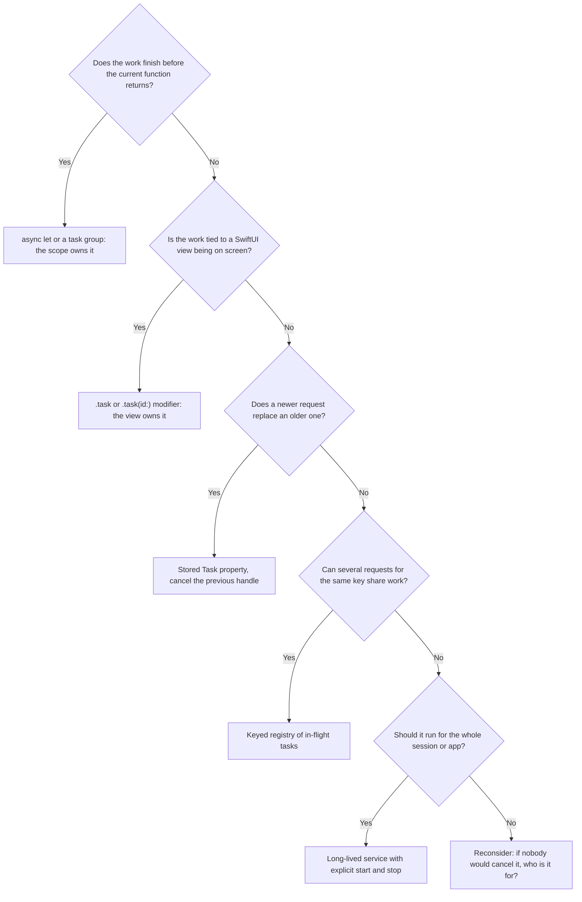

`Task { }` is the most common way to start asynchronous work from synchronous code, and the easiest one to misuse. It returns immediately and keeps running regardless of what happens to the code that created it. Nothing cancels it when a screen closes. Nothing reports its error if nobody reads it. Nothing stops it from keeping its creator alive forever.

Structured tasks get their lifetime from a scope. Unstructured tasks need an **owner**: some object or scope that holds the handle, decides when the work is no longer wanted, and cancels it. This article examines what `Task { }` inherits and what it does not, measures the leaks that appear when nobody owns a task, and builds the ownership patterns that cover most application code.

<!--more-->

The examples use Swift 6 language mode and were compiled and run with the Swift 6.4 toolchain on macOS 26. The Swift blocks build on one another in one `main.swift`. `Task.immediate`, from Swift 6.2, requires iOS 26, macOS 26, or later; `Mutex` requires iOS 18, macOS 15, or later.

## What a task handle is, and what it is not

`Task.init` returns a `Task<Success, Failure>` handle. The handle lets you read the result, cancel the task, and check whether it has been cancelled. It does **not** control the task's existence:

- The task starts running as soon as it is created, whether or not anyone keeps the handle.
- Releasing the last reference to the handle does not cancel the task.
- An error thrown by the task is stored in the task. If nobody reads `value` or `result`, the error disappears.

```swift
import Synchronization

struct UploadError: Error, Equatable {
    let reason: String
}

let upload = Task { () throws -> Int in
    try await Task.sleep(for: .milliseconds(20))
    throw UploadError(reason: "quota exceeded")
}

switch await upload.result {
case .success:
    assertionFailure("The upload was expected to fail")
case .failure(let error):
    assert(error as? UploadError == UploadError(reason: "quota exceeded"))
}

// The same failure with nobody listening: the program continues, and the error is gone.
_ = Task {
    throw UploadError(reason: "nobody reads this")
}
```

`Task.init` is marked `@discardableResult`, so older compilers accepted a bare `Task { throw ... }` silently. Swift 6.4 adds a warning for exactly this case ([SE-0520](https://github.com/swiftlang/swift-evolution/blob/main/proposals/0520-discardableresult-task-initializers.md)): an "unstructured throwing task ... is not used, which may accidentally ignore errors thrown inside the task". It applies only to tasks whose failure type is not `Never`, and `_ =` is how you tell the compiler the discard is deliberate. Either way, the second task's failure is invisible at run time. When a task can fail, either something awaits its result, or the task body handles its own errors, typically by catching them and updating state or logging. "Thrown into the void" is never a policy.

## What `Task { }` inherits from its context

An unstructured task created with `Task { }` copies three things from the place where it is written:

1. **Priority.** The new task starts with the current task's priority, or a priority derived from the current thread's quality of service if there is no current task.
2. **Task-local values.** Values bound with `@TaskLocal` are copied, as the [structured concurrency article](/swift-structured-concurrency/) shows.
3. **Actor isolation, sometimes.** If the surrounding code is isolated to a *global* actor, such as the main actor, the closure is isolated to that actor. If the surrounding code is an *actor instance* method, the closure is isolated to that actor only if it captures `self`.

It does **not** inherit cancellation. It is not a child, and cancelling the creating task does not cancel it.

```swift
func describe(_ isolation: (any Actor)?) -> String {
    isolation.map { "\(type(of: $0))" } ?? "nonisolated"
}

actor Indexer {
    private var indexedCount = 0

    func isolationOfNewTasks() async -> [String] {
        let withoutSelf = await Task { describe(#isolation) }.value
        let withSelf = await Task { () -> String in
            self.indexedCount += 1
            return describe(#isolation)
        }.value
        return [withoutSelf, withSelf]
    }
}

@MainActor
func isolationOfMainActorTask() async -> String {
    await Task { describe(#isolation) }.value
}

let indexerIsolation = await Indexer().isolationOfNewTasks()
assert(indexerIsolation == ["nonisolated", "Indexer"])
let mainIsolation = await isolationOfMainActorTask()
assert(mainIsolation == "MainActor")
```

The actor rule follows from what isolation means. To run on an actor instance, a closure needs a reference to that instance. A closure that never mentions `self` has nothing to be isolated to, so it runs on the global executor. That has a practical consequence: moving one line that mentions `self` into or out of a `Task` closure inside an actor changes where the entire closure runs.

`Task.detached { }` inherits none of the three. It starts with no isolation, default priority unless you pass one, and no task-local values. The [unstructured and detached tasks article](/swift-unstructured-detached-tasks/) compares the two.

## Starting synchronously with `Task.immediate`

A regular `Task { }` created on the main actor is *enqueued*. Its body cannot start until the current main-actor job finishes. Swift 6.2 adds `Task.immediate` ([SE-0472](https://github.com/swiftlang/swift-evolution/blob/main/proposals/0472-task-start-synchronously-on-caller-context.md)), which runs the body synchronously on the caller's executor until its first real suspension, then continues like any other task.

```swift
@MainActor
func compareStartBehavior() async -> [String] {
    let log = Mutex<[String]>([])
    log.withLock { $0.append("before creating tasks") }
    let regular = Task {
        log.withLock { $0.append("regular task body") }
    }
    let immediate = Task.immediate {
        log.withLock { $0.append("immediate task body") }
        try? await Task.sleep(for: .milliseconds(1))
        log.withLock { $0.append("immediate task after suspension") }
    }
    log.withLock { $0.append("after creating tasks") }
    await regular.value
    await immediate.value
    return log.withLock { $0 }
}

let startOrder = await compareStartBehavior()
assert(Array(startOrder.prefix(3)) == ["before creating tasks", "immediate task body", "after creating tasks"])
assert(startOrder.contains("regular task body"))
```

The immediate task's first segment ran before the creating function's next line, even though the regular task was created first. This matters in UI code: a button handler can update state, for example showing a spinner, inside the task before the next frame renders, without a one-turn delay. Use `Task.immediate` when the first synchronous part of the work must happen *now*. It does not change ownership at all: the result is an ordinary unstructured task that still needs an owner.

## The cost of a task nobody owns

An unowned task does not merely waste work. It frequently keeps objects alive. A task closure that refers to `self` captures it strongly, and the task holds that closure until it finishes. For finite work that is fine; the object lives a little longer. For a loop that never ends, such as observing a stream of notifications or polling a server, it is a leak.

The experiment below creates three owners. Each starts a polling loop in a task stored on the owner and cancels it in `deinit`. The loops differ only in how they capture `self`.

```swift
let deallocated = Mutex<[String]>([])

@MainActor
final class Poller {
    let name: String
    private var loop: Task<Void, Never>?
    private(set) var ticks = 0

    init(name: String) {
        self.name = name
    }

    func startStrongCapture() {
        loop = Task {
            while !Task.isCancelled {
                try? await Task.sleep(for: .milliseconds(5))
                self.ticks += 1
            }
        }
    }

    func startWeakCaptureUnwrappedOnce() {
        loop = Task { [weak self] in
            guard let self else { return }
            while !Task.isCancelled {
                try? await Task.sleep(for: .milliseconds(5))
                self.ticks += 1
            }
        }
    }

    func startWeakCapturePerIteration() {
        loop = Task { [weak self] in
            while !Task.isCancelled {
                try? await Task.sleep(for: .milliseconds(5))
                guard let self else { return }
                self.ticks += 1
            }
        }
    }

    deinit {
        loop?.cancel()
        let name = name
        deallocated.withLock { $0.append(name) }
    }
}

var strong: Poller? = Poller(name: "strong capture")
var unwrappedOnce: Poller? = Poller(name: "weak, unwrapped once")
var perIteration: Poller? = Poller(name: "weak, unwrapped per iteration")
strong?.startStrongCapture()
unwrappedOnce?.startWeakCaptureUnwrappedOnce()
perIteration?.startWeakCapturePerIteration()

try await Task.sleep(for: .milliseconds(30))    // Let every loop start and tick.
strong = nil
unwrappedOnce = nil
perIteration = nil
try await Task.sleep(for: .milliseconds(100))

assert(deallocated.withLock { $0 } == ["weak, unwrapped per iteration"])
```

Only one of the three was deallocated:

- **Strong capture.** The task holds `self`; `self` holds the task; the loop never ends because `deinit`, which would cancel it, can never run. A classic cycle, made worse because the loop keeps doing work.
- **Weak capture, unwrapped once.** The `[weak self]` looks like a fix, but `guard let self` at the top creates a strong reference that lives for the rest of the closure, which is the entire infinite loop. The capture list did nothing.
- **Weak capture, unwrapped per iteration.** The strong reference exists only inside each iteration, and is released at every `Task.sleep`. When the last outside reference goes away, the next iteration finds `nil` and exits.

The third pattern works, but it relies on the loop waking up to notice. A clearer design does not depend on capture semantics: give the owner an explicit `stop()` and call it from the code that ends the owner's useful life, such as a view disappearing, a coordinator finishing, or a session logging out. `deinit` is a last line of defense, not a lifecycle event.

The growth rate of such leaks follows from Little's law. If an app creates leaked loops at rate $$\lambda$$, say every time a screen opens, and each lives for time $$W$$, then on average $$L = \lambda W$$ are alive. With $$W$$ unbounded, $$L(t) = \lambda t$$ grows without limit: every visit to the screen adds a poller that never stops.

## Choosing an owner

Every unstructured task should have an answer to: *who cancels this, and when?* The answer is almost always one of a few shapes.



The first two shapes are structured or framework-managed and need no extra code. The rest are patterns you implement. Here they are in turn.

## Owner pattern: replace the previous request

When a newer request makes the older one irrelevant, as with search-as-you-type, a refresh button, or loading the detail for a newly selected row, store the handle and cancel it before starting the next:

```swift
@MainActor
final class DetailModel {
    private(set) var detail: String?
    private var loadTask: Task<Void, Never>?

    func select(itemID: Int) {
        loadTask?.cancel()
        loadTask = Task {
            do {
                try await Task.sleep(for: .milliseconds(30))
                detail = "Detail for item \(itemID)"
            } catch {
                // Cancelled because a newer selection replaced this one.
            }
        }
    }

    func waitForCurrentLoad() async {
        await loadTask?.value
    }
}

let detailModel = DetailModel()
detailModel.select(itemID: 1)
detailModel.select(itemID: 2)
await detailModel.waitForCurrentLoad()
assert(detailModel.detail == "Detail for item 2")
```

Cancellation alone is not enough to make this pattern correct. Cancellation is cooperative, so a replaced task that has already passed its last cancellation check can still finish and overwrite newer state. The [stale results article](/swift-rejecting-stale-results/) adds the generation check that closes that window.

## Owner pattern: a keyed registry of in-flight work

When several callers may ask for the same resource at the same time, such as thumbnails in a scrolling grid or a profile shown in several places, they should share one load. A registry keyed by resource holds the in-flight task, hands it to later callers, and removes it when it completes:

```swift
@MainActor
final class ThumbnailLoader {
    private struct Entry {
        let token: UInt64
        let task: Task<String, any Error>
    }

    private var inFlight: [Int: Entry] = [:]
    private var nextToken: UInt64 = 0
    private(set) var rendersStarted = 0

    func thumbnail(for photoID: Int) async throws -> String {
        if let existing = inFlight[photoID] {
            return try await existing.task.value
        }
        nextToken += 1
        let token = nextToken
        rendersStarted += 1
        let task = Task(name: "thumbnail \(photoID)") {
            try await Self.render(photoID)
        }
        inFlight[photoID] = Entry(token: token, task: task)
        defer {
            if inFlight[photoID]?.token == token {
                inFlight[photoID] = nil
            }
        }
        return try await task.value
    }

    func cancel(photoID: Int) {
        inFlight.removeValue(forKey: photoID)?.task.cancel()
    }

    var inFlightCount: Int {
        inFlight.count
    }

    @concurrent
    static func render(_ photoID: Int) async throws -> String {
        try await Task.sleep(for: .milliseconds(50))
        return "thumbnail-\(photoID)"
    }
}

let thumbnails = ThumbnailLoader()
async let firstRequest = thumbnails.thumbnail(for: 7)
async let secondRequest = thumbnails.thumbnail(for: 7)
let sharedResults = try await [firstRequest, secondRequest]
assert(sharedResults == ["thumbnail-7", "thumbnail-7"])
assert(thumbnails.rendersStarted == 1, "Concurrent requests for one key share one render")
assert(thumbnails.inFlightCount == 0, "Completed work leaves the registry")
```

Three details make the registry correct:

- **The check and the insertion happen without an `await` in between.** Both run on the main actor in one synchronous stretch, so two callers cannot both see an empty slot and both start a render.
- **Removal is guarded by a token.** If the entry is cancelled and replaced by a newer request while an older caller is still waiting, the older caller's `defer` must not remove the newer entry. Comparing tokens makes removal idempotent and specific.
- **The shared task is unstructured, deliberately.** If it were a child of the first caller, cancelling that caller would cancel the render for everyone. Ownership belongs to the registry, which is why only `cancel(photoID:)` cancels it.

The task is also given a name with `Task(name:)`, another Swift 6.2 addition ([SE-0469](https://github.com/swiftlang/swift-evolution/blob/main/proposals/0469-task-names.md)). Names appear in debugger and Instruments output, which makes it far easier to find "the thumbnail task that never finished" among hundreds of anonymous tasks. Creating a named task works on earlier systems; reading `Task.name` back requires the iOS 26 and macOS 26 runtime.

## Owner pattern: a long-lived service with explicit start and stop

Some work should run for as long as a session or the app runs: syncing, observing system notifications, keeping a WebSocket alive. Give it an owner whose lifecycle is explicit and idempotent:

```swift
@MainActor
final class SyncService {
    private var loop: Task<Void, Never>?
    private(set) var syncCount = 0

    var isRunning: Bool {
        loop != nil
    }

    func start(interval: Duration) {
        guard loop == nil else { return }
        loop = Task { [weak self] in
            while !Task.isCancelled {
                try? await Task.sleep(for: interval)
                guard let self, !Task.isCancelled else { return }
                self.syncCount += 1
            }
        }
    }

    func stop() async {
        let running = loop
        loop = nil
        running?.cancel()
        await running?.value
    }
}

let sync = SyncService()
sync.start(interval: .milliseconds(10))
sync.start(interval: .milliseconds(10))     // Idempotent: still one loop.
try await Task.sleep(for: .milliseconds(55))
await sync.stop()
let syncsAtStop = sync.syncCount
try await Task.sleep(for: .milliseconds(30))
assert(sync.syncCount == syncsAtStop, "No work happens after stop() returns")
assert(!sync.isRunning && syncsAtStop > 0)
```

`stop()` is `async` and awaits the task after cancelling it. That gives callers a strong guarantee: once `stop()` returns, the loop has exited and will not touch shared state again. Logging out, for example, can call `await sync.stop()` and then clear credentials without racing a sync that is still in progress. A synchronous `stop()` that only cancels gives a weaker guarantee: the loop will stop soon.

## Owners in SwiftUI and UIKit

In SwiftUI, prefer the view's own lifetime whenever the work belongs to a view being on screen:

<!-- skip-check -->
```swift
struct PhotoView: View {
    let photoID: Int
    let loader: ThumbnailLoader
    @State private var thumbnail: String?

    var body: some View {
        Text(thumbnail ?? "Loading")
            .task(id: photoID) {
                // Cancelled when the view disappears or when photoID changes.
                thumbnail = try? await loader.thumbnail(for: photoID)
            }
    }
}
```

`.task(id:)` combines two owner patterns: the view owns the task, and a new `id` replaces the previous request. In UIKit, the equivalent owner is usually the view controller or its model, cancelling in `viewDidDisappear` or when the coordinator finishes, rather than in `deinit`.

## Summary

- `Task { }` starts immediately and runs to completion whether or not anyone holds its handle. Unread errors are lost.
- It inherits priority and task-local values. It inherits global-actor isolation, and an actor instance's isolation only when the closure captures `self`. It never inherits cancellation.
- `Task.immediate` (Swift 6.2) runs synchronously until its first suspension; it does not change ownership.
- Strongly capturing `self` in a long-lived task loop leaks the owner; so does `[weak self]` followed by an early `guard let self`.
- Every unstructured task needs an owner that cancels it: a replaced-request property, a keyed registry, or a service with explicit, awaitable `stop()`.
- Prefer framework-provided owners, such as SwiftUI's `.task` and `.task(id:)`, whenever the work is tied to a view.

## Exercise

`ThumbnailLoader` never cancels a shared render when its callers stop caring: if every caller waiting on photo 7 is cancelled, the render still runs to completion. Add reference counting. Each call to `thumbnail(for:)` registers as a waiter, wraps its `await` in `withTaskCancellationHandler`, and unregisters when cancelled or finished; when the last waiter leaves, the registry cancels the render. Test that cancelling one of two waiters keeps the render alive, and cancelling both stops it. The [cancellation handlers article](/swift-cancellation-handlers-cleanup/) covers the handler's concurrency rules.

## Further reading

- [SE-0304: Structured concurrency](https://github.com/swiftlang/swift-evolution/blob/main/proposals/0304-structured-concurrency.md), section "Unstructured tasks."
- [SE-0472: Starting tasks synchronously from caller context](https://github.com/swiftlang/swift-evolution/blob/main/proposals/0472-task-start-synchronously-on-caller-context.md).
- [SE-0469: Task naming](https://github.com/swiftlang/swift-evolution/blob/main/proposals/0469-task-names.md).
- The Swift book on [strong reference cycles for closures](https://docs.swift.org/swift-book/documentation/the-swift-programming-language/automaticreferencecounting/#Strong-Reference-Cycles-for-Closures).

Previous: [Structured Concurrency and Child-Task Lifetimes](/swift-structured-concurrency/). Next: [Task Groups: Fan-Out, Aggregation, and Early Exit](/swift-task-groups/).

Return to the [Concurrency roadmap](/swift-concurrency-roadmap/).
