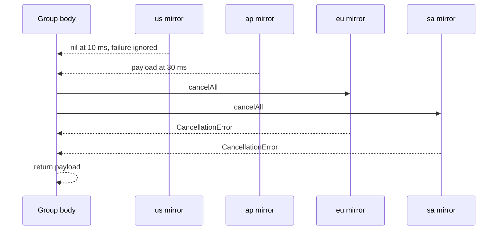

`async let` handles a fixed number of concurrent operations known when you write the code. A task group handles everything else: a number of children known only at run time, results consumed in the order they finish, a cap on how many run at once, and the ability to stop early once you have what you need.

Task groups are structured. Their children cannot outlive the group, cancellation reaches all of them, and the group waits for every child before it returns. Within that structure, the group's body decides almost everything else, including when errors surface and whether a failure stops the siblings, and the defaults are not always what people expect. This article builds the common shapes, fan-out, ordered aggregation, bounded concurrency, racing, and timeouts, and measures the error behaviors that matter.

<!--more-->

The examples use Swift 6 language mode and were compiled and run with the Swift 6.4 toolchain on macOS 26. Timings in the text come from that machine. The Swift blocks build on one another in one `main.swift`. `Mutex` requires iOS 18, macOS 15, or later.

## The four group types

| Function | Children return | Child errors | Typical use |
| --- | --- | --- | --- |
| `withTaskGroup` | A value | Not allowed | Fan-out of non-throwing work |
| `withThrowingTaskGroup` | A value | Surfaced when the body consumes that child | Fan-out that can fail |
| `withDiscardingTaskGroup` | `Void`, discarded | Not allowed | Many side-effecting children, such as event handlers |
| `withThrowingDiscardingTaskGroup` | `Void`, discarded | First error cancels the group and is rethrown | Long-running servers and listeners |

The discarding variants arrived in Swift 5.9 ([SE-0381](https://github.com/swiftlang/swift-evolution/blob/main/proposals/0381-task-group-discard-results.md)). Since Swift 6.1, the child result type can be inferred from the first `addTask` call ([SE-0442](https://github.com/swiftlang/swift-evolution/blob/main/proposals/0442-allow-taskgroup-childtaskresult-type-to-be-inferred.md)), so `of: Int.self` is optional.

## Fan-out and aggregation

The examples load "photos" whose latency depends on the identifier, so completion order differs from request order:

```swift
import Foundation
import Synchronization

struct Photo: Equatable, Sendable {
    let id: Int
    let bytes: Int
}

enum PhotoError: Error, Equatable {
    case corrupt(Int)
}

/// Latency is 25 ms times a value that cycles 2, 3, 4, 1, so identifier 4 finishes first.
func fetchPhoto(id: Int, failing: Set<Int> = []) async throws -> Photo {
    try await Task.sleep(for: .milliseconds(25 * ((id % 4) + 1)))
    if failing.contains(id) { throw PhotoError.corrupt(id) }
    return Photo(id: id, bytes: id * 1_000)
}
```

The basic shape adds one child per input and consumes results as they arrive:

```swift
func fetchAll(_ ids: [Int]) async throws -> (photos: [Int: Photo], completionOrder: [Int]) {
    try await withThrowingTaskGroup(of: Photo.self) { group in
        for id in ids {
            group.addTask { try await fetchPhoto(id: id) }
        }
        var photos: [Int: Photo] = [:]
        var completionOrder: [Int] = []
        for try await photo in group {
            photos[photo.id] = photo
            completionOrder.append(photo.id)
        }
        return (photos, completionOrder)
    }
}

let fanOut = try await fetchAll([1, 2, 3, 4])
assert(fanOut.photos.count == 4)
assert(fanOut.completionOrder == [4, 1, 2, 3], "Results arrive in completion order, not request order")
```

The body is ordinary sequential code that runs in the *parent's* isolation, not in any child. Mutating `photos` and `completionOrder` there needs no lock and no actor: the children only *return* values, and the body is the only code that combines them. Keep it that way. A child that writes into shared state instead of returning a value reintroduces exactly the coordination problem the group was meant to remove.

## Preserving input order

When the output must line up with the input, such as rows in a table or pages in a document, return the index with each result and place it:

```swift
func fetchInOrder(_ ids: [Int]) async throws -> [Photo] {
    try await withThrowingTaskGroup(of: (Int, Photo).self) { group in
        for (index, id) in ids.enumerated() {
            group.addTask { (index, try await fetchPhoto(id: id)) }
        }
        var slots = [Photo?](repeating: nil, count: ids.count)
        for try await (index, photo) in group {
            slots[index] = photo
        }
        return slots.map { $0! }
    }
}

let ordered = try await fetchInOrder([1, 2, 3, 4])
assert(ordered.map(\.id) == [1, 2, 3, 4])
```

The force unwrap is justified: the loop only ends normally after every child has returned, and every child fills exactly one distinct slot. If the group throws, the function never reaches the `map`.

## Bounded concurrency with a sliding window

Adding one child per input is fine for four photos. For four thousand, it starts four thousand network requests at once, which defeats HTTP connection limits, server rate limits, and memory budgets. Cap the number of children in flight, and add a new child whenever one finishes:

```swift
/// Records the peak number of children running at once.
final class ConcurrencyGauge: Sendable {
    private let counts = Mutex((current: 0, peak: 0))

    func enter() {
        counts.withLock { counts in
            counts.current += 1
            counts.peak = max(counts.peak, counts.current)
        }
    }

    func leave() {
        counts.withLock { $0.current -= 1 }
    }

    var peak: Int {
        counts.withLock { $0.peak }
    }
}

func fetchBounded(_ ids: [Int], maxConcurrent: Int, gauge: ConcurrencyGauge) async throws -> [Photo] {
    precondition(maxConcurrent > 0)
    return try await withThrowingTaskGroup(of: (Int, Photo).self) { group in
        var slots = [Photo?](repeating: nil, count: ids.count)
        var nextIndex = 0

        func addNext() {
            guard nextIndex < ids.count else { return }
            let index = nextIndex
            let id = ids[index]
            nextIndex += 1
            group.addTask {
                gauge.enter()
                defer { gauge.leave() }
                return (index, try await fetchPhoto(id: id))
            }
        }

        for _ in 0..<min(maxConcurrent, ids.count) {
            addNext()
        }
        while let (index, photo) = try await group.next() {
            slots[index] = photo
            addNext()
        }
        return slots.map { $0! }
    }
}

let gauge = ConcurrencyGauge()
let bounded = try await fetchBounded(Array(1...24), maxConcurrent: 3, gauge: gauge)
assert(bounded.map(\.id) == Array(1...24))
assert(gauge.peak <= 3, "Never more than three requests in flight")
```

The window starts `maxConcurrent` children, then adds exactly one for each result it consumes, so the number in flight never exceeds the limit. The `addNext` helper captures `group`, which is allowed because it is a local function used only inside the body. The group itself can never escape the body.

### Why a sliding window beats batching

A tempting alternative is to process items in batches of $$k$$: start $$k$$, wait for all of them, start the next $$k$$. Each batch takes as long as its slowest member, so a single slow item stalls $$k - 1$$ idle slots:

$$
T_{\text{batches}} = \sum_{b} \max_{i \in b} t_i, \qquad T_{\text{window}} \le \frac{1}{k}\sum_i t_i + \max_i t_i .
$$

The window bound is Graham's classic result for greedy list scheduling: the window is never idle while work remains, so it finishes within one longest task of the perfect division of work. With eight items whose durations are 100, 10, 10, 10, 100, 10, 10, 10 ms and $$k = 4$$, batching takes 200 ms; the window takes about 110 ms.

```mermaid
gantt
    accTitle: Batching waits for each batch's slowest item while a sliding window keeps every slot busy
    dateFormat x
    axisFormat %L ms
    section Batches of four
    Item 0, 100 ms   :b0, 0, 100
    Items 1 to 3     :b1, 0, 10
    Idle until batch ends :crit, b1i, 10, 100
    Item 4, 100 ms   :b4, 100, 200
    Items 5 to 7     :b5, 100, 110
    Idle until batch ends :crit, b5i, 110, 200
    section Sliding window of four
    Item 0, 100 ms   :w0, 0, 100
    Items 1 to 3     :w1, 0, 10
    Item 4, 100 ms   :w4, 10, 110
    Items 5 and 6    :w5, 10, 20
    Item 7           :w7, 20, 30
```



```swift
func simulatedWork(_ duration: Duration) async throws {
    try await Task.sleep(for: duration)
}

let durations: [Duration] = [100, 10, 10, 10, 100, 10, 10, 10].map { .milliseconds($0) }

func runBatched(_ durations: [Duration], batchSize: Int) async throws {
    for start in stride(from: 0, to: durations.count, by: batchSize) {
        let batch = durations[start..<min(start + batchSize, durations.count)]
        try await withThrowingTaskGroup(of: Void.self) { group in
            for duration in batch {
                group.addTask { try await simulatedWork(duration) }
            }
            try await group.waitForAll()
        }
    }
}

func runWindowed(_ durations: [Duration], window: Int) async throws {
    try await withThrowingTaskGroup(of: Void.self) { group in
        var iterator = durations.makeIterator()
        for _ in 0..<window {
            guard let duration = iterator.next() else { break }
            group.addTask { try await simulatedWork(duration) }
        }
        while try await group.next() != nil {
            if let duration = iterator.next() {
                group.addTask { try await simulatedWork(duration) }
            }
        }
    }
}

let clock = ContinuousClock()
let batchStart = clock.now
try await runBatched(durations, batchSize: 4)
let batchedTime = batchStart.duration(to: clock.now)
let windowStart = clock.now
try await runWindowed(durations, window: 4)
let windowedTime = windowStart.duration(to: clock.now)
assert(batchedTime >= .milliseconds(200))
assert(windowedTime < batchedTime)
print("batched:", batchedTime, "windowed:", windowedTime)
```

Measured: about 0.22 seconds batched and 0.12 seconds windowed, each including a few milliseconds of scheduling overhead over the ideal 200 and 110 ms. To choose $$k$$, use Little's law from the [concurrency vs. parallelism article](/swift-concurrency-vs-parallelism/): sustaining throughput $$\lambda$$ with per-item latency $$W$$ needs about $$k = \lambda W$$ in flight.

## Early exit: the first good answer wins

Some problems need only one result: the fastest mirror, the first cache tier that has the key, the first of several equivalent servers to respond. Start all candidates, take the first success, and cancel the rest:

```swift
struct Mirror: Sendable {
    let name: String
    let latency: Duration
    let fails: Bool
}

enum MirrorError: Error {
    case unavailable(String)
    case noMirrorSucceeded
}

/// A thread-safe list of names. `Mutex` is noncopyable, so share it through a class.
final class NameLog: Sendable {
    private let names = Mutex<[String]>([])

    func append(_ name: String) {
        names.withLock { $0.append(name) }
    }

    var all: [String] {
        names.withLock { $0 }
    }
}

func download(from mirror: Mirror, cancelled: NameLog) async throws -> String {
    do {
        try await Task.sleep(for: mirror.latency)
    } catch {
        cancelled.append(mirror.name)
        throw error
    }
    if mirror.fails { throw MirrorError.unavailable(mirror.name) }
    return "payload from \(mirror.name)"
}

func fastestSuccess(from mirrors: [Mirror], cancelled: NameLog) async throws -> String {
    try await withThrowingTaskGroup(of: String?.self) { group in
        for mirror in mirrors {
            group.addTask {
                // Convert a mirror's failure into nil so one bad mirror does not end the race.
                try? await download(from: mirror, cancelled: cancelled)
            }
        }
        while let result = try await group.next() {
            if let payload = result {
                group.cancelAll()
                return payload
            }
        }
        throw MirrorError.noMirrorSucceeded
    }
}

let cancelledMirrors = NameLog()
let mirrors = [
    Mirror(name: "eu", latency: .milliseconds(80), fails: false),
    Mirror(name: "us", latency: .milliseconds(10), fails: true),
    Mirror(name: "ap", latency: .milliseconds(30), fails: false),
    Mirror(name: "sa", latency: .milliseconds(500), fails: false),
]
let raceStart = clock.now
let payload = try await fastestSuccess(from: mirrors, cancelled: cancelledMirrors)
let raceTime = raceStart.duration(to: clock.now)
assert(payload == "payload from ap", "The fastest mirror failed, so the next fastest wins")
assert(Set(cancelledMirrors.all) == ["eu", "sa"], "The slower mirrors were cancelled")
assert(raceTime < .milliseconds(200))
```

`us` answered first but failed, so the loop kept waiting. `ap` succeeded at about 30 ms. `cancelAll()` then cancelled `eu` and `sa`, and returning from the body waited for them to acknowledge, which they did immediately because `Task.sleep` responds to cancellation. The whole race took about 30 ms instead of the 500 ms the slowest mirror would have needed.

The explicit `cancelAll()` matters for clarity more than for correctness. Returning from the body would cancel remaining children anyway, but only *after* the group has waited for them to stop. Calling `cancelAll()` states the intent where it happens.



## Timeouts as a race

A timeout is a race between the operation and a clock. A standard `withDeadline` function has been accepted for a future release ([SE-0526](https://github.com/swiftlang/swift-evolution/blob/main/proposals/0526-deadline.md)), but it is not part of the Swift 6.4 toolchain used here. Until it ships, a throwing group expresses a timeout directly:

```swift
struct TimeoutError: Error {}

func withTimeout<T: Sendable>(
    _ limit: Duration,
    operation: @escaping @Sendable () async throws -> T
) async throws -> T {
    try await withThrowingTaskGroup(of: T.self) { group in
        group.addTask { try await operation() }
        group.addTask {
            try await Task.sleep(for: limit)
            throw TimeoutError()
        }
        defer { group.cancelAll() }
        return try await group.next()!
    }
}

let quick = try await withTimeout(.milliseconds(200)) { try await fetchPhoto(id: 4) }
assert(quick.id == 4)

do {
    _ = try await withTimeout(.milliseconds(20)) { try await fetchPhoto(id: 3) }
    assertionFailure("A 100 ms fetch cannot finish within 20 ms")
} catch is TimeoutError {
}
```

Whichever child finishes first, successfully or by throwing, decides the outcome; the `defer` cancels the other. The force unwrap is safe because the group has two children, so the first `next()` cannot return `nil`.

This helper inherits the structured guarantee, and its limitation: **a timeout can only be as prompt as the operation's response to cancellation.** If `operation` ignores cancellation, the timeout child throws on time, but the group must still wait for the operation to finish before `withTimeout` can return. Timeouts in Swift are cooperative for the same reason cancellation is.

## When errors actually surface

Error behavior in throwing groups depends entirely on how the body consumes children. Three facts, each verified on the test toolchain, are worth knowing precisely.

**Errors reach the caller only through the body.** `withThrowingTaskGroup` is declared `rethrows`: it can throw only what its body throws. A body that never consumes a failed child returns normally, and the child's error is discarded.

```swift
let ignoredFailure = await withThrowingTaskGroup(of: Int.self) { group in
    group.addTask { throw PhotoError.corrupt(1) }
    return 7
}
assert(ignoredFailure == 7, "The child's error was never consumed, so it vanished")
```

The compiler even agrees that this call cannot throw: no `try` is needed, because the body does not throw.

**`next()` and `for try await` fail fast; `waitForAll()` does not.** Consuming with `next()` rethrows a child's error as soon as that child is consumed, and leaving the body then cancels the rest. `waitForAll()` on a throwing group waits for *every* child to finish, then rethrows the first error. In the [structured concurrency article](/swift-structured-concurrency/), the same failing group took 0.03 seconds with `for try await` and 1.04 seconds with `waitForAll()`.

**Discarding groups fail fast by design.** In a throwing discarding group, the first child error cancels the group immediately and is rethrown once the other children finish:

```swift
let discardStart = clock.now
do {
    try await withThrowingDiscardingTaskGroup { group in
        group.addTask {
            try await Task.sleep(for: .milliseconds(20))
            throw PhotoError.corrupt(2)
        }
        group.addTask {
            try await Task.sleep(for: .seconds(2))
        }
    }
    assertionFailure("The discarding group must rethrow the child's error")
} catch PhotoError.corrupt(let id) {
    assert(id == 2)
}
assert(discardStart.duration(to: clock.now) < .milliseconds(500))
```

Measured: 0.02 seconds, with the two-second sibling cancelled. That makes discarding groups the right shape for long-running supervisors, such as one child per accepted connection or per observed event stream, where any failure should bring the whole unit down.

Discarding groups also solve a resource problem. A regular group keeps each completed child's result until the body consumes it. A loop that adds children forever and never calls `next()`, for example a server accepting connections, accumulates completed children without bound. A discarding group releases each child as soon as it finishes.

## Partial failure as data

When failures should be collected rather than fatal, as in a batch import that reports which files failed, make each child return a `Result`:

```swift
func importAll(_ ids: [Int], failing: Set<Int>) async -> (imported: [Int], failed: [Int]) {
    await withTaskGroup(of: (Int, Result<Photo, any Error>).self) { group in
        for id in ids {
            group.addTask {
                do {
                    return (id, .success(try await fetchPhoto(id: id, failing: failing)))
                } catch {
                    return (id, .failure(error))
                }
            }
        }
        var imported: [Int] = []
        var failed: [Int] = []
        for await (id, result) in group {
            switch result {
            case .success: imported.append(id)
            case .failure: failed.append(id)
            }
        }
        return (imported.sorted(), failed.sorted())
    }
}

let report = await importAll(Array(1...8), failing: [3, 6])
assert(report.imported == [1, 2, 4, 5, 7, 8])
assert(report.failed == [3, 6])
```

The group type is now non-throwing, which documents the policy: no child can end the import early. As with `async let`, decide what cancellation should mean. Here a cancelled parent produces a report in which every unfinished photo appears as failed, which may or may not be what a caller expects.

## Not adding work after cancellation

A group whose parent has been cancelled will still accept new children; they simply start in a cancelled state. Long-running loops that add children should stop adding:

```swift
let afterCancellation = await withTaskGroup(of: Bool.self) { group in
    group.cancelAll()
    let accepted = group.addTaskUnlessCancelled { true }
    group.addTask { Task.isCancelled }
    var startedCancelled: [Bool] = []
    for await value in group {
        startedCancelled.append(value)
    }
    return (accepted, startedCancelled)
}
assert(afterCancellation.0 == false, "addTaskUnlessCancelled refuses to add to a cancelled group")
assert(afterCancellation.1 == [true], "addTask still adds a child, which starts already cancelled")
```

`addTaskUnlessCancelled` returns `false` and adds nothing. In a sliding window or a producer loop, use it and stop the loop when it fails, rather than starting work that will immediately be cancelled.

## Summary

- Task groups handle dynamic fan-out with structured lifetimes; the body runs in the parent's isolation and is the only place results should be combined.
- Results arrive in completion order. Return an index to preserve input order.
- Bound concurrency with a sliding window: it stays within one longest task of the ideal, while batches pay for each batch's slowest member.
- For races and timeouts, take the first result and `cancelAll()`. Promptness depends on how quickly the losers respond to cancellation.
- `withThrowingTaskGroup` rethrows only what the body throws. Unconsumed child errors vanish; `waitForAll()` waits for every child before rethrowing; `next()` fails fast.
- Throwing discarding groups fail fast and release finished children, which suits supervisors and servers.
- Use `Result` children to make partial failure explicit, and `addTaskUnlessCancelled` to stop adding work after cancellation.

## Exercise

Write `func crawl(from root: URL, maxConcurrent: Int, maxPages: Int) async throws -> Set<URL>` against a simulated link graph, where each fetched page returns new links to visit. The work list grows while the group runs, so the sliding window must add children discovered by earlier children, deduplicate URLs in the body, stop adding once `maxPages` is reached, and still return only after every in-flight child finishes. Verify the concurrency bound with `ConcurrencyGauge` and the page limit with a graph that has more reachable pages than the limit.

## Further reading

- [SE-0304: Structured concurrency](https://github.com/swiftlang/swift-evolution/blob/main/proposals/0304-structured-concurrency.md), section "Task groups."
- [SE-0381: DiscardingTaskGroups](https://github.com/swiftlang/swift-evolution/blob/main/proposals/0381-task-group-discard-results.md).
- [SE-0442: Allow TaskGroup's ChildTaskResult type to be inferred](https://github.com/swiftlang/swift-evolution/blob/main/proposals/0442-allow-taskgroup-childtaskresult-type-to-be-inferred.md).
- [Parallel Algorithms and MapReduce in Swift](/swift-parallel-mapreduce/), which applies the sliding window to CPU-bound partitions.

Previous: [Creating Tasks and Choosing Their Lifetime Owner](/swift-task-lifetime-ownership/). Next: [Cooperative Cancellation and Cancellation Checks](/swift-cooperative-cancellation/).

Return to the [Concurrency roadmap](/swift-concurrency-roadmap/).
