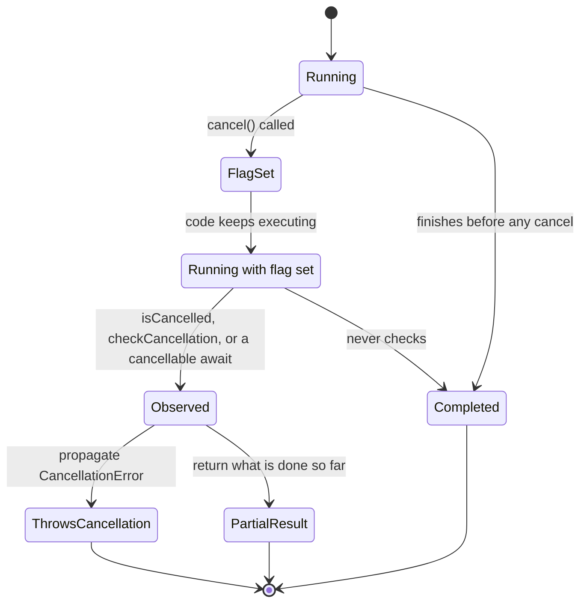

Cancelling a Swift task does not stop it. It sets a flag. The task keeps running exactly as before until some code it executes looks at that flag and decides what to do. This is **cooperative cancellation**: the runtime delivers the request instantly, and each piece of code is responsible for noticing it and responding sensibly.

That design avoids the classic disasters of forced termination, such as locks left held, files half-written, and invariants broken mid-update, but it moves the responsibility to you. Code that never checks is uncancellable. Code that checks wrongly can spin, swallow the signal, or commit results nobody wants. This article shows what the flag does and does not do, which APIs check it for you, how often your own code should check, and four bugs that appear in otherwise careful code.

<!--more-->

The examples use Swift 6 language mode and were compiled and run with the Swift 6.4 toolchain on macOS 26. Timings in the text come from that machine. The Swift blocks build on one another in one `main.swift`. `Mutex` requires iOS 18, macOS 15, or later.

## What `cancel()` actually does

Calling `cancel()` on a task handle, or cancelling a parent whose structured children inherit it, does three things:

1. It atomically sets the task's cancelled flag. The flag can never be cleared.
2. It recursively sets the flag on every structured child.
3. It runs any cancellation handlers registered with `withTaskCancellationHandler`, as the [next article](/swift-cancellation-handlers-cleanup/) explains.

It does **not** interrupt the task, throw into it, or wait for it. A task that never looks at the flag finishes normally:

```swift
import Foundation
import Synchronization

/// Busy CPU work that takes about `duration` and never checks for cancellation.
func uncheckedWork(for duration: Duration) -> Int {
    let clock = ContinuousClock()
    let deadline = clock.now + duration
    var iterations = 0
    while clock.now < deadline {
        iterations &+= 1
    }
    return iterations
}

/// `@concurrent` keeps the CPU-bound work off the caller's actor.
@concurrent
func obliviousJob() async -> (iterations: Int, sawCancellation: Bool) {
    let iterations = uncheckedWork(for: .milliseconds(150))
    return (iterations, Task.isCancelled)
}

let clock = ContinuousClock()
let oblivious = Task { await obliviousJob() }
try await Task.sleep(for: .milliseconds(10))
let cancelledAt = clock.now
oblivious.cancel()
let (iterations, sawFlag) = await oblivious.value
let ignoredFor = cancelledAt.duration(to: clock.now)
assert(iterations > 0 && sawFlag, "The task ran to completion with its flag set")
assert(ignoredFor >= .milliseconds(100))
```

The task was cancelled 10 ms in and kept computing for the remaining 140 ms.

The `@concurrent` attribute is not incidental. This code is top-level code, which is main-actor-isolated, and `Task { }` inherits that isolation. Without a hop off the main actor, the busy loop would run *on* the main actor, the main actor could not resume the code that calls `cancel()` until the loop finished, and the cancellation would arrive after the task was already done. CPU-bound work belongs off the actors that need to stay responsive, including the actor that wants to cancel it. Its flag was set the whole time; nothing read it until the end. Everything that awaited this task, including a parent group or a view model waiting to start the next request, waited too.



## Which APIs check for you

Many asynchronous APIs observe cancellation, but not uniformly. Knowing which do, and how they report it, decides where your own checks are needed:

| API | Behavior when the current task is cancelled |
| --- | --- |
| `Task.sleep(for:)`, `Clock.sleep(until:)` | Throws `CancellationError` immediately, even if called after cancellation |
| `Task.checkCancellation()` | Throws `CancellationError` |
| `Task.isCancelled` | Returns `true`; does nothing else |
| `URLSession` async methods | Cancel the network request and throw `URLError` with code `.cancelled` |
| `for await` over `AsyncStream` | The iterator returns `nil`, so the loop ends normally |
| `Task.yield()` | Suspends and returns normally; does not check |
| `withCheckedContinuation` | Keeps waiting until resumed; does not check |
| Task group `next()` | Children are cancelled; `next()` keeps returning their results |
| Synchronous code, GCD blocks, C libraries | Unaware of task cancellation |

Two entries deserve emphasis. `URLSession` does not throw `CancellationError`. On the test machine, a cancelled `URLSession.shared.data(from:)` threw `NSURLErrorDomain` code −999, which bridges to `URLError(.cancelled)`. Code that recognizes cancellation by `catch is CancellationError` misses it. And continuations ignore cancellation entirely: a task suspended in `withCheckedContinuation` stays suspended until something resumes it, cancelled or not. On the test machine, a continuation resumed after 100 ms by another task held its cancelled waiter for the full remaining time. Bridging cancellation into callback APIs is the subject of the [continuation ownership article](/swift-continuation-ownership/).

## Checking in your own code

Two primitives cover nearly every case:

- `try Task.checkCancellation()` throws `CancellationError` if the current task is cancelled. Use it where cancellation should abort the operation and propagate.
- `Task.isCancelled` returns a `Bool`. Use it where cancellation should produce a different, non-throwing outcome.

A multi-stage pipeline checks at stage boundaries, where stopping leaves no partial state:

```swift
struct Document: Sendable {
    let words: [String]
}

func tokenize(_ text: String) -> [String] {
    text.lowercased().split(whereSeparator: { !$0.isLetter }).map(String.init)
}

func buildIndex(from documents: [String]) async throws -> [String: Set<Int>] {
    var parsed: [Document] = []
    for text in documents {
        try Task.checkCancellation()
        parsed.append(Document(words: tokenize(text)))
    }
    try Task.checkCancellation()
    var index: [String: Set<Int>] = [:]
    for (position, document) in parsed.enumerated() {
        for word in document.words {
            index[word, default: []].insert(position)
        }
    }
    return index
}

let index = try await buildIndex(from: ["Swift tasks cancel", "Tasks check flags"])
assert(index["tasks"] == [0, 1])

let cancelledIndexing = Task {
    withUnsafeCurrentTask { $0?.cancel() }
    return try await buildIndex(from: ["never", "parsed"])
}
do {
    _ = try await cancelledIndexing.value
    assertionFailure("A cancelled build must throw")
} catch is CancellationError {
}
```

`withUnsafeCurrentTask { $0?.cancel() }` cancels the running task from inside itself, a compact way to put a task into the cancelled state for a test. The handle it provides is only valid inside the closure.

## How often to check

A loop that checks after every item responds quickly but pays for every check. One that checks rarely is cheaper but slower to stop. The trade-off is easy to quantify.

If each item takes time $$t$$ and the loop checks every $$N$$ items, the worst-case delay between `cancel()` and the loop noticing is

$$
L_{\text{worst}} \approx N t ,
$$

and if one check costs $$c$$, the overhead relative to the useful work is

$$
\frac{c}{N t} .
$$

On the test machine, an optimized build performed ten million `Task.isCancelled` checks in 0.24 seconds, so $$c \approx 24\,\text{ns}$$. Choose $$N$$ so that $$N t$$ meets your responsiveness target, typically 5 to 20 ms for user-initiated work. With a target of 10 ms, the overhead is about $$24\,\text{ns} / 10\,\text{ms} = 2.4 \times 10^{-6}$$, negligible. Checking per item is only worth avoiding when each item is itself only nanoseconds of work.

```swift
/// Processes items that take about `itemCost` each, checking every `stride` items.
@concurrent
func process(items: Int, itemCost: Duration, checkEvery stride: Int) async throws -> Int {
    for item in 0..<items {
        if item % stride == 0 {
            try Task.checkCancellation()
        }
        _ = uncheckedWork(for: itemCost)
    }
    return items
}

func cancellationLatency(checkEvery stride: Int) async -> Duration {
    let worker = Task {
        try await process(items: 2_000, itemCost: .microseconds(200), checkEvery: stride)
    }
    try? await Task.sleep(for: .milliseconds(20))
    let start = clock.now
    worker.cancel()
    _ = await worker.result
    return start.duration(to: clock.now)
}

let frequentChecks = await cancellationLatency(checkEvery: 10)
let rareChecks = await cancellationLatency(checkEvery: 500)
assert(frequentChecks < .milliseconds(30))
assert(rareChecks > frequentChecks)
print("check every 10 items:", frequentChecks, "every 500 items:", rareChecks)
```

With 0.2 ms items, checking every 10 items bounds the delay at about 2 ms; every 500 items, at about 100 ms. On the test machine one run measured 0.05 ms and 70 ms respectively, both within their bounds. Where the cancellation lands within a stride is effectively random, so the expected latency is about half the worst case.

## Bug 1: `try?` around a cancellable sleep turns a loop into a spin

Polling loops often look like this:

```swift
func pollIgnoringErrors(until deadline: ContinuousClock.Instant) async -> Int {
    var wakeUps = 0
    while clock.now < deadline {
        try? await Task.sleep(for: .milliseconds(10))   // Swallows CancellationError.
        wakeUps += 1
    }
    return wakeUps
}

let spinning = Task { await pollIgnoringErrors(until: clock.now + .milliseconds(100)) }
try await Task.sleep(for: .milliseconds(25))
spinning.cancel()
let wakeUps = await spinning.value
assert(wakeUps > 100, "After cancellation every sleep returns immediately, so the loop spins")
print("wake-ups in 100 ms with a swallowed cancellation:", wakeUps)
```

Before cancellation, the loop wakes up about every 10 ms. After it, `Task.sleep` throws immediately on every call, because the flag is permanent, and `try?` discards that error. The loop becomes a busy spin that burns a core until its other exit condition is met. On the test machine, in a debug build, the loop above woke up about 145,000 times in total, nearly all of them in the 75 ms after cancellation; an open-ended polling loop would spin forever.

The fix is to let cancellation end the loop:

```swift
func poll(until deadline: ContinuousClock.Instant) async -> Int {
    var wakeUps = 0
    while clock.now < deadline {
        do {
            try await Task.sleep(for: .milliseconds(10))
        } catch {
            break
        }
        wakeUps += 1
    }
    return wakeUps
}

let polite = Task { await poll(until: clock.now + .milliseconds(100)) }
try await Task.sleep(for: .milliseconds(25))
polite.cancel()
let politeWakeUps = await polite.value
assert(politeWakeUps <= 3)
```

`while !Task.isCancelled` in the loop condition is equally correct. What is never correct is a `try?` that discards the only signal the loop had.

## Bug 2: treating cancellation as a failure

A catch-all `catch` sees `CancellationError` and `URLError(.cancelled)` like any other error. In UI code, that becomes an error alert that appears when the user navigates away, or a "Something went wrong" banner after typing a second character in a search field. Cancellation is not a failure. It is the caller saying the result is no longer wanted, and the right response is usually to do nothing.

```swift
func isCancellation(_ error: any Error) -> Bool {
    if error is CancellationError { return true }
    if let urlError = error as? URLError, urlError.code == .cancelled { return true }
    return false
}

@MainActor
final class ArticleModel {
    private(set) var title: String?
    private(set) var errorMessage: String?
    private var loadTask: Task<Void, Never>?

    func load(_ fetch: @escaping @Sendable () async throws -> String) {
        loadTask?.cancel()
        loadTask = Task {
            do {
                title = try await fetch()
                errorMessage = nil
            } catch where isCancellation(error) {
                // The caller replaced or abandoned this load. Not an error to show.
            } catch {
                errorMessage = "Could not load the article."
            }
        }
    }

    func cancel() {
        loadTask?.cancel()
    }

    func settle() async {
        await loadTask?.value
    }
}

let articleModel = ArticleModel()
articleModel.load {
    try await Task.sleep(for: .seconds(1))
    return "Never shown"
}
articleModel.cancel()
await articleModel.settle()
assert(articleModel.errorMessage == nil, "Cancelling must not surface an error")

articleModel.load { throw URLError(.cancelled) }
await articleModel.settle()
assert(articleModel.errorMessage == nil, "URLSession cancellations are cancellations too")

articleModel.load { throw URLError(.notConnectedToInternet) }
await articleModel.settle()
assert(articleModel.errorMessage != nil)
```

Put the cancellation clause first and keep it in one helper, so every catch site agrees on what counts as cancellation. If a lower layer translates errors into its own domain type, have it preserve cancellation as a distinct case rather than wrapping it as a generic failure.

## Bug 3: committing a result after cancellation

A cancellation check guards the code *after* it. If the task is cancelled while it is suspended in an `await` that does not throw on cancellation, such as a continuation-based API, a non-cancellable computation, or an `await` on another task's value, then execution resumes as if nothing happened. Writing the result into shared state at that point publishes work nobody asked for.

```swift
/// Simulates an API that completes normally even if its caller is cancelled.
func uncancellableLookup(_ key: String) async -> String {
    await withCheckedContinuation { continuation in
        DispatchQueue.global().asyncAfter(deadline: .now() + .milliseconds(40)) {
            continuation.resume(returning: "value for \(key)")
        }
    }
}

@MainActor
final class LookupModel {
    private(set) var committed: [String] = []

    func lookUpCarelessly(_ key: String) async {
        let value = await uncancellableLookup(key)
        committed.append(value)
    }

    func lookUp(_ key: String) async {
        let value = await uncancellableLookup(key)
        guard !Task.isCancelled else { return }
        committed.append(value)
    }
}

let lookupModel = LookupModel()
let careless = Task { await lookupModel.lookUpCarelessly("stale") }
let careful = Task { await lookupModel.lookUp("also stale") }
try await Task.sleep(for: .milliseconds(10))
careless.cancel()
careful.cancel()
await careless.value
await careful.value
assert(lookupModel.committed == ["value for stale"], "Only the careless version committed after cancellation")
```

The rule: **check for cancellation after the last `await` and before the first irreversible effect**, such as writing to model state, the disk, or a cache. For operations that replace one another, a cancellation check is still not sufficient, because the replaced task may have passed the check just before being cancelled; the [stale results article](/swift-rejecting-stale-results/) adds a generation token for that case.

## Bug 4: assuming cleanup can await normally

The cancelled flag is permanent, so it also affects cleanup code that runs after cancellation is observed. Any cancellable `await` in that cleanup, including a `Task.sleep` for a retry delay, a `URLSession` call that reports an abandoned upload to the server, or a child task, sees the flag and fails immediately.

```swift
let cleanupProbe = Task { () -> String in
    withUnsafeCurrentTask { $0?.cancel() }
    do {
        try Task.checkCancellation()
        return "not reached"
    } catch {
        // Cleanup after cancellation: try to wait briefly before releasing a resource.
        do {
            try await Task.sleep(for: .milliseconds(10))
            return "cleanup slept"
        } catch {
            return "cleanup sleep threw immediately"
        }
    }
}
let cleanupOutcome = await cleanupProbe.value
assert(cleanupOutcome == "cleanup sleep threw immediately")
```

Cleanup in a cancelled task must therefore be synchronous, run inside a cancellation shield, which Swift 6.4 adds for iOS 27 and macOS 27 ([SE-0504](https://github.com/swiftlang/swift-evolution/blob/main/proposals/0504-task-cancellation-shields.md)), or be handed to work that is not cancelled. All three approaches are covered in the [cancellation handlers and cleanup article](/swift-cancellation-handlers-cleanup/).

## Returning partial results

Throwing `CancellationError` is not the only valid response. Some computations get better the longer they run, and a caller who cancels may still want the best answer so far. Such *anytime* algorithms check `Task.isCancelled` and return what they have.

Estimating $$\pi$$ by Monte Carlo sampling is a small example. A point drawn uniformly from the unit square lands inside the quarter circle with probability $$p = \pi/4$$, so after $$n$$ samples with $$h$$ hits, $$\hat\pi = 4h/n$$, with standard error

$$
\sigma_{\hat\pi} = 4\sqrt{\frac{p(1-p)}{n}} \approx \frac{1.64}{\sqrt{n}} .
$$

The longer the task runs, the more samples it takes and the smaller the error, and the caller decides when "good enough" has arrived.

```swift
struct SplitMix64: RandomNumberGenerator {
    private var state: UInt64

    init(seed: UInt64) {
        state = seed
    }

    mutating func next() -> UInt64 {
        state &+= 0x9E37_79B9_7F4A_7C15
        var z = state
        z = (z ^ (z >> 30)) &* 0xBF58_476D_1CE4_E5B9
        z = (z ^ (z >> 27)) &* 0x94D0_49BB_1331_11EB
        return z ^ (z >> 31)
    }
}

struct PiEstimate: Sendable {
    let value: Double
    let samples: Int

    var standardError: Double {
        let p = Double.pi / 4
        return 4 * (p * (1 - p) / Double(samples)).squareRoot()
    }
}

/// Samples in batches until cancelled, then returns the estimate so far instead of throwing.
@concurrent
func estimatePi(seed: UInt64, batch: Int = 10_000) async -> PiEstimate {
    var generator = SplitMix64(seed: seed)
    var hits = 0
    var samples = 0
    repeat {
        for _ in 0..<batch {
            let x = Double.random(in: 0..<1, using: &generator)
            let y = Double.random(in: 0..<1, using: &generator)
            if x * x + y * y < 1 { hits += 1 }
        }
        samples += batch
        await Task.yield()
    } while !Task.isCancelled
    return PiEstimate(value: 4 * Double(hits) / Double(samples), samples: samples)
}

let estimator = Task { await estimatePi(seed: 2026) }
try await Task.sleep(for: .milliseconds(100))
estimator.cancel()
let estimate = await estimator.value
assert(estimate.samples >= 10_000)
assert(abs(estimate.value - .pi) < 5 * estimate.standardError, "Within five standard errors")
print("pi ≈", estimate.value, "from", estimate.samples, "samples, standard error", estimate.standardError)
```

The `repeat ... while` structure guarantees at least one batch, so the estimate is always defined. The `Task.yield()` between batches is not needed for cancellation, since the flag is checked regardless, but it keeps the estimator from monopolizing its thread when other work is waiting.

Whether to throw or return partially is an API decision. Make it explicit in the documentation, because callers handle the two very differently: a throwing function's caller writes a `catch`, while a partial-result caller must check how complete the result is.

## Summary

- `cancel()` sets a permanent flag on a task and its structured children. Nothing stops until code observes the flag.
- `Task.sleep`, `checkCancellation`, and `URLSession` observe it; continuations, `Task.yield`, and synchronous code do not. `URLSession` reports `URLError(.cancelled)`, not `CancellationError`.
- Check every $$N$$ items so that $$N t$$ meets your latency target. At about 24 ns per check, overhead is rarely a concern.
- Never wrap a cancellable sleep in `try?` inside a loop: after cancellation it spins.
- Treat cancellation as its own outcome, not a failure; recognize both error forms in one place.
- Check after the last `await` and before the first irreversible effect.
- Cleanup in a cancelled task cannot rely on cancellable awaits.
- Anytime algorithms can return the best result so far instead of throwing; document which contract you chose.

## Exercise

Write `func compress(_ chunks: [Data]) async throws -> Data` that compresses chunks sequentially with a synchronous compression function taking about 3 ms per chunk. Measure cancellation latency with checks before every chunk, every 10 chunks, and every 100 chunks, and confirm the $$N t$$ bound. Then make the function return a valid partial archive on cancellation, containing only fully compressed chunks plus a footer, and write a test that cancels at random points and verifies the partial archive always decompresses correctly.

## Further reading

- [SE-0304: Structured concurrency](https://github.com/swiftlang/swift-evolution/blob/main/proposals/0304-structured-concurrency.md), section "Cancellation."
- [Task.checkCancellation()](https://developer.apple.com/documentation/swift/task/checkcancellation()) and [Task.isCancelled](https://developer.apple.com/documentation/swift/task/iscancelled-swift.type.property).
- [Beyond the basics of structured concurrency](https://developer.apple.com/videos/play/wwdc2023/10170/), WWDC23, on cancellation propagation and task trees.

Previous: [Task Groups: Fan-Out, Aggregation, and Early Exit](/swift-task-groups/). Next: [Cancellation Handlers and Reliable Resource Cleanup](/swift-cancellation-handlers-cleanup/).

Return to the [Concurrency roadmap](/swift-concurrency-roadmap/).
