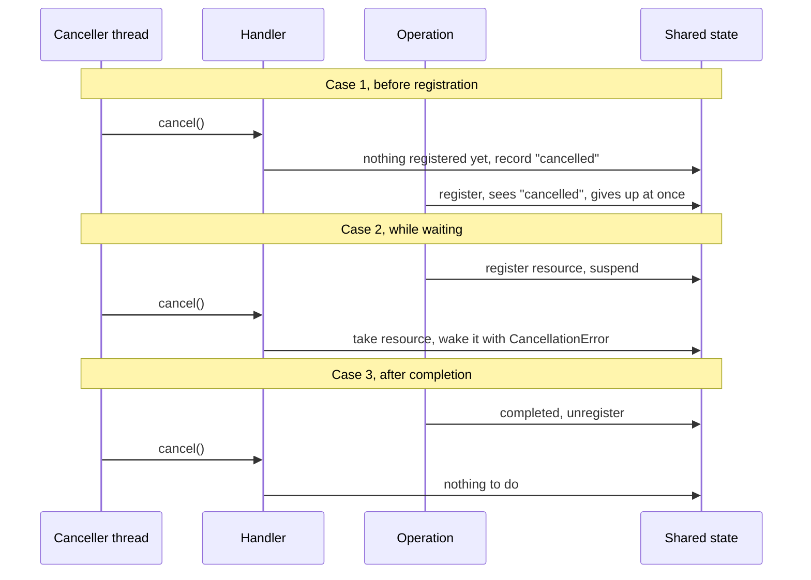

Cooperative cancellation works when the cancelled code is running and can check a flag. It does nothing for code that is *suspended*, waiting for a callback, a legacy download, a queued permit, or a child process. That code will not check anything until it wakes up, and it may not wake up until the very operation you wanted to cancel finishes.

`withTaskCancellationHandler` closes that gap. It runs a closure at the moment of cancellation, from whichever thread called `cancel()`, so you can poke the underlying operation and make it stop. The price is concurrency: the handler races with the operation, and getting that race right is where most of the subtlety lies. This article builds the race-free patterns, then turns to the other half of the problem, cleanup that runs reliably on every exit path, including cleanup that needs to `await`.

<!--more-->

The examples use Swift 6 language mode and were compiled and run with the Swift 6.4 toolchain on macOS 26. The Swift blocks build on one another in one `main.swift`. `Mutex` requires iOS 18, macOS 15, or later.

## What a cancellation handler is

<!-- skip-check -->
```swift
func withTaskCancellationHandler<T>(
    operation: () async throws -> T,
    onCancel handler: @Sendable () -> Void,
    isolation: isolated (any Actor)? = #isolation
) async rethrows -> T
```

The function runs `operation` normally. If the current task is cancelled while `operation` is in progress, `handler` runs **immediately**, synchronously, on the thread that called `cancel()`. Precisely:

- If the task is already cancelled when `withTaskCancellationHandler` is entered, `handler` runs *before* `operation` starts.
- If cancellation happens while `operation` runs, `handler` runs concurrently with it, possibly on another thread at the same instant.
- If cancellation happens after `operation` returns, `handler` never runs.
- The handler runs at most once.

The handler does not cancel anything on its own, and it does not stop `operation`. Its job is to forward the cancellation to something that can: a legacy object's `cancel()` method, a continuation waiting in a queue, a file descriptor to close.

```swift
import Foundation
import Synchronization

/// A thread-safe ordered list of event names.
final class EventList: Sendable {
    private let storage = Mutex<[String]>([])

    func append(_ event: String) {
        storage.withLock { $0.append(event) }
    }

    var events: [String] {
        storage.withLock { $0 }
    }
}

let preCancelled = EventList()
let preCancelledTask = Task {
    withUnsafeCurrentTask { $0?.cancel() }
    await withTaskCancellationHandler {
        preCancelled.append("operation")
    } onCancel: {
        preCancelled.append("handler")
    }
}
await preCancelledTask.value
assert(preCancelled.events == ["handler", "operation"], "An already-cancelled task runs the handler first")
```

The handler is `@Sendable` and may run on any thread, so it can only touch state that is safe to share, typically a `Mutex`, an atomic, or an object with its own thread safety. It cannot be isolated to an actor, and it cannot `await`: it must do its work, quickly, right now.

## Forwarding cancellation to a legacy operation

Here is a legacy downloader of the kind found in older SDKs and third-party libraries: it starts work, reports completion through a callback, and can be cancelled with a method. Cancelling it makes it call the completion handler early with an error.

```swift
enum DownloadError: Error, Equatable {
    case cancelled
}

/// A callback-based API with its own cancellation, standing in for a legacy SDK.
final class LegacyDownload: Sendable {
    private let completion = Mutex<(@Sendable (Result<Data, DownloadError>) -> Void)?>(nil)
    let bytes: Int

    init(bytes: Int) {
        self.bytes = bytes
    }

    func start(afterMilliseconds delay: Int, completion: @escaping @Sendable (Result<Data, DownloadError>) -> Void) {
        self.completion.withLock { $0 = completion }
        DispatchQueue.global().asyncAfter(deadline: .now() + .milliseconds(delay)) { [self] in
            finish(with: .success(Data(count: bytes)))
        }
    }

    func cancel() {
        finish(with: .failure(.cancelled))
    }

    /// Calls the completion handler at most once, whichever of the timer or cancel gets here first.
    private func finish(with result: Result<Data, DownloadError>) {
        let pending = completion.withLock { stored in
            defer { stored = nil }
            return stored
        }
        pending?(result)
    }
}
```

Wrapping it with a continuation alone produces an async function that cannot be cancelled: the continuation waits for the callback, and the callback waits for the download. Adding a cancellation handler connects the task's cancellation to the download's `cancel()`:

```swift
func download(bytes: Int, afterMilliseconds delay: Int) async throws -> Data {
    let legacy = LegacyDownload(bytes: bytes)
    return try await withTaskCancellationHandler {
        try await withCheckedThrowingContinuation { continuation in
            legacy.start(afterMilliseconds: delay) { result in
                continuation.resume(with: result)
            }
        }
    } onCancel: {
        legacy.cancel()
    }
}

let finished = try await download(bytes: 512, afterMilliseconds: 10)
assert(finished.count == 512)

let clock = ContinuousClock()
let slowDownload = Task { try await download(bytes: 512, afterMilliseconds: 5_000) }
try await Task.sleep(for: .milliseconds(20))
let cancelStart = clock.now
slowDownload.cancel()
let outcome = await slowDownload.result
assert(cancelStart.duration(to: clock.now) < .milliseconds(100), "Cancellation reached the legacy download")
if case .failure(let error) = outcome {
    assert(error as? DownloadError == .cancelled)
} else {
    assertionFailure("A cancelled download must fail")
}
```

A five-second download stopped within a millisecond of `cancel()`. The task was suspended in the continuation the whole time and never checked a flag. The handler did the work, from the cancelling thread.

The wrapper is simple because `LegacyDownload` already handles the hard part itself: its `finish` method guarantees the completion runs at most once, even when `cancel()` races with natural completion. (The simulated timer still fires five seconds later and finds nothing to do; a real downloader would also stop its network activity.) That is what keeps the continuation from being resumed twice. When an API lacks that guarantee, the wrapper has to provide it, as the [continuation ownership article](/swift-continuation-ownership/) shows.

There is also a timing case this wrapper gets wrong: if the task is cancelled *before* `start` runs, the handler calls `cancel()` on a download with no completion registered, which does nothing, and then `start` begins a download that nobody will cancel. The continuation then waits the full five seconds. The next section treats that race properly.

## The three-way race

A cancellation handler interacts with an operation that is itself changing state. For any resource the handler needs to touch, there are three moments cancellation can arrive:



The shared state must make each case resolve correctly whichever order the two sides reach it in. Handling only the second case, which is the one tests usually exercise, leaves two bugs: a lost cancellation in case 1, and a stale reference or double resume in case 3.

## A complete example: an async permit pool

A pool of permits limits how many operations can use a scarce resource at once: concurrent uploads, database connections, simultaneous image decodes. `acquire()` suspends until a permit is free; `release()` hands it to the next waiter. A waiter that is cancelled while queued must leave the queue and resume with `CancellationError`. If it stayed, the next `release()` would hand a permit to a task that no longer wants it, and that permit would be lost forever.

Each acquisition gets an identifier and a phase stored under one lock. Every transition happens inside `withLock`, so the operation and the handler always see a consistent phase:

```swift
/// Limits concurrent access to `capacity` holders. Cancellable while waiting.
final class Permits: Sendable {
    private enum Phase {
        case registering
        case waiting(CheckedContinuation<Void, any Error>)
        case cancelledEarly
    }

    private struct State {
        var available: Int
        var phases: [UInt64: Phase] = [:]
        var queue: [UInt64] = []
        var nextID: UInt64 = 0
    }

    private let state: Mutex<State>

    init(capacity: Int) {
        precondition(capacity > 0)
        state = Mutex(State(available: capacity))
    }

    func acquire() async throws {
        let id = state.withLock { state -> UInt64 in
            state.nextID += 1
            state.phases[state.nextID] = .registering
            return state.nextID
        }
        try await withTaskCancellationHandler {
            try await withCheckedThrowingContinuation { (continuation: CheckedContinuation<Void, any Error>) in
                enum Decision { case granted, cancelled, queued }
                let decision = state.withLock { state -> Decision in
                    if case .cancelledEarly = state.phases[id] {
                        state.phases[id] = nil
                        return .cancelled
                    }
                    if state.available > 0 {
                        state.available -= 1
                        state.phases[id] = nil
                        return .granted
                    }
                    state.phases[id] = .waiting(continuation)
                    state.queue.append(id)
                    return .queued
                }
                switch decision {
                case .granted: continuation.resume()
                case .cancelled: continuation.resume(throwing: CancellationError())
                case .queued: break
                }
            }
        } onCancel: {
            let waiter = state.withLock { state -> CheckedContinuation<Void, any Error>? in
                switch state.phases[id] {
                case .registering:
                    state.phases[id] = .cancelledEarly     // Case 1: the operation will see this.
                    return nil
                case .waiting(let continuation):
                    state.phases[id] = nil                 // Case 2: leave the queue now.
                    state.queue.removeAll { $0 == id }
                    return continuation
                case .cancelledEarly, nil:
                    return nil                             // Case 3: already granted or resolved.
                }
            }
            waiter?.resume(throwing: CancellationError())
        }
    }

    func release() {
        let next = state.withLock { state -> CheckedContinuation<Void, any Error>? in
            while !state.queue.isEmpty {
                let id = state.queue.removeFirst()
                if case .waiting(let continuation) = state.phases.removeValue(forKey: id) {
                    return continuation
                }
            }
            state.available += 1
            return nil
        }
        next?.resume()
    }

    /// For tests: everything a leak would leave behind.
    var bookkeeping: (available: Int, phases: Int, queued: Int) {
        state.withLock { ($0.available, $0.phases.count, $0.queue.count) }
    }
}
```

Several rules make this correct, and they generalize to any handler-based design:

- **One lock covers every piece of state both sides read.** The phase, the queue, and the count change together.
- **Continuations are resumed outside the lock.** Resuming can run arbitrary code, and holding a lock while doing that invites deadlocks.
- **Every path resumes each continuation exactly once.** A continuation leaves the state at the same moment it is chosen for resumption, so no other path can find it again.
- **The early-cancellation case leaves a marker.** If the handler runs before the operation has registered, it records `cancelledEarly`, and the operation checks for it before queuing.
- **Late cancellation is a no-op.** Once a permit is granted, the phase entry is gone, and the handler finds nothing to do. The caller now holds a permit in a cancelled task and must release it as usual.

The tests below exercise all three cases and check that nothing is left behind:

```swift
let permits = Permits(capacity: 1)
try await permits.acquire()                            // The only permit is now held.

let queued = Task { try await permits.acquire() }      // Waits in the queue.
try await Task.sleep(for: .milliseconds(20))
queued.cancel()                                        // Case 2: cancelled while waiting.
switch await queued.result {
case .success: assertionFailure("A cancelled waiter must not get a permit")
case .failure(let error): assert(error is CancellationError)
}
assert(permits.bookkeeping.queued == 0, "The cancelled waiter left the queue")

let early = Task {
    withUnsafeCurrentTask { $0?.cancel() }
    try await permits.acquire()                        // Case 1: cancelled before registering.
}
switch await early.result {
case .success: assertionFailure("A pre-cancelled task must not wait for a permit")
case .failure(let error): assert(error is CancellationError)
}

permits.release()
assert(permits.bookkeeping.available == 1, "The released permit was not handed to a cancelled waiter")

let late = Task { () -> Bool in
    try await permits.acquire()                        // Granted immediately.
    withUnsafeCurrentTask { $0?.cancel() }             // Case 3: cancelled after the grant.
    permits.release()
    return true
}
let lateResult = try await late.value
assert(lateResult)
let bookkeeping = permits.bookkeeping
assert(bookkeeping.available == 1 && bookkeeping.phases == 0 && bookkeeping.queued == 0, "No leaked state")
```

## Cleanup on every exit path

The second half of cancellation safety is making sure resources are released however an operation ends: success, error, or cancellation. In Swift, `defer` is the primary tool. A `defer` block runs when its scope exits for any reason, and cancellation is just one of the ways a scope exits, typically by a thrown `CancellationError`.

A scoped helper makes acquisition and release impossible to separate:

```swift
extension Permits {
    nonisolated(nonsending)
    func withPermit<T>(_ body: () async throws -> T) async throws -> T {
        try await acquire()
        defer { release() }
        return try await body()
    }
}

let pool = Permits(capacity: 2)
let peak = Mutex((current: 0, peak: 0))
try await withThrowingTaskGroup(of: Void.self) { group in
    for _ in 0..<8 {
        group.addTask {
            try await pool.withPermit {
                peak.withLock { $0.current += 1; $0.peak = max($0.peak, $0.current) }
                try await Task.sleep(for: .milliseconds(10))
                peak.withLock { $0.current -= 1 }
            }
        }
    }
    try await group.waitForAll()
}
assert(peak.withLock { $0.peak } == 2)
assert(pool.bookkeeping.available == 2, "Every permit came back")
```

Notice `nonisolated(nonsending)` on the helper. `withPermit` takes a non-`Sendable` closure and calls it. Under default Swift 6 rules, a plain non-isolated `async` function runs on the global executor, so calling it from main-actor code would send a main-actor closure to another executor, and the compiler rejects that. `nonisolated(nonsending)`, new in Swift 6.2, makes the helper run on the caller's executor instead, so the closure never crosses an isolation boundary. Before Swift 6.2, the same effect needed an extra `isolation: isolated (any Actor)? = #isolation` parameter, which is how `withTaskCancellationHandler` itself is declared. Every scoped "with" helper that calls a closure should use one of the two.

`release()` is synchronous, and that is a deliberate design choice. Until Swift 6.4, a `defer` block could not contain `await` at all, so a resource whose release had to be awaited, such as an actor method, could not be released from `defer`. Swift 6.4 lifts that restriction, as the next section shows, but synchronous release is still the more robust design: it cannot be interrupted by cancellation, cannot suspend while other code observes the resource half-released, and works with every toolchain. When you design a resource type, make its release path synchronous and thread-safe, backed by a lock. That decision matters more for reliable cleanup than any other.

Files are the same. Creating a temporary directory and removing it in `defer` guarantees removal even when the work inside is cancelled:

```swift
nonisolated(nonsending)
func withTemporaryDirectory<T>(_ body: (URL) async throws -> T) async throws -> T {
    let directory = FileManager.default.temporaryDirectory
        .appendingPathComponent("cleanup-demo-\(UUID().uuidString)", isDirectory: true)
    try FileManager.default.createDirectory(at: directory, withIntermediateDirectories: true)
    defer { try? FileManager.default.removeItem(at: directory) }
    return try await body(directory)
}

let createdPaths = Mutex<[URL]>([])
let cancelledExport = Task {
    try await withTemporaryDirectory { directory in
        createdPaths.withLock { $0.append(directory) }
        try Data("partial".utf8).write(to: directory.appendingPathComponent("export.part"))
        try await Task.sleep(for: .seconds(5))     // Cancelled here.
    }
}
try await Task.sleep(for: .milliseconds(30))
cancelledExport.cancel()
_ = await cancelledExport.result
let exportDirectory = createdPaths.withLock { $0 }.first!
assert(!FileManager.default.fileExists(atPath: exportDirectory.path), "The temporary directory was removed")
```

## When cleanup must `await`

Some cleanup is inherently asynchronous: closing an upload session on the server, flushing a log through an actor, shutting down a network connection gracefully. Two obstacles stand in the way. Before Swift 6.4, `defer` could not `await`. And in a cancelled task, as the [cooperative cancellation article](/swift-cooperative-cancellation/) shows, every cancellable `await` fails immediately, including the ones in cleanup code.

Swift 6.4 removes the first obstacle. [SE-0493](https://github.com/swiftlang/swift-evolution/blob/main/proposals/0493-defer-async.md) allows `await` inside `defer`; the scope implicitly awaits the deferred work on every exit. It is a compiler feature, so it works on any deployment target. But the deferred code still runs *in the cancelled task*:

```swift
func uploadWithAsyncDefer(log: EventList) async throws -> String {
    defer {
        do {
            try await Task.sleep(for: .milliseconds(10))     // Stands in for closing the session.
            log.append("upload session closed")
        } catch {
            log.append("cleanup saw the cancellation")
        }
    }
    log.append("uploading")
    try await Task.sleep(for: .seconds(5))
    return "uploaded"
}

let deferLog = EventList()
let deferredUpload = Task { try await uploadWithAsyncDefer(log: deferLog) }
try await Task.sleep(for: .milliseconds(20))
deferredUpload.cancel()
_ = await deferredUpload.result
assert(deferLog.events == ["uploading", "cleanup saw the cancellation"])
```

The `defer` ran, and awaited, but its network call stand-in failed at once because the task's cancelled flag is permanent. Async `defer` solves "where do I put asynchronous cleanup"; it does not solve "how does cleanup survive cancellation."

### Cancellation shields, on iOS 27 and macOS 27

Swift 6.4 also adds the missing piece, `withTaskCancellationShield` ([SE-0504](https://github.com/swiftlang/swift-evolution/blob/main/proposals/0504-task-cancellation-shields.md)). Inside a shield, the current task observes itself as *not* cancelled: `Task.isCancelled` is `false`, `Task.sleep` does not throw early, child tasks created inside are not cancelled automatically, and cancellation handlers registered inside do not fire. When the shield ends, the task is cancelled again, because it always was; the shield changes what code can *observe*, not the task's state. Asking a task handle from the outside, with `task.isCancelled`, always reports the real state.

The shield requires runtime support, so it is available only on iOS 27, macOS 27, and the corresponding releases of other platforms, with no back-deployment:

<!-- skip-check -->
```swift
@available(iOS 27, macOS 27, *)
func uploadWithShieldedCleanup(log: EventList) async throws -> String {
    defer {
        await withTaskCancellationShield {
            do {
                try await Task.sleep(for: .milliseconds(10))
                log.append("upload session closed")
            } catch {
                log.append("cleanup saw the cancellation")
            }
        }
    }
    log.append("uploading")
    try await Task.sleep(for: .seconds(5))
    return "uploaded"
}

if #available(iOS 27, macOS 27, *) {
    let shieldLog = EventList()
    let shieldedUpload = Task { try await uploadWithShieldedCleanup(log: shieldLog) }
    try await Task.sleep(for: .milliseconds(20))
    shieldedUpload.cancel()
    _ = await shieldedUpload.result
    assert(shieldLog.events == ["uploading", "upload session closed"])
}
```

The shielded example was compiled for this article but not executed, because the test machine runs macOS 26.6. Its expected behavior follows directly from the proposal's semantics.

There is a practical trap here. With the Xcode 27.1 toolchain, a binary built for a macOS 26 deployment target that contains this code, even behind `#available`, failed to launch on macOS 26.6 with `dyld: Symbol not found: _swift_task_cancellationShieldPush`. The shield's inlined implementation referenced its runtime entry points as strong, not weak, symbols. If your app supports systems older than iOS 27 or macOS 27, launch it on the oldest supported OS before shipping code that uses shields, and keep the fallback below.

### The fallback: a fresh unstructured task

Before iOS 27 and macOS 27, the standard workaround, which SE-0504 itself describes, is to run the cleanup in a **new unstructured task**, which does not inherit cancellation, and await it:

```swift
/// Runs `body`, then `cleanup`, even if `body` throws or the task is cancelled.
/// `cleanup` runs in a fresh task, so cancellation of the caller does not abort it.
nonisolated(nonsending)
func withAsyncCleanup<T: Sendable>(
    _ body: () async throws -> T,
    cleanup: @escaping @Sendable () async -> Void
) async throws -> T {
    let result: Result<T, any Error>
    do {
        result = .success(try await body())
    } catch {
        result = .failure(error)
    }
    await Task { await cleanup() }.value
    return try result.get()
}

let cleanupLog = EventList()
let abandonedUpload = Task {
    try await withAsyncCleanup {
        cleanupLog.append("uploading")
        try await Task.sleep(for: .seconds(5))
        return "uploaded"
    } cleanup: {
        do {
            try await Task.sleep(for: .milliseconds(10))     // Stands in for closing the session.
            cleanupLog.append("upload session closed")
        } catch {
            cleanupLog.append("cleanup saw the cancellation")
        }
    }
}
try await Task.sleep(for: .milliseconds(20))
abandonedUpload.cancel()
_ = await abandonedUpload.result
assert(cleanupLog.events == ["uploading", "upload session closed"])
```

The cleanup's own `Task.sleep` succeeded even though the caller was cancelled, because the cleanup task has its own, uncancelled flag. Awaiting `.value` keeps the ordering structured: `withAsyncCleanup` does not return until the cleanup finishes, so callers can rely on it having happened. The costs, compared with a shield, are an extra task to schedule, a cleanup that cannot touch non-`Sendable` state, and a pattern that only works in `async` code.

Whichever mechanism you use, use it sparingly and bound it. A shielded cleanup that hangs, for example because the server never answers, now holds up the cancelled caller indefinitely, because the caller can no longer interrupt it. Give asynchronous cleanup its own timeout, such as the `withTimeout` helper from the [task groups article](/swift-task-groups/), and treat cleanup failure as something to log, not something to retry forever.

## Rules that keep cleanup reliable

- **Prefer synchronous release.** Design resources so that releasing them is synchronous and thread-safe. Then `defer` handles every exit path.
- **Never hold a lock across `await`.** `Mutex.withLock` takes a synchronous closure, so the compiler enforces this for `Mutex`. Hand-rolled locks with separate lock and unlock calls do not have that protection.
- **Keep handlers short and non-blocking.** A cancellation handler runs on the canceller's thread, which may be the main thread. Flip state and call a non-blocking `cancel()`; never wait in a handler.
- **Resolve all three timings.** Before registration, during the wait, after completion. Test each one deliberately, as the permit tests do.
- **Make cancellation idempotent.** A resource may see `cancel()` from the handler and a natural completion at the same moment. Exactly one of them should win.
- **Shield async cleanup only when necessary, and bound it.**

## Summary

- `withTaskCancellationHandler` runs its handler immediately on cancellation, concurrently with the operation, or before it if the task was already cancelled.
- Use the handler to forward cancellation into operations that are suspended and cannot check a flag: legacy cancellable APIs, queued continuations, file descriptors.
- Guard shared state with one lock, model each acquisition's phase explicitly, resume continuations outside the lock, and handle early, waiting, and late cancellation.
- `defer` handles cleanup on every exit, including cancellation, as long as the cleanup is synchronous.
- Swift 6.4 allows `await` in `defer`, but deferred code still observes cancellation.
- For cleanup that must survive cancellation, use `withTaskCancellationShield` on iOS 27 and macOS 27, or a fresh `Task` whose value you await on earlier systems, always with a time bound.

## Exercise

Extend `Permits` with `func acquire(timeout: Duration) async throws` that throws a `TimeoutError` if no permit becomes available in time. The timeout and cancellation must share the same removal path, so a waiter is removed from the queue exactly once whichever happens first, and a permit released at the same instant as the timeout is either granted or returned, never lost. Write a stress test that runs thousands of acquisitions with random timeouts, cancellations, and releases, then checks that `bookkeeping` returns to its initial state.

## Further reading

- [withTaskCancellationHandler(operation:onCancel:isolation:)](https://developer.apple.com/documentation/swift/withtaskcancellationhandler(operation:oncancel:isolation:)).
- [SE-0304: Structured concurrency](https://github.com/swiftlang/swift-evolution/blob/main/proposals/0304-structured-concurrency.md), section "Cancellation handlers."
- [SE-0433: Synchronous Mutual Exclusion Lock](https://github.com/swiftlang/swift-evolution/blob/main/proposals/0433-mutex.md), which introduced `Mutex`.
- [SE-0493: Support `async` calls in `defer` bodies](https://github.com/swiftlang/swift-evolution/blob/main/proposals/0493-defer-async.md) and [SE-0504: Task Cancellation Shields](https://github.com/swiftlang/swift-evolution/blob/main/proposals/0504-task-cancellation-shields.md).

Previous: [Cooperative Cancellation and Cancellation Checks](/swift-cooperative-cancellation/). Next: [Unstructured and Detached Tasks: When to Use Each](/swift-unstructured-detached-tasks/).

Return to the [Concurrency roadmap](/swift-concurrency-roadmap/).
