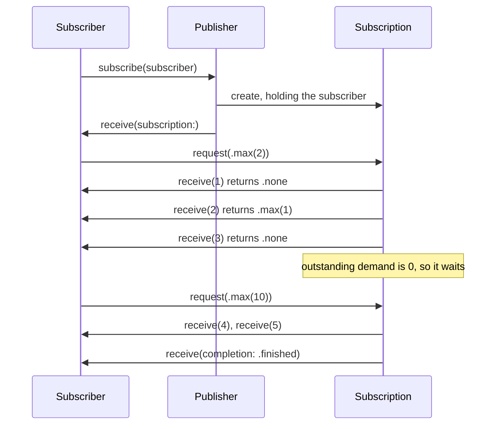
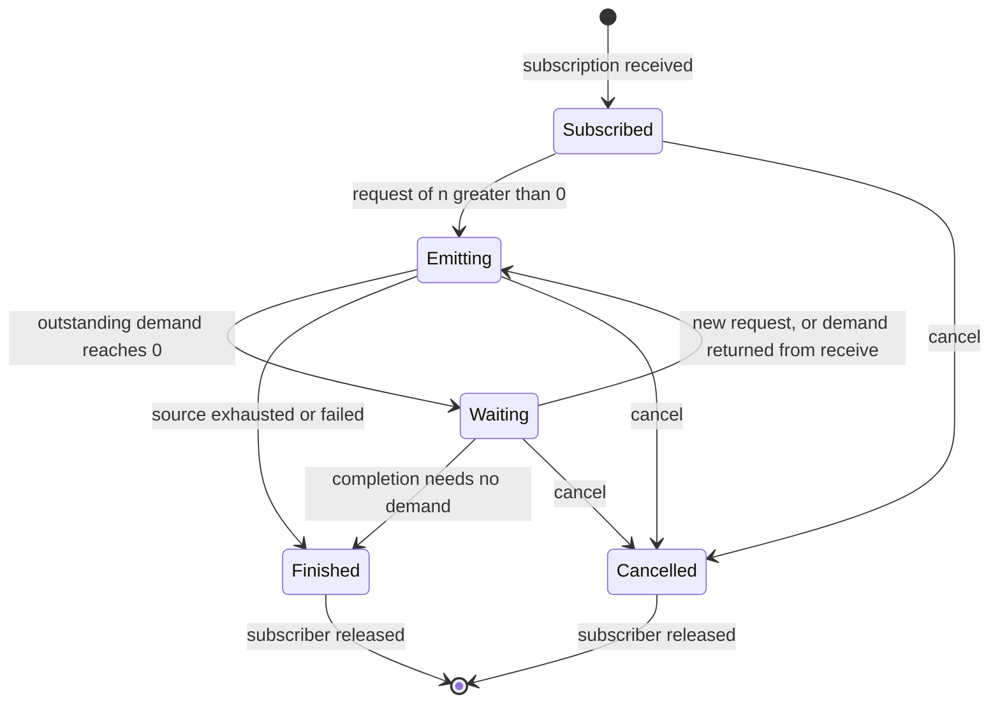

Every Combine pipeline, however many operators it chains, is built from three protocols. A **publisher** describes values that will arrive over time. A **subscriber** consumes them. A **subscription** is the live connection between one publisher and one subscriber, and it carries the one idea that separates Combine from a callback list: the subscriber decides how many values it is ready for, and the publisher may never send more. That number is called **demand**.

Most code never touches these protocols directly, because `sink`, `assign`, and the built-in operators implement them for you. But every confusing Combine behavior, from a subject that silently loses values to a pipeline that does its work at the wrong moment, is explained by the contract between them. This article implements both ends by hand: a subscriber that records every signal it receives and a publisher that honors demand, survives reentrant requests, and stops when cancelled. Along the way it measures how the built-in publishers behave when that contract is pushed.

<!--more-->

The examples use Swift 6 language mode and were compiled and run with the Swift 6.4 toolchain from Xcode 27.1 on macOS 26. Combine ships with the OS on every Apple platform since iOS 13 and macOS 10.15, so nothing needs to be installed. Paste the blocks in order into one `main.swift`; each one relies on the declarations before it, and every `assert` passed when the file was run.

## Three protocols and a contract

These are the declarations from the Combine module interface, with attributes removed:

<!-- skip-check -->
```swift
public protocol Publisher<Output, Failure> {
    associatedtype Output
    associatedtype Failure: Error
    func receive<S: Subscriber>(subscriber: S) where S.Input == Output, S.Failure == Failure
}

public protocol Subscriber<Input, Failure>: CustomCombineIdentifierConvertible {
    associatedtype Input
    associatedtype Failure: Error
    func receive(subscription: any Subscription)
    func receive(_ input: Input) -> Subscribers.Demand
    func receive(completion: Subscribers.Completion<Failure>)
}

public protocol Subscription: Cancellable, CustomCombineIdentifierConvertible {
    func request(_ demand: Subscribers.Demand)
}
```

Everything in Combine is a refinement of these seven requirements. A few things are worth noticing before any code runs:

- A publisher has a single requirement, and it is not "send values". `receive(subscriber:)` is called when someone subscribes, and its job is to hand that subscriber a subscription. A publisher is therefore usually a cheap value type that *describes* work; the subscription is the object that does it.
- The subscriber's three methods are the only three signals that can ever flow downstream: "here is your subscription", "here is a value", and "the stream is over". A completion is either `.finished` or `.failure(Failure)`, and a publisher whose `Failure` is `Never` can only finish.
- Signals flow upstream through the subscription: `request(_:)` adds demand, and `cancel()`, inherited from `Cancellable`, ends the relationship.
- The return value of `receive(_:)` is also demand. A subscriber can raise its demand either by calling `request(_:)` on the subscription it was given or by returning a non-zero demand after each value.

Those signals have to arrive in a particular order. Combine follows the [Reactive Streams](https://github.com/reactive-streams/reactive-streams-jvm/blob/master/README.md) specification, which grew out of the same problem on the JVM, and the rules that matter in practice are these:

| Rule | What it means for a publisher |
|---|---|
| Subscription first | Call `receive(subscription:)` exactly once, before any value or completion |
| Bounded by demand | The number of values sent never exceeds the total demand requested |
| One terminal signal | Send at most one completion, and nothing after it |
| Serial signals | Never call the subscriber's methods concurrently from two threads |
| Cancel is final | After `cancel()`, stop sending eventually and release the subscriber |

The bounded-by-demand rule can be written precisely. If the subscriber has made requests $$r_1, r_2, \ldots$$ through `request(_:)` and returned demands $$d_1, d_2, \ldots$$ from `receive(_:)`, then at every moment $$t$$ the number of values delivered satisfies

$$
N(t) \;\le\; D(t) \;=\; \sum_{i} r_i \;+\; \sum_{j} d_j ,
$$

where any term equal to `.unlimited` makes $$D(t)$$ infinite. The difference $$D(t) - N(t)$$ is the *outstanding demand*: how many more values the publisher is allowed to send right now. Every publisher you write keeps that one number, and every built-in operator does too.

## Watching the handshake

The fastest way to see the contract is to subscribe with something that writes down every signal. This subscriber records events as strings, asks for an initial batch, and lets the caller decide how much extra demand to return after each value:

```swift
import Combine
import Foundation

/// A subscriber that records every signal it receives.
final class EventRecorder<Input, Failure: Error>: Subscriber {
    private(set) var events: [String] = []
    private var subscription: (any Subscription)?
    private let initialDemand: Subscribers.Demand
    private let demandAfterValue: (Input) -> Subscribers.Demand

    init(initialDemand: Subscribers.Demand,
         demandAfterValue: @escaping (Input) -> Subscribers.Demand = { _ in .none }) {
        self.initialDemand = initialDemand
        self.demandAfterValue = demandAfterValue
    }

    func receive(subscription: any Subscription) {
        events.append("subscription")
        self.subscription = subscription
        if initialDemand > .none { request(initialDemand) }
    }

    func receive(_ input: Input) -> Subscribers.Demand {
        let more = demandAfterValue(input)
        events.append(more > .none ? "value \(input) (+\(more))" : "value \(input)")
        return more
    }

    func receive(completion: Subscribers.Completion<Failure>) {
        events.append("completion \(completion)")
        subscription = nil
    }

    func request(_ demand: Subscribers.Demand) {
        events.append("request \(demand)")
        subscription?.request(demand)
    }

    func cancel() {
        events.append("cancel")
        subscription?.cancel()
        subscription = nil
    }
}
```

The recorder keeps a strong reference to its subscription, and the subscription keeps a strong reference to the recorder so it can deliver values. That reference cycle is deliberate and universal in Combine: it is what keeps a pipeline alive while nobody else holds it, and it is broken when the stream completes or is cancelled. That is why `receive(completion:)` and `cancel()` both set `subscription` to `nil`.

Now subscribe it to a sequence publisher, ask for two values, and return one more unit of demand after the second:

```swift
let recorder = EventRecorder<Int, Never>(initialDemand: .max(2)) { $0 == 2 ? .max(1) : .none }
(1...5).publisher.subscribe(recorder)

assert(recorder.events == [
    "subscription",
    "request max(2)",
    "value 1",
    "value 2 (+max(1))",
    "value 3",
])
```

The pipeline stopped after three values even though the sequence holds five, and it did so without any buffering or blocking: the publisher had no outstanding demand left, so it simply waited. Two more facts are visible in the order of events. All three values were delivered *inside* the call to `request(.max(2))`, before it returned, because a sequence has its values available immediately. And the extra unit of demand returned from the second `receive(_:)` was honored in the same loop.

Asking for more later resumes the stream where it stopped, and the completion arrives as soon as the sequence runs out:

```swift
recorder.request(.max(10))
assert(recorder.events.suffix(4) == [
    "request max(10)",
    "value 4",
    "value 5",
    "completion finished",
])
```

The handshake has the same shape for every publisher, whether its values come from an array, a network response, or a user tapping a button:



## Demand is a saturating counter

`Subscribers.Demand` is either `.unlimited` or `.max(n)` for a non-negative `n`, and its arithmetic is designed so that bookkeeping code can add demands freely without worrying about overflow:

```swift
typealias Demand = Subscribers.Demand

assert(Demand.max(2) + .max(3) == .max(5))
assert(Demand.max(3) + .unlimited == .unlimited)       // unlimited absorbs everything
assert(Demand.unlimited - .max(5) == .unlimited)       // and survives subtraction
assert(Demand.max(Int.max - 1) + .max(5) == .unlimited) // saturates instead of overflowing
assert(Demand.max(Int.max) != .unlimited)               // a huge finite demand is still finite
assert(Demand.max(0) == .none)
assert(Demand.max(7).max == 7 && Demand.unlimited.max == nil)
```

Subtraction is the operation to be careful with: `Demand.max(2) - .max(5)` traps at run time, because a demand can never be negative. A publisher should subtract only after checking that the outstanding demand is greater than `.none`, which is exactly what the publisher later in this article does.

Requesting `.none` is a contract violation, and the built-in publishers do not agree on how to treat it. A sequence publisher ignores `request(.none)`; a `PassthroughSubject` traps inside `request(_:)`. Never request zero; if a subscriber wants nothing yet, it should simply not call `request`.

### What publishers do when demand runs out

Demand is how Combine expresses backpressure, but a publisher can only respect it if it has somewhere to put values the subscriber has not asked for. Publishers that compute values on request, like sequences, can stop and resume at no cost. Publishers whose values are *pushed into them* from outside, like subjects, have to decide what to do with a value that arrives when demand is zero. The two built-in subjects decide differently:

```swift
let passthrough = PassthroughSubject<Int, Never>()
let passthroughRecorder = EventRecorder<Int, Never>(initialDemand: .none)
passthrough.subscribe(passthroughRecorder)
passthrough.send(1)                       // no demand yet
passthroughRecorder.request(.max(1))
passthrough.send(2)
passthrough.send(3)                       // demand used up again
passthrough.send(completion: .finished)
assert(passthroughRecorder.events == [
    "subscription", "request max(1)", "value 2", "completion finished",
])

let current = CurrentValueSubject<Int, Never>(1)
let currentRecorder = EventRecorder<Int, Never>(initialDemand: .none)
current.subscribe(currentRecorder)
current.send(2)
current.send(3)                           // still no demand
currentRecorder.request(.max(1))          // delivers the latest value, 3
current.send(4)                           // no demand: kept as the current value
currentRecorder.request(.max(5))          // delivers 4
assert(currentRecorder.events == [
    "subscription", "request max(1)", "value 3", "request max(5)", "value 4",
])
```

A `PassthroughSubject` drops every value that arrives without demand: 1 and 3 were lost. A `CurrentValueSubject` keeps exactly one value, its current one, and delivers it when demand arrives; 1 and 2 were overwritten before anyone asked. Neither subject buffers a queue of values. That is not a bug but a choice you make by picking a subject, and it is the reason the [`buffer(size:prefetch:whenFull:)`](https://developer.apple.com/documentation/combine/publisher/buffer(size:prefetch:whenfull:)) operator exists. In practice most subscribers, including `sink` and `assign`, request `.unlimited` at once, so subjects rarely drop anything. The cases where they do, such as bridging a subject to `async`/`await` with `.values`, are covered in the subjects article and in [Bridging Publishers to `async`/`await` with `.values`](/combine-publisher-values-async/).

Completion, by contrast, does not need demand. An `Empty` publisher finishes as soon as it is subscribed, even if the subscriber has requested nothing:

```swift
let emptyRecorder = EventRecorder<Int, Never>(initialDemand: .none)
Empty<Int, Never>().subscribe(emptyRecorder)
assert(emptyRecorder.events == ["subscription", "completion finished"])
```

## Writing a publisher that honors demand

A publisher becomes concrete when you write one. `Countdown` emits a starting number and counts down to zero, then finishes. Its `receive(subscriber:)` creates one `Inner` subscription per subscriber, and `Inner` does all the work:

```swift
struct Countdown: Publisher {
    typealias Output = Int
    typealias Failure = Never

    let start: Int

    func receive<S: Subscriber>(subscriber: S) where S.Input == Int, S.Failure == Never {
        subscriber.receive(subscription: Inner(next: start, downstream: subscriber))
    }

    private final class Inner<Downstream: Subscriber>: Subscription
    where Downstream.Input == Int, Downstream.Failure == Never {
        private enum Step { case send(Int, Downstream), finish(Downstream), stop }

        private let lock = NSLock()
        private var next: Int
        private var demand = Subscribers.Demand.none
        private var isDraining = false
        private var downstream: Downstream?   // nil once finished or cancelled

        init(next: Int, downstream: Downstream) {
            self.next = next
            self.downstream = downstream
        }

        func request(_ additional: Subscribers.Demand) {
            let shouldDrain = lock.withLock {
                demand += additional
                guard !isDraining else { return false }   // the active loop will see the new demand
                isDraining = true
                return true
            }
            if shouldDrain { drain() }
        }

        func cancel() {
            lock.withLock { downstream = nil }
        }

        private func drain() {
            while true {
                let step: Step = lock.withLock {
                    guard let downstream else { isDraining = false; return .stop }
                    if next < 0 { self.downstream = nil; return .finish(downstream) }
                    guard demand > .none else { isDraining = false; return .stop }
                    demand -= .max(1)
                    defer { next -= 1 }
                    return .send(next, downstream)
                }
                switch step {
                case .stop:
                    return
                case .finish(let downstream):
                    downstream.receive(completion: .finished)
                    return
                case .send(let value, let downstream):
                    let more = downstream.receive(value)   // called without holding the lock
                    if more > .none { lock.withLock { demand += more } }
                }
            }
        }
    }
}
```

Four decisions in that code are the whole craft of writing a publisher:

1. **All mutable state lives in the subscription, behind a lock.** `request(_:)` and `cancel()` can be called from any thread, and Combine's own publishers are safe to use that way, so a hand-written one must be as well.
2. **The subscriber is never called while the lock is held.** The subscriber may respond by calling `request(_:)` or `cancel()` on the same subscription, which would deadlock a non-recursive lock. Each step is decided under the lock, and the signal is sent after the lock is released.
3. **Releasing the subscriber is how the subscription ends.** Setting `downstream` to `nil` on completion or cancellation breaks the reference cycle described earlier and turns every later `request(_:)` into a no-op.
4. **Only one loop delivers values at a time.** The `isDraining` flag turns a reentrant `request(_:)` into a plain demand increment that the running loop picks up. The next section shows why that matters.

It behaves like any built-in publisher, including under a `sink`, which requests unlimited demand:

```swift
var countdownValues: [Int] = []
var countdownFinished = false
let countdownCancellable = Countdown(start: 5).sink(
    receiveCompletion: { _ in countdownFinished = true },
    receiveValue: { countdownValues.append($0) }
)
assert(countdownValues == [5, 4, 3, 2, 1, 0] && countdownFinished)

let batched = EventRecorder<Int, Never>(initialDemand: .max(2))
Countdown(start: 3).subscribe(batched)
batched.cancel()
batched.request(.max(5))                  // ignored: the subscription is gone
assert(batched.events == ["subscription", "request max(2)", "value 3", "value 2", "cancel", "request max(5)"])
```

## Reentrancy: the bug every hand-written publisher has once

A subscriber that wants values one at a time often requests the next one from inside `receive(_:)`. That call re-enters the subscription while the publisher is still inside its own call to `receive(_:)`. The following subscriber does exactly that, records how deeply its calls nest, and stops asking after a limit so a broken publisher cannot run forever:

```swift
final class OneAtATime: Subscriber {
    typealias Input = Int
    typealias Failure = Never

    private var subscription: (any Subscription)?
    private var depth = 0
    private let limit: Int
    private(set) var maxDepth = 0
    private(set) var values: [Int] = []
    private(set) var finished = false

    init(limit: Int) { self.limit = limit }

    func receive(subscription: any Subscription) {
        self.subscription = subscription
        subscription.request(.max(1))
    }

    func receive(_ input: Int) -> Subscribers.Demand {
        depth += 1
        maxDepth = max(maxDepth, depth)
        values.append(input)
        if values.count < limit { subscription?.request(.max(1)) }   // reentrant request
        depth -= 1
        return .none
    }

    func receive(completion: Subscribers.Completion<Never>) {
        finished = true
        subscription = nil
    }
}
```

Here is the publisher most people write first. It looks reasonable: add the demand, then loop while there is demand, decrementing the counter after each value is delivered:

```swift
struct NaiveCountdown: Publisher {
    typealias Output = Int
    typealias Failure = Never

    let start: Int

    func receive<S: Subscriber>(subscriber: S) where S.Input == Int, S.Failure == Never {
        subscriber.receive(subscription: Inner(next: start, downstream: subscriber))
    }

    private final class Inner<Downstream: Subscriber>: Subscription
    where Downstream.Input == Int, Downstream.Failure == Never {
        var next: Int
        var demand = Subscribers.Demand.none
        var downstream: Downstream?

        init(next: Int, downstream: Downstream) {
            self.next = next
            self.downstream = downstream
        }

        func request(_ additional: Subscribers.Demand) {
            demand += additional
            while demand > .none, let downstream {
                if next < 0 {
                    self.downstream = nil
                    downstream.receive(completion: .finished)
                    return
                }
                demand -= .max(1)
                demand += downstream.receive(next)
                next -= 1
            }
        }

        func cancel() { downstream = nil }
    }
}
```

Under `sink` it works perfectly, which is why the bug survives code review. Under a subscriber that requests from inside `receive(_:)`, the inner `request(_:)` starts a second loop before the outer loop has decremented `next`, so it sends the same value again, which triggers another reentrant request, and so on:

```swift
let naive = OneAtATime(limit: 8)
NaiveCountdown(start: 3).subscribe(naive)
assert(naive.values == [3, 3, 3, 3, 3, 3, 3, 3])   // the same value, eight times
assert(naive.maxDepth == 8)                          // each one nested inside the last
assert(!naive.finished)
```

Without the limit, the subscriber would keep asking, the recursion would never end, and the process would die of a stack overflow; that is what happened when the limit was removed. Even a version that decrements before calling the subscriber would nest one stack frame per value, which overflows on a long enough stream. Reactive Streams rule 3.3 forbids exactly this: `request` must place an upper bound on its recursion. `Countdown` meets it with the draining flag, and so do Combine's own publishers:

```swift
let safe = OneAtATime(limit: .max)
Countdown(start: 1_000).subscribe(safe)
assert(safe.values == Array((0...1_000).reversed()) && safe.finished)
assert(safe.maxDepth == 1)               // 1,001 values, never nested

let sequenceSubscriber = OneAtATime(limit: .max)
(0...1_000).publisher.subscribe(sequenceSubscriber)
assert(sequenceSubscriber.maxDepth == 1 && sequenceSubscriber.values.count == 1_001)
```

## Publishers describe work; subscriptions do it

Because the work lives in the subscription, nothing happens until somebody subscribes, and every subscriber gets an independent run. Two subscribers to the same `Countdown` each see the full sequence:

```swift
let shared = Countdown(start: 2)
var firstRun: [Int] = []
var secondRun: [Int] = []
let firstCancellable = shared.sink { firstRun.append($0) }
let secondCancellable = shared.sink { secondRun.append($0) }
assert(firstRun == [2, 1, 0] && secondRun == [2, 1, 0])
```

This is what is usually meant by a **cold** publisher: subscribing starts the work, so two subscribers cause the work twice. A `URLSession` data task publisher is cold in the same way, and two `sink`s on it send two requests; [Managing Resources: `share` and Multicasting](/combine-share-multicasting/) is about making work happen once. A **hot** publisher, like a subject or a notification, produces values whether or not anyone is listening, and a late subscriber sees only what arrives after it subscribes.

Two built-in publishers break the "nothing happens until you subscribe" expectation, and both catch people out. `Future` runs its closure when the future is *created*, not when it is subscribed to, and `Deferred` is the tool that makes it lazy:

```swift
var futureRuns = 0
let eager = Future<Int, Never> { promise in
    futureRuns += 1
    promise(.success(42))
}
assert(futureRuns == 1)                  // ran with no subscriber at all

let lazy = Deferred {
    Future<Int, Never> { promise in
        futureRuns += 1
        promise(.success(42))
    }
}
assert(futureRuns == 1)                  // nothing yet
let lazyCancellable = lazy.sink { _ in }
assert(futureRuns == 2)                  // ran on subscription
```

A `Future` also runs only once and replays its single result to every subscriber, so it is the one built-in publisher that is neither purely cold nor purely hot. The second surprise is less well known. `Publishers.Sequence` overloads `map`, `filter`, `compactMap`, and several other operators to return another `Publishers.Sequence`, which means the transform runs over the entire sequence *when the operator is applied*:

```swift
var transformCalls = 0
let doubled = (1...3).publisher.map { value -> Int in
    transformCalls += 1
    return value * 2
}
assert(transformCalls == 3)              // all three ran before anyone subscribed
assert(type(of: doubled) == Publishers.Sequence<[Int], Never>.self)

let doubledFirst = doubled.sink { _ in }
let doubledSecond = doubled.sink { _ in }
assert(transformCalls == 3)              // and never again, however many subscribers
```

For a three-element array that is harmless and even efficient. For a transform with side effects, or one that should run per subscriber, it is wrong. For an infinite sequence such as `(1...).publisher.map { $0 * 2 }`, it never returns, because the overload tries to build the whole mapped array. Inserting any non-sequence operator first, such as `handleEvents()`, restores lazy, per-subscriber evaluation, as does mapping a `lazy` sequence before turning it into a publisher.

## Signals must be serial

The serial-signals rule says that a publisher must not call `receive(_:)` on the same subscriber from two threads at once, so a subscriber never needs its own lock just to protect itself from its upstream. That rule matters most for subjects, because anyone holding a subject can call `send(_:)` from any thread. To see whether Combine enforces it, this test sends 16,000 values from eight threads at once and tracks how many deliveries are ever inside the subscriber's closure at the same time:

```swift
import Synchronization

final class OverlapGauge: Sendable {
    private let inside = Atomic<Int>(0)
    private let peakValue = Atomic<Int>(0)
    private let countValue = Atomic<Int>(0)

    var peak: Int { peakValue.load(ordering: .relaxed) }
    var count: Int { countValue.load(ordering: .relaxed) }

    func record() {
        let now = inside.wrappingAdd(1, ordering: .relaxed).newValue
        peakValue.max(now, ordering: .relaxed)
        countValue.wrappingAdd(1, ordering: .relaxed)
        usleep(5)                        // widen the window for an overlap
        inside.wrappingSubtract(1, ordering: .relaxed)
    }
}

nonisolated func measureConcurrentSends() -> OverlapGauge {
    let gauge = OverlapGauge()
    let subject = PassthroughSubject<Int, Never>()
    let cancellable = subject
        .map { @Sendable value in value * 2 }
        .sink { @Sendable _ in gauge.record() }

    // PassthroughSubject is not annotated Sendable, although its send(_:) is thread-safe.
    nonisolated(unsafe) let sharedSubject = subject
    DispatchQueue.concurrentPerform(iterations: 8) { thread in
        for i in 0..<2_000 { sharedSubject.send(thread * 10_000 + i) }
    }
    cancellable.cancel()
    return gauge
}

let gauge = measureConcurrentSends()
assert(gauge.count == 16_000)
assert(gauge.peak == 1)                  // never two deliveries at once
```

The peak was 1 on every run: the subject serializes delivery to each subscriber, so values sent concurrently arrive one at a time, in whatever order the threads won the race. The same held through `merge`, through `receive(on:)` to a serial or a concurrent queue, and for `CurrentValueSubject`. A publisher you write yourself has to provide the same guarantee, which `Countdown` does by delivering from a single drain loop.

That test also shows two things about Combine under Swift 6 that later articles return to. First, Combine is compiled in Swift 5 language mode, and its interface marks only `Subscribers.Demand` and `Subscribers.Completion` as `Sendable`; subjects, `AnyCancellable`, and subscriptions are not, which is why the test has to tell the compiler that sharing the subject is safe. Second, the closures are marked `@Sendable` and the test lives in a `nonisolated` function on purpose. A closure written in main-actor code without that annotation is inferred to be main-actor isolated, and Swift 6 inserts a check that crashes the process when Combine calls it from a background thread. The same pipeline with plain closures, run from top-level code, stopped with `EXC_BREAKPOINT` inside `_swift_task_checkIsolatedSwift` on the first background `send`. [Schedulers: `receive(on:)` and `subscribe(on:)`](/combine-schedulers-receive-subscribe-on/) explains when that happens and how to avoid it.

## Operator types, opaque types, and type erasure

Each operator is a struct that wraps the publisher before it, so the type of a pipeline spells out its whole shape:

```swift
let pipeline = (1...10).publisher
    .handleEvents()
    .filter { $0.isMultiple(of: 2) }
    .map { $0 * $0 }
assert("\(type(of: pipeline))" == "Map<Filter<HandleEvents<Sequence<ClosedRange<Int>, Never>>>, Int>")
```

That nested type is how Combine avoids dynamic dispatch between operators, but it is not something to put in an API. There are two ways to hide it. `eraseToAnyPublisher()` wraps the pipeline in `AnyPublisher<Output, Failure>`, a concrete type that hides everything except the output and failure types and can be stored in a property or returned from a protocol requirement. Since Swift 5.7, `Publisher` also declares `Output` and `Failure` as primary associated types, so a function can return an opaque `some Publisher<Int, Never>` and keep the concrete type, and its optimizations, without exposing it:

```swift
func evenSquares(upTo limit: Int) -> some Publisher<Int, Never> {
    (1...limit).publisher
        .handleEvents()
        .filter { $0.isMultiple(of: 2) }
        .map { $0 * $0 }
}

func evenSquaresErased(upTo limit: Int) -> AnyPublisher<Int, Never> {
    evenSquares(upTo: limit).eraseToAnyPublisher()
}

var squares: [Int] = []
let squaresCancellable = evenSquaresErased(upTo: 6).sink { squares.append($0) }
assert(squares == [4, 16, 36])
```

Use `some Publisher` when every path returns the same pipeline, and `AnyPublisher` when the type has to be stored or when different branches return different pipelines. An existential `any Publisher<Int, Never>` also compiles, and you can `sink` on it, but every operator is unavailable: `map` on an existential fails with "member 'map' cannot be used on value of type 'any Publisher<Int, Never>'", because each operator returns a type built from `Self`. That makes it rarely what you want.

The lifecycle of a single subscription, from the point of view of the publisher's bookkeeping, fits in one diagram:



Keep the cancellables alive until the end of the file so their subscriptions are not torn down early:

```swift
withExtendedLifetime((countdownCancellable, firstCancellable, secondCancellable, lazyCancellable,
                      doubledFirst, doubledSecond, squaresCancellable, eager)) {}
```

## Summary

- A publisher describes work and creates one subscription per subscriber; the subscription holds the state, the demand, and a strong reference to the subscriber, released on completion or cancellation.
- Values may never exceed cumulative demand, $$N(t) \le D(t)$$. Demand saturates at `.unlimited`, never goes negative, and must never be requested as `.none`; a `PassthroughSubject` traps if you do.
- Measured: a `PassthroughSubject` drops values sent without demand, a `CurrentValueSubject` keeps only the latest, and `Empty` completes without any demand.
- Never call a subscriber while holding a lock, and bound reentrancy with a draining flag. The naive loop delivered the same value eight times at nesting depth eight; the draining version delivered 1,001 values at depth one.
- `Future` runs on creation and `Deferred` makes it lazy. Operators applied to a sequence publisher run over the whole sequence immediately, once, and never return for an infinite one.
- Subjects serialized 16,000 concurrent sends to a peak of one delivery at a time. In Swift 6, a plain closure written on the main actor crashes when Combine calls it from another thread.
- Return `some Publisher<Output, Failure>` to hide a pipeline's type, and `AnyPublisher` when it must be stored or vary by branch.

## Exercise

Write `Publishers.Interval`, a publisher that emits `0, 1, 2, ...` on a `DispatchQueue` every `n` milliseconds and honors demand: when outstanding demand is zero, it should stop its timer rather than drop ticks, and resume when demand arrives. Test it with the `EventRecorder` by requesting `.max(3)`, waiting long enough for ten ticks, and asserting that exactly three values arrived; then request two more and assert that the values continue from 3 rather than skipping ahead. Finally, call `cancel()` from inside `receive(_:)` and verify with a `deinit` print that the subscription releases its subscriber and its timer.

## Further reading

- [Introducing Combine](https://developer.apple.com/videos/play/wwdc2019/722/) and [Combine in Practice](https://developer.apple.com/videos/play/wwdc2019/721/), WWDC19.
- Apple's documentation for [`Publisher`](https://developer.apple.com/documentation/combine/publisher), [`Subscriber`](https://developer.apple.com/documentation/combine/subscriber), and [`Subscribers.Demand`](https://developer.apple.com/documentation/combine/subscribers/demand).
- The [Reactive Streams specification](https://github.com/reactive-streams/reactive-streams-jvm/blob/master/README.md), whose numbered rules Combine's contract follows closely.
- [OpenCombine](https://github.com/OpenCombine/OpenCombine), an open-source reimplementation of Combine whose subscriptions are a readable reference for how the built-in operators handle locking and demand.

Next: [`sink` and `assign`](/combine-sink-assign/).

Return to the [Combine roadmap](/combine/).
