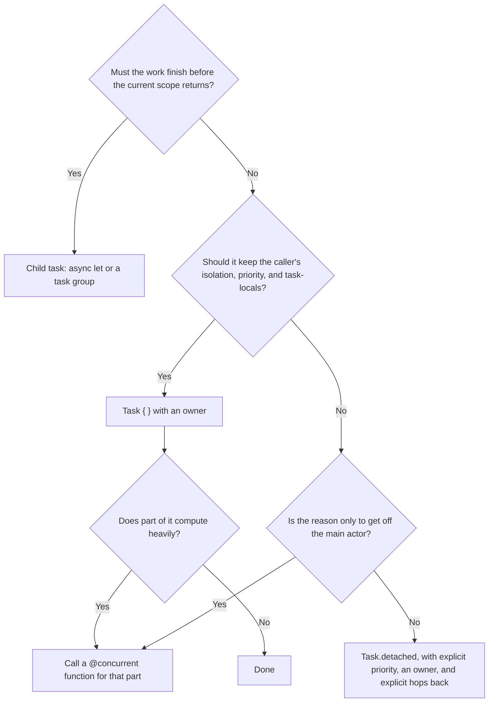

Swift has two ways to start a task that is not a child of the current one. `Task { }` creates an unstructured task that inherits its surroundings: actor isolation, priority, and task-local values. `Task.detached { }` creates one that inherits nothing. Both outlive their creator, neither is cancelled with it, and both need an owner.

The difference is entirely about context, and context is usually what you want. That makes `Task.detached` a specialized tool that is reached for far more often than it is needed, typically as a reflex for "run this on a background thread." This article measures exactly what each kind of task inherits, shows why detaching is rarely the best way to get off the main actor, and identifies the few situations where detaching is the right call.

<!--more-->

The examples use Swift 6 language mode and were compiled and run with the Swift 6.4 toolchain on macOS 26. The Swift blocks build on one another in one `main.swift`. `@concurrent` and `Task.immediateDetached` are Swift 6.2 features.

## What each kind of task inherits

| Context | Child task (`async let`, group) | `Task { }` | `Task.detached { }` |
| --- | --- | --- | --- |
| Cancellation from creator | Yes | No | No |
| Lifetime bounded by creator's scope | Yes | No | No |
| Priority | Yes | Yes | No, defaults to `.medium` unless specified |
| Task-local values | Yes | Yes | No |
| Actor isolation | No, children are non-isolated | Global actor: yes. Actor instance: only if it captures `self` | No |
| Task executor preference | Yes | No | No |

The task-executor row comes from [SE-0417](https://github.com/swiftlang/swift-evolution/blob/main/proposals/0417-task-executor-preference.md), which is covered in the [executors article](/swift-executors/). The rest can be measured directly. The probe below runs on the main actor at user-initiated priority, with a task-local trace identifier bound, and asks each kind of task what it sees:

```swift
import Foundation
import Synchronization

enum Trace {
    @TaskLocal static var id: String?
}

func describe(_ isolation: (any Actor)?) -> String {
    isolation.map { "\(type(of: $0))" } ?? "nonisolated"
}

func isMainThread() -> Bool {
    pthread_main_np() != 0
}

struct Inheritance: Equatable, Sendable {
    let isolation: String
    let priority: TaskPriority
    let traceID: String?
    let onMainThread: Bool
}

@MainActor
func inspectInheritance() async -> (unstructured: Inheritance, detached: Inheritance) {
    await Trace.$id.withValue("trace-1") {
        let unstructured = Task {
            Inheritance(isolation: describe(#isolation), priority: Task.currentPriority, traceID: Trace.id, onMainThread: isMainThread())
        }
        let detached = Task.detached {
            Inheritance(isolation: describe(#isolation), priority: Task.currentPriority, traceID: Trace.id, onMainThread: isMainThread())
        }
        return (await unstructured.value, await detached.value)
    }
}

let observed = await Task(priority: .userInitiated) { @MainActor in
    await inspectInheritance()
}.value

assert(observed.unstructured == Inheritance(isolation: "MainActor", priority: .high, traceID: "trace-1", onMainThread: true))
assert(observed.detached == Inheritance(isolation: "nonisolated", priority: .medium, traceID: nil, onMainThread: false))
```

`.userInitiated` and `.high` are the same priority, which is why the inherited value prints as `.high`. The detached task's `.medium` is its starting priority. Awaiting a task's value from a higher-priority task escalates the awaited task's priority, so reading `Task.currentPriority` inside a detached task *after* a high-priority waiter has started awaiting it can report the escalated value. The [priority article](/swift-task-priority/) covers escalation.

## A detached task does not come back

A common reason for detaching is "this work should not run on the main actor." That is true of the work, but rarely of the whole task. Most work ends by updating UI state, and a detached task has no isolation to return to. It must hop to the main actor explicitly for every state update:

```swift
func decodeCatalog(_ bytes: Int) -> [String] {
    (0..<max(1, bytes / 100)).map { "item \($0)" }
}

@MainActor
final class CatalogModel {
    private(set) var items: [String] = []
    private(set) var status = "idle"
    private var loadTask: Task<Void, Never>?

    /// Detached: every touch of model state needs an explicit hop back.
    func reloadDetached(bytes: Int) {
        loadTask = Task.detached { [weak self] in
            let decoded = decodeCatalog(bytes)
            await MainActor.run {
                self?.items = decoded
                self?.status = "loaded \(decoded.count)"
            }
        }
    }

    func waitForLoad() async {
        await loadTask?.value
    }
}

let detachedModel = CatalogModel()
detachedModel.reloadDetached(bytes: 1_000)
await detachedModel.waitForLoad()
assert(detachedModel.items.count == 10 && detachedModel.status == "loaded 10")
```

It works, but every line that touches the model now lives inside a `MainActor.run` block, and the capture of `self` has to be weak and optional because the task is not tied to the model's lifetime in any way. The structure of the code is inverted: the default is "not on the main actor," with islands of main-actor code inside.

## The better default: stay on the actor, offload the computation

The alternative is to keep the task on the main actor, where state updates are direct, and move only the CPU-bound part off it with a `@concurrent` function:

```swift
/// Runs on the global concurrent executor regardless of the caller's isolation.
@concurrent
func decodeCatalogOffMain(_ bytes: Int) async -> (items: [String], decodedOnMainThread: Bool) {
    (decodeCatalog(bytes), isMainThread())
}

extension CatalogModel {
    /// Unstructured, main-actor task: only the decoding leaves the main actor.
    func reload(bytes: Int) {
        loadTask?.cancel()
        status = "loading"
        loadTask = Task {
            let (decoded, decodedOnMain) = await decodeCatalogOffMain(bytes)
            assert(!decodedOnMain, "The expensive part ran off the main thread")
            guard !Task.isCancelled else { return }
            items = decoded
            status = "loaded \(decoded.count)"
        }
    }
}

let model = CatalogModel()
model.reload(bytes: 2_000)
assert(model.status == "loading", "Synchronous state change before the task even starts")
await model.waitForLoad()
assert(model.items.count == 20 && model.status == "loaded 20")
```

Compare the two shapes:

- **Isolation is the default, not the exception.** Assignments to `items` and `status` are ordinary statements, checked by the compiler, with no `MainActor.run`.
- **The off-main boundary is a function signature.** `@concurrent` documents, at the declaration, that this function never runs on the caller's actor. Every caller gets the same guarantee, not just the one that remembered to detach.
- **Context flows through.** The task keeps the caller's priority and task-local values, so tracing and logging still work inside `decodeCatalogOffMain`.
- **Values cross the boundary explicitly.** Only the arguments and the return value cross between isolation domains, and the compiler checks that they are `Sendable`.

Before Swift 6.2, the same shape used a plain non-isolated `async` function, which under Swift 6 rules already runs off the caller's actor ([SE-0338](https://github.com/swiftlang/swift-evolution/blob/main/proposals/0338-clarify-execution-non-actor-async.md)). Under the `NonisolatedNonsendingByDefault` upcoming feature, plain non-isolated `async` functions run on the caller's actor instead, so `@concurrent` is the spelling that keeps meaning "off the actor" in both worlds. The [async/await article](/swift-async-await-suspension/) measures both behaviors.

## Detaching from an actor so the actor stays available

Actors are serial. If a long computation runs *isolated* to an actor, every other call to that actor waits for it. Inside an actor method, `Task { }` that captures `self` is isolated to the actor, so a heavy computation started that way blocks the actor just as surely as if it ran inline:

```swift
func buildIndex(_ documents: [String]) -> [String: Int] {
    // CPU-heavy: about 100 ms of busy work, then a tiny result.
    let clock = ContinuousClock()
    let deadline = clock.now + .milliseconds(100)
    while clock.now < deadline {}
    var index: [String: Int] = [:]
    for (position, document) in documents.enumerated() {
        index[document, default: position] = position
    }
    return index
}

actor SearchIndex {
    private var documents: [String] = ["alpha", "beta", "gamma"]
    private var index: [String: Int] = [:]
    private var rebuild: Task<Void, Never>?

    /// The rebuild captures `self`, so it is isolated to the actor and runs on it.
    func rebuildOnActor() {
        rebuild = Task {
            self.index = buildIndex(self.documents)
        }
    }

    /// The rebuild runs detached; the actor is touched only to read inputs and install the result.
    func rebuildOffActor() {
        let snapshot = documents
        rebuild = Task.detached { [weak self] in
            let built = buildIndex(snapshot)
            await self?.install(built)
        }
    }

    private func install(_ built: [String: Int]) {
        index = built
    }

    func lookup(_ term: String) -> Int? {
        index[term]
    }

    func waitForRebuild() async {
        await rebuild?.value
    }
}

func lookupLatency(during rebuild: (SearchIndex) async -> Void) async -> Duration {
    let search = SearchIndex()
    await rebuild(search)
    try? await Task.sleep(for: .milliseconds(10))      // Let the rebuild start.
    let clock = ContinuousClock()
    let start = clock.now
    _ = await search.lookup("beta")
    let latency = start.duration(to: clock.now)
    await search.waitForRebuild()
    return latency
}

let blockedLatency = await lookupLatency { await $0.rebuildOnActor() }
let freeLatency = await lookupLatency { await $0.rebuildOffActor() }
assert(blockedLatency >= .milliseconds(50), "The lookup waited for the actor-isolated rebuild")
assert(freeLatency < .milliseconds(50), "The actor stayed available during the detached rebuild")
print("lookup during on-actor rebuild:", blockedLatency, "during detached rebuild:", freeLatency)
```

On the test machine, a lookup issued during the on-actor rebuild waited about 85 ms, the remainder of the rebuild. During the detached rebuild it returned in microseconds.

This is one of the legitimate uses of `Task.detached`: escaping an actor instance's isolation while still holding a reference to the actor. Two details make it correct:

- **Snapshot the inputs while isolated.** `documents` is copied into `snapshot` inside the actor method. The detached closure never reads actor state directly, so there is nothing to race.
- **Install the result through an isolated method.** The single `await self?.install(built)` is the only point where the detached task touches the actor again.

A `@concurrent` helper achieves the same thing without a detached task: an isolated `Task { }` that calls `let built = await buildIndexConcurrently(snapshot)` suspends the actor-isolated task while the helper computes elsewhere, and other calls to the actor run in the meantime. Either form is fine. What does not work is CPU-bound code that runs *in* actor-isolated context, whatever kind of task contains it.

Because the actor must tolerate other calls interleaving with the rebuild, it must also tolerate the rebuild finishing after newer state has arrived. That is [actor reentrancy](/swift-actor-reentrancy/), and the usual remedy is a generation number checked in `install`.

## Detaching to shed context on purpose

The other legitimate reason to detach is that inheriting context would be *wrong*.

**Task-local values that must not leak.** Task-locals often carry per-operation context: a request identifier for logs, a span for distributed tracing, a database transaction, a test's dependency overrides. A long-running maintenance job started while handling one request should not report itself as part of that request for the rest of the session:

```swift
actor ThumbnailCache {
    private var entries: [String: Int] = (0..<100).reduce(into: [:]) { $0["photo-\($1)", default: 0] = $1 }
    private(set) var prunedUnderTrace: [String?] = []

    func prune(keepingNewest count: Int) {
        prunedUnderTrace.append(Trace.id)
        let sortedKeys = entries.sorted { $0.value > $1.value }.map(\.key)
        for key in sortedKeys.dropFirst(count) {
            entries[key] = nil
        }
    }

    var count: Int {
        entries.count
    }
}

let thumbnailCache = ThumbnailCache()
await Trace.$id.withValue("request-77") {
    // Maintenance discovered while serving a request, but not part of it.
    let maintenance = Task.detached(priority: .background) {
        await thumbnailCache.prune(keepingNewest: 10)
    }
    await maintenance.value
}
let pruneTraces = await thumbnailCache.prunedUnderTrace
assert(pruneTraces == [nil], "The maintenance job did not inherit the request's trace identifier")
let remaining = await thumbnailCache.count
assert(remaining == 10)
```

**Priority that must not be inherited.** A `Task { }` started from a user-initiated context runs at user-initiated priority. Passing `priority:` overrides that, so priority alone is not a reason to detach. But when maintenance should *also* drop actor isolation and task-locals, `Task.detached(priority: .background)` states all three decisions at once, as above.

**Starting synchronously without inheriting.** Swift 6.2 also provides `Task.immediateDetached`, the detached counterpart to `Task.immediate`: it starts running synchronously on the calling thread until its first suspension, without inheriting isolation, priority, or task-local values. It is rarely needed outside low-level code that bridges into concurrency from callbacks.

## Anti-patterns

**Detaching as a reflex for "background."** If the goal is only to keep CPU work off the main actor, a `@concurrent` function is clearer, keeps context, and keeps state updates checked. Detaching the whole task moves the *wrong* boundary.

**Detaching to make compiler errors go away.** Detached closures are `sending`, so they face *stricter* checks than `Task { }`: capturing a non-`Sendable` value and using it again afterwards is rejected with "sending value of non-`Sendable` type ... risks causing data races." If a `Task { }` produced an isolation error, a detached task will not solve it; it will only move it.

**Detaching inside a structured operation.** A detached task started inside a task group child is neither cancelled with the group nor awaited by it. If the work should finish before the operation completes, use a child task.

**Detaching without an owner.** Everything from the [task lifetime article](/swift-task-lifetime-ownership/) applies. A detached task with no stored handle cannot be cancelled by anyone.

## Choosing



## Summary

- `Task { }` inherits priority, task-local values, and isolation: always for a global actor, and for an actor instance only when it captures `self`. `Task.detached { }` inherits none of them. Neither inherits cancellation.
- Detached tasks must hop back explicitly for every isolated state update, which inverts the structure of UI code.
- To keep work off the main actor, prefer a `@concurrent` function called from a task that stays on the actor.
- Detach to free an actor during a long computation, snapshotting inputs and installing results through isolated methods, or to deliberately shed task-locals and priority for maintenance work.
- Detached tasks are checked more strictly, not less, and need owners like any other unstructured task.

## Exercise

`SearchIndex.rebuildOffActor()` can install a stale index: if `documents` changes during a rebuild, the older rebuild may finish last. Add a `generation` counter that increments on every document change and every rebuild, pass the generation into the detached task, and have `install` ignore results from an older generation. Write a test that changes documents twice during overlapping rebuilds with different durations and verifies the final index reflects the latest documents.

## Further reading

- [Task.detached(name:priority:operation:)](https://developer.apple.com/documentation/swift/task/detached(name:priority:operation:)-795w1) in the Swift documentation.
- [SE-0461: Run nonisolated async functions on the caller's actor by default](https://github.com/swiftlang/swift-evolution/blob/main/proposals/0461-async-function-isolation.md), which introduces `@concurrent`.
- [SE-0472: Starting tasks synchronously from caller context](https://github.com/swiftlang/swift-evolution/blob/main/proposals/0472-task-start-synchronously-on-caller-context.md), including `Task.immediateDetached`.
- [SE-0311: Task-local values](https://github.com/swiftlang/swift-evolution/blob/main/proposals/0311-task-locals.md).

Previous: [Cancellation Handlers and Reliable Resource Cleanup](/swift-cancellation-handlers-cleanup/). Next: [Task Priority, Inheritance, and Priority Inversion](/swift-task-priority/).

Return to the [Concurrency roadmap](/swift-concurrency-roadmap/).
