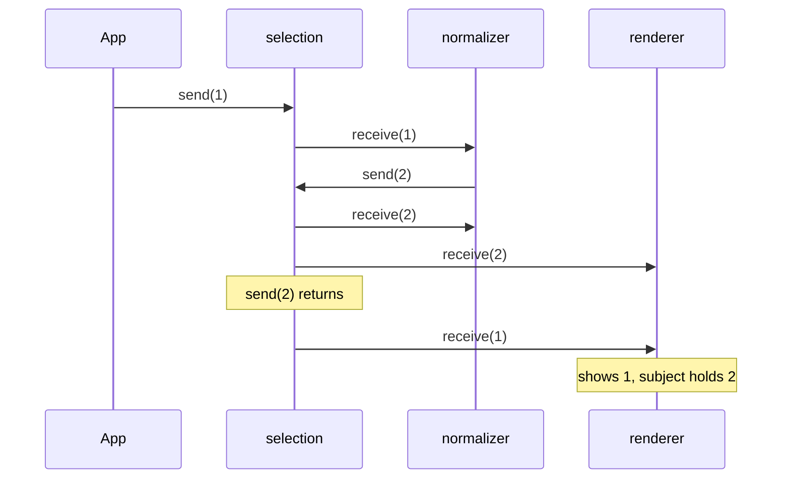
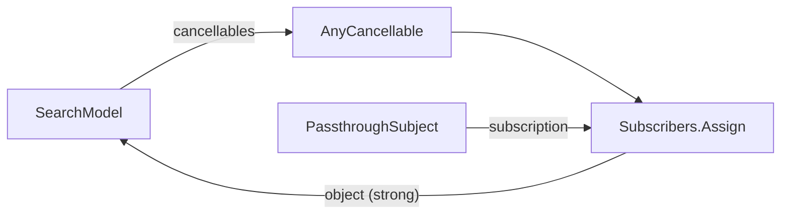

Almost every Combine pipeline in an app ends in one of two built-in subscribers. `sink` hands each value and the completion to closures you supply. `assign` writes each value into a property through a key path. They are the point where a pipeline stops being a description and starts doing work, so they are also where its lifetime, its threading, and its memory behavior are decided.

Both look trivial, and both have sharp edges that are invisible in a quick test: a cancellable that is thrown away and silently stops the pipeline, a `cancel()` inside a `sink` that does nothing, a subscriber that sees values out of order because another subscriber sent a value back into the subject, an `assign(to:on:)` that keeps its object alive forever, and, in Swift 6, an `assign` that writes a main-actor property from a background thread without any warning. This article measures each one and shows the version to use instead.

<!--more-->

The examples use Swift 6 language mode and were compiled and run with the Swift 6.4 toolchain from Xcode 27.1 on macOS 26. Paste the blocks in order into one `main.swift`. The previous article, [Publishers, Subscribers, and Subscriptions](/combine-publishers-subscribers-subscriptions/), explains the protocol contract that `sink` and `assign` implement.

## `sink`: closures as a subscriber

`sink` has two forms. The one-closure form, `sink(receiveValue:)`, is available only when the publisher's `Failure` is `Never`, because there is nowhere to report an error:

```swift
import Combine
import Foundation

let numbers = PassthroughSubject<Int, Never>()
var received: [Int] = []
let numbersCancellable = numbers.sink { received.append($0) }
numbers.send(1)
numbers.send(2)
assert(received == [1, 2])
```

For a publisher that can fail, the compiler insists on the two-closure form. Trying the short form on a failing publisher produces an error that is clearer than most generic-constraint messages:

```swift
// Does not compile
enum ExampleError: Error { case broken }
let failing = Fail<Int, ExampleError>(error: .broken).sink { print($0) }
// error: referencing instance method 'sink(receiveValue:)' on 'Publisher'
//        requires the types 'ExampleError' and 'Never' be equivalent
```

With both closures, the completion arrives exactly once, as either `.finished` or `.failure`, and nothing is delivered after it:

```swift
enum LoadError: Error { case offline }

let pages = PassthroughSubject<String, LoadError>()
var pageEvents: [String] = []
let pagesCancellable = pages.sink(
    receiveCompletion: { completion in
        switch completion {
        case .finished: pageEvents.append("finished")
        case .failure(let error): pageEvents.append("failed: \(error)")
        }
    },
    receiveValue: { pageEvents.append("value: \($0)") }
)
pages.send("page 1")
pages.send(completion: .failure(.offline))
pages.send("page 2")                      // ignored: the stream is over
pages.send(completion: .finished)         // also ignored
assert(pageEvents == ["value: page 1", "failed: offline"])
```

Behind the method is a class, `Subscribers.Sink`, which conforms to both `Subscriber` and `Cancellable`. When it receives its subscription it requests `.unlimited` demand immediately and never adjusts it. The `print` operator, which logs every signal passing through it, shows that handshake. It writes to any `TextOutputStream`, so a small buffer makes the log something a test can inspect:

```swift
final class LogBuffer: TextOutputStream {
    private(set) var lines: [String] = []
    func write(_ string: String) {
        lines += string.split(separator: "\n").map(String.init)
    }
}

let sinkLog = LogBuffer()
let justCancellable = Just(42).print("just", to: sinkLog).sink { _ in }
assert(sinkLog.lines == [
    "just: receive subscription: (Just)",
    "just: request unlimited",
    "just: receive value: (42)",
    "just: receive finished",
])
```

Unlimited demand is the right default for a UI binding, and it is also a decision you cannot change: a `sink` cannot slow its upstream down. If a consumer needs backpressure, it has to come from an operator such as `buffer`, `flatMap(maxPublishers:)`, or a custom subscriber like the `EventRecorder` from the previous article.

## The cancellable is the subscription's lifetime

`sink` returns an `AnyCancellable`, and an `AnyCancellable` cancels its subscription when it is deallocated. That is the most important line in Combine memory management, and it has an immediate consequence: a cancellable that nobody stores is deallocated at the end of the statement, and the pipeline dies with it.

```swift
let ticks = PassthroughSubject<Int, Never>()
var discardedTicks: [Int] = []
_ = ticks.sink { discardedTicks.append($0) }
ticks.send(1)
assert(discardedTicks.isEmpty)            // the subscription was already cancelled
```

The compiler warns, "result of call to 'sink(receiveValue:)' is unused", when you write the call on its own, which is a hint to keep it. Assigning to `_` silences the warning and keeps the bug. Synchronous publishers make this harder to spot, because they finish their work before the statement ends:

```swift
var discardedSequence: [Int] = []
_ = [1, 2, 3].publisher.sink { discardedSequence.append($0) }
assert(discardedSequence == [1, 2, 3])    // delivered before the cancellable was released
```

So a test that sinks a sequence or a `Just` passes, and the same code against a subject or a network request receives nothing. [`AnyCancellable` and Memory Management](/combine-anycancellable-memory/) covers where to keep cancellables and what happens to the closures they own; the rule for now is that whatever stores the cancellable decides how long the pipeline runs.

A `Sink` also lets go of its closures as soon as the stream completes, without waiting for the cancellable to be released. That matters, because the closures are where captured objects live:

Counting live instances is the simplest way to see that. Swift 6 rejects a `static var` counter as unprotected global state, and `deinit` is not isolated to any actor, so the counter is an atomic:

```swift
import Synchronization

/// Counts live instances. Safe to update from `deinit`, which runs without actor isolation.
final class InstanceCounter: Sendable {
    private let live = Atomic<Int>(0)
    var count: Int { live.load(ordering: .relaxed) }
    func increment() { live.wrappingAdd(1, ordering: .relaxed) }
    func decrement() { live.wrappingSubtract(1, ordering: .relaxed) }
}

final class Tracked {
    static let instances = InstanceCounter()
    init() { Tracked.instances.increment() }
    deinit { Tracked.instances.decrement() }
}

let downloads = PassthroughSubject<Int, Never>()
var downloadsCancellable: AnyCancellable?
do {
    let captured = Tracked()
    downloadsCancellable = downloads.sink { _ in _ = captured }
}
assert(Tracked.instances.count == 1)            // the sink's closure holds it
downloads.send(completion: .finished)
assert(Tracked.instances.count == 0)            // released on completion
assert(downloadsCancellable != nil)       // even though the cancellable is still stored
```

## Cancelling from inside `sink`

A common way to stop after a condition is met is to cancel the subscription from inside the closure. Against a synchronous publisher, it does nothing:

```swift
var seenBeforeStop: [Int] = []
var stopCancellable: AnyCancellable?
stopCancellable = (1...10).publisher.sink { value in
    seenBeforeStop.append(value)
    if value == 3 { stopCancellable?.cancel() }
}
assert(seenBeforeStop == Array(1...10))   // all ten arrived
```

The assignment to `stopCancellable` happens only after `sink` returns, and a sequence publisher delivers every value before then, so the closure calls `cancel()` on `nil`. With an infinite sequence, this loop never ends. The fix that is almost always right is to express the stopping condition as an operator, which also documents intent:

```swift
var seenWithPrefix: [Int] = []
let prefixCancellable = (1...10).publisher
    .prefix(while: { $0 < 3 })
    .sink { seenWithPrefix.append($0) }
assert(seenWithPrefix == [1, 2])

var seenWithFirst: [Int] = []
let firstCancellable = (1...10).publisher
    .first(where: { $0 == 3 })
    .sink { seenWithFirst.append($0) }
assert(seenWithFirst == [3])
```

When the decision really belongs inside the closure, create the `Subscribers.Sink` yourself, store it, and only then subscribe it. The subscriber exists before the first value, so cancelling it works:

```swift
var seenWithStoredSink: [Int] = []
var storedSink: Subscribers.Sink<Int, Never>?
storedSink = Subscribers.Sink(
    receiveCompletion: { _ in },
    receiveValue: { value in
        seenWithStoredSink.append(value)
        if value == 3 { storedSink?.cancel() }
    }
)
(1...10).publisher.subscribe(storedSink!)
assert(seenWithStoredSink == [1, 2, 3])
```

## Sending back into a subject from `sink`

Subjects deliver synchronously, one subscriber after another. If one subscriber reacts to a value by sending a new value into the same subject, that new value is delivered to every subscriber *before* the original delivery finishes. Any subscriber that had not yet received the original value then sees the two values in reverse order.

Which subscribers those are depends on the order in which the subject visits them, and that order is not the order in which they subscribed. With two or more subscribers, the subject keeps them in a hashed collection, and Swift seeds its hashing per process. This test repeats the same two-subscriber setup 2,000 times in one process and counts what the second subscriber, a renderer, ends up seeing:

```swift
var rendererOutcomes: [[Int]: Int] = [:]
for _ in 0..<2_000 {
    let selection = CurrentValueSubject<Int, Never>(0)
    var rendererSaw: [Int] = []

    // Subscriber 1 "normalizes" a selection of 1 into 2.
    let normalizer = selection.sink { value in
        if value == 1 { selection.send(2) }
    }
    // Subscriber 2 renders whatever it is told.
    let renderer = selection.sink { rendererSaw.append($0) }

    selection.send(1)
    assert(selection.value == 2)
    rendererOutcomes[rendererSaw, default: 0] += 1
    withExtendedLifetime((normalizer, renderer)) {}
}
assert(Set(rendererOutcomes.keys) == [[0, 1, 2], [0, 2, 1]])
```

Both outcomes occurred in every run. Across six launches, one of them accounted for between 96% and 99% of the trials, and *which* one dominated changed from launch to launch. With five subscribers to a `PassthroughSubject`, the trials in each launch split almost evenly between two orders, and those two orders changed from launch to launch; subscription order was one of them in only one launch out of four. So a test that checks the order can pass for weeks and then fail. When the normalizer happens to be visited first, the renderer's last value is 1 while the subject holds 2, and nothing will ever correct it. The delivery is depth-first:



This is the subject version of the reentrancy problem from the previous article, and it appears in real code as "a view that occasionally shows the previous value". The best fix is not to feed values back at all: derive the normalized value with `map` and have everyone subscribe to that. If a feedback loop is genuinely needed, deliver the new value asynchronously, so the current delivery completes first. That needs the main run loop to turn, so here is a helper that runs it until a condition holds:

```swift
func runMainLoop(until condition: () -> Bool, timeout: TimeInterval = 2) {
    let deadline = Date(timeIntervalSinceNow: timeout)
    while !condition() && Date() < deadline {
        RunLoop.main.run(until: Date(timeIntervalSinceNow: 0.01))
    }
}

let deferredSelection = CurrentValueSubject<Int, Never>(0)
var deferredRendererSaw: [Int] = []
let deferredNormalizer = deferredSelection.sink { value in
    if value == 1 { DispatchQueue.main.async { deferredSelection.send(2) } }
}
let deferredRenderer = deferredSelection.sink { deferredRendererSaw.append($0) }
deferredSelection.send(1)
runMainLoop(until: { deferredRendererSaw.count == 3 })
assert(deferredRendererSaw == [0, 1, 2])  // in order, ending on the current value
```

## `assign(to:on:)` and the retain cycle

`assign(to:on:)` is a subscriber that writes each value into `object[keyPath: keyPath]`. It requires `Failure == Never`, it also requests unlimited demand, and it holds a **strong** reference to the object. That last fact makes the most natural use of it a leak:

```swift
final class SearchModel {
    static let instances = InstanceCounter()
    var query = ""
    private var cancellables = Set<AnyCancellable>()

    init(queries: some Publisher<String, Never>) {
        SearchModel.instances.increment()
        queries.assign(to: \.query, on: self).store(in: &cancellables)
    }
    deinit { SearchModel.instances.decrement() }
}

let queryInput = PassthroughSubject<String, Never>()
do {
    let model = SearchModel(queries: queryInput)
    queryInput.send("swift")
    assert(model.query == "swift")
}
assert(SearchModel.instances.count == 1)        // never deallocated
```

The model owns the cancellable, the cancellable owns the `Assign` subscriber, and the subscriber owns the model:



The cycle would break if the upstream completed, because `Assign` releases its object on completion, but a subject that represents user input never completes. Writing `queryInput.send(completion: .finished)` here would deallocate the model, which is a fact worth knowing and not a strategy.

There are two leak-free replacements. The first is a `sink` with a weak capture, which can be wrapped as an operator so call sites stay as short as `assign`:

```swift
extension Publisher where Failure == Never {
    /// Like `assign(to:on:)`, but holds `object` weakly.
    func assign<Root: AnyObject>(
        to keyPath: ReferenceWritableKeyPath<Root, Output>,
        onWeak object: Root
    ) -> AnyCancellable {
        sink { [weak object] value in object?[keyPath: keyPath] = value }
    }
}

final class WeakSearchModel {
    static let instances = InstanceCounter()
    var query = ""
    private var cancellables = Set<AnyCancellable>()

    init(queries: some Publisher<String, Never>) {
        WeakSearchModel.instances.increment()
        queries.assign(to: \.query, onWeak: self).store(in: &cancellables)
    }
    deinit { WeakSearchModel.instances.decrement() }
}

do {
    let model = WeakSearchModel(queries: queryInput)
    queryInput.send("combine")
    assert(model.query == "combine")
}
assert(WeakSearchModel.instances.count == 0)
```

When the model deallocates, its `Set<AnyCancellable>` is released with it, which cancels the subscription, so nothing keeps running for a dead object.

## `assign(to:)` for `@Published` properties

The second replacement, available since iOS 14 and macOS 11, is `assign(to:)` with an `inout` reference to a `@Published` property's publisher. It returns nothing, so there is no cancellable to store, and the subscription's lifetime is tied to the property itself: when the object that owns the property deallocates, the subscription is cancelled.

```swift
final class PublishedSearchModel {
    static let instances = InstanceCounter()
    @Published var query = ""

    init(queries: some Publisher<String, Never>) {
        PublishedSearchModel.instances.increment()
        queries.assign(to: &$query)
    }
    deinit { PublishedSearchModel.instances.decrement() }
}

do {
    let model = PublishedSearchModel(queries: queryInput)
    queryInput.send("observation")
    assert(model.query == "observation")
}
assert(PublishedSearchModel.instances.count == 0)
```

This is the form to use whenever the target is a `@Published` property, which in an `ObservableObject` it usually is. It cannot be cancelled early, so a binding that must be torn down before the object dies, such as one that changes when the user switches accounts, still needs a `sink` with a stored cancellable. [`@Published` Properties](/combine-published-properties/) covers what `$query` is and when its values are emitted.

| Subscriber | Holds target | Returns | Ends when |
|---|---|---|---|
| `sink` | whatever the closures capture | `AnyCancellable` | cancellable released, or upstream completes |
| `assign(to:on:)` | **strongly** | `AnyCancellable` | cancellable released, or upstream completes |
| `assign(to:onWeak:)` (above) | weakly | `AnyCancellable` | cancellable released, or upstream completes |
| `assign(to: &$property)` | the property's own storage | nothing | owner deallocated, or upstream completes |

## Threading: both subscribers run where values arrive

Neither `sink` nor `assign` changes threads. The closure runs, and the property is written, on whichever thread delivered the value, which for a subject is whichever thread called `send`. In Swift 5 that was a well-known source of "UI updated from a background thread" warnings. In Swift 6 language mode it splits into two very different failures, depending on which subscriber you use.

A `sink` closure written inside a `@MainActor` type, or in top-level code, is inferred to be isolated to the main actor. Combine is compiled without strict concurrency checking, so the compiler cannot stop it from being called elsewhere; instead it inserts a run-time check into the closure, and the process stops with `EXC_BREAKPOINT` the first time a value arrives on a background thread. That is a crash, but at least it is a loud one at the exact line.

`assign` has no closure to check. Writing through a key path into a `@MainActor` class compiles without a diagnostic, and it runs the property's setter, including any `didSet`, on the background thread:

```swift
nonisolated(unsafe) let backgroundFeed = PassthroughSubject<Int, Never>()

@MainActor
final class BadgeModel {
    var count = 0 { didSet { setterRanOnMainThread = Thread.isMainThread } }
    var setterRanOnMainThread: Bool?
    private var cancellables = Set<AnyCancellable>()

    func bindDirectly() {
        backgroundFeed.assign(to: \.count, onWeak: self).store(in: &cancellables)
    }
}

let badge = BadgeModel()
badge.bindDirectly()
DispatchQueue.global().async { backgroundFeed.send(7) }
runMainLoop(until: { badge.setterRanOnMainThread != nil })
assert(badge.count == 7)
assert(badge.setterRanOnMainThread == false)  // a main-actor property, set off the main thread
```

The weak `assign` helper behaves the same way as the built-in `assign(to:on:)` here, because its closure is written in a nonisolated extension, not in main-actor code. Running the same pattern under the Thread Sanitizer, with the main thread reading the property while the background thread assigned it, reported `ThreadSanitizer: data race` in `BadgeModel.count.setter`, called from a key path setter. Swift 6's data-race safety does not cover this case, because the write happens inside a module compiled in Swift 5 mode.

The fix is the same for both subscribers: move delivery to the main thread *before* the subscriber, with `receive(on:)`.

```swift
@MainActor
final class SafeBadgeModel {
    var count = 0 { didSet { setterRanOnMainThread = Thread.isMainThread } }
    var setterRanOnMainThread: Bool?
    private var cancellables = Set<AnyCancellable>()

    func bind() {
        backgroundFeed
            .receive(on: DispatchQueue.main)
            .sink { [weak self] in self?.count = $0 }
            .store(in: &cancellables)
    }
}

let safeBadge = SafeBadgeModel()
safeBadge.bind()
DispatchQueue.global().async { backgroundFeed.send(9) }
runMainLoop(until: { safeBadge.setterRanOnMainThread != nil })
assert(safeBadge.count == 9 && safeBadge.setterRanOnMainThread == true)
```

Here the `sink` closure is main-actor isolated, its run-time check passes because `receive(on: DispatchQueue.main)` delivers on the main queue, and the compiler is satisfied that `self?.count = $0` is a main-actor access. [Schedulers: `receive(on:)` and `subscribe(on:)`](/combine-schedulers-receive-subscribe-on/) explains why `DispatchQueue.main` is a better choice than `RunLoop.main` for this, and how to make the isolation explicit.

Keep the remaining subscriptions alive until the end of the file:

```swift
withExtendedLifetime((numbersCancellable, pagesCancellable, justCancellable, stopCancellable,
                      prefixCancellable, firstCancellable,
                      deferredNormalizer, deferredRenderer)) {}
```

## Choosing between them

- Use `assign(to: &$property)` to drive a `@Published` property from a pipeline that should live exactly as long as the object.
- Use `sink` when the value needs to do something other than land in one property, when the pipeline can fail, or when the subscription must be cancellable on its own schedule. Capture `self` weakly.
- Avoid `assign(to:on:)` with `self` as the target; it is a retain cycle unless the upstream completes. With another object as the target, it is fine.
- Put `receive(on: DispatchQueue.main)` immediately before any subscriber that touches main-actor state, and treat a Swift 6 isolation crash in a `sink` closure as a missing `receive(on:)`.

## Summary

- `sink` and `assign` both request `.unlimited` demand, so neither can apply backpressure.
- The returned `AnyCancellable` is the subscription's lifetime. Assigning it to `_` cancelled a subject subscription before its first value, while a synchronous sequence still delivered everything, which hides the bug in tests.
- A `Sink` releases its closures, and what they capture, on completion.
- Cancelling from inside `sink` did nothing against a synchronous publisher, because the cancellable was not assigned yet. Use `prefix(while:)` or `first(where:)`, or create and store the `Subscribers.Sink` before subscribing.
- Sending into a subject from one of its own subscribers delivers depth-first, and subjects visit subscribers in an order that changes between launches: across 2,000 trials, a renderer sometimes ended on a stale value while the subject held the new one. Derive values with operators, or defer the feedback.
- `assign(to:on: self)` kept the model alive indefinitely; a weak `sink` wrapper and `assign(to: &$property)` both let it deallocate.
- In Swift 6, `assign` wrote a `@MainActor` property from a background thread with no diagnostic, and the Thread Sanitizer reported the data race; a main-actor `sink` crashes instead. `receive(on: DispatchQueue.main)` fixes both.

## Exercise

Write a `bind(_:to:on:)` helper for a `@MainActor` view model that takes a publisher of any failure type, applies `receive(on: DispatchQueue.main)`, routes failures to an `onError` closure, and writes values through a key path while holding the view model weakly. Make its signature reject a key path to a property that is not main-actor isolated, if you can find a way to express that, and explain in a comment why it is hard. Then test the helper with a subject that sends from a background queue: assert that the property is written on the main thread, that a failure reaches `onError` exactly once, and that releasing the view model cancels the subscription, by sending one more value afterwards and checking that nothing is written.

## Further reading

- Apple's documentation for [`sink(receiveCompletion:receiveValue:)`](https://developer.apple.com/documentation/combine/publisher/sink(receivecompletion:receivevalue:)), [`assign(to:on:)`](https://developer.apple.com/documentation/combine/publisher/assign(to:on:)), and [`assign(to:)`](https://developer.apple.com/documentation/combine/publisher/assign(to:)).
- [Combine in Practice](https://developer.apple.com/videos/play/wwdc2019/721/), WWDC19, which introduces `sink`, `assign`, and cancellation.
- The concurrency roadmap's [The Main Actor](/swift-main-actor/) and [Swift 6 Data-Race Safety Migration](/swift-6-data-race-safety-migration/), for why a main-actor closure gets a run-time check when it is passed to a Swift 5 module.

Previous: [Publishers, Subscribers, and Subscriptions](/combine-publishers-subscribers-subscriptions/). Next: [Subjects: `PassthroughSubject` and `CurrentValueSubject`](/combine-subjects/).

Return to the [Combine roadmap](/combine/).
