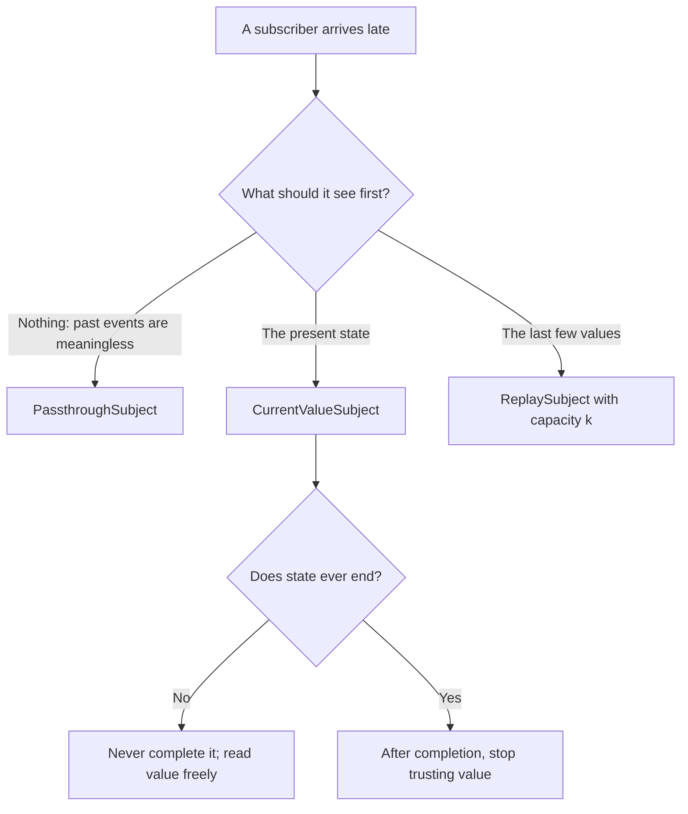

Most of the world does not arrive as a publisher. A delegate method fires, a button's action runs, a WebSocket handler receives a frame, a download reports progress through a callback. **Subjects** are how imperative code like that enters a Combine pipeline: a subject is a publisher that you can also push values into by calling `send(_:)`. Combine ships two of them. `PassthroughSubject` forwards each value to whoever is subscribed at that moment and remembers nothing. `CurrentValueSubject` always holds a current value, gives it to every new subscriber, and updates it on every send.

That description fits in a sentence, but the details decide whether a feature works: what a late subscriber sees, what happens to values when nobody has asked for them, what a completed subject does with later sends, in what order several subscribers are called, and what happens when a subject is subscribed to more than one upstream. This article measures each of them, shows how to keep subjects from leaking into an API, and builds the subject Combine does not include, a `ReplaySubject` that remembers the last few values and still honors demand.

<!--more-->

The examples use Swift 6 language mode and were compiled and run with the Swift 6.4 toolchain from Xcode 27.1 on macOS 26. Paste the blocks in order into one `main.swift`. The demand rules referred to below are explained in [Publishers, Subscribers, and Subscriptions](/combine-publishers-subscribers-subscriptions/).

## The `Subject` protocol

A subject is a reference type that is also a publisher, with three extra entry points:

<!-- skip-check -->
```swift
public protocol Subject<Output, Failure>: AnyObject, Publisher {
    func send(_ value: Output)
    func send(completion: Subscribers.Completion<Failure>)
    func send(subscription: any Subscription)
}
```

The first two are the imperative inputs. The third exists because a subject can also act as a subscriber's target: `somePublisher.subscribe(subject)` forwards every value and the completion from `somePublisher` into the subject, and the subject receives that upstream's subscription through `send(subscription:)`. It being `AnyObject` is the point: everybody who holds the subject holds the same one, so a value sent from a delegate callback reaches the subscribers attached elsewhere.

## `PassthroughSubject`: values for whoever is listening

A `PassthroughSubject` is the closest thing Combine has to an event bus. It delivers each value to its current subscribers and then forgets it:

```swift
import Combine
import Foundation

let taps = PassthroughSubject<Void, Never>()
var earlyTaps = 0
var lateTaps = 0

let earlyListener = taps.sink { earlyTaps += 1 }
taps.send()                                 // Void subjects have a send() with no argument
let lateListener = taps.sink { lateTaps += 1 }
taps.send()

assert(earlyTaps == 2)
assert(lateTaps == 1)                       // the first tap happened before it subscribed
```

That is exactly right for events, things that happen at a moment and are meaningless afterwards: a tap, a "message sent" notification, a request to show an alert. It is wrong for state. A screen that subscribes to a `PassthroughSubject` of "current user" after the user logged in will show nothing until the user changes.

## `CurrentValueSubject`: state with a current value

A `CurrentValueSubject` is created with an initial value, delivers its current value to each new subscriber immediately, and exposes it through a `value` property. Setting `value` is the same as calling `send(_:)`:

```swift
let temperature = CurrentValueSubject<Double, Never>(20)
var display: [Double] = []
let displayListener = temperature.sink { display.append($0) }
temperature.send(21)
temperature.value = 22                     // equivalent to send(22)

assert(display == [20, 21, 22])
assert(temperature.value == 22)

var lateDisplay: [Double] = []
let lateDisplayListener = temperature.sink { lateDisplay.append($0) }
assert(lateDisplay == [22])                // a late subscriber starts from the current value
```

The value is updated before subscribers are called, so a subscriber that reads `value` inside its closure sees the value it is being given:

```swift
let counter = CurrentValueSubject<Int, Never>(0)
var readsDuringDelivery: [String] = []
let counterListener = counter.sink { delivered in
    readsDuringDelivery.append("delivered \(delivered), value \(counter.value)")
}
counter.send(3)
assert(readsDuringDelivery == ["delivered 0, value 0", "delivered 3, value 3"])
```

That ordering is the opposite of `@Published`, which emits *before* its property changes; [`@Published` Properties](/combine-published-properties/) measures the difference and explains why SwiftUI wants it that way.

## Demand: what each subject does with an unwanted value

A subject receives values from outside, whether or not anyone has asked for them, so it has to decide what to do with a value that arrives when a subscriber's demand is zero. The first article measured the answer with a recording subscriber: a `PassthroughSubject` drops the value for that subscriber, and a `CurrentValueSubject` keeps it as the current value and delivers the latest one when demand arrives. The same holds when values are set through `value`:

```swift
/// A subscriber that requests nothing until told to.
final class DemandProbe<Input>: Subscriber {
    typealias Failure = Never
    private var subscription: (any Subscription)?
    private(set) var received: [Input] = []

    func receive(subscription: any Subscription) { self.subscription = subscription }
    func receive(_ input: Input) -> Subscribers.Demand { received.append(input); return .none }
    func receive(completion: Subscribers.Completion<Never>) { subscription = nil }
    func request(_ demand: Subscribers.Demand) { subscription?.request(demand) }
}

let level = CurrentValueSubject<Int, Never>(0)
let slowReader = DemandProbe<Int>()
level.subscribe(slowReader)
level.value = 1
level.value = 2
slowReader.request(.max(1))
assert(slowReader.received == [2])         // 0 and 1 were superseded before it asked
```

For state, that is the behavior you want: a slow consumer should catch up to the present, not replay history. For events it is data loss, which is why bridging a `PassthroughSubject` into `for await` with `.values`, which requests one value at a time, can lose events, as [Bridging Publishers to `async`/`await` with `.values`](/combine-publisher-values-async/) measures. Ordinary `sink` and `assign` subscribers request unlimited demand, so neither subject ever drops anything for them.

## Completion is final, mostly

Sending a completion ends the subject for everyone: current subscribers receive it, later sends are ignored, and anyone who subscribes afterwards receives the completion immediately and nothing else. For a `CurrentValueSubject`, that includes not receiving the current value. The `value` property, though, does not follow the same rule as `send`:

```swift
let session = CurrentValueSubject<String, Never>("signed in")
session.send(completion: .finished)

session.send("ignored")
assert(session.value == "signed in")       // send after completion does nothing

session.value = "changed"
assert(session.value == "changed")         // but the setter still changes the stored value

var afterCompletion: [String] = []
let afterCompletionListener = session.sink(
    receiveCompletion: { afterCompletion.append("completion \($0)") },
    receiveValue: { afterCompletion.append("value \($0)") }
)
assert(afterCompletion == ["completion finished"])   // no current value for a late subscriber
```

After completion, `send("ignored")` was dropped, while `value = "changed"` updated the stored value without emitting it to anyone. Code that treats `value` as the source of truth can therefore read a value that no subscriber has ever seen. The safe pattern is to stop using a subject's `value` once you have completed it, or not to complete state subjects at all; state rarely has a natural end.

## One subject, several upstreams

Because `subscribe(_:)` accepts a subject, it is tempting to funnel several sources into one subject. The first completion ends the subject for all of them:

```swift
let merged = PassthroughSubject<String, Never>()
var mergedEvents: [String] = []
let mergedListener = merged.sink(
    receiveCompletion: { mergedEvents.append("completion \($0)") },
    receiveValue: { mergedEvents.append($0) }
)

let localSource = PassthroughSubject<String, Never>()
let remoteSource = PassthroughSubject<String, Never>()
let localLink = localSource.subscribe(merged)    // returns an AnyCancellable
let remoteLink = remoteSource.subscribe(merged)

localSource.send("local 1")
remoteSource.send("remote 1")
localSource.send(completion: .finished)         // the local source is done...
remoteSource.send("remote 2")                   // ...and so is everything else
merged.send("direct")

assert(mergedEvents == ["local 1", "remote 1", "completion finished"])
```

The remote source kept running, its subscription to the subject stayed alive, and its values went nowhere. `subscribe(_:)` forwards the completion along with the values, and a subject can complete only once. When several sources should feed one stream, use the `merge` operator, which completes only when every source has completed, as [Combining: `combineLatest`, `zip`, and `merge`](/combine-combinelatest-zip-merge/) shows. If you must forward into a subject, forward values only, with `sink { subject.send($0) }`.

## Several subscribers, no defined order

A subject delivers a value to its subscribers one at a time, but not in the order they subscribed. Once a subject has more than one subscriber, it keeps them in a hashed collection, and Swift's hashing is seeded randomly for each process. This test subscribes five closures to a fresh subject 200 times and counts the delivery orders it sees:

```swift
var deliveryOrders: [[Int]: Int] = [:]
for _ in 0..<200 {
    let announcements = PassthroughSubject<Void, Never>()
    var order: [Int] = []
    let listeners = (0..<5).map { index in announcements.sink { order.append(index) } }
    announcements.send()
    deliveryOrders[order, default: 0] += 1
    withExtendedLifetime(listeners) {}
}
assert(deliveryOrders.count > 1)            // more than one order in a single run
print("delivery orders seen:", deliveryOrders.count)
```

Every launch produced several different orders. In each launch, two orders accounted for almost all trials, roughly half each, and those two orders were different in every launch; subscription order was one of them in only one launch out of four. [`sink` and `assign`](/combine-sink-assign/) showed what that does to a subscriber that sends a value back into the subject: depending on the order, another subscriber ends on a stale value.

The practical rule is that subscribers of one subject must be independent of each other. If one of them must run before another, they are not two subscribers but one pipeline: combine them into a single `sink`, or derive the second from the first with operators.

### Subscribing and cancelling during delivery

A subject takes a snapshot of its subscribers before it delivers a value. A subscriber added while a value is being delivered does not receive that value, and a subscriber cancelled during delivery may or may not receive it, depending on whether the subject had already reached it:

```swift
let feed = PassthroughSubject<Int, Never>()
var feedLog: [String] = []
var addedDuringDelivery: AnyCancellable?
let firstSubscriber = feed.sink { value in
    feedLog.append("first \(value)")
    if addedDuringDelivery == nil {
        addedDuringDelivery = feed.sink { feedLog.append("added \($0)") }
    }
}
feed.send(1)
assert(feedLog == ["first 1"])              // the new subscriber missed the value in flight
feed.send(2)
assert(Set(feedLog.dropFirst()) == ["first 2", "added 2"])

var cancelledReceived: [Int] = []
for _ in 0..<50 {
    let stream = PassthroughSubject<Int, Never>()
    var victim: AnyCancellable?
    let canceller = stream.sink { _ in victim?.cancel() }
    victim = stream.sink { cancelledReceived.append($0) }
    stream.send(1)
    stream.send(2)
    withExtendedLifetime(canceller) {}
}
assert(!cancelledReceived.contains(2))      // never after the delivery that cancelled it
assert(cancelledReceived.allSatisfy { $0 == 1 })   // sometimes the in-flight 1, sometimes not
```

## Threads: safe to send, not `Sendable`

Subjects are internally synchronized. The first article sent 16,000 values from eight threads into a `PassthroughSubject` and never saw two deliveries overlap, and `CurrentValueSubject` behaved the same. The order in which concurrent sends arrive is decided by which thread takes the lock first, so concurrent senders should not expect their values to be delivered in any particular order relative to each other.

Swift 6 does not know any of that. Combine's interface marks neither subject as `Sendable`, so capturing one in a `@Sendable` closure, such as a `DispatchQueue.async` block or a `Task`, produces "capture of non-Sendable type" diagnostics. Wrapping a subject in a type you mark `@unchecked Sendable` is a reasonable, documented exception, because the subject really is thread-safe. The subscribers are a different matter: a subscriber's closure runs on the sending thread, so a value sent from a background thread must be moved with `receive(on:)` before it touches main-actor state, as [Schedulers: `receive(on:)` and `subscribe(on:)`](/combine-schedulers-receive-subscribe-on/) explains.

## Keeping subjects private

A subject exposed as a property lets every caller send into it, which turns a type's output into a global variable. The convention is to keep the subject private and expose it as an `AnyPublisher`:

```swift
enum DownloadEvent: Equatable {
    case started
    case finished(bytes: Int)
}

final class DownloadMonitor {
    private let progressSubject = CurrentValueSubject<Double, Never>(0)
    private let eventSubject = PassthroughSubject<DownloadEvent, Never>()

    /// Fraction complete, starting with the current value.
    var progress: AnyPublisher<Double, Never> {
        progressSubject.removeDuplicates().eraseToAnyPublisher()
    }

    /// Events that happen at a moment; late subscribers miss earlier ones.
    var events: AnyPublisher<DownloadEvent, Never> {
        eventSubject.eraseToAnyPublisher()
    }

    // Called by the networking layer, for example from URLSession delegate methods.
    func didStart() {
        eventSubject.send(.started)
    }

    func didWrite(_ written: Int, of total: Int) {
        progressSubject.send(Double(written) / Double(total))
    }

    func didFinish(bytes: Int) {
        progressSubject.send(1)
        eventSubject.send(.finished(bytes: bytes))
    }
}

let monitor = DownloadMonitor()
var progressSeen: [Double] = []
var eventsSeen: [DownloadEvent] = []
let progressListener = monitor.progress.sink { progressSeen.append($0) }
let eventsListener = monitor.events.sink { eventsSeen.append($0) }

monitor.didStart()
monitor.didWrite(50, of: 200)
monitor.didWrite(50, of: 200)                 // duplicate progress is filtered out
monitor.didWrite(200, of: 200)
monitor.didFinish(bytes: 200)

assert(progressSeen == [0, 0.25, 1])
assert(eventsSeen == [.started, .finished(bytes: 200)])
```

The type now chooses which subject fits each output: progress is state, so a view that appears halfway through starts at the current fraction; `started` and `finished` are events, so they are not replayed. Erasure is more than a compile-time label, too: the `AnyPublisher` wraps the subject in a box, and a caller cannot cast it back:

```swift
assert((monitor.events as Any) is PassthroughSubject<DownloadEvent, Never> == false)
```

Consumers who try to send through the erased type get a compile-time error:

```swift
// Does not compile
monitor.events.send(.started)
// error: value of type 'AnyPublisher<DownloadEvent, Never>' has no member 'send'
```

## Building a `ReplaySubject`

Some streams need more history than one current value. A chat screen that opens mid-conversation wants the last few messages; a log viewer wants recent lines. Combine has no replay subject, so here is one that keeps the last `capacity` values, replays them to every new subscriber, then continues live, and still honors each subscriber's demand.

The structure follows the first article's rules. The subject owns a shared buffer and a set of *conduits*, one per subscriber. Each conduit keeps its own pending queue, bounded by the same capacity, and delivers from it through a single draining loop, so a subscriber that has requested nothing accumulates at most `capacity` values instead of growing without bound:

<!-- replay-subject -->
```swift
final class ReplaySubject<Output, Failure: Error>: Subject {
    private let lock = NSLock()
    private let capacity: Int
    private var buffer: [Output] = []
    private var completion: Subscribers.Completion<Failure>?
    private var conduits: [ObjectIdentifier: Conduit] = [:]
    private var upstreams: [any Subscription] = []

    init(capacity: Int) {
        precondition(capacity > 0)
        self.capacity = capacity
    }

    var subscriberCount: Int { lock.withLock { conduits.count } }

    func send(_ value: Output) {
        let targets: [Conduit] = lock.withLock {
            guard completion == nil else { return [] }
            buffer.append(value)
            if buffer.count > capacity { buffer.removeFirst() }
            return Array(conduits.values)
        }
        for conduit in targets { conduit.offer(value) }
    }

    func send(completion: Subscribers.Completion<Failure>) {
        let targets: [Conduit] = lock.withLock {
            guard self.completion == nil else { return [] }
            self.completion = completion
            defer { conduits.removeAll() }
            return Array(conduits.values)
        }
        for conduit in targets { conduit.finish(completion) }
    }

    func send(subscription: any Subscription) {
        lock.withLock { upstreams.append(subscription) }
        subscription.request(.unlimited)
    }

    func receive<S: Subscriber>(subscriber: S) where S.Input == Output, S.Failure == Failure {
        let conduit = Conduit(downstream: AnySubscriber(subscriber), capacity: capacity, parent: self)
        lock.withLock {
            // Taking the snapshot and registering happen under one lock, so a concurrent
            // send(_:) is either in the snapshot or offered to the conduit, never both.
            conduit.preload(buffer, completion: completion)
            if completion == nil { conduits[ObjectIdentifier(conduit)] = conduit }
        }
        subscriber.receive(subscription: conduit)
    }

    fileprivate func remove(_ conduit: Conduit) {
        lock.withLock { _ = conduits.removeValue(forKey: ObjectIdentifier(conduit)) }
    }

    fileprivate final class Conduit: Subscription {
        private typealias Downstream = AnySubscriber<Output, Failure>
        private enum Step {
            case send(Output, Downstream)
            case finish(Subscribers.Completion<Failure>, Downstream)
            case stop
        }

        private let lock = NSLock()
        private let capacity: Int
        private var pending: [Output] = []
        private var pendingCompletion: Subscribers.Completion<Failure>?
        private var demand = Subscribers.Demand.none
        private var isDraining = false
        private var downstream: Downstream?
        private weak var parent: ReplaySubject?

        init(downstream: AnySubscriber<Output, Failure>, capacity: Int, parent: ReplaySubject) {
            self.downstream = downstream
            self.capacity = capacity
            self.parent = parent
        }

        func preload(_ values: [Output], completion: Subscribers.Completion<Failure>?) {
            lock.withLock {
                pending = values
                pendingCompletion = completion
            }
        }

        func offer(_ value: Output) {
            lock.withLock {
                pending.append(value)
                if pending.count > capacity { pending.removeFirst() }   // drop the oldest
            }
            drain()
        }

        func finish(_ completion: Subscribers.Completion<Failure>) {
            lock.withLock { pendingCompletion = completion }
            drain()
        }

        func request(_ additional: Subscribers.Demand) {
            lock.withLock { demand += additional }
            drain()
        }

        func cancel() {
            let parent = lock.withLock { () -> ReplaySubject? in
                downstream = nil
                pending.removeAll()
                return self.parent
            }
            parent?.remove(self)
        }

        private func drain() {
            let shouldDrain = lock.withLock { () -> Bool in
                guard !isDraining else { return false }
                isDraining = true
                return true
            }
            guard shouldDrain else { return }
            while true {
                let step: Step = lock.withLock {
                    guard let downstream else { isDraining = false; return .stop }
                    if !pending.isEmpty, demand > .none {
                        demand -= .max(1)
                        return .send(pending.removeFirst(), downstream)
                    }
                    if pending.isEmpty, let pendingCompletion {
                        self.downstream = nil
                        return .finish(pendingCompletion, downstream)
                    }
                    isDraining = false
                    return .stop
                }
                switch step {
                case .stop:
                    return
                case .finish(let completion, let downstream):
                    downstream.receive(completion: completion)
                    return
                case .send(let value, let downstream):
                    let more = downstream.receive(value)   // never called under the lock
                    if more > .none { lock.withLock { demand += more } }
                }
            }
        }
    }
}
```

A late subscriber receives the last two values and then the live ones, and a subscriber that arrives after completion still gets the history followed by the completion, which is the main difference from the built-in subjects:

```swift
let chat = ReplaySubject<String, Never>(capacity: 2)
chat.send("hi")
chat.send("how are you?")
chat.send("fine, thanks")

var openedLate: [String] = []
let openedLateListener = chat.sink { openedLate.append($0) }
chat.send("great")
assert(openedLate == ["how are you?", "fine, thanks", "great"])
assert(chat.subscriberCount == 1)

openedLateListener.cancel()
assert(chat.subscriberCount == 0)          // cancelling removes the conduit

chat.send(completion: .finished)
var openedAfterEnd: [String] = []
let openedAfterEndListener = chat.sink(
    receiveCompletion: { openedAfterEnd.append("completion \($0)") },
    receiveValue: { openedAfterEnd.append($0) }
)
assert(openedAfterEnd == ["fine, thanks", "great", "completion finished"])
```

Demand is respected per subscriber. A subscriber that requests one value at a time gets the oldest buffered value first, and while it is not asking, its own queue keeps only the newest `capacity` values:

```swift
let log = ReplaySubject<Int, Never>(capacity: 3)
(1...5).forEach(log.send)                  // buffer holds 3, 4, 5

let pacedReader = DemandProbe<Int>()
log.subscribe(pacedReader)
pacedReader.request(.max(1))
assert(pacedReader.received == [3])
(6...9).forEach(log.send)                  // its queue: 4, 5, 6, 7, 8, 9, trimmed to 7, 8, 9
pacedReader.request(.max(10))
assert(pacedReader.received == [3, 7, 8, 9])
```

The memory cost is easy to bound. With capacity $$k$$ and $$s$$ subscribers, the subject holds at most $$k$$ values in its shared buffer and each conduit at most $$k$$ in its queue, so

$$
\text{values held} \;\le\; k\,(s + 1).
$$

Choosing $$k$$ is choosing how much history a newcomer needs, and the bound grows with the number of subscribers rather than with the number of values ever sent, which is what makes a replay subject safe to keep for the life of a screen.

Here is how the three subjects compare:

| | `PassthroughSubject` | `CurrentValueSubject` | `ReplaySubject` (above) |
|---|---|---|---|
| Needs an initial value | No | Yes | No |
| A new subscriber receives | Nothing until the next send | The current value | The last `k` values |
| Value sent with zero demand | Dropped for that subscriber | Kept as the latest | Queued, newest `k` kept |
| Subscribing after completion | Completion only | Completion only, no value | History, then completion |
| Typical use | Events | State | Recent history |

And the choice, as a question about what a subscriber that arrives late needs:



Keep the remaining subscriptions alive until the end of the file:

```swift
withExtendedLifetime((earlyListener, lateListener, displayListener, lateDisplayListener,
                      counterListener, afterCompletionListener, mergedListener, localLink,
                      remoteLink, firstSubscriber, addedDuringDelivery, progressListener,
                      eventsListener, openedAfterEndListener)) {}
```

## Summary

- A subject is a shared, reference-typed publisher with `send` methods; it is how delegate callbacks, actions, and handlers enter a pipeline.
- `PassthroughSubject` is for events; late subscribers miss earlier ones. `CurrentValueSubject` is for state; it updates `value` before calling subscribers and gives each new subscriber the current value.
- Measured with limited demand: a `PassthroughSubject` drops values, and a `CurrentValueSubject` delivers only the latest.
- After completion, `send` is ignored, late subscribers receive only the completion, and a `CurrentValueSubject`'s `value` setter still changes the stored value without emitting it.
- Subscribing a subject to several upstreams ends it at the first upstream completion. Use `merge` instead.
- Subscribers of one subject are called in an order that varied between trials and between launches, so they must not depend on each other. A subscriber added during delivery misses the value in flight.
- Keep subjects private and expose `AnyPublisher`. When newcomers need history, a demand-aware `ReplaySubject` holds at most $$k(s+1)$$ values.

## Exercise

Add a `maxAge` to `ReplaySubject`, so that buffered values older than a given interval are not replayed to new subscribers. Inject the clock as a closure returning `ContinuousClock.Instant` so a test can control time without sleeping. Test that a subscriber joining after `maxAge` receives only newer values, that a subscriber already connected still receives every live value regardless of age, and that a value arriving exactly at the boundary is treated consistently. Then send from eight threads at once, as the first article did, and assert that each subscriber receives every value exactly once, even if the order differs between subscribers.

## Further reading

- Apple's documentation for [`PassthroughSubject`](https://developer.apple.com/documentation/combine/passthroughsubject), [`CurrentValueSubject`](https://developer.apple.com/documentation/combine/currentvaluesubject), and the [`Subject`](https://developer.apple.com/documentation/combine/subject) protocol.
- [Combine in Practice](https://developer.apple.com/videos/play/wwdc2019/721/), WWDC19, which uses subjects to bridge UIKit controls into pipelines.
- The `ReplaySubject` and `BehaviorSubject` types in [RxSwift](https://github.com/ReactiveX/RxSwift), which this site's [RxSwift roadmap](/rxswift/) compares with Combine; Combine's `CurrentValueSubject` corresponds to `BehaviorSubject`.

Previous: [`sink` and `assign`](/combine-sink-assign/). Next: [`@Published` Properties](/combine-published-properties/).

Return to the [Combine roadmap](/combine/).
