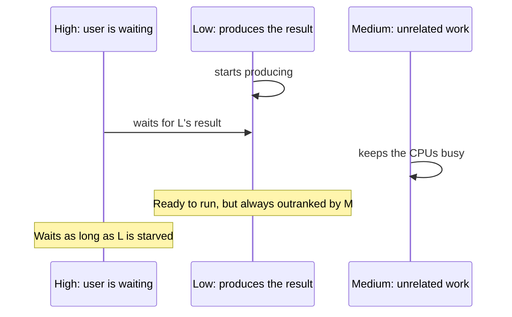

A task's priority tells the scheduler how urgent its work is. It does not make the work faster, it does not interrupt anything already running, and it does not guarantee an order. It influences which job an executor picks next when several are waiting, and which quality-of-service class the threads running them get.

Most of the time, priority takes care of itself: tasks inherit it, and the runtime raises it automatically when urgent work waits on less urgent work. The interesting cases are where that automation cannot see the dependency, because the wait goes through a continuation, a semaphore, or a lock, and urgent work ends up stuck behind background work. That is priority inversion, and this article shows how it arises, how Swift prevents most of it, and how to fix the cases it cannot see.

<!--more-->

The examples use Swift 6 language mode and were compiled and run with the Swift 6.4 toolchain on macOS 26. The Swift blocks build on one another in one `main.swift`. The priority escalation APIs from Swift 6.2 require iOS 26, macOS 26, or later; `Mutex` requires iOS 18, macOS 15, or later.

## The priority levels

`TaskPriority` is a wrapper around a raw value. Several names alias the same level, which reflects the mapping onto the system's quality-of-service classes:

```swift
import Foundation
import Synchronization

assert(TaskPriority.high == .userInitiated && TaskPriority.high.rawValue == 25)
assert(TaskPriority.medium.rawValue == 21)
assert(TaskPriority.low == .utility && TaskPriority.low.rawValue == 17)
assert(TaskPriority.background.rawValue == 9)
```

| Priority | Use it for | Avoid it for |
| --- | --- | --- |
| `.high` / `.userInitiated` | Work the user is actively waiting for: opening a document, loading the screen they tapped | Prefetching, analytics, anything speculative |
| `.medium` | The default for detached tasks and work with no stated urgency | |
| `.low` / `.utility` | Long-running work the user knows about but does not watch: imports, exports, syncing | Anything blocking a visible spinner |
| `.background` | Maintenance the user never sees: pruning caches, indexing, cleanup | Anything a user or a test awaits |

Background priority can be throttled aggressively by the system, for example in Low Power Mode or under thermal pressure, especially for disk and network I/O. Work at that level may take far longer than its CPU cost suggests. That is the point of the level, and it is why nothing the user waits on belongs there.

## Inheritance

Priority flows through the same channels as other task context:

- Child tasks, `async let` and task groups, inherit their parent's priority.
- `Task { }` inherits the current task's priority. Outside any task, it derives one from the current thread's quality of service.
- `Task.detached { }` starts at `.medium` unless given a priority.
- Any task-creating API accepts an explicit `priority:` that overrides inheritance.

```swift
let inheritance = await Task(priority: .high) { () -> [TaskPriority] in
    async let child = Task.currentPriority
    let unstructured = Task { Task.currentPriority }
    let detached = Task.detached { Task.currentPriority }
    let explicit = Task(priority: .background) { Task.currentPriority }
    // Let every task record its starting priority before anything awaits it.
    try? await Task.sleep(for: .milliseconds(20))
    return [await child, await unstructured.value, await detached.value, await explicit.value]
}.value
assert(inheritance == [.high, .high, .medium, .background])
```

The sleep and the choice of `.high` are not decoration. Awaiting a task from a higher-priority task *raises* the awaited task's priority, as the escalation section below shows. A first version of this probe started the outer task at `.low` and awaited it from top-level code running at `.medium`. The outer task was escalated to `.medium` almost immediately, and the tasks it created reported a mixture of `.low` and `.medium` depending on exactly when each one was created. Priority measurements are only meaningful when nothing higher is waiting on the task being measured.

Inheritance is usually what you want. A screen opened by the user starts its loading from a user-initiated context, and every child of that work inherits user-initiated priority without anyone writing it down. The main reason to pass a priority explicitly is to *lower* it, for work that is triggered by an urgent context but is not itself urgent, such as warming a cache for screens the user has not opened yet.

## What priority does and does not do

Priority orders *waiting* work. When an executor has several jobs ready, it prefers higher-priority ones. It never preempts a job that is already running: Swift's executors are cooperative, and a job runs until it finishes or suspends.

Both properties are visible on an actor. Below, a medium-priority job occupies the actor for 100 ms. While it runs, three low-priority calls arrive, then three high-priority calls:

```swift
actor Journal {
    private(set) var order: [String] = []

    func occupy(for duration: Duration) {
        let clock = ContinuousClock()
        let deadline = clock.now + duration
        while clock.now < deadline {}
    }

    func record(_ entry: String) {
        order.append(entry)
    }
}

let journal = Journal()
let occupant = Task.detached(priority: .medium) { await journal.occupy(for: .milliseconds(100)) }
try await Task.sleep(for: .milliseconds(20))
var writers: [Task<Void, Never>] = []
for index in 0..<3 {
    writers.append(Task.detached(priority: .low) { await journal.record("low \(index)") })
}
try await Task.sleep(for: .milliseconds(5))
for index in 0..<3 {
    writers.append(Task.detached(priority: .high) { await journal.record("high \(index)") })
}
for writer in writers { await writer.value }
await occupant.value
let journalOrder = await journal.order
assert(journalOrder.count == 6)
print("actor execution order:", journalOrder)
```

On the test machine this printed `["high 0", "high 1", "high 2", "low 0", "low 1", "low 2"]`. The high-priority calls arrived later but ran first, because the actor's pending jobs are ordered by priority, not strictly by arrival. And none of them ran until the medium-priority `occupy` call finished, because nothing preempts a running job.

Two design consequences follow. First, **do not rely on FIFO order for calls to an actor from different tasks.** If order matters, it must come from the program's structure, for example one task making the calls sequentially, or a sequence number. Second, **priority cannot rescue a long synchronous job.** If a background job holds an actor for 200 ms, a user-initiated call waits 200 ms whatever its priority. Keep isolated jobs short, as the [actors article](/swift-actors/) argues.

## Priority inversion and automatic escalation

Priority inversion happens when high-priority work waits for low-priority work, and other, medium-priority work keeps the low-priority work from running. The high-priority work is then effectively running at low priority, or worse.



Swift prevents this automatically wherever the runtime can see *who is waiting for whom*. It **escalates** the priority of the awaited work to match the waiter. Escalation applies when:

- a task awaits another task's `value` or `result`;
- a parent awaits a child, through `async let` or a task group;
- a task is waiting to run on an actor, in which case the actor's current job is escalated so the actor gets through its queue faster.

Escalation is visible from inside the escalated task:

```swift
final class PriorityLog: Sendable {
    private let samples = Mutex<[TaskPriority]>([])

    func sample() {
        samples.withLock { $0.append(Task.currentPriority) }
    }

    func reset() {
        samples.withLock { $0.removeAll() }
    }

    var first: TaskPriority? { samples.withLock { $0.first } }
    var last: TaskPriority? { samples.withLock { $0.last } }
}

let escalationLog = PriorityLog()
let lowWorker = Task.detached(priority: .low) {
    for _ in 0..<15 {
        escalationLog.sample()
        try? await Task.sleep(for: .milliseconds(10))
    }
}
try await Task.sleep(for: .milliseconds(40))
let urgentWaiter = Task(priority: .high) { await lowWorker.value }
await urgentWaiter.value
assert(escalationLog.first == .low)
assert(escalationLog.last == .high, "Awaiting from a high-priority task escalated the worker")
```

The worker sampled `.low` until the high-priority task began awaiting it, then `.high`. Escalation is permanent for the life of the task: a task's priority can be raised, never lowered.

Escalation is transitive. If $$W(t)$$ is the set of tasks waiting on task $$t$$, then the effective priority of $$t$$ is

$$
p_{\text{eff}}(t) = \max\Big(p_{\text{base}}(t),\; \max_{w \in W(t)} p_{\text{eff}}(w)\Big),
$$

so an urgent task at the end of a chain of `await`s lifts every task along the chain, as far as the runtime can see the chain.

## Where escalation cannot see

The runtime knows about task handles, child tasks, and actors. It does not know about:

- **Continuations.** A task suspended in `withCheckedContinuation` is waiting for *whoever will call `resume`*, and the runtime has no idea who that is.
- **Semaphores, locks, and condition variables.** These block threads; they do not record which task will release them. In async code they are already a problem for other reasons, covered in the [deadlocks article](/swift-deadlocks-blocking-waits/).
- **Callback-based and GCD-based work.** A queue that will eventually call back has no connection to the task waiting for the callback.

Here, a consumer waits for a producer through a continuation. Both start at low priority; then a high-priority task awaits the consumer:

```swift
/// A one-shot signal: one task waits, another fires. Invisible to priority escalation.
final class Signal: Sendable {
    private let waiter = Mutex<CheckedContinuation<Int, Never>?>(nil)

    func wait() async -> Int {
        await withCheckedContinuation { continuation in
            waiter.withLock { $0 = continuation }
        }
    }

    func fire(_ value: Int) {
        let continuation = waiter.withLock { stored in
            defer { stored = nil }
            return stored
        }
        continuation?.resume(returning: value)
    }
}

func producerPriority(forwardingEscalation: Bool) async -> TaskPriority? {
    let producerLog = PriorityLog()
    let signal = Signal()
    let producer = Task.detached(priority: .low) {
        for _ in 0..<15 {
            producerLog.sample()
            try? await Task.sleep(for: .milliseconds(10))
        }
        signal.fire(42)
    }
    let consumer = Task.detached(priority: .low) { () -> Int in
        guard forwardingEscalation else {
            return await signal.wait()
        }
        return await withTaskPriorityEscalationHandler {
            await signal.wait()
        } onPriorityEscalated: { _, newPriority in
            producer.escalatePriority(to: newPriority)
        }
    }
    try? await Task.sleep(for: .milliseconds(30))
    let urgent = Task(priority: .high) { await consumer.value }
    _ = await urgent.value
    return producerLog.last
}

let invertedPriority = await producerPriority(forwardingEscalation: false)
let forwardedPriority = await producerPriority(forwardingEscalation: true)
assert(invertedPriority == .low, "The producer stayed low while urgent work waited on it")
assert(forwardedPriority == .high, "Forwarding the escalation lifted the producer")
```

Without help, the high-priority task escalated the consumer, which it awaits directly, but the escalation stopped there. The producer, the task that actually had to run, stayed at `.low`. On a busy device, the user-facing work would wait as long as background work took to get scheduled.

Swift 6.2 adds the tools to forward escalation by hand ([SE-0462](https://github.com/swiftlang/swift-evolution/blob/main/proposals/0462-task-priority-escalation-apis.md)):

- `withTaskPriorityEscalationHandler(operation:onPriorityEscalated:)` runs a handler whenever the current task is escalated while `operation` runs. Like a cancellation handler, it runs synchronously on whichever thread performed the escalation, so it must be `@Sendable` and quick.
- `Task.escalatePriority(to:)` on a task handle, and the static `Task.escalatePriority(_:to:)` for an `UnsafeCurrentTask`, raise another task's priority.

With the handler in place, the consumer's escalation was forwarded to the producer, which then ran at `.high`. Use this pattern whenever you build a waiting mechanism, such as a signal, an async queue, or a permit pool like the one in the [cancellation handlers article](/swift-cancellation-handlers-cleanup/), where the task that will satisfy a waiter is known. If the satisfier is unknown, as with a broadcast, a priority-ordered queue of waiters is the best available tool.

## Starvation

Priority ordering means lower-priority work runs only when no higher-priority work is ready. If urgent work keeps the executor fully busy, background work never runs. In queueing terms, if high-priority work alone occupies a fraction $$\rho_H$$ of the pool's capacity, lower-priority work receives at most the remainder:

$$
\text{capacity}_{\text{low}} \le (1 - \rho_H)\,\text{capacity}.
$$

As $$\rho_H \to 1$$, low-priority work starves. Escalation turns this into a hazard for *correctness*, not just throughput, when urgent work transitively depends on starved work it cannot see.

In practice, app workloads rarely saturate every core with user-initiated work for long. The common failure is subtler: a long-running loop marked `.high` because it started from a button tap, quietly outranking everything else for minutes. Tasks inherit priority by default, so it is worth lowering it explicitly when a user-initiated action starts work that the user will not watch:

```swift
@MainActor
final class LibraryModel {
    private(set) var importStatus = "idle"
    private var importTask: Task<Void, Never>?

    func importTapped(files: Int) {
        importStatus = "importing \(files) files"
        // The tap is urgent; the import is not. Lower it so the UI stays crisp.
        importTask = Task(priority: .utility) {
            for _ in 0..<files {
                try? await Task.sleep(for: .milliseconds(1))
            }
            importStatus = "imported \(files) files"
        }
    }

    func waitForImport() async {
        await importTask?.value
    }
}

let library = LibraryModel()
library.importTapped(files: 5)
await library.waitForImport()
assert(library.importStatus == "imported 5 files")
```

The task still runs on the main actor, because `Task { }` inherits the main actor's isolation, but at utility priority. If something urgent later awaits `importTask`, escalation raises it again, so lowering the priority is never a correctness risk when the dependency is visible to the runtime.

## Guidelines

- **Let inheritance do most of the work.** User-initiated contexts produce user-initiated tasks without annotations.
- **Lower priority explicitly** for work that an urgent context triggers but the user will not wait for.
- **Do not raise priority to make something "faster."** It only reorders waiting work; if the work is slow because it is long, priority does nothing.
- **Never put awaited work at `.background`** unless the awaiting path is visible to escalation.
- **Do not assume FIFO** for calls into an actor from different tasks; pending jobs are ordered by priority.
- **Forward escalation** through any waiting mechanism you build on continuations, with `withTaskPriorityEscalationHandler` and `escalatePriority(to:)`.

## Summary

- Priority orders waiting work; it never preempts running work or speeds anything up.
- Child tasks and `Task { }` inherit priority; `Task.detached` starts at `.medium`; explicit priorities override both.
- Actors run pending jobs in priority order, not strictly FIFO, but never interrupt the running job.
- Awaiting a task, a child, or an actor escalates the awaited work, transitively: $$p_{\text{eff}}(t) = \max(p_{\text{base}}(t), \max_{w} p_{\text{eff}}(w))$$.
- Continuations, locks, semaphores, and callbacks hide dependencies from escalation. Forward escalation by hand with the Swift 6.2 APIs.
- Lower priority for work started by urgent contexts but not awaited by them.

## Exercise

Build an `AsyncQueue<Element>` where producers `enqueue` and a single consumer task awaits `dequeue()` through a continuation. Add escalation forwarding so that when a high-priority task awaits the consumer, the producer that will enqueue next is escalated. Decide what "the producer that will enqueue next" means when there are several producers, and justify the choice. Then measure, using `PriorityLog`, that a high-priority waiter no longer leaves the producers at their base priority.

## Further reading

- [SE-0462: Task Priority Escalation APIs](https://github.com/swiftlang/swift-evolution/blob/main/proposals/0462-task-priority-escalation-apis.md).
- [SE-0304: Structured concurrency](https://github.com/swiftlang/swift-evolution/blob/main/proposals/0304-structured-concurrency.md), section "Task priorities."
- [Prioritize Work with Quality of Service Classes](https://developer.apple.com/library/archive/documentation/Performance/Conceptual/EnergyGuide-iOS/PrioritizeWorkWithQoS.html), Apple's energy efficiency guide.
- [Swift concurrency: Behind the scenes](https://developer.apple.com/videos/play/wwdc2021/10254/), WWDC21, on actor scheduling and escalation.

Previous: [Unstructured and Detached Tasks: When to Use Each](/swift-unstructured-detached-tasks/). Next: [Actors: Protecting State Behind an Isolation Boundary](/swift-actors/).

Return to the [Concurrency roadmap](/swift-concurrency-roadmap/).
