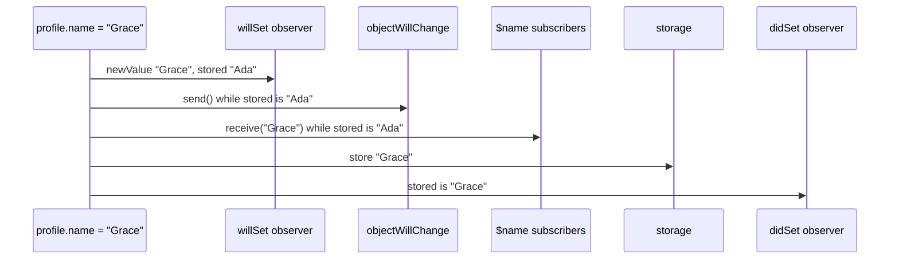

`@Published` is the most widely used piece of Combine, often by people who never import Combine on purpose. It is a property wrapper that turns a stored property of a class into a property *and* a publisher of that property's changes: `model.query` is the value, and `model.$query` is a publisher that emits it. Inside an `ObservableObject`, every `@Published` property also feeds the object's `objectWillChange` publisher, which is how SwiftUI learned, from iOS 13 until the Observation framework arrived in iOS 17, that a view needed to be redrawn.

The detail that explains most `@Published` bugs is in the name of that publisher: it fires when the object *will* change. The wrapper emits a new value before it stores it, so code that reacts to the emission by reading the object sees the old state. This article measures the exact order of events during an assignment, shows the stale-read bug and its fix, counts emissions for duplicate values and struct mutations, and checks the rules of `objectWillChange` for subclasses, custom publishers, and nested objects.

<!--more-->

The examples use Swift 6 language mode and were compiled and run with the Swift 6.4 toolchain from Xcode 27.1 on macOS 26. Paste the blocks in order into one `main.swift`. The view models are marked `@MainActor`, as they are in a SwiftUI app, which also lets them write to the top-level logs below.

## What the wrapper gives you

Declaring a property `@Published` produces three things: the stored value, accessed as usual; a projected value, `$property`, of type `Published<Value>.Publisher`; and, if the class conforms to `ObservableObject`, a notification on the object's synthesized `objectWillChange` before every change. The projected publisher behaves like a `CurrentValueSubject` in two ways, it gives each new subscriber the current value and it never fails, and differs from it in two others: it never completes, and you cannot send into it.

```swift
import Combine
import Foundation

@MainActor
final class SearchModel: ObservableObject {
    @Published var query = ""
}

let search = SearchModel()
var queries: [String] = []
let queryListener = search.$query.sink { queries.append($0) }
search.query = "swift"
search.query = "combine"
assert(queries == ["", "swift", "combine"])   // the current value first, then each change
```

Because the first value is the current one, a subscriber that only wants changes adds `dropFirst()`. The publisher also does not keep its owner alive, and when the owner is deallocated it simply stops; subscribers never receive a completion:

```swift
final class Owner {
    @Published var count = 0
}

var ownerEvents: [String] = []
var ownerListener: AnyCancellable?
do {
    let owner = Owner()
    ownerListener = owner.$count.sink(
        receiveCompletion: { ownerEvents.append("completion \($0)") },
        receiveValue: { ownerEvents.append("value \($0)") }
    )
    owner.count = 1
}
assert(ownerEvents == ["value 0", "value 1"])   // the owner is gone; no completion arrived
assert(ownerListener != nil)
```

That is convenient, since subscribing to `$count` does not create a retain cycle by itself, and it means a pipeline built on a `@Published` property cannot use `receiveCompletion` to learn that its source has gone away.

`@Published` exists only for classes. On a struct, the compiler explains why the wrapper's storage trick cannot work:

```swift
// Does not compile
struct FormState {
    @Published var name = ""
}
// error: 'wrappedValue' is unavailable: @Published is only available on properties of classes
```

The wrapper needs a stable object identity to find the enclosing instance's `objectWillChange` and to share one publisher between every copy of the reference, and a struct has neither.

## The order of events in one assignment

Here is a model with all four observation points: a `willSet` and a `didSet` observer, `objectWillChange`, and the projected publisher. Each one logs what it sees, including what the property returns at that moment:

```swift
var assignmentLog: [String] = []

@MainActor
final class ProfileModel: ObservableObject {
    @Published var name = "Ada" {
        willSet { assignmentLog.append("willSet: newValue \(newValue), stored \(name)") }
        didSet { assignmentLog.append("didSet: stored \(name)") }
    }
}

let profile = ProfileModel()
let willChangeListener = profile.objectWillChange.sink {
    assignmentLog.append("objectWillChange: stored \(profile.name)")
}
let nameListener = profile.$name.dropFirst().sink { delivered in
    assignmentLog.append("$name: delivered \(delivered), stored \(profile.name)")
}

profile.name = "Grace"
assert(assignmentLog == [
    "willSet: newValue Grace, stored Ada",
    "objectWillChange: stored Ada",
    "$name: delivered Grace, stored Ada",
    "didSet: stored Grace",
])
```

Both publishers fire inside the setter, before the new value is stored. The sequence is the same for every assignment:



The design is deliberate. SwiftUI subscribes to `objectWillChange` so it can record that a view is invalid *before* the state changes, and then reads the new state when it re-evaluates the view's `body` later in the same run loop turn. For a pipeline that reacts immediately, though, the order is a trap.

## The stale-read bug

A form model with a derived property shows the bug. `canSubmit` is computed from two `@Published` properties, and a subscriber updates a button whenever the username changes:

```swift
@MainActor
final class SignUpModel: ObservableObject {
    @Published var username = ""
    @Published var password = ""
    var canSubmit: Bool { username.count >= 3 && password.count >= 8 }
}

let signUp = SignUpModel()
signUp.password = "correct horse"
var buttonEnabled: [Bool] = []
let staleListener = signUp.$username.dropFirst().sink { _ in
    buttonEnabled.append(signUp.canSubmit)     // reads the model during the emission
}

signUp.username = "ada"
assert(signUp.canSubmit)                       // valid now...
assert(buttonEnabled == [false])               // ...but the button was disabled
```

The username is valid and the password is valid, yet the button saw `false`, because `canSubmit` read `username` while it still held `""`. The next keystroke would enable it, so in an app the button is always one character behind, which is maddening to reproduce and easy to dismiss as flakiness.

The fix is to compute derived state from the values the publishers deliver, not from the object. `combineLatest` gives the latest value of each input every time either changes:

```swift
var buttonEnabledFixed: [Bool] = []
let fixedListener = signUp.$username
    .combineLatest(signUp.$password)
    .map { username, password in username.count >= 3 && password.count >= 8 }
    .removeDuplicates()
    .sink { buttonEnabledFixed.append($0) }

signUp.username = "al"
signUp.username = "alan"
signUp.password = "short"
assert(buttonEnabledFixed == [true, false, true, false])
```

The first `true` is the current state at subscription, the username `"ada"` with a valid password. The rule then runs on delivered values only, so it is correct at every step, and `removeDuplicates()` suppresses repeated states. The validation also now lives in one pipeline instead of being split between a computed property and a subscriber, which makes it testable on its own. [Combining: `combineLatest`, `zip`, and `merge`](/combine-combinelatest-zip-merge/) covers the operator in detail.

A second fix, which you will see in many codebases, is to defer the read with `receive(on: DispatchQueue.main)` or `RunLoop.main`, so that the subscriber runs after the setter has returned. It works, but it trades a deterministic bug for an asynchronous hop on every change, and the subscriber still reads mutable state that may have changed again by the time it runs. Prefer passing values.

## No deduplication, and one emission per mutation

`@Published` emits on every assignment, including an assignment of the value it already holds, and it treats every in-place mutation of a value type as a new assignment:

```swift
@MainActor
final class PlaylistModel: ObservableObject {
    @Published var title = "Mix"
    @Published var tracks: [String] = []
}

let playlist = PlaylistModel()
var titleEmissions = 0
var trackEmissions = 0
var willChangeCount = 0
let titleListener = playlist.$title.dropFirst().sink { _ in titleEmissions += 1 }
let tracksListener = playlist.$tracks.dropFirst().sink { _ in trackEmissions += 1 }
let playlistWillChange = playlist.objectWillChange.sink { willChangeCount += 1 }

playlist.title = "Mix"                       // same value
playlist.title = "Mix"
playlist.tracks.append("Intro")              // each mutation is a set
playlist.tracks.append("Outro")
playlist.tracks.sort()

assert(titleEmissions == 2)
assert(trackEmissions == 3)
assert(willChangeCount == 5)                 // every one of them invalidates the object
```

Two kinds of cost follow. Subscribers to `$title` do redundant work, which `removeDuplicates()` fixes for them, provided the value is `Equatable`. And `objectWillChange` fired five times for changes that, from a user's point of view, were one edit; in SwiftUI, every view observing the object is invalidated each time. SwiftUI coalesces invalidations within a run loop turn. In a separate test that hosted a SwiftUI view in an offscreen `NSHostingView` on macOS and counted evaluations of its `body`, five synchronous assignments caused one evaluation, while five assignments made 30 ms apart from a task caused five. Changing a `@Published` property that the view never read also caused an evaluation, because the view subscribes to the whole object. Coalescing hides the cost of synchronous bursts from rendering, but every `objectWillChange` subscriber still runs each time, and changes spread across turns are rendered one by one.

When several properties change together, model them as one value and assign it once:

```swift
struct EditorState: Equatable {
    var title = ""
    var body = ""
    var isDirty = false
}

@MainActor
final class EditorModel: ObservableObject {
    @Published private(set) var state = EditorState()

    func load(title: String, body: String) {
        var next = state
        next.title = title
        next.body = body
        next.isDirty = false
        state = next                          // one assignment, one emission
    }
}

let editor = EditorModel()
var editorWillChange = 0
let editorListener = editor.objectWillChange.sink { editorWillChange += 1 }
editor.load(title: "Draft", body: "Hello")
assert(editorWillChange == 1)
assert(editor.state == EditorState(title: "Draft", body: "Hello", isDirty: false))
```

Mutating `state.title`, `state.body`, and `state.isDirty` directly would have produced three emissions, because each mutation of a field of a `@Published` struct is a set of the whole struct. Building the new value in a local and assigning it once is the `@Published` version of a transaction.

## `objectWillChange` and its rules

`ObservableObject` has one requirement, an `objectWillChange` publisher, and a default implementation that synthesizes it as an `ObservableObjectPublisher` and connects every `@Published` property to it. Three cases decide whether that connection exists.

**Subclasses.** `@Published` properties declared in a subclass of an `ObservableObject` class fire the inherited `objectWillChange`, as do those in the base class. Early releases of iOS 13 had a bug here, which is why older code sometimes forwards subclass properties by hand; on current systems that is unnecessary:

```swift
class BaseSettings: ObservableObject {
    @Published var theme = "light"
}

final class AccountSettings: BaseSettings {
    @Published var email = ""
}

let account = AccountSettings()
var accountWillChange = 0
let accountListener = account.objectWillChange.sink { accountWillChange += 1 }
account.theme = "dark"
account.email = "ada@example.com"
assert(accountWillChange == 2)
```

**A custom `objectWillChange`.** If a class declares its own `objectWillChange` of any other type, the synthesized one is not created, and `@Published` properties no longer notify anything. The wrapper looks specifically for an `ObservableObjectPublisher`:

```swift
final class CustomSignalModel: ObservableObject {
    let objectWillChange = PassthroughSubject<Void, Never>()
    @Published var value = 0
}

let custom = CustomSignalModel()
var customWillChange = 0
let customListener = custom.objectWillChange.sink { customWillChange += 1 }
custom.value = 5
assert(customWillChange == 0)                // nothing: the wrapper did not find its publisher
```

A view observing this object would never update when `value` changes. Declaring `let objectWillChange = ObservableObjectPublisher()` keeps automatic emission working while making the publisher explicit, and you can still call `objectWillChange.send()` yourself for state that is not `@Published`.

**Nested observable objects.** A `@Published` property whose value is another `ObservableObject` fires only when the reference itself is replaced. Changes inside the child are not forwarded:

```swift
@MainActor
final class PlayerModel: ObservableObject {
    @Published var volume = 0.5
}

@MainActor
final class RoomModel: ObservableObject {
    @Published var player = PlayerModel()
}

let room = RoomModel()
var roomWillChange = 0
let roomListener = room.objectWillChange.sink { roomWillChange += 1 }
room.player.volume = 0.8
assert(roomWillChange == 0)                  // the room never heard about it
```

A SwiftUI view that observes only the room, and reads `room.player.volume` in its body, will not redraw. The usual fixes are to observe the child directly in the view that displays it, or to forward the child's notifications:

```swift
@MainActor
final class ForwardingRoomModel: ObservableObject {
    let player = PlayerModel()
    private var forwarding: AnyCancellable?

    init() {
        forwarding = player.objectWillChange.sink { [weak self] _ in
            self?.objectWillChange.send()
        }
    }
}

let forwardingRoom = ForwardingRoomModel()
var forwardingWillChange = 0
let forwardingListener = forwardingRoom.objectWillChange.sink { forwardingWillChange += 1 }
forwardingRoom.player.volume = 0.2
assert(forwardingWillChange == 1)
```

Forwarding re-creates exactly the coarse invalidation that makes large `ObservableObject` graphs slow: any change anywhere invalidates everything above it. That limitation, more than any API detail, is what the Observation framework was designed to remove, as [Combine vs. the Observation Framework in SwiftUI](/combine-vs-observation-swiftui/) measures.

## Threads

The wrapper emits on whatever thread performs the assignment, so subscribers to `$property` and `objectWillChange` run on that thread too. Marking the class `@MainActor`, as every model above does, makes the compiler reject a direct assignment from a background context, which is the main reason to do it. Two paths bypass that protection. `assign(to: &$property)` writes from whatever thread the upstream delivers on, with no diagnostic, as [`sink` and `assign`](/combine-sink-assign/) measured for `assign(to:on:)`. And a `@Published` property on a class that is *not* main-actor isolated can be set from anywhere:

```swift
final class UnisolatedCounter {
    @Published var value = 0
}

let unisolated = UnisolatedCounter()
nonisolated(unsafe) let sharedCounter = unisolated   // deliberately unchecked for the demonstration
let deliveredOnMain = PassthroughSubject<Bool, Never>()
var deliveryThreads: [Bool] = []
let threadReporter = deliveredOnMain.sink { deliveryThreads.append($0) }
let threadProbe = unisolated.$value.dropFirst().sink { @Sendable _ in
    let onMain = Thread.isMainThread
    DispatchQueue.main.async { MainActor.assumeIsolated { deliveredOnMain.send(onMain) } }
}
DispatchQueue.global().async { sharedCounter.value = 1 }
let deadline = Date(timeIntervalSinceNow: 2)
while deliveryThreads.isEmpty && Date() < deadline {
    RunLoop.main.run(until: Date(timeIntervalSinceNow: 0.01))
}
assert(deliveryThreads == [false])           // the subscriber ran on the background thread
```

If such a property drives UI, put `receive(on: DispatchQueue.main)` before the subscriber, or better, isolate the class to the main actor and move the background work into a function that returns a value.

Keep the remaining subscriptions alive until the end of the file:

```swift
withExtendedLifetime((queryListener, willChangeListener, nameListener, staleListener,
                      fixedListener, titleListener, tracksListener, playlistWillChange,
                      editorListener, accountListener, customListener, roomListener,
                      forwardingListener, threadReporter, threadProbe)) {}
```

## Summary

- `@Published` gives a class property a projected publisher that emits the current value on subscription and every change after it, never completes, and does not retain its owner.
- The measured order of one assignment is `willSet`, `objectWillChange`, `$property` subscribers, storage, `didSet`: both publishers fire while the old value is still stored.
- Reading the object inside a `$property` subscriber therefore sees stale state; a derived `canSubmit` lagged one change behind. Compute derived state from delivered values with `combineLatest` and `map`.
- Assigning the same value emits again, and each in-place mutation of a value-typed property emits once: five changes produced five `objectWillChange` signals. Use `removeDuplicates()`, and group related properties into one struct assigned once.
- `@Published` properties in subclasses notify the inherited `objectWillChange`. A custom `objectWillChange` of another type silences them, and a nested `ObservableObject` does not propagate its changes.
- Emission happens on the assigning thread. Isolate models to the main actor and be careful with `assign(to:)`, which bypasses that isolation.

## Exercise

Write a `CheckoutModel` with `@Published` properties for a cart's items, a discount code, and a shipping option, and a derived `total` that depends on all three. Expose `total` as an `AnyPublisher<Decimal, Never>` built only from the projected publishers, never by reading the model, and test that it is correct after every single change, including two changes made in a row inside one function. Then add a `reset()` method that clears all three properties, count the `objectWillChange` emissions it causes, and refactor the model so that `reset()` causes exactly one, without changing what the `total` publisher emits.

## Further reading

- Apple's documentation for [`Published`](https://developer.apple.com/documentation/combine/published) and [`ObservableObject`](https://developer.apple.com/documentation/combine/observableobject).
- [Data Flow Through SwiftUI](https://developer.apple.com/videos/play/wwdc2019/226/), WWDC19, and [Data Essentials in SwiftUI](https://developer.apple.com/videos/play/wwdc2020/10040/), WWDC20, which explain why SwiftUI observes `objectWillChange` rather than the new values.
- [SE-0258: Property Wrappers](https://github.com/swiftlang/swift-evolution/blob/main/proposals/0258-property-wrappers.md), including the "referencing the enclosing self" design that `@Published` uses to reach `objectWillChange`.

Previous: [Subjects: `PassthroughSubject` and `CurrentValueSubject`](/combine-subjects/). Next: [`AnyCancellable` and Memory Management](/combine-anycancellable-memory/).

Return to the [Combine roadmap](/combine/).
