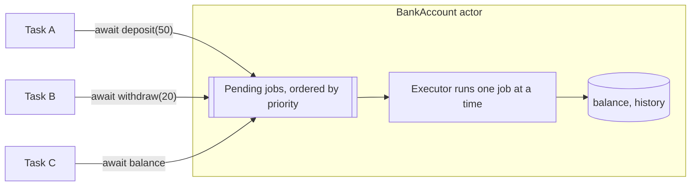

Mutable state shared between concurrent tasks needs protection. For decades that meant locks, queues, and discipline: every access had to remember to take the lock, and nothing checked that it did. An actor makes the protection part of the type. Its mutable state can be touched only by code running *on* the actor, one piece at a time, and the compiler rejects every other access.

This article covers what that isolation boundary guarantees, what crossing it costs, how to design actor interfaces that keep invariants intact, and when a lock is the better tool. It measures the cost of actor calls from different contexts, because that cost shapes good actor design more than anything else.

<!--more-->

The examples use Swift 6 language mode and were compiled and run with the Swift 6.4 toolchain on macOS 26. Performance numbers quoted in the text come from an optimized (`-O`) build on an Apple M1 Ultra. The Swift blocks build on one another in one `main.swift`. `Mutex` requires iOS 18, macOS 15, or later.

## The problem actors solve

In Swift 6 language mode, sharing an unprotected class between concurrent tasks does not compile:

```swift
// Does not compile in Swift 6 mode.
final class Counter {
    var value = 0
}

let counter = Counter()

func incrementConcurrently() async {
    await withTaskGroup(of: Void.self) { group in
        for _ in 0..<2 {
            group.addTask { counter.value += 1 }
        }
    }
}
// error: non-Sendable type 'Counter' of let 'counter' cannot exit main actor-isolated context
// error: main actor-isolated let 'counter' cannot be accessed from outside of the actor
```

Two tasks could increment `value` at the same instant. `+=` is a read followed by a write, so one increment can be lost, and in the worst case the program reads memory mid-update. That is a **data race**, and Swift 6 rejects programs that could contain one. The compiler offers several ways out; an actor is the one designed for state that many tasks share.

## Declaring an actor

An actor looks like a class: it is a reference type with stored properties, methods, and initializers. The difference is that its mutable state is **isolated**:

```swift
import Foundation
import Synchronization

enum BankError: Error, Equatable {
    case insufficientFunds(balance: Int, requested: Int)
    case accountClosed(Int)
}

actor BankAccount {
    let id: Int
    private(set) var balance: Int
    private(set) var isClosed = false
    private var history: [Int] = []

    init(id: Int, balance: Int) {
        self.id = id
        self.balance = balance
    }

    func deposit(_ amount: Int) throws {
        guard !isClosed else { throw BankError.accountClosed(id) }
        precondition(amount > 0)
        balance += amount
        history.append(amount)
    }

    func withdraw(_ amount: Int) throws {
        guard !isClosed else { throw BankError.accountClosed(id) }
        guard balance >= amount else {
            throw BankError.insufficientFunds(balance: balance, requested: amount)
        }
        balance -= amount
        history.append(-amount)
    }

    func close() {
        isClosed = true
    }

    var transactionCount: Int {
        history.count
    }
}
```

Inside the actor, code accesses `balance` and `history` directly, synchronously, like any class. Outside, every access to isolated state goes through `await`:

```swift
let checking = BankAccount(id: 1, balance: 100)
try await checking.deposit(50)
let checkingBalance = await checking.balance
assert(checkingBalance == 150)
assert(checking.id == 1, "An immutable Sendable let can be read without await")
```

The `await` is not ceremony. The call may have to wait for the actor to finish other work, so it is a potential suspension point like any other. And `id`, a `let` of a `Sendable` type, needs no `await` within the same module, because an immutable value cannot race.

## What isolation guarantees

An actor runs at most one piece of isolated code at a time. Each call into the actor becomes a *job* on the actor's queue, and the actor processes jobs one by one, so the state it protects is never touched by two threads at once.



That makes thousands of concurrent deposits exact:

```swift
let savings = BankAccount(id: 2, balance: 0)
await withThrowingTaskGroup(of: Void.self) { group in
    for _ in 0..<1_000 {
        group.addTask { try await savings.deposit(1) }
    }
}
let savingsBalance = await savings.balance
let savingsTransactions = await savings.transactionCount
assert(savingsBalance == 1_000 && savingsTransactions == 1_000, "No increment was lost")
```

Each deposit is a job; jobs never overlap; no increment is lost. No lock appears in the code, and none can be forgotten.

The guarantee has a precise boundary, which the rest of this article returns to: an actor serializes **jobs**, not **methods**. A method without `await` runs as one job, so it is atomic with respect to other isolated code. A method with an `await` in the middle is split into several jobs, and other calls can run between them. That is [reentrancy](/swift-actor-reentrancy/), the most important actor behavior to understand after isolation itself.

## Actors and Sendable

Actors are `Sendable` automatically: a reference to an actor can be passed to any task, because every access to its state is serialized. What crosses *into or out of* an actor must also be safe. Arguments and return values of isolated methods called from outside must be `Sendable`, or must be provably unshared ([SE-0414](https://github.com/swiftlang/swift-evolution/blob/main/proposals/0414-region-based-isolation.md)). That rule is what stops an actor from leaking a mutable reference to its internals: returning a non-`Sendable` class instance from an actor method would let callers mutate it outside the actor. Return value types and snapshots instead. The [Sendable article](/swift-sendable/) covers these rules in detail.

## Operations that span actors are not atomic

Each actor is its own unit of atomicity. An operation that touches two actors, such as a transfer between two accounts, necessarily has a suspension point between the two halves, and the system is briefly in an intermediate state:

```swift
extension BankAccount {
    /// Withdraws here, then deposits there. Refunds if the deposit fails.
    func transfer(_ amount: Int, to destination: BankAccount) async throws {
        try withdraw(amount)                     // Isolated, synchronous: atomic on this actor.
        do {
            try await destination.deposit(amount) // Suspension point: other work may run here.
        } catch {
            balance += amount                     // Compensate, so money is not destroyed.
            history.append(amount)
            throw error
        }
    }
}

let source = BankAccount(id: 10, balance: 100)
let destination = BankAccount(id: 11, balance: 0)
try await source.transfer(30, to: destination)
let afterTransfer = (await source.balance, await destination.balance)
assert(afterTransfer == (70, 30))

await destination.close()
do {
    try await source.transfer(30, to: destination)
    assertionFailure("Depositing into a closed account must fail")
} catch BankError.accountClosed(let id) {
    assert(id == 11)
}
let afterFailedTransfer = (await source.balance, await destination.balance)
assert(afterFailedTransfer == (70, 30), "The compensating refund preserved the total")
```

While `transfer` is suspended at the `await`, the 30 units exist in neither account. An auditor summing the two balances at that moment would see money missing. Whether that matters depends on the domain. A bank needs a ledger with an explicit "in transit" state; a cache does not care.

Two techniques keep cross-actor operations correct:

- **Compensation**, as above: perform the first half, attempt the second, and undo the first if the second fails.
- **Putting related state in one actor.** If two accounts must always be updated atomically, they belong to one `Ledger` actor, which updates both in a single synchronous method. An actor's boundary should enclose an invariant, not a single object.

## Conforming to synchronous protocols

Protocol requirements that are synchronous, such as `CustomStringConvertible.description` and `Hashable.hash(into:)`, cannot be satisfied by isolated members, because a caller outside the actor would have to `await` them. Satisfy them with `nonisolated` members that use only non-isolated state:

```swift
extension BankAccount: CustomStringConvertible, Hashable {
    nonisolated var description: String {
        "Account #\(id)"
    }

    nonisolated static func == (lhs: BankAccount, rhs: BankAccount) -> Bool {
        lhs.id == rhs.id
    }

    nonisolated func hash(into hasher: inout Hasher) {
        hasher.combine(id)
    }
}

assert(checking.description == "Account #1")
assert(Set([checking, savings, checking]).count == 2)
```

`nonisolated` members are compiled as ordinary methods that do not run on the actor. They can read `let` constants of `Sendable` type, but not `balance`, which the compiler enforces. The [isolated and nonisolated article](/swift-isolated-nonisolated/) goes further, including Swift 6.2's isolated conformances.

## What crossing the boundary costs

An actor call from outside is not a plain function call. The caller must suspend, the job must be enqueued, the actor's executor must run it, and the caller must resume in its own isolation. How expensive that is depends mostly on whether a thread switch is involved.

```swift
/// Runs on the caller's executor, so the caller decides where the calls come from.
nonisolated(nonsending)
func measureActorCalls(count: Int, on account: BankAccount) async -> Duration {
    let clock = ContinuousClock()
    let start = clock.now
    for _ in 0..<count {
        try? await account.deposit(1)
    }
    return start.duration(to: clock.now) / count
}

@MainActor
func measureFromMainActor(count: Int, on account: BankAccount) async -> Duration {
    await measureActorCalls(count: count, on: account)
}

@concurrent
func measureFromPool(count: Int, on account: BankAccount) async -> Duration {
    await measureActorCalls(count: count, on: account)
}

let costAccount = BankAccount(id: 99, balance: 0)
let fromMainActor = await measureFromMainActor(count: 20_000, on: costAccount)
let fromPool = await measureFromPool(count: 20_000, on: costAccount)
let counterLock = Mutex(0)
let lockClock = ContinuousClock()
let lockStart = lockClock.now
for _ in 0..<20_000 {
    counterLock.withLock { $0 += 1 }
}
let perLock = lockStart.duration(to: lockClock.now) / 20_000
print("per actor call from the main actor:", fromMainActor, "from the pool:", fromPool, "per Mutex lock:", perLock)
```

In an optimized build of this code on the test machine, across repeated runs:

| Operation | Time per call |
| --- | --- |
| `Mutex.withLock` incrementing an integer | about 60 ns |
| `deposit` call from a task on the cooperative pool | about 100 ns |
| `deposit` call from the main actor | about 6 µs |

The pool-to-actor case is cheap because the runtime can usually run the actor's job on the *same thread* the caller was using: switching executors without switching threads. The main-actor case is roughly 60 times more expensive because every call is two real thread switches, from the main thread to a pool thread and back again. A debug build narrows the gap between the first two rows, because unoptimized code dominates, but not the third. A loop on the main actor that makes thousands of fine-grained actor calls spends most of its time in context switches.

Design consequence: **make actor interfaces coarse-grained.** One call that does the whole job beats many calls that each do a sliver:

```swift
enum Transaction: Sendable {
    case deposit(Int)
    case withdrawal(Int)
}

struct Statement: Sendable, Equatable {
    let balance: Int
    let applied: Int
    let rejected: Int
}

extension BankAccount {
    /// One hop for a whole batch, with a Sendable snapshot as the result.
    func apply(_ transactions: [Transaction]) -> Statement {
        var applied = 0
        var rejected = 0
        for transaction in transactions {
            do {
                switch transaction {
                case .deposit(let amount): try deposit(amount)
                case .withdrawal(let amount): try withdraw(amount)
                }
                applied += 1
            } catch {
                rejected += 1
            }
        }
        return Statement(balance: balance, applied: applied, rejected: rejected)
    }
}

let batchAccount = BankAccount(id: 20, balance: 10)
let statement = await batchAccount.apply([.deposit(5), .withdrawal(30), .withdrawal(15), .deposit(1)])
assert(statement == Statement(balance: 1, applied: 3, rejected: 1))
```

A batch method also solves a correctness problem that fine-grained calls create. Four separate `await batchAccount.withdraw(...)` calls from a caller could interleave with other callers' calls; one `apply` call is a single job, and the whole batch is atomic.

## How busy can an actor get?

Because an actor is serial, its throughput has a hard ceiling. If each job takes on average $$s$$ seconds, the actor can complete at most $$\mu = 1/s$$ jobs per second. If jobs arrive at rate $$\lambda$$, its utilization is $$\rho = \lambda s$$.

Queueing theory says that waiting time grows sharply as utilization approaches one. For the simplest model, random arrivals and exponentially distributed job times (the M/M/1 queue), the mean time a job waits before it starts is

$$
W_q = \frac{\rho}{1 - \rho}\, s .
$$

At $$\rho = 0.5$$ a job waits on average one job time. At $$\rho = 0.8$$, four job times. At $$\rho = 0.95$$, nineteen. An actor whose jobs take 2 ms, called 400 times per second, is 80% busy, and each caller waits about 8 ms before its call even starts. Real workloads differ from the model, but the shape holds: **an actor that is busy most of the time is slow for everyone.**

The remedies follow from the formula. Shorten jobs by moving computation out of isolated code, as the [unstructured and detached tasks article](/swift-unstructured-detached-tasks/) demonstrates with a search index rebuild. Reduce arrivals by batching. Or split the state across several actors so their queues run in parallel, if the invariants allow it.

## Global actors

Sometimes the state that must be protected is spread across several types: a database connection, its statement cache, and the objects that use them. Making each an actor would make cross-type operations non-atomic. A **global actor** provides one isolation domain that many declarations can share:

```swift
@globalActor
actor StorageActor {
    static let shared = StorageActor()
}

@StorageActor
final class StatementCache {
    private var statements: [String: Int] = [:]

    func prepare(_ sql: String) -> Int {
        if let existing = statements[sql] { return existing }
        let handle = statements.count + 1
        statements[sql] = handle
        return handle
    }
}

@StorageActor
final class Database {
    private let cache = StatementCache()
    private(set) var executed: [Int] = []

    func execute(_ sql: String) {
        // Same isolation domain as the cache: synchronous calls, no await, one atomic job.
        executed.append(cache.prepare(sql))
    }
}

let database = Database()
await database.execute("SELECT 1")
await database.execute("SELECT 1")
await database.execute("SELECT 2")
let executedHandles = await database.executed
assert(executedHandles == [1, 1, 2])
```

Within `@StorageActor`, `Database` calls `StatementCache` synchronously, because both are isolated to the same actor. The main actor is the most familiar global actor; the [main actor article](/swift-main-actor/) covers it. Define your own sparingly. A global actor is a single serial queue for everything it annotates, so its utilization is the sum of all of them.

## Deinitialization

An actor's `deinit` runs when the last reference goes away, which can happen on any thread. By default `deinit` is non-isolated: it can read stored properties, because no other reference exists, but it cannot call isolated methods.

Swift 6.2 adds `isolated deinit` ([SE-0371](https://github.com/swiftlang/swift-evolution/blob/main/proposals/0371-isolated-synchronous-deinit.md)) for actors and global-actor-isolated classes. The runtime arranges for the deinitializer to run on the actor's executor, so it can call isolated, synchronous methods, for example to unregister from a main-actor registry. The runtime support shipped in iOS 18.4 and macOS 15.4. An isolated `deinit` may run later than the last release, after hopping to the executor, so it should not be relied on for prompt release of scarce resources; explicit `close()` methods remain the better lifecycle tool.

## Actor or lock?

| Situation | Prefer |
| --- | --- |
| State accessed from async code, operations naturally async | Actor |
| Invariants spanning several fields, updated by methods | Actor |
| Tiny critical sections, called from synchronous code, very frequently | `Mutex` |
| State that must be accessible from a synchronous protocol requirement or a C callback | `Mutex` |
| A class that is otherwise non-isolated but needs one thread-safe field | `Mutex` |
| UI state | The main actor |

A `Mutex` is synchronous: `withLock` cannot contain `await`, which prevents holding it across a suspension. That makes it ideal for small, fast, synchronous state. An actor is asynchronous from the outside and supports operations that themselves suspend. Neither is "more correct"; they fit different shapes. Many well-designed types use both: an actor for the operation, a `Mutex` inside a `Sendable` helper for a counter that synchronous code must read.

## Summary

- An actor isolates its mutable state; only code running on the actor can touch it, and the compiler enforces that.
- Calls from outside need `await`; immutable `Sendable` lets do not, within the module.
- Actors serialize jobs, not methods. Code between two `await`s is atomic; code across an `await` is not.
- Operations spanning several actors are not atomic. Compensate, or move the invariant into one actor.
- Actor calls from the pool cost on the order of 100 ns; from the main actor, several microseconds. Design coarse-grained, batch-friendly interfaces.
- A serial actor's waiting time grows like $$\rho / (1 - \rho)$$. Keep jobs short and utilization moderate.
- Global actors share one isolation domain across types; `isolated deinit` (Swift 6.2) runs teardown on the actor.

## Exercise

Model a small ledger with three accounts that must always sum to a fixed total. Implement it twice: as three `BankAccount` actors with compensating transfers, and as one `Ledger` actor. Run a thousand random concurrent transfers in each, with an auditor task that repeatedly sums all balances. Count how often the auditor observes a wrong total in each design, and explain the difference in terms of jobs and suspension points.

## Further reading

- [SE-0306: Actors](https://github.com/swiftlang/swift-evolution/blob/main/proposals/0306-actors.md).
- [SE-0316: Global actors](https://github.com/swiftlang/swift-evolution/blob/main/proposals/0316-global-actors.md).
- [SE-0371: Isolated synchronous deinit](https://github.com/swiftlang/swift-evolution/blob/main/proposals/0371-isolated-synchronous-deinit.md).
- [Protect mutable state with Swift actors](https://developer.apple.com/videos/play/wwdc2021/10133/), WWDC21.

Previous: [Task Priority, Inheritance, and Priority Inversion](/swift-task-priority/). Next: [Actor Reentrancy Across Suspension Points](/swift-actor-reentrancy/).

Return to the [Concurrency roadmap](/swift-concurrency-roadmap/).
