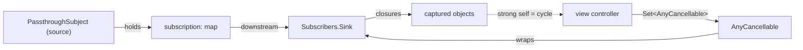

A Combine subscription is a small graph of objects: the source holds a subscription, the subscription holds the next operator, and so on down to a subscriber whose closures capture whatever they need. `AnyCancellable` is the handle you get back from `sink` and `assign`, and it does one thing: when you call `cancel()` on it, or when it is deallocated, it tears that graph down. Almost every memory problem in Combine code comes from misunderstanding which object owns which, and therefore what keeps a pipeline running or an object alive.

This article draws the ownership graph and checks each edge with code. It measures that a pipeline without a cancellable keeps running forever, that a method reference passed to `sink` leaks its object, that replacing a stored cancellable starts the new subscription before cancelling the old one, and that cancellation discards values already queued on another thread. It then works through the bug that accumulating subscriptions cause in reused objects, such as table cells, where the cost of each update grows linearly and the total cost quadratically, and ends by measuring what a stored cancellable costs.

<!--more-->

The examples use Swift 6 language mode and were compiled and run with the Swift 6.4 toolchain from Xcode 27.1 on macOS 26. Paste the blocks in order into one `main.swift`. The previous articles on [`sink` and `assign`](/combine-sink-assign/) and [`@Published` Properties](/combine-published-properties/) introduce the subscribers whose lifetimes are discussed here.

## What `AnyCancellable` is

`Cancellable` is a protocol with one method, `cancel()`. `AnyCancellable` is a final class that wraps either another `Cancellable` or a closure, and adds two behaviors: it calls `cancel()` from its `deinit`, and it makes sure the wrapped cancellation runs only once, however many times it is triggered:

```swift
import Combine
import Foundation
import Synchronization

var cleanupRuns = 0
do {
    let handle = AnyCancellable { cleanupRuns += 1 }
    handle.cancel()
    handle.cancel()
}                                            // deinit also tries to cancel
assert(cleanupRuns == 1)
```

`AnyCancellable` is `Hashable` by identity, so two handles are equal only if they are the same object, and `store(in:)` has overloads for a `Set<AnyCancellable>` and for any `RangeReplaceableCollection`, such as an array:

```swift
let first = AnyCancellable {}
let second = AnyCancellable {}
assert(first == first && first != second)

var handles: [AnyCancellable] = []
first.store(in: &handles)
second.store(in: &handles)
assert(handles.count == 2)
```

The closure initializer is also the simplest way to give anything with a cleanup step, such as a `Task`, an observer token, or a timer, the same lifetime rules as a subscription, which the end of this article uses.

## Who keeps a pipeline alive

The intuitive picture is that the cancellable *owns* the pipeline. It does not. The **source** keeps the pipeline alive: a subject holds each subscription it has handed out, the subscription holds its downstream, and that chain reaches the subscriber. The cancellable is an off switch that also happens to be held by you. The difference shows up when a subscriber is attached without one:

```swift
let source = PassthroughSubject<Int, Never>()
var receivedWithoutHandle: [Int] = []
source.subscribe(Subscribers.Sink(
    receiveCompletion: { _ in },
    receiveValue: { receivedWithoutHandle.append($0) }
))
source.send(1)
source.send(2)
assert(receivedWithoutHandle == [1, 2])      // nothing stores it, and it still runs
```

That `Sink` will run for as long as the subject lives, and nothing can stop it, because nothing outside the subject refers to it. `sink(receiveValue:)` avoids that by wrapping its `Sink` in an `AnyCancellable` and handing it to you, so dropping the handle is the way to stop the pipeline, and an unused handle, as [`sink` and `assign`](/combine-sink-assign/) showed, stops it immediately.



The dashed edge is the one you control. If the subscriber's closures capture the object that stores the handle, the graph is a cycle, and because the source keeps the pipeline alive independently of the handle, the cycle is never broken: the owner keeps the handle, the pipeline keeps the owner.

## Cancellation travels upstream

Cancelling the handle cancels the subscriber's subscription, which cancels *its* upstream, and so on to the source, so every operator gets a chance to release resources: a `URLSession` data task publisher cancels its task, a `Timer` publisher stops its timer. `handleEvents(receiveCancel:)` shows the signal arriving at the top:

```swift
var upstreamEvents: [String] = []
let cancelSource = PassthroughSubject<Int, Never>()
let cancelHandle = cancelSource
    .handleEvents(receiveCancel: { upstreamEvents.append("cancel reached the source") })
    .map { $0 * 2 }
    .filter { $0 > 0 }
    .sink { _ in }
cancelHandle.cancel()
assert(upstreamEvents == ["cancel reached the source"])

var finishedEvents: [String] = []
let finishedHandle = Just(1)
    .handleEvents(receiveCompletion: { _ in finishedEvents.append("completion") },
                  receiveCancel: { finishedEvents.append("cancel") })
    .sink { _ in }
finishedHandle.cancel()
assert(finishedEvents == ["completion"])     // nothing to cancel after completion
```

### Cancellation also discards queued values

A pipeline that hops threads with `receive(on:)` has values in flight: they have left the source and are waiting on the destination queue. Cancelling such a subscription does not let those values trickle through. This test sends 2,000 values to a pipeline that delivers on a serial queue and takes 50 microseconds per value, cancels immediately, and counts what is delivered afterwards:

```swift
struct QueuedDeliveryResult {
    let delivered: Int
    let startedAfterCancel: Int
}

nonisolated func measureQueuedDelivery() -> QueuedDeliveryResult {
    let values = PassthroughSubject<Int, Never>()
    let delivered = Atomic<Int>(0)
    let startedAfterCancel = Atomic<Int>(0)
    let cancelled = Atomic<Bool>(false)
    let queue = DispatchQueue(label: "delivery")

    let handle = values.receive(on: queue).sink { @Sendable _ in
        delivered.wrappingAdd(1, ordering: .relaxed)
        if cancelled.load(ordering: .relaxed) { startedAfterCancel.wrappingAdd(1, ordering: .relaxed) }
        usleep(50)
    }
    for value in 0..<2_000 { values.send(value) }
    handle.cancel()
    cancelled.store(true, ordering: .relaxed)
    queue.sync {}                            // let everything already queued run
    return QueuedDeliveryResult(delivered: delivered.load(ordering: .relaxed),
                                startedAfterCancel: startedAfterCancel.load(ordering: .relaxed))
}

let queued = measureQueuedDelivery()
assert(queued.delivered < 2_000)
assert(queued.startedAfterCancel == 0)
```

Over 15 runs, between 11 and 19 of the 2,000 values were delivered before the cancellation, and none began after `cancel()` returned: `receive(on:)` checks whether it has been cancelled before delivering each queued value. That is the guarantee you want when, for example, a user logs out while results are queued for the main thread. It does not extend to work you schedule yourself; a `DispatchQueue.main.async` inside a `sink` closure runs whether or not the subscription is still alive.

## Replacing a stored cancellable

A common pattern for "latest request wins" is a single optional handle that each new request replaces. Assigning a new handle releases the old one, which cancels it, but the right-hand side is evaluated first, so the new subscription is already running when the old one is cancelled:

```swift
var replacementLog: [String] = []

@MainActor
func startOperation(_ name: String) -> AnyCancellable {
    Deferred {
        replacementLog.append("subscribe \(name)")
        return Empty<Int, Never>(completeImmediately: false)
    }
    .handleEvents(receiveCancel: { replacementLog.append("cancel \(name)") })
    .sink { _ in }
}

var currentOperation: AnyCancellable?
currentOperation = startOperation("A")
currentOperation = startOperation("B")
assert(replacementLog == ["subscribe A", "subscribe B", "cancel A"])
```

For most work the overlap is harmless. When the two operations compete for something exclusive, such as a single upload slot, a file, or a server-side lock, cancel explicitly before starting the replacement:

```swift
replacementLog.removeAll()
currentOperation?.cancel()
currentOperation = startOperation("C")
assert(replacementLog == ["cancel B", "subscribe C"])
```

## Three ways to leak `self`

A model that stores its subscriptions in a `Set<AnyCancellable>` and captures itself strongly in one of them never deallocates. There are three common ways to write that capture, and only one of them is visible. Here is a counter to observe deallocation; it is atomic because `deinit` is not isolated to any actor:

```swift
final class InstanceCounter: Sendable {
    private let live = Atomic<Int>(0)
    var count: Int { live.load(ordering: .relaxed) }
    func increment() { live.wrappingAdd(1, ordering: .relaxed) }
    func decrement() { live.wrappingSubtract(1, ordering: .relaxed) }
}

let ticker = PassthroughSubject<Int, Never>()
```

**An explicit strong capture.** The compiler requires `self.` inside an escaping closure, which at least makes this one visible:

```swift
final class StrongCaptureModel {
    static let instances = InstanceCounter()
    private var cancellables = Set<AnyCancellable>()
    private(set) var total = 0

    init(ticks: PassthroughSubject<Int, Never>) {
        StrongCaptureModel.instances.increment()
        ticks.sink { self.total += $0 }.store(in: &cancellables)
    }
    deinit { StrongCaptureModel.instances.decrement() }
}

do { _ = StrongCaptureModel(ticks: ticker) }
assert(StrongCaptureModel.instances.count == 1)   // leaked
```

**A method reference.** Passing `handle` where a closure is expected is the same as writing `{ self.handle($0) }`, with no `self` in sight:

```swift
final class MethodReferenceModel {
    static let instances = InstanceCounter()
    private var cancellables = Set<AnyCancellable>()
    private(set) var total = 0

    init(ticks: PassthroughSubject<Int, Never>) {
        MethodReferenceModel.instances.increment()
        ticks.sink(receiveValue: handle).store(in: &cancellables)
    }
    private func handle(_ value: Int) { total += value }
    deinit { MethodReferenceModel.instances.decrement() }
}

do { _ = MethodReferenceModel(ticks: ticker) }
assert(MethodReferenceModel.instances.count == 1)  // also leaked
```

**`assign(to:on: self)`**, measured in [`sink` and `assign`](/combine-sink-assign/), which holds its object strongly by design.

The fix for all three is to hold the object weakly in the closure, or to capture only the values the closure needs:

```swift
final class WeakCaptureModel {
    static let instances = InstanceCounter()
    private var cancellables = Set<AnyCancellable>()
    private(set) var total = 0

    init(ticks: PassthroughSubject<Int, Never>, formatter: NumberFormatter) {
        WeakCaptureModel.instances.increment()
        ticks
            .map { [formatter] in formatter.string(from: $0 as NSNumber) ?? "" }  // captures the formatter, not self
            .sink { [weak self] text in self?.total += text.count }
            .store(in: &cancellables)
    }
    deinit { WeakCaptureModel.instances.decrement() }
}

do {
    let model = WeakCaptureModel(ticks: ticker, formatter: NumberFormatter())
    ticker.send(1_234)
    assert(model.total == 4)
}
assert(WeakCaptureModel.instances.count == 0)
```

When the model deallocates, its `Set<AnyCancellable>` goes with it, every handle cancels its subscription, and the subject drops the pipelines. `[unowned self]` also breaks the cycle, but it turns a value that arrives after deallocation, for example one already queued with `receive(on:)` before the handle was released, into a crash. `weak` costs a nil check and never crashes.

## Subscriptions that accumulate in reused objects

Leaks are easy to spot in a memory graph. The more damaging bug keeps every object alive correctly and still goes wrong: a long-lived object that adds a new subscription every time it is reconfigured, and never removes the old ones. Table and collection view cells are the classic case, because a cell is configured for one item, scrolled away, and reused for another. Here is a store that publishes title changes, and a cell that binds to it:

```swift
struct TitleChange {
    let bookID: Int
    let title: String
}

let titleChanges = PassthroughSubject<TitleChange, Never>()
var filterEvaluations = 0

@MainActor
final class BookCell {
    private(set) var title = ""
    private var cancellables = Set<AnyCancellable>()

    func configure(bookID: Int, changes: PassthroughSubject<TitleChange, Never>) {
        changes
            .filter { change in
                filterEvaluations += 1
                return change.bookID == bookID
            }
            .sink { [weak self] change in self?.title = change.title }
            .store(in: &cancellables)
    }

    func prepareForReuse() {
        cancellables.removeAll()             // releasing the handles cancels the bindings
    }
}
```

Reuse the cell without calling `prepareForReuse()`, and the subscription for its previous item is still attached:

```swift
let reusedCell = BookCell()
reusedCell.configure(bookID: 1, changes: titleChanges)
reusedCell.configure(bookID: 2, changes: titleChanges)  // reused for book 2, no reset
titleChanges.send(TitleChange(bookID: 2, title: "Dune"))
assert(reusedCell.title == "Dune")
titleChanges.send(TitleChange(bookID: 1, title: "Emma"))
assert(reusedCell.title == "Emma")             // a cell showing book 2 now displays book 1's title
```

That is the "wrong image in a reused cell" bug, with titles. It also gets slower over time. After the cell has been configured $$n$$ times, every change is checked by $$n$$ filters, so if each configuration is followed by one change, as it is when a user scrolls through a list whose items update, the total number of filter evaluations after $$n$$ configurations is

$$
\sum_{i=1}^{n} i \;=\; \frac{n(n+1)}{2},
$$

quadratic in the amount of scrolling. The simulation agrees exactly:

```swift
filterEvaluations = 0
let scrollChanges = PassthroughSubject<TitleChange, Never>()
let scrollingCell = BookCell()
let configurations = 200
for bookID in 1...configurations {
    scrollingCell.configure(bookID: bookID, changes: scrollChanges)
    scrollChanges.send(TitleChange(bookID: bookID, title: "Book \(bookID)"))
}
assert(filterEvaluations == configurations * (configurations + 1) / 2)   // 20,100

filterEvaluations = 0
let resetChanges = PassthroughSubject<TitleChange, Never>()
let resetCell = BookCell()
for bookID in 1...configurations {
    resetCell.prepareForReuse()
    resetCell.configure(bookID: bookID, changes: resetChanges)
    resetChanges.send(TitleChange(bookID: bookID, title: "Book \(bookID)"))
}
assert(filterEvaluations == configurations)                              // 200
```

Two hundred configurations cost 20,100 filter evaluations without the reset and 200 with it, and the gap grows with every row scrolled. In an app the subjects are shared, so the cost is also paid by every other subscriber's updates.

`prepareForReuse()` is the right place for the reset in UIKit, and `cancellables.removeAll()` is the whole implementation. A cell that has exactly one binding can hold a single `AnyCancellable?` instead, and assigning the new binding cancels the old one automatically.

## What a stored cancellable costs

Subscriptions for one-off work, such as a button that triggers a request, are often stored in the same `Set<AnyCancellable>` as the long-lived bindings. A completed subscription releases its closures, but its handle stays in the set until the owner dies. Measuring the process's physical footprint while adding 100,000 subscriptions to a set, in an optimized build, gave about 368 bytes per completed `Just(…).sink` and about 490 bytes per live `map`-then-`sink` subscription to a subject. One `send` to a subject with 100,000 live subscribers took about 50 ms, or half a microsecond per subscriber. This block repeats the measurement with a looser bound, since unoptimized builds allocate more:

```swift
func physicalFootprint() -> Int {
    var info = task_vm_info_data_t()
    var count = mach_msg_type_number_t(MemoryLayout<task_vm_info_data_t>.size / MemoryLayout<natural_t>.size)
    let result = withUnsafeMutablePointer(to: &info) {
        $0.withMemoryRebound(to: integer_t.self, capacity: Int(count)) {
            task_info(mach_task_self_, task_flavor_t(TASK_VM_INFO), $0, &count)
        }
    }
    precondition(result == KERN_SUCCESS)
    return Int(info.phys_footprint)
}

var oneOffWork = Set<AnyCancellable>()
let footprintBefore = physicalFootprint()
for request in 0..<100_000 {
    Just(request).sink { _ in }.store(in: &oneOffWork)
}
let bytesPerHandle = (physicalFootprint() - footprintBefore) / 100_000
print("bytes per completed handle:", bytesPerHandle)
assert(oneOffWork.count == 100_000)
assert(bytesPerHandle > 100 && bytesPerHandle < 4_000)
```

A few hundred bytes is nothing for a handful of subscriptions and real money for a screen that stays open all day and stores a handle per event. When the work is one-off, remove the handle when it completes. Keying handles by an identifier makes that straightforward:

```swift
@MainActor
final class RequestTracker {
    private var inFlight: [UUID: AnyCancellable] = [:]
    var count: Int { inFlight.count }

    func run<P: Publisher>(_ work: P, onValue: @escaping (P.Output) -> Void) where P.Failure == Never {
        let id = UUID()
        var finishedSynchronously = false
        let handle = work.sink(
            receiveCompletion: { [weak self] _ in
                finishedSynchronously = true
                self?.inFlight[id] = nil
            },
            receiveValue: onValue
        )
        if !finishedSynchronously { inFlight[id] = handle }
    }
}

let tracker = RequestTracker()
var trackedResults: [Int] = []
let slowRequest = PassthroughSubject<Int, Never>()
tracker.run(Just(1)) { trackedResults.append($0) }   // completes immediately
tracker.run(slowRequest) { trackedResults.append($0) }
assert(tracker.count == 1)                            // only the one still running
slowRequest.send(2)
slowRequest.send(completion: .finished)
assert(tracker.count == 0 && trackedResults == [1, 2])
```

The `finishedSynchronously` flag handles publishers that complete before `sink` returns, the same ordering problem as cancelling inside `sink`: the completion handler runs before the handle exists, so without the flag a completed `Just` would be stored and never removed. Often a better design is a single long-lived pipeline that turns each trigger into work with `flatMap` or `switchToLatest`, so there is one handle for the life of the screen; [Transforming: `map`, `flatMap`, and `scan`](/combine-map-flatmap-scan/) shows how.

## Giving tasks the same lifetime

`AnyCancellable` cancels on `deinit`; a `Task` does not. A `Task` started from a view model keeps running after the view model is gone, unless something cancels it. Wrapping its cancellation in an `AnyCancellable` puts it under the same rule as every subscription the object owns:

```swift
extension Task {
    func store(in set: inout Set<AnyCancellable>) {
        AnyCancellable { self.cancel() }.store(in: &set)
    }
}

final class CancellationProbe: Sendable {
    private let flag = Atomic<Bool>(false)
    var wasCancelled: Bool { flag.load(ordering: .relaxed) }
    func markCancelled() { flag.store(true, ordering: .relaxed) }
}

let probe = CancellationProbe()
do {
    var screenLifetime = Set<AnyCancellable>()
    Task {
        do { try await Task.sleep(for: .seconds(10)) } catch { probe.markCancelled() }
    }
    .store(in: &screenLifetime)
}                                            // the set is released here
let taskDeadline = Date(timeIntervalSinceNow: 2)
while !probe.wasCancelled && Date() < taskDeadline {
    RunLoop.main.run(until: Date(timeIntervalSinceNow: 0.01))
}
assert(probe.wasCancelled)                   // the sleep was interrupted, not left to run 10 s
```

Keep the remaining handles alive until the end of the file:

```swift
withExtendedLifetime((cancelHandle, finishedHandle, currentOperation)) {}
```

## Summary

- `AnyCancellable` cancels on `deinit`, runs its cancellation once however often it is triggered, and is `Hashable` by identity.
- The source keeps a pipeline alive, not the handle: a `Subscribers.Sink` attached without a handle kept receiving values with nothing referring to it. The handle is the off switch.
- Cancellation propagates to the source and is a no-op after completion. With `receive(on:)`, cancelling discarded the values still queued: none of 2,000 began delivery after `cancel()` returned.
- Replacing a stored handle subscribes the new pipeline before cancelling the old one; cancel first when the two must not overlap.
- Strong `self` captures, method references, and `assign(to:on: self)` all create cycles that never break while the source lives. Use `[weak self]` or capture only what is needed.
- Reused objects that add bindings without removing them show stale data and do $$n(n+1)/2$$ work over $$n$$ reconfigurations; reset in `prepareForReuse()`.
- A stored handle costs a few hundred bytes, measured at about 368 bytes completed and 490 live, and one send costs about half a microsecond per subscriber. Remove one-off handles on completion, and tie `Task`s to the same lifetime with an `AnyCancellable`.

## Exercise

Build a `SubscriptionScope` type that replaces `Set<AnyCancellable>` in a view model. It should support `insert(_:)` for long-lived bindings, `run(_:)` for one-off publishers that removes the handle on completion, including synchronous completion, and `reset()` that cancels everything. Add a debug-only check that fails if the scope holds more than a configurable number of handles, and test it with a simulated list of 1,000 cell configurations to show that the check fires when a cell forgets to reset and stays quiet when it does. Finally, extend it to hold `Task`s and verify, with a probe like the one above, that releasing the scope cancels them.

## Further reading

- Apple's documentation for [`AnyCancellable`](https://developer.apple.com/documentation/combine/anycancellable) and [`Cancellable`](https://developer.apple.com/documentation/combine/cancellable).
- The site's articles on [Swift capture lists](/swift-capture-lists/) and [avoiding memory leaks with capture lists](/avoiding-memory-leaks-swift-capture-lists/), which cover `weak` and `unowned` in detail.
- The concurrency roadmap's [Task Lifetime and Ownership](/swift-task-lifetime-ownership/), on why a `Task` is not cancelled when its handle is dropped.

Previous: [`@Published` Properties](/combine-published-properties/). Next: [Transforming: `map`, `flatMap`, and `scan`](/combine-map-flatmap-scan/).

Return to the [Combine roadmap](/combine/).
