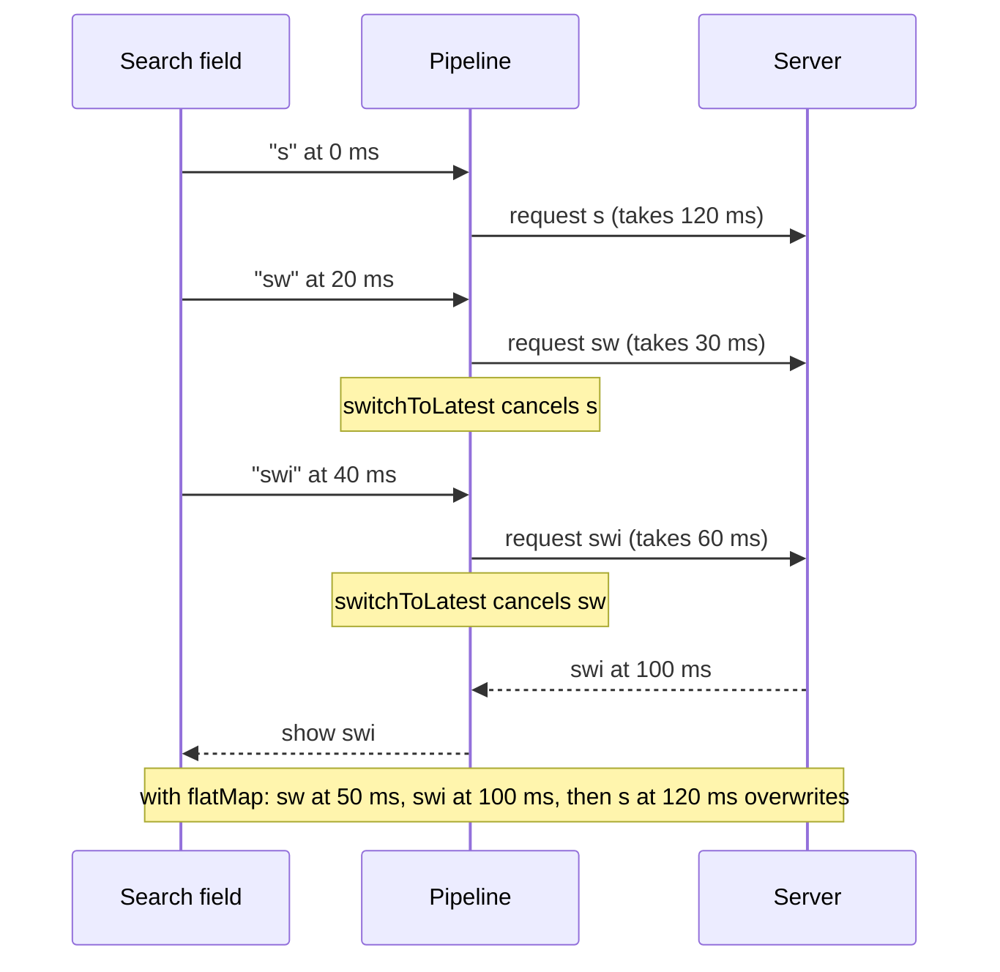

Three operators do most of the transforming in Combine, and each answers a different question. `map` asks what each value should become. `flatMap` asks what *work* each value should start, where that work is itself a publisher, such as a request, a timer, or a database query. `scan` asks what the running state is after each value, carrying an accumulator from one value to the next.

`map` holds few surprises. `flatMap` holds most of them: it runs its inner publishers concurrently, emits their values in the order they finish, completes only when everything has finished, and fails everything when one fails. Its `maxPublishers` parameter is a concurrency limit built from demand, and the wrong choice between it and `switchToLatest` is the classic search-field bug where an old response replaces a newer one. This article measures each of those behaviors, derives how long a batch of work takes under a concurrency limit, and uses `scan` to build a state machine and a smoothed throughput estimate.

<!--more-->

The examples use Swift 6 language mode and were compiled and run with the Swift 6.4 toolchain from Xcode 27.1 on macOS 26. Paste the blocks in order into one `main.swift`. The demand mechanism that `flatMap(maxPublishers:)` relies on is explained in [Publishers, Subscribers, and Subscriptions](/combine-publishers-subscribers-subscriptions/).

## `map`: one value in, one value out

`map` applies a function to each value and passes along completion unchanged. Its key-path overloads accept up to three key paths and produce a tuple for more than one:

```swift
import Combine
import Foundation
import Synchronization

struct Book {
    let title: String
    let pages: Int
    let year: Int
}

let books = [
    Book(title: "Dune", pages: 412, year: 1965),
    Book(title: "Emma", pages: 474, year: 1815),
]

var titles: [String] = []
let titlesHandle = books.publisher.map(\.title).sink { titles.append($0) }
assert(titles == ["Dune", "Emma"])

var summaries: [String] = []
let summariesHandle = books.publisher
    .map(\.title, \.year)
    .map { title, year in "\(title) (\(year))" }
    .sink { summaries.append($0) }
assert(summaries == ["Dune (1965)", "Emma (1815)"])
```

The closure in `map` cannot throw. When a transformation can fail, such as parsing, `tryMap` is the throwing version. A thrown error terminates the stream with a failure, and because Swift cannot know which errors the closure throws, the failure type becomes `any Error`:

```swift
enum ParseError: Error, Equatable {
    case notANumber(String)
}

func parsePrice(_ text: String) throws -> Decimal {
    guard let value = Decimal(string: text) else { throw ParseError.notANumber(text) }
    return value
}

let prices = ["12.50", "abc", "3.00"].publisher.tryMap(parsePrice)
let erasedFailure: any Publisher<Decimal, any Error> = prices   // the failure type is now any Error

var parsed: [Decimal] = []
var parseFailure: (any Error)?
let parseHandle = prices.sink(
    receiveCompletion: { if case .failure(let error) = $0 { parseFailure = error } },
    receiveValue: { parsed.append($0) }
)
assert(parsed == [12.5])                       // "3.00" never ran: the stream ended at "abc"
assert(parseFailure as? ParseError == .notANumber("abc"))
```

Two consequences are visible. The failure stopped the stream, so values after the bad one were never processed; [Error Handling: `catch`, `retry`, and `replaceError`](/combine-error-handling-catch-retry/) shows how to keep a stream alive past a bad element. And the typed error was lost, so downstream code has to cast. `mapError` restores a concrete type at the point where you know what the possibilities are:

```swift
let typedPrices: AnyPublisher<Decimal, ParseError> = ["7"].publisher
    .tryMap(parsePrice)
    .mapError { $0 as? ParseError ?? .notANumber("unknown") }
    .eraseToAnyPublisher()
var typedParsed: [Decimal] = []
let typedHandle = typedPrices.sink(receiveCompletion: { _ in }, receiveValue: { typedParsed.append($0) })
assert(typedParsed == [7])
```

## `flatMap`: each value starts work

`flatMap` maps each value to a publisher, subscribes to it, and merges everything those inner publishers emit into one stream. That makes it the operator for "for each X, do asynchronous work Y": for each search query, fetch results; for each selected photo, upload it; for each user ID, load a profile.

### The type rules

The inner publisher's `Failure` must match the upstream's. Since iOS 14 and macOS 11, `flatMap` has overloads that bridge the common mismatch involving `Never` by inserting `setFailureType(to:)` for you, either on the upstream or on the inner publisher, and the resulting types show it:

```swift
enum LoadError: Error { case offline }

let neverUpstream = Just(1).flatMap { _ in Fail<Int, LoadError>(error: .offline) }
assert("\(type(of: neverUpstream))" == "FlatMap<Fail<Int, LoadError>, SetFailureType<Just<Int>, LoadError>>")

let neverInner = PassthroughSubject<Int, LoadError>().flatMap { Just($0) }
assert("\(type(of: neverInner))" == "FlatMap<SetFailureType<Just<Int>, LoadError>, PassthroughSubject<Int, LoadError>>")
```

Two different concrete failure types do not unify, and the diagnostic is unhelpfully generic:

```swift
// Does not compile
enum StorageError: Error { case full }
let mismatched = Fail<Int, LoadError>(error: .offline)
    .flatMap { _ in Fail<Int, StorageError>(error: .full) }
// error: no exact matches in call to instance method 'flatMap'
```

When you see "no exact matches" on a `flatMap`, compare the two failure types and add a `mapError` to one side.

### Completion and failure

A `flatMap` finishes when its upstream has finished *and* every inner publisher has finished. If any inner publisher fails, the whole stream fails, and `flatMap` cancels the other inner publishers that are still running:

```swift
var flatMapEvents: [String] = []
let triggers = PassthroughSubject<Int, Never>()
let slowWork = PassthroughSubject<String, Never>()
let completionHandle = triggers
    .flatMap { _ in slowWork }
    .sink(receiveCompletion: { _ in flatMapEvents.append("completion") },
          receiveValue: { flatMapEvents.append("value \($0)") })
triggers.send(1)
triggers.send(completion: .finished)
flatMapEvents.append("upstream finished")
slowWork.send("late result")
slowWork.send(completion: .finished)
assert(flatMapEvents == ["upstream finished", "value late result", "completion"])

var failureEvents: [String] = []
let jobs = PassthroughSubject<Int, LoadError>()
let firstJob = PassthroughSubject<String, LoadError>()
let secondJob = PassthroughSubject<String, LoadError>()
let failureHandle = jobs
    .flatMap { id in
        (id == 1 ? firstJob : secondJob)
            .handleEvents(receiveCancel: { failureEvents.append("job \(id) cancelled") })
    }
    .sink(receiveCompletion: { completion in
              if case .failure(let error) = completion { failureEvents.append("failed: \(error)") }
          },
          receiveValue: { failureEvents.append("value \($0)") })
jobs.send(1)
jobs.send(2)
firstJob.send("first result")
secondJob.send(completion: .failure(.offline))   // one job fails...
firstJob.send("never delivered")                  // ...and the other was cancelled
assert(failureEvents == ["value first result", "job 1 cancelled", "failed: offline"])
```

That is usually not what a batch upload wants: one failed photo should not cancel the other nine. The fix is to handle failure inside the inner publisher, turning it into a value, for example with `.map(Result.success).catch { Just(.failure($0)) }`, so the outer stream never sees a failure at all. The error handling article develops that pattern.

### Concurrency and `maxPublishers`

By default `flatMap` requests unlimited values from its upstream and subscribes to an inner publisher for every one, so a burst of 500 upstream values starts 500 requests at once. `flatMap(maxPublishers:)` limits that, and it does so with demand: it requests `k` values from upstream, and one more each time an inner publisher completes. The following experiment maps twelve values to simulated jobs that take 100, 80, or 60 ms, records the requests `flatMap` sends upstream and the peak number of jobs running at once, and times the whole batch.

The jobs use `delay` on a **serial** queue. That choice matters: `delay` on a concurrent queue schedules each value and the completion as separate blocks, and the completion can run first. When the experiment was first run on `DispatchQueue.global()`, some batches finished with 10 or 11 of their 12 values, and a separate test found that `Just(i).delay(for: .milliseconds(1), scheduler: DispatchQueue.global())` lost its value to an early completion in between 1 and 21 of 2,000 attempts across ten runs, against none on a serial queue. [Time: `debounce`, `throttle`, and `delay`](/combine-debounce-throttle-delay/) returns to this.

```swift
let jobQueue = DispatchQueue(label: "jobs")       // serial: see the note above

final class ConcurrencyGauge: Sendable {
    private let running = Atomic<Int>(0)
    private let peakValue = Atomic<Int>(0)
    var peak: Int { peakValue.load(ordering: .relaxed) }
    func start() { peakValue.max(running.wrappingAdd(1, ordering: .relaxed).newValue, ordering: .relaxed) }
    func finish() { running.wrappingSubtract(1, ordering: .relaxed) }
}

final class SafeList<Element: Sendable>: Sendable {
    private let storage = Mutex<[Element]>([])
    func append(_ element: Element) { storage.withLock { $0.append(element) } }
    var elements: [Element] { storage.withLock { $0 } }
}

struct BatchResult {
    let peak: Int
    let seconds: Double
    let order: [Int]
    let requests: [String]
}

nonisolated func runBatch(maxPublishers: Subscribers.Demand) -> BatchResult {
    let gauge = ConcurrencyGauge()
    let order = SafeList<Int>()
    let requests = SafeList<String>()
    let finished = DispatchSemaphore(value: 0)
    let clock = ContinuousClock()
    let start = clock.now

    let handle = (0..<12).publisher
        .handleEvents(receiveRequest: { @Sendable demand in requests.append("\(demand)") })
        .flatMap(maxPublishers: maxPublishers) { @Sendable job in
            Just(job)
                .delay(for: .milliseconds(100 - (job % 3) * 20), scheduler: jobQueue)
                .handleEvents(receiveSubscription: { @Sendable _ in gauge.start() },
                              receiveCompletion: { @Sendable _ in gauge.finish() })
        }
        .sink(receiveCompletion: { @Sendable _ in finished.signal() },
              receiveValue: { @Sendable job in order.append(job) })
    finished.wait()
    handle.cancel()

    let elapsed = clock.now - start
    return BatchResult(peak: gauge.peak,
                       seconds: Double(elapsed.components.attoseconds) / 1e18 + Double(elapsed.components.seconds),
                       order: order.elements,
                       requests: requests.elements)
}

let sequential = runBatch(maxPublishers: .max(1))
let limited = runBatch(maxPublishers: .max(3))
let unbounded = runBatch(maxPublishers: .unlimited)

assert(sequential.peak == 1 && limited.peak == 3 && unbounded.peak == 12)
assert(sequential.order == Array(0..<12))             // one at a time preserves order
assert(Set(limited.order) == Set(0..<12) && limited.order != Array(0..<12))
assert(limited.requests.first == "max(3)" && limited.requests.dropFirst().allSatisfy { $0 == "max(1)" })
assert(unbounded.requests == ["unlimited"])
print(String(format: "k=1: %.3f s, k=3: %.3f s, unlimited: %.3f s",
             sequential.seconds, limited.seconds, unbounded.seconds))
assert(sequential.seconds > 0.9 && unbounded.seconds < 0.3)
```

A typical run printed:

| `maxPublishers` | Peak running | Time | Output order |
|---|---|---|---|
| `.max(1)` | 1 | 1.065 s | `0, 1, 2, …, 11` |
| `.max(3)` | 3 | 0.342 s | `2, 1, 0, 4, 5, 3, 8, 7, 6, 10, 9, 11` |
| `.max(4)` | 4 | 0.275 s | `2, 1, 0, 3, 4, 5, 7, 6, 8, 9, 11, 10` |
| `.unlimited` | 12 | 0.109 s | `2, 5, 8, 11, 1, 4, 7, 10, 0, 3, 6, 9` |

The request log confirms the mechanism: with `.max(3)`, the upstream received `max(3)` followed by nine `max(1)`s, one per completed job, ten requests in all. Output order is completion order, so the 60 ms jobs (2, 5, 8, 11) come out first whenever they run together. Only `.max(1)` preserves upstream order, because it never runs two jobs at once.

### How long a limited batch takes

The times follow from scheduling theory. `flatMap(maxPublishers: .max(k))` behaves like a list scheduler with $$k$$ workers: whenever a worker is free, it takes the next job in upstream order. For jobs with durations $$T_1, \ldots, T_n$$, no schedule can beat either the total work divided among the workers or the longest single job, and Graham's classic bound for list scheduling says a greedy scheduler is never worse than their sum:

$$
\max\!\left(\frac{1}{k}\sum_{i=1}^{n} T_i,\; \max_i T_i\right) \;\le\; T_{\text{batch}} \;\le\; \frac{1}{k}\sum_{i=1}^{n} T_i + \max_i T_i .
$$

Here the twelve jobs total $$4 \times (100 + 80 + 60) = 960$$ ms and the longest is 100 ms. For $$k = 3$$ the bounds are 320 ms and 420 ms, and the measured 342 ms falls between them; for $$k = 4$$ they are 240 and 340 ms against a measured 275 ms. The bound is useful in practice because it needs only the total work and the slowest job. Going from $$k = 3$$ to $$k = 12$$ can at best cut the batch from 320 ms to 100 ms, while multiplying the number of simultaneous connections, decoders, or disk writers by four. For network requests, the networking roadmap's [Choosing a `URLSession` Configuration](/swift-urlsession-configuration/) explains why more than a handful per host rarely helps.

## `flatMap` or `switchToLatest`

A search field is the canonical stream where each value starts work: every query triggers a request. With `flatMap`, every request runs to completion and every response is delivered, in the order the responses arrive. With `map` followed by `switchToLatest`, each new query cancels the request for the previous one, and only the latest response is delivered. The experiment types three queries 20 ms apart, with server latencies chosen so that the first query is the slowest:

```swift
let searchQueue = DispatchQueue(label: "search")

nonisolated func searchResults(for query: String, latencyMilliseconds: Int,
                               cancelled: SafeList<String>) -> AnyPublisher<String, Never> {
    Just("results for \(query)")
        .delay(for: .milliseconds(latencyMilliseconds), scheduler: searchQueue)
        .handleEvents(receiveCancel: { @Sendable in cancelled.append(query) })
        .eraseToAnyPublisher()
}

nonisolated func typeQueries(useSwitchToLatest: Bool) -> (shown: [String], cancelled: [String]) {
    let queries = PassthroughSubject<(String, Int), Never>()
    let shown = SafeList<String>()
    let cancelled = SafeList<String>()

    let results: AnyPublisher<String, Never> = useSwitchToLatest
        ? queries
            .map { @Sendable query, latency in searchResults(for: query, latencyMilliseconds: latency, cancelled: cancelled) }
            .switchToLatest()
            .eraseToAnyPublisher()
        : queries
            .flatMap { @Sendable query, latency in searchResults(for: query, latencyMilliseconds: latency, cancelled: cancelled) }
            .eraseToAnyPublisher()

    let handle = results.sink { @Sendable in shown.append($0) }
    for (query, latency) in [("s", 120), ("sw", 30), ("swi", 60)] {
        queries.send((query, latency))
        Thread.sleep(forTimeInterval: 0.02)
    }
    Thread.sleep(forTimeInterval: 0.25)
    handle.cancel()
    return (shown.elements, cancelled.elements)
}

let withFlatMap = typeQueries(useSwitchToLatest: false)
assert(withFlatMap.shown == ["results for sw", "results for swi", "results for s"])
assert(withFlatMap.cancelled.isEmpty)

let withSwitch = typeQueries(useSwitchToLatest: true)
assert(withSwitch.shown == ["results for swi"])
assert(withSwitch.cancelled == ["s", "sw"])
```

With `flatMap`, the screen showed results for "sw", then "swi", and finally, 140 ms after the user started typing, the results for "s", which replaced the correct ones and stayed. With `switchToLatest`, the two superseded requests were cancelled before they could deliver, and the only results shown were for the query in the field:



The rule is simple to state: use `switchToLatest` when a new value makes the previous work irrelevant, such as a query, a selection, or a filter, and `flatMap` when every value's work must finish, such as uploads, saves, or analytics events. In practice the search pipeline also needs `debounce` and `removeDuplicates` in front, which [Time: `debounce`, `throttle`, and `delay`](/combine-debounce-throttle-delay/) adds. The concurrency roadmap's [Rejecting Stale Results After Request Replacement](/swift-rejecting-stale-results/) solves the same problem with tasks.

## `scan`: carrying state through a stream

`scan` is `reduce` that emits every intermediate result. It takes an initial accumulator and a closure that combines the accumulator with each value; the result becomes both the output and the next accumulator. It does not emit the initial value itself:

```swift
var runningTotals: [Int] = []
let totalsHandle = [1, 2, 3].publisher.scan(10, +).sink { runningTotals.append($0) }
assert(runningTotals == [11, 13, 16])          // no 10: the seed is not emitted
```

### A state machine as a reducer

Because the closure sees the previous state and the new event, `scan` is a natural home for a state machine: the closure is a pure reducer, and the stream of states is its output. Here is a download whose events arrive from a delegate:

```swift
enum TransferEvent {
    case started(totalBytes: Int)
    case received(bytes: Int)
    case failed
    case finished
}

struct TransferState: Equatable {
    enum Phase: Equatable { case idle, running, failed, done }
    var phase: Phase = .idle
    var receivedBytes = 0
    var totalBytes = 0
    var fraction: Double { totalBytes == 0 ? 0 : Double(receivedBytes) / Double(totalBytes) }
}

func reduce(_ state: TransferState, _ event: TransferEvent) -> TransferState {
    var next = state
    switch (state.phase, event) {
    case (.idle, .started(let total)), (.failed, .started(let total)):
        next = TransferState(phase: .running, receivedBytes: 0, totalBytes: total)
    case (.running, .received(let bytes)):
        next.receivedBytes = min(state.receivedBytes + bytes, state.totalBytes)
    case (.running, .failed):
        next.phase = .failed
    case (.running, .finished):
        next.phase = .done
        next.receivedBytes = state.totalBytes
    default:
        break                                    // ignore events that make no sense in this phase
    }
    return next
}

let transferEvents = PassthroughSubject<TransferEvent, Never>()
var phases: [TransferState.Phase] = []
var fractions: [Double] = []
let transferHandle = transferEvents
    .scan(TransferState(), reduce)
    .removeDuplicates()
    .sink { state in
        phases.append(state.phase)
        fractions.append(state.fraction)
    }

transferEvents.send(.received(bytes: 10))       // ignored: not started
transferEvents.send(.started(totalBytes: 200))
transferEvents.send(.received(bytes: 50))
transferEvents.send(.received(bytes: 100))
transferEvents.send(.failed)
transferEvents.send(.received(bytes: 50))       // ignored: failed
transferEvents.send(.started(totalBytes: 200))  // retry from the beginning
transferEvents.send(.finished)

assert(phases == [.idle, .running, .running, .running, .failed, .running, .done])
assert(fractions == [0, 0, 0.25, 0.75, 0.75, 0, 1])
```

The first `.received` produced an `.idle` state identical to the seed, which `scan` emitted because it does not compare, and `removeDuplicates()` dropped the second ignored event's unchanged `.failed` state. The reducer is an ordinary function, so every transition can be tested without a pipeline, and the pipeline itself is three operators long. If the reducer can throw, for example to reject an impossible transition loudly, `tryScan` is the throwing version, with the same `any Error` caveat as `tryMap`.

### A smoothed estimate

Download speed samples are noisy, and showing them raw makes a "time remaining" label jump. An exponential moving average smooths them using only the previous estimate, which is exactly what `scan` carries. With smoothing factor $$\alpha$$:

$$
\bar{x}_1 = x_1, \qquad \bar{x}_n = \alpha\, x_n + (1 - \alpha)\, \bar{x}_{n-1}.
$$

Unrolling the recurrence shows that the sample $$j$$ steps in the past has weight $$\alpha(1-\alpha)^j$$, so old samples fade geometrically. The number of samples after which a sample's influence halves is

$$
h = \frac{\ln 0.5}{\ln(1-\alpha)},
$$

about 1.9 samples for $$\alpha = 0.3$$ and 6.6 for $$\alpha = 0.1$$. Choosing $$\alpha$$ is choosing that half-life: a lower value is steadier and slower to react when the network really does change speed.

```swift
let throughputSamples: [Double] = [100, 20, 110, 95, 15, 105, 100, 90]   // KB/s, with two dips
let alpha = 0.3
var smoothed: [Double] = []
let smoothingHandle = throughputSamples.publisher
    .scan(nil as Double?) { average, sample in
        guard let average else { return sample }
        return alpha * sample + (1 - alpha) * average
    }
    .compactMap { $0 }
    .sink { smoothed.append($0) }

assert(smoothed.count == throughputSamples.count)
assert(abs(smoothed[1] - 76) < 1e-9)            // 0.3 * 20 + 0.7 * 100
let rawSwing = throughputSamples.max()! - throughputSamples.min()!
let smoothedSwing = smoothed.max()! - smoothed.min()!
assert(smoothedSwing < rawSwing / 2)              // the 95-point swings shrink to under half
assert(abs(log(0.5) / log(1 - alpha) - 1.943) < 0.001)
```

The raw samples swing by 95 KB/s; the smoothed series stays within a band less than half as wide, while still moving toward a sustained change within a few samples. Seeding with `nil` and starting from the first real sample avoids the bias toward zero that an arbitrary seed would introduce.

Keep the remaining subscriptions alive until the end of the file:

```swift
withExtendedLifetime((titlesHandle, summariesHandle, parseHandle, typedHandle, erasedFailure,
                      completionHandle, failureHandle, totalsHandle, transferHandle,
                      smoothingHandle)) {}
```

## Summary

- `map` transforms values, including with up to three key paths. `tryMap` ends the stream at the first thrown error and erases the failure type to `any Error`; restore it with `mapError`.
- `flatMap` runs inner publishers concurrently and emits in completion order. It finishes when the upstream and every inner publisher finish, and one failing inner publisher cancels the rest and fails the stream.
- `flatMap(maxPublishers: .max(k))` limits concurrency through demand: measured as one `max(k)` request followed by `max(1)` per completed job, with a peak of exactly $$k$$ running. Only `.max(1)` preserves order.
- A batch under a limit of $$k$$ takes between $$\max(\sum T_i / k, \max T_i)$$ and $$\sum T_i / k + \max T_i$$; the measured times fit those bounds.
- For searches and selections, `map` plus `switchToLatest` cancelled both superseded requests and showed only the latest results, while `flatMap` finished on a stale response.
- `delay` on a concurrent queue lost values to an early completion in up to 1% of attempts; schedule it on a serial queue.
- `scan` emits every intermediate accumulator but not the seed. Use it with a pure reducer for state machines, and for an exponential moving average whose half-life is $$\ln 0.5 / \ln(1-\alpha)$$ samples.

## Exercise

Write an `uploadAll(_:)` function that takes an array of photo identifiers and returns a publisher of `(id, Result<URL, UploadError>)` pairs, using `flatMap(maxPublishers: .max(3))` and a simulated upload that fails for one identifier in five. Assert that a single failure does not cancel the others, that no more than three uploads ever run at once, and that the publisher finishes after every photo has a result. Then add a second publisher derived from the first with `scan` that emits `(completed, failed, total)` counts, and use the bound from this article to predict how long ten uploads with known durations will take before measuring it.

## Further reading

- Apple's documentation for [`flatMap(maxPublishers:_:)`](https://developer.apple.com/documentation/combine/publisher/flatmap(maxpublishers:_:)-3k7z5), [`switchToLatest()`](https://developer.apple.com/documentation/combine/publisher/switchtolatest()-453ht), and [`scan(_:_:)`](https://developer.apple.com/documentation/combine/publisher/scan(_:_:)).
- R. L. Graham, "Bounds for Certain Multiprocessing Anomalies", *Bell System Technical Journal* 45 (1966), the origin of the list-scheduling bound used above.
- [Combine in Practice](https://developer.apple.com/videos/play/wwdc2019/721/), WWDC19, which builds a sign-up form with `flatMap` and `switchToLatest`.

Previous: [`AnyCancellable` and Memory Management](/combine-anycancellable-memory/). Next: [Filtering: `filter`, `removeDuplicates`, and `compactMap`](/combine-filter-removeduplicates-compactmap/).

Return to the [Combine roadmap](/combine/).
