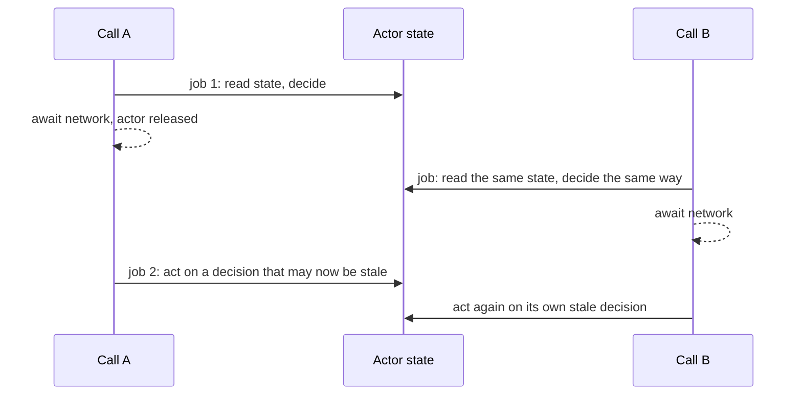
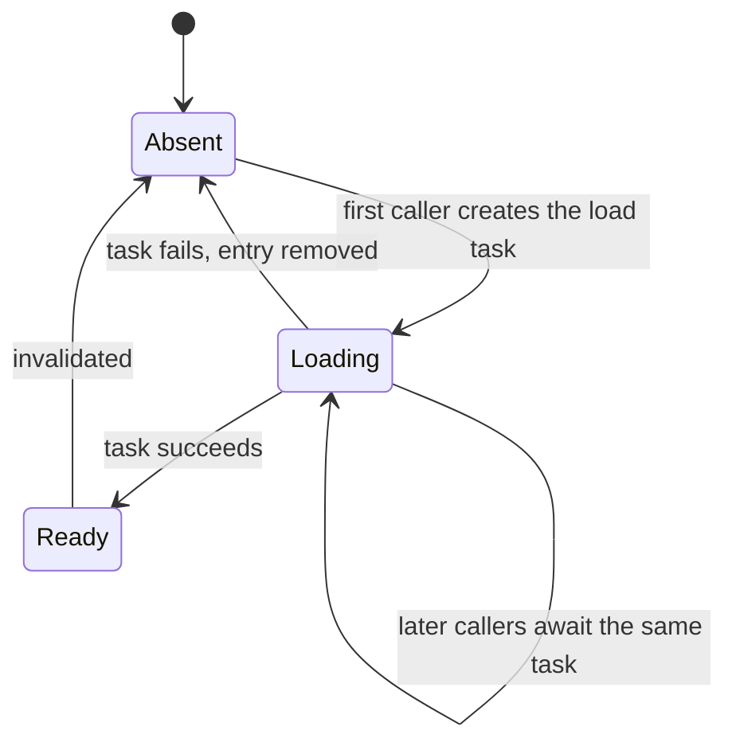

An actor guarantees that only one piece of its code runs at a time. It does not guarantee that a method runs from start to finish without interruption. When an actor method reaches an `await` that suspends, the actor is free to run other calls, including other calls to the same method, before the first one resumes. That property is called **reentrancy**.

Reentrancy keeps actors from deadlocking, and it lets an actor stay responsive while one of its methods waits on the network. It also means that every `await` inside an actor method is a point where the actor's state may change underneath the method. The compiler cannot catch the resulting bugs, because none of them is a data race. They are logic races: duplicate work, lost updates, broken invariants, and decisions made on stale facts. This article reproduces four of them deterministically and fixes each one.

<!--more-->

The examples use Swift 6 language mode and were compiled and run with the Swift 6.4 toolchain on macOS 26. The Swift blocks build on one another in one `main.swift`. `Mutex` requires iOS 18, macOS 15, or later.

## Why actors are reentrant

The alternative would be a non-reentrant actor that stays locked while one of its methods is suspended. [SE-0306](https://github.com/swiftlang/swift-evolution/blob/main/proposals/0306-actors.md) considered and rejected that design, for two reasons. First, deadlock: if actor A awaits actor B while B awaits A, two non-reentrant actors would wait for each other forever. Second, responsiveness: an actor waiting on a two-second network request could serve nobody else for two seconds.

Reentrancy trades those problems for another one. The actor is free between jobs, so the code *after* an `await` must not assume that anything it read *before* the `await` is still true.



## A tool for deterministic interleavings

Reentrancy bugs depend on timing, which makes them easy to miss in tests that "usually" pass. To reproduce them every time, the examples use a gate: an operation that suspends until the test opens it. That lets a test hold an actor method *at* its `await` while other calls run.

```swift
import Synchronization

/// Suspends callers until opened. Lets a test hold an operation at its suspension point.
actor Gate {
    private var isOpen = false
    private var waiters: [CheckedContinuation<Void, Never>] = []

    func wait() async {
        guard !isOpen else { return }
        await withCheckedContinuation { waiters.append($0) }
    }

    func open() {
        isOpen = true
        for waiter in waiters { waiter.resume() }
        waiters.removeAll()
    }
}

/// Counts events from any task, and lets a test wait until a count is reached.
final class Tally: Sendable {
    private let count = Mutex(0)

    func increment() {
        count.withLock { $0 += 1 }
    }

    var value: Int {
        count.withLock { $0 }
    }

    func waitUntil(atLeast target: Int) async {
        while value < target {
            await Task.yield()
        }
    }
}
```

`Tally.waitUntil` polls with `Task.yield()` instead of sleeping, so the test proceeds as soon as the condition holds and never depends on a guessed duration. The [controlled interleavings article](/swift-testing-controlled-interleavings/) develops these tools further.

## Bug 1: duplicate work in a cache

The most common reentrancy bug is a cache that checks, then loads, then stores:

```swift
struct Image: Equatable, Sendable {
    let key: String
}

actor NaiveImageCache {
    private var images: [String: Image] = [:]
    private let load: @Sendable (String) async throws -> Image

    init(load: @escaping @Sendable (String) async throws -> Image) {
        self.load = load
    }

    func image(for key: String) async throws -> Image {
        if let cached = images[key] {
            return cached
        }
        let image = try await load(key)   // Suspension point: other calls run here.
        images[key] = image
        return image
    }
}
```

Each call checks the dictionary and finds nothing, because no load has finished. Each call then starts its own load. With a gate, the duplication is exact:

```swift
let loadGate = Gate()
let naiveLoads = Tally()
let naiveCache = NaiveImageCache { key in
    naiveLoads.increment()
    await loadGate.wait()
    return Image(key: key)
}

try await withThrowingTaskGroup(of: Image.self) { group in
    for _ in 0..<5 {
        group.addTask { try await naiveCache.image(for: "avatar") }
    }
    await naiveLoads.waitUntil(atLeast: 5)       // Every caller is now suspended inside a load.
    await loadGate.open()
    for try await image in group {
        assert(image.key == "avatar")
    }
}
assert(naiveLoads.value == 5, "Five callers, five loads of the same image")
```

The cost scales with traffic. If requests for a key arrive at rate $$\lambda$$ and a load takes time $$L$$, then by Little's law about $$\lambda L$$ requests arrive while the first load is in flight, and each starts its own load. A list of 30 rows showing the same avatar, scrolled into view at once, can start 30 identical downloads.

### Fix: cache the in-flight work, not just the result

Store the *task* performing the load, so later callers join it instead of starting another:



```swift
actor ImageCache {
    private enum Entry {
        case loading(Task<Image, any Error>)
        case ready(Image)
    }

    private var entries: [String: Entry] = [:]
    private let load: @Sendable (String) async throws -> Image

    init(load: @escaping @Sendable (String) async throws -> Image) {
        self.load = load
    }

    func image(for key: String) async throws -> Image {
        switch entries[key] {
        case .ready(let image):
            return image
        case .loading(let task):
            return try await task.value
        case nil:
            let load = self.load
            let task = Task { try await load(key) }
            entries[key] = .loading(task)
            do {
                let image = try await task.value
                if case .loading(let current) = entries[key], current == task {
                    entries[key] = .ready(image)
                }
                return image
            } catch {
                if case .loading(let current) = entries[key], current == task {
                    entries[key] = nil
                }
                throw error
            }
        }
    }

    func invalidate(_ key: String) {
        entries[key] = nil
    }
}
```

The critical property is that the check (`switch entries[key]`) and the registration (`entries[key] = .loading(task)`) happen in one job, with no `await` between them. Any later call sees the `.loading` entry and joins.

The identity checks after the `await` handle a second reentrancy hazard. While the load was suspended, someone may have called `invalidate(key)`, or invalidated and started a fresh load. Writing `.ready` unconditionally would resurrect an entry that was deliberately removed. `Task` is `Hashable`, so comparing the stored task with the one this call created tells the method whether its result is still wanted.

The load closure is copied into a local before creating the task. A `Task { }` inside an actor method that captures `self` is isolated to the actor; one that does not capture `self` is not. The load itself does not need the actor, so not capturing `self` keeps it off the actor's executor.

```swift
let sharedGate = Gate()
let sharedLoads = Tally()
let cache = ImageCache { key in
    sharedLoads.increment()
    await sharedGate.wait()
    return Image(key: key)
}

try await withThrowingTaskGroup(of: Image.self) { group in
    for _ in 0..<5 {
        group.addTask { try await cache.image(for: "avatar") }
    }
    await sharedLoads.waitUntil(atLeast: 1)
    for _ in 0..<20 { await Task.yield() }       // Give the other four callers time to join.
    await sharedGate.open()
    for try await image in group {
        assert(image.key == "avatar")
    }
}
assert(sharedLoads.value == 1, "Five callers shared one load")
let cachedAgain = try await cache.image(for: "avatar")
assert(cachedAgain.key == "avatar" && sharedLoads.value == 1, "Later calls hit the ready entry")
```

Sharing has a policy consequence for cancellation: the load is an unstructured task owned by the cache, so cancelling one caller does not cancel the load the others are waiting for. That is usually what you want; the [task lifetime article](/swift-task-lifetime-ownership/) discusses how to cancel a shared load when its last waiter leaves.

## Bug 2: a check that is stale by the time you act

A guard condition checked before an `await` may be false after it:

```swift
enum PaymentError: Error, Equatable {
    case insufficientFunds
    case declined
}

actor Wallet {
    private(set) var balance: Int

    init(balance: Int) {
        self.balance = balance
    }

    func payCheckingFirst(_ amount: Int, authorize: @Sendable () async -> Bool) async throws {
        guard balance >= amount else { throw PaymentError.insufficientFunds }
        guard await authorize() else { throw PaymentError.declined }   // Suspension point.
        balance -= amount
    }
}

let authorizationGate = Gate()
let authorizations = Tally()
let slowAuthorize: @Sendable () async -> Bool = {
    authorizations.increment()
    await authorizationGate.wait()
    return true
}

let wallet = Wallet(balance: 100)
async let firstPayment: Void = wallet.payCheckingFirst(80, authorize: slowAuthorize)
async let secondPayment: Void = wallet.payCheckingFirst(80, authorize: slowAuthorize)
await authorizations.waitUntil(atLeast: 2)
await authorizationGate.open()
_ = try await (firstPayment, secondPayment)
let overdrawn = await wallet.balance
assert(overdrawn == -60, "Both payments passed the balance check before either deducted")
```

Both calls passed the balance check, both suspended in `authorize`, and both deducted. The actor serialized every access to `balance`; the bug is that the *decision* and the *action* happened in different jobs.

### Fix: reserve before suspending, or re-check after

There are two correct shapes. **Reserve** makes the state change before suspending and rolls it back on failure:

```swift
extension Wallet {
    func payReservingFirst(_ amount: Int, authorize: @Sendable () async -> Bool) async throws {
        guard balance >= amount else { throw PaymentError.insufficientFunds }
        balance -= amount                       // Same job as the check: atomic.
        guard await authorize() else {
            balance += amount                   // Roll back the reservation.
            throw PaymentError.declined
        }
    }
}

let reservingGate = Gate()
let reservingAuthorizations = Tally()
let reservingWallet = Wallet(balance: 100)
let gatedAuthorize: @Sendable () async -> Bool = {
    reservingAuthorizations.increment()
    await reservingGate.wait()
    return true
}
async let reservedFirst = Result { try await reservingWallet.payReservingFirst(80, authorize: gatedAuthorize) }
async let reservedSecond = Result { try await reservingWallet.payReservingFirst(80, authorize: gatedAuthorize) }
await reservingAuthorizations.waitUntil(atLeast: 1)
for _ in 0..<20 { await Task.yield() }
await reservingGate.open()
let outcomes = await [reservedFirst, reservedSecond]
assert(outcomes.filter { (try? $0.get()) != nil }.count == 1, "Exactly one payment succeeded")
let reservedBalance = await reservingWallet.balance
assert(reservedBalance == 20)
```

**Re-check** keeps the original order but validates again after the `await`, in the same job as the action: `guard balance >= amount else { throw ... }; balance -= amount`. Re-checking is simpler when the suspended work has no side effects to undo; reserving is necessary when the work, such as charging a card, must only happen if the money is definitely available.

Either way, the rule is the same: **the condition and the mutation it justifies must be in the same synchronous stretch of code.**

## Bug 3: lost updates from a stale snapshot

A method that reads state into a local, suspends, then writes a value computed from that local, overwrites anything other calls did in between:

```swift
actor Feed {
    private(set) var posts: [String] = []

    func publish(_ post: String) {
        posts.append(post)
    }

    func refreshLosingUpdates(fetch: @Sendable () async -> [String]) async {
        let current = posts
        let fetched = await fetch()             // Other calls may append here.
        posts = current + fetched               // Overwrites them.
    }

    func refresh(fetch: @Sendable () async -> [String]) async {
        let fetched = await fetch()
        posts.append(contentsOf: fetched.filter { !posts.contains($0) })   // Mutates current state.
    }
}

func refreshWhilePublishing(lossy: Bool) async -> [String] {
    let feed = Feed()
    let fetchGate = Gate()
    let fetchStarted = Tally()
    let fetch: @Sendable () async -> [String] = {
        fetchStarted.increment()
        await fetchGate.wait()
        return ["server post"]
    }
    async let refreshing: Void = lossy ? feed.refreshLosingUpdates(fetch: fetch) : feed.refresh(fetch: fetch)
    await fetchStarted.waitUntil(atLeast: 1)
    await feed.publish("local draft")           // Runs while the refresh is suspended.
    await fetchGate.open()
    await refreshing
    return await feed.posts
}

let lossyPosts = await refreshWhilePublishing(lossy: true)
let correctPosts = await refreshWhilePublishing(lossy: false)
assert(lossyPosts == ["server post"], "The local draft was silently discarded")
assert(correctPosts == ["local draft", "server post"])
```

The fix is to make the post-`await` write a *mutation of current state*, not an assignment of a value derived from old state. `append`, `merge`, or a reducer applied to the state as it is now all compose with concurrent changes. When the operation genuinely needs the old value, such as a compare-and-swap, compare the current state with the snapshot and decide what to do if they differ.

## Bug 4: flags that assume one call at a time

Booleans that bracket an `await` assume they are the only call in progress:

```swift
actor Syncer {
    private(set) var isSyncingFlag = false
    private var activeSyncs = 0

    var isSyncing: Bool {
        activeSyncs > 0
    }

    func syncWithFlag(_ work: @Sendable () async -> Void) async {
        isSyncingFlag = true
        await work()
        isSyncingFlag = false                   // Clears the flag while another sync is still running.
    }

    func sync(_ work: @Sendable () async -> Void) async {
        activeSyncs += 1
        defer { activeSyncs -= 1 }
        await work()
    }
}

let syncer = Syncer()
let shortSyncDone = Tally()
let longGate = Gate()
let longStarted = Tally()
async let longSync: Void = syncer.syncWithFlag {
    longStarted.increment()
    await longGate.wait()
}
await longStarted.waitUntil(atLeast: 1)
await syncer.syncWithFlag { shortSyncDone.increment() }
let flagDuringLongSync = await syncer.isSyncingFlag
assert(flagDuringLongSync == false, "The flag says idle while a sync is still in progress")
await longGate.open()
await longSync

let countingGate = Gate()
let countingStarted = Tally()
async let countedLong: Void = syncer.sync {
    countingStarted.increment()
    await countingGate.wait()
}
await countingStarted.waitUntil(atLeast: 1)
await syncer.sync {}
let countedDuringLongSync = await syncer.isSyncing
assert(countedDuringLongSync == true, "The counter knows a sync is still running")
await countingGate.open()
await countedLong
let countedAfter = await syncer.isSyncing
assert(countedAfter == false)
```

A counter, or a set of operation identifiers, survives overlap. A boolean does not. The `defer` matters too: it decrements on every exit path, including errors and cancellation, which a final line of the method would not.

## When you need a non-reentrant section

Sometimes overlapping calls are simply wrong: a migration that must run once, a token refresh whose second run would invalidate the first, a file format that cannot tolerate two concurrent writers. The patterns above make overlap *safe*; occasionally you need to *prevent* it. An async serializer chains each operation after the previous one:

```swift
/// Runs operations one at a time, in the order the actor receives them, even across awaits.
actor SerialQueue {
    private var tail: Task<Void, Never>?

    func run<T: Sendable>(_ operation: @escaping @Sendable () async throws -> T) async throws -> T {
        let previous = tail
        let current = Task {
            await previous?.value
            return try await operation()
        }
        tail = Task { _ = try? await current.value }
        return try await current.value
    }
}

final class OverlapGauge: Sendable {
    private let counts = Mutex((current: 0, peak: 0))

    func enter() {
        counts.withLock { $0.current += 1; $0.peak = max($0.peak, $0.current) }
    }

    func leave() {
        counts.withLock { $0.current -= 1 }
    }

    var peak: Int {
        counts.withLock { $0.peak }
    }
}

let serial = SerialQueue()
let overlap = OverlapGauge()
try await withThrowingTaskGroup(of: Int.self) { group in
    for index in 0..<5 {
        group.addTask {
            try await serial.run {
                overlap.enter()
                defer { overlap.leave() }
                try await Task.sleep(for: .milliseconds(5))
                return index
            }
        }
    }
    try await group.waitForAll()
}
assert(overlap.peak == 1, "The operations never overlapped, even though each one suspended")
```

Use this sparingly, and know its costs:

- **It reintroduces the deadlock that reentrancy prevents.** An operation that calls `serial.run` on the same queue waits for itself forever.
- **Cancellation does not propagate.** Each operation runs in an unstructured task; cancelling a caller stops its wait, not the operation.
- **Latency adds up.** Every operation waits for all earlier ones. Long operations behind the queue make it a bottleneck, with the waiting-time growth described in the [actors article](/swift-actors/).

Most code that reaches for a serializer is better served by the in-flight-task pattern from bug 1: instead of making the second call wait for the first and then do the same work again, make it share the first call's result.

## A checklist for every `await` in an actor

For each `await` inside an actor method, ask:

1. **Did I read state before this `await` that I use after it?** If so, re-read it, or make the decision and the mutation before suspending.
2. **Can two calls to this method be in flight at once?** If so, would they do the same work twice? Share it with an in-flight task.
3. **Does the code after the `await` assign a value derived from a snapshot?** Make it a mutation of current state instead.
4. **Is there a flag or "current operation" property set before and cleared after?** Make it a counter or a set of identifiers, cleared in `defer`.
5. **Could the world have been reset while I was suspended,** for example by a logout, an invalidation, or a newer request? Check identity or a generation counter before writing the result.

## Summary

- Actors are reentrant: while a method is suspended at an `await`, other calls run on the actor.
- Reentrancy prevents deadlocks and keeps actors responsive, but makes every `await` a point where state can change.
- Duplicate work: cache the in-flight task, so concurrent callers share one operation; about $$\lambda L$$ duplicates disappear.
- Stale checks: reserve before suspending, or re-check after, in the same job as the action.
- Lost updates: after an `await`, mutate current state instead of assigning a value derived from a snapshot.
- Overlapping calls: count operations instead of using a boolean, and decrement in `defer`.
- A serializer prevents overlap at the cost of deadlock risk, lost cancellation, and latency. Prefer sharing work.

## Exercise

Write an `AuthSession` actor with `func validToken() async throws -> String`. Tokens expire; refreshing requires an `await` on a network call, and a refresh invalidates the previous refresh token, so two concurrent refreshes cause the second to fail. Use the gate to write a test where ten concurrent callers find an expired token, and verify exactly one refresh happens. Then add `logout()`, which may be called during a refresh, and verify that a refresh completing after logout does not store its token.

## Further reading

- [SE-0306: Actors](https://github.com/swiftlang/swift-evolution/blob/main/proposals/0306-actors.md), section "Actor reentrancy."
- [Protect mutable state with Swift actors](https://developer.apple.com/videos/play/wwdc2021/10133/), WWDC21, on the cache example.
- [Swift concurrency: Behind the scenes](https://developer.apple.com/videos/play/wwdc2021/10254/), WWDC21, on why reentrancy avoids deadlocks.

Previous: [Actors: Protecting State Behind an Isolation Boundary](/swift-actors/). Next: [The Main Actor and UI-Facing State](/swift-main-actor/).

Return to the [Concurrency roadmap](/swift-concurrency-roadmap/).
