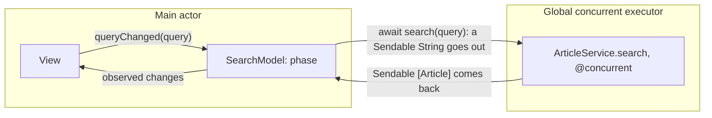

UIKit, AppKit, and SwiftUI share one rule older than Swift itself: user interface state is touched only from the main thread. For most of Apple-platform history, that rule lived in documentation and in Main Thread Checker warnings at run time. In Swift concurrency it lives in the type system, as the **main actor**: a global actor whose executor is the main thread. Code isolated to it can update UI directly; code that is not must `await` to get there, and the compiler checks every crossing.

This article treats the main actor as both a correctness tool and a performance budget. It shows how to structure view models so that state changes are synchronous and checked, how to keep heavy work off the main actor and measure that you did, how Swift 6.2's default isolation changes app targets, and how to bridge the callbacks and delegates that still arrive from older APIs.

<!--more-->

The examples use Swift 6 language mode and were compiled and run with the Swift 6.4 toolchain on macOS 26. The Swift blocks build on one another in one `main.swift`. `Observations` requires iOS 26, macOS 26, or later.

## What the main actor is

`MainActor` is a global actor, declared in the standard library as `@globalActor public final actor MainActor`. Its executor is the main dispatch queue, which runs on the main thread. Marking a declaration `@MainActor` isolates it there:

- A `@MainActor` function always runs on the main thread, and calling it from elsewhere requires `await`.
- A `@MainActor` class or struct isolates all of its members, and the type is implicitly `Sendable`, because every access to its state is serialized on one thread.
- A `@MainActor` closure runs on the main actor wherever it is called from.

The UI frameworks are annotated this way. `UIView`, `UIViewController`, `NSView`, and SwiftUI's `View` protocol are main-actor-isolated, so code that conforms to them inherits the isolation. In a SwiftUI view, `body` and every method of the view run on the main actor without any annotation of your own.

## The frame budget

The main thread draws frames. On a 60 Hz display it has about 16.7 ms per frame; on a 120 Hz ProMotion display, about 8.3 ms. Any single main-actor job that runs longer than one frame interval delays the next frame. A job of length $$T$$ on a display with frame interval $$T_f$$ causes roughly

$$
\text{dropped frames} \approx \left\lceil \frac{T}{T_f} \right\rceil - 1
$$

missed frames. An 80 ms JSON decode on the main actor drops about four frames at 60 Hz and about nine at 120 Hz: a visible stutter. The main actor is a serial executor with a hard real-time deadline, and the most useful mental model is that everything on it is spending from a budget of a few milliseconds per job.

Because actors switch work only at suspension points, the length of a main-actor *job*, from one `await` to the next, is what matters. A long `async` function with many `await`s can be fine. A short synchronous loop that runs for 80 ms is not.

## Measuring responsiveness

A heartbeat makes the budget measurable. It is a main-actor task that wakes every 2 ms and records how late it woke. If something occupies the main actor, the heartbeat cannot run, and its lateness reveals how long the main actor was blocked:

```swift
import Foundation
import Observation
import Synchronization

/// Wakes on the main actor every `interval` and records the worst delay.
@MainActor
final class Heartbeat {
    private(set) var worstLateness: Duration = .zero
    private var task: Task<Void, Never>?

    func start(interval: Duration = .milliseconds(2)) {
        task = Task {
            let clock = ContinuousClock()
            while !Task.isCancelled {
                let expected = clock.now + interval
                try? await Task.sleep(for: interval)
                worstLateness = max(worstLateness, expected.duration(to: clock.now))
            }
        }
    }

    func stop() async {
        task?.cancel()
        await task?.value
    }
}

/// Stand-in for decoding a large payload: about 80 ms of CPU work.
func decodeLargePayload() -> Int {
    let clock = ContinuousClock()
    let deadline = clock.now + .milliseconds(80)
    var checksum = 0
    while clock.now < deadline {
        checksum &+= 1
    }
    return checksum
}

@MainActor
func decodeOnMainActor() -> Int {
    decodeLargePayload()
}

@concurrent
func decodeOffMainActor() async -> Int {
    decodeLargePayload()
}

@MainActor
func worstLateness(decodingOnMain: Bool) async -> Duration {
    let heartbeat = Heartbeat()
    heartbeat.start()
    try? await Task.sleep(for: .milliseconds(10))
    if decodingOnMain {
        _ = decodeOnMainActor()
    } else {
        _ = await decodeOffMainActor()
    }
    try? await Task.sleep(for: .milliseconds(10))
    await heartbeat.stop()
    return heartbeat.worstLateness
}

let blockedLateness = await worstLateness(decodingOnMain: true)
let freeLateness = await worstLateness(decodingOnMain: false)
assert(blockedLateness >= .milliseconds(60), "Decoding on the main actor blocked it for most of 80 ms")
assert(freeLateness < .milliseconds(40), "Decoding off the main actor left it responsive")
print("worst heartbeat delay, decoding on main:", blockedLateness, "off main:", freeLateness)
```

On the test machine, the heartbeat was about 80 ms late when the decode ran on the main actor and a few milliseconds late when it ran in a `@concurrent` function. The calling code looks almost identical in both cases; the difference is one attribute on the function that does the work. Instruments' Hangs and Animation Hitches instruments measure the same thing in a real app, as the [profiling article](/swift-profiling-tasks-main-actor/) shows.

## Structuring a main-actor view model

The pattern that works best in Swift 6 puts **state** on the main actor and **work** off it. The view model is `@MainActor`, so every property assignment is a synchronous, checked operation. Services that do I/O or computation are non-isolated and `Sendable`, and the view model `await`s them:



```swift
struct Article: Equatable, Sendable {
    let id: Int
    let title: String
}

/// Non-isolated and Sendable: callable from any isolation domain.
protocol ArticleService: Sendable {
    func search(_ query: String) async throws -> [Article]
}

struct InMemoryArticleService: ArticleService {
    let articles: [Article]
    let latency: Duration

    @concurrent
    func search(_ query: String) async throws -> [Article] {
        try await Task.sleep(for: latency)
        return articles.filter { $0.title.localizedCaseInsensitiveContains(query) }
    }
}

@MainActor
@Observable
final class SearchModel {
    enum Phase: Equatable {
        case idle
        case loading(query: String)
        case loaded([Article])
        case failed(String)
    }

    private(set) var phase: Phase = .idle
    private let service: any ArticleService
    @ObservationIgnored private var searchTask: Task<Void, Never>?

    init(service: any ArticleService) {
        self.service = service
    }

    /// Called synchronously from the UI, for example on every keystroke.
    func queryChanged(_ query: String) {
        searchTask?.cancel()
        guard !query.isEmpty else {
            phase = .idle
            return
        }
        phase = .loading(query: query)
        searchTask = Task {
            do {
                let results = try await service.search(query)
                guard !Task.isCancelled else { return }
                phase = .loaded(results)
            } catch is CancellationError {
            } catch {
                phase = .failed("Search failed")
            }
        }
    }

    func settle() async {
        await searchTask?.value
    }
}

let service = InMemoryArticleService(
    articles: [Article(id: 1, title: "Actors"), Article(id: 2, title: "Main actor"), Article(id: 3, title: "Tasks")],
    latency: .milliseconds(20)
)
let searchModel = SearchModel(service: service)
searchModel.queryChanged("act")
assert(searchModel.phase == .loading(query: "act"), "State changes synchronously, before any await")
await searchModel.settle()
assert(searchModel.phase == .loaded([Article(id: 1, title: "Actors"), Article(id: 2, title: "Main actor")]))
```

Several properties of this design are worth naming:

- **State changes are synchronous.** `phase = .loading(...)` takes effect before `queryChanged` returns, so the UI never shows a frame where the keystroke has been processed but the spinner has not appeared.
- **The task inherits the main actor.** `Task { }` created in a main-actor method is main-actor-isolated, so `phase = .loaded(results)` needs no hop and resumes on the main thread after the `await`.
- **The work leaves the main actor because of the callee, not the caller.** `search` is `@concurrent`, so it runs on the global executor no matter who calls it. If a future caller is a background importer instead of a view model, the work still runs off the main actor, and nobody has to remember to detach.
- **Only `Sendable` values cross.** The query string goes out, an array of `Article` values comes back. The view model itself never leaves the main actor.

The `guard !Task.isCancelled` after the `await` matters. Cancellation is cooperative: a superseded search that has already finished its network call returns normally, and without the check it would overwrite the newer query's state. The [stale results article](/swift-rejecting-stale-results/) shows why even this check leaves a small window, and how a generation token closes it.

## Observing main-actor state as a stream

`@Observable` view models drive SwiftUI views directly. Non-view code sometimes needs the same changes as a stream, for example to persist a setting whenever it changes or to log state transitions. Swift 6.2's `Observations` type ([SE-0475](https://github.com/swiftlang/swift-evolution/blob/main/proposals/0475-observed.md)) turns an observation-tracked expression into an `AsyncSequence`:

```swift
@MainActor
@Observable
final class PlaybackModel {
    var position = 0
}

@MainActor
func recordPositions() async -> [Int] {
    let playback = PlaybackModel()
    let positions = Observations { playback.position }
    let recorder = Task {
        var seen: [Int] = []
        for await position in positions {
            seen.append(position)
            if position >= 3 { break }
        }
        return seen
    }
    for _ in 0..<3 {
        try? await Task.sleep(for: .milliseconds(20))
        playback.position += 1
    }
    return await recorder.value
}

let recordedPositions = await recordPositions()
assert(recordedPositions == [0, 1, 2, 3])
```

`Observations` is *transactional*: it delivers values at suspension points of the code making the changes, so several synchronous changes made in one main-actor job arrive as a single, consistent value rather than a series of intermediate ones. That is the right semantic for UI state, where intermediate states were never rendered either. The changes above are separated by sleeps, so each one is delivered.

## Default main-actor isolation in Swift 6.2

Most code in an app target touches UI or UI-facing state. Swift 6.2 lets a module make the main actor its default ([SE-0466](https://github.com/swiftlang/swift-evolution/blob/main/proposals/0466-control-default-actor-isolation.md)): every declaration without an explicit isolation is inferred `@MainActor`. In Xcode 26 and later, new app projects enable this through the "Default Actor Isolation" build setting; in SwiftPM it is a target setting:

<!-- skip-check -->
```swift
// Package.swift
.executableTarget(
    name: "App",
    swiftSettings: [.defaultIsolation(MainActor.self)]
)
```

On the command line the flag is `-default-isolation MainActor`. Under that default, a plain `final class Model { var count = 0 }` is main-actor-isolated with no annotation, and code that mutates it from the main actor compiles without any `await`.

Default isolation removes most of the annotation noise from UI code, and most of the confusing errors that come from forgetting an annotation. It does not change what should run *off* the main actor. With main-actor isolation as the default, background work must opt out explicitly:

- Mark CPU-heavy functions `@concurrent`, as `decodeOffMainActor` is above.
- Mark types used only by background code, such as parsers, network clients, and persistence layers, `nonisolated`, so they can be used from any isolation domain.
- Consider putting non-UI layers in their own modules, which keep the nonisolated default.

The combination works well: UI code reads as if concurrency did not exist, and the places that leave the main actor are exactly the places that say so.

## Getting onto the main actor

From non-isolated code, there are three ways onto the main actor. Prefer them in this order:

1. **Call a `@MainActor` function with `await`.** The isolation is part of the callee's signature, so every caller gets it right.
2. **`await MainActor.run { }`** for a one-off block. It is equivalent to calling a `@MainActor` closure, and it suspends the caller until the block has run.
3. **`Task { @MainActor in }`** from synchronous non-isolated code, when there is nothing to await from. This creates an unstructured task that needs an owner like any other.

Avoid `DispatchQueue.main.async` in code that uses Swift concurrency. It works, but the block it submits is outside the task tree: no cancellation, no priority propagation, no result, and, in Swift 6 mode, an isolation inference trap when closures inherit isolation they do not have at run time, as the [threads article](/swift-threads-dispatch-queues-tasks/) demonstrates.

## Bridging callbacks that are already on the main thread

Older APIs often call back on the main thread without saying so in their types: delegate methods, notification observers registered with `queue: .main`, completion handlers documented to run on the main queue. The compiler sees a non-isolated callback and refuses to let it touch main-actor state synchronously.

When the API guarantees main-thread delivery, `MainActor.assumeIsolated` tells the compiler so, and checks it at run time:

```swift
@MainActor
final class LegacyBridge {
    private(set) var events: [String] = []

    func record(_ event: String) {
        events.append(event)
    }
}

let bridge = LegacyBridge()
let delivered = Mutex(false)
DispatchQueue.main.async {
    // A callback that an API documents as main-thread-only.
    MainActor.assumeIsolated {
        bridge.record("legacy callback")
    }
    delivered.withLock { $0 = true }
}
while !delivered.withLock({ $0 }) {
    await Task.yield()
}
assert(bridge.events == ["legacy callback"])
```

`assumeIsolated` runs the closure synchronously, with no hop, after verifying that the current executor *is* the main actor. If the assumption is wrong, it stops the program with a precise error instead of allowing a data race. That makes it strictly better than an unchecked workaround: the claim is visible in the code, and testing exposes it if it is false.

For whole conformances, Swift offers two tools. `@preconcurrency` on a protocol conformance, as in `extension Controller: @preconcurrency SomeDelegate`, accepts that the protocol predates concurrency annotations and inserts run-time isolation checks into each requirement. And Swift 6.2's **isolated conformances** ([SE-0470](https://github.com/swiftlang/swift-evolution/blob/main/proposals/0470-isolated-conformances.md)) let a main-actor type conform to a non-isolated protocol for use *on the main actor only*:

```swift
protocol Describable {
    func describe() -> String
}

@MainActor
final class Screen {
    var title = "Library"
}

extension Screen: @MainActor Describable {
    func describe() -> String {
        title
    }
}

@MainActor
func describeScreen() -> String {
    let screen = Screen()
    let describable: any Describable = screen
    return describable.describe()
}

let screenDescription = describeScreen()      // Top-level code is already on the main actor.
assert(screenDescription == "Library")
```

The `@MainActor` in the conformance means the conformance itself is isolated: code on the main actor can use `Screen` as a `Describable`, and the compiler prevents passing that conformance to code that might call `describe()` from another thread. Before isolated conformances, the only options were to make the requirement `nonisolated`, which could not read `title`, or to give up the conformance.

## Pitfalls

**Assuming `Task { }` leaves the main actor.** In a main-actor context, `Task { }` runs on the main actor. Heavy work inside it blocks the UI exactly as if it ran inline. Offload the work, not the task.

**Making a whole service `@MainActor` because one caller is UI.** A network client, database, or image pipeline annotated `@MainActor` forces every caller onto the main thread and every job into the frame budget. Keep services non-isolated and `Sendable`, or give them their own actor.

**Fine-grained hops in loops.** Every `await` from the main actor into another actor and back costs a thread switch. The [actors article](/swift-actors/) measured about 6 µs per round trip, so a loop of 10,000 small calls spends about 60 ms, four frames at 60 Hz, in switching alone. Move the loop to the other side of the boundary.

**`assumeIsolated` on an unverified claim.** If an API's callback queue is configurable or undocumented, `assumeIsolated` will eventually crash. Hop explicitly with `Task { @MainActor in }` instead, or configure the API to call back on the main queue.

**Long synchronous work in `body` or view initializers.** SwiftUI calls `body` frequently, on the main actor. Formatting, sorting, and filtering large collections there runs in every update. Compute derived values in the model, off the main actor if they are expensive.

## Summary

- The main actor is a global actor whose executor is the main thread; UI frameworks are isolated to it.
- Every main-actor job spends from a frame budget of about 8 to 17 ms. Jobs longer than one frame drop $$\lceil T / T_f \rceil - 1$$ frames.
- Keep state on the main actor and work off it: `@MainActor` view models, non-isolated `Sendable` services, `@concurrent` for heavy computation.
- Measure responsiveness with a heartbeat locally and with Instruments in apps.
- Swift 6.2 can make the main actor a module's default isolation; background code then opts out with `@concurrent` and `nonisolated`.
- Get onto the main actor through `@MainActor` functions first, `MainActor.run` second, and avoid `DispatchQueue.main.async` in concurrent code.
- Bridge main-thread callbacks with `MainActor.assumeIsolated`, and conform main-actor types to non-isolated protocols with isolated conformances.

## Exercise

Add a `thumbnails` feature to `SearchModel`: each loaded article gets an image that is decoded with a CPU-bound function taking about 15 ms. Implement it three ways: decoding inside the model's main-actor task, decoding in a `@concurrent` function one image at a time, and decoding in a task group off the main actor with results applied in one main-actor update. Use `Heartbeat` to measure the worst main-actor delay for twenty articles in each version, and relate the results to the frame-budget formula.

## Further reading

- [SE-0316: Global actors](https://github.com/swiftlang/swift-evolution/blob/main/proposals/0316-global-actors.md).
- [SE-0466: Control default actor isolation inference](https://github.com/swiftlang/swift-evolution/blob/main/proposals/0466-control-default-actor-isolation.md).
- [SE-0470: Global-actor isolated conformances](https://github.com/swiftlang/swift-evolution/blob/main/proposals/0470-isolated-conformances.md).
- [SE-0475: Transactional Observation of Values](https://github.com/swiftlang/swift-evolution/blob/main/proposals/0475-observed.md).
- [Embracing Swift concurrency](https://developer.apple.com/videos/play/wwdc2025/268/), WWDC25.

Previous: [Actor Reentrancy Across Suspension Points](/swift-actor-reentrancy/). Next: [`Sendable`: Moving Values Across Isolation Boundaries](/swift-sendable/).

Return to the [Concurrency roadmap](/swift-concurrency-roadmap/).
