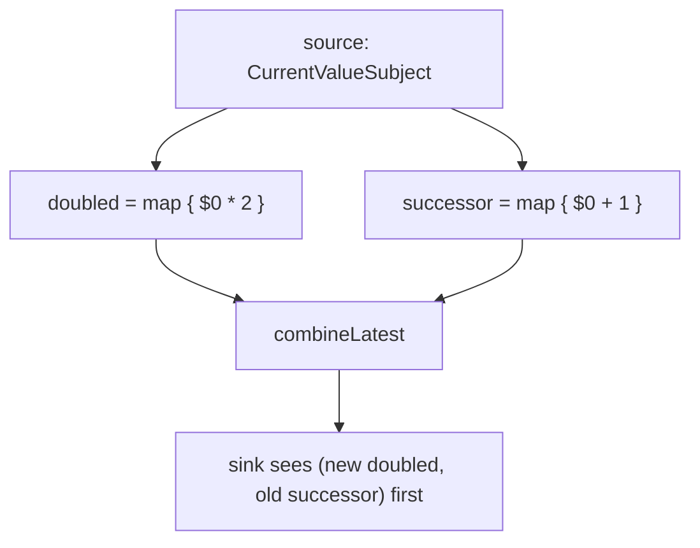
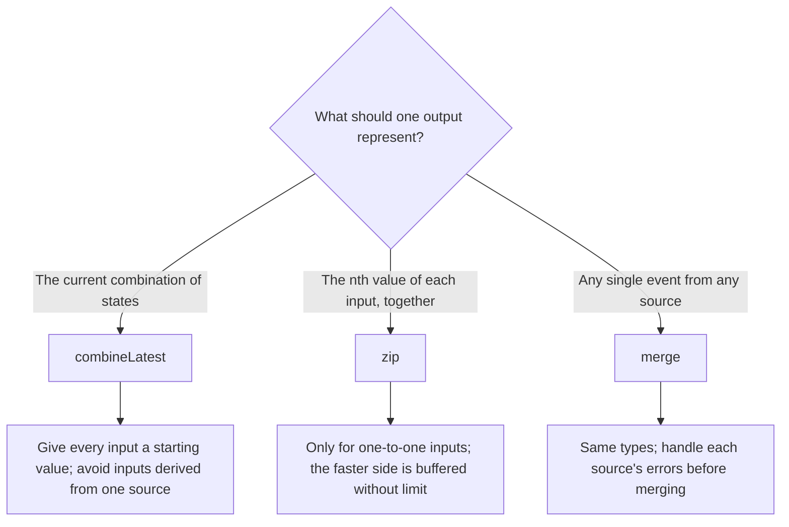

Real features depend on more than one stream. A sign-up button depends on a username, a password, and a terms checkbox. A chart pairs each request with its response. A notification badge listens to messages arriving over a socket and to messages created locally. Combine has three operators for joining streams, and each one answers "when should the output emit?" differently. `combineLatest` emits whenever any input changes, with the latest value of every input. `zip` emits only when every input has a new value, pairing them by position. `merge` emits every value from every input, as it arrives, in one stream.

The emission rules are easy to learn from a diagram. The completion rules, the buffering, and the consistency guarantees are not, and they are where the bugs live: a `combineLatest` that silently never emits because one input finished empty, a `zip` that buffers without limit and hangs forever when one side is an infinite sequence, and a `combineLatest` of two streams derived from the same source that briefly emits a state that never existed. This article runs one scripted timeline through all three operators, measures each of those behaviors, and builds a `combineLatest` for any number of inputs.

<!--more-->

The examples use Swift 6 language mode and were compiled and run with the Swift 6.4 toolchain from Xcode 27.1 on macOS 26. Paste the blocks in order into one `main.swift`.

## One timeline, three operators

The clearest comparison is to drive the same inputs through all three and record when each output emits. This script sends letters on one subject and numbers on another, one event per tick, and then completes both:

```swift
import Combine
import Foundation

let letters = PassthroughSubject<String, Never>()
let numbers = PassthroughSubject<Int, Never>()
var tick = 0
var latestOutput: [String] = []
var zippedOutput: [String] = []
var mergedOutput: [String] = []

let latestHandle = letters.combineLatest(numbers).sink(
    receiveCompletion: { _ in latestOutput.append("t\(tick) done") },
    receiveValue: { latestOutput.append("t\(tick) \($0)\($1)") }
)
let zippedHandle = letters.zip(numbers).sink(
    receiveCompletion: { _ in zippedOutput.append("t\(tick) done") },
    receiveValue: { zippedOutput.append("t\(tick) \($0)\($1)") }
)
let mergedHandle = letters.merge(with: numbers.map(String.init)).sink(
    receiveCompletion: { _ in mergedOutput.append("t\(tick) done") },
    receiveValue: { mergedOutput.append("t\(tick) \($0)") }
)

let script: [() -> Void] = [
    { letters.send("a") },                    // t1
    { numbers.send(1) },                      // t2
    { letters.send("b") },                    // t3
    { letters.send("c") },                    // t4
    { numbers.send(2) },                      // t5
    { letters.send(completion: .finished) },  // t6
    { numbers.send(3) },                      // t7
    { numbers.send(4) },                      // t8
    { numbers.send(completion: .finished) },  // t9
]
for (index, step) in script.enumerated() {
    tick = index + 1
    step()
}

assert(latestOutput == ["t2 a1", "t3 b1", "t4 c1", "t5 c2", "t7 c3", "t8 c4", "t9 done"])
assert(zippedOutput == ["t2 a1", "t5 b2", "t7 c3", "t7 done"])
assert(mergedOutput == ["t1 a", "t2 1", "t3 b", "t4 c", "t5 2", "t7 3", "t8 4", "t9 done"])
```

Laid out by tick:

| Tick | Input | `combineLatest` | `zip` | `merge` |
|---|---|---|---|---|
| 1 | letter `a` | | | `a` |
| 2 | number `1` | `a1` | `a1` | `1` |
| 3 | letter `b` | `b1` | | `b` |
| 4 | letter `c` | `c1` | | `c` |
| 5 | number `2` | `c2` | `b2` | `2` |
| 6 | letters finish | | | |
| 7 | number `3` | `c3` | `c3`, then finishes | `3` |
| 8 | number `4` | `c4` | | `4` |
| 9 | numbers finish | finishes | | finishes |

Every difference in the table is a rule worth stating:

- `combineLatest` emits nothing until every input has emitted once; at tick 1 there is no number yet. After that, every input value produces an output, paired with the *latest* value of the other input, which is why `c` was reused at ticks 7 and 8 after the letters had finished.
- `zip` pairs the $$n$$th value of each input. At tick 5 it paired `b` with `2`, though `c` was already waiting; `c` was paired with `3` at tick 7. It finished at tick 7, as soon as the letters had finished *and* no buffered letter was left to pair, so `4` was never used.
- `merge` forwards everything, and finishes only when every input has finished.
- `combineLatest` also finishes only when every input has finished, even though the letters finished at tick 6.

## `combineLatest`

`combineLatest` is the operator for derived state: whenever any input changes, recompute from the current value of all of them. It has overloads for two, three, and four publishers, as a method and as `Publishers.CombineLatest`, `CombineLatest3`, and `CombineLatest4`, plus versions that take a transform closure. A sign-up form is the standard example:

```swift
@MainActor
final class SignUpForm: ObservableObject {
    @Published var username = ""
    @Published var password = ""
    @Published var acceptedTerms = false

    var canSubmit: AnyPublisher<Bool, Never> {
        Publishers.CombineLatest3($username, $password, $acceptedTerms)
            .map { username, password, accepted in
                username.count >= 3 && password.count >= 8 && accepted
            }
            .removeDuplicates()
            .eraseToAnyPublisher()
    }
}

let form = SignUpForm()
var submitStates: [Bool] = []
let submitHandle = form.canSubmit.sink { submitStates.append($0) }
form.username = "ada"
form.password = "correct horse"
form.acceptedTerms = true
form.password = "short"
assert(submitStates == [false, true, false])
```

`@Published` properties emit their current value on subscription, so the first output arrives immediately. With subjects that have no current value, the first output waits for the last input to speak, which for a form means the button state is unknown until every field has been touched. The fix is to give every input a starting value, with `CurrentValueSubject` or `prepend(_:)`.

### The input that finishes empty

The completion rule has an unpleasant corner. If an input finishes without ever emitting, `combineLatest` can never produce a value, yet it does not finish either; it waits for the other inputs:

```swift
var emptyEvents: [String] = []
let neverEmits = PassthroughSubject<Int, Never>()
let keepsEmitting = PassthroughSubject<Int, Never>()
let emptyHandle = neverEmits.combineLatest(keepsEmitting).sink(
    receiveCompletion: { _ in emptyEvents.append("finished") },
    receiveValue: { emptyEvents.append("value \($0), \($1)") }
)
neverEmits.send(completion: .finished)
keepsEmitting.send(1)
keepsEmitting.send(2)
assert(emptyEvents.isEmpty)                    // nothing, and no completion either
keepsEmitting.send(completion: .finished)
assert(emptyEvents == ["finished"])
```

In an app this shows up as a screen stuck on a spinner because one of the combined loads returned `Empty`, for example from a `catch` that replaced an error with nothing. `replaceEmpty(with:)` on each input that might finish empty guarantees a value, and it is a cheap guard to put on any input that comes from a `catch`.

A failure from any input, by contrast, fails the output immediately, and the other inputs are cancelled.

### Glitches: two inputs from one source

When the inputs of a `combineLatest` are both derived from the same source, one change to the source arrives as two separate input updates, and `combineLatest` emits after each. The first emission combines the new value of one input with the *old* value of the other, a state that never existed:



Every output should satisfy `successor == doubled / 2 + 1`. Counting the outputs that do not:

```swift
let counter = CurrentValueSubject<Int, Never>(0)
var pairs: [(doubled: Int, successor: Int)] = []
let glitchHandle = counter.map { $0 * 2 }
    .combineLatest(counter.map { $0 + 1 })
    .sink { pairs.append(($0, $1)) }
counter.send(1)
counter.send(2)

let inconsistent = pairs.filter { $0.successor != $0.doubled / 2 + 1 }
assert(pairs.count == 5)                      // one initial pair, then two per send
assert(inconsistent.count == 2)               // one glitch per change
```

Five outputs for three source values, two of them impossible: `(2, 1)` and `(4, 2)` in a run where the doubled branch happened to be updated first. Which branch updates first depends on the order in which the source subject visits its two subscribers, and [Subjects](/combine-subjects/) showed that this order changes from launch to launch, so the glitch values themselves vary but their count does not. If the sink drives a view, the view briefly shows the impossible state; if it drives a network request or a write, the impossible state is acted on.

The fix is to not split the stream in the first place. Compute everything derived from one source in one `map`, so each change produces exactly one consistent output:

```swift
var consistentPairs: [(doubled: Int, successor: Int)] = []
let consistentHandle = counter
    .map { (doubled: $0 * 2, successor: $0 + 1) }
    .sink { consistentPairs.append($0) }
counter.send(3)
assert(consistentPairs.count == 2)            // the current value, then one per change
assert(consistentPairs.allSatisfy { $0.successor == $0.doubled / 2 + 1 })
```

The same hazard appears less obviously when two `@Published` properties of one model are always updated together and combined downstream: each assignment is a separate emission. Grouping them into one struct property, as [`@Published` Properties](/combine-published-properties/) suggested, removes the intermediate state at the source.

## `zip`

`zip` pairs values by position: the first of each input, then the second of each, and so on. It is right when inputs correspond one to one, such as a stream of requests and a stream of their responses, or two independent loads that must both finish before a screen appears, where each emits once. It is wrong for state, because a fast input does not refresh the output; it queues.

### `zip` buffers without limit

To pair values by position, `zip` has to keep every value of the faster input until the slower one catches up. It does not slow the faster input down: it requests unlimited demand from every input. A `handleEvents` on a sequence publisher shows the request:

```swift
var zipRequests: [String] = []
let slowSide = PassthroughSubject<String, Never>()
var zipPairs: [String] = []
let sequenceZipHandle = (1...1_000).publisher
    .handleEvents(receiveRequest: { zipRequests.append("\($0)") })
    .zip(slowSide)
    .sink { zipPairs.append("\($0)\($1)") }
slowSide.send("a")
slowSide.send("b")
assert(zipRequests == ["unlimited"])          // all 1,000 values were pulled into the buffer
assert(zipPairs == ["1a", "2b"])
```

All 1,000 numbers were generated and buffered at subscription, to be paired with letters that may never come. Replacing the range with the infinite `(1...).publisher` makes the subscription never return: the sequence produces values forever into `zip`'s buffer, which is what happened when this test was first written that way.

With a subject on the fast side, the buffer grows with the difference in rates. If the inputs emit at rates $$\lambda_f > \lambda_s$$ values per second, the buffer after $$t$$ seconds holds

$$
B(t) \;=\; (\lambda_f - \lambda_s)\, t
$$

values, with no upper bound. Measuring the process footprint while sending a million `Int`s into one side of a `zip`, in an optimized build, gave about 82 bytes per buffered value. Zipping a 60 Hz sensor with a 1 Hz location fix by mistake therefore leaks $$59 \times 3600 = 212{,}400$$ values an hour, about 17 MB, and every pair it does emit is further out of date than the last.

If the intent was "each location fix with the newest sensor reading", that is not `zip` but sampling: `combineLatest` followed by `removeDuplicates` on the location, or the `sensor.combineLatest(location)` output filtered to emit only when the location changes. If the intent really is one-to-one pairing, the faster side needs backpressure, such as a `buffer(size:prefetch:whenFull:)` with an explicit policy.

### When `zip` finishes

`zip` finishes as soon as any input has finished and every value it buffered from that input has been paired, because no further pair can be formed. If nothing is buffered, that is immediate:

```swift
var zipFinishEvents: [String] = []
let left = PassthroughSubject<Int, Never>()
let right = PassthroughSubject<Int, Never>()
let zipFinishHandle = left.zip(right).sink(
    receiveCompletion: { _ in zipFinishEvents.append("finished") },
    receiveValue: { zipFinishEvents.append("\($0)-\($1)") }
)
left.send(1)
right.send(10)
left.send(completion: .finished)              // nothing buffered from left
right.send(20)                                // can never be paired
assert(zipFinishEvents == ["1-10", "finished"])
```

## `merge`

`merge` interleaves inputs of the same `Output` and `Failure` type into one stream, in arrival order. `merge(with:)` accepts up to seven other publishers at once, and `Publishers.MergeMany` takes an array or a variadic list, which makes it the operator for "listen to all of these sources":

```swift
enum FeedError: Error { case disconnected }

struct Message: Equatable {
    let id: Int
    let origin: String
}

let socketMessages = PassthroughSubject<Message, FeedError>()
let localMessages = PassthroughSubject<Message, FeedError>()
let pushMessages = PassthroughSubject<Message, FeedError>()

var inbox: [String] = []
let inboxHandle = Publishers.MergeMany(socketMessages, localMessages, pushMessages)
    .sink(receiveCompletion: { completion in
              if case .failure(let error) = completion { inbox.append("failed: \(error)") }
          },
          receiveValue: { inbox.append("\($0.origin) \($0.id)") })

socketMessages.send(Message(id: 1, origin: "socket"))
localMessages.send(Message(id: 2, origin: "local"))
localMessages.send(completion: .finished)     // one source finishing changes nothing
pushMessages.send(Message(id: 3, origin: "push"))
socketMessages.send(completion: .failure(.disconnected))
pushMessages.send(Message(id: 4, origin: "push"))   // too late: the merge has failed

assert(inbox == ["socket 1", "local 2", "push 3", "failed: disconnected"])
```

Like `combineLatest`, `merge` finishes when all inputs finish and fails when any input fails. The failure rule is the one to plan for: the socket disconnecting took the push notifications down with it. When sources should fail independently, handle each source's errors before merging, for example by turning them into values or by retrying, as [Error Handling: `catch`, `retry`, and `replaceError`](/combine-error-handling-catch-retry/) shows. And when inputs have different types, map them into a shared enum first; that is how a reducer with several event sources is usually fed.

## `combineLatest` for any number of inputs

The built-in `combineLatest` stops at four inputs, and a dashboard with a tile per data source, or a form generated from a schema, has as many as it has. `MergeMany` and `scan` from [Transforming: `map`, `flatMap`, and `scan`](/combine-map-flatmap-scan/) build one: tag each input's values with its index, merge, keep an array of the latest values, and emit once every slot is filled:

```swift
extension Collection where Element: Publisher {
    /// Emits an array of the latest value of every publisher, once all have emitted,
    /// and again whenever any of them emits.
    func combineLatestAll() -> AnyPublisher<[Element.Output], Element.Failure> {
        let inputCount = count
        guard inputCount > 0 else {
            return Just([]).setFailureType(to: Element.Failure.self).eraseToAnyPublisher()
        }
        return Publishers.MergeMany(enumerated().map { index, publisher in
            publisher.map { (index: index, value: $0) }
        })
        .scan([Element.Output?](repeating: nil, count: inputCount)) { latest, update in
            var next = latest
            next[update.index] = update.value
            return next
        }
        .compactMap { latest in
            let values = latest.compactMap { $0 }
            return values.count == inputCount ? values : nil
        }
        .eraseToAnyPublisher()
    }
}

let tiles = (0..<6).map { CurrentValueSubject<Int, Never>($0 * 10) }
var dashboards: [[Int]] = []
let dashboardHandle = tiles.combineLatestAll().sink { dashboards.append($0) }
assert(dashboards == [[0, 10, 20, 30, 40, 50]])   // emitted once the sixth tile reported
tiles[3].send(33)
assert(dashboards.last == [0, 10, 20, 33, 40, 50])
assert(dashboards.count == 2)
```

It inherits `combineLatest`'s rules because it is built from the same parts: `MergeMany` finishes when every input finishes and fails when one fails, and an input that never emits keeps every slot waiting. It does not inherit a fixed arity, and its output is an array, so the inputs must share an output type; tiles with different types map to a common enum first.

## Choosing



Keep the remaining subscriptions alive until the end of the file:

```swift
withExtendedLifetime((latestHandle, zippedHandle, mergedHandle, submitHandle, emptyHandle,
                      glitchHandle, consistentHandle, sequenceZipHandle, zipFinishHandle,
                      inboxHandle, dashboardHandle)) {}
```

## Summary

- `combineLatest` emits on every input change once all inputs have emitted, and finishes only when all inputs finish. An input that finishes empty leaves it waiting with no output; guard such inputs with `replaceEmpty(with:)`.
- Combining two streams derived from one source produced two impossible states out of five outputs. Derive everything from one `map` instead.
- `zip` pairs values by position and requested unlimited demand from its inputs: a 1,000-element sequence was buffered at subscription, and an infinite one never returned. A rate difference of $$\lambda_f - \lambda_s$$ grows its buffer linearly, at about 82 bytes per buffered `Int`.
- `zip` finishes as soon as a finished input has no buffered values left.
- `merge` and `MergeMany` interleave same-typed inputs, finish when all finish, and fail when any fails; isolate failures per source before merging.
- `combineLatestAll()` extends `combineLatest` to any number of inputs with `MergeMany` and `scan`, keeping the same rules.

## Exercise

Write a `latestFrom(_:)` operator, sometimes called `withLatestFrom`, that emits whenever its upstream emits, paired with the most recent value of another publisher, but does not emit when only the other publisher changes. Build it from the operators in this article and `scan`, and test it with a button tap stream and a text field stream: taps before the text field has a value produce nothing, typing produces nothing, and each tap produces exactly one pair with the current text. Then use it to fix the 60 Hz sensor and 1 Hz location example, and measure that memory stays flat over a million sensor values.

## Further reading

- Apple's documentation for [`combineLatest(_:)`](https://developer.apple.com/documentation/combine/publisher/combinelatest(_:)), [`zip(_:)`](https://developer.apple.com/documentation/combine/publisher/zip(_:)), and [`Publishers.MergeMany`](https://developer.apple.com/documentation/combine/publishers/mergemany).
- [Introducing Combine](https://developer.apple.com/videos/play/wwdc2019/722/), WWDC19, which introduces the three operators with a sign-up example.
- The [ReactiveX documentation on CombineLatest](https://reactivex.io/documentation/operators/combinelatest.html), with marble diagrams that apply to Combine's version.

Previous: [Filtering: `filter`, `removeDuplicates`, and `compactMap`](/combine-filter-removeduplicates-compactmap/). Next: [Time: `debounce`, `throttle`, and `delay`](/combine-debounce-throttle-delay/).

Return to the [Combine roadmap](/combine/).
