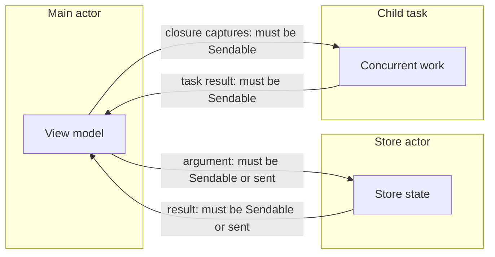
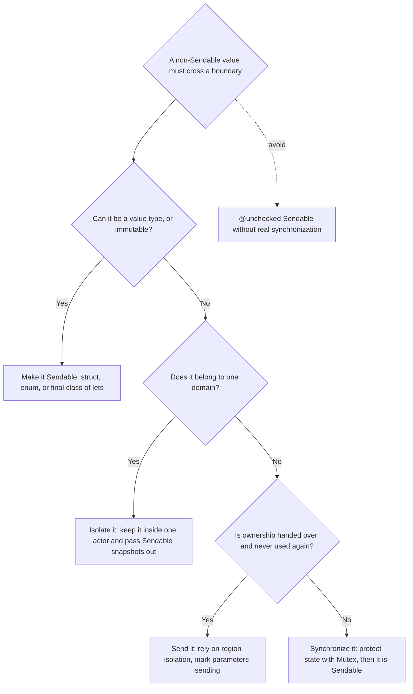

Every data race needs two things: a piece of mutable memory, and two concurrent contexts that can both reach it. Actors and the main actor control who can run where. `Sendable` controls the second half: which values may travel from one isolation domain to another. A value that is `Sendable` can be shared without creating a race. A value that is not must stay where it is, or be handed over completely.

`Sendable` is where most Swift 6 migration errors come from, and also where the most misguided fixes are applied, usually `@unchecked Sendable` sprinkled until the compiler goes quiet. This article explains what the protocol promises, which types get it for free, how closures and region-based isolation fit in, what Swift 6.3 and 6.4 added, and how to choose between making a type `Sendable`, isolating it, and sending it.

<!--more-->

The examples use Swift 6 language mode and were compiled and run with the Swift 6.4 toolchain on macOS 26. The Swift blocks build on one another in one `main.swift`. Blocks marked "Does not compile" show the diagnostics the compiler produced for them. `weak let` requires Swift 6.3, and `~Sendable` Swift 6.4.

## What `Sendable` promises

`Sendable` is a *marker protocol*: it has no requirements and no run-time representation. Conforming to it is a claim, checked by the compiler, that **sharing a value of this type between concurrently executing code cannot cause a data race.** Three kinds of types can make that claim honestly:

1. **Values that are copied when shared.** Structs and enums whose stored properties are all `Sendable`. Each domain gets its own copy, so there is nothing to race on.
2. **References to things that cannot change.** Final classes whose stored properties are all immutable `let`s of `Sendable` types.
3. **References to things that synchronize themselves.** Actors, global-actor-isolated classes, and classes whose mutable state is protected by a lock.

Everywhere a value crosses an isolation boundary, the compiler requires one of those, or proof that the value is not shared at all. The crossings are: arguments and results of calls into an actor, captures of closures that run concurrently, task results, and values handed to child tasks.



## Value types: Sendable for free, internally

Structs and enums are inferred `Sendable` when all their stored properties or associated values are `Sendable`, but only if they are not `public`:

```swift
import Foundation
import Synchronization

func requireSendable<T: Sendable>(_ value: T) {}

struct Coordinate {          // Internal: Sendable is inferred.
    var latitude: Double
    var longitude: Double
}

enum LoadState {             // Internal: inferred, because every payload is Sendable.
    case idle
    case loaded([Coordinate])
    case failed(message: String)
}

requireSendable(Coordinate(latitude: 51.5, longitude: -0.12))
requireSendable(LoadState.loaded([]))
```

Public types do not get inference, because conformance is part of a module's public contract: a library that later adds a non-`Sendable` stored property to a public struct would silently break every client that relied on inferred `Sendable`. Public types must declare the conformance explicitly:

```swift
// Does not compile in Swift 6 mode.
public struct Route {
    public var stopNames: [String]
}
requireSendable(Route(stopNames: []))
// error: type 'Route' does not conform to the 'Sendable' protocol
```

Adding `: Sendable` to a public type is a promise to clients. Before making it, check that the type will stay `Sendable` as it evolves.

For generic types, the conformance is usually conditional:

```swift
public struct Page<Item> {
    public var items: [Item]
    public var nextCursor: String?

    public init(items: [Item], nextCursor: String?) {
        self.items = items
        self.nextCursor = nextCursor
    }
}

extension Page: Sendable where Item: Sendable {}

requireSendable(Page(items: [Coordinate(latitude: 0, longitude: 0)], nextCursor: nil))
```

## Classes: immutable, isolated, or locked

A class is a shared reference, so the compiler is strict. To be checked `Sendable`, a class must be `final` and have only immutable, `Sendable` stored properties:

```swift
// Does not compile in Swift 6 mode.
final class Preferences: Sendable {
    var theme = "dark"
}
// error: stored property 'theme' of 'Sendable'-conforming class 'Preferences' is mutable

class Base: Sendable {
    let id = 1
}
// error: non-final class 'Base' cannot conform to the 'Sendable' protocol
```

The `final` requirement exists because a subclass could add mutable state that the base class's conformance would vouch for.

When a class genuinely needs mutable state *and* must be shared, there are three honest options:

```swift
/// Option 1: immutable. Share freely; "mutate" by creating a new instance.
final class Theme: Sendable {
    let name: String
    let accentHex: UInt32

    init(name: String, accentHex: UInt32) {
        self.name = name
        self.accentHex = accentHex
    }
}

/// Option 2: isolated to a global actor. Sendable because access is serialized on the main actor.
@MainActor
final class ThemeController {
    var current = Theme(name: "dark", accentHex: 0x0A84FF)
}

/// Option 3: internally synchronized. `Mutex` is Sendable, so this is checked, not unchecked.
final class RequestCounter: Sendable {
    private let counts = Mutex<[String: Int]>([:])

    func record(_ endpoint: String) {
        counts.withLock { $0[endpoint, default: 0] += 1 }
    }

    func count(for endpoint: String) -> Int {
        counts.withLock { $0[endpoint, default: 0] }
    }
}

requireSendable(Theme(name: "light", accentHex: 0x007AFF))
requireSendable(RequestCounter())

let requestCounter = RequestCounter()
await withTaskGroup(of: Void.self) { group in
    for _ in 0..<100 {
        group.addTask { requestCounter.record("/feed") }
    }
}
assert(requestCounter.count(for: "/feed") == 100)
```

Notice that option 3 needs no `@unchecked`. `Mutex<Value>` is itself `Sendable`, so a final class whose only stored property is a `let` mutex is checked by the compiler like any other immutable class. `@unchecked Sendable` is needed only when the synchronization is something the compiler cannot see: a legacy `NSLock`, a serial dispatch queue, an atomic built from C, or an invariant like "this object is only mutated before it is published."

### Weak references in Sendable classes

Until Swift 6.3, a `Sendable` class could not hold a weak reference, because `weak` required `var`, and `var` stored properties are not allowed. Swift 6.3 adds `weak let` ([SE-0481](https://github.com/swiftlang/swift-evolution/blob/main/proposals/0481-weak-let.md)): a weak reference that the program cannot reassign, though it still becomes `nil` when the object is deallocated.

```swift
final class Session: Sendable {
    let id: Int

    init(id: Int) {
        self.id = id
    }
}

final class SessionObserver: Sendable {
    weak let session: Session?

    init(session: Session) {
        self.session = session
    }
}

var liveSession: Session? = Session(id: 7)
let observer = SessionObserver(session: liveSession!)
assert(observer.session?.id == 7)
liveSession = nil
assert(observer.session == nil, "weak let still zeroes when the object goes away")
```

The same proposal makes explicit `[weak x]` captures immutable, so they no longer prevent a closure from being `@Sendable`.

### Saying "not Sendable" on purpose

Sometimes a type should *never* be shared, such as a handle to a non-thread-safe C resource, a cursor into a database transaction, or a builder meant to be used by one task. For internal value types, inference could silently make such a type `Sendable` as soon as all its fields happen to be. Swift 6.4 adds an explicit way to say no ([SE-0518](https://github.com/swiftlang/swift-evolution/blob/main/proposals/0518-tilde-sendable.md)):

```swift
/// A cursor into a single-threaded transaction. Deliberately not shareable.
struct TransactionCursor: ~Sendable {
    var position: Int
}

// requireSendable(TransactionCursor(position: 0))
// error: type 'TransactionCursor' does not conform to the 'Sendable' protocol
```

`~Sendable` suppresses inference and documents intent for readers and auditors. Unlike the older idiom of an `@available(*, unavailable)` `Sendable` conformance, it is not inherited, so a non-`Sendable` base class can still have a `Sendable` subclass.

## Closures: `@Sendable` and what they may capture

A closure that may run concurrently with its creator, such as the body of a child task or a callback invoked on another thread, must be `@Sendable`. A `@Sendable` closure may capture only `Sendable` values, and may not capture mutable local variables at all:

```swift
// Does not compile in Swift 6 mode.
func run(_ operation: @escaping @Sendable () -> Void) {}

func countTaps() {
    var count = 0
    run { count += 1 }
    print(count)
}
// error: mutation of captured var 'count' in concurrently-executing code
```

The closure and the enclosing function could both touch `count` at the same time; that is a data race on a stack variable. When the closure only needs the *current* value, capture it by value:

```swift
func scheduleLog(count: Int, into log: RequestCounter) -> @Sendable () -> Void {
    var attempts = count
    attempts += 1
    return { [attempts] in
        log.record("attempt \(attempts)")      // Captures an immutable copy.
    }
}

let logCounter = RequestCounter()
let logOperation = scheduleLog(count: 2, into: logCounter)
logOperation()
assert(logCounter.count(for: "attempt 3") == 1)
```

When the closure needs to *change* shared state, that state must live somewhere that synchronizes it: an actor, the main actor, or a `Mutex`-backed object like `RequestCounter`.

Functions and methods have the same rules. Swift 6 infers `@Sendable` for references to global functions and for unapplied methods of `Sendable` types, and for key paths whose components are all `Sendable` ([SE-0418](https://github.com/swiftlang/swift-evolution/blob/main/proposals/0418-inferring-sendable-for-methods.md)), so `items.map(\.name)` in concurrent code needs no annotation.

## Region-based isolation: sending what is not Sendable

Requiring `Sendable` everywhere would make many correct programs illegal. A common shape is: create an object, configure it, and hand it to another isolation domain, never touching it again. The object is not thread-safe, but it is never *shared*: ownership moves.

Swift 6 checks this with **region-based isolation** ([SE-0414](https://github.com/swiftlang/swift-evolution/blob/main/proposals/0414-region-based-isolation.md)). The compiler tracks which values could reference each other, grouping them into regions. A value in a region that nothing else in the current domain can reach is *disconnected*, and may be **sent** to another domain, after which the sender cannot use it. Parameters marked `sending` ([SE-0430](https://github.com/swiftlang/swift-evolution/blob/main/proposals/0430-transferring-parameters-and-results.md)) state that requirement in a function signature:

```swift
/// Not Sendable: a plain mutable class.
final class Draft {
    var title = ""
    var paragraphs: [String] = []
}

actor DraftStore {
    private var drafts: [Draft] = []

    /// Takes ownership: callers cannot keep using the draft after sending it.
    func adopt(_ draft: sending Draft) {
        drafts.append(draft)
    }

    var titles: [String] {
        drafts.map(\.title)
    }
}

let draftStore = DraftStore()
let draft = Draft()
draft.title = "Region-based isolation"
draft.paragraphs.append("Values move between domains.")
await draftStore.adopt(draft)                 // Ownership moves into the actor.
let storedTitles = await draftStore.titles
assert(storedTitles == ["Region-based isolation"])
```

Touching the draft after sending it is rejected:

```swift
// Does not compile in Swift 6 mode.
func sendThenEdit(store: DraftStore) async {
    let draft = Draft()
    draft.title = "hello"
    await store.adopt(draft)
    draft.title = "after"
}
// error: sending 'draft' risks causing data races
// note: 'draft' used after being passed as a 'sending' parameter; Later uses could race
```

This is the right model for builders, freshly decoded objects, and values produced by one task for consumption by another. A function can also return a `sending` result to promise that the result is disconnected from its own state, which is how `Task.value` and continuation results can hand non-`Sendable` values back safely.

Region-based isolation makes many `Sendable` errors disappear without any annotation. When an error remains, it usually means the value really is reachable from both sides: a property of `self` captured into a task, an element of an array the caller keeps using, or a closure stored somewhere and called later.

## Three strategies for a non-Sendable type

When a type is not `Sendable` and the compiler objects to it crossing a boundary, there are three good responses and one bad one:



**Make it `Sendable`** when the type is data. Most model types should be structs, and most structs are `Sendable` already.

**Isolate it** when the type is stateful and belongs to one domain. A non-`Sendable` class used only inside an actor needs no conformance at all; the actor is the protection. Pass `Sendable` snapshots out instead of the object.

**Send it** when ownership moves once. Configure on one side, hand over, never touch again.

**Synchronize it** when it is genuinely shared and mutable: put the state behind a `Mutex`, and the compiler will check the conformance.

What you should not do is write `@unchecked Sendable` on a class with unprotected mutable state to silence an error. That converts a compile-time diagnostic into a run-time data race. Treat every `@unchecked Sendable` as a claim that needs a comment explaining the synchronization, and audit them during review.

## Code you do not control

Frameworks and packages that predate concurrency annotations produce `Sendable` errors that you cannot fix at the source. `@preconcurrency import SomeModule` downgrades diagnostics about that module's types to warnings or suppresses them, until the module adopts annotations. Use it as a migration aid, not a permanent setting; the [Swift 6 migration article](/swift-6-data-race-safety-migration/) covers the process.

For Objective-C APIs, Swift 6.2 imports completion-handler parameters as `@Sendable` ([SE-0463](https://github.com/swiftlang/swift-evolution/blob/main/proposals/0463-sendable-completion-handlers.md)), matching the reality that such handlers are called on arbitrary queues.

## Common diagnostics and their usual fixes

| Diagnostic | Usual cause | Usual fix |
| --- | --- | --- |
| "type 'X' does not conform to the 'Sendable' protocol" | A public type, or a type with a non-`Sendable` field | Add the conformance, make the field `Sendable`, or isolate the value |
| "stored property 'x' of 'Sendable'-conforming class is mutable" | `var` in a `Sendable` class | Use `let`, move state behind a `Mutex`, or make the class an actor |
| "mutation of captured var 'x' in concurrently-executing code" | A `@Sendable` closure modifies a local | Capture a copy, or move the state into an actor |
| "sending 'x' risks causing data races" | A value is used after being sent, or is reachable from both sides | Stop using it after sending, or send a copy |
| "non-Sendable type 'X' of let 'x' cannot exit main actor-isolated context" | Main-actor state captured by non-isolated code | Pass a `Sendable` snapshot, or keep the code on the main actor |

## Summary

- `Sendable` is a compile-time promise that sharing a value cannot cause a data race.
- Internal structs and enums with `Sendable` members are inferred `Sendable`; public types must declare it.
- Classes must be final with immutable `Sendable` properties, isolated to a global actor, or internally synchronized. A `Mutex`-backed class is checked, not unchecked.
- Swift 6.3's `weak let` allows weak references in `Sendable` classes; Swift 6.4's `~Sendable` declares a type deliberately non-shareable.
- `@Sendable` closures cannot capture mutable locals; capture copies or move state behind synchronization.
- Region-based isolation and `sending` move non-`Sendable` values between domains safely, as long as the sender never uses them again.
- Choose between making a type `Sendable`, isolating it, sending it, or synchronizing it. Reserve `@unchecked Sendable` for synchronization the compiler cannot see.

## Exercise

Take a non-`Sendable` `ImageProcessor` class with mutable configuration and a cache. Write three versions: one where the processor lives inside an actor and callers receive `Sendable` results, one where each task creates and configures its own processor and sends it to a pipeline actor, and one where the cache moves behind a `Mutex` so the processor can be `Sendable`. For each, list what can still go wrong at run time, and which version you would choose if the cache must be shared across all images.

## Further reading

- [SE-0302: Sendable and @Sendable closures](https://github.com/swiftlang/swift-evolution/blob/main/proposals/0302-concurrent-value-and-concurrent-closures.md).
- [SE-0414: Region based isolation](https://github.com/swiftlang/swift-evolution/blob/main/proposals/0414-region-based-isolation.md) and [SE-0430: `sending` parameter and result values](https://github.com/swiftlang/swift-evolution/blob/main/proposals/0430-transferring-parameters-and-results.md).
- [SE-0481: `weak let`](https://github.com/swiftlang/swift-evolution/blob/main/proposals/0481-weak-let.md) and [SE-0518: `~Sendable`](https://github.com/swiftlang/swift-evolution/blob/main/proposals/0518-tilde-sendable.md).
- [Eliminate data races using Swift Concurrency](https://developer.apple.com/videos/play/wwdc2022/110351/), WWDC22.

Previous: [The Main Actor and UI-Facing State](/swift-main-actor/). Next: [Isolated and Nonisolated Methods](/swift-isolated-nonisolated/).

Return to the [Concurrency roadmap](/swift-concurrency-roadmap/).
