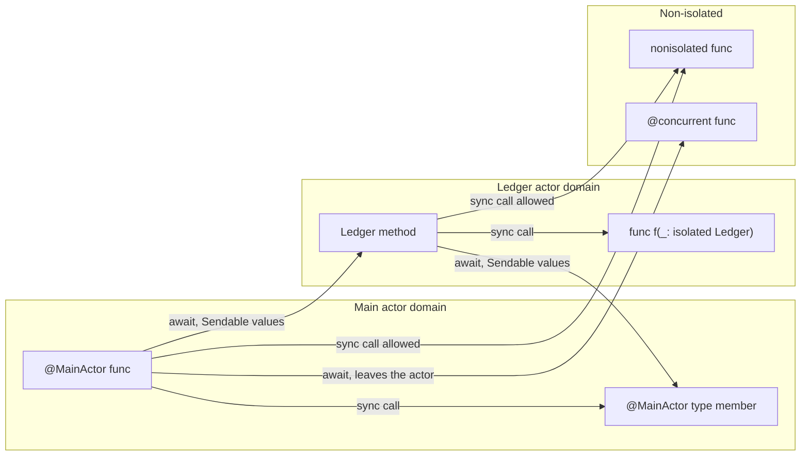

Every function in Swift 6 has an **isolation**: a static answer to the question "which actor's state may this code touch synchronously?" Most of the time the answer is inferred, from the enclosing type, a protocol, or the default for the module. The keywords `isolated` and `nonisolated` let you state it explicitly, and Swift 6.2 adds `nonisolated(nonsending)` and `@concurrent` to say where non-isolated *asynchronous* code runs.

Knowing these tools turns many "cannot be called from" errors from obstacles into design decisions. This article walks through each spelling with a compiled example: `nonisolated` members on actors, `isolated` parameters that let free functions run on an actor, `#isolation` for helpers that inherit their caller's isolation, `@isolated(any)` closures that carry their isolation with them, the inference rules that decide isolation when you write nothing, and the escape hatch for global variables.

<!--more-->

The examples use Swift 6 language mode and were compiled and run with the Swift 6.4 toolchain on macOS 26. The Swift blocks build on one another in one `main.swift`; blocks marked "Does not compile" show the diagnostics the compiler produced.

## Isolation domains

A function's isolation is one of:

- **Actor-instance isolated**: methods of an actor, and functions with an `isolated` parameter. They run on that actor instance.
- **Global-actor isolated**: declarations annotated `@MainActor` or another global actor, or inferred to be.
- **Non-isolated**: everything else. Non-isolated synchronous code runs wherever it is called. Non-isolated asynchronous code runs on the global concurrent executor or on the caller's executor, depending on the rules covered below.



The `#isolation` macro ([SE-0420](https://github.com/swiftlang/swift-evolution/blob/main/proposals/0420-inheritance-of-actor-isolation.md)) evaluates to the current isolation as an `(any Actor)?`, which makes it possible to observe:

```swift
import Synchronization

func describe(_ isolation: (any Actor)?) -> String {
    isolation.map { "\(type(of: $0))" } ?? "nonisolated"
}

actor Ledger {
    private(set) var entries: [Int] = []
    let name: String

    init(name: String) {
        self.name = name
    }

    func record(_ amount: Int) {
        entries.append(amount)
    }

    func whereAmI() -> String {
        describe(#isolation)
    }
}

@MainActor
func onMainActor() -> String {
    describe(#isolation)
}

func plainFunction() -> String {
    describe(#isolation)
}

let ledger = Ledger(name: "household")
let insideActor = await ledger.whereAmI()
let insideMain = onMainActor()
let insideDetached = await Task.detached { plainFunction() }.value
assert(insideActor == "Ledger" && insideMain == "MainActor" && insideDetached == "nonisolated")
```

The rules for crossing between domains are simple. Synchronous calls are allowed only within the same domain. Calls into another domain must be `await`ed, and the values that cross must be `Sendable`, or provably unshared, as the [Sendable article](/swift-sendable/) explains.

## `nonisolated` members on an actor

An actor's members are isolated by default. Marking a member `nonisolated` removes it from the actor's domain: it can be called synchronously from anywhere, and in exchange it cannot touch the actor's mutable state.

```swift
extension Ledger: CustomStringConvertible {
    /// Synchronous and callable from anywhere: uses only the immutable, Sendable `name`.
    nonisolated var description: String {
        "Ledger(\(name))"
    }

    /// Pure helper that needs no actor state.
    nonisolated func formatted(_ amount: Int) -> String {
        amount >= 0 ? "+\(amount)" : "\(amount)"
    }
}

assert(ledger.description == "Ledger(household)")
assert(ledger.formatted(-5) == "-5")
```

```swift
// Does not compile in Swift 6 mode.
extension Ledger {
    nonisolated var total: Int {
        entries.reduce(0, +)
    }
}
// error: actor-isolated property 'entries' can not be referenced from a nonisolated context
```

Use `nonisolated` for protocol requirements that must be synchronous, such as `description`, `hash(into:)`, and `Identifiable.id` backed by a `let`, and for pure helpers that happen to live on an actor type. A `let` of `Sendable` type is already accessible without `await` inside its module; `nonisolated` on such a `let` makes that true across modules too.

## `isolated` parameters: running a function on an actor

A method is not the only way to put code on an actor. A function with a parameter marked `isolated` runs on *that argument's* actor, and can touch its state synchronously ([SE-0313](https://github.com/swiftlang/swift-evolution/blob/main/proposals/0313-actor-isolation-control.md)):

```swift
/// Runs on `ledger`'s actor. Both appends happen in one job, with no other call in between.
func recordPair(_ amount: Int, in ledger: isolated Ledger) {
    ledger.record(amount)
    ledger.record(-amount)
}

await recordPair(25, in: ledger)
let pairEntries = await ledger.entries
assert(pairEntries == [25, -25])
```

Callers outside the actor `await` the function as they would a method. Inside, there is no `await` between the two `record` calls, so the pair is atomic with respect to other calls on the ledger. That is the main reason to use an isolated parameter: **to write multi-step operations against an actor without adding a method to the actor itself**, for example in a different module, in tests, or in a utility that works on any actor conforming to a protocol.

A function may have at most one `isolated` parameter; two would require running on two actors at once:

```swift
// Does not compile in Swift 6 mode.
func moveAll(from source: isolated Ledger, to destination: isolated Ledger) {}
// error: cannot have more than one 'isolated' parameter
```

Operations across two actors remain non-atomic, exactly as the [actors article](/swift-actors/) describes for transfers between accounts.

## Inheriting the caller's isolation

Generic helpers that take closures face a dilemma. If the helper is non-isolated and `async`, then under default Swift 6 rules it runs on the global executor, so the closure it calls must be `@Sendable`, and callers on the main actor cannot capture their non-`Sendable` state in it. The fix is for the helper to run in whatever isolation its caller has.

The Swift 6.0 way is an `isolated` optional parameter defaulted to `#isolation`. The default is evaluated at the call site, so the helper inherits the caller's actor, or `nil` if the caller is non-isolated:

```swift
/// Runs `body` with retries, on the caller's actor, so `body` need not be Sendable.
func withRetries<T>(
    _ attempts: Int,
    isolation: isolated (any Actor)? = #isolation,
    _ body: () async throws -> T
) async throws -> T {
    precondition(attempts > 0)
    var lastError: (any Error)?
    for _ in 0..<attempts {
        do {
            return try await body()
        } catch {
            lastError = error
        }
    }
    throw lastError!
}

/// A non-Sendable class used only on the main actor.
final class AttemptLog {
    var attempts: [String] = []
}

struct Flaky: Error {}

@MainActor
func retryOnMainActor() async throws -> (Int, [String]) {
    let log = AttemptLog()
    var remainingFailures = 2
    let value = try await withRetries(3) {
        log.attempts.append(describe(#isolation))
        if remainingFailures > 0 {
            remainingFailures -= 1
            throw Flaky()
        }
        return 42
    }
    return (value, log.attempts)
}

let (retried, attemptIsolations) = try await retryOnMainActor()
assert(retried == 42)
assert(attemptIsolations == ["MainActor", "MainActor", "MainActor"], "Every attempt ran on the caller's actor")
```

The closure mutates a non-`Sendable` `AttemptLog` and a local variable, which would be rejected if the closure crossed into another domain. It never does: `withRetries` runs on the main actor because its caller does.

Swift 6.2 offers a shorter spelling of the same idea. A `nonisolated(nonsending)` async function runs on its caller's executor without an explicit parameter ([SE-0461](https://github.com/swiftlang/swift-evolution/blob/main/proposals/0461-async-function-isolation.md)):

```swift
nonisolated(nonsending)
func withRetriesNonsending<T>(_ attempts: Int, _ body: () async throws -> T) async throws -> T {
    var lastError: (any Error)?
    for _ in 0..<attempts {
        do {
            return try await body()
        } catch {
            lastError = error
        }
    }
    throw lastError!
}

@MainActor
func retryNonsending() async throws -> [String] {
    let log = AttemptLog()
    var failuresLeft = 1
    _ = try await withRetriesNonsending(2) {
        log.attempts.append(describe(#isolation))
        if failuresLeft > 0 {
            failuresLeft -= 1
            throw Flaky()
        }
        return 0
    }
    return log.attempts
}

let nonsendingIsolations = try await retryNonsending()
assert(nonsendingIsolations == ["MainActor", "MainActor"])
```

The standard library uses both forms. `withTaskGroup`, `withTaskCancellationHandler`, and `withCheckedContinuation` take `isolation: isolated (any Actor)? = #isolation`; newer APIs such as `withTaskCancellationShield` are declared `nonisolated(nonsending)`. For your own scoped helpers, prefer `nonisolated(nonsending)` when you can require Swift 6.2, and the `#isolation` parameter when you need to support older compilers or need the actor value inside the function.

## Where non-isolated async code runs

The previous section depends on a rule worth stating in one place:

| Declaration | Runs on | Arguments and results |
| --- | --- | --- |
| `func f() async` under default Swift 6 rules | Global concurrent executor | Must be `Sendable` when called from an actor |
| `func f() async` with `NonisolatedNonsendingByDefault` | Caller's executor | Need not be `Sendable` |
| `nonisolated(nonsending) func f() async` (6.2) | Caller's executor | Need not be `Sendable` |
| `@concurrent func f() async` (6.2) | Global concurrent executor | Must be `Sendable` when called from an actor |
| `func f(isolation: isolated (any Actor)? = #isolation) async` | Caller's actor, or global executor if `nil` | Need not be `Sendable` |

The upcoming feature `NonisolatedNonsendingByDefault`, enabled by Xcode's "Approachable Concurrency" setting, flips the default from the first row to the second. Code that relied on plain non-isolated `async` functions to get off the main actor should say `@concurrent` instead. The [async/await article](/swift-async-await-suspension/) measures both behaviors on the main thread.

## Closures that carry their isolation: `@isolated(any)`

A function value normally hides its isolation inside its type: a `() async -> Void` might be main-actor isolated or not, and the caller cannot tell until it calls it. An `@isolated(any)` function type keeps that information available at run time through an `isolation` property ([SE-0431](https://github.com/swiftlang/swift-evolution/blob/main/proposals/0431-isolated-any-functions.md)):

```swift
final class JobRecorder: Sendable {
    private let records = Mutex<[String]>([])

    func run(_ label: String, _ job: @escaping @isolated(any) () async -> Void) async {
        let isolation = describe(job.isolation)
        records.withLock { $0.append("\(label): \(isolation)") }
        await job()
    }

    var all: [String] {
        records.withLock { $0 }
    }
}

let recorder = JobRecorder()
await recorder.run("main-actor job") { @MainActor in }
await recorder.run("ledger job") { [ledger] in await ledger.record(1) }
await recorder.run("detached job", { @concurrent in })
assert(recorder.all == ["main-actor job: MainActor", "ledger job: MainActor", "detached job: nonisolated"])
```

Two results are worth a second look. The "ledger job" reports `MainActor`, not `Ledger`: the closure itself is written in top-level code, so it inherits the main actor's isolation, and only its *call* to `record` hops to the ledger. And a closure marked `@concurrent` reports no isolation at all.

This is how `Task.init` and `TaskGroup.addTask` work. Their operation parameters are `@isolated(any)`, so the runtime can enqueue a new task *directly* on the executor the closure is isolated to, instead of starting it on the global executor and hopping. You need `@isolated(any)` in your own APIs when you build schedulers, event dispatchers, or other infrastructure that stores closures and runs them later, and wants to run each where it belongs.

## How isolation is inferred

When you write no annotation, Swift infers isolation from context. The rules that matter most in practice:

- **Members inherit from their type.** Methods and properties of an actor, or of a `@MainActor` type, share that isolation unless marked `nonisolated`.
- **Subclasses inherit from superclasses.** A subclass of a `@MainActor` class such as `UIViewController` is main-actor isolated.
- **Conformances in the primary declaration infer isolation.** A type that conforms to a global-actor-isolated protocol in its *primary* declaration takes that isolation for the whole type. Conformances added in extensions do not.
- **Closures inherit from their context** unless they are `@Sendable`, `@concurrent`, or passed to a `sending` parameter that does not inherit, such as `Task.detached`.
- **Module defaults apply last.** With Swift 6.2's default isolation set to `MainActor`, everything not otherwise inferred is main-actor isolated, as the [main actor article](/swift-main-actor/) describes.

The protocol rule surprises people, because it reaches beyond the requirements:

```swift
// Does not compile in Swift 6 mode.
@MainActor
protocol Screen {
    func render()
}

struct HomeScreen: Screen {
    func render() {}
    func analyticsName() -> String { "home" }
}

nonisolated func logScreen() -> String {
    HomeScreen().analyticsName()
}
// error: call to main actor-isolated instance method 'analyticsName()' in a synchronous nonisolated context
```

`analyticsName()` has nothing to do with `Screen`, but because the conformance is declared on the struct itself, the entire struct became main-actor isolated. Moving the conformance into an extension, `extension HomeScreen: Screen {}`, isolates only the members in that extension. Alternatively, mark individual members `nonisolated`.

## Global and static variables

A global or static `var` is shared by every isolation domain, so Swift 6 requires each one to be safe ([SE-0412](https://github.com/swiftlang/swift-evolution/blob/main/proposals/0412-strict-concurrency-for-global-variables.md)). The options, in order of preference:

1. **Make it a `let` of a `Sendable` type.** Immutable and safe everywhere.
2. **Isolate it to a global actor**, for example `@MainActor static var current = Theme()`.
3. **Protect it with a lock**, as a `let` holding a `Mutex`, which is `Sendable`.
4. **Mark it `nonisolated(unsafe)`** when correctness is guaranteed by something the compiler cannot see.

```swift
enum Defaults {
    static let retryLimit = 3                                // Option 1
    @MainActor static var lastScreenName = "home"            // Option 2
    static let requestCount = Mutex(0)                       // Option 3
    nonisolated(unsafe) static var testOverride: Int? = nil  // Option 4: only touched during single-threaded setup
}

Defaults.requestCount.withLock { $0 += 1 }
assert(Defaults.retryLimit == 3 && Defaults.lastScreenName == "home")
assert(Defaults.requestCount.withLock { $0 } == 1)
```

`nonisolated(unsafe)` turns off checking for that one declaration, so its safety becomes a code-review responsibility. It is acceptable for values written once during process start-up, before any concurrency exists, and for test hooks. It is not acceptable for state that real concurrent code mutates; that is a data race with the warning removed.

## Choosing a spelling

| Goal | Spelling |
| --- | --- |
| Synchronous member on an actor that reads only `let`s | `nonisolated` |
| Protocol conformance for a global-actor type, used only on that actor | Isolated conformance, `extension T: @MainActor P` |
| Multi-step atomic operation on an actor from outside its declaration | `isolated` parameter |
| Helper that takes a closure and should run where its caller runs | `nonisolated(nonsending)`, or `isolation: isolated (any Actor)? = #isolation` |
| Async function that must never run on the caller's actor | `@concurrent` |
| Stored closure that should later run in its own isolation | `@isolated(any)` function type |
| Global mutable state guaranteed safe by other means | `nonisolated(unsafe)`, with a comment |

## Summary

- Every function has a static isolation: an actor instance, a global actor, or none. `#isolation` reveals it.
- `nonisolated` members on an actor are synchronous everywhere and cannot touch isolated state.
- An `isolated` parameter runs a free function on an actor, making multi-step operations atomic; only one is allowed.
- Helpers that take closures should inherit their caller's isolation, with `nonisolated(nonsending)` or an `isolated (any Actor)? = #isolation` parameter, so closures need not be `Sendable`.
- `@concurrent` guarantees off-actor execution regardless of defaults; `NonisolatedNonsendingByDefault` changes what plain non-isolated `async` functions do.
- `@isolated(any)` closures expose their isolation, which lets schedulers run each closure where it belongs.
- Conformance to a global-actor protocol in a type's primary declaration isolates the whole type; extensions isolate only their own members.
- Global variables must be immutable and `Sendable`, isolated, locked, or explicitly `nonisolated(unsafe)`.

## Exercise

Write `func batch<T>(_ items: [T], size: Int, isolation: isolated (any Actor)? = #isolation, process: ([T]) async throws -> Void) async rethrows` that calls `process` with consecutive chunks. Call it from the main actor with a closure that updates a non-`Sendable` progress object, and from inside an actor method with a closure that mutates the actor's state directly. Then rewrite it with `nonisolated(nonsending)` and verify, using `#isolation` inside the closure, that both versions keep every call in the caller's domain.

## Further reading

- [SE-0313: Improved control over actor isolation](https://github.com/swiftlang/swift-evolution/blob/main/proposals/0313-actor-isolation-control.md).
- [SE-0420: Inheritance of actor isolation](https://github.com/swiftlang/swift-evolution/blob/main/proposals/0420-inheritance-of-actor-isolation.md).
- [SE-0431: `@isolated(any)` function types](https://github.com/swiftlang/swift-evolution/blob/main/proposals/0431-isolated-any-functions.md).
- [SE-0461: Run nonisolated async functions on the caller's actor by default](https://github.com/swiftlang/swift-evolution/blob/main/proposals/0461-async-function-isolation.md).
- [SE-0412: Strict concurrency for global variables](https://github.com/swiftlang/swift-evolution/blob/main/proposals/0412-strict-concurrency-for-global-variables.md).

Previous: [`Sendable`: Moving Values Across Isolation Boundaries](/swift-sendable/). Next: [Choosing an Executor Without Blocking the UI](/swift-executors/).

Return to the [Concurrency roadmap](/swift-concurrency-roadmap/).
