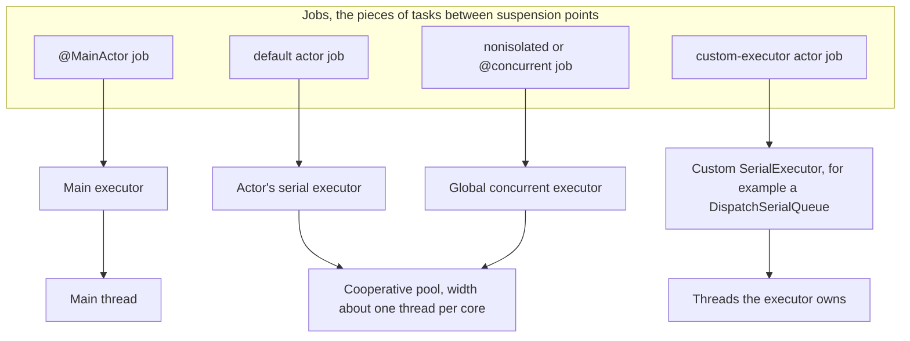
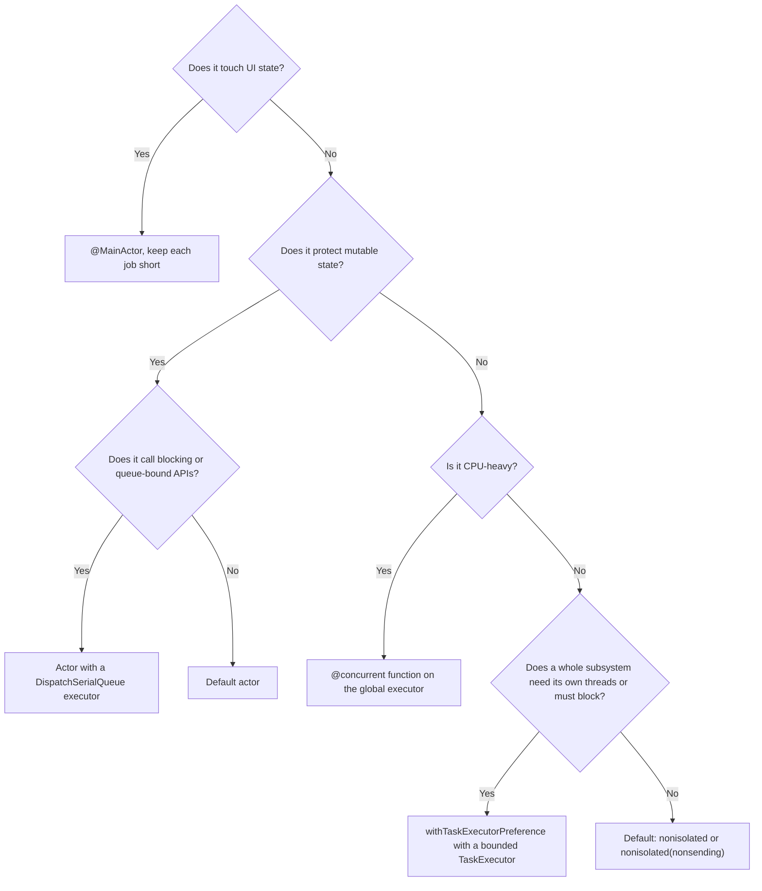

Isolation decides *which state* code may touch. An **executor** decides *where that code actually runs*: on the main thread, on a thread of the cooperative pool, or on a thread you provide. Most Swift code never names an executor, because the defaults are good: the main actor runs on the main thread, other actors and non-isolated code run on the shared cooperative pool, and the runtime moves work between them at suspension points.

The defaults stop being good in a few specific situations: work that must block a thread, libraries that insist on being called from one particular queue, and subsystems whose heavy work should not compete with everything else on the shared pool. Swift provides two ways to take control, custom actor executors and task executor preferences, and both are easy to misuse. This article maps the executors you already have, measures what happens when the defaults are abused, and shows when and how to replace them.

<!--more-->

The examples use Swift 6 language mode and were compiled and run with the Swift 6.4 toolchain on macOS 26, on a 20-core Apple M1 Ultra. `DispatchSerialQueue` as an executor requires iOS 17, macOS 14, or later; task executors require iOS 18, macOS 15, or later. The Swift blocks build on one another in one `main.swift`. `__dispatch_queue_get_label` is used only to observe which queue is running, and is Darwin-specific.

## The executors you already have

An executor is anything that can accept *jobs*, the pieces of a task between suspension points, and run them. Every job runs on some executor, chosen by the isolation of the code it contains:

| Code | Executor | Threads |
| --- | --- | --- |
| `@MainActor` code | Main executor | The main thread only |
| Methods of a default actor | The actor's own serial executor | Borrowed from the cooperative pool, one job at a time |
| Non-isolated `async` code, `@concurrent` code | Global concurrent executor | The cooperative pool, about one thread per core |
| Actor with a custom executor | Whatever that executor provides | Usually a serial dispatch queue or a dedicated thread |
| Non-isolated code inside `withTaskExecutorPreference` | The preferred task executor | Whatever that executor provides |



A default actor does not own a thread. It is a serial *discipline* layered over the pool: when it has work, it borrows a pool thread, runs jobs one at a time, and gives the thread back. That is why hopping from pool code into a default actor is cheap, about 100 ns per call in the [actors article](/swift-actors/), and why a default actor that blocks takes a pool thread with it.

You can see which queue a job runs on by asking Dispatch for the current queue's label:

```swift
import Foundation
import Synchronization

func currentQueueLabel() -> String {
    String(cString: __dispatch_queue_get_label(nil))
}

@concurrent
func labelFromGlobalExecutor() async -> String {
    currentQueueLabel()
}

@MainActor
func labelFromMainActor() -> String {
    currentQueueLabel()
}

let globalLabel = await labelFromGlobalExecutor()
let mainLabel = labelFromMainActor()
assert(mainLabel == "com.apple.main-thread")
print("global concurrent executor runs on:", globalLabel)
```

On the test machine the global executor's jobs ran on a queue labeled `com.apple.root.default-qos.cooperative`: the cooperative pool. The label changes with quality of service; it is a diagnostic, not an API.

## The rule that governs everything: do not block the pool

The cooperative pool has a fixed width, and the runtime assumes every job either finishes or suspends quickly. A job that blocks its thread with `usleep`, a synchronous C library call, a semaphore, or a slow `read` takes one of a small number of threads out of service. The [threads article](/swift-threads-dispatch-queues-tasks/) measured the consequence: 40 blocking tasks on a 20-core machine took two full rounds, and every other non-isolated task in the process waited behind them.

Actors do not escape this rule. A blocking call inside a default actor's method blocks the pool thread the actor borrowed. The experiment below starts 30 actors, each making one 100 ms blocking call, and meanwhile asks the *main actor* to sleep for 20 ms:

```swift
/// Stands in for a synchronous library call that blocks its thread.
func blockingLibraryCall() {
    usleep(100_000)
}

actor DefaultActorClient {
    func query() -> String {
        blockingLibraryCall()
        return currentQueueLabel()
    }
}

actor QueueBackedClient {
    private let queue: DispatchSerialQueue

    init(label: String) {
        queue = DispatchSerialQueue(label: label)
    }

    nonisolated var unownedExecutor: UnownedSerialExecutor {
        queue.asUnownedSerialExecutor()
    }

    func query() -> String {
        blockingLibraryCall()
        return currentQueueLabel()
    }
}

/// How long a 20 ms sleep on the main actor really takes while `queries` run.
@MainActor
func mainActorSleep(whileRunning queries: [@Sendable () async -> String]) async -> (Duration, Set<String>) {
    await withTaskGroup(of: String.self) { group in
        for query in queries {
            group.addTask { await query() }
        }
        let clock = ContinuousClock()
        let start = clock.now
        try? await Task.sleep(for: .milliseconds(20))
        let slept = start.duration(to: clock.now)
        var labels: Set<String> = []
        for await label in group {
            labels.insert(label)
        }
        return (slept, labels)
    }
}

let defaultClients = (0..<30).map { _ in DefaultActorClient() }
let (sleepWithDefaultActors, defaultLabels) = await mainActorSleep(whileRunning: defaultClients.map { client in { await client.query() } })

let queueClients = (0..<30).map { QueueBackedClient(label: "client.\($0)") }
let (sleepWithQueueActors, queueLabels) = await mainActorSleep(whileRunning: queueClients.map { client in { await client.query() } })

assert(sleepWithDefaultActors >= .milliseconds(60), "Blocking default actors delayed a main-actor wake-up")
assert(sleepWithQueueActors < .milliseconds(60), "Blocking on the actors' own queues did not")
assert(defaultLabels == ["com.apple.root.default-qos.cooperative"], "Default actors borrowed pool threads")
assert(queueLabels.allSatisfy { $0.hasPrefix("client.") }, "Each queue-backed actor ran on its own queue")
print("20 ms main-actor sleep took", sleepWithDefaultActors, "with default actors,", sleepWithQueueActors, "with queue-backed actors")
```

On the test machine, the 20 ms sleep took about **140 ms** while 30 default actors blocked, and about 30 ms, the same as with no load at all, while 30 queue-backed actors blocked. With 60 blocking default actors, the same sleep took about 350 ms.

The main thread was never blocked. The delay came from the pool. When a `Task.sleep` ends, the runtime enqueues the sleeping task on the global concurrent executor, and only from there does it hop back to the main actor. With every pool thread asleep inside `usleep`, nothing could run that hop until the first wave of blocking calls finished. **Starving the cooperative pool makes the main actor late**, even when the main thread is idle: animations driven by sleeps, debounce timers, and continuations resumed through the pool all wait.

This experiment did not start out this way, and the false start is instructive. A first version measured how long an unrelated pool task took to *start*, timing it from the main actor right after a short sleep. It reported a few microseconds and appeared to show no starvation at all. The flaw was the sleep before the measurement: it had silently taken more than 100 ms, so the "start" timestamp was taken only after the first wave of blocking calls had released their threads. When measuring a scheduler, check that the measuring code does not depend on the thing being measured.

Each default actor reported the cooperative pool's label; each queue-backed actor reported its own queue. The blocking happened on 30 dispatch threads that GCD created for the purpose, and the pool stayed free.

That is the main legitimate reason to give an actor a custom executor: **the actor wraps something that blocks, and you would rather spend GCD threads than starve the pool.** It is a trade-off, not a free lunch. Thirty blocked dispatch threads still cost memory, and GCD's thread limit still applies. If many such actors exist, share a small number of queues among them, or redesign around an asynchronous API.

## Custom actor executors

A custom executor is declared by implementing `unownedExecutor` ([SE-0392](https://github.com/swiftlang/swift-evolution/blob/main/proposals/0392-custom-actor-executors.md)), as `QueueBackedClient` does. `DispatchSerialQueue` conforms to `SerialExecutor` on iOS 17, macOS 14, and later, so the simplest custom executor is a serial queue the actor owns.

The second reason to use one is interoperability with code that already lives on a queue. A legacy library may deliver callbacks on a queue you passed in, or require that all calls into it come from one queue. If the actor's executor *is* that queue, then code running on the queue is, by definition, running on the actor. `assumeIsolated` lets that code touch the actor's state synchronously, and checks the claim at run time:

```swift
actor TileStore {
    let queue = DispatchSerialQueue(label: "tiles.serial")
    private(set) var tiles: [String: Int] = [:]

    nonisolated var unownedExecutor: UnownedSerialExecutor {
        queue.asUnownedSerialExecutor()
    }

    func store(_ name: String, bytes: Int) {
        dispatchPrecondition(condition: .onQueue(queue))     // Isolated code runs on the queue.
        tiles[name] = bytes
    }
}

/// A legacy loader that calls back on whatever queue it is given.
func legacyLoadTile(_ name: String, callbackQueue: DispatchQueue, completion: @escaping @Sendable (Int) -> Void) {
    DispatchQueue.global().asyncAfter(deadline: .now() + .milliseconds(10)) {
        callbackQueue.async { completion(name.count * 1_000) }
    }
}

let tileStore = TileStore()
let callbackFinished = Mutex(false)
legacyLoadTile("ocean", callbackQueue: tileStore.queue) { bytes in
    // On the actor's queue, so on the actor: synchronous access, verified at run time.
    tileStore.assumeIsolated { store in
        store.store("ocean", bytes: bytes)
    }
    callbackFinished.withLock { $0 = true }
}
while !callbackFinished.withLock({ $0 }) {
    await Task.yield()
}
let oceanBytes = await tileStore.tiles["ocean"]
assert(oceanBytes == 5_000)
```

No hop, no `Task`, no continuation: the callback arrives on the queue and works with actor state immediately. Swift 6.2 improved how the runtime verifies such claims for custom executors ([SE-0471](https://github.com/swiftlang/swift-evolution/blob/main/proposals/0471-SerialExecutor-isIsolated.md)), so `assumeIsolated` on a `DispatchSerialQueue`-backed actor recognizes code submitted directly to the queue.

Custom executors have costs to weigh:

- **Hops into the actor become thread switches.** Calls from pool code into a queue-backed actor can no longer run on the caller's thread. Each call costs a context switch, the main-actor-like cost the actors article measured at several microseconds.
- **Priority and fairness change.** A dispatch queue has its own quality of service and ordering rules, which may not match task priority.
- **You own the executor's correctness.** A hand-written executor must run jobs serially, exactly once, and never drop one. Prefer `DispatchSerialQueue` unless you have a specific reason to build your own.

## Task executor preference

Custom actor executors control where *isolated* code runs. Non-isolated code always ran on the global executor, until Swift 6.0 added **task executor preference** ([SE-0417](https://github.com/swiftlang/swift-evolution/blob/main/proposals/0417-task-executor-preference.md)). Within `withTaskExecutorPreference(executor) { }`, or in a task created with `Task(executorPreference:)`, non-isolated code runs on the preferred executor instead of the shared pool. Child tasks inherit the preference; unstructured tasks do not.

A task executor can be built from a concurrent dispatch queue:

```swift
/// Runs task jobs on a dedicated concurrent queue instead of the shared cooperative pool.
final class QueueTaskExecutor: TaskExecutor, @unchecked Sendable {
    private let queue: DispatchQueue

    init(label: String) {
        queue = DispatchQueue(label: label, attributes: .concurrent)
    }

    func enqueue(_ job: consuming ExecutorJob) {
        let job = UnownedJob(job)
        queue.async {
            job.runSynchronously(on: self.asUnownedTaskExecutor())
        }
    }
}

@concurrent
func labelOfNonisolatedWork() async -> String {
    currentQueueLabel()
}

let ingestExecutor = QueueTaskExecutor(label: "ingest.pool")
let preferredLabels = await withTaskExecutorPreference(ingestExecutor) {
    async let child = labelOfNonisolatedWork()
    let direct = await labelOfNonisolatedWork()
    let grouped = await withTaskGroup(of: String.self) { group in
        group.addTask { currentQueueLabel() }
        return await group.next()!
    }
    let unstructured = await Task { currentQueueLabel() }.value
    return [await child, direct, grouped, unstructured]
}
assert(Array(preferredLabels.prefix(3)) == ["ingest.pool", "ingest.pool", "ingest.pool"])
assert(preferredLabels[3] != "ingest.pool", "Unstructured tasks do not inherit the preference")

let pinnedTask = Task(executorPreference: ingestExecutor) { currentQueueLabel() }
let pinnedLabel = await pinnedTask.value
assert(pinnedLabel == "ingest.pool")
```

The `@unchecked Sendable` is justified: the class's only stored property is a `DispatchQueue`, which is thread-safe, and `TaskExecutor` requires `Sendable`.

A preference is a preference, not an override. Actor-isolated code still runs on its actor's executor, and main-actor code still runs on the main thread. The preference affects only code that would otherwise have gone to the global executor, and default actors, which borrow threads from the preferred executor instead of the pool.

When is this worth it? When a subsystem does heavy non-isolated work that would otherwise compete with the whole app on the shared pool, such as a media ingest pipeline, a large import, or a server handling requests, and you want to control its parallelism and quality of service separately. It is also the clean way to run work that blocks: give the blocking subsystem an executor whose threads are allowed to block, and keep the cooperative pool clean.

## Sizing an executor for blocking work

A cooperative executor should have about as many threads as cores, because its jobs compute. An executor for jobs that block needs more, because blocked threads do no work. A classic estimate, from Brian Goetz's *Java Concurrency in Practice*, sizes a pool from the target CPU utilization $$U$$ and the ratio of waiting time $$W$$ to computing time $$C$$ per job:

$$
N_{\text{threads}} = N_{\text{cores}} \times U \times \left(1 + \frac{W}{C}\right).
$$

A job that computes for 2 ms and blocks on a database for 18 ms has $$W/C = 9$$. To keep 4 cores 50% busy with such jobs, the executor needs about $$4 \times 0.5 \times 10 = 20$$ threads. The same formula with $$W = 0$$ gives the cooperative pool's width. The blocking executor should be bounded: a serial queue, a concurrent queue behind a semaphore, or a fixed set of serial queues. An unbounded concurrent dispatch queue grows a thread per blocked job, which is the thread explosion the threads article measured.

## Keeping the main executor free

The main executor has one thread and a frame deadline. Every executor decision in app code should be checked against it:

- **CPU work never belongs on the main executor.** Move it with `@concurrent` functions, as the [main actor article](/swift-main-actor/) measures with a heartbeat.
- **Blocking work belongs on neither the main executor nor the pool.** Use a queue-backed actor or a task executor whose threads may block.
- **Hops cost the most on the main actor.** About 6 µs per round trip in the actors article. Batch calls from the main actor to other actors.
- **Do not give an actor the main queue as its executor** to "make it run on the main thread." That is what `@MainActor` is for, and it keeps the compiler's isolation reasoning intact.

## Choosing



## Summary

- Executors run jobs. The main executor runs on the main thread; default actors and non-isolated code share the cooperative pool.
- A default actor borrows pool threads, so blocking inside an actor starves the pool just as blocking in a task does. On the test machine, a 20 ms main-actor sleep took about 140 ms while 30 default actors blocked, because the wake-up passes through the pool.
- A custom actor executor, typically a `DispatchSerialQueue`, moves an actor's jobs onto threads it owns. Use it for blocking libraries and queue-bound APIs; `assumeIsolated` then works from callbacks on that queue.
- Task executor preference moves non-isolated work, and its children, onto an executor you choose. Unstructured tasks do not inherit it.
- Size blocking executors with $$N_{\text{cores}} \times U \times (1 + W/C)$$, and bound them.
- Protect the main executor: no CPU work, no blocking, few hops.

## Exercise

Wrap a simulated synchronous key-value store, where every `get` and `put` blocks for 5 ms, in three designs: a default actor, an actor backed by a `DispatchSerialQueue`, and a non-isolated client used inside `withTaskExecutorPreference` with a bounded executor of four threads. Drive each with 200 concurrent requests while a heartbeat task on the global executor measures its own scheduling delay. Report throughput and heartbeat delay for each, and explain the results using the pool width and the sizing formula.

## Further reading

- [SE-0392: Custom Actor Executors](https://github.com/swiftlang/swift-evolution/blob/main/proposals/0392-custom-actor-executors.md).
- [SE-0417: Task Executor Preference](https://github.com/swiftlang/swift-evolution/blob/main/proposals/0417-task-executor-preference.md).
- [SE-0424: Custom isolation checking for SerialExecutor](https://github.com/swiftlang/swift-evolution/blob/main/proposals/0424-custom-isolation-checking-for-serialexecutor.md) and [SE-0471](https://github.com/swiftlang/swift-evolution/blob/main/proposals/0471-SerialExecutor-isIsolated.md).
- [Swift concurrency: Behind the scenes](https://developer.apple.com/videos/play/wwdc2021/10254/), WWDC21, on the cooperative pool's forward-progress contract.

Previous: [Isolated and Nonisolated Methods](/swift-isolated-nonisolated/). Next: [Migrating to Swift 6 Data-Race Safety](/swift-6-data-race-safety-migration/).

Return to the [Concurrency roadmap](/swift-concurrency-roadmap/).
