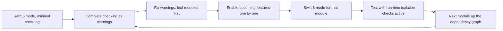

The Swift 6 language mode turns data-race safety from advice into a compile-time guarantee: a module that builds in Swift 6 mode cannot contain a data race outside code explicitly marked unsafe. Getting an existing codebase there is a migration, not a flag flip. The same code that compiled silently for years now produces diagnostics about global variables, singletons, closures captured by tasks, and delegate callbacks, and a few fixes that look obvious make things worse.

This article lays out an incremental path: what each checking level reports, the order in which to migrate modules, a catalog of the most common diagnostics with fixes that compile, the run-time checks Swift 6 adds at boundaries it cannot verify statically, and how Swift 6.2's "approachable concurrency" settings and migration tooling change the plan.

<!--more-->

The examples use Swift 6 language mode and were compiled with the Swift 6.4 toolchain from Xcode 27.1 on macOS 26. Diagnostic text is quoted from that compiler. "Before" blocks marked "Does not compile" were verified to fail; the corrected versions build on one another in one `main.swift`.

## Toolchain versus language mode

Two version numbers are easy to confuse:

- The **toolchain** is the compiler you build with: Swift 6.4 in Xcode 27.1.
- The **language mode** is the set of rules a module is compiled under: Swift 5 or Swift 6.

A Swift 6.4 compiler builds Swift 5 mode modules perfectly well. Language mode is chosen **per module**: per target in Xcode and per target in SwiftPM ([SE-0435](https://github.com/swiftlang/swift-evolution/blob/main/proposals/0435-swiftpm-per-target-swift-language-version-setting.md)). Modules in different modes link together and call each other. That is what makes incremental migration possible: one module at a time, while the app keeps shipping.

## What each checking level reports

Swift 5 mode offers three levels of concurrency checking; Swift 6 mode is a fourth, stricter level. To see the difference, here is a small file in the style of pre-concurrency app code:

```swift
// Does not compile in Swift 6 mode.
import Foundation

var requestCount = 0

final class ImageCache {
    static let shared = ImageCache()
    var storage: [String: Data] = [:]
}

final class ProfileLoader {
    var onLoad: ((String) -> Void)?

    func load(id: Int) {
        Task {
            requestCount += 1
            let name = "User \(id)"
            ImageCache.shared.storage[name] = Data()
            DispatchQueue.main.async { self.onLoad?(name) }
        }
    }
}
```

Compiled as an ordinary source file in each mode:

| Mode | Diagnostics |
| --- | --- |
| Swift 5, minimal (the default) | None |
| Swift 5, `-strict-concurrency=targeted` | None |
| Swift 5, `-strict-concurrency=complete` | 5 warnings, each ending "this is an error in the Swift 6 language mode" |
| Swift 6 | Errors |

The five complete-checking warnings were:

- "var 'requestCount' is not concurrency-safe because it is nonisolated global shared mutable state"
- "static property 'shared' is not concurrency-safe because non-'Sendable' type 'ImageCache' may have shared mutable state"
- "passing closure as a 'sending' parameter risks causing data races between code in the current isolation context and concurrent execution of the closure"
- "capture of 'self' with non-Sendable type 'ProfileLoader' in a '@Sendable' closure"
- "sending 'self' risks causing data races"

In Swift 6 mode the first two became errors, and the compiler stopped there: the remaining diagnostics come from a later phase, which runs only once earlier errors are fixed. Expect the error count to *grow* briefly as you fix the first wave. Complete checking in Swift 5 mode shows everything at once, as warnings, which is why it is the right first step.

Each diagnostic points at a real hazard. `requestCount` is incremented from a task that may run on any thread. `ImageCache.shared.storage` is a dictionary mutated from that same task while other code could read it. The task captures `self`, a non-`Sendable` class, and `DispatchQueue.main.async` captures it again on another thread.

## The migration path



**Start with complete checking in Swift 5 mode.** In Xcode, set "Strict Concurrency Checking" to Complete. In SwiftPM, enable the upcoming feature that corresponds to it:

<!-- skip-check -->
```swift
// Package.swift, a target still in Swift 5 mode with complete checking
.target(
    name: "Networking",
    swiftSettings: [
        .swiftLanguageMode(.v5),
        .enableUpcomingFeature("StrictConcurrency"),
    ]
)
```

**Migrate leaf modules first.** A module's diagnostics depend on how its dependencies are annotated. If `Networking` declares its response types `Sendable` and its client `@MainActor` or actor-isolated where appropriate, then `Feature` modules that use it get accurate diagnostics instead of a flood of "non-Sendable type from module 'Networking'" warnings. Work from the bottom of the dependency graph upward: models and utilities, then services, then features, then the app target.

**Switch a module to Swift 6 mode when its warnings are gone.** Swift 6 mode does not add new kinds of checking beyond complete checking; it turns the warnings into errors and enables the Swift 6 upcoming features by default. The switch should be a small change once the warnings are fixed.

**Do not try to migrate everything in one branch.** A module-by-module migration keeps each change reviewable, and any module that hits a hard problem can stay in Swift 5 mode while the rest move on.

## A catalog of common fixes

The corrected version of `ProfileLoader` below fixes all five diagnostics, each in the way that best fits its cause:

```swift
import Foundation
import Synchronization

/// Fix 1: global mutable state behind a lock, inside a namespace.
enum Metrics {
    static let requestCount = Mutex(0)
}

/// Fix 2: a shared cache whose state is synchronized, so the singleton is Sendable.
final class ImageCache: Sendable {
    static let shared = ImageCache()
    private let storage = Mutex<[String: Data]>([:])

    func store(_ data: Data, for key: String) {
        storage.withLock { $0[key] = data }
    }

    func data(for key: String) -> Data? {
        storage.withLock { $0[key] }
    }
}

/// Fixes 3 to 5: a UI-facing object belongs on the main actor; its task inherits that isolation.
@MainActor
final class ProfileLoader {
    var onLoad: ((String) -> Void)?
    private var loadTask: Task<Void, Never>?

    func load(id: Int) {
        loadTask?.cancel()
        loadTask = Task {
            Metrics.requestCount.withLock { $0 += 1 }
            let name = await Self.fetchName(id: id)
            ImageCache.shared.store(Data(), for: name)
            onLoad?(name)                         // Already on the main actor: no dispatch needed.
        }
    }

    @concurrent
    static func fetchName(id: Int) async -> String {
        try? await Task.sleep(for: .milliseconds(5))
        return "User \(id)"
    }

    func waitForLoad() async {
        await loadTask?.value
    }
}

let loader = ProfileLoader()
var loadedNames: [String] = []
loader.onLoad = { name in
    MainActor.assertIsolated()
    loadedNames.append(name)
}
loader.load(id: 3)
await loader.waitForLoad()
assert(loadedNames == ["User 3"])
assert(Metrics.requestCount.withLock { $0 } == 1)
assert(ImageCache.shared.data(for: "User 3") != nil)
```

The general patterns, in the order you are likely to meet them:

**Global and static mutable variables.** Prefer a `let` of a `Sendable` type. If the value must change, isolate it to a global actor (`@MainActor static var`) or protect it with a `Mutex`. Use `nonisolated(unsafe)` only for values set once before any concurrency begins, with a comment saying so. The [isolated and nonisolated article](/swift-isolated-nonisolated/) compares the four options.

**Singletons of non-`Sendable` classes.** `static let shared = Thing()` is only safe if `Thing` is `Sendable`. Decide what the singleton is: UI-facing state goes on the main actor; a shared cache or registry gets a `Mutex` or becomes an actor; an object that is not actually shared should stop being a singleton.

**Tasks that capture `self`.** A `Task { }` in a non-isolated class captures a non-`Sendable` `self` into concurrently running code. If the class is UI-facing, annotate it `@MainActor`; its tasks then inherit the main actor and the capture is safe. If it is a service, make it an actor or make it `Sendable`.

**`DispatchQueue.main.async` inside async code.** In a main-actor type, it is unnecessary; just assign. Elsewhere, call a `@MainActor` function with `await`. Removing dispatch calls also removes the [closure isolation trap](/swift-threads-dispatch-queues-tasks/) that Swift 6 mode turns into a crash.

**Completion handlers.** Convert the API to `async` where you own it, wrapping legacy implementations with continuations as the [checked continuations article](/swift-checked-continuations/) shows. Keep a completion-handler overload only for callers you cannot migrate yet.

**Delegates and protocols from older frameworks.** If a delegate is always called on the main thread, conform with `@preconcurrency`: `extension Controller: @preconcurrency LegacyDelegate`. The compiler accepts main-actor implementations and inserts run-time checks. For your own protocols, Swift 6.2's isolated conformances let main-actor types conform to non-isolated protocols for use on the main actor, as the [main actor article](/swift-main-actor/) shows.

**Modules you do not control.** `@preconcurrency import SomeSDK` suppresses `Sendable` diagnostics about that module's types until it adopts annotations. Revisit these imports when the dependency updates; the compiler warns when a `@preconcurrency` import has become unnecessary.

**Notification observers and timers.** Closure-based observers run on whatever queue they are registered for. Replace them with an async sequence consumed in a main-actor task, for example `for await _ in NotificationCenter.default.notifications(named: ...)`, owned and cancelled like any other task.

## Fixes that make things worse

**Blanket `@unchecked Sendable`.** It silences the diagnostic and keeps the race. Every `@unchecked Sendable` should come with a comment naming the lock or invariant that makes it true. If there is none, the fix is elsewhere.

**`nonisolated(unsafe)` on mutable state used concurrently.** Same problem, applied to a variable.

**`@MainActor` on everything.** Annotating services, caches, and parsers `@MainActor` makes diagnostics disappear and moves their work into the frame budget. Annotate types that hold UI-facing state; keep the rest non-isolated and `Sendable`.

**`Task.detached` to "escape" an isolation error.** Detached closures are checked more strictly, not less, as the [unstructured and detached tasks article](/swift-unstructured-detached-tasks/) explains.

**`MainActor.assumeIsolated` to quiet a callback.** It is correct only when the callback is guaranteed to arrive on the main thread. Otherwise it converts a compile-time diagnostic into a crash.

## Run-time isolation checks

Some boundaries cannot be verified statically: Objective-C code, modules imported with `@preconcurrency`, `@preconcurrency` conformances, and closures handed to APIs that do not declare `@Sendable`. In Swift 6 mode the compiler inserts **dynamic isolation checks** at those boundaries ([SE-0423](https://github.com/swiftlang/swift-evolution/blob/main/proposals/0423-dynamic-actor-isolation.md)). If main-actor code is actually invoked off the main thread, the process stops with an executor-check trap instead of racing silently.

These checks change how migration should be tested:

- **Exercise real code paths.** Delegate callbacks, notification handlers, and SDK completion handlers that compile cleanly can still trap if their threading assumptions are wrong. Run UI tests and manual passes over every screen.
- **Watch crash reports after shipping a Swift 6 module.** A new class of crash, a trap inside a closure with an executor-check frame below it, is the run-time check doing its job. The bug was there before; Swift 6 found it.
- **Know the classic case.** In the macOS 26 SDK, `DispatchGroup.notify(queue:execute:)` takes a non-`@Sendable` closure, so a closure written in main-actor code is inferred `@MainActor` and traps when GCD runs it on a background queue. The [threads article](/swift-threads-dispatch-queues-tasks/) reproduces it.

## Swift 6.2: approachable concurrency

Swift 6.2 shifted several defaults to reduce the number of concepts a newcomer meets. In Xcode, the **Approachable Concurrency** build setting enables five upcoming features, listed in its description in Xcode 27.1 as `DisableOutwardActorInference`, `GlobalActorIsolatedTypesUsability`, `InferIsolatedConformances`, `InferSendableFromCaptures`, and `NonisolatedNonsendingByDefault`. The first, second, and fourth are already part of Swift 6 mode. The other two change behavior:

- `InferIsolatedConformances` makes conformances of global-actor-isolated types isolated by default ([SE-0470](https://github.com/swiftlang/swift-evolution/blob/main/proposals/0470-isolated-conformances.md)).
- `NonisolatedNonsendingByDefault` makes non-isolated `async` functions run on the caller's actor instead of the global executor ([SE-0461](https://github.com/swiftlang/swift-evolution/blob/main/proposals/0461-async-function-isolation.md)).

Separately, **Default Actor Isolation** can make `MainActor` the default isolation for a module ([SE-0466](https://github.com/swiftlang/swift-evolution/blob/main/proposals/0466-control-default-actor-isolation.md)). New app projects in recent Xcode versions turn on both settings.

These features make app code simpler, but `NonisolatedNonsendingByDefault` changes where existing code runs. A non-isolated `async` function that used to leave the main actor will, after the change, run on it when called from it. Swift 6.2's migration tooling ([SE-0486](https://github.com/swiftlang/swift-evolution/blob/main/proposals/0486-adoption-tooling-for-swift-features.md)) finds every such function. Enabling the feature in *migration mode* reports what will change, with a fix-it that preserves today's behavior:

<!-- skip-check -->
```swift
// swiftc -enable-upcoming-feature NonisolatedNonsendingByDefault:migrate
struct Report: Sendable { let bytes: Int }

func renderReport(rows: Int) async -> Report {
    Report(bytes: rows * 64)
}
// warning: feature 'NonisolatedNonsendingByDefault' will cause nonisolated async global function
// 'renderReport' to run on the caller's actor; use '@concurrent' to preserve behavior
```

Accepting every fix-it is the conservative path: behavior stays exactly as it was, with `@concurrent` written out. A better path is to review each one. A function that does real computation should keep `@concurrent`. A function that only awaits other things can drop it and benefit from running on the caller's actor, where it can use non-`Sendable` arguments.

## Notes for library authors

Public API carries concurrency annotations as part of its contract:

- **Adding `Sendable` to a public type is a promise.** Clients will depend on it; removing it later is source-breaking. Swift 6.4's `~Sendable` documents types that are deliberately not `Sendable` ([SE-0518](https://github.com/swiftlang/swift-evolution/blob/main/proposals/0518-tilde-sendable.md)).
- **Adding isolation to a public API can break clients.** Marking a public protocol or function `@MainActor` turns existing non-isolated callers into compile errors. Annotate with `@preconcurrency @MainActor` to deliver the annotation to Swift 6 clients while keeping it a warning for clients still in Swift 5 mode ([SE-0337](https://github.com/swiftlang/swift-evolution/blob/main/proposals/0337-support-incremental-migration-to-concurrency-checking.md)).
- **Closure parameters need a decision.** A callback parameter called from arbitrary threads should be `@Sendable`; one always called on the main actor should be `@MainActor`. Leaving it unannotated forces every client to guess, and in Swift 6 mode the guess may compile to a run-time trap.
- **Migrate before your clients do.** A library in Swift 6 mode with complete annotations makes every client's migration easier; a library without them pushes `@preconcurrency import` into every client.

## Summary

- Language mode is per module. A Swift 6 toolchain builds Swift 5 mode modules, so migrate one module at a time.
- Start with complete checking in Swift 5 mode: it reports every Swift 6 error as a warning, all at once.
- Migrate leaf modules first, so their annotations improve diagnostics in dependent modules.
- Fix diagnostics by choosing the right protection: `let` and value types, a global actor, a `Mutex`, an actor, or sending ownership. Avoid blanket `@unchecked Sendable`, `nonisolated(unsafe)`, and `@MainActor` everywhere.
- Swift 6 inserts run-time isolation checks at unverifiable boundaries. Exercise real code paths and expect them to reveal old threading bugs.
- Approachable concurrency changes where non-isolated `async` code runs. Use the `:migrate` mode to find affected functions, and keep `@concurrent` on real computation.
- Library authors should annotate public API deliberately, using `@preconcurrency` to avoid breaking clients.

## Exercise

Take a small app module that still uses completion handlers, a `static let shared` service, and `DispatchQueue.main.async`. Turn on complete checking and record the number of warnings by category. Fix them in three passes, global state, then types and isolation, then closures and callbacks, recording the count after each pass. Then switch the module to Swift 6 mode, enable `NonisolatedNonsendingByDefault:migrate`, and decide for each reported function whether it keeps `@concurrent`.

## Further reading

- The [Swift 6 migration guide](https://www.swift.org/migration/documentation/migrationguide/) on swift.org.
- [SE-0337: Incremental migration to concurrency checking](https://github.com/swiftlang/swift-evolution/blob/main/proposals/0337-support-incremental-migration-to-concurrency-checking.md).
- [SE-0423: Dynamic actor isolation enforcement](https://github.com/swiftlang/swift-evolution/blob/main/proposals/0423-dynamic-actor-isolation.md).
- [SE-0486: Migration tooling for Swift features](https://github.com/swiftlang/swift-evolution/blob/main/proposals/0486-adoption-tooling-for-swift-features.md).
- [Migrate your app to Swift 6](https://developer.apple.com/videos/play/wwdc2024/10169/), WWDC24.

Previous: [Choosing an Executor Without Blocking the UI](/swift-executors/). Next: [Consuming Values with `AsyncSequence`](/swift-asyncsequence/).

Return to the [Concurrency roadmap](/swift-concurrency-roadmap/).
