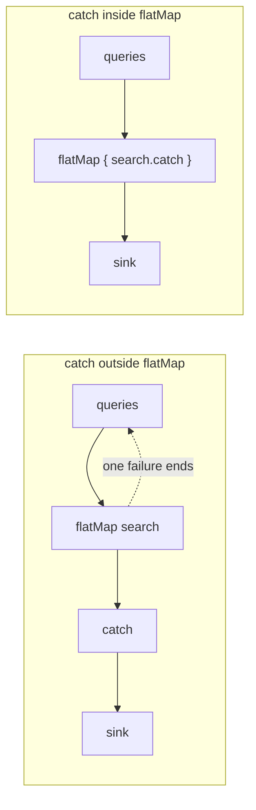
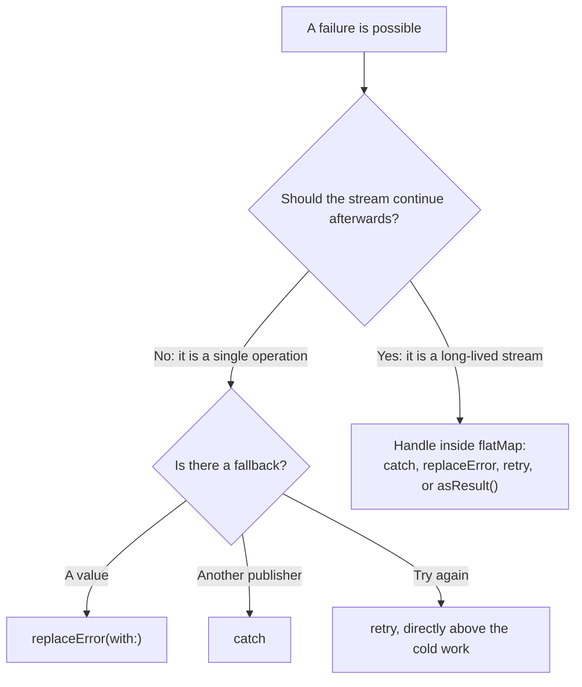

In Combine, an error is not an exception that unwinds a call stack; it is the last thing a stream ever says. A publisher's `Failure` type is part of its signature, a failure is delivered once as the completion, and after it nothing else arrives. Every error-handling operator is a way of deciding what happens *instead* of that end: `catch` switches to a different publisher, `replaceError(with:)` switches to a single value, and `retry` subscribes to the original publisher again.

"Instead of the end" is the part that catches people. A `catch` placed at the end of a search pipeline handles the first failed request perfectly, and the search field never works again, because the stream it replaced was the whole pipeline, including the subscription to the field. A `retry` on a `Future` retries nothing, and on a subject it receives the same failure again. This article measures each of those, shows where `catch` belongs, builds a `retry` with exponential backoff that is tested in virtual time, and turns errors into values so that one failure cannot end a stream that should keep going.

<!--more-->

The examples use Swift 6 language mode and were compiled and run with the Swift 6.4 toolchain from Xcode 27.1 on macOS 26. Paste the `VirtualTimeScheduler` and `TimelineRecorder` from [Time: `debounce`, `throttle`, and `delay`](/combine-debounce-throttle-delay/#a-scheduler-whose-clock-you-control) first, then the blocks below in order, into one `main.swift`.

<!-- check-uses: virtual-scheduler -->

## Failure is in the type

A publisher's `Failure` must be an `Error` type, or `Never` for publishers that cannot fail. Operators that join publishers require their failure types to match, and three operators adjust them:

```swift
enum SearchError: Error, Equatable {
    case offline
    case server(status: Int)
}

let neverFails = Just("ok")
let canFail: AnyPublisher<String, SearchError> = neverFails
    .setFailureType(to: SearchError.self)    // Never -> SearchError, so it can join failing streams
    .eraseToAnyPublisher()

let urlFailures = Fail<String, URLError>(error: URLError(.notConnectedToInternet))
let domainFailures: AnyPublisher<String, SearchError> = urlFailures
    .mapError { _ in SearchError.offline }   // translate at the boundary
    .eraseToAnyPublisher()

var domainCompletion: Subscribers.Completion<SearchError>?
let domainHandle = domainFailures.sink(receiveCompletion: { domainCompletion = $0 }, receiveValue: { _ in })
assert(domainCompletion == .failure(.offline))
```

The third, `assertNoFailure()`, converts the failure type to `Never` by trapping if a failure ever arrives. It is a statement that failure is impossible, and if the statement is wrong, the app crashes in production. Use `replaceError` or `catch` when failure is possible but uninteresting.

## `catch` replaces the stream, all of it

`catch` subscribes to a fallback publisher when its upstream fails, and its output continues with the fallback's values. The upstream is gone: it failed, and a failed publisher sends nothing more. That is exactly right for a single request with a cached fallback. It is a bug when the upstream is a long-lived pipeline:

```swift
func search(_ query: String) -> AnyPublisher<String, SearchError> {
    query == "error"
        ? Fail(error: .offline).eraseToAnyPublisher()
        : Just("results for \(query)").setFailureType(to: SearchError.self).eraseToAnyPublisher()
}

let outerQueries = PassthroughSubject<String, Never>()
var outerShown: [String] = []
let outerHandle = outerQueries
    .setFailureType(to: SearchError.self)
    .flatMap(search)
    .catch { _ in Just("Couldn't load results") }   // at the end of the pipeline
    .sink(receiveCompletion: { _ in outerShown.append("finished") },
          receiveValue: { outerShown.append($0) })

outerQueries.send("swift")
outerQueries.send("error")
outerQueries.send("combine")                     // typed after the failure
assert(outerShown == ["results for swift", "Couldn't load results", "finished"])
```

The third query produced nothing, and so will every query after it. The failed request failed the `flatMap`, which cancelled its subscription to the query subject; `catch` replaced the failed pipeline with `Just`, which emitted its one value and finished. The search field is now disconnected from everything, and the only symptom is a screen that stops responding to typing.

The fix is to handle the error where it belongs: per request, inside the `flatMap`, so that only the inner publisher is replaced:

```swift
let innerQueries = PassthroughSubject<String, Never>()
var innerShown: [String] = []
let innerHandle = innerQueries
    .flatMap { query in
        search(query).catch { _ in Just("Couldn't load results") }   // replaces one request
    }
    .sink(receiveCompletion: { _ in innerShown.append("finished") },
          receiveValue: { innerShown.append($0) })

innerQueries.send("swift")
innerQueries.send("error")
innerQueries.send("combine")
assert(innerShown == ["results for swift", "Couldn't load results", "results for combine"])
```

Because the inner `catch` makes the inner publisher's failure type `Never`, the `flatMap` no longer needs `setFailureType`, and the outer stream's type now says what is true: this pipeline cannot fail.



`replaceError(with:)` is `catch { _ in Just(value) }` with less typing, and has the same scope: put it on the inner publisher. `tryCatch` is the throwing version of `catch`, for a fallback that can itself decide to fail.

## Errors as values

Sometimes the subscriber needs to know that a request failed, so it can show an error banner, but the stream must continue. Turning each inner publisher's outcome into a `Result` does both:

```swift
extension Publisher {
    /// Emits each value as `.success`, and the failure, if any, as a final `.failure` value.
    func asResult() -> AnyPublisher<Result<Output, Failure>, Never> {
        map(Result.success)
            .catch { Just(.failure($0)) }
            .eraseToAnyPublisher()
    }
}

let resultQueries = PassthroughSubject<String, Never>()
var resultLog: [String] = []
let resultHandle = resultQueries
    .flatMap { search($0).asResult() }
    .sink { result in
        switch result {
        case .success(let results): resultLog.append(results)
        case .failure(let error): resultLog.append("error: \(error)")
        }
    }
resultQueries.send("swift")
resultQueries.send("error")
resultQueries.send("combine")
assert(resultLog == ["results for swift", "error: offline", "results for combine"])
```

This is the pattern to reach for in batch work, where [Transforming: `map`, `flatMap`, and `scan`](/combine-map-flatmap-scan/) showed that one failing inner publisher cancels all the others. With `asResult()` on each upload, a failure is just one more value, and nothing is cancelled.

## `retry` resubscribes, which only helps cold publishers

`retry(_:)` handles a failure by subscribing to its upstream again, up to the given number of times. Whether that does anything useful depends entirely on whether subscribing again starts new work:

```swift
var deferredAttempts = 0
var deferredResult: [String] = []
let deferredHandle = Deferred { () -> AnyPublisher<String, SearchError> in
    deferredAttempts += 1
    return deferredAttempts < 3
        ? Fail(error: .server(status: 503)).eraseToAnyPublisher()
        : Just("loaded").setFailureType(to: SearchError.self).eraseToAnyPublisher()
}
.retry(5)
.sink(receiveCompletion: { _ in deferredResult.append("finished") },
      receiveValue: { deferredResult.append($0) })
assert(deferredAttempts == 3)                    // failed twice, succeeded on the third
assert(deferredResult == ["loaded", "finished"])
```

A `Future` runs its closure once, when it is created, and replays the stored result to every subscriber. Retrying it resubscribes to the same failed result:

```swift
var futureRuns = 0
let failingFuture = Future<String, SearchError> { promise in
    futureRuns += 1
    promise(.failure(.offline))
}
let futureHandle = failingFuture.retry(3).sink(receiveCompletion: { _ in }, receiveValue: { _ in })
assert(futureRuns == 1)                          // three retries, no new work

var deferredFutureRuns = 0
let retryableFuture = Deferred {
    Future<String, SearchError> { promise in
        deferredFutureRuns += 1
        promise(.failure(.offline))
    }
}
let retryableHandle = retryableFuture.retry(3).sink(receiveCompletion: { _ in }, receiveValue: { _ in })
assert(deferredFutureRuns == 4)                  // the original attempt and three retries
```

A subject that has failed is in the same position: it has completed, and a new subscriber to a completed subject receives the completion immediately:

```swift
let failingSubject = PassthroughSubject<Int, SearchError>()
var subjectLog: [String] = []
let subjectHandle = failingSubject.retry(2).sink(
    receiveCompletion: { if case .failure(let error) = $0 { subjectLog.append("failed: \(error)") } },
    receiveValue: { subjectLog.append("\($0)") })
failingSubject.send(1)
failingSubject.send(completion: .failure(.offline))
failingSubject.send(2)
assert(subjectLog == ["1", "failed: offline"])  // both retries got the same failure
```

So `retry` belongs directly above something cold, such as a `URLSession` data task publisher or a `Deferred` wrapper, and below anything that turns a successful response into a failure, such as status validation; [Networking with `URLSession` Publishers](/combine-urlsession-publishers/) measured that placement, where `retry` before validation never retried a `503`.

## Retrying with backoff

The built-in `retry` resubscribes immediately, which against an overloaded server is the worst possible behavior: every client that failed retries at once. A retry with exponential backoff waits $$d, dm, dm^2, \ldots$$ between attempts, stops after a maximum number of attempts, and retries only errors that are worth retrying. It can be built from `catch`, `delay`, and `flatMap`, with recursion for the next attempt:

```swift
extension Publisher {
    /// Retries failures that `shouldRetry` accepts, waiting `initialDelay * multiplier^(n-1)`
    /// seconds before attempt `n + 1`, for at most `maxAttempts` attempts in total.
    /// The upstream must be cold: each attempt subscribes to it again.
    func retry<S: Scheduler>(
        maxAttempts: Int,
        initialDelay: TimeInterval,
        multiplier: Double = 2,
        scheduler: S,
        shouldRetry: @escaping (Failure) -> Bool = { _ in true }
    ) -> AnyPublisher<Output, Failure> {
        func attempt(_ number: Int) -> AnyPublisher<Output, Failure> {
            self.catch { error -> AnyPublisher<Output, Failure> in
                guard number < maxAttempts, shouldRetry(error) else {
                    return Fail(error: error).eraseToAnyPublisher()
                }
                let wait = initialDelay * pow(multiplier, Double(number - 1))
                return Just(())
                    .delay(for: .seconds(wait), scheduler: scheduler)
                    .setFailureType(to: Failure.self)
                    .flatMap { attempt(number + 1) }
                    .eraseToAnyPublisher()
            }
            .eraseToAnyPublisher()
        }
        return attempt(1)
    }
}
```

With the virtual scheduler, a fake endpoint that fails three times before succeeding shows the attempts landing exactly on the backoff schedule:

```swift
let clock = VirtualTimeScheduler()
let start = clock.now
var attemptTimes: [Int] = []

@MainActor
func flakyEndpoint(failuresBeforeSuccess: Int, error: SearchError) -> AnyPublisher<String, SearchError> {
    Deferred { () -> AnyPublisher<String, SearchError> in
        attemptTimes.append(Int(start.distance(to: clock.now).magnitude / 1_000_000))
        return attemptTimes.count <= failuresBeforeSuccess
            ? Fail(error: error).eraseToAnyPublisher()
            : Just("loaded").setFailureType(to: SearchError.self).eraseToAnyPublisher()
    }
    .eraseToAnyPublisher()
}

let recovered = TimelineRecorder(
    flakyEndpoint(failuresBeforeSuccess: 3, error: .server(status: 503))
        .retry(maxAttempts: 5, initialDelay: 0.1, scheduler: clock),
    scheduler: clock)
clock.advance(by: .seconds(5))
assert(attemptTimes == [0, 100, 300, 700])       // waits of 100, 200, and 400 ms
assert(recovered.events == ["loaded@700", "|@700"])
```

The same operator gives up after the last attempt with the last error, and does not retry errors it was told to leave alone:

```swift
attemptTimes.removeAll()
let exhausted = TimelineRecorder(
    flakyEndpoint(failuresBeforeSuccess: 10, error: .server(status: 503))
        .retry(maxAttempts: 4, initialDelay: 0.1, scheduler: clock),
    scheduler: clock)
clock.advance(by: .seconds(5))
assert(attemptTimes.count == 4)                  // the first attempt and three retries
assert(exhausted.events.count == 1 && exhausted.events[0].hasPrefix("x(server(status: 503))@"))

attemptTimes.removeAll()
nonisolated func isTransient(_ error: SearchError) -> Bool {
    switch error {
    case .offline: true
    case .server(let status): status == 429 || status >= 500
    }
}
let notRetried = TimelineRecorder(
    flakyEndpoint(failuresBeforeSuccess: 10, error: .server(status: 404))
        .retry(maxAttempts: 4, initialDelay: 0.1, scheduler: clock, shouldRetry: isTransient),
    scheduler: clock)
clock.advance(by: .seconds(5))
assert(attemptTimes.count == 1)                  // a 404 is not going to get better
assert(notRetried.events == ["x(server(status: 404))@0"])
```

The time spent before giving up follows from the geometric series. With initial delay $$d$$, multiplier $$m$$, and at most $$n$$ attempts, the client waits

$$
W = \sum_{k=0}^{n-2} d\, m^{k} = d\,\frac{m^{\,n-1} - 1}{m - 1}
$$

before reporting failure: $$0.1 \times (2^3 - 1) = 0.7$$ seconds for the four attempts above, and 1.5 seconds for five. That number is the latency of an error message, so choose $$n$$ from how long the user should wait, not from how many attempts feel thorough. Production retries also add random jitter to each wait so that clients that failed together do not retry together; the networking roadmap's [Retry Policies, Backoff, and Idempotency](/swift-retry-backoff-idempotency/) derives how much jitter is needed, and which requests are safe to repeat at all. Adding it here is a one-line change to `wait`.

## Where each operator goes



The test that distinguishes the two branches is simple: if the publisher being protected has a subject, a `@Published` property, a timer, or a notification anywhere upstream, a failure that reaches the outer level will end it, and the handler must move inward.

Keep the remaining subscriptions alive until the end of the file:

```swift
withExtendedLifetime((domainHandle, outerHandle, innerHandle, resultHandle, deferredHandle,
                      futureHandle, retryableHandle, subjectHandle, canFail, recovered,
                      exhausted, notRetried)) {}
```

## Summary

- `Failure` is part of a publisher's type. `setFailureType` raises `Never` to an error type, `mapError` translates errors at boundaries, and `assertNoFailure` crashes if it is wrong.
- `catch` and `replaceError` replace the failed upstream. At the end of a search pipeline, one failure ended the subscription to the field: later queries produced nothing. Inside `flatMap`, they replace only the failed request.
- `asResult()` turns failures into values so a stream keeps going while subscribers still see each error.
- `retry` resubscribes: a `Deferred` publisher ran three attempts, a `Future` ran once despite three retries, and a failed subject delivered the same failure again.
- A backoff `retry` built from `catch`, `delay`, and recursive `flatMap` attempted at 0, 100, 300, and 700 ms in virtual time, gave up with the last error, and skipped a non-transient `404`. The total wait before giving up is $$d(m^{n-1}-1)/(m-1)$$.

## Exercise

Add jitter to the backoff `retry`, using an injected random number generator so that tests stay deterministic, and assert that every wait falls within the expected range. Then add a `retryAfter` option: when the failure carries a server-provided delay, as a `429` or `503` response with a `Retry-After` header does, wait that long instead of the computed backoff. Test both with the virtual scheduler, including a `Retry-After` longer than the remaining attempt budget, where the operator should give up immediately rather than wait.

## Further reading

- Apple's documentation for [`catch(_:)`](https://developer.apple.com/documentation/combine/publisher/catch(_:)), [`retry(_:)`](https://developer.apple.com/documentation/combine/publisher/retry(_:)), and [`replaceError(with:)`](https://developer.apple.com/documentation/combine/publisher/replaceerror(with:)).
- The networking roadmap's [Retry Policies, Backoff, and Idempotency](/swift-retry-backoff-idempotency/) and [Separating Transport Errors from Application Failures](/swift-transport-vs-application-errors/).
- Marc Brooker, ["Exponential Backoff And Jitter"](https://aws.amazon.com/blogs/architecture/exponential-backoff-and-jitter/), AWS Architecture Blog, on why jitter matters more than the backoff curve.

Previous: [Notifications as Publishers](/combine-notification-publishers/). Next: [Schedulers: `receive(on:)` and `subscribe(on:)`](/combine-schedulers-receive-subscribe-on/).

Return to the [Combine roadmap](/combine/).
