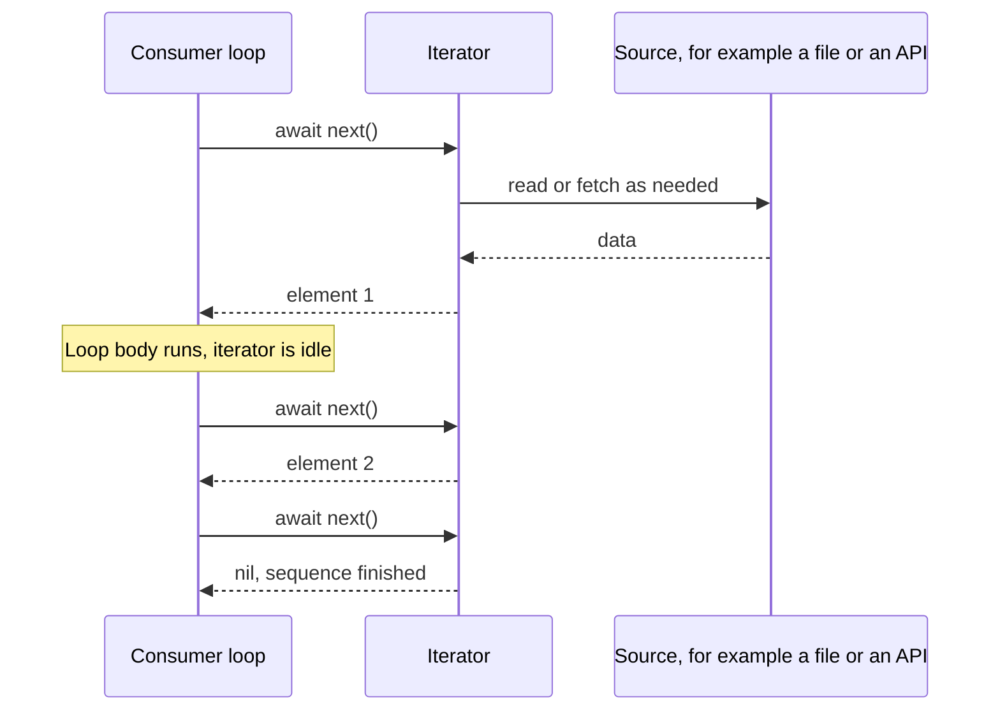

An `async` function produces one value, later. An `AsyncSequence` produces many values over time: lines of a file as they are read, pages of an API as they are fetched, notifications as they are posted, model changes as they happen. Consuming one looks like an ordinary loop, `for await value in sequence`, and the familiar operators `map`, `filter`, `prefix`, and `reduce` all work.

The similarity to `Sequence` is deliberate, and it hides the properties that matter in practice: iteration is **pull-based** and lazy, each element costs an `await`, a sequence may or may not restart when iterated twice, and what happens on cancellation is up to each sequence. This article covers consuming the built-in sequences, writing your own with typed errors, and the performance and lifetime rules that keep stream-processing code correct.

<!--more-->

The examples use Swift 6 language mode and were compiled and run with the Swift 6.4 toolchain on macOS 26. Performance numbers quoted in the text come from an optimized build on an Apple M1 Ultra. The Swift blocks build on one another in one `main.swift`.

## The protocol

<!-- skip-check -->
```swift
protocol AsyncSequence<Element, Failure> {
    associatedtype AsyncIterator: AsyncIteratorProtocol
    associatedtype Element
    associatedtype Failure: Error = any Error
    func makeAsyncIterator() -> AsyncIterator
}

protocol AsyncIteratorProtocol<Element, Failure> {
    mutating func next() async throws(Failure) -> Element?
}
```

That is a simplified view of the declarations, which also include an isolation-aware `next(isolation:)` requirement. Since Swift 6.0, both protocols have a `Failure` associated type ([SE-0421](https://github.com/swiftlang/swift-evolution/blob/main/proposals/0421-generalize-async-sequence.md)), so a sequence can declare that it never throws, throws `any Error`, or throws one specific error type. Primary associated types allow `some AsyncSequence<Int, Never>` in signatures.

`for await element in sequence` is sugar for creating an iterator and calling `next()` until it returns `nil`. The loop body runs in the consumer's task and isolation; `next()` is an ordinary `async` call that may suspend.



Nothing happens between calls. The iterator produces an element only when the consumer asks for one, so a slow consumer automatically slows the producer. That is **pull-based** iteration, and it is the most important difference from push-based streams like `AsyncStream`, which the [next article](/swift-asyncstream/) covers.

## Consuming built-in sequences

Foundation provides asynchronous sequences for common sources. Reading a file line by line, for example, uses `URL.lines`:

```swift
import Foundation
import Synchronization

let logURL = FileManager.default.temporaryDirectory
    .appendingPathComponent("asyncsequence-\(UUID().uuidString).log")
let logLines = (1...1_000).map { index in
    index % 10 == 0 ? "ERROR request \(index) failed" : "INFO request \(index) ok"
}
try logLines.joined(separator: "\n").write(to: logURL, atomically: true, encoding: .utf8)

var errorCount = 0
for try await line in logURL.lines where line.hasPrefix("ERROR") {
    errorCount += 1
}
assert(errorCount == 100)
```

The same operators as on `Sequence` exist, each returning a new lazy asynchronous sequence or awaiting a result:

```swift
let firstErrors = try await logURL.lines
    .filter { $0.hasPrefix("ERROR") }
    .map { $0.split(separator: " ")[2] }
    .prefix(3)
    .reduce(into: [String]()) { $0.append(String($1)) }
assert(firstErrors == ["10", "20", "30"])

let containsRequest500 = try await logURL.lines.contains { $0.contains("request 500 ") }
assert(containsRequest500)
try? FileManager.default.removeItem(at: logURL)
```

Because the chain is lazy and pull-based, `prefix(3)` stops the whole pipeline after the third matching line: the file is not read to the end. `contains` stops at the first match.

Other built-in sources include `URL.resourceBytes` and `FileHandle.bytes` for raw bytes, `URLSession.bytes(for:)` for streaming HTTP responses, `NotificationCenter.notifications(named:)` for notifications, and, from Swift 6.2, `Observations` for changes to `@Observable` state, shown in the [main actor article](/swift-main-actor/).

## Each element costs an await

Every `next()` is an `async` call. Even when it does not suspend, it has overhead: an iterator call, sometimes a buffer refill, sometimes an executor check. For a sequence of many tiny elements, that overhead dominates. If each element costs $$c$$ in iteration overhead and $$t$$ in useful work, throughput is bounded by

$$
\text{elements per second} \le \frac{1}{c + t}.
$$

On the test machine, reading a 2.7 MB file containing 200,000 short lines took, in an optimized build:

| Approach | Elements | Time | Per element |
| --- | --- | --- | --- |
| `for try await` over `url.lines` | 200,000 lines | 1.19 s | about 6 µs |
| `for try await` over `url.resourceBytes` | 2.7 million bytes | 0.17 s | about 63 ns |
| `Data(contentsOf:)`, all at once | 1 buffer | 0.0007 s | not applicable |

The lesson is not that async sequences are slow; it is that **element granularity matters.** Byte-at-a-time iteration of a large local file costs about 230 times more than reading it in one call. For local files that fit in memory, read them whole and process the buffer synchronously, ideally off the main actor. Use byte and line sequences for sources that genuinely arrive over time, such as network streams and pipes, where waiting dominates and incremental processing lets you start before the end arrives.

## Writing an AsyncSequence: a paginated API

A paginated API is a natural asynchronous sequence: each page is fetched only when the consumer is ready for it. Declaring a concrete `Failure` type lets the compiler know exactly what the loop can throw:

```swift
enum FeedError: Error, Equatable {
    case offline
    case badPage(Int)
}

/// A fake backend that counts its fetches so laziness can be observed.
final class FeedBackend: Sendable {
    private let fetches = Mutex(0)
    let pageCount: Int
    let failingPage: Int?

    init(pageCount: Int, failingPage: Int? = nil) {
        self.pageCount = pageCount
        self.failingPage = failingPage
    }

    func fetchPage(_ page: Int) async throws(FeedError) -> [String]? {
        fetches.withLock { $0 += 1 }
        try? await Task.sleep(for: .milliseconds(2))
        if page == failingPage { throw .badPage(page) }
        guard page < pageCount else { return nil }
        return (0..<3).map { "post \(page * 3 + $0)" }
    }

    var fetchCount: Int {
        fetches.withLock { $0 }
    }
}

struct FeedPages: AsyncSequence {
    typealias Element = [String]
    typealias Failure = FeedError

    let backend: FeedBackend

    struct AsyncIterator: AsyncIteratorProtocol {
        let backend: FeedBackend
        var nextPage = 0
        var finished = false

        mutating func next() async throws(FeedError) -> [String]? {
            guard !finished, !Task.isCancelled else { return nil }
            guard let page = try await backend.fetchPage(nextPage) else {
                finished = true
                return nil
            }
            nextPage += 1
            return page
        }
    }

    func makeAsyncIterator() -> AsyncIterator {
        AsyncIterator(backend: backend)
    }
}
```

Consumers iterate it like any other sequence. The `catch` clause receives a `FeedError`, not `any Error`, because the sequence's `Failure` is concrete:

```swift
let backend = FeedBackend(pageCount: 4)
var posts: [String] = []
for try await page in FeedPages(backend: backend) {
    posts += page
}
assert(posts.count == 12)
assert(backend.fetchCount == 5, "Four pages plus the fetch that discovered the end")

let brokenBackend = FeedBackend(pageCount: 4, failingPage: 2)
do {
    for try await _ in FeedPages(backend: brokenBackend) {}
    assertionFailure("Page 2 must fail")
} catch {
    let typed: FeedError = error       // The error is statically a FeedError.
    assert(typed == .badPage(2))
}
```

Laziness is observable through the fetch count. A consumer that needs only the first few posts fetches only the pages that contain them:

```swift
let lazyBackend = FeedBackend(pageCount: 100)
let firstFivePosts = try await FeedPages(backend: lazyBackend)
    .flatMap { $0.async }
    .prefix(5)
    .reduce(into: [String]()) { $0.append($1) }
assert(firstFivePosts == ["post 0", "post 1", "post 2", "post 3", "post 4"])
assert(lazyBackend.fetchCount == 2, "Only two of a hundred pages were fetched")
```

The `.async` property on an array, defined below, turns a synchronous collection into an asynchronous sequence so that `flatMap` can splice pages into a stream of posts. It is the one piece of glue the standard library does not provide:

```swift
struct AsyncCollection<Base: Collection & Sendable>: AsyncSequence, Sendable where Base.Element: Sendable {
    typealias Element = Base.Element
    typealias Failure = Never

    let base: Base

    struct AsyncIterator: AsyncIteratorProtocol {
        var iterator: Base.Iterator

        mutating func next() async -> Base.Element? {
            iterator.next()
        }
    }

    func makeAsyncIterator() -> AsyncIterator {
        AsyncIterator(iterator: base.makeIterator())
    }
}

extension Collection where Self: Sendable, Element: Sendable {
    var async: AsyncCollection<Self> {
        AsyncCollection(base: self)
    }
}
```

The `swift-async-algorithms` package provides this and many more operators, such as `merge`, `zip`, `debounce`, `throttle`, and `chunked`, if you need them across a codebase.

## Iterating twice

`Sequence` makes no promise that iterating twice yields the same elements, and neither does `AsyncSequence`. In practice, sequences fall into two groups:

- **Restartable sequences** create independent state in `makeAsyncIterator()`. `FeedPages` is one: each loop starts at page zero and fetches everything again. So is `url.lines`, which reopens the file.
- **Single-consumer streams** share one underlying source. `AsyncStream` and `NotificationCenter.notifications(named:)` deliver each element once; two loops compete for elements rather than both receiving them.

```swift
let restartBackend = FeedBackend(pageCount: 2)
let feed = FeedPages(backend: restartBackend)
var firstPass = 0
for try await page in feed { firstPass += page.count }
var secondPass = 0
for try await page in feed { secondPass += page.count }
assert(firstPass == 6 && secondPass == 6)
assert(restartBackend.fetchCount == 6, "The second loop fetched every page again")
```

Document which kind your sequence is. For an API-backed sequence, a second iteration that silently re-fetches everything is a performance bug waiting to happen; caching or a single shared stream may be what callers actually want.

## Cancellation ends iteration, in the sequence's own way

When the task running a `for await` loop is cancelled, the loop does not stop by itself. It stops when `next()` returns `nil` or throws. Each sequence decides which:

- `AsyncStream` delivers anything already buffered, then returns `nil`, so the loop ends normally; the [backpressure article](/swift-stream-backpressure/) traces the exact order.
- `FeedPages` above checks `Task.isCancelled` and returns `nil`.
- `URLSession.bytes(for:)` throws `URLError(.cancelled)`.
- A sequence that never checks keeps producing elements until it is exhausted.

```swift
let endlessBackend = FeedBackend(pageCount: 1_000)
let reader = Task { () -> Int in
    var pages = 0
    for try await _ in FeedPages(backend: endlessBackend) {
        pages += 1
    }
    return pages
}
try await Task.sleep(for: .milliseconds(30))
reader.cancel()
let pagesBeforeCancellation = try await reader.value
assert(pagesBeforeCancellation < 1_000, "The iterator noticed cancellation and finished early")
```

Returning `nil` on cancellation makes cancelled iteration look like a normal end of sequence, which is convenient in loops but can hide the cancellation from code after the loop. Throwing `CancellationError` makes it explicit. Either is defensible; choose one, and check `Task.isCancelled` after the loop if the distinction matters.

## Long-lived loops need owners

A loop over an infinite sequence, such as notifications, location updates, or model observations, never ends on its own. The task running it must be owned and cancelled, exactly like the polling loops in the [task lifetime article](/swift-task-lifetime-ownership/):

```swift
@MainActor
final class ThemeObserver {
    private(set) var changes = 0
    private var observation: Task<Void, Never>?

    func start() {
        observation = Task { [weak self] in
            for await _ in NotificationCenter.default.notifications(named: .themeDidChange) {
                guard let self else { return }
                self.changes += 1
            }
        }
    }

    func stop() {
        observation?.cancel()
        observation = nil
    }
}

extension Notification.Name {
    static let themeDidChange = Notification.Name("ThemeDidChange")
}

let themeObserver = ThemeObserver()
themeObserver.start()
try await Task.sleep(for: .milliseconds(20))
NotificationCenter.default.post(name: .themeDidChange, object: nil)
NotificationCenter.default.post(name: .themeDidChange, object: nil)
try await Task.sleep(for: .milliseconds(20))
assert(themeObserver.changes == 2)
themeObserver.stop()
NotificationCenter.default.post(name: .themeDidChange, object: nil)
try await Task.sleep(for: .milliseconds(20))
assert(themeObserver.changes == 2, "No more changes after stop()")
```

The `guard let self` inside the loop, rather than before it, lets the observer deallocate even if nobody calls `stop()`: each element re-checks the weak reference. Calling `stop()` explicitly is still better, because the loop otherwise lingers until the next notification arrives.

## Processing elements concurrently

A `for await` loop processes elements one at a time: the next element is not requested until the body finishes. That is often correct, because order is preserved and back-pressure is automatic, but it serializes work that could overlap. To process elements concurrently with a limit, combine the loop with a task group's sliding window, from the [task groups article](/swift-task-groups/):

```swift
func processConcurrently(pages: FeedPages, maxInFlight: Int) async throws -> Int {
    try await withThrowingTaskGroup(of: Int.self) { group in
        var inFlight = 0
        var processed = 0
        for try await page in pages {
            if inFlight == maxInFlight {
                processed += try await group.next() ?? 0
                inFlight -= 1
            }
            group.addTask {
                try await Task.sleep(for: .milliseconds(5))      // Per-page work.
                return page.count
            }
            inFlight += 1
        }
        for try await count in group {
            processed += count
        }
        return processed
    }
}

let concurrentBackend = FeedBackend(pageCount: 10)
let processedPosts = try await processConcurrently(pages: FeedPages(backend: concurrentBackend), maxInFlight: 3)
assert(processedPosts == 30)
```

The consumer still pulls pages one at a time, but it no longer waits for each page's processing before pulling the next, up to three at once. Results arrive in completion order; attach indices, as the task groups article shows, if order matters.

## Summary

- `AsyncSequence` is a pull-based, lazy sequence whose `next()` is `async`. Since Swift 6.0 it has a `Failure` type, so sequences can declare precise errors.
- The standard operators work and stay lazy: `prefix`, `first`, and `contains` stop the pipeline early.
- Each element costs an `await`. Measured overhead was about 63 ns per byte and 6 µs per line; choose element granularity accordingly.
- Write custom sequences as an iterator with a `mutating next()`; check cancellation and decide whether it returns `nil` or throws.
- Know whether a sequence restarts on each iteration or is a single shared stream, and document it.
- Infinite loops need an owning task with a `stop()`; concurrent processing needs a bounded task group around the loop.

## Exercise

Write `struct LogTail: AsyncSequence` that yields new lines appended to a file, polling the file size every 50 ms and reading only the new bytes. Give it a concrete `Failure` type, return `nil` when the task is cancelled, and make it restartable from the current end of the file. Test it by appending lines from another task while a consumer reads with `prefix(10)`, and verify that the poller stops once `prefix` is satisfied.

## Further reading

- [SE-0298: Async/Await: Sequences](https://github.com/swiftlang/swift-evolution/blob/main/proposals/0298-asyncsequence.md).
- [SE-0421: Generalize effect polymorphism for AsyncSequence and AsyncIteratorProtocol](https://github.com/swiftlang/swift-evolution/blob/main/proposals/0421-generalize-async-sequence.md).
- [swift-async-algorithms](https://github.com/apple/swift-async-algorithms) for `merge`, `zip`, `debounce`, `chunked`, and more.
- [Meet AsyncSequence](https://developer.apple.com/videos/play/wwdc2021/10058/), WWDC21.

Previous: [Migrating to Swift 6 Data-Race Safety](/swift-6-data-race-safety-migration/). Next: [Building Streams with `AsyncStream` and `AsyncThrowingStream`](/swift-asyncstream/).

Return to the [Concurrency roadmap](/swift-concurrency-roadmap/).
