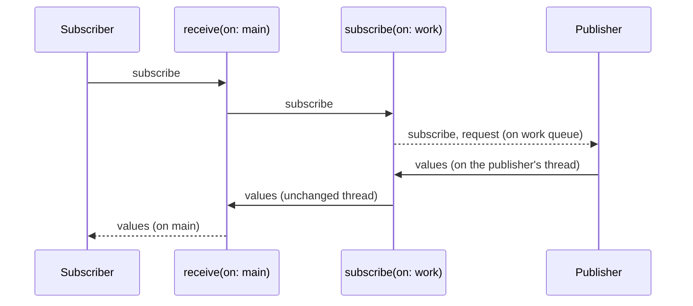

Combine does not pick threads. A value is delivered on whatever thread produced it, every operator runs on that thread, and the subscriber runs there too. A subject delivers on the thread that called `send`, a `URLSession` publisher on the session's delegate queue, a KVO publisher on the thread that changed the property. Two operators change that. `receive(on:)` moves everything *downstream* of it, values and completion, to a scheduler. `subscribe(on:)` moves the *upstream* signals, the subscription and the requests for demand, which moves the work of cold publishers that do their work when asked.

They are easy to confuse and easy to misuse: `subscribe(on:)` does not move a subject's values at all and can lose the first one, `receive(on:)` to the main queue is asynchronous even when you are already on the main thread, a concurrent queue reorders values, and `RunLoop.main` pauses delivery while the user scrolls. In Swift 6 the stakes are higher, because a closure on the wrong side of a `receive(on:)` does not just risk a data race; it crashes. This article measures each of those behaviors, sets out the rules for main-actor code, and builds a type-erased scheduler so a view model can be tested on the virtual-time scheduler and run on the main queue.

<!--more-->

The examples use Swift 6 language mode and were compiled and run with the Swift 6.4 toolchain from Xcode 27.1 on macOS 26. Paste the `VirtualTimeScheduler` and `TimelineRecorder` from [Time: `debounce`, `throttle`, and `delay`](/combine-debounce-throttle-delay/#a-scheduler-whose-clock-you-control) first, then the blocks below in order, into one `main.swift`. A few helpers record which thread each signal arrived on and run the main run loop:

<!-- check-uses: virtual-scheduler -->

```swift
import Synchronization

final class SignalLog: Sendable {
    private let entries = Mutex<[String]>([])
    func append(_ entry: String) { entries.withLock { $0.append(entry) } }
    var all: [String] { entries.withLock { $0 } }
}

nonisolated func currentThread() -> String { Thread.isMainThread ? "main" : "background" }

func runMainLoop(for seconds: TimeInterval, mode: RunLoop.Mode = .default) {
    let end = Date(timeIntervalSinceNow: seconds)
    while Date() < end {
        _ = RunLoop.main.run(mode: mode, before: min(end, Date(timeIntervalSinceNow: 0.01)))
    }
}

let workQueue = DispatchQueue(label: "work")
```

## Which way each operator moves signals

A subscription has two directions. The subscription and demand travel upstream, from subscriber to publisher; values and the completion travel downstream. Each operator moves one direction:



## `subscribe(on:)` moves the work of cold publishers

A cold publisher does its work when it receives a subscription or a request. A sequence publisher emits its values inside `request(_:)`; a `Deferred` runs its closure inside `receive(subscriber:)`. Moving those calls to another queue moves the work:

```swift
let sequenceLog = SignalLog()
let sequenceHandle = [1, 2].publisher
    .handleEvents(receiveSubscription: { @Sendable _ in sequenceLog.append("subscription on \(currentThread())") },
                  receiveRequest: { @Sendable _ in sequenceLog.append("request on \(currentThread())") })
    .subscribe(on: workQueue)
    .sink { @Sendable value in sequenceLog.append("value \(value) on \(currentThread())") }
runMainLoop(for: 0.1)
assert(sequenceLog.all == [
    "subscription on background", "request on background",
    "value 1 on background", "value 2 on background",
])

let expensiveLog = SignalLog()
let expensiveHandle = Deferred { @Sendable () -> Just<Int> in
    expensiveLog.append("parsing on \(currentThread())")    // stands in for decoding a large file
    return Just(42)
}
.subscribe(on: workQueue)
.sink { @Sendable _ in expensiveLog.append("delivered on \(currentThread())") }
runMainLoop(for: 0.1)
assert(expensiveLog.all == ["parsing on background", "delivered on background"])
```

The `@Sendable` on the `Deferred` closure is required, not stylistic. This article's first version left it out, and since the closure is written in top-level code, Swift 6 inferred it to be main-actor isolated; `subscribe(on:)` then ran it on the work queue, and the process stopped in the isolation check on the thread whose queue is named `work`. Any closure that `subscribe(on:)` moves off the main thread needs the same treatment as one that runs before `receive(on:)`.

That is the legitimate use of `subscribe(on:)`: start synchronous, cold work, such as reading a file or decoding a cached response wrapped in `Deferred`, somewhere other than the main thread.

It does nothing useful for a hot publisher. A subject's values are produced by whoever calls `send`, on their thread, regardless of where the subscription was made. And because `subscribe(on:)` makes the subscription *asynchronously*, a value sent right after subscribing arrives before the subscription exists:

```swift
let hotLog = SignalLog()
let hotSubject = PassthroughSubject<Int, Never>()
let hotHandle = hotSubject
    .subscribe(on: workQueue)
    .sink { @Sendable value in hotLog.append("value \(value) on \(currentThread())") }
hotSubject.send(1)                               // the subscription has not been made yet
runMainLoop(for: 0.1)
hotSubject.send(2)
runMainLoop(for: 0.1)
assert(hotLog.all == ["value 2 on main"])        // 1 was lost, and 2 arrived on the sender's thread
```

The value 1 was dropped, and the value 2 arrived on the main thread, where it was sent. The same applies to `URLSession` publishers, whose values come from the delegate queue however they are subscribed: `subscribe(on:)` on a data task publisher moves only the call to `resume()`. If you want values on a particular queue, the operator you want is `receive(on:)`.

## `receive(on:)` moves everything downstream

`receive(on:)` schedules each value and the completion on a scheduler, so everything after it runs there. Its scheduling is always asynchronous: `DispatchQueue.main` delivers on a later turn of the main queue even when the value was sent from the main thread. `ImmediateScheduler` is the scheduler that runs synchronously:

```swift
let delivery = PassthroughSubject<Int, Never>()
var deliveredValues: [String] = []
let queuedHandle = delivery.receive(on: DispatchQueue.main).sink { deliveredValues.append("main queue \($0)") }
let immediateHandle = delivery.receive(on: ImmediateScheduler.shared).sink { deliveredValues.append("immediate \($0)") }
delivery.send(1)
assert(deliveredValues == ["immediate 1"])       // the main-queue delivery has not happened yet
runMainLoop(for: 0.05)
assert(deliveredValues == ["immediate 1", "main queue 1"])
```

The asynchronous hop is usually what you want, because it decouples the producer from the consumer, but it has two consequences. A test that sends a value and immediately asserts on the result fails, as `deliveredValues` did above; the injected scheduler at the end of this article fixes that. And code that sends from the main thread and expects the UI to have updated by the next line will see the old state.

### Serial queues keep order; concurrent queues do not

`receive(on:)` schedules each value as a separate block. On a serial queue the blocks run in order. On a concurrent queue they can run in any order, and they do:

```swift
nonisolated func deliveryOrder(on queue: DispatchQueue) -> [Int] {
    let received = Mutex<[Int]>([])
    let source = PassthroughSubject<Int, Never>()
    let handle = source.receive(on: queue).sink { @Sendable value in received.withLock { $0.append(value) } }
    for value in 0..<1_000 { source.send(value) }
    Thread.sleep(forTimeInterval: 0.1)
    handle.cancel()
    return received.withLock { $0 }
}

var reorderedRuns = 0
for _ in 0..<20 {
    let order = deliveryOrder(on: DispatchQueue.global())
    assert(order.count == 1_000)                 // nothing lost...
    if order != Array(0..<1_000) { reorderedRuns += 1 }
}
assert(reorderedRuns > 0)                        // ...but reordered
assert(deliveryOrder(on: DispatchQueue(label: "serial")) == Array(0..<1_000))
print("concurrent queue reordered \(reorderedRuns) of 20 runs")
```

All 20 runs on `DispatchQueue.global()` delivered the 1,000 values out of order, while still never delivering two at once, since [Publishers, Subscribers, and Subscriptions](/combine-publishers-subscribers-subscriptions/) measured a peak of one concurrent delivery through the same operator. For time-based operators, concurrent queues are worse: [Time: `debounce`, `throttle`, and `delay`](/combine-debounce-throttle-delay/) found `delay` losing values on them. Give every scheduler parameter a serial queue.

## Three main schedulers, and scrolling

There are three ways to say "the main thread" in Combine: `DispatchQueue.main`, `RunLoop.main`, and `OperationQueue.main`. They differ in how they get there. `DispatchQueue.main` and `OperationQueue.main` submit work to the main dispatch queue, which the main run loop services in all of its common modes. `RunLoop.main` performs its blocks in the run loop's *default* mode. While a scroll view is being dragged, the main run loop runs in its tracking mode, which is a common mode but not the default one. Reproducing that with a custom common mode, kept alive by a timer as UIKit's tracking mode is kept alive by its event sources:

```swift
let trackingMode = RunLoop.Mode("ExampleTrackingMode")
CFRunLoopAddCommonMode(CFRunLoopGetMain(), CFRunLoopMode(trackingMode.rawValue as CFString))
let keepModeAlive = Timer(timeInterval: 60, repeats: true) { _ in }
RunLoop.main.add(keepModeAlive, forMode: trackingMode)

let scrollUpdates = PassthroughSubject<Int, Never>()
var viaRunLoop = 0
var viaDispatchQueue = 0
var viaOperationQueue = 0
let runLoopHandle = scrollUpdates.receive(on: RunLoop.main).sink { _ in viaRunLoop += 1 }
let dispatchHandle = scrollUpdates.receive(on: DispatchQueue.main).sink { _ in viaDispatchQueue += 1 }
let operationHandle = scrollUpdates.receive(on: OperationQueue.main).sink { _ in viaOperationQueue += 1 }

scrollUpdates.send(1)
runMainLoop(for: 0.2, mode: trackingMode)       // the user is dragging
assert(viaRunLoop == 0 && viaDispatchQueue == 1 && viaOperationQueue == 1)
runMainLoop(for: 0.05)                           // the drag ends
assert(viaRunLoop == 1)
keepModeAlive.invalidate()
```

| Scheduler | Delivers while scrolling | Notes |
|---|---|---|
| `DispatchQueue.main` | yes | the usual choice for UI delivery |
| `OperationQueue.main` | yes | equivalent here; supports operation dependencies elsewhere |
| `RunLoop.main` | **no**, held until the drag ends | useful only to deliberately defer work during scrolling |

Holding image decoding results until a fling ends is occasionally desirable, and `RunLoop.main` does exactly that. For anything the user is waiting for, use `DispatchQueue.main`.

## Swift 6 and the main actor

Swift 6 adds a rule that turns threading mistakes in Combine pipelines from data races into crashes. A closure written in main-actor code, inside a `@MainActor` type or in top-level code, is inferred to be isolated to the main actor. Combine is compiled in Swift 5 mode, so the compiler cannot prove where Combine will call the closure; instead of an error, it inserts a run-time check into the closure that the current executor is the main actor. Called from any other thread, the check stops the process with `EXC_BREAKPOINT` in `_swift_task_checkIsolatedSwift`. This series has hit that check with subjects, `URLSession`, KVO, and notifications. The rule that avoids it is the same in every case:

> Every closure that runs **before** `receive(on:)` to the main queue must not be main-actor isolated. Every closure **after** it may be.

The three main schedulers all satisfy the check: in this article's tests, values sent from a background thread and delivered through `receive(on: DispatchQueue.main)`, `receive(on: RunLoop.main)`, and `receive(on: OperationQueue.main)` all reached main-actor `sink` closures without stopping. The check passes because the closure runs on the main thread, and the main actor's executor is the main thread.

The pipeline below crashes when a value arrives from a background thread, because the `map` closure carries the view model's isolation:

```swift
// Crashes when `values` emits on a background thread
@MainActor
final class CrashingModel {
    var label = ""
    private var cancellables = Set<AnyCancellable>()

    func bind(_ values: some Publisher<Int, Never>) {
        values
            .map { "\($0) items" }                       // main-actor closure, run on the sender's thread
            .receive(on: DispatchQueue.main)
            .sink { [weak self] in self?.label = $0 }
            .store(in: &cancellables)
    }
}
```

There are four ways to fix it. Each version below receives a value sent from a background queue:

```swift
nonisolated(unsafe) let backgroundValues = PassthroughSubject<Int, Never>()

nonisolated func itemLabel(_ count: Int) -> String { "\(count) items" }

extension Publisher where Output == Int {
    /// Built in a nonisolated extension, so its closure carries no actor isolation.
    func itemLabels() -> Publishers.Map<Self, String> { map { "\($0) items" } }
}

@MainActor
final class LabelModel {
    var labels: [String] = []
    private var cancellables = Set<AnyCancellable>()

    // 1. Move the transformation after the hop.
    func bindTransformingAfterHop(_ values: some Publisher<Int, Never>) {
        values
            .receive(on: DispatchQueue.main)
            .map { "\($0) items" }                       // main-actor closure, now on the main thread
            .sink { [weak self] in self?.labels.append("after hop: \($0)") }
            .store(in: &cancellables)
    }

    // 2. Mark the early closure @Sendable, which removes the inferred isolation.
    func bindSendable(_ values: some Publisher<Int, Never>) {
        values
            .map { @Sendable count in "\(count) items" }
            .receive(on: DispatchQueue.main)
            .sink { [weak self] in self?.labels.append("sendable: \($0)") }
            .store(in: &cancellables)
    }

    // 3. Use nonisolated functions or extensions for the early stages.
    func bindNonisolated(_ values: some Publisher<Int, Never>) {
        values
            .itemLabels()
            .receive(on: DispatchQueue.main)
            .sink { [weak self] in self?.labels.append("extension: \($0)") }
            .store(in: &cancellables)
        values
            .map(itemLabel)
            .receive(on: DispatchQueue.main)
            .sink { [weak self] in self?.labels.append("function: \($0)") }
            .store(in: &cancellables)
    }

    // 4. Make the final closure's isolation explicit, so a reader sees what the check enforces.
    func bindExplicit(_ values: some Publisher<Int, Never>) {
        values
            .receive(on: DispatchQueue.main)
            .sink { @MainActor [weak self] count in self?.labels.append("explicit: \(count) items") }
            .store(in: &cancellables)
    }
}

let labelModel = LabelModel()
labelModel.bindTransformingAfterHop(backgroundValues)
labelModel.bindSendable(backgroundValues)
labelModel.bindNonisolated(backgroundValues)
labelModel.bindExplicit(backgroundValues)
DispatchQueue.global().async { backgroundValues.send(3) }
runMainLoop(for: 0.2)
assert(Set(labelModel.labels) == [
    "after hop: 3 items", "sendable: 3 items", "extension: 3 items",
    "function: 3 items", "explicit: 3 items",
])
```

The first option is the simplest and is often fine, at the cost of doing the transformation on the main thread. The second and third keep expensive work, such as formatting or decoding, off the main thread, and the `@Sendable` annotation also makes the compiler check that the closure captures nothing it should not. The fourth changes nothing at run time but documents the contract.

`MainActor.assumeIsolated` is the tool for the opposite situation: a nonisolated closure, such as one in a helper that knows it has already hopped, that must call main-actor code. It checks the same condition at run time and lets you call main-actor API inside it:

```swift
nonisolated func bindOnMain(_ values: some Publisher<Int, Never>,
                            apply: @escaping @MainActor (Int) -> Void) -> AnyCancellable {
    values
        .receive(on: DispatchQueue.main)
        .sink { value in MainActor.assumeIsolated { apply(value) } }
}

var assumedValues: [Int] = []
let assumedHandle = bindOnMain(backgroundValues) { assumedValues.append($0) }
DispatchQueue.global().async { backgroundValues.send(5) }
runMainLoop(for: 0.1)
assert(assumedValues == [5])
```

If the `receive(on:)` were removed, `assumeIsolated` would stop the process just as the inferred check does; it is an assertion, not a hop.

## Injecting the scheduler

A view model that hard-codes `DispatchQueue.main` can only be tested by running the main run loop and hoping the delivery happened in time. Injecting the scheduler lets a test pass the virtual-time scheduler instead, so delivery happens exactly when the test advances the clock. The obstacle is the type: `receive(on:)` is generic over the scheduler, so a stored property needs one concrete type for both `DispatchQueue` and the test scheduler. A type eraser provides it, keeping the time type, which both share, and dropping scheduler-specific options:

```swift
/// A scheduler that forwards to any scheduler with the same time type, ignoring options.
struct AnyScheduler<SchedulerTimeType: Strideable>: Scheduler
where SchedulerTimeType.Stride: SchedulerTimeIntervalConvertible {
    typealias SchedulerOptions = Never

    private let currentTime: () -> SchedulerTimeType
    private let tolerance: () -> SchedulerTimeType.Stride
    private let scheduleNow: (@escaping () -> Void) -> Void
    private let scheduleAfter: (SchedulerTimeType, SchedulerTimeType.Stride, @escaping () -> Void) -> Void
    private let scheduleRepeating: (SchedulerTimeType, SchedulerTimeType.Stride, SchedulerTimeType.Stride,
                                    @escaping () -> Void) -> any Cancellable

    init<S: Scheduler>(_ base: S) where S.SchedulerTimeType == SchedulerTimeType {
        currentTime = { base.now }
        tolerance = { base.minimumTolerance }
        scheduleNow = { base.schedule(options: nil, $0) }
        scheduleAfter = { base.schedule(after: $0, tolerance: $1, options: nil, $2) }
        scheduleRepeating = { base.schedule(after: $0, interval: $1, tolerance: $2, options: nil, $3) }
    }

    var now: SchedulerTimeType { currentTime() }
    var minimumTolerance: SchedulerTimeType.Stride { tolerance() }

    func schedule(options: Never?, _ action: @escaping () -> Void) { scheduleNow(action) }

    func schedule(after date: SchedulerTimeType, tolerance: SchedulerTimeType.Stride,
                  options: Never?, _ action: @escaping () -> Void) {
        scheduleAfter(date, tolerance, action)
    }

    func schedule(after date: SchedulerTimeType, interval: SchedulerTimeType.Stride,
                  tolerance: SchedulerTimeType.Stride, options: Never?,
                  _ action: @escaping () -> Void) -> any Cancellable {
        scheduleRepeating(date, interval, tolerance, action)
    }
}

typealias MainScheduler = AnyScheduler<DispatchQueue.SchedulerTimeType>
```

A search model takes the scheduler in its initializer, defaults it to the main queue, and uses it for both the debounce and the delivery hop:

```swift
@MainActor
final class SearchModel {
    private(set) var results: [String] = []
    let query = PassthroughSubject<String, Never>()
    private var cancellables = Set<AnyCancellable>()

    init(search: @escaping @Sendable (String) -> AnyPublisher<[String], Never>,
         scheduler: MainScheduler = AnyScheduler(DispatchQueue.main)) {
        query
            .debounce(for: .milliseconds(300), scheduler: scheduler)
            .removeDuplicates()
            .map(search)
            .switchToLatest()
            .receive(on: scheduler)
            .sink { [weak self] in self?.results = $0 }
            .store(in: &cancellables)
    }
}

let testClock = VirtualTimeScheduler()
let testModel = SearchModel(
    search: { query in Just(["\(query) result"]).eraseToAnyPublisher() },
    scheduler: AnyScheduler(testClock))

testModel.query.send("sw")
testModel.query.send("swift")
testClock.advance(by: .milliseconds(299))
assert(testModel.results.isEmpty)                // still debouncing
testClock.advance(by: .milliseconds(1))
assert(testModel.results == ["swift result"])    // debounced and delivered, at exactly 300 ms
```

The test controls both the debounce and the hop and needs no run loop and no sleeping. The production default goes through the same eraser, so the code path under test is the one that ships:

```swift
let liveModel = SearchModel(search: { query in Just(["\(query) result"]).eraseToAnyPublisher() })
liveModel.query.send("combine")
runMainLoop(for: 0.4)
assert(liveModel.results == ["combine result"])
```

[Testing Publishers](/combine-testing-publishers/) builds on this in a Swift Testing package. Point-Free's [combine-schedulers](https://github.com/pointfreeco/combine-schedulers) library provides a fuller `AnyScheduler` that also forwards options.

Keep the remaining subscriptions alive until the end of the file:

```swift
withExtendedLifetime((sequenceHandle, expensiveHandle, hotHandle, queuedHandle, immediateHandle,
                      runLoopHandle, dispatchHandle, operationHandle, assumedHandle)) {}
```

## Summary

- Without a scheduler operator, every stage of a pipeline runs on the thread that produced the value.
- `subscribe(on:)` moves subscription and demand upstream, so the work of cold publishers such as sequences and `Deferred` moved to the background queue. It did not move a subject's values, and it lost the value sent immediately after subscribing.
- `receive(on:)` moves values and completion downstream, and is asynchronous even from the main thread; `ImmediateScheduler` is synchronous.
- A concurrent queue reordered 1,000 values in 20 runs out of 20; a serial queue never did. Use serial queues.
- `RunLoop.main` held delivery while the run loop was in a tracking-style mode; `DispatchQueue.main` and `OperationQueue.main` delivered. Use `DispatchQueue.main` for UI.
- In Swift 6, closures before `receive(on:)` to the main queue must not be main-actor isolated: move the work after the hop, mark the closure `@Sendable`, or build it in nonisolated code. All three main schedulers satisfied the main-actor check.
- Inject an `AnyScheduler` to test debouncing and delivery in virtual time while shipping the main queue.

## Exercise

Write a `ThumbnailLoader` that takes a publisher of image file URLs, decodes each image on a serial background queue using `subscribe(on:)` around a `Deferred` decode, delivers the results to a `@MainActor` model through `receive(on:)`, and holds results during scrolling by switching its delivery scheduler to `RunLoop.main` only while a `isScrolling` publisher is `true`. Inject both schedulers through `AnyScheduler`, and test with two virtual schedulers that decoding never runs on the delivery scheduler, that results arrive in input order, and that nothing is delivered while scrolling. Then explain in a comment why `subscribe(on:)` would not work if the URLs came from a `PassthroughSubject` without the `Deferred`.

## Further reading

- Apple's documentation for [`receive(on:options:)`](https://developer.apple.com/documentation/combine/publisher/receive(on:options:)), [`subscribe(on:options:)`](https://developer.apple.com/documentation/combine/publisher/subscribe(on:options:)), and [`ImmediateScheduler`](https://developer.apple.com/documentation/combine/immediatescheduler).
- [SE-0423: Dynamic actor isolation enforcement from non-strict-concurrency contexts](https://github.com/swiftlang/swift-evolution/blob/main/proposals/0423-dynamic-actor-isolation.md), the proposal behind the run-time check that crashes misplaced main-actor closures.
- The concurrency roadmap's [The Main Actor](/swift-main-actor/) and [Executors](/swift-executors/).

Previous: [Error Handling: `catch`, `retry`, and `replaceError`](/combine-error-handling-catch-retry/). Next: [Managing Resources: `share` and Multicasting](/combine-share-multicasting/).

Return to the [Combine roadmap](/combine/).
