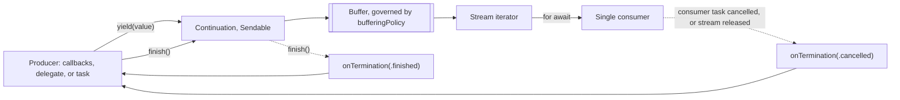

Most event sources in an app were built before Swift concurrency: delegates that report location fixes, callbacks that fire for every download chunk, observers that receive notifications, timers that tick. `AsyncStream` and `AsyncThrowingStream` adapt them to `AsyncSequence`, so consumers can write `for await event in events` and get cancellation, structured lifetimes, and sequential processing for free.

The adapter has two halves: a **continuation** that the producer pushes values into, and a **stream** that one consumer iterates. Getting the boundary right means deciding who finishes the stream, what happens when the consumer goes away, and what to do when there is more than one consumer. This article builds adapters for a callback API and a delegate API, shows the lifecycle rules with tests, and fixes the single-consumer limitation with a broadcaster.

<!--more-->

The examples use Swift 6 language mode and were compiled and run with the Swift 6.4 toolchain on macOS 26. The Swift blocks build on one another in one `main.swift`. `Mutex` requires iOS 18, macOS 15, or later.

## The two halves

`AsyncStream.makeStream(of:bufferingPolicy:)` ([SE-0388](https://github.com/swiftlang/swift-evolution/blob/main/proposals/0388-async-stream-factory.md)) returns both halves at once:

```swift
import Foundation
import Synchronization

let (numbers, numbersContinuation) = AsyncStream.makeStream(of: Int.self)

let producer = Task {
    for value in 1...5 {
        numbersContinuation.yield(value)
        try? await Task.sleep(for: .milliseconds(2))
    }
    numbersContinuation.finish()
}

var received: [Int] = []
for await value in numbers {
    received.append(value)
}
await producer.value
assert(received == [1, 2, 3, 4, 5])
```



The continuation is `Sendable`, so callbacks on any thread can call `yield` without further synchronization. `yield` never suspends: it hands the value to a waiting consumer or appends it to the stream's buffer and returns immediately. That makes `AsyncStream` a **push** source, unlike the pull-based sequences of the [previous article](/swift-asyncsequence/). The buffer is the stream's only defense against a producer that outpaces its consumer, and the [backpressure article](/swift-stream-backpressure/) is about choosing its policy.

There is also an older, closure-based initializer, `AsyncStream { continuation in ... }`, which runs the closure immediately with the continuation. It is convenient when all setup fits in one place; `makeStream` is clearer when the continuation must be stored in an object that outlives the setup code.

## Adapting a callback API

Here is a legacy ticker of the kind found in media players and sensor SDKs: you start it with a handler, it calls the handler repeatedly on a background queue, and you must stop it explicitly.

```swift
/// A callback-based API: calls `handler` every `interval` until stopped.
final class LegacyTicker: Sendable {
    private struct State {
        var timer: DispatchSourceTimer?
        var ticks = 0
    }

    private let state = Mutex(State())
    private let queue = DispatchQueue(label: "legacy.ticker")

    func start(interval: DispatchTimeInterval, handler: @escaping @Sendable (Int) -> Void) {
        let timer = DispatchSource.makeTimerSource(queue: queue)
        timer.schedule(deadline: .now() + interval, repeating: interval)
        timer.setEventHandler { [self] in
            let tick = state.withLock { state -> Int in
                state.ticks += 1
                return state.ticks
            }
            handler(tick)
        }
        state.withLock { $0.timer = timer }
        timer.resume()
    }

    func stop() {
        state.withLock { state in
            state.timer?.cancel()
            state.timer = nil
        }
    }

    var isRunning: Bool {
        state.withLock { $0.timer != nil }
    }
}
```

The adapter wires the handler to `yield` and wires stream termination to `stop()`:

```swift
extension LegacyTicker {
    func ticks(every interval: DispatchTimeInterval) -> AsyncStream<Int> {
        let (stream, continuation) = AsyncStream.makeStream(of: Int.self)
        continuation.onTermination = { [self] _ in
            stop()       // The consumer cancelled or the stream finished: stop producing.
        }
        start(interval: interval) { tick in
            continuation.yield(tick)
        }
        return stream
    }
}

func firstTicks(from ticker: LegacyTicker, count: Int) async -> [Int] {
    var ticks: [Int] = []
    for await tick in ticker.ticks(every: .milliseconds(5)) {
        ticks.append(tick)
        if ticks.count == count { break }
    }
    return ticks
}

let ticker = LegacyTicker()
let threeTicks = await firstTicks(from: ticker, count: 3)
assert(threeTicks == [1, 2, 3])
try await Task.sleep(for: .milliseconds(10))
assert(!ticker.isRunning, "The stream was released, which terminated it and stopped the ticker")
```

When `firstTicks` returned, the stream it created went out of scope. The stream terminated with `.cancelled`, `onTermination` ran, and the legacy timer stopped. The consumer never had to know the ticker existed. That chain, consumer leaves, stream terminates, producer stops, is the most important thing an adapter does. Without `onTermination`, the ticker would keep firing into a stream nobody reads, forever.

Notice what triggered the termination: not the `break`, but the stream being *released*. The next section shows why that distinction matters.

## Adapting a delegate API

Delegate-based APIs need one more piece: an object to *be* the delegate, which forwards each delegate call to the continuation. That object must stay alive for as long as the stream, so the stream's termination handler is a natural place to retain it:

```swift
struct Fix: Equatable, Sendable {
    let latitude: Double
    let longitude: Double
}

enum PositioningError: Error, Equatable {
    case denied
}

protocol PositioningDelegate: AnyObject, Sendable {
    func positioning(didUpdate fix: Fix)
    func positioning(didFail error: PositioningError)
}

/// A delegate-based API that holds its delegate weakly, as most do.
final class LegacyPositioning: Sendable {
    private let delegateBox = Mutex<(any PositioningDelegate)?>(nil)
    private let running = Mutex(false)

    func setDelegate(_ delegate: any PositioningDelegate) {
        delegateBox.withLock { $0 = delegate }
    }

    func startUpdates(fixes: [Fix], thenFail error: PositioningError? = nil) {
        running.withLock { $0 = true }
        DispatchQueue.global().async { [self] in
            for fix in fixes {
                guard running.withLock({ $0 }) else { return }
                delegateBox.withLock { $0 }?.positioning(didUpdate: fix)
                usleep(2_000)
            }
            if let error {
                delegateBox.withLock { $0 }?.positioning(didFail: error)
            }
        }
    }

    func stopUpdates() {
        running.withLock { $0 = false }
        delegateBox.withLock { $0 = nil }
    }

    var isRunning: Bool {
        running.withLock { $0 }
    }
}

/// Forwards delegate calls into a throwing stream's continuation.
final class PositioningStreamAdapter: PositioningDelegate {
    let continuation: AsyncThrowingStream<Fix, any Error>.Continuation

    init(continuation: AsyncThrowingStream<Fix, any Error>.Continuation) {
        self.continuation = continuation
    }

    func positioning(didUpdate fix: Fix) {
        continuation.yield(fix)
    }

    func positioning(didFail error: PositioningError) {
        continuation.finish(throwing: error)
    }
}

extension LegacyPositioning {
    func fixes(_ simulated: [Fix], thenFail error: PositioningError? = nil) -> AsyncThrowingStream<Fix, any Error> {
        let (stream, continuation) = AsyncThrowingStream.makeStream(of: Fix.self, throwing: (any Error).self)
        let adapter = PositioningStreamAdapter(continuation: continuation)
        setDelegate(adapter)
        continuation.onTermination = { [self] _ in
            _ = adapter          // Keeps the delegate alive exactly as long as the stream.
            stopUpdates()
        }
        startUpdates(fixes: simulated, thenFail: error)
        return stream
    }
}

let positioning = LegacyPositioning()
let route = [Fix(latitude: 1, longitude: 1), Fix(latitude: 2, longitude: 2)]
var tracked: [Fix] = []
do {
    for try await fix in positioning.fixes(route, thenFail: .denied) {
        tracked.append(fix)
    }
    assertionFailure("The stream must end with the delegate's error")
} catch PositioningError.denied {
}
assert(tracked == route)
assert(!positioning.isRunning, "Finishing with an error ran onTermination, which stopped updates")
```

`AsyncThrowingStream` adds `finish(throwing:)`, which ends the stream with an error: the consumer receives every buffered element first, then the error from `for try await`. The delegate's failure callback maps onto it directly.

The ownership arrangement is worth copying. The legacy API holds its delegate weakly, so something else must keep the adapter alive. Capturing it in `onTermination` ties its lifetime to the stream's: alive while anyone might read, released when the stream terminates. The `_ = adapter` line exists only to make the capture explicit.

## The lifecycle rules, tested

A stream terminates exactly once, for one of two reasons, which `onTermination` receives:

- `.finished`: the producer called `finish()` or `finish(throwing:)`.
- `.cancelled`: the consumer's task was cancelled, or the last reference to the stream and its iterator was released. A cancellation is noticed when the consumer is waiting in `next()` or next calls it; the [backpressure article](/swift-stream-backpressure/) shows what that means for buffered values.

After termination, `yield` returns `.terminated` and drops the value. Producers should treat that as a signal to stop:

```swift
let terminationReasons = Mutex<[String]>([])

let (finishedStream, finishedContinuation) = AsyncStream.makeStream(of: Int.self)
finishedContinuation.onTermination = { reason in
    terminationReasons.withLock { $0.append("\(reason)") }
}
finishedContinuation.yield(7)
finishedContinuation.finish()
if case .terminated = finishedContinuation.yield(8) {} else {
    assertionFailure("Yielding after finish reports termination")
}
var afterFinish: [Int] = []
for await value in finishedStream {
    afterFinish.append(value)
}
assert(afterFinish == [7], "Values buffered before finish() are still delivered")

let (cancelledStream, cancelledContinuation) = AsyncStream.makeStream(of: Int.self)
cancelledContinuation.onTermination = { reason in
    terminationReasons.withLock { $0.append("\(reason)") }
}
let cancelledConsumer = Task {
    for await _ in cancelledStream {}
}
try await Task.sleep(for: .milliseconds(10))
cancelledConsumer.cancel()
await cancelledConsumer.value
if case .terminated = cancelledContinuation.yield(1) {} else {
    assertionFailure("Yielding after the consumer left reports termination")
}
assert(terminationReasons.withLock { $0 } == ["finished", "cancelled"])
```

Two rules are easy to get wrong because they differ from what many people expect.

**Breaking out of a loop does not, by itself, terminate the stream.** A stream terminates with `.cancelled` when the consuming task is cancelled, or when the last copy of the stream and its iterators is released. If the stream is still referenced, by a stored property, a variable in an enclosing scope, or top-level code, then leaving the loop leaves the stream alive and its producer running:

```swift
let stillRunning = LegacyTicker()
let storedTicks = stillRunning.ticks(every: .milliseconds(5))   // Kept in a variable.

func readTwo(from stream: AsyncStream<Int>) async -> [Int] {
    var values: [Int] = []
    for await value in stream {
        values.append(value)
        if values.count == 2 { break }
    }
    return values
}

let twoTicks = await readTwo(from: storedTicks)
try await Task.sleep(for: .milliseconds(20))
assert(twoTicks == [1, 2])
assert(stillRunning.isRunning, "The stream is still referenced, so it never terminated")
stillRunning.stop()
```

On the test toolchain, a stream created inside a function terminated as soon as the function returned, while the same loop over a stored stream, or over a stream in top-level code, left the producer running indefinitely. If a stream must be stored, cancel the task that consumes it, or finish it from the producer side, rather than relying on `break`.

**Releasing the continuation does not finish the stream.** If a producer object holding the only continuation is deallocated without calling `finish()`, the consumer waits forever:

```swift
func streamWhoseProducerForgetsToFinish() -> AsyncStream<Int> {
    let (stream, continuation) = AsyncStream.makeStream(of: Int.self)
    continuation.yield(1)
    return stream        // The continuation is released here; finish() is never called.
}

let forgotten = streamWhoseProducerForgetsToFinish()
let stuckConsumer = Task { () -> [Int] in
    var values: [Int] = []
    for await value in forgotten {
        values.append(value)
    }
    return values
}
try await Task.sleep(for: .milliseconds(100))
// Still waiting after 100 ms; only cancellation ends the loop.
stuckConsumer.cancel()
let stuckValues = await stuckConsumer.value
assert(stuckValues == [1])
```

On the test toolchain, the consumer stayed suspended for as long as it was left, and only cancelling it ended the loop. Make finishing part of the producer's teardown: call `finish()` from the producer's `deinit` or `stop()` method, and from every error path.

## One stream, one consumer

`AsyncStream` delivers each element once. If two tasks iterate the same stream, they compete for elements: each element goes to whichever consumer is waiting, and neither sees the whole sequence. On the test toolchain this did not crash, but it is almost never what the code intended.

When several consumers need every event, give each its own stream. A broadcaster keeps one continuation per subscriber, removes it when that subscriber's stream terminates, and yields each event to all of them:

```swift
/// Fans each event out to every current subscriber. Each subscriber gets its own stream.
final class Broadcaster<Event: Sendable>: Sendable {
    private let subscribers = Mutex<Set<AsyncStream<Event>.Continuation>>([])

    func subscribe(bufferingNewest limit: Int = 16) -> AsyncStream<Event> {
        let (stream, continuation) = AsyncStream.makeStream(of: Event.self, bufferingPolicy: .bufferingNewest(limit))
        subscribers.withLock { _ = $0.insert(continuation) }
        continuation.onTermination = { [weak self] _ in
            self?.subscribers.withLock { _ = $0.remove(continuation) }
        }
        return stream
    }

    func send(_ event: Event) {
        for subscriber in subscribers.withLock({ $0 }) {
            subscriber.yield(event)
        }
    }

    func finish() {
        let all = subscribers.withLock { all in
            defer { all.removeAll() }
            return all
        }
        for subscriber in all {
            subscriber.finish()
        }
    }

    var subscriberCount: Int {
        subscribers.withLock { $0.count }
    }
}

let events = Broadcaster<String>()
let firstReader = Task { () -> [String] in
    var seen: [String] = []
    for await event in events.subscribe() { seen.append(event) }
    return seen
}
let secondReader = Task { () -> [String] in
    var seen: [String] = []
    for await event in events.subscribe() {
        seen.append(event)
        if seen.count == 1 { break }      // This subscriber leaves early; its stream is released with the task.
    }
    return seen
}
while events.subscriberCount < 2 {
    await Task.yield()
}
events.send("login")
_ = await secondReader.value
try await Task.sleep(for: .milliseconds(10))
assert(events.subscriberCount == 1, "The departed subscriber removed itself")
events.send("purchase")
events.finish()
let firstSeen = await firstReader.value
let secondSeen = await secondReader.value
assert(firstSeen == ["login", "purchase"])
assert(secondSeen == ["login"])
```

Storing continuations in a `Set` relies on `AsyncStream.Continuation` being `Hashable`, added in Swift 6.2 ([SE-0468](https://github.com/swiftlang/swift-evolution/blob/main/proposals/0468-async-stream-continuation-hashable-conformance.md)); before that, the usual approach was a dictionary keyed by a UUID. Copying the set out of the lock before yielding keeps `yield` calls, which can resume consumers, outside the critical section.

Each subscriber's buffer is bounded at 16 newest events, so a slow subscriber drops old events instead of growing without limit. Choosing that policy deliberately is the subject of the [next article](/swift-stream-backpressure/).

## Pull-based streams with `unfolding`

`AsyncStream(unfolding:onCancel:)` builds a stream from a closure that produces the next element on demand. Unlike the continuation-based form, it is pull-based: the closure runs only when the consumer asks for an element, so there is no buffer to manage.

```swift
let idCounter = Mutex(0)
let identifiers = AsyncStream<Int>(unfolding: {
    let next = idCounter.withLock { counter -> Int in
        counter += 1
        return counter
    }
    return next <= 5 ? next : nil
})

var collectedIDs: [Int] = []
for await id in identifiers {
    collectedIDs.append(id)
}
assert(collectedIDs == [1, 2, 3, 4, 5])
assert(idCounter.withLock { $0 } == 6, "The closure ran once per element, plus once to end")
```

Use `unfolding` when the source can produce on request, such as reading from a queue or generating values. Use the continuation-based form when the source pushes on its own schedule, as callbacks and delegates do.

## Summary

- `AsyncStream.makeStream` returns a `Sendable` continuation for the producer and a stream for one consumer. `yield` never suspends.
- Adapt callback and delegate APIs by yielding from the callback and stopping the producer in `onTermination`, which runs on both finishing and cancellation.
- `AsyncThrowingStream.finish(throwing:)` maps failure callbacks onto stream errors, after buffered elements are delivered.
- After termination, `yield` returns `.terminated`; producers should stop.
- A stream terminates when its consumer's task is cancelled or its last reference is released, not when a loop breaks. Do not rely on `break` to stop a stored stream.
- Releasing the continuation does not finish the stream. Always call `finish()` on every producer exit path.
- A stream has one consumer; concurrent iterators split its elements. Broadcast by giving each subscriber its own stream.
- `AsyncStream(unfolding:)` is pull-based and needs no buffer.

## Exercise

Wrap `URLSession`'s delegate-based download progress into an `AsyncThrowingStream<Progress, any Error>` that yields fractional progress values and finishes with the downloaded file's URL as a final event, or with an error. Retain the delegate through `onTermination`, cancel the download task when the consumer stops iterating, and test three cases with `URLProtocol` fixtures: normal completion, a server error, and a consumer that breaks out of the loop at 50%.

## Further reading

- [SE-0314: AsyncStream and AsyncThrowingStream](https://github.com/swiftlang/swift-evolution/blob/main/proposals/0314-async-stream.md).
- [SE-0388: Convenience Async[Throwing]Stream.makeStream methods](https://github.com/swiftlang/swift-evolution/blob/main/proposals/0388-async-stream-factory.md).
- [SE-0468: Hashable conformance for Async(Throwing)Stream.Continuation](https://github.com/swiftlang/swift-evolution/blob/main/proposals/0468-async-stream-continuation-hashable-conformance.md).
- [Meet AsyncSequence](https://developer.apple.com/videos/play/wwdc2021/10058/), WWDC21.

Previous: [Consuming Values with `AsyncSequence`](/swift-asyncsequence/). Next: [Buffering, Backpressure, and Stream Termination](/swift-stream-backpressure/).

Return to the [Concurrency roadmap](/swift-concurrency-roadmap/).
