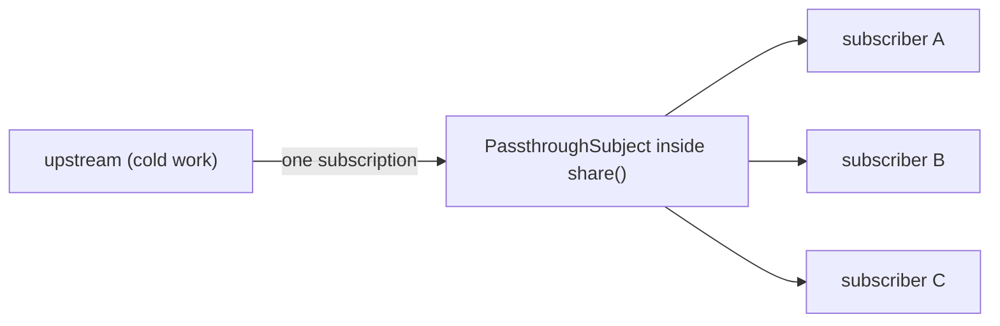

Most publishers are cold: each subscriber gets its own subscription, and the subscription does the work. Two views bound to the same request publisher send two requests; two subscribers to a `Deferred` file read read the file twice. Usually you want the opposite. One request, one read, one location manager, with every subscriber seeing the same results. That is **multicasting**: one subscription upstream, many subscribers downstream, with a subject in between relaying values from the one to the many.

Combine offers three levels of control. `share()` is the convenient one, and its convenience hides rules that decide whether it works: a subscriber that arrives late misses earlier values, a subscriber that arrives after completion gets only the completion, and with a synchronous upstream the second subscriber gets nothing at all. `multicast(_:)` with `connect()` lets you attach every subscriber before the work starts. And choosing the subject that `multicast` uses decides what late subscribers see, which turns a shared request into a cached one. This article measures each case, builds a `shareReplay` from the `ReplaySubject` written in [Subjects](/combine-subjects/), and wraps it in a response cache that does not cache failures.

<!--more-->

The examples use Swift 6 language mode and were compiled and run with the Swift 6.4 toolchain from Xcode 27.1 on macOS 26. Paste the `ReplaySubject` from [Subjects: `PassthroughSubject` and `CurrentValueSubject`](/combine-subjects/#building-a-replaysubject) first, then the blocks below in order, into one `main.swift`. The "work" in each example is counted by a `Deferred` publisher, which runs its closure once per upstream subscription, exactly as a request or a file read would.

<!-- check-uses: replay-subject -->

## What `share()` does

Apple's documentation describes `share()` as effectively a combination of `multicast(_:)` with a `PassthroughSubject` and an implicit `autoconnect()`. The first subscriber causes one subscription to the upstream; the values flow into a `PassthroughSubject`, and every downstream subscriber is a subscriber of that subject:



With an upstream that produces values over time, that is exactly the behavior you want, and the subject's rules apply to late subscribers:

```swift
import Combine
import Foundation

var upstreamWork = 0
let response = PassthroughSubject<String, Never>()
let sharedRequest = Deferred { () -> PassthroughSubject<String, Never> in
    upstreamWork += 1                            // stands in for sending a request
    return response
}
.share()

var first: [String] = []
var second: [String] = []
var afterCompletion: [String] = []
let firstHandle = sharedRequest.sink(receiveCompletion: { _ in first.append("done") },
                                     receiveValue: { first.append($0) })
response.send("partial")
let secondHandle = sharedRequest.sink(receiveCompletion: { _ in second.append("done") },
                                      receiveValue: { second.append($0) })
response.send("final")
response.send(completion: .finished)
let afterHandle = sharedRequest.sink(receiveCompletion: { _ in afterCompletion.append("done") },
                                     receiveValue: { afterCompletion.append($0) })

assert(upstreamWork == 1)                        // one request for three subscribers
assert(first == ["partial", "final", "done"])
assert(second == ["final", "done"])              // arrived late: missed "partial"
assert(afterCompletion == ["done"])              // arrived after completion: nothing but the end
```

The third subscriber did not start a new request; it received the shared subject's completion and nothing else. Code that shares a request and lets a screen subscribe later, for example when a tab is first opened, shows an empty state forever.

### With a synchronous upstream, the second subscriber gets nothing

`share()` connects when the first subscriber arrives. If the upstream finishes synchronously, it finishes *during that first subscription*, before the second subscriber exists:

```swift
var syncWork = 0
let sharedJust = Deferred { () -> Just<Int> in
    syncWork += 1
    return Just(syncWork)
}
.share()

var syncFirst: [String] = []
var syncSecond: [String] = []
let syncFirstHandle = sharedJust.sink(receiveCompletion: { _ in syncFirst.append("done") },
                                      receiveValue: { syncFirst.append("\($0)") })
let syncSecondHandle = sharedJust.sink(receiveCompletion: { _ in syncSecond.append("done") },
                                       receiveValue: { syncSecond.append("\($0)") })
assert(syncWork == 1)
assert(syncFirst == ["1", "done"])
assert(syncSecond == ["done"])                   // the value had already been delivered
```

This catches tests more than apps: a test replaces a network publisher with `Just` or a cached value, and a pipeline that shares it suddenly behaves differently from production. Apple's own example for `share()` inserts a `delay` for the same reason.

### When everyone leaves, the next subscriber starts over

`share()` keeps the upstream subscription only while it has subscribers. When the last one cancels, the upstream is cancelled, and the next subscriber connects again:

```swift
var restartWork = 0
let liveSource = PassthroughSubject<Int, Never>()
var upstreamCancellations = 0
let restartable = Deferred { () -> PassthroughSubject<Int, Never> in
    restartWork += 1
    return liveSource
}
.handleEvents(receiveCancel: { upstreamCancellations += 1 })
.share()

var viewA: AnyCancellable? = restartable.sink { _ in }
var viewB: AnyCancellable? = restartable.sink { _ in }
viewA = nil
assert(upstreamCancellations == 0)               // one subscriber remains
viewB = nil
assert(upstreamCancellations == 1)               // the last one left: upstream cancelled
let viewC = restartable.sink { _ in }
assert(restartWork == 2)                         // a new subscription, a second request
```

That is the right default for expensive live sources such as location updates, which should stop when no screen is listening. It also means that a screen that briefly drops its subscription, for example by recreating its pipeline when it reappears, repeats the work.

## `multicast` and `connect`: attach first, then start

`multicast(_:)` puts a subject of your choosing between the upstream and its subscribers and returns a `ConnectablePublisher`: nothing happens until you call `connect()`. That separates attaching subscribers from starting the work, which fixes the synchronous case:

```swift
var connectWork = 0
let connectable = Deferred { () -> Just<Int> in
    connectWork += 1
    return Just(connectWork)
}
.multicast { PassthroughSubject<Int, Never>() }

var connectedA: [Int] = []
var connectedB: [Int] = []
let connectedHandleA = connectable.sink { connectedA.append($0) }
let connectedHandleB = connectable.sink { connectedB.append($0) }
assert(connectWork == 0)                         // attached, not started
let connection = connectable.connect()
assert(connectWork == 1)
assert(connectedA == [1] && connectedB == [1])   // both received the value
```

The value returned by `connect()` is a `Cancellable` that stops the upstream; keep it as long as the work should run. `makeConnectable()` is shorthand for multicasting through a `PassthroughSubject` when the failure type is `Never`. Calling `autoconnect()` on a connectable publisher brings back `share()`'s behavior.

### The subject decides what late subscribers see

The closure passed to `multicast` creates the relaying subject, and that choice decides what a late subscriber receives. A `CurrentValueSubject` gives each new subscriber the latest value, at the price of an initial placeholder that the first subscriber also sees:

```swift
let temperatureSensor = PassthroughSubject<Int, Never>()
let latestTemperature = temperatureSensor
    .multicast { CurrentValueSubject<Int, Never>(0) }
    .autoconnect()

var earlyReadings: [Int] = []
var lateReadings: [Int] = []
let earlyReader = latestTemperature.sink { earlyReadings.append($0) }
temperatureSensor.send(21)
let lateReader = latestTemperature.sink { lateReadings.append($0) }
assert(earlyReadings == [0, 21])                 // the placeholder, then the reading
assert(lateReadings == [21])                     // a late subscriber starts from the latest
```

## `shareReplay`: sharing that remembers

A `ReplaySubject` with capacity 1 gives late subscribers the last value without a placeholder, and, unlike Combine's subjects, it replays its history to subscribers that arrive *after completion*. Multicasting through one gives the operator other frameworks call `shareReplay`:

```swift
extension Publisher {
    /// Shares one upstream subscription and replays the last `count` values, and the completion,
    /// to every subscriber, including those that arrive after the upstream has finished.
    func shareReplay(_ count: Int = 1) -> Publishers.Autoconnect<Publishers.Multicast<Self, ReplaySubject<Output, Failure>>> {
        multicast { ReplaySubject(capacity: count) }.autoconnect()
    }
}

var replayWork = 0
let profileResponse = PassthroughSubject<String, Never>()
let replayed = Deferred { () -> PassthroughSubject<String, Never> in
    replayWork += 1
    return profileResponse
}
.shareReplay()

var screenOne: [String] = []
var screenTwo: [String] = []
var screenThree: [String] = []
let screenOneHandle = replayed.sink(receiveCompletion: { _ in screenOne.append("done") },
                                    receiveValue: { screenOne.append($0) })
profileResponse.send("Ada Lovelace")
profileResponse.send(completion: .finished)
let screenTwoHandle = replayed.sink(receiveCompletion: { _ in screenTwo.append("done") },
                                    receiveValue: { screenTwo.append($0) })
screenOneHandle.cancel()
screenTwoHandle.cancel()
let screenThreeHandle = replayed.sink(receiveCompletion: { _ in screenThree.append("done") },
                                      receiveValue: { screenThree.append($0) })

assert(replayWork == 1)                          // one request, ever
assert(screenOne == ["Ada Lovelace", "done"])
assert(screenTwo == ["Ada Lovelace", "done"])    // after completion: the cached response
assert(screenThree == ["Ada Lovelace", "done"])  // even after every subscriber had left
```

The subject is created once, when the multicast first connects, and it outlives the upstream subscription, so it acts as a cache of the response. A synchronous upstream works too, because the replay buffer catches the value before the second subscriber arrives:

```swift
var replaySyncWork = 0
let replayedJust = Deferred { () -> Just<Int> in
    replaySyncWork += 1
    return Just(replaySyncWork)
}
.shareReplay()
var replayA: [Int] = []
var replayB: [Int] = []
let replayHandleA = replayedJust.sink { replayA.append($0) }
let replayHandleB = replayedJust.sink { replayB.append($0) }
assert(replaySyncWork == 1 && replayA == [1] && replayB == [1])
```

| Operator | One upstream subscription | Late subscriber while running | Subscriber after completion | Synchronous upstream |
|---|---|---|---|---|
| none (cold) | no, one per subscriber | its own fresh run | its own fresh run | each subscriber gets everything |
| `share()` | yes | misses earlier values | completion only | second subscriber gets nothing |
| `multicast` + `connect()` | yes | misses earlier values | completion only | all receive, if attached before `connect()` |
| `multicast { CurrentValueSubject }` | yes | latest value | completion only | placeholder, then latest |
| `shareReplay(1)` | yes | last value, then live | last value, then completion | all receive |

## A response cache that does not cache failures

A replayed failure is also cached. The replay subject stores the completion, and every later subscriber receives it:

```swift
enum ProfileError: Error { case offline }

var failingWork = 0
let failingResponse = PassthroughSubject<String, ProfileError>()
let replayedFailure = Deferred { () -> PassthroughSubject<String, ProfileError> in
    failingWork += 1
    return failingResponse
}
.shareReplay()
var failureLog: [String] = []
let failingFirst = replayedFailure.sink(
    receiveCompletion: { if case .failure = $0 { failureLog.append("first failed") } },
    receiveValue: { _ in })
failingResponse.send(completion: .failure(.offline))
let failingLater = replayedFailure.sink(
    receiveCompletion: { if case .failure = $0 { failureLog.append("later failed") } },
    receiveValue: { _ in })
assert(failingWork == 1)                         // no new attempt
assert(failureLog == ["first failed", "later failed"])
```

A profile that failed to load once because the device was offline would stay failed for the life of the cache. A cache needs to know the difference: keep a shared publisher while it is in flight or has succeeded, and forget it when it fails, so the next caller makes a fresh attempt. A small class does that:

```swift
@MainActor
final class ResponseCache<Output, Failure: Error> {
    private let makeRequest: () -> AnyPublisher<Output, Failure>
    private var current: AnyPublisher<Output, Failure>?

    init(_ makeRequest: @escaping () -> AnyPublisher<Output, Failure>) {
        self.makeRequest = makeRequest
    }

    /// The cached response, or the request in flight, or a new request if neither exists.
    func response() -> AnyPublisher<Output, Failure> {
        if let current { return current }
        let shared = makeRequest()
            .handleEvents(receiveCompletion: { [weak self] completion in
                if case .failure = completion { self?.current = nil }   // never cache a failure
            })
            .shareReplay()
            .eraseToAnyPublisher()
        current = shared
        return shared
    }

    func invalidate() { current = nil }
}

var requestsSent = 0
var nextRequestFails = true
let profileCache = ResponseCache<String, ProfileError> {
    Deferred { () -> AnyPublisher<String, ProfileError> in
        requestsSent += 1
        return nextRequestFails
            ? Fail(error: .offline).eraseToAnyPublisher()
            : Just("Ada Lovelace").setFailureType(to: ProfileError.self).eraseToAnyPublisher()
    }
    .eraseToAnyPublisher()
}

var cacheLog: [String] = []
@MainActor
func load(_ label: String) -> AnyCancellable {
    profileCache.response().sink(
        receiveCompletion: { if case .failure = $0 { cacheLog.append("\(label): failed") } },
        receiveValue: { cacheLog.append("\(label): \($0)") })
}

let attempt1 = load("first")                     // offline: fails, and is forgotten
nextRequestFails = false
let attempt2 = load("second")                    // a fresh request succeeds, and is cached
let attempt3 = load("third")                     // served from the cache
profileCache.invalidate()
let attempt4 = load("after invalidate")          // a deliberate refresh

assert(requestsSent == 3)
assert(cacheLog == ["first: failed", "second: Ada Lovelace", "third: Ada Lovelace",
                    "after invalidate: Ada Lovelace"])
```

Three requests for four loads: the failure was retried on the next load, the success was shared, and `invalidate()` gives the app an explicit refresh, for example on pull to refresh or when the user signs out. Two concurrent callers that ask while the request is still in flight share it too, which is the coalescing that the networking roadmap's [Coalescing Duplicate Requests and Rejecting Stale Results](/swift-request-coalescing/) builds with tasks. What this cache does not do is expire entries by age or by server cache headers; for HTTP responses, that belongs in `URLCache` and the rules from [HTTP Caching with `Cache-Control` and `ETag`](/swift-http-caching-etag/).

Keep the remaining subscriptions alive until the end of the file:

```swift
withExtendedLifetime((firstHandle, secondHandle, afterHandle, syncFirstHandle, syncSecondHandle,
                      viewC, connectedHandleA, connectedHandleB, connection, earlyReader,
                      lateReader, screenThreeHandle, replayHandleA, replayHandleB, failingFirst,
                      failingLater, attempt1, attempt2, attempt3, attempt4)) {}
_ = (viewA, viewB)
```

## Summary

- `share()` makes one upstream subscription for all concurrent subscribers. A late subscriber missed earlier values, a subscriber after completion received only the completion, and with a synchronous upstream the second subscriber received nothing.
- When the last subscriber of `share()` cancelled, the upstream was cancelled, and the next subscriber started the work again.
- `multicast(_:)` plus `connect()` attaches subscribers before the work starts; both received a synchronous value. The subject passed to `multicast` decides what late subscribers see.
- `shareReplay()`, built from `multicast` and a capacity-1 `ReplaySubject`, ran the work once and replayed the response to subscribers arriving after completion, even after every subscriber had left. It also replays failures.
- A `ResponseCache` that drops its shared publisher on failure retried after an offline failure, served later loads from the cache, and refreshed on `invalidate()`: three requests for four loads.

## Exercise

Add a time-to-live to `ResponseCache`, using an injected clock, so that a cached success older than a given age triggers a new request on the next `response()`, while callers that arrive during that request share it. Test with the virtual scheduler that a load inside the time-to-live sends no request, a load after it sends exactly one even when three callers ask at once, and a failure after expiry leaves the cache empty rather than serving the stale value. Then decide, and justify in a comment, whether a stale value should be served while the refresh is in flight, the "stale-while-revalidate" policy, and implement it behind a flag.

## Further reading

- Apple's documentation for [`share()`](https://developer.apple.com/documentation/combine/publisher/share()), [`multicast(_:)`](https://developer.apple.com/documentation/combine/publisher/multicast(_:)), and [`ConnectablePublisher`](https://developer.apple.com/documentation/combine/connectablepublisher).
- The ReactiveX documentation for [`Replay`](https://reactivex.io/documentation/operators/replay.html) and [`RefCount`](https://reactivex.io/documentation/operators/refcount.html), which correspond to `shareReplay` and `autoconnect`.
- The networking roadmap's [Coalescing Duplicate Requests and Rejecting Stale Results](/swift-request-coalescing/), which derives how much coalescing saves.

Previous: [Schedulers: `receive(on:)` and `subscribe(on:)`](/combine-schedulers-receive-subscribe-on/). Next: [Debugging Pipelines with `print` and `handleEvents`](/combine-debugging-print-handleevents/).

Return to the [Combine roadmap](/combine/).
