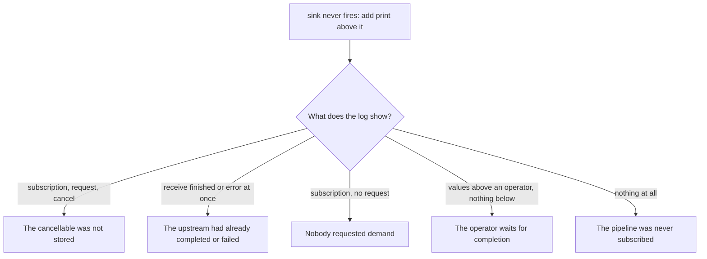

A Combine pipeline is hard to step through. The operators are generic structs inside a system framework, the work happens in subscriptions you never see, and the interesting events, a subscription that was cancelled, a demand that never arrived, a completion that came too early, leave no trace in your own code. Breakpoints in a `sink` closure tell you only that a value did arrive. When it does not, you need to see the signals themselves.

Combine has three operators for that. `print(_:to:)` logs every signal that passes through it, including the subscription, each request for demand, and cancellation. `handleEvents` runs your closures on the same signals, so you can log, count, or assert on them. `breakpoint` and `breakpointOnError` stop in the debugger when a condition is met. This article reads `print`'s output in detail, uses it to diagnose the five common reasons a `sink` never fires, builds a logging operator on `os.Logger` that keeps values private, and covers reading the Swift 6 isolation crash that the rest of this series keeps running into.

<!--more-->

The examples use Swift 6 language mode and were compiled and run with the Swift 6.4 toolchain from Xcode 27.1 on macOS 26. Paste the blocks in order into one `main.swift`.

## Reading `print`

`print(_:to:)` logs each signal with an optional prefix. By default it writes to standard output; passing a `TextOutputStream` captures it, which is what the examples here do so they can assert on the log:

```swift
import Combine
import Foundation

final class SignalTranscript: TextOutputStream {
    private(set) var lines: [String] = []
    func write(_ string: String) {
        lines += string.split(separator: "\n").map(String.init)
    }
}

enum UploadError: Error { case rejected }

let uploads = PassthroughSubject<Int, UploadError>()
let uploadTranscript = SignalTranscript()
var uploadHandle: AnyCancellable? = uploads
    .print("upload", to: uploadTranscript)
    .sink(receiveCompletion: { _ in }, receiveValue: { _ in })
uploads.send(1)
uploadHandle = nil                               // release the subscription

assert(uploadTranscript.lines == [
    "upload: receive subscription: (PassthroughSubject)",
    "upload: request unlimited",
    "upload: receive value: (1)",
    "upload: receive cancel",
])
```

Each line names one signal, and the vocabulary is small:

| Line | Signal | Direction |
|---|---|---|
| `receive subscription: (X)` | the upstream handed over subscription `X` | downstream |
| `request unlimited`, `request max: (n)` | the downstream asked for more values | upstream |
| `request max: (n) (synchronous)` | demand returned from `receive(_:)` rather than requested | upstream |
| `receive value: (v)` | a value | downstream |
| `receive finished`, `receive error: (e)` | the completion | downstream |
| `receive cancel` | the downstream cancelled | upstream |

A failure shows the error, and a subscriber that requests in small amounts shows each request. Placing `print` at more than one point shows how operators transform demand: here a `filter` asks the source for one more value, marked `(synchronous)`, each time it drops one, and `prefix` cancels the source once it has what it needs, so the source never sees a completion:

```swift
let stagesTranscript = SignalTranscript()
let stagesHandle = (1...6).publisher
    .print("source", to: stagesTranscript)
    .filter { $0.isMultiple(of: 2) }
    .print("filtered", to: stagesTranscript)
    .prefix(2)
    .sink { _ in }

assert(stagesTranscript.lines == [
    "source: receive subscription: (1...6)",
    "filtered: receive subscription: (Print)",
    "filtered: request unlimited",
    "source: request unlimited",
    "source: receive value: (1)",
    "source: request max: (1) (synchronous)",
    "source: receive value: (2)",
    "filtered: receive value: (2)",
    "source: receive value: (3)",
    "source: request max: (1) (synchronous)",
    "source: receive value: (4)",
    "filtered: receive value: (4)",
    "filtered: receive cancel",
    "source: receive cancel",
])
```

Two details in that log are easy to misread. The subscription lines appear in upstream order, source first, because subscriptions are handed down from the top. And the `(synchronous)` requests are the `filter` returning extra demand from `receive(_:)`, the accounting [Filtering](/combine-filter-removeduplicates-compactmap/) describes, not a separate call. With `flatMap(maxPublishers:)`, the same technique shows the limit at work:

```swift
let flatMapTranscript = SignalTranscript()
let flatMapHandle = (1...3).publisher
    .print("outer", to: flatMapTranscript)
    .flatMap(maxPublishers: .max(1)) { Just($0 * 10) }
    .sink { _ in }

assert(flatMapTranscript.lines == [
    "outer: receive subscription: (1...3)",
    "outer: request max: (1)",
    "outer: receive value: (1)",
    "outer: request max: (1)",
    "outer: receive value: (2)",
    "outer: request max: (1)",
    "outer: receive value: (3)",
    "outer: request max: (1)",
    "outer: receive finished",
])
```

One request per value, each sent after the previous inner publisher finished: the concurrency limit is visible as demand.

`print` writes values with `String(describing:)`, to standard output, in every build configuration. A pipeline that carries tokens, emails, or message bodies writes them to the device console in release builds if a `print` is left in. Treat it like a breakpoint: add it while debugging and remove it before committing, or use the logging operator below.

## Why a `sink` never fires

When a subscriber receives nothing, a `print` directly above it narrows the cause to one of five patterns, each with a distinctive log.

**The subscription was cancelled at once**, because nothing stored the cancellable. The log shows a subscription and a request immediately followed by a cancel:

```swift
let discardedSource = PassthroughSubject<Int, Never>()
let discardedTranscript = SignalTranscript()
_ = discardedSource.print("discarded", to: discardedTranscript).sink { _ in }
discardedSource.send(1)
assert(discardedTranscript.lines == [
    "discarded: receive subscription: (PassthroughSubject)",
    "discarded: request unlimited",
    "discarded: receive cancel",
])
```

**The upstream had already finished.** A subject that has completed hands a new subscriber the completion immediately:

```swift
let finishedSource = PassthroughSubject<Int, Never>()
finishedSource.send(completion: .finished)
let finishedTranscript = SignalTranscript()
let finishedHandle = finishedSource.print("finished", to: finishedTranscript).sink { _ in }
finishedSource.send(1)
assert(finishedTranscript.lines == [
    "finished: receive subscription: (Empty)",       // not the subject: a stand-in that is already done
    "finished: request unlimited",
    "finished: receive finished",
])
```

The subscription line gives it away: a finished subject does not hand out a `PassthroughSubject` subscription but an `Empty` one, which completes as soon as it is asked for values.

**An earlier failure ended the stream.** A `receive error` line, often from a `catch` placed too far out, as in [Error Handling](/combine-error-handling-catch-retry/), and nothing afterwards.

**Nobody asked for values.** A custom subscriber or a `.values` bridge that has not requested demand produces a subscription line with no request line after it; a `PassthroughSubject` then drops every value:

```swift
final class SilentSubscriber: Subscriber {
    typealias Input = Int
    typealias Failure = Never
    func receive(subscription: any Subscription) {}          // forgot to request
    func receive(_ input: Int) -> Subscribers.Demand { .none }
    func receive(completion: Subscribers.Completion<Never>) {}
}

let undemandedSource = PassthroughSubject<Int, Never>()
let undemandedTranscript = SignalTranscript()
undemandedSource.print("undemanded", to: undemandedTranscript).subscribe(SilentSubscriber())
undemandedSource.send(1)
assert(undemandedTranscript.lines == ["undemanded: receive subscription: (PassthroughSubject)"])
```

**The operator is waiting for a completion that never comes.** `last()`, `collect()`, and `reduce` on a subject show values arriving *above* them and nothing below, as [Sequence Operators](/combine-first-last-collect/) measured. Two `print`s, one on each side of the operator, make the gap obvious.



## `handleEvents`: hooks you can assert on

`handleEvents` takes optional closures for each signal: `receiveSubscription`, `receiveOutput`, `receiveCompletion`, `receiveCancel`, and `receiveRequest`. It passes every signal through unchanged, so it can be inserted anywhere. It runs its closure *before* forwarding the signal, which means a closure on `receiveOutput` sees a value before anything downstream does:

```swift
var orderLog: [String] = []
let orderHandle = Just(7)
    .handleEvents(receiveOutput: { orderLog.append("handleEvents saw \($0)") })
    .sink { orderLog.append("sink got \($0)") }
assert(orderLog == ["handleEvents saw 7", "sink got 7"])
```

Its most useful debugging role is counting things that should not happen more than once, such as subscriptions to an expensive upstream. A test that asserts on the count catches a duplicate request long before a user notices:

```swift
var subscriptionCount = 0
let expensive = Deferred { Just("profile") }
    .handleEvents(receiveSubscription: { _ in subscriptionCount += 1 })

let viewA = expensive.sink { _ in }
let viewB = expensive.sink { _ in }
assert(subscriptionCount == 2)                   // two views, two subscriptions: share it

subscriptionCount = 0
let sharedExpensive = expensive.share()
let sharedA = sharedExpensive.sink { _ in }
let sharedB = sharedExpensive.sink { _ in }
assert(subscriptionCount == 1)
```

The second count is 1, though as [Managing Resources](/combine-share-multicasting/) explained, with this synchronous upstream `sharedB` received only the completion. A count is a fact about subscriptions, not about who saw the value.

## A logging operator that keeps values private

For diagnostics that should stay in the code, such as which pipeline subscribed, when it was cancelled, and what demand it carried, `os.Logger` is the right destination: it is cheap when the level is disabled, it is collected in sysdiagnoses, and it redacts dynamic values unless you mark them public. A `handleEvents`-based operator gives every pipeline the same log format:

```swift
import os

extension Publisher {
    /// Logs every signal at debug level. Values are private; structure is public.
    func log(_ label: String, to logger: Logger) -> Publishers.HandleEvents<Self> {
        handleEvents(
            receiveSubscription: { _ in logger.debug("\(label, privacy: .public): subscribed") },
            receiveOutput: { value in logger.debug("\(label, privacy: .public): value \(String(describing: value))") },
            receiveCompletion: { completion in
                logger.debug("\(label, privacy: .public): \(String(describing: completion), privacy: .public)")
            },
            receiveCancel: { logger.debug("\(label, privacy: .public): cancelled") },
            receiveRequest: { demand in
                logger.debug("\(label, privacy: .public): request \(String(describing: demand), privacy: .public)")
            }
        )
    }
}

let pipelineLogger = Logger(subsystem: "com.example.combine-debug", category: "pipeline")
let tokenHandle = ["token-123", "token-456"].publisher
    .log("tokens", to: pipelineLogger)
    .sink { _ in }
```

Running this code while streaming the log with `log stream --level debug --predicate 'subsystem == "com.example.combine-debug"'` showed the structure and hid the values:

```text
[com.example.combine-debug:pipeline] tokens: subscribed
[com.example.combine-debug:pipeline] tokens: request unlimited
[com.example.combine-debug:pipeline] tokens: value <private>
[com.example.combine-debug:pipeline] tokens: value <private>
[com.example.combine-debug:pipeline] tokens: finished
```

Debug-level messages are not persisted by default, so `log show` after the fact found nothing; streaming while reproducing, or Console with debug messages enabled, is how to read them. The completion is marked public because it is a structural fact; an error's description can contain user data, so for errors with payloads, log a type or a code instead. The networking roadmap's [Redacting Sensitive Data from Network Logs](/swift-redacting-network-logs/) measured how `os.Logger` treats static strings, which it does *not* redact, and why secrets must never be part of a format string.

## `breakpoint` and `breakpointOnError`

`breakpoint(receiveSubscription:receiveOutput:receiveCompletion:)` raises `SIGTRAP` when one of its closures returns `true`, and `breakpointOnError()` does so on any failure. Under the debugger, execution stops at the signal with the pipeline's frames on the stack. Without a debugger, `SIGTRAP` terminates the process: a test program using `breakpointOnError()` exited with status 133 at the first failure. Under `lldb`, the stop looked like this:

```text
* thread #1, queue = 'com.apple.main-thread', stop reason = signal SIGTRAP
  * frame #0: libsystem_kernel.dylib`__pthread_kill + 8
    frame #1: libsystem_pthread.dylib`pthread_kill + 296
    frame #2: libsystem_c.dylib`raise + 32
    frame #3: Combine`Publishers.Breakpoint.Inner.receive(completion:) + 88
    frame #4: Combine`PassthroughSubject.Conduit.finish(completion:) + 800
```

Frames further down show the code that sent the failure, which is usually what you want to find. Because they terminate the process outside a debugger, these operators must never reach a build that runs anywhere else; wrap them in `#if DEBUG`, or better, add them only while investigating:

<!-- skip-check -->
```swift
let investigated = uploads
    .breakpoint(receiveOutput: { $0 > 1_000 })   // stop on a suspicious value
    .breakpointOnError()                          // and on any failure
```

## Reading the Swift 6 isolation crash

The crash this series meets most often looks like this in a backtrace:

```text
* thread #6, queue = 'com.apple.NSURLSession-delegate', stop reason = EXC_BREAKPOINT
    frame #0: libdispatch.dylib`_dispatch_assert_queue_fail + 120
    frame #1: libdispatch.dylib`dispatch_assert_queue$V2.cold.1 + 116
    frame #2: libdispatch.dylib`dispatch_assert_queue + 108
    frame #3: libswift_Concurrency.dylib`_swift_task_checkIsolatedSwift + 48
    frame #4: libswift_Concurrency.dylib`swift_task_isCurrentExecutorWithFlagsImpl(...) + 356
    frame #5: MyApp`closure #1 in ProfileModel.load(from:) + 124
    frame #6: Combine`Publishers.Map.Inner.receive(_:) + 168
```

Three facts identify it. The thread is not the main thread; here it is `URLSession`'s delegate queue. Frames 0 to 4 are the run-time isolation check that Swift 6 inserts into closures it infers to be main-actor isolated. Frame 5 names the closure, by position, `closure #1`, inside the method that created it, and frame 6 names the operator that called it. The fix is always to make that closure run after a `receive(on: DispatchQueue.main)`, or to make it nonisolated, as [Schedulers: `receive(on:)` and `subscribe(on:)`](/combine-schedulers-receive-subscribe-on/) sets out. A `print` placed just above the named operator confirms which values arrive on which thread when the crash is intermittent.

Keep the remaining subscriptions alive until the end of the file:

```swift
withExtendedLifetime((stagesHandle, flatMapHandle, finishedHandle, orderHandle, viewA, viewB,
                      sharedA, sharedB, tokenHandle)) {}
_ = uploadHandle
```

## Summary

- `print` logs subscriptions, requests, values, completions, and cancellations; demand returned from `receive(_:)` is marked `(synchronous)`. It writes values in plain text in every build, so do not leave it in.
- Prints at several stages show how operators transform demand: `filter` requested one more per drop, `prefix` cancelled its source, and `flatMap(maxPublishers: .max(1))` requested one value at a time.
- A silent `sink` has five common causes with distinct logs: an unstored cancellable, a completed upstream, an earlier failure, missing demand, and an operator waiting for completion.
- `handleEvents` runs before the signal is forwarded and is the tool for counting subscriptions in tests.
- A `Logger`-based operator logged the structure of a pipeline and showed values as `<private>`; debug messages appear in `log stream`, not in `log show`.
- `breakpoint` and `breakpointOnError` stop in the debugger and terminate the process without one: exit status 133.
- An isolation crash names the closure as `closure #N in Type.method` above the operator that called it; move that closure after `receive(on:)` or make it nonisolated.

## Exercise

Write a `trace(_:)` operator that records every signal, with the thread it arrived on and the time since subscription measured by an injected scheduler, into a `Sendable` recorder, and returns the upstream unchanged. Use it to write a test that fails with a readable message, listing the full signal history, when a pipeline delivers a value on the wrong thread or subscribes to its upstream more than once. Then add a `#if DEBUG` assertion mode that calls `assertionFailure` with that history instead of recording silently, and check that the release build compiles it away.

## Further reading

- Apple's documentation for [`print(_:to:)`](https://developer.apple.com/documentation/combine/publisher/print(_:to:)), [`handleEvents(receiveSubscription:receiveOutput:receiveCompletion:receiveCancel:receiveRequest:)`](https://developer.apple.com/documentation/combine/publisher/handleevents(receivesubscription:receiveoutput:receivecompletion:receivecancel:receiverequest:)), and [`breakpointOnError()`](https://developer.apple.com/documentation/combine/publisher/breakpointonerror()).
- Apple's [Logger](https://developer.apple.com/documentation/os/logger) documentation, and the article [Generating Log Messages from Your Code](https://developer.apple.com/documentation/os/generating-log-messages-from-your-code).
- The site's [LLDB Survival Guide](/lldb-survival-guide/), for working with the stops that `breakpoint` produces.

Previous: [Managing Resources: `share` and Multicasting](/combine-share-multicasting/). Next: [Testing Publishers](/combine-testing-publishers/).

Return to the [Combine roadmap](/combine/).
