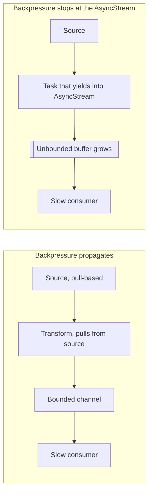

Whenever a producer can generate values faster than a consumer can handle them, something has to give. The values can pile up in a buffer, which costs memory and makes the consumer see increasingly stale data. Some values can be dropped. Or the producer can be made to wait, which is **backpressure**: the consumer's pace propagates back to the source.

`AsyncStream` chooses buffering and dropping. Its `yield` never waits, so it cannot apply backpressure; it can only decide what to do with values that arrive while the consumer is busy. This article quantifies that choice, measures each buffering policy, builds a small bounded channel that does apply backpressure, and pins down exactly what happens to buffered values when a stream finishes, fails, or is cancelled.

<!--more-->

The examples use Swift 6 language mode and were compiled and run with the Swift 6.4 toolchain on macOS 26. The Swift blocks build on one another in one `main.swift`.

## A buffer is a queue, and queues have arithmetic

Suppose a producer emits values at rate $$\lambda$$ and a consumer processes them at rate $$\mu$$. If $$\lambda \le \mu$$, any buffer stays small: it absorbs bursts and drains between them. If $$\lambda > \mu$$ for a sustained period of length $$t$$, the excess accumulates:

$$
Q(t) = (\lambda - \mu)\, t .
$$

A sensor producing 1,000 readings per second, consumed by UI code that handles 60 per second, accumulates 940 readings per second. After a minute, an unbounded buffer holds 56,400 readings, and the consumer is a minute behind reality.

Staleness follows from Little's law: a value that enters a buffer holding $$L$$ values, drained at rate $$\mu$$, waits about

$$
W = \frac{L}{\mu}
$$

before it is handled. With a 100-value buffer drained at 60 per second, the consumer is always about 1.7 seconds behind. For UI state, that is useless: the user sees where they *were*. For an audit log, it may be fine, as long as memory allows. The policy has to match what the values mean.

## The three buffering policies

`AsyncStream` and `AsyncThrowingStream` take a `bufferingPolicy` when created:

| Policy | When the buffer is full | Keeps | Typical use |
| --- | --- | --- | --- |
| `.unbounded` (default) | Never full | Everything | Bounded, bursty sources where every value matters |
| `.bufferingOldest(n)` | Drops the *new* value | The first `n` values | First-come work where later duplicates are redundant |
| `.bufferingNewest(n)` | Drops the *oldest* buffered value | The latest `n` values | State, progress, positions: anything where newer supersedes older |

`yield` reports what happened to each value through `YieldResult`: `.enqueued(remaining:)`, `.dropped(element)`, or `.terminated`. The experiment below yields 1,000 values while the consumer is busy elsewhere, then lets the consumer drain whatever the stream kept:

```swift
import Synchronization

struct StreamRun: Sendable {
    let delivered: [Int]
    let enqueued: Int
    let dropped: Int
}

func flood(policy: AsyncStream<Int>.Continuation.BufferingPolicy) async -> StreamRun {
    let (stream, continuation) = AsyncStream.makeStream(of: Int.self, bufferingPolicy: policy)
    var enqueued = 0
    var dropped = 0
    for value in 0..<1_000 {          // The consumer is not reading yet: everything goes to the buffer.
        switch continuation.yield(value) {
        case .enqueued: enqueued += 1
        case .dropped: dropped += 1
        case .terminated: break
        @unknown default: break
        }
    }
    continuation.finish()
    var delivered: [Int] = []
    for await value in stream {
        delivered.append(value)
    }
    return StreamRun(delivered: delivered, enqueued: enqueued, dropped: dropped)
}

let unbounded = await flood(policy: .unbounded)
assert(unbounded.delivered == Array(0..<1_000) && unbounded.dropped == 0)

let oldest = await flood(policy: .bufferingOldest(10))
assert(oldest.delivered == Array(0..<10) && oldest.dropped == 990, "Kept the first ten, dropped every later value")

let newest = await flood(policy: .bufferingNewest(10))
assert(newest.delivered == Array(990..<1_000) && newest.dropped == 990, "Kept the latest ten, evicting older ones")
```

The unbounded stream held all 1,000 values. Each bounded policy kept exactly ten and dropped 990, but different ones: `bufferingOldest` kept 0 through 9 and refused everything after; `bufferingNewest` kept 990 through 999, evicting older values as newer ones arrived. When a consumer is already waiting at the moment of a `yield`, the value is handed to it directly without touching the buffer, so in a live stream a bounded policy can deliver one more value than its limit.

Two details matter in practice:

- **`.unbounded` is the default.** A stream created without a policy has no memory limit. That is fine for a delegate that reports a handful of events. It is a slow leak for a high-frequency source, such as motion data, audio levels, or download progress, paired with a consumer that occasionally stalls.
- **`bufferingNewest(1)` is "latest value" semantics.** The consumer always sees the most recent state, never more than one value behind. For UI it is usually the right policy; staleness is bounded by one consumer iteration.

## `AsyncStream` cannot apply backpressure

Dropping values is acceptable when values supersede each other. It is not acceptable for a file upload, a database import, or a log shipper, where every value must be processed. For those, the producer must slow down when the consumer cannot keep up.

`AsyncStream.Continuation.yield` is synchronous. It cannot suspend the producer, so it cannot transmit the consumer's pace. A proposal to add backpressure to `AsyncStream`, [SE-0406](https://github.com/swiftlang/swift-evolution/blob/main/proposals/0406-async-stream-backpressure.md), was returned for revision and is not part of the Swift 6.4 standard library. Until something like it ships, backpressure needs one of three designs:

1. **Pull-based production.** If the source can produce on request, use `AsyncStream(unfolding:)` or a custom `AsyncSequence`. The producer runs only when the consumer calls `next()`, so it can never get ahead.
2. **A channel whose `send` suspends.** The [swift-async-algorithms](https://github.com/apple/swift-async-algorithms) package provides `AsyncChannel`, where `send` suspends until a consumer takes the value. A bounded buffer generalizes that to "suspend only when `n` values are waiting."
3. **Source-level flow control.** Pause and resume the underlying source, for example by suspending a `URLSessionTask` or stopping a sensor, driven by buffer depth. This is the only option when the source itself cannot wait, such as a network socket that keeps receiving.

## A bounded channel with backpressure

A bounded channel is a buffer of capacity $$n$$ where `send` suspends while the buffer is full and `receive` suspends while it is empty. An actor makes the bookkeeping straightforward:

```swift
/// A single-consumer channel whose `send` suspends while `capacity` values are waiting.
actor BoundedChannel<Element: Sendable> {
    private var buffer: [Element] = []
    private let capacity: Int
    private var waitingSenders: [CheckedContinuation<Void, Never>] = []
    private var waitingReceiver: CheckedContinuation<Element?, Never>?
    private var isFinished = false
    private(set) var peakBuffered = 0

    init(capacity: Int) {
        precondition(capacity > 0)
        self.capacity = capacity
    }

    /// Returns false if the channel was finished before the value could be sent.
    func send(_ element: Element) async -> Bool {
        while buffer.count >= capacity && !isFinished {
            await withCheckedContinuation { waitingSenders.append($0) }
        }
        guard !isFinished else { return false }
        if let receiver = waitingReceiver {
            waitingReceiver = nil
            receiver.resume(returning: element)
        } else {
            buffer.append(element)
            peakBuffered = max(peakBuffered, buffer.count)
        }
        return true
    }

    /// Returns nil once the channel is finished and drained.
    func receive() async -> Element? {
        if !buffer.isEmpty {
            let element = buffer.removeFirst()
            if !waitingSenders.isEmpty {
                waitingSenders.removeFirst().resume()
            }
            return element
        }
        if isFinished { return nil }
        return await withCheckedContinuation { waitingReceiver = $0 }
    }

    func finish() {
        isFinished = true
        waitingReceiver?.resume(returning: nil)
        waitingReceiver = nil
        for sender in waitingSenders {
            sender.resume()
        }
        waitingSenders.removeAll()
    }
}
```

Two parts of this design come straight from the [actor reentrancy article](/swift-actor-reentrancy/). The `while` loop in `send`, rather than an `if`, re-checks the condition after every wake-up, because another sender may have filled the freed slot while this one was suspended. And every continuation is removed from the actor's state at the moment it is resumed, so none can be resumed twice.

With a fast producer and a slow consumer, the buffer never exceeds its capacity and nothing is lost:

```swift
let channel = BoundedChannel<Int>(capacity: 8)
let channelProducer = Task { () -> Int in
    var sent = 0
    for value in 0..<200 {
        if await channel.send(value) { sent += 1 }
    }
    await channel.finish()
    return sent
}

var channelDelivered: [Int] = []
while let value = await channel.receive() {
    channelDelivered.append(value)
    try? await Task.sleep(for: .microseconds(200))     // A slow consumer.
}
let channelSent = await channelProducer.value
let channelPeak = await channel.peakBuffered
assert(channelSent == 200 && channelDelivered == Array(0..<200), "Every value, in order")
assert(channelPeak <= 8, "Memory is bounded by the capacity")
```

The producer ran exactly as fast as the consumer allowed: whenever eight values were waiting, its `send` suspended until the consumer took one. Memory is bounded by the capacity, and staleness by $$W = n/\mu$$.

This channel is deliberately small, and a production version needs more:

- **Cancellation.** A sender cancelled while suspended stays suspended until space appears. Removing it requires the cancellation-handler pattern from the [cancellation handlers article](/swift-cancellation-handlers-cleanup/), with an identifier per waiter.
- **Multiple consumers.** `waitingReceiver` holds a single continuation. More consumers need a queue of them.
- **Priority.** Waiting senders are suspended through continuations, which hide the dependency from priority escalation, as the [priority article](/swift-task-priority/) shows.

For most code, a well-tested library type such as `AsyncChannel` is the better choice. Building one once is the best way to understand what it does.

## Backpressure must hold at every stage

In a multi-stage pipeline, backpressure propagates only if *every* stage is pull-based or suspending. A single push-based stage breaks the chain:



The broken shape is common: a task reads from a pull-based source as fast as it can and yields every element into an `AsyncStream` for "decoupling." The source is now read at full speed, the stream's default buffer is unbounded, and the slow consumer's pace never reaches the source. Either replace the stream with a suspending channel, or let the consumer pull from the source directly.

## Termination and what happens to buffered values

A stream ends in one of three ways, and each treats the buffer differently:

```swift
let terminationLog = Mutex<[String]>([])

// 1. finish(): buffered values are delivered, then the loop ends normally.
let (finishing, finishingContinuation) = AsyncStream.makeStream(of: Int.self)
finishingContinuation.onTermination = { reason in
    terminationLog.withLock { $0.append("finishing: \(reason)") }
}
for value in 1...3 { finishingContinuation.yield(value) }
finishingContinuation.finish()
var drained: [Int] = []
for await value in finishing { drained.append(value) }
assert(drained == [1, 2, 3])

// 2. finish(throwing:): buffered values are delivered, then the error is thrown.
struct FeedBroke: Error {}
let (failing, failingContinuation) = AsyncThrowingStream.makeStream(of: Int.self, throwing: (any Error).self)
for value in 1...3 { failingContinuation.yield(value) }
failingContinuation.finish(throwing: FeedBroke())
var beforeFailure: [Int] = []
do {
    for try await value in failing { beforeFailure.append(value) }
    assertionFailure("The stream must end with its error")
} catch is FeedBroke {
}
assert(beforeFailure == [1, 2, 3], "Values buffered before the error still arrive first")

// 3. Consumer cancellation while the consumer is busy in its loop body.
let (abandoned, abandonedContinuation) = AsyncStream.makeStream(of: Int.self)
abandonedContinuation.onTermination = { reason in
    terminationLog.withLock { $0.append("abandoned: \(reason)") }
}
let abandoningConsumer = Task { () -> [String] in
    var seen: [String] = []
    for await value in abandoned {
        seen.append("\(value), cancelled: \(Task.isCancelled)")
        try? await Task.sleep(for: .milliseconds(50))         // Busy, not waiting in next().
    }
    return seen
}
try await Task.sleep(for: .milliseconds(5))
for value in 1...3 { abandonedContinuation.yield(value) }
try await Task.sleep(for: .milliseconds(10))
abandoningConsumer.cancel()
let yieldRightAfterCancel = abandonedContinuation.yield(4)
let seenAfterCancellation = await abandoningConsumer.value
if case .enqueued = yieldRightAfterCancel {} else {
    assertionFailure("The stream had not yet noticed the cancellation")
}
assert(seenAfterCancellation == ["1, cancelled: false", "2, cancelled: true", "3, cancelled: true", "4, cancelled: true"])
if case .terminated = abandonedContinuation.yield(5) {} else {
    assertionFailure("Once the consumer returned to next(), the stream terminated")
}
assert(terminationLog.withLock { $0 } == ["finishing: finished", "abandoned: cancelled"])
```

The third case surprised me when I first ran it, and it is worth reading the trace closely. The consumer was cancelled while it was busy in its loop body, sleeping, rather than waiting in `next()`. At that moment the stream did not know about the cancellation at all: a `yield` immediately after `cancel()` returned `.enqueued`. Only when the consumer came back and called `next()` did the stream terminate, run `onTermination` with `.cancelled`, and refuse further values. Even then, everything already in the buffer, including the value yielded *after* `cancel()`, was delivered to the cancelled loop before it ended.

When the consumer is instead waiting inside `next()` at the moment of cancellation, the stream terminates immediately: in a separate run, `onTermination` fired before `cancel()` even returned, and the next `yield` returned `.terminated`.

The consequences for design:

- **Finishing is graceful.** A producer that calls `finish()` can rely on the consumer seeing everything already yielded. Use it for orderly shutdown.
- **Errors are ordered.** `finish(throwing:)` does not jump the queue. A consumer that must react to the error immediately, for example to show "connection lost" without first rendering stale buffered updates, needs `bufferingNewest(1)` or a separate signal.
- **Cancellation is noticed at `next()`, and buffered values still drain.** A cancelled consumer keeps receiving whatever is buffered, and the producer can keep yielding until the consumer next asks for a value. A consumer that must stop immediately should check `Task.isCancelled` at the top of its loop body and `break`; a producer that must stop immediately should not rely on `yield` returning `.terminated` promptly. Values that must not be lost, such as pending uploads, need the producer's own record of what was delivered.

## Choosing a design

| Values are... | Consumer may fall behind because... | Use |
| --- | --- | --- |
| State or progress, newer supersedes older | UI updates are slower than the source | `bufferingNewest(1)` |
| Events, occasional bursts, all needed | Short stalls | `.unbounded`, with a bounded source |
| Events, sustained high rate, all needed | The consumer is fundamentally slower | A suspending channel, or pull-based production |
| Work items, first submission wins | Duplicates arrive while busy | `bufferingOldest(n)` |
| Bytes from a network socket | Disk or decoding is slower than the network | Source-level flow control |

## Summary

- When producers outpace consumers, buffers grow as $$(\lambda - \mu)\,t$$ and staleness as $$L / \mu$$.
- `AsyncStream` buffers or drops; its `yield` never suspends, so it cannot apply backpressure. The default policy is unbounded.
- `bufferingNewest(n)` keeps the latest values and `bufferingOldest(n)` the first; with $$n = 10$$, each kept ten of 1,000 and dropped 990.
- For backpressure, use pull-based production or a channel whose `send` suspends. A bounded channel kept the buffer at its capacity of 8 while delivering all 200 values in order.
- Backpressure holds only if every pipeline stage respects it.
- `finish()` and `finish(throwing:)` deliver buffered values first. A stream notices consumer cancellation only at `next()`, and still delivers buffered values to the cancelled loop.

## Exercise

Add cancellation support to `BoundedChannel.send`: a sender cancelled while waiting for space must return `false` promptly and leave no continuation behind, even if cancellation races with a receiver freeing a slot. Use `withTaskCancellationHandler` and give each waiting sender an identifier. Then build a three-stage pipeline, reading lines, parsing them, and writing records, connected by two bounded channels, and verify with `peakBuffered` that a slow writer keeps both channels at their capacity rather than letting the reader run ahead.

## Further reading

- [SE-0314: AsyncStream and AsyncThrowingStream](https://github.com/swiftlang/swift-evolution/blob/main/proposals/0314-async-stream.md), on buffering policies.
- [SE-0406: Backpressure support for AsyncStream](https://github.com/swiftlang/swift-evolution/blob/main/proposals/0406-async-stream-backpressure.md), returned for revision.
- [swift-async-algorithms](https://github.com/apple/swift-async-algorithms), including `AsyncChannel` and `AsyncThrowingChannel`.
- [Parallel Algorithms and MapReduce in Swift](/swift-parallel-mapreduce/), for the work-and-span view of pipeline throughput.

Previous: [Building Streams with `AsyncStream` and `AsyncThrowingStream`](/swift-asyncstream/). Next: [Bridging Callback APIs with Checked Continuations](/swift-checked-continuations/).

Return to the [Concurrency roadmap](/swift-concurrency-roadmap/).
