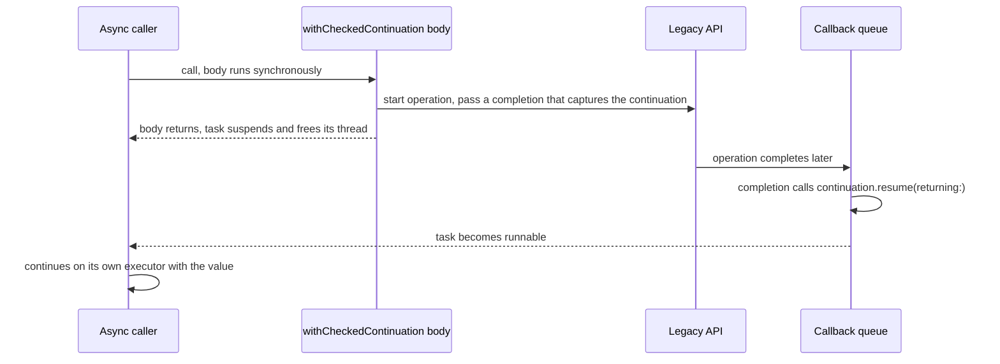

A continuation is the bridge between the callback world and the `async` world. Inside `withCheckedContinuation`, the current task suspends and hands you an object; whoever calls `resume` on that object, from any thread and at any later time, wakes the task up with a value or an error. With it, a twenty-year-old completion-handler API becomes an `async` function in a dozen lines.

The bridge has exactly one rule: **resume every continuation exactly once.** Resume it twice and the program traps. Never resume it and the waiting task is suspended forever, holding whatever it captured. This article builds wrappers for the common shapes of callback API, shows the diagnostics for each kind of misuse, compares the checked, unsafe, and new Swift 6.4 noncopyable continuations, and lists the cases where you do not need a continuation at all.

<!--more-->

The examples use Swift 6 language mode and were compiled and run with the Swift 6.4 toolchain on macOS 26. Performance numbers come from an optimized build on an Apple M1 Ultra. The Swift blocks build on one another in one `main.swift`. The noncopyable `Continuation` type requires iOS 27, macOS 27, or later; its example was compiled but not executed on the macOS 26 test machine.

## The four functions

| Function | Continuation type | Resumes with |
| --- | --- | --- |
| `withCheckedContinuation` | `CheckedContinuation<T, Never>` | A value |
| `withCheckedThrowingContinuation` | `CheckedContinuation<T, any Error>` | A value or an error |
| `withUnsafeContinuation` | `UnsafeContinuation<T, Never>` | A value, without misuse checks |
| `withUnsafeThrowingContinuation` | `UnsafeContinuation<T, any Error>` | A value or an error, without checks |

All four run their closure **immediately and synchronously**, in the caller's isolation, before the task suspends ([SE-0300](https://github.com/swiftlang/swift-evolution/blob/main/proposals/0300-continuation.md)). That is what makes them safe to use for registration: the closure starts the legacy operation and stores or captures the continuation, then returns, and only then does the task suspend.



The continuation is `Sendable`, so completion handlers on any queue may resume it. After `resume`, the task continues on its own executor, so a main-actor caller is back on the main actor, whatever thread the callback used.

## Shape 1: a single `Result` completion

The simplest and most common shape is a function that calls one completion handler exactly once, with either a value or an error:

```swift
import Foundation
import Synchronization

struct Place: Equatable, Sendable {
    let name: String
}

enum GeocodeError: Error, Equatable {
    case notFound(String)
}

/// A legacy API: calls `completion` exactly once, on a background queue.
func legacyGeocode(_ query: String, completion: @escaping @Sendable (Result<Place, GeocodeError>) -> Void) {
    DispatchQueue.global().asyncAfter(deadline: .now() + .milliseconds(5)) {
        completion(query.isEmpty ? .failure(.notFound(query)) : .success(Place(name: query.capitalized)))
    }
}

func geocode(_ query: String) async throws -> Place {
    try await withCheckedThrowingContinuation { continuation in
        legacyGeocode(query) { result in
            continuation.resume(with: result)
        }
    }
}

let place = try await geocode("lisbon")
assert(place == Place(name: "Lisbon"))
do {
    _ = try await geocode("")
    assertionFailure("An empty query must fail")
} catch GeocodeError.notFound(let query) {
    assert(query.isEmpty)
}
```

`resume(with:)` forwards a `Result` directly. The error arrives as `any Error`, because `CheckedContinuation`'s throwing form is untyped; the `catch` pattern recovers the concrete type.

This wrapper is correct only because the legacy function's contract says it calls `completion` **exactly once**. That is the property to verify, from documentation or from the source, before writing any continuation wrapper. The rest of this article is about APIs that do not make that promise cleanly.

## Shape 2: separate success and failure callbacks

Some APIs take two closures and promise, usually only in documentation, that exactly one of them runs:

```swift
/// Calls exactly one of `onSuccess` or `onFailure`, once.
func legacyFetchAvatar(
    userID: Int,
    onSuccess: @escaping @Sendable (Data) -> Void,
    onFailure: @escaping @Sendable (any Error) -> Void
) {
    DispatchQueue.global().async {
        if userID > 0 {
            onSuccess(Data(repeating: 0xAB, count: userID))
        } else {
            onFailure(URLError(.badURL))
        }
    }
}

func avatar(userID: Int) async throws -> Data {
    try await withCheckedThrowingContinuation { continuation in
        legacyFetchAvatar(userID: userID) { data in
            continuation.resume(returning: data)
        } onFailure: { error in
            continuation.resume(throwing: error)
        }
    }
}

let avatarData = try await avatar(userID: 4)
assert(avatarData.count == 4)
```

The continuation is captured by two closures, so the compiler cannot prove only one of them calls it. A checked continuation catches a violation at run time. If you do not trust the "exactly one" promise, for example because a third-party SDK has been seen calling both on some error path, add a guard that makes extra calls harmless:

```swift
/// Wraps a continuation so that only the first resume takes effect. Later ones are ignored.
final class ResumeOnce<T: Sendable>: Sendable {
    private let continuation: Mutex<CheckedContinuation<T, any Error>?>

    init(_ continuation: CheckedContinuation<T, any Error>) {
        self.continuation = Mutex(continuation)
    }

    func resume(with result: Result<T, any Error>) {
        let pending = continuation.withLock { stored in
            defer { stored = nil }
            return stored
        }
        pending?.resume(with: result)
    }
}
```

Use it deliberately. It turns a crash into silently discarded callbacks, which is the right trade only when the extra calls are known to be benign duplicates.

## Shape 3: callbacks that may run synchronously

Many APIs call their completion handler *synchronously* in some cases, such as a cache hit or an invalid argument, and asynchronously otherwise. Continuations handle both, because resuming before the task suspends is allowed: the task simply does not suspend.

```swift
final class LegacyThumbnailCache: Sendable {
    private let cached = Mutex<[String: Int]>(["logo": 128])

    /// Calls `completion` synchronously for a cache hit, asynchronously for a miss.
    func thumbnail(named name: String, completion: @escaping @Sendable (Int) -> Void) {
        if let size = cached.withLock({ $0[name] }) {
            completion(size)
            return
        }
        DispatchQueue.global().async { [self] in
            cached.withLock { $0[name] = 64 }
            completion(64)
        }
    }
}

func thumbnailSize(_ name: String, from cache: LegacyThumbnailCache) async -> Int {
    await withCheckedContinuation { continuation in
        cache.thumbnail(named: name) { size in
            continuation.resume(returning: size)
        }
    }
}

let thumbnailCache = LegacyThumbnailCache()
let hit = await thumbnailSize("logo", from: thumbnailCache)
let miss = await thumbnailSize("banner", from: thumbnailCache)
assert(hit == 128 && miss == 64)
```

This is one of the advantages of continuations over the old habit of "always dispatch the completion asynchronously to be safe": the wrapper does not care which path the API takes.

## Shape 4: a delegate that answers one request

Some single-shot operations report through a delegate: a permission prompt, a document picker, an authentication session. The continuation must be **stored** until the delegate method fires, and the storage must handle a second request arriving while the first is pending:

```swift
enum PermissionError: Error, Equatable {
    case requestAlreadyPending
}

/// A delegate-style API: `onDecision` is called once per request, later.
final class LegacyPermissionPrompt: Sendable {
    let onDecision = Mutex<(@Sendable (Bool) -> Void)?>(nil)

    func present(userWillGrant: Bool) {
        DispatchQueue.main.asyncAfter(deadline: .now() + .milliseconds(10)) { [self] in
            onDecision.withLock { $0 }?(userWillGrant)
        }
    }
}

@MainActor
final class PermissionRequester {
    private let prompt = LegacyPermissionPrompt()
    private var pending: CheckedContinuation<Bool, any Error>?

    init() {
        prompt.onDecision.withLock {
            $0 = { [weak self] granted in
                Task { @MainActor in self?.complete(granted) }
            }
        }
    }

    func requestAccess(userWillGrant: Bool) async throws -> Bool {
        guard pending == nil else { throw PermissionError.requestAlreadyPending }
        return try await withCheckedThrowingContinuation { continuation in
            pending = continuation
            prompt.present(userWillGrant: userWillGrant)
        }
    }

    private func complete(_ granted: Bool) {
        let continuation = pending
        pending = nil
        continuation?.resume(returning: granted)
    }
}

let requester = PermissionRequester()
async let firstRequest = requester.requestAccess(userWillGrant: true)
try await Task.sleep(for: .milliseconds(2))
do {
    _ = try await requester.requestAccess(userWillGrant: false)
    assertionFailure("A second request while one is pending must be rejected")
} catch PermissionError.requestAlreadyPending {
}
let granted = try await firstRequest
assert(granted)
```

Three details carry the correctness:

- **The check and the store happen in one synchronous stretch.** `requestAccess` runs on the main actor, and `withCheckedThrowingContinuation` runs its closure synchronously, so no other call can slip in between `guard pending == nil` and `pending = continuation`.
- **The continuation leaves storage before it is resumed.** `complete` clears `pending` first, so a duplicate delegate call finds nothing to resume.
- **Concurrent requests have a policy.** Here the second one is rejected. Joining it to the first, by storing an array of continuations and resuming all of them, is equally valid; silently overwriting the first continuation is not, because that leaks it.

## What misuse looks like

The "checked" in `CheckedContinuation` means the runtime tracks each continuation and reports both kinds of misuse. On the test toolchain:

<!-- skip-check -->
```swift
func resumesTwice() async -> Int {
    await withCheckedContinuation { continuation in
        continuation.resume(returning: 1)
        continuation.resume(returning: 2)
    }
}
// Fatal error: SWIFT TASK CONTINUATION MISUSE: resumesTwice() tried to resume its
// continuation more than once, returning 2!

func neverResumes() async -> Int {
    await withCheckedContinuation { (continuation: CheckedContinuation<Int, Never>) in
        // Forgot to start the operation, or the operation's error path never calls back.
    }
}
// SWIFT TASK CONTINUATION MISUSE: neverResumes() leaked its continuation without resuming it.
// This may cause tasks waiting on it to remain suspended forever.
```

A double resume is a fatal error: the program stops at the second `resume`, with the function name in the message. A leak is reported as a printed warning when the continuation object is destroyed without having been resumed; the waiting task stays suspended, and nothing else happens. If the continuation is still referenced somewhere, for example stored in a property that is never cleared, no warning appears at all, and the task simply hangs. Tests that exercise error paths, such as timeouts, invalid input, and cancellation, are the best defense against leaks.

The function name in both messages comes from a `function: String = #function` parameter on `withCheckedContinuation`, so it names the function that created the continuation. That makes the wrapper function easy to find in a crash report.

## Checked or unsafe?

`UnsafeContinuation` has the same API without the bookkeeping. It is faster, and it turns misuse into undefined behavior. A microbenchmark that creates a continuation and resumes it immediately, 200,000 times in an optimized build, measured:

| Continuation | Time per create-and-resume |
| --- | --- |
| `CheckedContinuation` | about 340 ns |
| `UnsafeContinuation` | about 180 ns |

The difference, about 160 ns, matters only when bridging happens hundreds of thousands of times per second: per-packet or per-sample callbacks in a hot loop. For a network request, a file read, or a permission prompt, it is unmeasurable next to the operation itself. Use checked continuations by default. If profiling shows the checks matter, switch to unsafe only after the wrapper has been exercised thoroughly with checked continuations, and keep tests that run its error paths.

## Swift 6.4: a continuation the compiler checks

Swift 6.4 adds a third option, `Continuation<Success, Failure>` ([SE-0528](https://github.com/swiftlang/swift-evolution/blob/main/proposals/0528-noncopyable-continuation.md)), obtained with `withContinuation(of:throwing:_:)`. It is **noncopyable**, and each `resume` method *consumes* it. Resuming twice is therefore a compile-time error, and a continuation that is dropped without being resumed traps immediately instead of leaking silently. It has no run-time bookkeeping on the success path, so it costs about what an unsafe continuation does. It also adopts typed throws: `throwing: NetworkError.self` gives a continuation, and a call site, that can throw only `NetworkError`.

```swift
// Does not compile in Swift 6 mode.
@available(iOS 27, macOS 27, *)
func resumesTwiceNoncopyable() async -> Int {
    await withContinuation(of: Int.self) { continuation in
        continuation.resume(returning: 1)
        continuation.resume(returning: 2)
    }
}
// error: 'continuation' consumed more than once
```

The same ownership rules that prevent the double resume also prevent the most common bridging pattern. A noncopyable value cannot be captured by an escaping closure, and completion handlers are escaping:

```swift
// Does not compile in Swift 6 mode.
@available(iOS 27, macOS 27, *)
func geocodeNoncopyable(_ query: String) async throws -> Place {
    try await withContinuation(of: Place.self, throwing: (any Error).self) { continuation in
        legacyGeocode(query) { result in
            continuation.resume(with: result.mapError { $0 })
        }
    }
}
// error: noncopyable 'continuation' cannot be consumed when captured by an escaping closure
// or borrowed by a non-Escapable type
```

So the new type does not replace `CheckedContinuation` for completion handlers. The proposal provides `CheckedContinuation(continuation)` to convert when a continuation must flow into callbacks. Where `Continuation` shines is code that **stores** continuations and resumes them later from a single place: actor-based waiters, queues of pending requests, permit pools, and gates like the ones in the [reentrancy](/swift-actor-reentrancy/) and [cancellation handler](/swift-cancellation-handlers-cleanup/) articles. There, moving the continuation out of storage and consuming it with `resume` is exactly the discipline those designs already follow by hand, and the compiler now enforces it.

```swift
@available(iOS 27, macOS 27, *)
actor OneShotSignal {
    private var waiter: Continuation<Int, Never>?
    private var value: Int?

    func wait() async -> Int {
        if let value { return value }
        return await withContinuation(of: Int.self) { continuation in
            waiter = consume continuation
        }
    }

    func fire(_ newValue: Int) {
        value = newValue
        if let waiter = waiter.take() {
            waiter.resume(returning: newValue)   // Consumed: cannot be resumed again.
        }
    }
}

if #available(iOS 27, macOS 27, *) {
    let signal = OneShotSignal()
    async let waited = signal.wait()
    try await Task.sleep(for: .milliseconds(5))
    await signal.fire(42)
    let signalled = await waited
    assert(signalled == 42)
}
```

`Optional.take()` moves the stored continuation out and leaves `nil` behind, so storage and resumption cannot get out of step. Overwriting a stored continuation without resuming it would destroy it, which traps, turning the silent hang of a leaked `CheckedContinuation` into a crash at the line that caused it.

## When you do not need a continuation

Before writing a wrapper, check whether one already exists:

- **Objective-C completion handlers are imported as `async` automatically** ([SE-0297](https://github.com/swiftlang/swift-evolution/blob/main/proposals/0297-concurrency-objc.md)). A method like `- (void)fetchWithCompletion:(void (^)(NSData *, NSError *))completion` is also available as `func fetch() async throws -> Data`. Most Apple frameworks already provide these.
- **Foundation has async APIs** for most I/O: `URLSession.data(for:)`, `FileHandle.bytes`, `URL.lines`, `NotificationCenter.notifications(named:)`.
- **Multi-shot callbacks want a stream, not a continuation.** A continuation resumes once. A callback that fires repeatedly, such as progress updates, location fixes, or ticks, belongs in an `AsyncStream`, as the [AsyncStream article](/swift-asyncstream/) shows.

## Summary

- `withChecked(Throwing)Continuation` runs its closure synchronously, then suspends until `resume` is called, from any thread.
- Resume exactly once. A double resume is a fatal error naming the function; a leak prints a warning when the continuation is destroyed, or hangs silently if it is still stored.
- Verify the "called exactly once" contract of every API you wrap. Guard two-callback APIs, store delegate continuations with a policy for concurrent requests, and clear storage before resuming.
- Checked continuations cost about 340 ns per use against 180 ns for unsafe ones; use checked by default.
- Swift 6.4's noncopyable `Continuation` turns double resumes into compile errors and leaks into traps, but cannot be captured by escaping completion handlers. Use it for stored waiters on iOS 27 and macOS 27.
- Prefer existing async APIs, including automatically imported Objective-C ones, and use streams for multi-shot callbacks.

## Exercise

Wrap a legacy `Downloader` whose `start(url:completion:)` calls `completion` exactly once, but whose `cancel()` method, if called while a download is in progress, calls `completion` with a cancellation error, and if called after completion, does nothing. Write `func download(_ url: URL) async throws -> Data` using a checked continuation, then add cancellation support with `withTaskCancellationHandler`. Write tests for completion, failure, cancellation before start, cancellation mid-download, and cancellation after completion, and verify that no test produces a continuation misuse message. The [next article](/swift-continuation-ownership/) covers the patterns these tests will need.

## Further reading

- [SE-0300: Continuations for interfacing async tasks with synchronous code](https://github.com/swiftlang/swift-evolution/blob/main/proposals/0300-continuation.md).
- [SE-0528: `Continuation`, safe and performant async continuations](https://github.com/swiftlang/swift-evolution/blob/main/proposals/0528-noncopyable-continuation.md).
- [SE-0297: Concurrency Interoperability with Objective-C](https://github.com/swiftlang/swift-evolution/blob/main/proposals/0297-concurrency-objc.md).
- [Swift concurrency: Update a sample app](https://developer.apple.com/videos/play/wwdc2021/10194/), WWDC21, on migrating completion handlers.

Previous: [Buffering, Backpressure, and Stream Termination](/swift-stream-backpressure/). Next: [Continuation Ownership, Cancellation, and Double Resume](/swift-continuation-ownership/).

Return to the [Concurrency roadmap](/swift-concurrency-roadmap/).
