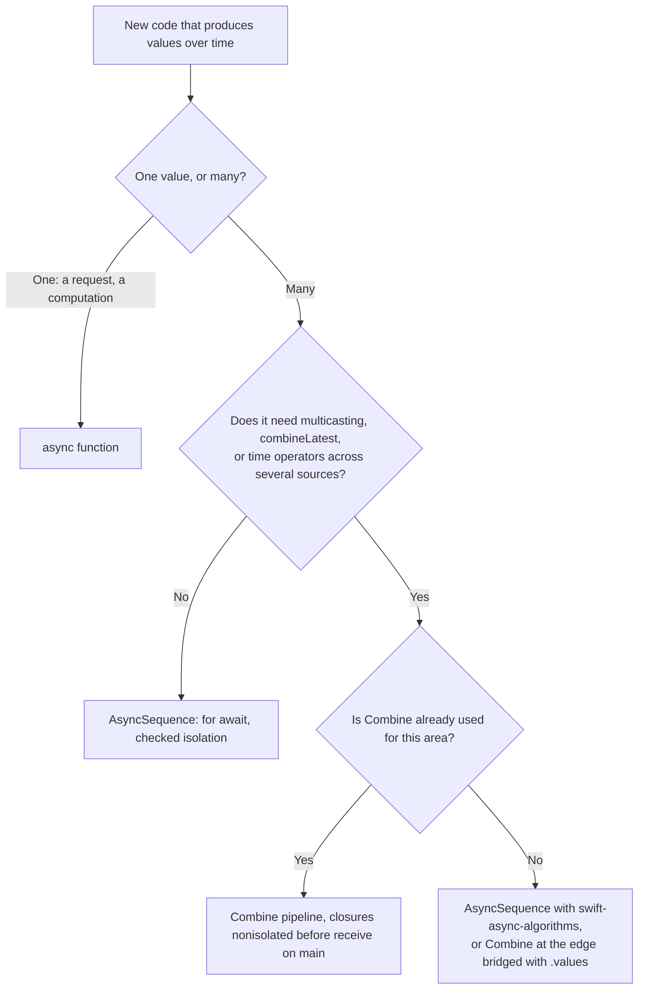

Swift 5.5 gave the language its own model for values over time: `async` functions for one value, `AsyncSequence` for many, tasks for lifetime and cancellation, and actors for isolation. Combine solved most of the same problems two years earlier, as a library, and the two now overlap almost completely. A request is either a publisher or an `async` function. A stream of events is either a publisher or an `AsyncSequence`. A cancellable is either an `AnyCancellable` or a `Task` handle.

The overlap hides differences that change how code behaves. Combine pushes values to subscribers; an `AsyncSequence` is pulled by its consumer, one `next()` at a time. Combine's operators are a large built-in vocabulary; `AsyncSequence`'s are few, with the rest in a separate package. Combine has multicasting built in, while `AsyncStream` splits values between consumers. And the compiler checks the isolation of `async` code, while Combine code, as this series has measured repeatedly, compiles cleanly and crashes at run time. This article compares the two side by side, measures the differences that matter, implements the same feature both ways, and ends with how to choose.

<!--more-->

The examples use Swift 6 language mode and were compiled and run with the Swift 6.4 toolchain from Xcode 27.1 on macOS 26. Paste the blocks in order into one `main.swift`; the file uses top-level `await`. The concurrency roadmap covers the language side in depth, starting with [`AsyncSequence`](/swift-asyncsequence/) and [`AsyncStream`](/swift-asyncstream/).

## Push and pull

A Combine publisher delivers values by calling its subscriber. Demand lets a subscriber limit that, but most subscribers request unlimited demand, and sources such as subjects push whether or not anyone asked, dropping values when demand is zero, as [Subjects](/combine-subjects/) measured. An `AsyncSequence` inverts the relationship: the consumer calls `next()` when it is ready, so a slow consumer slows down the sequence. When the producer is independent of the consumer, as with an `AsyncStream` fed from a callback, the stream's **buffering policy** decides what happens to values the consumer has not asked for yet:

```swift
import Combine
import Foundation
import Synchronization

func consumeSlowly(_ stream: AsyncStream<Int>) async -> [Int] {
    var received: [Int] = []
    for await value in stream {
        received.append(value)
        try? await Task.sleep(for: .milliseconds(20))   // a slow consumer
    }
    return received
}

let (allValues, allContinuation) = AsyncStream<Int>.makeStream(bufferingPolicy: .unbounded)
let (latestValues, latestContinuation) = AsyncStream<Int>.makeStream(bufferingPolicy: .bufferingNewest(1))
async let unboundedResult = consumeSlowly(allValues)
async let newestResult = consumeSlowly(latestValues)
try await Task.sleep(for: .milliseconds(10))
for value in 1...5 {
    allContinuation.yield(value)
    latestContinuation.yield(value)
}
allContinuation.finish()
latestContinuation.finish()

let (everything, newest) = await (unboundedResult, newestResult)
assert(everything == [1, 2, 3, 4, 5])          // buffered until the consumer caught up
assert(newest.first == 1 && newest.last == 5 && newest.count < 5)   // older values were replaced
```

`.unbounded` is the event-stream policy: nothing is lost, and memory grows if the consumer never catches up. `.bufferingNewest(1)` is the state policy, the `AsyncStream` counterpart of a `CurrentValueSubject` delivering only the latest value to a slow subscriber. Combine makes the same choice through which subject you pick and whether you add a `buffer` operator; `AsyncStream` makes it explicit at creation.

## One sequence, one consumer

A publisher can have any number of subscribers, each receiving every value from a subject. An `AsyncStream` is designed for a single consumer. Iterating it from two tasks does not give both of them the values; it splits them:

```swift
let (sharedStream, sharedContinuation) = AsyncStream<Int>.makeStream()
async let firstConsumer: [Int] = { var values: [Int] = []; for await v in sharedStream { values.append(v) }; return values }()
async let secondConsumer: [Int] = { var values: [Int] = []; for await v in sharedStream { values.append(v) }; return values }()
try await Task.sleep(for: .milliseconds(50))
for value in 0..<10 {
    sharedContinuation.yield(value)
    try await Task.sleep(for: .milliseconds(5))
}
sharedContinuation.finish()
let (firstValues, secondValues) = await (firstConsumer, secondConsumer)

assert(Set(firstValues).isDisjoint(with: secondValues))            // no value went to both
assert((firstValues + secondValues).sorted() == Array(0..<10))       // and none was lost
print("first consumer: \(firstValues), second: \(secondValues)")
```

The run printed `[0, 2, 4, 6, 8]` for one consumer and `[1, 3, 5, 7, 9]` for the other: each value went to whichever consumer was waiting. Broadcasting to several consumers needs a separate stream per consumer, a publisher, or the `share()` operator that the swift-async-algorithms package added in version 1.1. The standard library itself has no multicasting, which is one place where Combine's built-in [`share` and `multicast`](/combine-share-multicasting/) remain simpler.

## Cancellation

Combine cancellation is immediate and structural: cancelling the `AnyCancellable` cancels every subscription up to the source, and releasing it does the same. Task cancellation is cooperative: `Task.cancel()` sets a flag, and suspension points such as `Task.sleep` and `AsyncStream.next()` check it. When a task iterates a publisher through `.values`, the two models connect: cancelling the task cancels the Combine subscription.

```swift
let liveUpdates = PassthroughSubject<Int, Never>()
let upstreamCancelled = Mutex(false)
let observed = liveUpdates.handleEvents(receiveCancel: { upstreamCancelled.withLock { $0 = true } })
let consumingTask = Task {
    for await _ in observed.values {}
}
try await Task.sleep(for: .milliseconds(50))
consumingTask.cancel()
try await Task.sleep(for: .milliseconds(50))
assert(upstreamCancelled.withLock { $0 })      // Task.cancel() reached the publisher
```

The difference that bites is ownership. An `AnyCancellable` cancels when it is deallocated, so storing it in an object ties the work to the object's lifetime. A `Task` does not cancel when its handle is dropped; it runs to completion unless something calls `cancel()`. [`AnyCancellable` and Memory Management](/combine-anycancellable-memory/) shows a small extension that stores a task's cancellation in a `Set<AnyCancellable>` to get Combine's behavior, and the concurrency roadmap's [Task Lifetime and Ownership](/swift-task-lifetime-ownership/) explains why tasks work the way they do.

## Isolation is checked for one and not the other

The most important practical difference in Swift 6 is what the compiler can see. In `async` code, crossing from a background context into main-actor state is a compile-time error:

```swift
// Does not compile
@MainActor final class Counter { var value = 0 }
let counter = Counter()
Task.detached {
    counter.value += 1
}
// error: main actor-isolated property 'value' can not be mutated from a nonisolated context
```

The equivalent Combine code compiles without a diagnostic and decides at run time. A closure written in main-actor code and called by Combine on a background thread stops the process in Swift 6's isolation check, and an `assign` to a main-actor property from a background publisher races silently, as [`sink` and `assign`](/combine-sink-assign/) found with the Thread Sanitizer. Everything [Schedulers: `receive(on:)` and `subscribe(on:)`](/combine-schedulers-receive-subscribe-on/) says about where to put `receive(on:)` is knowledge that `async` code gets from the type checker for free. For new code, that alone is a strong argument.

## The same feature, both ways

A debounced search that cancels superseded requests is a good test case, because it uses time, cancellation, and isolation. In Combine it is a pipeline:

```swift
@MainActor
final class CombineSearchModel {
    private(set) var results: [String] = []
    private(set) var requests: [String] = []
    let query = PassthroughSubject<String, Never>()
    private var cancellables = Set<AnyCancellable>()

    init(debounce: Int) {
        query
            .removeDuplicates()
            .debounce(for: .milliseconds(debounce), scheduler: DispatchQueue.main)
            .map { [weak self] query -> AnyPublisher<[String], Never> in
                self?.requests.append(query)
                return Just(["\(query) result"])
                    .delay(for: .milliseconds(30), scheduler: DispatchQueue.main)   // simulated latency
                    .eraseToAnyPublisher()
            }
            .switchToLatest()
            .sink { [weak self] in self?.results = $0 }
            .store(in: &cancellables)
    }
}
```

With `async`/`await`, the same behavior is a method that cancels the previous task and starts a new one, which sleeps for the debounce interval and then searches. Cancellation does the work of `debounce` and `switchToLatest` at once: a keystroke during the sleep cancels it, and a keystroke during the request cancels that:

```swift
@MainActor
final class AsyncSearchModel {
    private(set) var results: [String] = []
    private(set) var requests: [String] = []
    private var current: Task<Void, Never>?
    private var lastQuery: String?
    private let debounce: Duration

    init(debounce: Duration) { self.debounce = debounce }

    func queryChanged(_ query: String) {
        guard query != lastQuery else { return }        // removeDuplicates
        lastQuery = query
        current?.cancel()                               // switchToLatest
        current = Task {
            do {
                try await Task.sleep(for: debounce)     // debounce
                requests.append(query)
                try await Task.sleep(for: .milliseconds(30))   // simulated latency
                results = ["\(query) result"]
            } catch {
                // cancelled: a newer query replaced this one
            }
        }
    }
}
```

Driving both with the same keystrokes gives the same requests and results:

```swift
let combineModel = CombineSearchModel(debounce: 100)
let asyncModel = AsyncSearchModel(debounce: .milliseconds(100))
for query in ["s", "sw", "swi", "swift"] {
    combineModel.query.send(query)
    asyncModel.queryChanged(query)
    try await Task.sleep(for: .milliseconds(20))
}
try await Task.sleep(for: .milliseconds(300))
assert(combineModel.requests == ["swift"] && asyncModel.requests == ["swift"])
assert(combineModel.results == ["swift result"] && asyncModel.results == ["swift result"])
```

The Combine version is declarative, and each requirement is one named operator; adding `retry`, `throttle`, or a `combineLatest` with a filter setting is a line each. The `async` version is imperative, has no operators to learn, and its isolation is checked: `requests.append` and `results =` are main-actor accesses the compiler has verified, whereas the Combine `map` and `sink` closures are main-actor closures that work only because every scheduler in the pipeline is the main queue. The `async` version's time is harder to control in tests: the Combine pipeline takes a scheduler, while the `async` one would need an injected `Clock` to be tested without real sleeps.

## Operators

`AsyncSequence` in the standard library has the `Sequence`-like operators: `map`, `filter`, `compactMap`, `flatMap`, `prefix`, `drop(while:)`, `first(where:)`, `contains`, `reduce`, and `min`/`max`. The time- and combination-based operators that make Combine pipelines short live in Apple's [swift-async-algorithms](https://github.com/apple/swift-async-algorithms) package:

| Combine | `AsyncSequence` |
|---|---|
| `map`, `filter`, `compactMap`, `prefix`, `first`, `reduce` | standard library |
| `flatMap` (concurrent) | none; `flatMap` on `AsyncSequence` is sequential, use a task group |
| `scan` | none; a `for await` loop with a variable |
| `switchToLatest` | task cancellation; async-algorithms has `flatMapLatest` on its main branch, not yet in a release as of 1.1.7 |
| `removeDuplicates` | async-algorithms `removeDuplicates()` |
| `debounce`, `throttle` | async-algorithms `debounce(for:tolerance:clock:)`, and `_throttle(for:clock:reducing:)`, whose underscore marks it as not yet stable API |
| `combineLatest`, `zip`, `merge` | async-algorithms `combineLatest`, `zip`, `merge` |
| `collect(_:)`, `collect(.byTime)` | async-algorithms `chunks(ofCount:)`, `chunked(by:)` |
| `share`, `multicast` | async-algorithms `share()`, since 1.1; nothing in the standard library |
| `PassthroughSubject` | `AsyncStream` with its continuation, one consumer |
| `CurrentValueSubject` | `AsyncStream` with `.bufferingNewest(1)`, or `Observations` |
| `receive(on:)` | actor isolation: `await` a `@MainActor` function |
| `retry`, `catch` | `do`/`catch` in a loop |

The table is the strongest argument for keeping Combine in a codebase that already uses it heavily: a pipeline with `combineLatest`, `debounce`, `share`, and `retry` is short in Combine, and in `async` code it needs a package dependency for three of the four and a hand-written loop for the fourth.

## What it costs per value

Sending a million integers through each mechanism, with the producer and consumer in nonisolated code and an optimized build, measured the per-value overhead:

```swift
nonisolated func perValueCost() async -> (combine: Duration, asyncStream: Duration) {
    let count = 200_000
    let clock = ContinuousClock()

    var combineTotal = 0
    let subject = PassthroughSubject<Int, Never>()
    let combineStart = clock.now
    let handle = subject.sink { combineTotal &+= $0 }
    for value in 0..<count { subject.send(value) }
    let combineCost = (clock.now - combineStart) / count
    handle.cancel()

    let (stream, continuation) = AsyncStream<Int>.makeStream(bufferingPolicy: .unbounded)
    let streamStart = clock.now
    let consumer = Task.detached { () -> Int in
        var total = 0
        for await value in stream { total &+= value }
        return total
    }
    for value in 0..<count { continuation.yield(value) }
    continuation.finish()
    let streamTotal = await consumer.value
    let streamCost = (clock.now - streamStart) / count

    precondition(combineTotal == streamTotal)
    return (combineCost, streamCost)
}

let costs = await perValueCost()
print("per value: Combine \(costs.combine), AsyncStream \(costs.asyncStream)")
assert(costs.asyncStream > costs.combine)
```

| Path | Time per value, optimized build |
|---|---|
| `PassthroughSubject.send` to a `sink` | about 97 ns |
| `AsyncStream` yield, consumed concurrently by a `for await` task | about 1.9 µs |
| `AsyncStream` yield, consumed afterwards from the buffer | about 1.5 µs |

A subject call is a synchronous function call through a lock; an `AsyncStream` element involves a continuation resumption and a potential task switch. Twenty times the cost per value is irrelevant for UI events and search queries, which arrive at most hundreds of times a second, and noticeable for hundreds of thousands of values per second, such as sensor samples or parsed log lines. For those, process values in batches, or keep the hot loop synchronous.

## Choosing



In existing Combine code, there is rarely a reason to rewrite a working pipeline. The useful migrations are at the edges: an `async` function that a pipeline calls, wrapped as a publisher, or a pipeline whose output an `async` caller consumes through `.values`. [Bridging Publishers to `async`/`await` with `.values`](/combine-publisher-values-async/) covers both directions and their traps, and [Combine vs. the Observation Framework in SwiftUI](/combine-vs-observation-swiftui/) covers the place where most apps actually replace Combine: view state.

## Summary

- Combine pushes; `AsyncSequence` is pulled. An `AsyncStream`'s buffering policy decides what a slow consumer sees: everything with `.unbounded`, the latest with `.bufferingNewest(1)`.
- An `AsyncStream` has one consumer: two tasks iterating one stream split the values, even and odd. Publishers multicast; async sequences need a stream per consumer.
- Cancelling a task that iterates `.values` cancelled the Combine subscription. Dropping a `Task` handle does not cancel the task, while dropping an `AnyCancellable` cancels the subscription.
- The compiler rejects main-actor access from a detached task; the same access from a Combine closure compiles and crashes or races at run time.
- The same debounced search took one pipeline in Combine and one method with task replacement in `async` code, with identical requests and results.
- Many Combine operators have no standard-library equivalent. swift-async-algorithms covers most of them, including `share()` since 1.1; concurrent `flatMap`, `scan`, and `retry` remain hand-written.
- Per value, a subject cost about 97 ns and an `AsyncStream` 1.5 to 1.9 µs.

## Exercise

Rewrite `AsyncSearchModel` so its time is testable: inject a `Clock` and use `clock.sleep(for:)`, then write a manual test clock whose `sleep` suspends until the test advances it, using continuations. Test the debounce boundary at 299 and 300 ms, and the cancellation of a superseded request, as [Testing Publishers](/combine-testing-publishers/) does for the Combine version. Compare the amount of test infrastructure each version needed, and note which bugs each test style can and cannot catch.

## Further reading

- [Meet AsyncSequence](https://developer.apple.com/videos/play/wwdc2021/10058/), WWDC21, and [Meet Swift Async Algorithms](https://developer.apple.com/videos/play/wwdc2022/110355/), WWDC22.
- Apple's [swift-async-algorithms](https://github.com/apple/swift-async-algorithms) package.
- The concurrency roadmap's [Stream Backpressure](/swift-stream-backpressure/), which measures `AsyncStream`'s buffering policies in depth.

Previous: [Testing Publishers](/combine-testing-publishers/). Next: [Bridging Publishers to `async`/`await` with `.values`](/combine-publisher-values-async/).

Return to the [Combine roadmap](/combine/).
