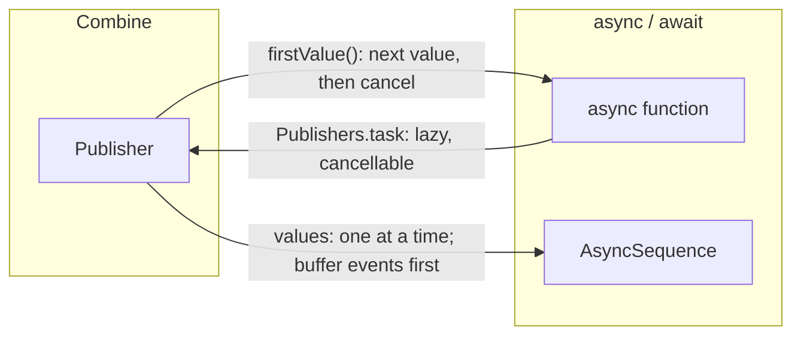

Most codebases do not move from Combine to `async`/`await` in one step. They grow a boundary: an `async` function that needs the latest value of a `@Published` property, a `for await` loop over events that a Combine pipeline produces, a Combine pipeline that needs to call an `async` API. Since iOS 15, every publisher has a `values` property that turns it into an `AsyncSequence`, which covers the first two. The third direction has no built-in API, and the obvious way to write it, a `Future` that starts a `Task`, has two flaws that are easy to measure.

This article measures the boundary in both directions. `.values` requests one value at a time, which loses nine values out of ten from a `PassthroughSubject` feeding a slow loop, and a `buffer` fixes it. Its loop body runs on the consuming task's actor, which makes it the safest way to consume a background publisher from the main actor. Its error type is erased. In the other direction, `Future` runs the work before anyone subscribes and never cancels it, and a `Deferred` wrapper fixes both.

<!--more-->

The examples use Swift 6 language mode and were compiled and run with the Swift 6.4 toolchain from Xcode 27.1 on macOS 26. Paste the blocks in order into one `main.swift`; the file uses top-level `await`.

## `.values` asks for one value at a time

`values` returns an `AsyncPublisher` for a publisher that cannot fail and an `AsyncThrowingPublisher` for one that can. Each call to the iterator's `next()` requests exactly one value from the publisher:

```swift
import Combine
import Foundation
import Synchronization

let requests = Mutex<[String]>([])
let counted = (1...3).publisher
    .handleEvents(receiveRequest: { @Sendable demand in requests.withLock { $0.append("\(demand)") } })
var collected: [Int] = []
for await value in counted.values { collected.append(value) }
assert(collected == [1, 2, 3])
assert(requests.withLock { $0 } == ["max(1)", "max(1)", "max(1)"])
```

The `@Sendable` on that closure is required. The request is made from inside the iterator's `next()`, which is a nonisolated `async` function and runs on the cooperative thread pool. When this example was first written without the annotation, the closure, written in top-level code and so inferred to be main-actor isolated, stopped the process in Swift 6's isolation check from `Publishers.HandleEvents.Inner.request(_:)`. Closures that observe demand run wherever the consumer asks.

One-at-a-time demand is the correct translation of a pull-based `AsyncSequence`, and harmless for a publisher that waits for demand, such as a sequence or a request. For a publisher that pushes regardless, it is data loss.

### A slow loop over a `PassthroughSubject` loses values

A `PassthroughSubject` drops a value for any subscriber that has no outstanding demand, as [Subjects](/combine-subjects/) measured. While the loop body of a `for await` is running, the iterator has not called `next()` yet, so it has no demand, and every value sent in that window is dropped. This consumer takes 10 ms per value, while the producer sends ten values at once:

```swift
func consume(_ publisher: some Publisher<Int, Never>, until last: Int) async -> [Int] {
    var received: [Int] = []
    for await value in publisher.values {
        received.append(value)
        try? await Task.sleep(for: .milliseconds(10))   // the loop body takes time
        if value == last { break }
    }
    return received
}

nonisolated(unsafe) let events = PassthroughSubject<Int, Never>()
let lossyConsumer = Task { await consume(events, until: 99) }
try await Task.sleep(for: .milliseconds(30))
for value in 1...10 { events.send(value) }
try await Task.sleep(for: .milliseconds(100))
events.send(99)
let lossyResult = await lossyConsumer.value
assert(lossyResult == [1, 99])                  // values 2 through 10 were dropped
```

Nine of the ten values vanished with no error, no warning, and no log. The fix is to give the subject's subscriber somewhere to put values it has not asked for yet. `buffer(size:prefetch:whenFull:)` requests from upstream on its own schedule, `prefetch: .keepFull` meaning it requests enough to fill itself immediately, and holds values until downstream demand arrives:

```swift
nonisolated(unsafe) let bufferedEvents = PassthroughSubject<Int, Never>()
let bufferedConsumer = Task {
    await consume(bufferedEvents.buffer(size: 100, prefetch: .keepFull, whenFull: .dropOldest), until: 10)
}
try await Task.sleep(for: .milliseconds(30))
for value in 1...10 { bufferedEvents.send(value) }
let bufferedResult = await bufferedConsumer.value
assert(bufferedResult == Array(1...10))
```

The size is a decision, not a detail. It bounds memory if the consumer falls behind for good, and `whenFull` decides what is lost then: `.dropOldest` keeps the newest values, `.dropNewest` keeps the oldest, and `.customError` fails the stream so the loss is visible.

### State streams are already safe

A `@Published` property or a `CurrentValueSubject` keeps its latest value and delivers it when demand arrives, so a slow loop sees the current state rather than every intermediate one:

```swift
@MainActor
final class DownloadModel {
    @Published var progress = 0.0
}

let download = DownloadModel()
let progressReader = Task { @MainActor () -> [Double] in
    var seen: [Double] = []
    for await progress in download.$progress.values {
        seen.append(progress)
        try? await Task.sleep(for: .milliseconds(20))
        if progress == 1.0 { break }
    }
    return seen
}
try await Task.sleep(for: .milliseconds(10))
for step in 1...10 { download.progress = Double(step) / 10 }
let progressSeen = await progressReader.value
assert(progressSeen.first == 0.0 && progressSeen.last == 1.0)
assert(progressSeen.count < 11)                 // intermediate values were coalesced
print("progress values seen:", progressSeen)
```

For progress, coalescing is exactly right. The rule of thumb follows from the two cases: `.values` on state is safe; `.values` on events needs a `buffer` in front of it.

## The loop body runs on the consumer's actor

When a value arrives, `AsyncPublisher` resumes the waiting `next()`, and the loop body continues on whatever actor the consuming task is isolated to. A `@MainActor` task iterating a publisher that emits on a background thread runs its body on the main thread, with no `receive(on:)`:

```swift
nonisolated(unsafe) let backgroundEvents = PassthroughSubject<Int, Never>()
let mainActorConsumer = Task { @MainActor () -> Bool in
    for await _ in backgroundEvents.values {
        return pthread_main_np() != 0          // is the loop body on the main thread?
    }
    return false
}
try await Task.sleep(for: .milliseconds(30))
DispatchQueue.global().async { backgroundEvents.send(1) }
let ranOnMainThread = await mainActorConsumer.value
assert(ranOnMainThread)
```

That is the most useful property of the bridge. In a `@MainActor` view model, `for await` over a publisher's values is checked by the compiler and safe by construction, whereas a `sink` needs a `receive(on:)` in exactly the right place and crashes in Swift 6 without one, as [Schedulers: `receive(on:)` and `subscribe(on:)`](/combine-schedulers-receive-subscribe-on/) explains. In SwiftUI, the `.task` modifier gives the loop a lifetime too: it starts the task when the view appears and cancels it when the view disappears, and cancelling the task cancels the Combine subscription.

## Errors lose their type

`AsyncThrowingPublisher` declares its failure as `any Error`, not the publisher's `Failure`, so a typed Combine error becomes an untyped `throws`. The value keeps its concrete type at run time, so a cast recovers it:

```swift
enum FeedError: Error, Equatable { case disconnected }

var caught: FeedError?
do {
    for try await _ in Fail<Int, FeedError>(error: .disconnected).values {}
} catch {
    caught = error as? FeedError                // statically `any Error`, dynamically FeedError
}
assert(caught == .disconnected)
```

Wrap the cast in one place, for example a function that awaits the first value and rethrows as the domain error, rather than repeating it at every call site.

## Awaiting a single value

The common bridge is "give me the next value of this publisher": the current account from a `CurrentValueSubject`, the result of a request publisher. A `for await` loop that returns on its first iteration does it:

```swift
extension Publisher where Failure == Never {
    /// The publisher's next value, or `nil` if it finishes without one.
    func firstValue() async -> Output? {
        for await value in values { return value }
        return nil
    }
}

extension Publisher {
    /// The publisher's next value. Throws the publisher's failure, or `EmptyStream` if it finishes empty.
    func requireFirstValue() async throws -> Output {
        for try await value in values { return value }
        throw EmptyStream()
    }
}

struct EmptyStream: Error {}

let account = CurrentValueSubject<String, Never>("ada")
let currentAccount = await account.firstValue()
let nothing = await Empty<Int, Never>().firstValue()
let loaded = try await Just(42).setFailureType(to: FeedError.self).requireFirstValue()
assert(currentAccount == "ada" && nothing == nil && loaded == 42)
```

Returning from inside the loop ends the iteration, which cancels the subscription, so a request publisher is not left running. The two names keep the overloads apart: a non-failing publisher matches both extensions, and with the same name Swift picked the throwing one. The one hazard is a publisher that never emits and never completes, such as a subject nobody sends to: either function then waits forever, unless the calling task is cancelled. Callers that cannot guarantee a value should race it against a timeout in a task group.

## The other direction: `async` work as a publisher

There is no built-in conversion from an `async` function to a publisher. The version most code reaches for wraps a `Task` in a `Future`:

```swift
final class WorkProbe: Sendable {
    private let startedCount = Atomic<Int>(0)
    private let wasCancelled = Atomic<Bool>(false)
    private let didFinish = Atomic<Bool>(false)
    var started: Int { startedCount.load(ordering: .relaxed) }
    var cancelled: Bool { wasCancelled.load(ordering: .relaxed) }
    var finished: Bool { didFinish.load(ordering: .relaxed) }

    func work() async throws -> Int {
        startedCount.wrappingAdd(1, ordering: .relaxed)
        do {
            try await Task.sleep(for: .milliseconds(300))
        } catch {
            wasCancelled.store(true, ordering: .relaxed)
            throw error
        }
        didFinish.store(true, ordering: .relaxed)
        return 42
    }
}

let futureProbe = WorkProbe()
let futureWork = Future<Int, any Error> { promise in
    nonisolated(unsafe) let promise = promise     // Future.Promise is not Sendable
    Task {
        do { promise(.success(try await futureProbe.work())) } catch { promise(.failure(error)) }
    }
}
try await Task.sleep(for: .milliseconds(50))
assert(futureProbe.started == 1)                // started before anyone subscribed

let futureHandle = futureWork.sink(receiveCompletion: { _ in }, receiveValue: { _ in })
futureHandle.cancel()
try await Task.sleep(for: .milliseconds(400))
assert(!futureProbe.cancelled && futureProbe.finished)   // cancelling did not stop the work
```

Both flaws are visible. The work started when the `Future` was created, before any subscriber, because `Future` runs its closure at initialization, as [Publishers, Subscribers, and Subscriptions](/combine-publishers-subscribers-subscriptions/) showed. And cancelling the subscription did nothing to the task, which ran to completion, because nothing connects a `Future`'s cancellation to the task its closure started. For a request, that means requests sent for screens that were never shown and requests that keep running after the user left. The `nonisolated(unsafe)` is a third smell: `Future.Promise` is not `Sendable`, so Swift 6 refuses to let the task capture it without one.

A wrapper built from `Deferred`, a subject, and `handleEvents` fixes all three. `Deferred` makes it lazy, the task starts when the subscription is made, and cancelling the subscription cancels the task:

```swift
/// A subject that may be shared across tasks. Combine's subjects are internally synchronized,
/// but not annotated `Sendable`.
final class SendableSubject<Output, Failure: Error>: @unchecked Sendable {
    let subject = PassthroughSubject<Output, Failure>()
}

extension Publishers {
    /// Runs `operation` in a task for each subscriber, and cancels the task when the subscriber cancels.
    static func task<Output: Sendable>(
        _ operation: @escaping @Sendable () async throws -> Output
    ) -> AnyPublisher<Output, any Error> {
        Deferred {
            let output = SendableSubject<Output, any Error>()
            let running = Mutex<Task<Void, Never>?>(nil)
            return output.subject.handleEvents(
                receiveSubscription: { _ in
                    let task = Task {
                        do {
                            let value = try await operation()
                            output.subject.send(value)
                            output.subject.send(completion: .finished)
                        } catch {
                            output.subject.send(completion: .failure(error))
                        }
                    }
                    running.withLock { $0 = task }
                },
                receiveCancel: { running.withLock { $0?.cancel() } }
            )
        }
        .eraseToAnyPublisher()
    }
}

let taskProbe = WorkProbe()
let taskWork = Publishers.task { try await taskProbe.work() }
try await Task.sleep(for: .milliseconds(50))
assert(taskProbe.started == 0)                  // lazy: nothing yet

let taskHandle = taskWork.sink(receiveCompletion: { @Sendable _ in }, receiveValue: { @Sendable _ in })
try await Task.sleep(for: .milliseconds(50))
taskHandle.cancel()
try await Task.sleep(for: .milliseconds(400))
assert(taskProbe.started == 1 && taskProbe.cancelled && !taskProbe.finished)
```

The work started on subscription, and cancelling the subscription cancelled the task's sleep. The subject is created inside `Deferred`, so each subscriber gets its own task, like any cold publisher.

The values arrive on the task's thread, which is a thread of the cooperative pool. A `sink` written in main-actor code needs a `receive(on:)` first; the first version of this example, which appended to a top-level array in its `sink`, stopped in the isolation check on a thread named "Task 11". With the hop it works:

```swift
let valueProbe = WorkProbe()
var taskResults: [Int] = []
let resultHandle = Publishers.task { try await valueProbe.work() }
    .receive(on: DispatchQueue.main)
    .sink(receiveCompletion: { _ in }, receiveValue: { taskResults.append($0) })
try await Task.sleep(for: .milliseconds(500))
assert(taskResults == [42])
```

Two details are deliberate. The subject's subscription is made before the task can send anything, because `handleEvents` calls `receiveSubscription` as the subscription passes through, before downstream demand is requested. And a `PassthroughSubject` drops a value sent before demand arrives, which cannot happen here because `sink` requests unlimited demand at once; a custom subscriber that requests late would need a `buffer` or a `CurrentValueSubject` instead.

## Choosing a direction at the boundary



| Bridge | Watch out for |
|---|---|
| `publisher.values` on state | nothing: latest values are coalesced |
| `publisher.values` on events | lost values; add `buffer(size:prefetch:whenFull:)` |
| `for await` in a `@MainActor` task | none: the body runs on the main actor |
| `for try await` on a failing publisher | the error is `any Error`; cast once |
| `firstValue()`, `requireFirstValue()` | wait forever on a silent, never-completing publisher |
| `Future { Task { ... } }` | starts on creation, never cancelled, non-`Sendable` promise |
| `Publishers.task` | values arrive on the cooperative pool; hop before main-actor code |

Keep the remaining subscription alive until the end of the file:

```swift
withExtendedLifetime(resultHandle) {}
```

## Summary

- `.values` requested `max(1)` per element. Over a `PassthroughSubject`, a loop that took 10 ms per value received 2 of 11 values; a `buffer(size:prefetch: .keepFull, whenFull:)` in front delivered all ten.
- `@Published` and `CurrentValueSubject` are safe to bridge: a slow loop over eleven progress values saw only the first and the last, `0.0` and `1.0`, which is the right outcome for state.
- The body of a `for await` loop runs on the consuming task's actor: a `@MainActor` task ran its body on the main thread for a publisher emitting in the background.
- Demand-observing closures run on the consumer's thread, outside the main actor; make them `@Sendable`.
- `AsyncThrowingPublisher` throws `any Error`; the concrete error survives at run time.
- `Future` with a `Task` started its work before subscription and finished it after cancellation. `Publishers.task`, built on `Deferred`, started on subscription and cancelled the task with the subscription.

## Exercise

Write the inverse of `Publishers.task` for sequences: `Publishers.sequence(_:)`, which takes an `AsyncSequence` and publishes its elements, starting iteration on subscription and cancelling it when the subscriber cancels. Make it honor demand: if the subscriber has requested nothing, the iteration should wait instead of sending into a subject that would drop the value. Test it with an `AsyncStream` producer, a subscriber that requests one value at a time, and a cancellation in the middle, asserting that no element is lost or delivered after cancellation. Then use it to turn `NotificationCenter.default.messages(of:for:)` from [Notifications as Publishers](/combine-notification-publishers/) into a publisher.

## Further reading

- Apple's documentation for [`values`](https://developer.apple.com/documentation/combine/publisher/values-1dm9r), [`AsyncPublisher`](https://developer.apple.com/documentation/combine/asyncpublisher), and [`buffer(size:prefetch:whenFull:)`](https://developer.apple.com/documentation/combine/publisher/buffer(size:prefetch:whenfull:)).
- [Discover concurrency in SwiftUI](https://developer.apple.com/videos/play/wwdc2021/10019/), WWDC21, which introduces the `.task` modifier.
- The concurrency roadmap's [Checked Continuations](/swift-checked-continuations/), the other way to bridge callback-based code into `async` functions.

Previous: [Combine vs. `async`/`await` and `AsyncSequence`](/combine-vs-async-await/). Next: [Combine vs. the Observation Framework in SwiftUI](/combine-vs-observation-swiftui/).

Return to the [Combine roadmap](/combine/).
