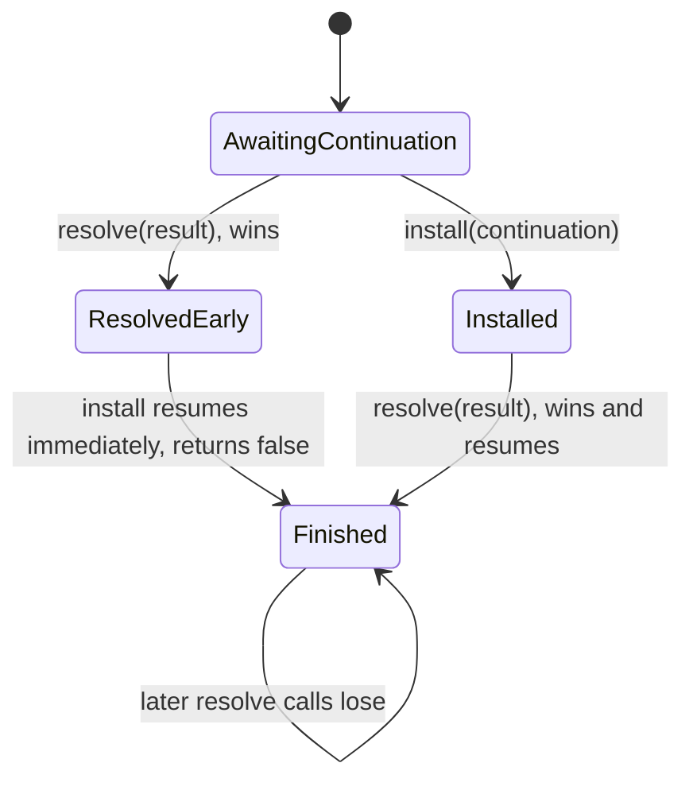

A continuation wrapper is easy to write when exactly one thing can finish the operation. It becomes hard as soon as two things can: a completion handler *and* a cancellation, a response *and* a timeout, a success callback *and* a failure callback that a buggy SDK sometimes calls both of. Each of those pairs is a race to resume the same continuation, and the loser either crashes the process with a double resume or, if the wrapper is defensive in the wrong way, leaves the task suspended forever.

The way out is to treat a continuation as a resource with exactly one **owner** at any moment, and to make "who resumes" a single atomic decision. This article builds a small resolve-once primitive, uses it to make a cancellable legacy operation correct under three different cancellation contracts, adds timeouts, catalogs the bugs that cause double resumes and leaks, and shows how many stress-test iterations it takes to trust a fix.

<!--more-->

The examples use Swift 6 language mode and were compiled and run with the Swift 6.4 toolchain on macOS 26. The Swift blocks build on one another in one `main.swift`. `Mutex` requires iOS 18, macOS 15, or later.

## Ownership, stated precisely

A continuation must be resumed exactly once. Restated as ownership:

1. When `withCheckedContinuation`'s closure receives the continuation, **the closure owns it.**
2. The closure may **transfer** ownership: to a completion handler it passes to an API, or into storage such as a property, a dictionary, or a queue.
3. Whoever owns it must eventually **consume** it by calling `resume`, after which nobody owns it.
4. Ownership must never be **duplicated**. Two parties that both believe they own the continuation will both resume it.

Most bugs are rule 4 violations hiding in plain sight. Capturing a continuation in two closures duplicates ownership. So does storing it in a property *and* capturing it in a cancellation handler. The fix is never "resume carefully"; it is to put the continuation where exactly one party can take it out.

## A resolve-once slot

The primitive below holds the continuation and an optional early result under one lock. Any number of parties may call `resolve`; the first one wins and the rest are told they lost. It also handles the case where a resolver arrives *before* the continuation has been installed, which is what happens when a task is already cancelled on entry:

```swift
import Foundation
import Synchronization

/// Owns a continuation until exactly one resolver resumes it. Later resolvers are ignored.
final class ResolveOnce<Value: Sendable>: Sendable {
    private enum State {
        case awaitingContinuation
        case installed(CheckedContinuation<Value, any Error>)
        case resolvedEarly(Result<Value, any Error>)
        case finished
    }

    private let state = Mutex(State.awaitingContinuation)

    /// Installs the continuation. Returns false if a result already arrived, in which case
    /// the continuation has been resumed with it and the caller must not start any work.
    func install(_ continuation: CheckedContinuation<Value, any Error>) -> Bool {
        let early = state.withLock { state -> Result<Value, any Error>? in
            switch state {
            case .awaitingContinuation:
                state = .installed(continuation)
                return nil
            case .resolvedEarly(let result):
                state = .finished
                return result
            case .installed, .finished:
                preconditionFailure("install(_:) must be called exactly once")
            }
        }
        guard let early else { return true }
        continuation.resume(with: early)
        return false
    }

    /// Resolves with `result` if nobody has yet. Returns whether this call won.
    @discardableResult
    func resolve(_ result: Result<Value, any Error>) -> Bool {
        let winner = state.withLock { state -> CheckedContinuation<Value, any Error>?? in
            switch state {
            case .awaitingContinuation:
                state = .resolvedEarly(result)
                return .some(nil)                 // Won; the continuation will be resumed on install.
            case .installed(let continuation):
                state = .finished
                return .some(continuation)        // Won; resume now, outside the lock.
            case .resolvedEarly, .finished:
                return nil                        // Lost.
            }
        }
        guard let winner else { return false }
        winner?.resume(with: result)
        return true
    }
}
```



Every transition happens inside `withLock`, so the operation, the cancellation handler, and a timeout can call into it from different threads at the same instant and exactly one will win. The continuation is always resumed *outside* the lock, because resuming may run code that tries to take the same lock.

## A legacy operation with an awkward cancellation contract

Real cancellable APIs disagree about what `cancel()` does. The fake below models the three contracts seen in practice:

```swift
enum CancelContract: Sendable {
    /// cancel() makes the operation call its completion with an error, synchronously.
    case completesWithError
    /// cancel() suppresses the completion entirely.
    case suppressesCompletion
    /// cancel() is best effort: the completion may still run later, with a success.
    case mayStillComplete
}

struct JobCancelled: Error {}

/// A cancellable callback-based job, standing in for an SDK.
final class LegacyJob: Sendable {
    private struct State {
        var completion: (@Sendable (Result<Int, any Error>) -> Void)?
        var cancelled = false
        var started = false
    }

    private let state = Mutex(State())
    let contract: CancelContract
    let duration: Duration

    init(contract: CancelContract, duration: Duration) {
        self.contract = contract
        self.duration = duration
    }

    var wasStarted: Bool {
        state.withLock { $0.started }
    }

    func start(completion: @escaping @Sendable (Result<Int, any Error>) -> Void) {
        state.withLock { state in
            state.completion = completion
            state.started = true
        }
        let nanoseconds = Int(duration.components.attoseconds / 1_000_000_000) + Int(duration.components.seconds) * 1_000_000_000
        DispatchQueue.global().asyncAfter(deadline: .now() + .nanoseconds(nanoseconds)) { [self] in
            let completion = state.withLock { state -> (@Sendable (Result<Int, any Error>) -> Void)? in
                if state.cancelled && contract != .mayStillComplete { return nil }
                defer { state.completion = nil }
                return state.completion
            }
            completion?(.success(42))
        }
    }

    func cancel() {
        let completion = state.withLock { state -> (@Sendable (Result<Int, any Error>) -> Void)? in
            state.cancelled = true
            guard contract == .completesWithError else { return nil }
            defer { state.completion = nil }
            return state.completion
        }
        completion?(.failure(JobCancelled()))
    }
}
```

Under `.completesWithError`, a naive wrapper that resumes from both the completion handler and the cancellation handler double-resumes. Under `.suppressesCompletion`, a wrapper that relies on the completion handler alone leaks. Under `.mayStillComplete`, either mistake can happen depending on timing. One wrapper built on `ResolveOnce` is correct under all three:

```swift
func run(_ job: LegacyJob) async throws -> Int {
    let slot = ResolveOnce<Int>()
    return try await withTaskCancellationHandler {
        try await withCheckedThrowingContinuation { continuation in
            guard slot.install(continuation) else { return }   // Already cancelled: do not start.
            job.start { result in
                slot.resolve(result)
            }
        }
    } onCancel: {
        slot.resolve(.failure(CancellationError()))            // Claim the result first...
        job.cancel()                                           // ...then tell the job to stop.
    }
}
```

The order inside `onCancel` matters. Resolving *before* calling `job.cancel()` guarantees that cancellation is reported as `CancellationError`, the error Swift code expects, even under the contract where `cancel()` synchronously calls the completion with the SDK's own error. That call then loses the race and is ignored.

The `guard slot.install(continuation)` handles the timing the [cancellation handlers article](/swift-cancellation-handlers-cleanup/) calls "case 1": if the task was already cancelled, the handler ran first, resolved the slot, and `install` resumes the continuation immediately and returns `false`, so the job is never started.

```swift
func outcome(of job: LegacyJob, cancelAfter delay: Duration?) async -> String {
    let task = Task { try await run(job) }
    if let delay {
        try? await Task.sleep(for: delay)
        task.cancel()
    }
    switch await task.result {
    case .success(let value): return "value \(value)"
    case .failure(let error as CancellationError): _ = error; return "cancelled"
    case .failure(let error): return "failed: \(error)"
    }
}

for contract in [CancelContract.completesWithError, .suppressesCompletion, .mayStillComplete] {
    let completed = await outcome(of: LegacyJob(contract: contract, duration: .milliseconds(5)), cancelAfter: nil)
    let cancelled = await outcome(of: LegacyJob(contract: contract, duration: .seconds(5)), cancelAfter: .milliseconds(10))
    assert(completed == "value 42", "\(contract): completes normally")
    assert(cancelled == "cancelled", "\(contract): cancellation is reported as CancellationError")
}

let neverStarted = LegacyJob(contract: .suppressesCompletion, duration: .seconds(5))
let preCancelled = Task {
    withUnsafeCurrentTask { $0?.cancel() }
    return try await run(neverStarted)
}
let preCancelledValue = try? await preCancelled.value
assert(preCancelledValue == nil)
assert(!neverStarted.wasStarted, "A task cancelled on entry never starts the job")
```

Every contract completes normally when left alone and reports `CancellationError` when cancelled, within milliseconds rather than after the five-second job duration. For the `.mayStillComplete` contract, the job's late success arrives five seconds later, finds the slot finished, and is discarded.

## Timeouts are just another resolver

Because `ResolveOnce` accepts any number of resolvers, a timeout is one more party racing to resolve:

```swift
struct OperationTimedOut: Error {}

func run(_ job: LegacyJob, timeout: Duration) async throws -> Int {
    let slot = ResolveOnce<Int>()
    let timer = Task {
        try await Task.sleep(for: timeout)
        if slot.resolve(.failure(OperationTimedOut())) {
            job.cancel()
        }
    }
    defer { timer.cancel() }
    return try await withTaskCancellationHandler {
        try await withCheckedThrowingContinuation { continuation in
            guard slot.install(continuation) else { return }
            job.start { result in slot.resolve(result) }
        }
    } onCancel: {
        slot.resolve(.failure(CancellationError()))
        job.cancel()
    }
}

do {
    _ = try await run(LegacyJob(contract: .mayStillComplete, duration: .seconds(5)), timeout: .milliseconds(20))
    assertionFailure("A five-second job cannot beat a 20 ms timeout")
} catch is OperationTimedOut {
}
let quickResult = try await run(LegacyJob(contract: .mayStillComplete, duration: .milliseconds(5)), timeout: .seconds(1))
assert(quickResult == 42)
```

The timer only cancels the job if *it* won the race, which keeps it from cancelling a job that already succeeded. The `defer` cancels the timer task on every exit, so a fast success does not leave a sleeping timer behind.

Unlike the task-group timeout in the [task groups article](/swift-task-groups/), this one returns as soon as the timer fires, even if the job ignores `cancel()`. The task group version must wait for its children; a continuation-based wrapper has no child to wait for. That makes it the right shape for legacy operations that cannot be interrupted, at the cost of the job possibly continuing in the background after the caller has moved on.

## A catalog of double resumes and leaks

Almost every continuation bug in practice is one of these:

| Bug | Symptom | Fix |
| --- | --- | --- |
| Missing `return` after resuming on an error path | Double resume | Resume as the last statement, or `return` immediately after |
| Both success and failure callbacks fire | Double resume | Route both through a resolve-once slot |
| Completion races cancellation or timeout | Intermittent double resume | Make every resolver go through one slot |
| A newer request overwrites a stored continuation | Leak of the older one | Reject, join, or resume the older one before replacing it |
| `cancel()` suppresses the completion | Leak on cancellation | Resolve from the cancellation handler |
| Early `guard ... else { return }` inside the closure | Leak | Resume with an error in the `else` branch |
| Delegate held weakly and deallocated mid-operation | Leak | Retain the delegate for the operation's lifetime |
| Continuation resumed while holding a lock | Deadlock, not a crash | Take the continuation out under the lock, resume after |

The first row deserves an example, because it hides in code that looks finished:

<!-- skip-check -->
```swift
func parse(_ data: Data?) async throws -> String {
    try await withCheckedThrowingContinuation { continuation in
        legacyParse(data) { text, error in
            if let error {
                continuation.resume(throwing: error)
                // Missing return: execution falls through.
            }
            continuation.resume(returning: text ?? "")
        }
    }
}
// Fatal error: SWIFT TASK CONTINUATION MISUSE: parse(_:) tried to resume its continuation
// more than once, returning ...
```

Converting the `(T?, Error?)` callback pair into a `Result` first, then calling `resume(with:)` once, eliminates the whole class of bug.

## How much stress testing is enough?

Races between completion, cancellation, and timeout happen only for particular interleavings. A test that runs once tells you little. If a bug manifests in a fraction $$p$$ of runs, then the probability that $$N$$ independent runs all miss it is $$(1 - p)^N$$. To catch it with confidence $$c$$, you need

$$
N \ge \frac{\ln(1 - c)}{\ln(1 - p)} \approx \frac{-\ln(1 - c)}{p} .
$$

A race that shows up once in a thousand runs, $$p = 0.001$$, needs about 4,600 runs to be caught with 99% confidence. A race at $$p = 0.01$$ needs about 460. Concurrency tests should therefore loop, with randomized timing, and run in optimized builds as well as debug ones, since timing changes between them.

```swift
/// A deterministic generator, so a failing stress run can be replayed.
struct SplitMix64: RandomNumberGenerator {
    private var state: UInt64

    init(seed: UInt64) {
        state = seed
    }

    mutating func next() -> UInt64 {
        state &+= 0x9E37_79B9_7F4A_7C15
        var z = state
        z = (z ^ (z >> 30)) &* 0xBF58_476D_1CE4_E5B9
        z = (z ^ (z >> 27)) &* 0x94D0_49BB_1331_11EB
        return z ^ (z >> 31)
    }
}

func stressCancellationRace(iterations: Int, seed: UInt64) async -> (completed: Int, cancelled: Int) {
    var generator = SplitMix64(seed: seed)
    var completed = 0
    var cancelled = 0
    let contracts: [CancelContract] = [.completesWithError, .suppressesCompletion, .mayStillComplete]
    for _ in 0..<iterations {
        let contract = contracts.randomElement(using: &generator)!
        let jobTime = Duration.microseconds(Int.random(in: 0...400, using: &generator))
        let cancelTime = Duration.microseconds(Int.random(in: 0...400, using: &generator))
        let task = Task { try await run(LegacyJob(contract: contract, duration: jobTime)) }
        try? await Task.sleep(for: cancelTime)
        task.cancel()
        switch await task.result {
        case .success: completed += 1
        case .failure: cancelled += 1
        }
    }
    return (completed, cancelled)
}

let stress = await stressCancellationRace(iterations: 1_000, seed: 2026)
assert(stress.completed + stress.cancelled == 1_000, "Every iteration finished exactly once, with no hang or trap")
assert(stress.completed > 0 && stress.cancelled > 0, "Both sides of the race were exercised")
print("stress: \(stress.completed) completed, \(stress.cancelled) cancelled")
```

The assertions are deliberately weak about *which* side wins, since that depends on timing. What they check is the invariant: every iteration ends, exactly once, as a success or an error. A double resume would trap; a leak would hang the loop. The seeded generator makes a failing run reproducible: rerun with the same seed to get the same sequence of contracts and delays, though not the same thread interleavings.

On the test machine, 1,000 iterations took about one second, with between 6% and 30% of them completing before the cancellation arrived, depending on the run. Running the same loop with a naive wrapper, one that stores the continuation for the cancellation handler *and* captures it in the completion handler, trapped at iteration 7 with "SWIFT TASK CONTINUATION MISUSE: runNaive(_:) tried to resume its continuation more than once, throwing CancellationError()!". That is the behavior the formula predicts for a race with a high $$p$$: a bug that a single test run would probably have missed, found in a fraction of a second.

## Summary

- Treat a continuation as a resource with exactly one owner. Duplicated ownership, such as two closures or a property plus a handler, is the root of double resumes.
- Route every party that can finish an operation, completion, cancellation, timeout, through one resolve-once slot under a lock, and resume outside the lock.
- Handle a result that arrives before the continuation is installed, so pre-cancelled tasks never start work.
- In cancellation handlers, claim the result before calling the legacy `cancel()`, so callers always see `CancellationError`.
- A continuation-based timeout returns promptly even when the legacy operation cannot be interrupted.
- Convert `(T?, Error?)` callbacks to `Result` and resume once; it removes the missing-`return` bug class.
- Stress-test races in loops: catching a bug with probability $$p$$ per run at confidence $$c$$ needs about $$-\ln(1 - c)/p$$ runs.

## Exercise

Extend the wrapper so that several callers can await the same `LegacyJob`: the first caller starts it, later callers join, and each caller can be cancelled independently. The job itself should be cancelled only when the last waiter leaves. Give each waiter its own `ResolveOnce`, keep the set of waiters in a `Mutex`, and write a stress test that randomly adds waiters, cancels some, and lets the job finish, checking that every waiter ends exactly once and that the job is cancelled if and only if every waiter was.

## Further reading

- [SE-0300: Continuations for interfacing async tasks with synchronous code](https://github.com/swiftlang/swift-evolution/blob/main/proposals/0300-continuation.md), section "Checked continuations."
- [SE-0528: `Continuation`](https://github.com/swiftlang/swift-evolution/blob/main/proposals/0528-noncopyable-continuation.md), which enforces single ownership in the type system on iOS 27 and macOS 27.
- [withTaskCancellationHandler(operation:onCancel:isolation:)](https://developer.apple.com/documentation/swift/withtaskcancellationhandler(operation:oncancel:isolation:)).

Previous: [Bridging Callback APIs with Checked Continuations](/swift-checked-continuations/). Next: [Rejecting Stale Results After Request Replacement](/swift-rejecting-stale-results/).

Return to the [Concurrency roadmap](/swift-concurrency-roadmap/).
