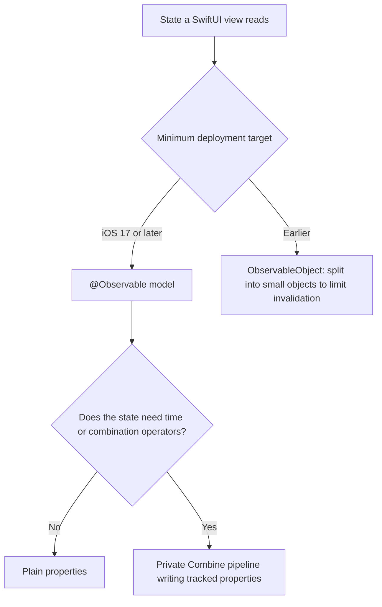

From iOS 13 to iOS 16, SwiftUI's data flow was built on Combine. A view model conformed to `ObservableObject`, its state was marked `@Published`, and SwiftUI subscribed to the object's `objectWillChange` publisher to learn when to re-evaluate a view. iOS 17 introduced the Observation framework and the `@Observable` macro, which tracks *which properties a view actually reads* and invalidates the view only when one of those changes. For view state, it replaces `ObservableObject` entirely, and most Combine code in SwiftUI apps exists to serve `ObservableObject`.

The difference is not cosmetic, and it can be counted. This article hosts SwiftUI views in an offscreen window and counts how many times each `body` runs for the same change under both models: a property the view never reads, one tile changing out of ten, and a nested model. It then measures the Observation primitives that replace `objectWillChange`, `withObservationTracking` and the `Observations` sequence, and shows where Combine still belongs in an `@Observable` app: in the pipelines that feed it, not in the observation itself.

<!--more-->

The examples use Swift 6 language mode and were compiled and run with the Swift 6.4 toolchain from Xcode 27.1 on macOS 26. They host SwiftUI views in an `NSHostingView` inside an offscreen `NSWindow`, which makes SwiftUI evaluate and update them exactly as it would on screen. Paste the `VirtualTimeScheduler` and `TimelineRecorder` from [Time: `debounce`, `throttle`, and `delay`](/combine-debounce-throttle-delay/#a-scheduler-whose-clock-you-control) first, then the blocks below in order, into one `main.swift`.

<!-- check-uses: virtual-scheduler -->

## Counting `body` evaluations

Each view in the experiments records an evaluation of its `body` in a counter, and a helper hosts views in a window and runs the main run loop long enough for SwiftUI to process updates:

```swift
import AppKit
import Observation
import SwiftUI
import Synchronization

@MainActor
enum BodyCounter {
    static var counts: [String: Int] = [:]
    static func record(_ view: String) { counts[view, default: 0] += 1 }
    static func reset() { counts = [:] }
}

@MainActor
func host(_ view: some View) -> NSWindow {
    let window = NSWindow(contentRect: NSRect(x: 0, y: 0, width: 400, height: 800),
                          styleMask: [.borderless], backing: .buffered, defer: false)
    window.contentView = NSHostingView(rootView: view)
    window.orderFrontRegardless()
    return window
}

func settle() {
    RunLoop.main.run(until: Date(timeIntervalSinceNow: 0.15))
}
```

## A property the view does not read

Here is the same model in both styles: a title that the view displays and a counter that it does not:

```swift
@MainActor
final class LegacyArticle: ObservableObject {
    @Published var title = "Draft"
    @Published var wordCount = 0
}

@MainActor
@Observable
final class ModernArticle {
    var title = "Draft"
    var wordCount = 0
}

struct LegacyTitleView: View {
    @ObservedObject var article: LegacyArticle
    var body: some View {
        BodyCounter.record("legacy")
        return Text(article.title)
    }
}

struct ModernTitleView: View {
    var article: ModernArticle
    var body: some View {
        BodyCounter.record("modern")
        return Text(article.title)
    }
}

let legacyArticle = LegacyArticle()
let modernArticle = ModernArticle()
let articleWindow = host(VStack {
    LegacyTitleView(article: legacyArticle)
    ModernTitleView(article: modernArticle)
})
settle()

BodyCounter.reset()
legacyArticle.wordCount += 1
modernArticle.wordCount += 1
settle()
assert(BodyCounter.counts == ["legacy": 1])      // only the ObservableObject view re-ran

BodyCounter.reset()
legacyArticle.title = "Final"
modernArticle.title = "Final"
settle()
assert(BodyCounter.counts == ["legacy": 1, "modern": 1])
```

Changing `wordCount`, which neither view reads, re-evaluated the `ObservableObject` view and left the `@Observable` view alone. The reason is the mechanism from [`@Published` Properties](/combine-published-properties/): every `@Published` property fires the object's single `objectWillChange`, and SwiftUI cannot know which property changed, so every view observing the object is invalidated. Observation records the properties each `body` reads while it runs, and invalidates a view only when one of *those* changes.

## One tile out of ten

The cost of coarse invalidation grows with the number of views that observe one object. A dashboard with ten tiles, each showing one property of a shared model, makes it concrete:

```swift
@MainActor
final class LegacyDashboard: ObservableObject {
    @Published var metrics = Array(repeating: 0, count: 10)
}

@MainActor
@Observable
final class MetricValue {
    var value = 0
}

@MainActor
@Observable
final class ModernDashboard {
    let metrics = (0..<10).map { _ in MetricValue() }
}

struct LegacyTile: View {
    @ObservedObject var dashboard: LegacyDashboard
    let index: Int
    var body: some View {
        BodyCounter.record("legacy tile")
        return Text("\(dashboard.metrics[index])")
    }
}

struct ModernTile: View {
    var metric: MetricValue
    var body: some View {
        BodyCounter.record("modern tile")
        return Text("\(metric.value)")
    }
}

let legacyDashboard = LegacyDashboard()
let modernDashboard = ModernDashboard()
let dashboardWindow = host(HStack {
    VStack { ForEach(0..<10, id: \.self) { LegacyTile(dashboard: legacyDashboard, index: $0) } }
    VStack { ForEach(0..<10, id: \.self) { ModernTile(metric: modernDashboard.metrics[$0]) } }
})
settle()

BodyCounter.reset()
legacyDashboard.metrics[3] += 1
modernDashboard.metrics[3].value += 1
settle()
assert(BodyCounter.counts == ["legacy tile": 10, "modern tile": 1])
```

One change, ten evaluations with `ObservableObject`, one with Observation. A separate run with ten distinct `@Published` properties on one model, each read by its own tile, gave the same 10 to 1. A screen built from one large `ObservableObject` does work proportional to the number of views on it for every change to any of its properties. The traditional mitigation, splitting the model into many small `ObservableObject`s, one per row or tile, does work; with an object per row, both models re-evaluated only the row that changed. Observation makes that granularity the default instead of a design discipline.

## Nested models

[`@Published` Properties](/combine-published-properties/) found that a `@Published` property holding another `ObservableObject` fires only when the reference is replaced, not when the child changes. In a view, that is a stale screen:

```swift
@MainActor
final class LegacyPlayer: ObservableObject { @Published var volume = 5 }

@MainActor
final class LegacyRoom: ObservableObject { @Published var player = LegacyPlayer() }

@MainActor
@Observable
final class ModernPlayer { var volume = 5 }

@MainActor
@Observable
final class ModernRoom { var player = ModernPlayer() }

struct LegacyRoomView: View {
    @ObservedObject var room: LegacyRoom
    var body: some View {
        BodyCounter.record("legacy room")
        return Text("Volume \(room.player.volume)")
    }
}

struct ModernRoomView: View {
    var room: ModernRoom
    var body: some View {
        BodyCounter.record("modern room")
        return Text("Volume \(room.player.volume)")
    }
}

let legacyRoom = LegacyRoom()
let modernRoom = ModernRoom()
let roomWindow = host(VStack {
    LegacyRoomView(room: legacyRoom)
    ModernRoomView(room: modernRoom)
})
settle()

BodyCounter.reset()
legacyRoom.player.volume = 9
modernRoom.player.volume = 9
settle()
assert(BodyCounter.counts == ["modern room": 1])   // the legacy view still says "Volume 5"
```

Observation tracks the access path the `body` actually took, `room` then `player` then `volume`, so it sees the change through the nesting. The `ObservableObject` view needs either its own `@ObservedObject` for the child or the hand-written forwarding of `objectWillChange` shown in the `@Published` article.

## The primitives that replace `objectWillChange`

Outside SwiftUI, code that used to subscribe to `objectWillChange` or a `$property` publisher has two Observation tools.

`withObservationTracking(_:onChange:)` runs a closure, records the properties it reads, and calls `onChange` the first time any of them is about to change. It fires once, and, like `objectWillChange`, before the new value is stored:

```swift
@MainActor
@Observable
final class Counter {
    var tracked = 0
    var untracked = 0
}

let counter = Counter()
let changeLog = Mutex<[String]>([])
withObservationTracking {
    _ = counter.tracked
} onChange: {
    let current = MainActor.assumeIsolated { counter.tracked }
    changeLog.withLock { $0.append("tracked will change; still \(current)") }
}
counter.untracked = 1                             // not read inside the closure: ignored
counter.tracked = 1
counter.tracked = 2                               // already fired: ignored
assert(changeLog.withLock { $0 } == ["tracked will change; still 0"])
```

The `onChange` closure is `@Sendable` and not isolated to the main actor, which is why reading the model inside it needs `MainActor.assumeIsolated`; in this test the change happens on the main actor, so the assumption holds. Code that wants every change must re-register in `onChange`, which is easy to get wrong.

`Observations`, added in Swift 6.2 by [SE-0475](https://github.com/swiftlang/swift-evolution/blob/main/proposals/0475-observed.md), does that for you: it is an `AsyncSequence` that evaluates a closure, emits the result, and emits again after the properties it read change. Changes made together, without a suspension in between, are delivered as one transaction:

```swift
let totals = Counter()
totals.tracked = 2
totals.untracked = 1
let observedTotals = Task { @MainActor () -> [Int] in
    var seen: [Int] = []
    for await total in Observations({ totals.tracked + totals.untracked }) {
        seen.append(total)
        if total == 31 { break }
    }
    return seen
}
try? await Task.sleep(for: .milliseconds(50))
totals.tracked = 10                               // three assignments with no suspension...
totals.untracked = 10
totals.tracked = 20                               // ...delivered as one value, 30
try? await Task.sleep(for: .milliseconds(50))
totals.tracked = 25                               // a different combination with the same total
totals.untracked = 5
try? await Task.sleep(for: .milliseconds(50))
totals.untracked = 6
let totalsSeen = await observedTotals.value
assert(totalsSeen == [3, 30, 30, 31])
```

Three behaviors are visible. The sequence started with the current value, 3. The burst of three assignments produced a single 30, not three intermediate totals, which is the transactional coalescing that `@Published` subscribers never got; the glitches that [Combining](/combine-combinelatest-zip-merge/) measured for `combineLatest` over two derived streams cannot happen here, because the closure is re-evaluated as a whole. And the second 30 was emitted even though the value had not changed: `Observations` does not deduplicate, so add a comparison in the loop if repeats matter.

This file awaits at top level, so the main actor is free to deliver the `Observations` values between the `Task.sleep` calls; the SwiftUI experiments above ran before the first `await`.

## Where Combine still fits

Observation answers "what changed?". It has no operators. A search screen still needs to debounce input, drop duplicates, cancel superseded requests, and retry, and none of that is observation. The `@Observable` macro also does not produce `$property` publishers:

```swift
// Does not compile
@Observable final class SearchState { var query = "" }
let searchState = SearchState()
let queries = searchState.$query.sink { print($0) }
// error: value of type 'SearchState' has no member '$query'
```

Adding `@Published` to a property of an `@Observable` class does not compile either, because both macros want to generate the same backing storage: "invalid redeclaration of synthesized property '_query'". Marking it `@ObservationIgnored @Published` compiles and provides `$query`, but then Observation does not track the property, so a view that reads it never updates; in a test, `withObservationTracking` around a read of such a property never fired when it changed. That combination looks like a migration shortcut and produces a screen that ignores the user.

The pattern that works keeps Combine as private plumbing: the observable property's `didSet` feeds a subject, and the pipeline's output is written back to an observable property, where SwiftUI sees it:

```swift
@MainActor
@Observable
final class SearchModel {
    var query = "" {
        didSet { queryInput.send(query) }
    }
    private(set) var results: [String] = []
    private(set) var searchesSent = 0

    @ObservationIgnored private let queryInput = PassthroughSubject<String, Never>()
    @ObservationIgnored private var cancellables = Set<AnyCancellable>()

    init(scheduler: VirtualTimeScheduler) {
        queryInput
            .removeDuplicates()
            .debounce(for: .milliseconds(300), scheduler: scheduler)
            .map { [weak self] query -> AnyPublisher<[String], Never> in
                self?.searchesSent += 1
                return Just(["\(query) result"])
                    .delay(for: .milliseconds(100), scheduler: scheduler)
                    .eraseToAnyPublisher()
            }
            .switchToLatest()
            .sink { [weak self] in self?.results = $0 }
            .store(in: &cancellables)
    }
}

let searchClock = VirtualTimeScheduler()
let search = SearchModel(scheduler: searchClock)
let resultsChanged = Mutex(0)
withObservationTracking { _ = search.results } onChange: { resultsChanged.withLock { $0 += 1 } }

search.query = "sw"
searchClock.advance(by: .milliseconds(100))
search.query = "swift"
searchClock.advance(by: .milliseconds(399))
assert(search.results.isEmpty && search.searchesSent == 1)
searchClock.advance(by: .milliseconds(1))
assert(search.results == ["swift result"])
assert(resultsChanged.withLock { $0 } == 1)       // Observation saw the pipeline's write
```

The subject and the cancellables are `@ObservationIgnored`, because they are implementation details that no view should track. The pipeline runs on the virtual scheduler here, as [Testing Publishers](/combine-testing-publishers/) does; in the app it would take the main queue through `AnyScheduler`. The search was sent 300 ms after the last keystroke, its result arrived 100 ms later, and Observation reported exactly one change to `results`.

## Migrating

| `ObservableObject` | `@Observable` |
|---|---|
| `final class Model: ObservableObject` | `@Observable final class Model` |
| `@Published var value` | `var value` |
| `@StateObject private var model = Model()` | `@State private var model = Model()` |
| `@ObservedObject var model: Model` | `var model: Model`, or `@Bindable var model: Model` for bindings |
| `@EnvironmentObject var model: Model` | `@Environment(Model.self) private var model` |
| `objectWillChange.sink { ... }` | `withObservationTracking`, or `for await` over `Observations` |
| `$value.debounce(...)` | a private subject fed from `didSet`, or `Observations` with an async debounce |

Observation requires iOS 17, macOS 14, and the matching OS versions elsewhere; `Observations` requires the Swift 6.2 runtime, which ships with iOS 26 and macOS 26. Apps that support earlier systems keep `ObservableObject` for those versions, and the cost measured above is the cost of doing so.



Keep the windows and remaining handles alive until the end of the file:

```swift
withExtendedLifetime((articleWindow, dashboardWindow, roomWindow)) {}
```

## Summary

- With `ObservableObject`, any `@Published` change invalidates every view observing the object: changing a property no view read re-ran a `body`, and changing one tile's value re-ran all ten tiles. With `@Observable`, the same changes ran zero and one `body` respectively.
- A change inside a nested `ObservableObject` did not update the parent's view; Observation tracked the nested access and updated it.
- `withObservationTracking` fires once, for the properties read, before the change. `Observations` emits the current value, coalesces changes made without a suspension into one value, and does not deduplicate: `[3, 30, 30, 31]`.
- `@Observable` has no `$property` publishers. `@Published` inside it does not compile, and `@ObservationIgnored @Published` compiles but is invisible to Observation.
- Combine still fits as private plumbing: feed a subject from `didSet`, run the debounce and `switchToLatest` pipeline, and write results to a tracked property.

## Exercise

Migrate the `SearchViewModel` from [Testing Publishers](/combine-testing-publishers/) to `@Observable`, keeping its pipeline and its tests. Change only what Observation requires, and make the test suite pass unchanged apart from replacing `$state` subscriptions with `Observations` or `withObservationTracking`. Then host the old and the new view model in a SwiftUI screen with a results list and a separate "searches sent" counter view, and count how many times each view's `body` runs while typing "swift" one letter at a time, before and after the migration.

## Further reading

- [Discover Observation in SwiftUI](https://developer.apple.com/videos/play/wwdc2023/10149/), WWDC23.
- Apple's article [Migrating from the Observable Object protocol to the Observable macro](https://developer.apple.com/documentation/swiftui/migrating-from-the-observable-object-protocol-to-the-observable-macro).
- [SE-0395: Observation](https://github.com/swiftlang/swift-evolution/blob/main/proposals/0395-observability.md) and [SE-0475: Transactional Observation of Values](https://github.com/swiftlang/swift-evolution/blob/main/proposals/0475-observed.md).

Previous: [Bridging Publishers to `async`/`await` with `.values`](/combine-publisher-values-async/).

Return to the [Combine roadmap](/combine/).
