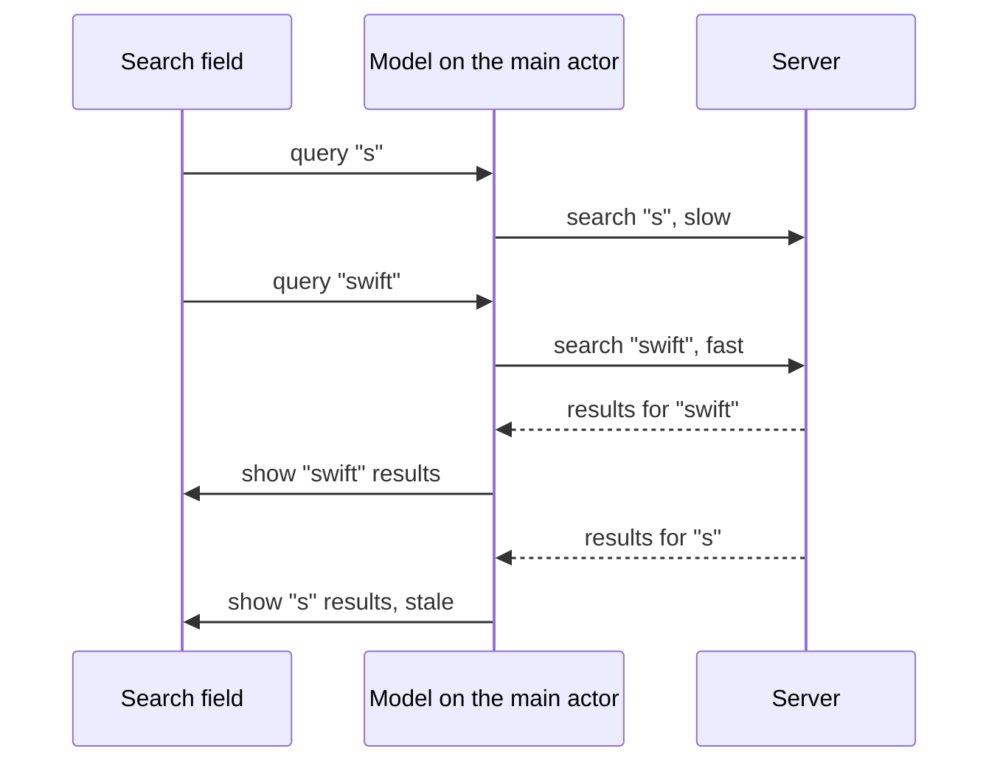

A user types "swift" into a search field. Five requests go out, one per keystroke. The response for "s" is large and slow; the response for "swift" is small and fast. "swift" arrives first and is displayed. Then "s" arrives and replaces it. The screen now shows results for a query the user typed a second ago and has since extended four times.

This is the stale-result bug, and it appears wherever a newer request replaces an older one: search fields, filters, pagination after a sort change, detail screens when the selection changes, map tiles when the viewport moves. Swift 6's data-race checking does not catch it, because nothing races in the memory-model sense; the main actor applies each result in turn, in the wrong order. This article quantifies how often the reordering happens, then builds up the defenses in order: cancellation, generation tokens for results that arrive outside the task, commit checks for multi-step updates, and debouncing.

<!--more-->

The examples use Swift 6 language mode and were compiled and run with the Swift 6.4 toolchain on macOS 26. The Swift blocks build on one another in one `main.swift`. `Mutex` requires iOS 18, macOS 15, or later.

## How often responses overtake each other

Suppose keystrokes are $$\Delta$$ apart and request latencies are independent and exponentially distributed with mean $$m$$, a common first model for network response times. Request $$i$$ is sent at time $$t$$ and request $$i+1$$ at $$t + \Delta$$. The older response arrives *after* the newer one when $$L_i > \Delta + L_{i+1}$$. Integrating over $$L_{i+1}$$:

$$
P(\text{reorder}) = \int_0^\infty e^{-(\Delta + x)/m}\,\frac{1}{m}e^{-x/m}\,dx = \frac{1}{2}\,e^{-\Delta/m}.
$$

With a typing gap of 150 ms and a mean latency of 300 ms, $$P = \tfrac{1}{2}e^{-0.5} \approx 0.30$$: almost a third of consecutive request pairs arrive out of order. On a fast connection with a mean latency of 50 ms, $$P \approx 0.025$$, rare enough to escape testing on office Wi-Fi and common enough to appear daily on cellular networks.

The formula is easy to check by simulation:

```swift
import Foundation
import Synchronization

struct SplitMix64: RandomNumberGenerator {
    private var state: UInt64

    init(seed: UInt64) {
        state = seed
    }

    mutating func next() -> UInt64 {
        state &+= 0x9E37_79B9_7F4A_7C15
        var z = state
        z = (z ^ (z >> 30)) &* 0xBF58_476D_1CE4_E5B9
        z = (z ^ (z >> 27)) &* 0x94D0_49BB_1331_11EB
        return z ^ (z >> 31)
    }
}

func exponential(mean: Double, using generator: inout SplitMix64) -> Double {
    -mean * log(1 - Double.random(in: 0..<1, using: &generator))
}

func simulatedReorderRate(gap: Double, meanLatency: Double, trials: Int) -> Double {
    var generator = SplitMix64(seed: 42)
    var reordered = 0
    for _ in 0..<trials {
        let older = exponential(mean: meanLatency, using: &generator)
        let newer = exponential(mean: meanLatency, using: &generator)
        if older > gap + newer { reordered += 1 }
    }
    return Double(reordered) / Double(trials)
}

let predicted = 0.5 * exp(-150.0 / 300.0)
let simulated = simulatedReorderRate(gap: 150, meanLatency: 300, trials: 200_000)
assert(abs(simulated - predicted) < 0.01)
print("reorder probability: predicted \(predicted), simulated \(simulated)")
```

The simulation agreed with the formula to within a few thousandths. Real latency distributions have heavier tails than the exponential, which makes reordering *more* likely, not less: one slow response can overtake many fast ones.



## A controllable fake service

The examples use a search service whose latency per query is set by the test, so every interleaving is deterministic:

```swift
final class SearchService: Sendable {
    private let latencies: [String: Duration]
    private let requests = Mutex<[String]>([])

    init(latencies: [String: Duration]) {
        self.latencies = latencies
    }

    /// Async API.
    func search(_ query: String) async throws -> [String] {
        requests.withLock { $0.append(query) }
        try await Task.sleep(for: latencies[query] ?? .milliseconds(10))
        return ["\(query) result"]
    }

    /// Legacy callback API for the same backend. There is no handle to cancel.
    func search(_ query: String, completion: @escaping @Sendable ([String]) -> Void) {
        requests.withLock { $0.append(query) }
        let latency = latencies[query] ?? .milliseconds(10)
        let milliseconds = Int(latency.components.seconds * 1_000) + Int(latency.components.attoseconds / 1_000_000_000_000_000)
        DispatchQueue.global().asyncAfter(deadline: .now() + .milliseconds(milliseconds)) {
            completion(["\(query) result"])
        }
    }

    var requestLog: [String] {
        requests.withLock { $0 }
    }
}

/// The slow-first, fast-last shape that produces stale results.
let typingLatencies: [String: Duration] = [
    "s": .milliseconds(120), "sw": .milliseconds(90), "swi": .milliseconds(60),
    "swif": .milliseconds(30), "swift": .milliseconds(5),
]
let typedQueries = ["s", "sw", "swi", "swif", "swift"]
```

## Step 0: the naive model

```swift
@MainActor
final class NaiveSearchModel {
    private(set) var results: [String] = []
    private var tasks: [Task<Void, Never>] = []
    private let service: SearchService

    init(service: SearchService) {
        self.service = service
    }

    func queryChanged(_ query: String) {
        tasks.append(Task {
            if let found = try? await service.search(query) {
                results = found
            }
        })
    }

    func settle() async {
        for task in tasks { await task.value }
    }
}

let naive = NaiveSearchModel(service: SearchService(latencies: typingLatencies))
for query in typedQueries {
    naive.queryChanged(query)
}
await naive.settle()
assert(naive.results == ["s result"], "The slowest, oldest response was applied last")
```

Every response was applied, in arrival order, and the oldest arrived last. Note that there is no data race here: the model is main-actor isolated, and every assignment is checked and serialized. The bug is entirely about *which* result wins.

## Step 1: cancel the previous request

The first defense is to keep one handle and cancel it whenever a newer query arrives, checking for cancellation after the `await` and before committing:

```swift
@MainActor
final class CancellingSearchModel {
    private(set) var results: [String] = []
    private var current: Task<Void, Never>?
    private let service: SearchService

    init(service: SearchService) {
        self.service = service
    }

    func queryChanged(_ query: String) {
        current?.cancel()
        current = Task {
            guard let found = try? await service.search(query) else { return }
            guard !Task.isCancelled else { return }
            results = found
        }
    }

    func settle() async {
        await current?.value
        try? await Task.sleep(for: .milliseconds(150))      // Let any replaced task finish too.
    }
}

let cancelling = CancellingSearchModel(service: SearchService(latencies: typingLatencies))
for query in typedQueries {
    cancelling.queryChanged(query)
}
await cancelling.settle()
assert(cancelling.results == ["swift result"])
```

This version is correct for this shape, and it is worth understanding exactly why. The check and the assignment run on the main actor in one synchronous stretch, and `cancel()` is called from the main actor too. So no cancellation can arrive *between* the check and the assignment. A replaced task either sees the flag and returns, or was never replaced. Cancellation also saves work: `Task.sleep`, standing in for `URLSession`, stops early, so replaced requests stop consuming bandwidth.

The defense depends on three conditions: the work is a task you hold, its result is delivered *through that task*, and the commit happens in one isolated job after the check. When any of the three fails, cancellation is no longer sufficient.

## Step 2: results that do not arrive through the task

A callback API has no task to cancel. The response arrives in a closure, whenever the server answers:

```swift
@MainActor
final class CallbackSearchModel {
    private(set) var results: [String] = []
    private let service: SearchService
    private var generation = 0
    let usesGeneration: Bool

    init(service: SearchService, usesGeneration: Bool) {
        self.service = service
        self.usesGeneration = usesGeneration
    }

    func queryChanged(_ query: String) {
        generation += 1
        let requestGeneration = generation
        service.search(query) { [weak self] found in
            Task { @MainActor in
                guard let self else { return }
                if self.usesGeneration, requestGeneration != self.generation {
                    return                              // A newer query has been issued since.
                }
                self.results = found
            }
        }
    }
}

let unguardedCallbacks = CallbackSearchModel(service: SearchService(latencies: typingLatencies), usesGeneration: false)
let guardedCallbacks = CallbackSearchModel(service: SearchService(latencies: typingLatencies), usesGeneration: true)
for query in typedQueries {
    unguardedCallbacks.queryChanged(query)
    guardedCallbacks.queryChanged(query)
}
try await Task.sleep(for: .milliseconds(200))
assert(unguardedCallbacks.results == ["s result"], "Without a token, the last response to arrive wins")
assert(guardedCallbacks.results == ["swift result"], "With a token, only the latest request may commit")
```

The **generation token** is a counter incremented for every new request. Each request captures the value current when it was issued, and its response may commit only if the counter has not moved since. Unlike the cancellation flag, the token is about *identity*: it does not ask "was this work cancelled?" but "is this still the request the user is waiting for?" It works for callbacks, for responses delivered through streams, for work shared between several callers, and for results produced by code you cannot cancel.

Tokens and cancellation are complementary. Cancellation stops work that is no longer wanted, saving bandwidth and battery. The token guarantees correctness regardless of whether the work stopped. A robust model uses both.

## Step 3: multi-step commits

Some updates happen in stages: show the first page, then load thumbnails; show cached results, then refresh from the network; update the list, then the detail pane. Each stage is a separate commit after a separate `await`, and the request can be replaced between them. Check the token at *every* commit point:

```swift
@MainActor
final class StagedSearchModel {
    private(set) var results: [String] = []
    private(set) var details: [String: String] = [:]
    private(set) var appliedStages: [String] = []
    private var generation = 0
    private var current: Task<Void, Never>?
    private let service: SearchService

    init(service: SearchService) {
        self.service = service
    }

    func queryChanged(_ query: String) {
        generation += 1
        let requestGeneration = generation
        current?.cancel()
        current = Task {
            guard let found = try? await service.search(query), requestGeneration == generation else { return }
            results = found
            appliedStages.append("results for \(query)")

            try? await Task.sleep(for: .milliseconds(40))              // Second stage: load details.
            guard requestGeneration == generation else { return }
            details = Dictionary(uniqueKeysWithValues: found.map { ($0, "details for \($0)") })
            appliedStages.append("details for \(query)")
        }
    }

    func settle() async {
        await current?.value
    }
}

let staged = StagedSearchModel(service: SearchService(latencies: ["first": .milliseconds(5), "second": .milliseconds(5)]))
staged.queryChanged("first")
try await Task.sleep(for: .milliseconds(20))          // "first" has shown results and is loading details.
staged.queryChanged("second")
await staged.settle()
try await Task.sleep(for: .milliseconds(60))
assert(staged.appliedStages == ["results for first", "results for second", "details for second"])
assert(staged.details.keys.sorted() == ["second result"], "The replaced request never applied its details")
```

The replaced request committed its first stage legitimately, then was replaced while loading details. The second check prevented it from writing details for "first" into a model that now shows results for "second", a mismatch that would be visible as the wrong detail pane for the selected row.

Here, `Task.sleep` would also have thrown on cancellation, so the replaced task would have stopped anyway. The token check makes correctness independent of whether the second stage happens to be cancellable, which matters as soon as it is a legacy callback, a shared load, or a synchronous computation.

## Step 4: fewer requests with debouncing

Every keystroke so far produced a request. Most of them were wasted. **Debouncing** waits until the input has been quiet for a short interval before starting work, and restarts the wait on every change. With tasks, a debounce is just a cancellable sleep at the start of the request:

```swift
@MainActor
final class DebouncedSearchModel {
    private(set) var results: [String] = []
    private var current: Task<Void, Never>?
    private var generation = 0
    private let service: SearchService
    private let quietPeriod: Duration

    init(service: SearchService, quietPeriod: Duration) {
        self.service = service
        self.quietPeriod = quietPeriod
    }

    func queryChanged(_ query: String) {
        generation += 1
        let requestGeneration = generation
        current?.cancel()
        current = Task {
            do {
                try await Task.sleep(for: quietPeriod)    // Cancelled by the next keystroke.
            } catch {
                return
            }
            guard let found = try? await service.search(query), requestGeneration == generation else { return }
            results = found
        }
    }

    func settle() async {
        await current?.value
    }
}

let debounceService = SearchService(latencies: typingLatencies)
let debounced = DebouncedSearchModel(service: debounceService, quietPeriod: .milliseconds(80))
for query in typedQueries {
    debounced.queryChanged(query)
    try await Task.sleep(for: .milliseconds(20))      // Typing faster than the quiet period.
}
await debounced.settle()
assert(debounced.results == ["swift result"])
assert(debounceService.requestLog == ["swift"], "Five keystrokes, one request")
```

Five keystrokes produced one request. Debouncing does not replace the token: if the user pauses for longer than the quiet period and then keeps typing, two requests can be in flight, and the reordering analysis above applies again. It changes the effective gap $$\Delta$$ in the formula to at least the quiet period, which lowers the reorder probability, $$\tfrac{1}{2}e^{-\Delta/m}$$, without eliminating it.

The quiet period is a trade-off between wasted requests and perceived latency. Values between 150 and 300 ms are typical for search; a filter that recomputes locally may not need debouncing at all.

## In SwiftUI

SwiftUI's `.task(id:)` modifier implements step 1 for you: when `id` changes, it cancels the running task and starts a new one. Combined with a quiet period inside the task, it also gives debouncing:

<!-- skip-check -->
```swift
struct SearchView: View {
    @State private var query = ""
    @State private var results: [String] = []
    let service: SearchService

    var body: some View {
        List(results, id: \.self) { Text($0) }
            .searchable(text: $query)
            .task(id: query) {
                try? await Task.sleep(for: .milliseconds(200))
                guard !Task.isCancelled, let found = try? await service.search(query) else { return }
                results = found
            }
    }
}
```

The same three conditions apply. Because the work is a task SwiftUI holds, the result arrives through it, and the commit is a single main-actor assignment, the cancellation check is sufficient. Once the view model starts using callbacks, shared loaders, or multi-stage commits, add a token.

## Summary

- Replaced requests reorder often: with exponential latencies, $$P = \tfrac{1}{2}e^{-\Delta/m}$$, about 30% for a 150 ms typing gap and 300 ms mean latency.
- The bug is not a data race; Swift 6 accepts it. It is about which result is allowed to commit.
- Cancelling the previous task and checking `Task.isCancelled` before committing is sufficient when the work is a task you hold, its result comes through that task, and the commit is one isolated job.
- Generation tokens make commits depend on request identity, so they also work for callbacks, streams, shared work, and uncancellable code.
- Check the token at every commit point of a multi-stage update.
- Debouncing removes most requests and widens the effective gap, but does not remove the need for a token.

## Exercise

Build a `PhotoGridModel` whose visible range changes as the user scrolls. Each range change requests thumbnails for the new range through a shared `ThumbnailLoader` that deduplicates concurrent requests for the same photo, as in the [task lifetime article](/swift-task-lifetime-ownership/). Because loads are shared, cancelling one range's task must not cancel a thumbnail another range still needs. Use per-cell generation tokens so that a cell only shows the thumbnail for the photo it currently displays, and write a test that scrolls quickly back and forth across the same rows with randomized load latencies.

## Further reading

- [Exponential distribution](https://en.wikipedia.org/wiki/Exponential_distribution), for the latency model used above.
- [task(id:name:priority:file:line:_:)](https://developer.apple.com/documentation/swiftui/view/task(id:name:priority:file:line:_:)) in the SwiftUI documentation.
- [Discover concurrency in SwiftUI](https://developer.apple.com/videos/play/wwdc2021/10019/), WWDC21.

Previous: [Continuation Ownership, Cancellation, and Double Resume](/swift-continuation-ownership/). Next: [Testing Concurrent Work with Controlled Interleavings](/swift-testing-controlled-interleavings/).

Return to the [Concurrency roadmap](/swift-concurrency-roadmap/).
