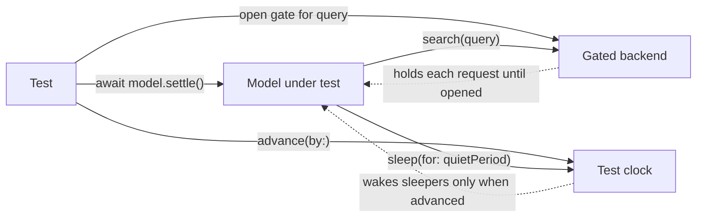

A concurrent test that sleeps is a test that guesses. It guesses how long the work takes on the machine it happens to run on, under whatever load that machine happens to have. Guess short and the test fails at random on a busy CI runner. Guess long and the suite gets slow, and still fails occasionally, because no fixed duration is enough for every run.

The alternative is to take control of the three things that make concurrent behavior nondeterministic: *when work finishes*, *where it pauses*, and *what time it is*. A test that awaits work instead of sleeping, holds operations at chosen suspension points, and advances a clock of its own can reproduce a specific interleaving every time, in microseconds. This article builds those tools, a gate, a manual test clock, and a bounded condition wait, and uses them with Swift Testing to test a debounced search model under interleavings that would otherwise appear only in production.

<!--more-->

The examples use Swift 6 language mode and the Swift Testing framework, and were compiled and run with the Swift 6.4 toolchain on macOS 26. The production code builds on itself in one module; the tests were run with `swift test` in a package containing that module. `Mutex` requires iOS 18, macOS 15, or later. The earlier [Testing Asynchronous Swift Code](/swift-testing-asynchronous-code/) article covers the XCTest side of the same ideas.

## Why sleeping tests fail, quantitatively

Suppose a test starts an operation, sleeps for $$d$$, then checks the result. If the operation's duration $$L$$ on a given run is random, the test fails whenever $$L > d$$. Even a well-behaved distribution has a tail. If $$L$$ is exponential with mean $$m$$:

$$
P(\text{flake}) = P(L > d) = e^{-d/m}, \qquad d = m \ln\frac{1}{P(\text{flake})}.
$$

To keep one test's flake rate at 0.1%, it must sleep $$m \ln 1000 \approx 6.9\,m$$: almost seven times the *average* duration, every run. A suite of 500 such tests, each at 0.1%, fails at least once in $$1 - 0.999^{500} \approx 39\%$$ of runs. Real CI latency distributions have heavier tails than the exponential, so the real numbers are worse. Sleeping makes a suite both slow and unreliable, and there is no value of $$d$$ that fixes it.

The fix is structural: make the test *know* when things happen rather than guess.



## Tool 1: await the work, not the clock

The simplest control is to give the test something to await. A model that starts unstructured tasks should expose a way to wait for them, as every model in this series has with `settle()`. Tests then await completion directly:

<!-- skip-check -->
```swift
model.queryChanged("swift")
await model.settle()
#expect(model.results == ["swift result"])
```

This removes the guess about *when* work finishes. It does not control *what happens in between*, which is where the interesting bugs live.

## Tool 2: gates that hold operations mid-flight

A gate is a dependency that suspends until the test opens it. Injected into a fake backend, it lets the test hold a request at the network boundary while other things happen:

```swift
import Foundation
import Synchronization

/// Suspends callers until opened.
actor Gate {
    private var isOpen = false
    private var waiters: [CheckedContinuation<Void, Never>] = []

    func wait() async {
        guard !isOpen else { return }
        await withCheckedContinuation { waiters.append($0) }
    }

    func open() {
        isOpen = true
        for waiter in waiters { waiter.resume() }
        waiters.removeAll()
    }
}

protocol SearchBackend: Sendable {
    func search(_ query: String) async throws -> [String]
}

/// A fake backend that records each request and holds it until the test opens that query's gate.
final class GatedBackend: SearchBackend {
    private let state = Mutex<(requests: [String], gates: [String: Gate])>(([], [:]))

    func search(_ query: String) async throws -> [String] {
        let gate = state.withLock { state -> Gate in
            state.requests.append(query)
            if let existing = state.gates[query] { return existing }
            let gate = Gate()
            state.gates[query] = gate
            return gate
        }
        await gate.wait()
        return ["\(query) result"]
    }

    func release(_ query: String) async {
        let gate = state.withLock { state -> Gate in
            if let existing = state.gates[query] { return existing }
            let gate = Gate()
            state.gates[query] = gate
            return gate
        }
        await gate.open()
    }

    var requests: [String] {
        state.withLock { $0.requests }
    }
}
```

With a gate per query, the test decides the order in which responses arrive. That is the order the [stale results article](/swift-rejecting-stale-results/) had to simulate with carefully chosen latencies; here it is a line of test code.

## Tool 3: a clock the test controls

Debouncing, timeouts, retries with backoff, polling intervals: any code that waits for time is untestable at speed unless time itself is a dependency. Swift's `Clock` protocol ([SE-0329](https://github.com/swiftlang/swift-evolution/blob/main/proposals/0329-clock-instant-duration.md)) makes it one. Production code takes `some Clock<Duration>` and calls `clock.sleep(for:)`; tests pass a clock that moves only when advanced.

The test clock below is careful about cancellation. A debounced model cancels its sleeping task on every keystroke, so the clock's sleepers must be removed when cancelled, including when cancellation arrives before the sleeper has registered. It uses the same phase-per-waiter design as the permit pool in the [cancellation handlers article](/swift-cancellation-handlers-cleanup/):

```swift
/// A clock that moves only when a test advances it.
final class TestClock: Clock, Sendable {
    struct Instant: InstantProtocol {
        let offset: Duration

        func advanced(by duration: Duration) -> Instant {
            Instant(offset: offset + duration)
        }

        func duration(to other: Instant) -> Duration {
            other.offset - offset
        }

        static func < (lhs: Instant, rhs: Instant) -> Bool {
            lhs.offset < rhs.offset
        }
    }

    private enum Phase {
        case registering
        case waiting(deadline: Instant, continuation: CheckedContinuation<Void, any Error>)
        case cancelledEarly
    }

    private struct State {
        var now = Instant(offset: .zero)
        var phases: [UInt64: Phase] = [:]
        var nextID: UInt64 = 0
    }

    private let state = Mutex(State())

    var now: Instant {
        state.withLock { $0.now }
    }

    var minimumResolution: Duration {
        .zero
    }

    func sleep(until deadline: Instant, tolerance: Duration? = nil) async throws {
        let id = state.withLock { state -> UInt64 in
            state.nextID += 1
            state.phases[state.nextID] = .registering
            return state.nextID
        }
        try await withTaskCancellationHandler {
            try await withCheckedThrowingContinuation { (continuation: CheckedContinuation<Void, any Error>) in
                enum Decision { case resumeNow, cancelNow, wait }
                let decision = state.withLock { state -> Decision in
                    if case .cancelledEarly = state.phases[id] {
                        state.phases[id] = nil
                        return .cancelNow
                    }
                    if deadline <= state.now {
                        state.phases[id] = nil
                        return .resumeNow
                    }
                    state.phases[id] = .waiting(deadline: deadline, continuation: continuation)
                    return .wait
                }
                switch decision {
                case .resumeNow: continuation.resume()
                case .cancelNow: continuation.resume(throwing: CancellationError())
                case .wait: break
                }
            }
        } onCancel: {
            let sleeper = state.withLock { state -> CheckedContinuation<Void, any Error>? in
                switch state.phases[id] {
                case .registering:
                    state.phases[id] = .cancelledEarly
                    return nil
                case .waiting(_, let continuation):
                    state.phases[id] = nil
                    return continuation
                case .cancelledEarly, nil:
                    return nil
                }
            }
            sleeper?.resume(throwing: CancellationError())
        }
    }

    /// Moves time forward and wakes, in deadline order, every sleeper that is now due.
    func advance(by duration: Duration) {
        let due = state.withLock { state -> [CheckedContinuation<Void, any Error>] in
            state.now = state.now.advanced(by: duration)
            var due: [(deadline: Instant, id: UInt64, continuation: CheckedContinuation<Void, any Error>)] = []
            for (id, phase) in state.phases {
                if case .waiting(let deadline, let continuation) = phase, deadline <= state.now {
                    due.append((deadline, id, continuation))
                    state.phases[id] = nil
                }
            }
            return due.sorted { ($0.deadline, $0.id) < ($1.deadline, $1.id) }.map(\.continuation)
        }
        for continuation in due {
            continuation.resume()
        }
    }

    /// The number of sleepers currently waiting for time to advance.
    var sleeperCount: Int {
        state.withLock { state in
            state.phases.values.filter { phase in
                if case .waiting = phase { true } else { false }
            }.count
        }
    }
}
```

Sleepers due at the same deadline wake in registration order, so tests that advance past several deadlines see a deterministic order. `sleeperCount` lets a test wait until the code under test has actually reached its sleep before advancing, which is the step most hand-rolled test clocks forget.

## Tool 4: wait for conditions, with a bound

Sometimes the test must wait for a background effect that no handle exposes, such as a request reaching the backend or a sleeper registering with the clock. Polling a *condition* with `Task.yield()` waits exactly as long as needed. A real-time bound turns a bug that would hang the test into a failure with a message:

```swift
/// Yields until `condition` holds. Returns false after `limit` of real time instead of hanging.
nonisolated(nonsending)
func waitUntil(_ limit: Duration = .seconds(2), _ condition: () async -> Bool) async -> Bool {
    let clock = ContinuousClock()
    let deadline = clock.now + limit
    while clock.now < deadline {
        if await condition() { return true }
        await Task.yield()
    }
    return await condition()
}
```

The limit is not a sleep: a passing test never waits for it. It only bounds how long a *failing* test takes to report. `nonisolated(nonsending)` lets the condition closure read main-actor state when the test runs on the main actor, as the [isolated and nonisolated article](/swift-isolated-nonisolated/) explains.

## The code under test

The model is the debounced search from the stale results article, rewritten to take its clock and backend as dependencies:

```swift
@MainActor
final class SearchViewModel<C: Clock<Duration>> {
    private(set) var results: [String] = []
    private(set) var isSearching = false
    private var current: Task<Void, Never>?
    private var generation = 0
    private let clock: C
    private let backend: any SearchBackend
    private let quietPeriod: Duration

    init(clock: C, backend: any SearchBackend, quietPeriod: Duration = .milliseconds(80)) {
        self.clock = clock
        self.backend = backend
        self.quietPeriod = quietPeriod
    }

    func queryChanged(_ query: String) {
        generation += 1
        let requestGeneration = generation
        current?.cancel()
        current = Task {
            do {
                try await clock.sleep(for: quietPeriod)
            } catch {
                return
            }
            isSearching = true
            defer {
                if requestGeneration == generation { isSearching = false }
            }
            guard let found = try? await backend.search(query), requestGeneration == generation else { return }
            results = found
        }
    }

    func settle() async {
        await current?.value
    }
}
```

In production it is created with `ContinuousClock()`; in tests with `TestClock()`. Nothing else about it knows it is being tested.

## Test: debouncing waits for the quiet period

<!-- skip-check -->
```swift
import Testing

@MainActor
@Test(.timeLimit(.minutes(1)))
func debounceIssuesOneRequestAfterTheQuietPeriod() async {
    let clock = TestClock()
    let backend = GatedBackend()
    let model = SearchViewModel(clock: clock, backend: backend)

    for query in ["s", "sw", "swi", "swif", "swift"] {
        model.queryChanged(query)
    }
    #expect(await waitUntil { clock.sleeperCount == 1 }, "Only the latest keystroke is still waiting")

    clock.advance(by: .milliseconds(79))
    #expect(backend.requests.isEmpty, "Nothing is sent before the quiet period ends")

    clock.advance(by: .milliseconds(1))
    #expect(await waitUntil { backend.requests == ["swift"] })
    #expect(model.isSearching)

    await backend.release("swift")
    await model.settle()
    #expect(model.results == ["swift result"])
    #expect(!model.isSearching)
}
```

This test runs in about a millisecond and checks the debounce to the millisecond: nothing at 79 ms, exactly one request at 80 ms, for the last query only. A sleep-based version would need real 80 ms waits, and could not distinguish 79 from 80 at all.

## Test: every arrival order gives the same answer

The stale-result bug depends on the order responses arrive. With gates, the test enumerates the orders instead of hoping to hit the bad one, and Swift Testing's parameterized tests run each as a separate case:

<!-- skip-check -->
```swift
@MainActor
@Test(arguments: [["first", "second"], ["second", "first"]])
func newestQueryWinsInEveryArrivalOrder(releaseOrder: [String]) async {
    let clock = TestClock()
    let backend = GatedBackend()
    let model = SearchViewModel(clock: clock, backend: backend)

    model.queryChanged("first")
    #expect(await waitUntil { clock.sleeperCount == 1 })
    clock.advance(by: .milliseconds(80))
    #expect(await waitUntil { backend.requests == ["first"] })

    model.queryChanged("second")
    #expect(await waitUntil { clock.sleeperCount == 1 })
    clock.advance(by: .milliseconds(80))
    #expect(await waitUntil { backend.requests == ["first", "second"] })

    for query in releaseOrder {
        await backend.release(query)
        await Task.yield()
    }
    await model.settle()
    #expect(await waitUntil { !model.isSearching })
    #expect(model.results == ["second result"], "Released in order \(releaseOrder)")
}
```

Both requests are in flight at the same time, a situation the debounce normally prevents and the test creates deliberately. Each case then releases them in a different order. The generation check makes the newest query win in both. Removing the check, which is the kind of "cleanup" a refactor might do, makes the `["second", "first"]` case fail deterministically on every run.

For two operations there are two orders. For $$n$$ independent completions there are $$n!$$, which grows too fast to enumerate beyond four or five. At that point, combine targeted cases for the orders you reason are dangerous with seeded random stress runs, sized with the formula from the [continuation ownership article](/swift-continuation-ownership/).

## Test: events delivered through callbacks

Some behavior is observable only through a callback: a delegate method, a closure property, a notification. Swift Testing's `confirmation` turns "this callback must be called exactly N times" into an assertion, without sleeping:

<!-- skip-check -->
```swift
@Test
func backendRecordsEveryRequestExactlyOnce() async throws {
    let backend = GatedBackend()
    try await confirmation("each search returns", expectedCount: 3) { searchReturned in
        try await withThrowingTaskGroup(of: Void.self) { group in
            for query in ["a", "b", "c"] {
                group.addTask {
                    _ = try await backend.search(query)
                    searchReturned()
                }
            }
            for query in ["c", "a", "b"] {
                await backend.release(query)
            }
            try await group.waitForAll()
        }
    }
    #expect(backend.requests.sorted() == ["a", "b", "c"])
}
```

`confirmation` fails the test if the closure it provides is called fewer or more times than `expectedCount` by the time its body returns. The body must therefore *wait for* the events itself, here by awaiting the task group. A confirmation is a count, not a timer.

## Running concurrent tests reliably

A few practices keep concurrent suites deterministic as they grow:

- **Inject every source of nondeterminism.** Clocks, backends, random generators, and UUID sources. If a test cannot control it, the test cannot pin it down.
- **Prefer `waitUntil` on a condition over `Task.sleep` for a duration.** A bounded condition wait never makes a passing test slower.
- **Bound every test in time.** `.timeLimit(.minutes(1))` turns a hang, usually a leaked continuation or a gate nobody opened, into a failure.
- **Run tests in parallel, and on purpose.** Swift Testing runs tests in parallel by default, which is a free stress test for shared state between tests. Use `.serialized` only for suites that share an external resource, and treat a test that fails only in parallel as a bug report about hidden shared state.
- **Repeat suspicious tests.** A test that has ever flaked should be run in a loop locally, a few hundred times, before and after the fix.
- **Run under Thread Sanitizer periodically.** Controlled interleavings find logic races; [Thread Sanitizer](/swift-thread-sanitizer/) finds memory races in code that escapes Swift's static checks.

## Summary

- Sleeping tests trade speed for reliability and get neither: a 0.1% flake rate needs about $$6.9\times$$ the mean duration, and suites multiply flake rates.
- Await completion directly through handles such as `settle()`.
- Hold operations at chosen suspension points with gates injected into fake dependencies.
- Make time a dependency with `Clock`, and drive it in tests with a manual clock that handles cancellation and reports its sleepers.
- Wait for conditions with a bounded yield loop rather than fixed sleeps.
- Enumerate dangerous orderings with parameterized tests; use seeded stress runs when orderings explode combinatorially.
- Use `confirmation` for callback counts and `.timeLimit` to turn hangs into failures.

## Exercise

Add retry with exponential backoff to `SearchViewModel`: on failure, wait 100 ms, then 200 ms, then 400 ms, before giving up. Write Swift Testing tests that use `TestClock` to verify the exact retry schedule, that a new query during a backoff wait cancels the pending retry, and that a success on the second attempt stops further retries. None of the tests should take more than a few milliseconds of real time.

## Further reading

- [Swift Testing](https://developer.apple.com/documentation/testing) documentation, including `confirmation` and traits.
- [SE-0329: Clock, Instant, and Duration](https://github.com/swiftlang/swift-evolution/blob/main/proposals/0329-clock-instant-duration.md) and [SE-0374: Add sleep(for:) to Clock](https://github.com/swiftlang/swift-evolution/blob/main/proposals/0374-clock-sleep-for.md).
- [Meet Swift Testing](https://developer.apple.com/videos/play/wwdc2024/10179/) and [Go further with Swift Testing](https://developer.apple.com/videos/play/wwdc2024/10195/), WWDC24.
- [Testing Asynchronous Swift Code](/swift-testing-asynchronous-code/), the XCTest-based companion article.

Previous: [Rejecting Stale Results After Request Replacement](/swift-rejecting-stale-results/). Next: [Avoiding Deadlocks and Blocking Waits](/swift-deadlocks-blocking-waits/).

Return to the [Concurrency roadmap](/swift-concurrency-roadmap/).
