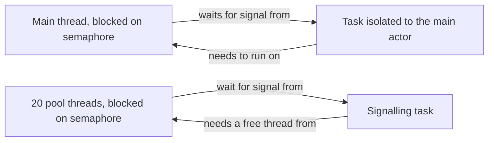

Swift concurrency removes the most common way to deadlock: actors are reentrant, so two actors that call each other do not lock each other up, and `Mutex.withLock` cannot be held across an `await`. It does not remove deadlocks altogether. A program can still reach a state where every piece of work it needs is waiting for another piece of work that cannot run, and in async code that state is often *quieter* than a classic deadlock: no thread is stuck in a lock, the CPU is idle, and the app simply never finishes what it started.

This article reproduces the deadlocks that remain, each one safely, with a timeout instead of a hang: blocking the main thread on main-actor work, starving the cooperative pool with blocking waits, waiting on yourself, and cyclic waits between tasks. It then shows how to diagnose them, because a suspended task does not appear in a thread backtrace, and the habits that prevent them.

<!--more-->

The examples use Swift 6 language mode and were compiled and run with the Swift 6.4 toolchain on macOS 26, on a machine whose cooperative pool has 20 threads. The Swift blocks build on one another in one `main.swift`. `Mutex` requires iOS 18, macOS 15, or later.

## What a deadlock is

A deadlock is a cycle of waits: A waits for B, B waits for C, and something in the chain waits for A. Coffman, Elphick, and Shoshani identified four conditions that must all hold for one to occur: mutual exclusion, hold-and-wait, no preemption, and a circular wait. Remove any one, and the deadlock cannot happen.

Swift concurrency attacks the conditions in specific places:

- **Actor reentrancy removes hold-and-wait for actors.** An actor that suspends on an `await` releases itself, so it does not hold anything while it waits.
- **`Mutex.withLock` takes a synchronous closure**, so a lock cannot be held while waiting on asynchronous work.
- **Structured concurrency makes most waits point downward,** from parents to children, which cannot form a cycle.

The deadlocks that remain come from bringing *blocking* into async code, from unstructured or continuation-based waits that can point anywhere, and from synchronous locks used the classic way.



## Deadlock 1: the main thread waits for main-actor work

The most common deadlock in apps adopting Swift concurrency is a synchronous function on the main thread that starts async work and blocks until it finishes, typically to satisfy a synchronous API that must return a value:

```swift
import Foundation
import Synchronization

/// A blocking wait with a timeout, so these demonstrations report instead of hanging.
func blockingWait(on semaphore: DispatchSemaphore, milliseconds: Int) -> DispatchTimeoutResult {
    semaphore.wait(timeout: .now() + .milliseconds(milliseconds))
}

@MainActor
func synchronousAPIThatWaitsForAsyncWork() -> DispatchTimeoutResult {
    let done = DispatchSemaphore(value: 0)
    Task {                       // Inherits the main actor.
        done.signal()
    }
    return blockingWait(on: done, milliseconds: 300)
}

let mainActorResult = synchronousAPIThatWaitsForAsyncWork()
assert(mainActorResult == .timedOut, "The task needed the main actor, which was blocked waiting for it")
```

The task is isolated to the main actor, so it cannot start until the current main-actor job finishes. That job is the function waiting for it. With an untimed `wait()`, the app freezes permanently; the watchdog on iOS eventually kills it.

Swift 6 makes the direct form a compile error: `DispatchSemaphore.wait()` is unavailable from asynchronous contexts. But the wait here happens in a *synchronous* helper called from a synchronous function, and nothing in the type system objects. The rule the compiler cannot enforce is: **never block a thread waiting for async work that may need that thread.** If a synchronous API must return something only async code can produce, the API has to change, to async, to a completion handler, or to returning a placeholder and updating later.

## Deadlock 2: starving the cooperative pool

The cooperative pool has a fixed width, as the [threads article](/swift-threads-dispatch-queues-tasks/) measured. If every pool thread blocks waiting for something that itself needs a pool thread, nothing can run:

```swift
let poolWidth = ProcessInfo.processInfo.activeProcessorCount

/// Starts `blockers` tasks that block until signalled, and one task that signals all of them.
func blockedWaiters(blockers: Int) async -> (succeeded: Int, timedOut: Int) {
    let signal = DispatchSemaphore(value: 0)
    return await withTaskGroup(of: DispatchTimeoutResult?.self) { group in
        for _ in 0..<blockers {
            group.addTask { blockingWait(on: signal, milliseconds: 400) }
        }
        group.addTask {
            try? await Task.sleep(for: .milliseconds(20))
            for _ in 0..<blockers { signal.signal() }
            return nil
        }
        var succeeded = 0
        var timedOut = 0
        for await result in group {
            switch result {
            case .success?: succeeded += 1
            case .timedOut?: timedOut += 1
            case nil: break
            }
        }
        return (succeeded, timedOut)
    }
}

let starved = await blockedWaiters(blockers: poolWidth)
let notStarved = await blockedWaiters(blockers: poolWidth - 1)
assert(starved == (0, poolWidth), "Every pool thread blocked; the signalling task never ran")
assert(notStarved == (poolWidth - 1, 0), "One free thread was enough for the signaller")
print("pool width \(poolWidth): \(starved) with \(poolWidth) blockers, \(notStarved) with one fewer")
```

With 20 blocked tasks on a 20-thread pool, all 20 timed out: the signalling task was runnable the whole time, and no thread was free to run it. With 19, the signaller found the twentieth thread and released everyone. The condition is exactly

$$
B \ge W \quad\text{and}\quad \text{the releasing work needs the pool} \;\Longrightarrow\; \text{deadlock},
$$

where $$B$$ is the number of pool threads blocked and $$W$$ is the pool width. In production, $$W$$ is the device's core count, so this deadlock appears on a six-core phone with six blocked tasks, and not on a twenty-core development machine with six. It is the definition of a bug that "only happens on some devices."

The fix is to wait without blocking. An async signal, built on continuations, suspends its waiters and frees their threads:

```swift
/// Suspends waiters until signalled. Waiting costs no thread.
actor AsyncSignal {
    private var signalled = false
    private var waiters: [CheckedContinuation<Void, Never>] = []

    func wait() async {
        guard !signalled else { return }
        await withCheckedContinuation { waiters.append($0) }
    }

    func signal() {
        signalled = true
        for waiter in waiters { waiter.resume() }
        waiters.removeAll()
    }
}

let asyncSignal = AsyncSignal()
let clock = ContinuousClock()
let asyncStart = clock.now
await withTaskGroup(of: Void.self) { group in
    for _ in 0..<(poolWidth * 10) {
        group.addTask { await asyncSignal.wait() }
    }
    group.addTask {
        try? await Task.sleep(for: .milliseconds(20))
        await asyncSignal.signal()
    }
}
let asyncElapsed = asyncStart.duration(to: clock.now)
assert(asyncElapsed < .milliseconds(200), "Ten times the pool width of waiters, released promptly")
```

Two hundred waiters on a twenty-thread pool were released about 20 ms after the signal. None of them held a thread while waiting.

## Deadlock 3: waiting on yourself

An operation that waits for something only it can produce never finishes. In async code the shape is usually indirect: a serializer that runs operations one at a time, and an operation that, somewhere deep in its call graph, submits more work to the same serializer and awaits it.

```swift
/// Runs operations one at a time, each after the previous one finishes.
actor SerialQueue {
    private var tail: Task<Void, Never>?

    func run<T: Sendable>(_ operation: @escaping @Sendable () async -> T) async -> T {
        let previous = tail
        let current = Task {
            await previous?.value
            return await operation()
        }
        tail = Task { _ = await current.value }
        return await current.value
    }
}

let finished = Mutex(false)
let serial = SerialQueue()
let selfWaiting = Task {
    _ = await serial.run {
        // A nested call on the same queue: it waits for the outer operation, which waits for it.
        await serial.run { 42 }
    }
    finished.withLock { $0 = true }
}
try await Task.sleep(for: .milliseconds(200))
assert(!finished.withLock { $0 }, "The nested operation waits for the outer one forever")
selfWaiting.cancel()        // Cancellation does not help: nothing in the cycle checks for it.
```

The nested `run` is queued behind the outer operation, and the outer operation is waiting for the nested one to return. Cancelling the task does nothing, because neither side is at a cancellable suspension point: each is awaiting a task's `value`, which waits for completion regardless of cancellation. The task above stays suspended until the process exits.

This is precisely the deadlock that actor reentrancy was designed to avoid, as the [actor reentrancy article](/swift-actor-reentrancy/) explains, reintroduced by building a non-reentrant section on top of actors. It also appears with `DispatchQueue.sync` called on the queue you are already running on, where GCD detects it and crashes rather than hanging, and with `MainActor` code that synchronously waits on a main-queue `sync` call.

Prefer designs that do not need a non-reentrant section. If you must have one, make it detect re-entry: record a task-local marker while inside, and fail loudly when `run` is called with the marker already set.

## Deadlock 4: cyclic waits between tasks

Unstructured tasks can wait on each other in any shape. Two tasks that each await the other's value form the smallest cycle:

```swift
final class HandleStore: Sendable {
    let first = Mutex<Task<Int, Never>?>(nil)
    let second = Mutex<Task<Int, Never>?>(nil)
}

let handles = HandleStore()
let cycleFinished = Mutex(0)
handles.first.withLock { slot in
    slot = Task {
        while handles.second.withLock({ $0 }) == nil { await Task.yield() }
        let other = await handles.second.withLock { $0 }!.value
        cycleFinished.withLock { $0 += 1 }
        return other + 1
    }
}
handles.second.withLock { slot in
    slot = Task {
        let other = await handles.first.withLock { $0 }!.value
        cycleFinished.withLock { $0 += 1 }
        return other + 1
    }
}
try await Task.sleep(for: .milliseconds(200))
assert(cycleFinished.withLock { $0 } == 0, "Each task waits for the other; neither can finish")
```

Real cycles are rarely this direct. They form through caches that share in-flight loads, like the one in the [actor reentrancy article](/swift-actor-reentrancy/): if loading A requires B, and loading B requires A, both callers join each other's in-flight task and wait forever. Structured concurrency prevents such cycles by construction, since a parent waits only for its own children. Unstructured tasks and shared in-flight work need an explicit rule: a dependency graph that is known to be acyclic, or a check that refuses to join a load already on the current call path.

## Deadlock 5: lock ordering in synchronous code

Synchronous locks still deadlock the classic way. If one code path takes lock A then lock B, and another takes B then A, two threads can each hold one lock and wait for the other. Swift's `Mutex` makes this harder to write by accident, because the nested lock must appear lexically inside the outer `withLock` closure, but not impossible.

The standard rules still apply:

- **Do not nest locks.** Copy what you need out of one critical section before entering another.
- **If you must nest, impose a global order**, such as by object identity or a documented hierarchy, and acquire in that order everywhere.
- **Never call unknown code while holding a lock.** Resuming a continuation, calling a delegate, or invoking a closure from inside `withLock` can re-enter the lock or take another one. Every example in this series takes the continuation out under the lock and resumes it after.

## Diagnosing a hang

Classic deadlocks are visible in a debugger: pause the app, and two threads are blocked in `__psynch_mutexwait` or `semaphore_wait_trap`, each holding what the other wants. Async deadlocks are different, and the difference is the most useful thing to know when debugging one.

| Symptom | Likely cause | Where to look |
| --- | --- | --- |
| Main thread blocked in a semaphore or lock wait | Deadlock 1, or a lock held too long | Xcode's debug navigator; the main thread's backtrace |
| All pool threads blocked in semaphore waits, nothing progressing | Deadlock 2 | Backtraces of threads named after the cooperative queue |
| Threads idle, CPU idle, work never completes | Deadlocks 3 and 4, or a leaked continuation | Task-level tools, not thread backtraces |
| `SWIFT TASK CONTINUATION MISUSE ... leaked its continuation` in the console | A continuation dropped without resuming | The function named in the message |

The third row is the hard one. A suspended task does not occupy a thread, so it does not appear in any thread's backtrace. Pausing the app shows idle threads and nothing obviously wrong. To see it, you need tools that show *tasks*:

- **Instruments' Swift Tasks instrument** records every task's state over time, including tasks that are suspended and never resume. Named tasks, created with `Task(name:)` in Swift 6.2, are far easier to find. The [profiling article](/swift-profiling-tasks-main-actor/) walks through it.
- **Continuation misuse messages** catch leaked checked continuations when they are destroyed.
- **`swift-inspect`**, a command-line tool shipped with the toolchain, can dump the tasks and actors of a running process when it is allowed to attach to it, as with debug builds.
- **Timeouts in tests.** A test with `.timeLimit` turns a silent hang into a failure that points at the operation that never completed, as the [controlled interleavings article](/swift-testing-controlled-interleavings/) recommends.

## Habits that prevent deadlocks

1. **Never block in async code, or on a thread that async code may need.** Not with semaphores, not with `DispatchGroup.wait`, not with `Thread.sleep`, and not indirectly through a synchronous helper.
2. **Keep waits structured.** Parents awaiting children cannot form cycles. Be suspicious of every unstructured task that awaits another unstructured task.
3. **Do not build non-reentrant sections on top of actors** unless re-entry is detected and rejected.
4. **Make shared in-flight work acyclic.** Know the dependency graph of anything that joins other callers' work.
5. **Do not nest synchronous locks,** and never resume continuations or call out while holding one.
6. **Name long-lived tasks and bound tests in time,** so the hangs you do get are diagnosable.

## Summary

- Swift concurrency removes the classic actor-to-actor deadlock through reentrancy, and lock-across-await through `Mutex`'s synchronous API.
- Blocking the main thread on main-actor work deadlocks; Swift 6 catches only the direct form.
- Blocking pool threads deadlocks when $$B \ge W$$ blocked threads wait for work that needs the pool. On the test machine, 20 blockers deadlocked and 19 did not. Async signals avoid it entirely.
- Non-reentrant serializers and cyclic waits between unstructured tasks hang silently, and cancellation does not break the cycle.
- Synchronous locks still need the classic discipline: no nesting, or a global order, and no calling out while held.
- Async hangs show idle threads. Diagnose them with task-level tools, continuation misuse messages, and time-limited tests.

## Exercise

Write a `ConfigLoader` actor that loads configuration files, where a file may `include` other files, and concurrent loads of the same file share one in-flight task. Construct two files that include each other and show that the naive design hangs. Then add cycle detection: track the chain of files being loaded in a task-local value, and throw a descriptive error when a load would join a file already in the chain. Test both the cycle and a diamond-shaped include graph, which must still share work without reporting a false cycle.

## Further reading

- Coffman, Elphick, and Shoshani, [*System Deadlocks*](https://dl.acm.org/doi/10.1145/356586.356588), ACM Computing Surveys, 1971.
- [Swift concurrency: Behind the scenes](https://developer.apple.com/videos/play/wwdc2021/10254/), WWDC21, on the forward-progress contract.
- [SE-0340: Unavailable From Async Attribute](https://github.com/swiftlang/swift-evolution/blob/main/proposals/0340-swift-noasync.md), which makes the most common blocking calls compile errors in async code.

Previous: [Testing Concurrent Work with Controlled Interleavings](/swift-testing-controlled-interleavings/). Next: [Finding Data Races with Thread Sanitizer](/swift-thread-sanitizer/).

Return to the [Concurrency roadmap](/swift-concurrency-roadmap/).
