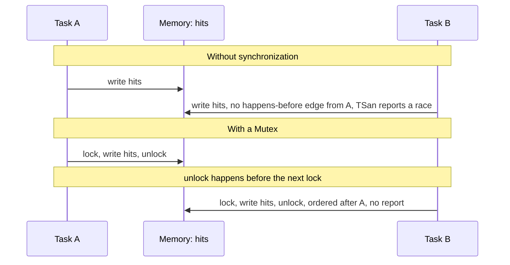

Swift 6 proves the absence of data races at compile time, for code it can check. Every real codebase also contains code it cannot: classes marked `@unchecked Sendable`, globals marked `nonisolated(unsafe)`, modules still in Swift 5 mode, `@preconcurrency` imports, Objective-C and C, and anything built on unsafe pointers. Those escape hatches exist for good reasons, and each one is a place where a data race can still hide.

Thread Sanitizer (TSan) checks the other way around: at run time, for the code paths a test actually executes. It instruments every memory access, tracks which accesses are ordered by synchronization, and reports any two conflicting accesses that are not. This article runs TSan on races that compile cleanly in Swift 6 mode, shows how to read its reports, measures its overhead, and describes how to make it a routine part of testing.

<!--more-->

The examples use Swift 6 language mode and were compiled with the Swift 6.4 toolchain and run on macOS 26 with `-sanitize=thread`. The reports quoted below are real output from those runs, trimmed for width. `Mutex` requires iOS 18, macOS 15, or later.

## What TSan detects, and how

A **data race** is two accesses to the same memory location, from different threads, at least one of them a write, with no *happens-before* ordering between them. Happens-before is the ordering created by synchronization: unlocking a mutex happens before the next lock of it, resuming a continuation happens before the resumed code runs, a task's creation happens before its first instruction.

TSan tracks happens-before with **vector clocks**. Each thread $$t$$ keeps a vector $$V_t$$ with one counter per thread. A thread increments its own entry as it runs; synchronization operations merge vectors, taking the element-wise maximum. An access $$a$$ by thread $$t$$ happens before an access $$b$$ by thread $$u$$ exactly when

$$
V_a[t] \le V_b[t],
$$

that is, when $$u$$ had, by the time of $$b$$, observed thread $$t$$'s progress up to $$a$$ through some chain of synchronization. TSan stores the clock of recent accesses in shadow memory next to each location. When a new access arrives, it compares clocks; if neither access happens before the other and at least one is a write, it reports a race.



Two properties follow from this design:

- **TSan reports races that happen in the run, not races that could happen.** If a test never executes the racy path, or never runs it on two threads, TSan says nothing. Coverage and concurrency in tests determine what it can find.
- **TSan does not need the race to cause a wrong result.** It reports the unsynchronized pair even when the timing happened to work out. That is why it finds bugs that stress testing alone misses.

Swift's concurrency runtime is annotated for TSan, so task creation, `await`, actor hops, and continuations all establish happens-before. Correctly isolated Swift concurrency code produces no reports.

## Enabling it

- **Xcode:** Edit Scheme, then Run or Test, then Diagnostics, then enable Thread Sanitizer. It applies to the scheme's builds and test runs.
- **SwiftPM:** `swift build --sanitize=thread`, `swift test --sanitize=thread`.
- **swiftc:** `swiftc -sanitize=thread`.

TSan runs on macOS and on iOS, tvOS, and watchOS **simulators**, not on physical devices. It cannot be combined with Address Sanitizer in the same build. Debug builds give the most readable reports; optimized builds find races that only appear at speed. Running both, periodically, is ideal.

On the test machine, outside Xcode, TSan's default symbolizer stalled when the first report was printed. Setting `TSAN_OPTIONS="external_symbolizer_path="` made it fall back to its built-in symbolization, which prints function names without line numbers. Xcode symbolizes reports fully and was not affected.

## A race that compiles cleanly

This program compiles in Swift 6 mode without a warning. Both of its races are behind escape hatches that tell the compiler "trust me":

<!-- skip-check -->
```swift
import Foundation

/// Claims to be Sendable, but nothing protects `storage`.
final class SessionCache: @unchecked Sendable {
    private var storage: [String: Int] = [:]

    func record(_ key: String) {
        storage[key, default: 0] += 1
    }

    var count: Int { storage.count }
}

nonisolated(unsafe) var hits = 0

@concurrent
func hammer(_ cache: SessionCache) async {
    await withTaskGroup(of: Void.self) { group in
        for worker in 0..<4 {
            group.addTask {
                for request in 0..<200 {
                    cache.record("key-\((worker * 200 + request) % 50)")
                    hits += 1
                }
            }
        }
    }
}

let cache = SessionCache()
await hammer(cache)
print("entries:", cache.count, "hits:", hits)
```

Without TSan, the program usually prints something plausible and occasionally crashes inside `Dictionary`, because concurrent writes can corrupt its storage. On one run it printed `hits: 740`: 60 of 800 increments were lost, because `hits += 1` is a read and a write, and two threads interleaved them.

Under TSan, the first report was:

```text
WARNING: ThreadSanitizer: Swift access race (pid=65781)
  Modifying access of Swift variable at 0x000109803870 by thread T3:
    #0 race.SessionCache.record(Swift.String) -> ()
    #1 (1) suspend resume partial function for closure #1 () async -> () in
       closure #1 (inout Swift.TaskGroup<()>) async -> () in race.hammer(race.SessionCache) async -> ()
    #2 swift::runJobInEstablishedExecutorContext(swift::Job*)

  Previous modifying access of Swift variable at 0x000109803870 by thread T1:
    #0 race.SessionCache.record(Swift.String) -> ()
    #1 (1) suspend resume partial function for closure #1 () async -> () in
       closure #1 (inout Swift.TaskGroup<()>) async -> () in race.hammer(race.SessionCache) async -> ()
    #2 swift::runJobInEstablishedExecutorContext(swift::Job*)

  Location is heap block of size 24 at 0x000109803860 allocated by main thread:
    #0 malloc
    #2 async_Main

  Thread T3 (tid=21157131, running) is a GCD worker thread
  Thread T1 (tid=21157129, running) is a GCD worker thread

SUMMARY: ThreadSanitizer: Swift access race in race.SessionCache.record(Swift.String) -> ()
```

In total the run produced seven warnings, for the dictionary and for the `hits` global, and the process exited with a failure status.

## Reading a report

Every TSan report has the same parts, and each answers a specific question:

| Part | Question it answers |
| --- | --- |
| First line: "Swift access race" or "data race" | What kind of conflict. A *Swift access race* means two overlapping Swift accesses, such as two mutations of a stored property; a *data race* is the underlying memory-level conflict. |
| First stack | Which code made the access that was just detected |
| "Previous ... access" stack | Which code made the earlier, conflicting access |
| "Location is ..." | What memory it was: a heap block and where it was allocated, or a named global such as `'r2.hits : Swift.Int'` |
| Thread descriptions | Which threads were involved. In async code these are usually GCD worker threads of the cooperative pool |

For async code, the frames are partial functions: the pieces of an `async` function between suspension points, as the [async/await article](/swift-async-await-suspension/) describes. "suspend resume partial function for closure #1 ... in hammer" means "the body of the first child task in `hammer`, after a suspension point." The thread numbers carry little information in async code, because a task can run on a different thread after every `await`. What matters is that the two stacks show two *tasks* touching the same memory without isolation between them.

The fix follows from the location. The heap block allocated in `async_Main` of size 24 is the `SessionCache` instance; the variable inside it is `storage`. The global is `hits`.

## Fixing it, and confirming the fix

Both races go away when the state gets real protection:

```swift
import Synchronization

/// Sendable because its state is protected, so no @unchecked is needed.
final class SessionCache: Sendable {
    private let storage = Mutex<[String: Int]>([:])

    func record(_ key: String) {
        storage.withLock { $0[key, default: 0] += 1 }
    }

    var count: Int {
        storage.withLock { $0.count }
    }
}

let hits = Mutex(0)

@concurrent
func hammer(_ cache: SessionCache) async {
    await withTaskGroup(of: Void.self) { group in
        for worker in 0..<4 {
            group.addTask {
                for request in 0..<200 {
                    cache.record("key-\((worker * 200 + request) % 50)")
                    hits.withLock { $0 += 1 }
                }
            }
        }
    }
}

let cache = SessionCache()
await hammer(cache)
assert(cache.count == 50)
assert(hits.withLock { $0 } == 800, "No increment was lost")
```

Run under TSan, this version produced no warnings and exited normally, with all 800 increments counted. Removing `@unchecked` from the class was part of the fix, not a side effect: with the state in a `Mutex`, the compiler verifies the `Sendable` conformance, so the next edit that adds an unprotected `var` will not compile.

The same program written with an actor instead of a `Mutex`, eight tasks each making 1,000 calls to an actor's `increment()`, also ran without a single report and produced the exact count of 8,000. That is TSan confirming that the runtime's actor and task synchronization establish the happens-before edges it needs.

## Where TSan earns its keep in Swift 6 code

Swift 6's static checking means TSan finds fewer races than it did in Swift 5 code, and finds them in predictable places. Focus test runs under TSan on code that contains:

- **`@unchecked Sendable` types.** Each is a claim about synchronization the compiler did not verify. TSan verifies it for the paths your tests exercise.
- **`nonisolated(unsafe)` declarations.** Same claim, applied to a variable.
- **Modules in Swift 5 mode** and **`@preconcurrency` imports**, where diagnostics are downgraded or suppressed.
- **Objective-C, C, and C++ code**, including callbacks from C libraries into Swift.
- **Unsafe pointers** and manually managed memory shared between threads.
- **Code that hands closures to GCD or other non-Swift-concurrency APIs**, where the isolation inference rules described in the [threads article](/swift-threads-dispatch-queues-tasks/) apply.

TSan does not find logic races, such as the stale results and reentrancy bugs earlier in this series, because those involve properly synchronized accesses in the wrong *order*. For those, use the controlled interleaving techniques from the [testing article](/swift-testing-controlled-interleavings/).

## What it costs

TSan instruments every memory access and keeps shadow state for every location. For the race-free actor version of the workload above, 8,000 actor calls across eight tasks, on the test machine:

| Build | Wall time | Peak memory |
| --- | --- | --- |
| Without TSan | 0.01 s | 6.5 MB |
| With TSan | 2.1 s | 57 MB |

This workload is a near worst case: almost nothing but synchronization, which TSan instruments heavily, plus its fixed start-up cost. LLVM's documentation describes typical overhead as a slowdown of about 5 to 15 times and memory usage 5 to 10 times higher. Either way, TSan is a testing tool, not something to leave enabled in everyday development builds of a large app.

## Making it routine

- **Run the test suite under TSan regularly**, nightly or on every merge to the main branch, not only when someone suspects a race. Races found long after they were introduced are much harder to fix.
- **Write tests that create concurrency.** TSan can only report races that happen. A test that calls `record` from one task proves nothing; the test above calls it from four at once, many times. Stress loops sized as in the [continuation ownership article](/swift-continuation-ownership/) work well here.
- **Treat every report as a bug.** Do not suppress reports in your own code. Suppression files exist for third-party code you cannot fix, and each entry should name the issue tracking the fix upstream.
- **Fail the build on reports.** Set `TSAN_OPTIONS=halt_on_error=1` in CI to stop at the first report, which keeps logs short and makes failures unambiguous.
- **Rerun with an optimized build** occasionally. Some races only manifest when code runs fast enough for the accesses to overlap.

## TSan and exclusivity enforcement

Swift also checks one related property without any sanitizer: **exclusive access**. Swift requires that a variable not be modified while another access to it is in progress, and the runtime enforces this for class properties, globals, and escaping closure captures in both debug and release builds. A violation stops the program with "Simultaneous accesses to ..., but modification requires exclusive access." Exclusivity checking is aimed at overlapping accesses within one thread, such as passing the same property as two `inout` arguments. It is not a race detector. When two threads conflict it may catch the overlap or may not, depending on timing; TSan catches it reliably whenever the two accesses execute without synchronization.

## Summary

- Swift 6 proves race freedom for checked code. TSan finds races at run time in the code behind escape hatches: `@unchecked Sendable`, `nonisolated(unsafe)`, Swift 5 mode modules, `@preconcurrency`, and C or Objective-C.
- TSan uses vector clocks to detect conflicting accesses without happens-before ordering. It reports races that happen in a run, even if the result happened to be correct.
- Enable it in the scheme's Diagnostics, or with `--sanitize=thread`. It runs on macOS and simulators, not on devices.
- Reports show two stacks, the memory location, and the threads. In async code, frames are partial functions and threads matter less than tasks.
- On the test machine, a cleanly compiling program produced seven reports and lost 60 of 800 increments; the `Mutex` and actor versions produced none.
- Overhead is large, here 200 times slower and 9 times the memory on a synchronization-heavy workload, so run TSan in tests and CI, not in everyday builds.

## Exercise

Write a small `ImageCache` class backed by `NSCache` and a plain `[URL: Date]` dictionary for access times, mark it `@unchecked Sendable`, and use it from a task group that loads and evicts images concurrently. Run the tests under TSan and fix each report it finds. Then decide, for each piece of state, whether a `Mutex`, an actor, or `NSCache`'s own thread safety is the right protection, and remove the `@unchecked`.

## Further reading

- [Diagnosing memory, thread, and crash issues early](https://developer.apple.com/documentation/xcode/diagnosing-memory-thread-and-crash-issues-early) in Apple's Xcode documentation.
- The [ThreadSanitizer](https://clang.llvm.org/docs/ThreadSanitizer.html) documentation from the LLVM project, including supported options.
- [SE-0176: Enforce Exclusive Access to Memory](https://github.com/swiftlang/swift-evolution/blob/main/proposals/0176-enforce-exclusive-access-to-memory.md).
- [Sendable in Swift](/swift-sendable/), on when `@unchecked Sendable` is justified.

Previous: [Avoiding Deadlocks and Blocking Waits](/swift-deadlocks-blocking-waits/). Next: [Profiling Task Lifetimes and Main-Actor Contention](/swift-profiling-tasks-main-actor/).

Return to the [Concurrency roadmap](/swift-concurrency-roadmap/).
