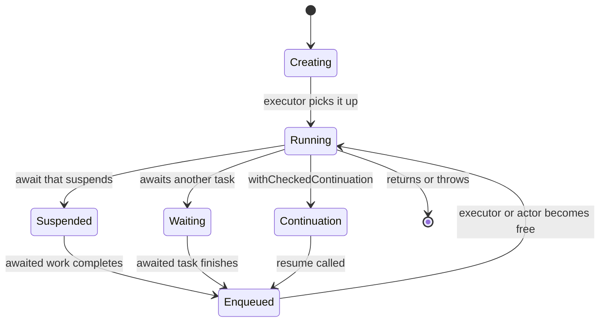

Concurrency problems that survive code review and testing usually show up as *time*: a screen that takes 300 ms longer to appear than it should, a scroll that hitches, a request that never finishes, a battery that drains because hundreds of tasks were alive when a dozen would do. Thread-based profiling tools struggle with all of them, because in Swift concurrency the interesting thing is not what a thread is doing, but what each *task* is doing, including the many tasks that are not on any thread at all.

Instruments' **Swift Concurrency** template records exactly that: every task's state over time, what each one is waiting for, how long actors' queues get, and where custom intervals begin and end. This article records real traces of a deliberately unhealthy program, reads the measurements that matter, and connects each pattern to its fix, from both Instruments and the command line.

<!--more-->

The examples use Swift 6 language mode and were compiled with the Swift 6.4 toolchain and traced with `xctrace` from Xcode 27.1 on macOS 26. Numbers quoted below come from those traces. The Swift blocks build on one another in one `main.swift`.

## What the template records

The Swift Concurrency template combines several instruments:

- **Swift Tasks** records each task's creation, state changes, and end, along with its name, priority, the actor it is running on, and the task or continuation it is waiting for.
- **Swift Actors** records each actor's queue of pending jobs over time.
- A **time profiler** samples call stacks, attributed to tasks as well as threads.
- **Points of Interest** shows intervals and events emitted with `OSSignposter`.

The task states are the vocabulary for everything that follows. As they appear in the trace:

| State | Meaning |
| --- | --- |
| Creating | Created, and has not yet started running |
| Enqueued | Ready to run, waiting for its executor or actor to pick it up |
| Running | Executing on a thread |
| Suspended | Paused at an `await`, not occupying a thread |
| Waiting | Suspended specifically waiting for another task, such as a child or a task's `value` |
| Continuation | Suspended in `withCheckedContinuation` or similar, waiting for `resume` |



A healthy task spends its life mostly Running or Suspended on useful waits. Long stretches in Creating or Enqueued mean the task wanted to run and could not. A task that ends a trace in Continuation, and stayed there, is the signature of a leaked continuation.

## Recording a trace

In Xcode, choose Product, then Profile, then the Swift Concurrency template, and record while exercising the feature under investigation. The same recording works from the command line, which makes it scriptable:

```text
xcrun xctrace record --template 'Swift Concurrency' --output run.trace --launch -- ./workload
xcrun xctrace export --input run.trace --toc
xcrun xctrace export --input run.trace \
    --xpath '/trace-toc/run[@number="1"]/data/table[@schema="SwiftTaskStateTable"]'
```

The `--toc` export lists every table the trace contains; the Swift Concurrency ones include `SwiftTaskStateTable`, `SwiftActorQueueSize`, `SwiftTotalTaskCountAll`, and `SwiftParallelRunningTasks`. Each table exports as XML, one row per state interval, with repeated values compressed into `id` and `ref` attributes. A short script that resolves the references and sums durations per task and state turns a trace into numbers a CI job can compare between builds.

## The program under the microscope

The workload contains four patterns worth finding, each in a named task. Names, set with `Task(name:)` and `addTask(name:)` in Swift 6.2 ([SE-0469](https://github.com/swiftlang/swift-evolution/blob/main/proposals/0469-task-names.md)), are what make a trace with hundreds of tasks readable:

```swift
import Foundation

actor Store {
    private(set) var count = 0

    func add() {
        count += 1
    }
}

@MainActor
final class Model {
    var value = 0
}

func busyWork(milliseconds: Int) {
    let clock = ContinuousClock()
    let deadline = clock.now + .milliseconds(milliseconds)
    while clock.now < deadline {}
}

/// Pattern 1: a long synchronous job on the main actor.
@MainActor
func blockMainActor() {
    busyWork(milliseconds: 300)
}

@concurrent
func renderThumbnail(_ index: Int) async -> Int {
    busyWork(milliseconds: 5)
    return index
}

let model = Model()
let store = Store()

/// Pattern 2: a named fan-out of 40 children, created while the main actor is about to be busy.
let fanOut = Task(name: "thumbnail-fanout") {
    await withTaskGroup(of: Int.self) { group in
        for index in 0..<40 {
            group.addTask(name: "thumbnail-\(index)") { await renderThumbnail(index) }
        }
        var total = 0
        for await value in group { total += value }
        return total
    }
}

/// Pattern 3: thousands of fine-grained hops between the main actor and another actor.
let chatty = Task(name: "chatty-store-calls") {
    for _ in 0..<3_000 {
        await store.add()
        model.value += 1
    }
}

blockMainActor()
_ = await fanOut.value
await chatty.value

/// Pattern 4: a task whose continuation is never resumed.
let stuck = Task(name: "stuck-request") {
    await withCheckedContinuation { (_: CheckedContinuation<Void, Never>) in }
}
try await Task.sleep(for: .milliseconds(300))
let storedCount = await store.count
assert(model.value == 3_000 && storedCount == 3_000)
```

Running it prints a continuation misuse warning for the stuck task at exit, as the [checked continuations article](/swift-checked-continuations/) describes. In a large app, that warning may never be seen; the trace shows the same problem visually.

## Reading the trace

Summing the task-state table per task gave, for the run with a 300 ms main-actor block:

| Task | Creating | Enqueued | Running | Notable |
| --- | --- | --- | --- | --- |
| `thumbnail-fanout` | 300.3 ms | | 9.7 ms | Its 40 children each ran about 5 ms |
| `chatty-store-calls` | 308.7 ms | 91.1 ms | 215.5 ms | 3,000 round trips to `Store` |
| `stuck-request` | 0.1 ms | | 0.05 ms | 310.5 ms in Continuation, until the process exited |

With the main-actor block shortened to 120 ms in a second run, the Creating times of the first two tasks dropped to 120.3 and 131.9 ms. Each pattern points to a specific fix.

### Pattern 1: tasks that cannot start

`thumbnail-fanout` and `chatty-store-calls` spent 300 ms in Creating: created, ready, and unable to run. Both were created in top-level code, which is main-actor isolated, so both were main-actor tasks. `Task { }` inherits the main actor's isolation, as the [task lifetime article](/swift-task-lifetime-ownership/) shows, and the main actor was busy with a 300 ms synchronous job. The Creating time tracked the length of the block exactly: 300 ms in one run, 120 ms in the other.

This is how **main-actor contention** looks in a trace: tasks waiting in Creating or Enqueued while the main thread's lane shows one long Running interval. In an app, the same 300 ms is a frozen UI: about 18 dropped frames at 60 Hz, using the frame-budget formula from the [main actor article](/swift-main-actor/). The fix is to find the long main-actor job in the time profiler, usually by selecting the main thread during the stall, and move its computation to a `@concurrent` function.

### Pattern 2: fan-out that behaves

The 40 children of `thumbnail-fanout` each ran for about 5 ms and spent a millisecond or so suspended or waiting to start. The Swift Actors instrument showed the global concurrent executor's queue peaking at 16 pending jobs while the 40 children were scheduled onto the 20-thread pool. That is a healthy shape: work queued briefly and drained at the rate the hardware allowed. A task group that adds thousands of children at once would show the queue size climbing much higher, and the total task count rising with it; that is the cue to use the sliding window from the [task groups article](/swift-task-groups/).

### Pattern 3: chatty actor calls

`chatty-store-calls` made 3,000 round trips: main actor to `Store`, then back. It accumulated 91 ms Enqueued, waiting for the main actor or the store to pick it up after each hop, and 215 ms Running. Two observations follow.

First, the Enqueued time is pure scheduling overhead, spread across 6,000 executor switches. The [actors article](/swift-actors/) measured those switches at about 6 µs per round trip without tracing. Batching the work into one call to `Store`, with one hop back to apply the result, removes almost all of it.

Second, the Running time is inflated by the instrument itself: about 72 µs per iteration under tracing, an order of magnitude more than the same loop takes untraced. The Swift Tasks instrument records every state change, and this loop changes state constantly. **Compare traces with traces**, before and after a change under the same instrument, not traced timings with untraced ones.

### Pattern 4: a task that never finishes

`stuck-request` entered the Continuation state almost immediately and stayed there for the rest of the run. In the timeline, it is a lane that never ends. Selecting it shows its creation backtrace, which leads to the `withCheckedContinuation` call that never had a matching `resume`. The task's name is what makes this findable among hundreds of short-lived tasks.

The same lane appears for the deadlocks in the [deadlocks article](/swift-deadlocks-blocking-waits/) that involve no blocked thread: a task suspended in Waiting on another task that is itself suspended. The task-state table's "Waiting For" column records which task each one is waiting on, which turns a silent hang into a chain you can follow.

## Utilization, not just duration

A trace window also gives utilization directly. If the main thread is Running for $$T_{\text{busy}}$$ out of a window $$T$$, its utilization is

$$
\rho = \frac{T_{\text{busy}}}{T}.
$$

The waiting-time formula from the actors article, $$W_q = \frac{\rho}{1 - \rho}\,s$$ for jobs of mean length $$s$$, explains why a main actor that is busy "only" 70% of the time during a scroll still feels sluggish: each new job, such as a touch or an animation update, waits on average more than twice the length of a typical job before it starts. The goal for the main actor during interaction is not "under 100% busy" but "mostly idle."

For scrolling and animation in apps, Apple's preferred metric is the **hitch time ratio**: milliseconds of hitches per second of animation. The Animation Hitches instrument and XCTest's performance metrics report it; Apple's guidance in [Eliminate animation hitches with XCTest](https://developer.apple.com/videos/play/wwdc2020/10077/) treats under 5 ms/s as good, 5 to 10 ms/s as worth investigating, and above 10 ms/s as critical.

## Custom intervals with `OSSignposter`

Task states show *how* tasks spent their time. Signposts show *what* they were doing in your app's terms: "decode feed," "apply search results," "prefetch page 3." An `OSSignposter` interval appears in the Points of Interest lane, aligned with the task lanes:

```swift
import os

let signposter = OSSignposter(subsystem: "com.example.feed", category: .pointsOfInterest)

@concurrent
func decodeFeed(itemCount: Int) async -> Int {
    let interval = signposter.beginInterval("decode feed", id: signposter.makeSignpostID(), "items: \(itemCount)")
    defer { signposter.endInterval("decode feed", interval) }
    busyWork(milliseconds: 20)
    return itemCount
}

for batch in 0..<3 {
    _ = await decodeFeed(itemCount: batch * 10)
}
signposter.emitEvent("feed ready")
```

Traced with the same template, this produced three "decode feed" intervals of 20.0 ms each, carrying their metadata, "items: 0", "items: 10", and "items: 20", in the `OSSignpostIntervals` table. Signposts cost very little when no tool is recording, so they can stay in production code. They are the most effective way to connect a trace to a user-visible operation, and the natural boundaries for performance tests that measure an operation's duration across builds.

## Tools for apps on devices

The traces above came from a command-line program on a Mac. On a device, add:

- **Hangs**, which flags main-thread unresponsiveness above a threshold. It watches an app's main run loop, so it reports nothing for a command-line tool; in the recordings above its table stayed empty even with a 300 ms block.
- **Animation Hitches**, for frame-level timing during scrolling and transitions.
- **Thread Performance Checker**, enabled in a scheme's Diagnostics, which flags priority inversions and main-thread work that is known to be slow, at run time while debugging.
- **MetricKit** hang and CPU diagnostics, which report what real users experienced in the field.
- A **main-actor heartbeat**, as in the main actor article, for a cheap continuous measurement during tests.

## A workflow

1. **Name tasks** that represent user-visible operations or long-lived work. Unnamed tasks appear only as numbers.
2. **Add signposts** around operations whose duration matters to users.
3. **Record the scenario**, not the whole app: one screen opening, one search, one scroll.
4. **Look for long Creating or Enqueued intervals** on tasks that should start promptly. Find the job occupying their executor.
5. **Look for lanes that do not end**: tasks in Continuation or Waiting at the end of the scenario.
6. **Check counts and queues**: total live tasks and actor queue sizes during the scenario. Steady growth means unbounded fan-out or leaked tasks.
7. **Fix one thing and record again,** comparing the same tables before and after.

## Summary

- The Swift Concurrency template records task states, waits, actor queues, and signposts; `xctrace` records and exports the same data from the command line.
- Long Creating or Enqueued intervals mean tasks could not run. In the traces above, two tasks waited 300 ms behind a 300 ms main-actor job, and 120 ms behind a 120 ms one.
- Chatty cross-actor calls show up as Enqueued time spread across thousands of hops; batching removes it.
- A lane that stays in Continuation is a leaked continuation; Waiting chains reveal async deadlocks.
- The instrument adds overhead, about 72 µs per hop in the chatty loop, so compare traces with traces.
- Main-actor utilization $$\rho$$ predicts responsiveness through $$\rho / (1 - \rho)$$; for animation, track the hitch time ratio.
- Name tasks and add `OSSignposter` intervals so traces speak in terms of your app's operations.

## Exercise

Take the search model from the [stale results article](/swift-rejecting-stale-results/) and drive it with a scripted burst of typing in a test target. Record it with the Swift Concurrency template twice: once with debouncing disabled and once with an 80 ms quiet period. Add a signpost around each search request. From the exported tables, report the number of search tasks created, the number that reached Running, the total time spent in requests that were later superseded, and the main actor's utilization during the burst, and explain the differences.

## Further reading

- [Visualize and optimize Swift concurrency](https://developer.apple.com/videos/play/wwdc2022/110350/), WWDC22, the introduction to the Swift Concurrency instruments.
- [Analyze hangs with Instruments](https://developer.apple.com/videos/play/wwdc2023/10248/), WWDC23.
- [Recording performance data](https://developer.apple.com/documentation/os/recording-performance-data) with `OSSignposter`.
- [SE-0469: Task Naming](https://github.com/swiftlang/swift-evolution/blob/main/proposals/0469-task-names.md).

Previous: [Finding Data Races with Thread Sanitizer](/swift-thread-sanitizer/).

Return to the [Concurrency roadmap](/swift-concurrency-roadmap/), or continue with the next guide, [Networking](/swift-networking/).
