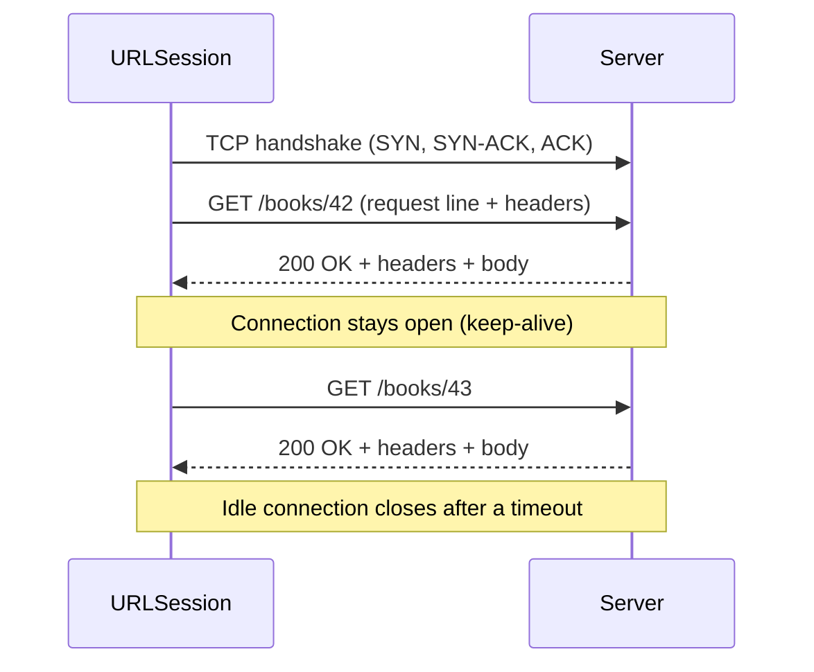
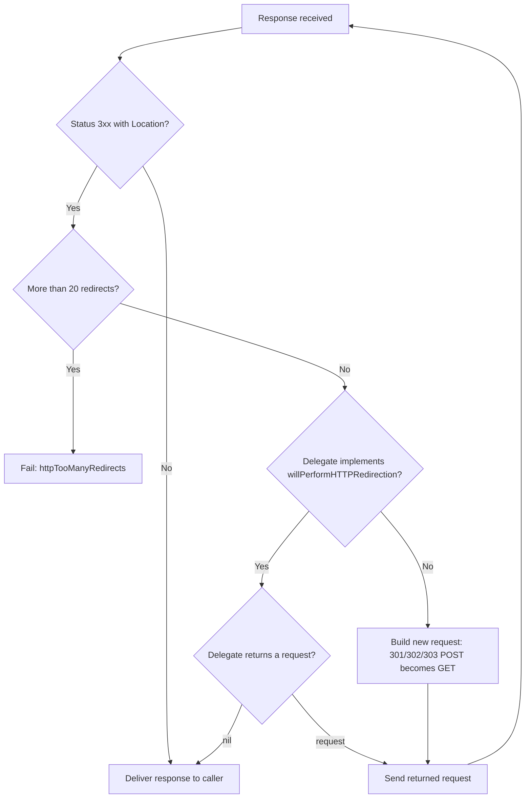

Most networking bugs in apps are not caused by a broken network. They come from a client and a server that disagree about what a message means: a `POST` that a redirect silently turned into a `GET`, a `404` that the client treated as an empty list, a body sent without a `Content-Type` and parsed as a form, or a request that the system retried without anyone asking.

HTTP gives every request and response a precise meaning through three things: the **method** says what the client wants done, the **status code** says how the server classified the outcome, and the **headers** carry everything else, from the body's format to caching rules and credentials. This article looks at all three from the client's side, using a small server that prints exactly what `URLSession` sends, so each claim below is something you can observe rather than something to memorize.

<!--more-->

The examples use Swift 6 language mode and were compiled and run with the Swift 6.4 toolchain from Xcode 27.1 on macOS 26. They talk to `LocalServer`, a small HTTP/1.1 server on the loopback interface whose full source is in the [appendix](#appendix-the-local-server-used-in-this-series). The rest of the networking series reuses it. Paste the appendix and the blocks below, in order, into one `main.swift` to run the assertions.

## A message is text with a strict shape

HTTP semantics are defined in [RFC 9110](https://www.rfc-editor.org/rfc/rfc9110), independently of how messages are framed on the wire. HTTP/1.1 ([RFC 9112](https://www.rfc-editor.org/rfc/rfc9112)) frames them as text, which makes it the easiest version to read. A request is a request line, a block of header fields, a blank line, and an optional body:

```text
POST /books HTTP/1.1          <- method, request target, protocol version
Host: api.example.com         <- header fields: name, colon, value
Content-Type: application/json
Content-Length: 27
                              <- empty line ends the header section
{"title":"Dune","year":1965}  <- body, exactly Content-Length bytes
```

A response has the same shape, with a status line in place of the request line:

```text
HTTP/1.1 201 Created
Location: /books/42
Content-Type: application/json
Content-Length: 39

{"id":42,"title":"Dune","year":1965}
```

HTTP/2 and HTTP/3 replace the text framing with binary frames, compress headers, and multiplex many requests over one connection, but the meaning of methods, status codes, and fields is the same. Two visible differences: field names are sent in lowercase, and the reason phrase ("Created") no longer exists. Clients should never have depended on it anyway. RFC 9112 makes it optional, and `LocalServer` leaves it out.

The simplest way to see what your client really sends is to ask a server to echo it. The first server below returns the raw request head as its response body:

```swift
import Foundation

let echo = try await LocalServer.start { request in .text(request.head) }

let (headData, _) = try await URLSession.shared.data(from: echo.baseURL.appending(path: "books/42"))
let head = String(decoding: headData, as: UTF8.self)
print(head)

assert(head.hasPrefix("GET /books/42 HTTP/1.1\r\n"))
assert(head.contains("Host: 127.0.0.1:\(echo.port)"))
assert(head.contains("Accept-Encoding: gzip"))
```

On macOS 26.6 this prints:

```text
GET /books/42 HTTP/1.1
Host: 127.0.0.1:49956
Accept: */*
Accept-Language: en-GB,en-US;q=0.9,en;q=0.8
Connection: keep-alive
Accept-Encoding: gzip, deflate
User-Agent: main (unknown version) CFNetwork/3860.700.1 Darwin/25.6.0
```

Every one of those fields was added by `URLSession`; the code asked only for a URL.

- `Host` names the authority the request is for. It lets one IP address serve many sites, and it is mandatory in HTTP/1.1.
- `Accept: */*` says any media type is acceptable. An API client should usually say what it can actually parse.
- `Accept-Language` comes from the user's language preferences, in order, with **quality values**: `q=0.8` means "acceptable, but less preferred than 1.0."
- `Accept-Encoding` advertises compression the session can undo. When a server answers with `Content-Encoding: gzip`, `URLSession` decompresses the body before your code sees it.
- `Connection: keep-alive` asks to reuse the TCP connection for later requests, which avoids a new handshake each time.
- `User-Agent` identifies the client. In an app it starts with the bundle name and version; in a command-line tool it says `unknown version`.

The sequence below shows a persistent connection carrying two exchanges. The cost of the connection is paid once.



## Methods carry promises about side effects

The method is not a label for routing. It is a promise about what the request does to the server's state, and every intermediary on the path, from `URLSession` to proxies and caches, is allowed to act on that promise.

RFC 9110 defines two properties. A method is **safe** if the client does not request any change to server state. A method is **idempotent** if sending the request several times has the same intended effect as sending it once. Writing $$S_0$$ for the server state before any request and $$S_n$$ for the state after $$n$$ identical requests:

$$
\text{safe:}\; S_n = S_0 \;\;\forall n \ge 1
\qquad\qquad
\text{idempotent:}\; S_n = S_1 \;\;\forall n \ge 1
$$

Every safe method is idempotent, since $$S_1 = S_0$$. The definitions are about *intended* effects: a `GET` may still write an access log, and that does not make it unsafe. What matters is that the client did not ask for the change and cannot be blamed for it.

| Method | Purpose | Safe | Idempotent | Body in request |
|---|---|---|---|---|
| `GET` | Retrieve a representation | Yes | Yes | No defined meaning |
| `HEAD` | Same as `GET`, headers only | Yes | Yes | No defined meaning |
| `OPTIONS` | Describe communication options | Yes | Yes | Rare |
| `PUT` | Replace the target's state with the body | No | Yes | Yes |
| `DELETE` | Remove the target | No | Yes | Rare |
| `POST` | Process the body by the target's own rules | No | No | Yes |
| `PATCH` | Apply a partial modification ([RFC 5789](https://www.rfc-editor.org/rfc/rfc5789)) | No | Not by default | Yes |

The difference between `PUT` and `POST` is the easiest to see with a counter. `PUT /cart/items/7` with `{"quantity": 2}` sets the quantity to 2 no matter how many times it arrives. `POST /cart/items` with `{"productID": 7}` adds an item each time, so two deliveries mean two items. `PATCH` depends on the patch format: "set quantity to 2" is idempotent, "add 1 to quantity" is not.

These properties decide what is safe to **retry**. A client that never got a response does not know whether the server processed the request. For an idempotent request, sending it again is harmless by definition. For a `POST`, it may charge a card twice. The [retry article](/swift-retry-backoff-idempotency/) builds a full policy on this distinction, including idempotency keys for `POST`.

### `URLSession` already acts on the method

`URLSession` makes two decisions on its own based on the method. The first: it refuses to send a `GET` with a body. RFC 9110 says a body in a `GET` "has no generally defined semantics" and may be rejected by intermediaries, and on Apple platforms the task fails before anything is sent:

```swift
struct Exchange {
    var status: Int
    var body: String
    var finalPath: String
}

func send(_ method: String, _ url: URL, body: Data? = nil,
          headers: [String: String] = [:], session: URLSession = .shared) async throws -> Exchange {
    var request = URLRequest(url: url)
    request.httpMethod = method
    request.httpBody = body
    for (name, value) in headers { request.setValue(value, forHTTPHeaderField: name) }
    let (data, response) = try await session.data(for: request)
    let http = response as! HTTPURLResponse
    return Exchange(status: http.statusCode, body: String(decoding: data, as: UTF8.self),
                    finalPath: http.url?.path ?? "")
}

let methods = try await LocalServer.start { request in
    switch request.path {
    case "/echo":
        .text("\(request.method) body=\(request.body.count) type=\(request.header("Content-Type") ?? "none")")
    case "/drop":
        .drop
    default:
        .text("not found", status: 404)
    }
}

do {
    _ = try await send("GET", methods.baseURL.appending(path: "echo"), body: Data("x".utf8))
    assertionFailure("a GET with a body should not be sent")
} catch let error as URLError {
    assert(error.code == .dataLengthExceedsMaximum)  // -1103
}
assert(methods.requests.isEmpty)
```

The error code, `-1103`, is an odd fit for the cause, so it is worth recognizing. If an API really needs a complex query that does not fit in a URL, the usual answer is a `POST` to a search resource; the IETF is also standardizing a safe [`QUERY` method](https://datatracker.ietf.org/doc/draft-ietf-httpbis-safe-method-w-body/) for exactly this case.

The second decision is about retries. When a connection closes before any byte of the response arrives, the system may resend the request on a new connection. The `/drop` route closes the connection without answering. The helper counts how many times the server saw the request:

```swift
func attempts(_ method: String, on server: LocalServer) async -> Int {
    let session = URLSession(configuration: .ephemeral)
    defer { session.invalidateAndCancel() }
    let before = server.requests.count
    let body: Data? = ["POST", "PUT", "PATCH"].contains(method) ? Data("x".utf8) : nil
    do {
        _ = try await send(method, server.baseURL.appending(path: "drop"), body: body, session: session)
    } catch let error as URLError {
        assert(error.code == .networkConnectionLost)  // -1005
    } catch {
        assertionFailure("unexpected \(error)")
    }
    return server.requests.count - before
}

var observed: [String: Int] = [:]
for method in ["GET", "HEAD", "PUT", "DELETE", "POST", "PATCH"] {
    observed[method] = await attempts(method, on: methods)
}
print(observed)
assert(observed["GET"] == 3 && observed["HEAD"] == 3)
assert(observed["PUT"] == 1 && observed["DELETE"] == 1)
assert(observed["POST"] == 1 && observed["PATCH"] == 1)
```

On macOS 26.6 the server saw each `GET` and `HEAD` three times and every other method once:

| Method | Attempts seen by the server | Error returned |
|---|---|---|
| `GET`, `HEAD` | 3 | `networkConnectionLost` (-1005) |
| `PUT`, `DELETE` | 1 | `networkConnectionLost` (-1005) |
| `POST`, `PATCH` | 1 | `networkConnectionLost` (-1005) |

The system is more conservative than the RFC: `PUT` and `DELETE` are idempotent, but they are not retried automatically. A further check, with a response that sends headers and three bytes of a ten-byte body before closing, produced exactly one attempt. Once any part of the response has arrived, the request is never replayed.

Two consequences follow. A server must handle repeated `GET` requests from one user action, so a `GET` must not trigger side effects such as "mark as read." And your own retry policy runs *on top of* this behavior: three app-level retries of a `GET` can reach the server up to nine times. The retry article quantifies that amplification.

## Status codes classify the outcome

A status code is a three-digit number whose first digit defines its class. A client that does not recognize a particular code must treat it as the `x00` code of its class: an unregistered `499` is handled as a `400`, and an unregistered `599` as a `500`.

| Class | Meaning | Client's job |
|---|---|---|
| `1xx` Informational | Interim response; the final one follows | Nothing; `URLSession` consumes these |
| `2xx` Successful | The request was received, understood, and accepted | Read the body according to the code |
| `3xx` Redirection | Further action is needed, usually another request | Usually handled by `URLSession` |
| `4xx` Client error | The request is wrong, unauthorized, or conflicting | Fix the request; do not blindly retry |
| `5xx` Server error | The server failed to perform a valid request | Maybe retry later |

The most important fact about status codes in `URLSession` is that **a status code is not an error**. A `404` or a `503` is a successfully received HTTP response; `data(for:)` returns normally, and the code is in `HTTPURLResponse.statusCode`. Thrown errors are reserved for failures where no usable HTTP response arrived. The distinction has its own article, [Separating Transport Errors from Application Failures](/swift-transport-vs-application-errors/).

```swift
let missing = try await send("GET", methods.baseURL.appending(path: "no-such-book"))
assert(missing.status == 404)  // returned, not thrown
```

The codes below are the ones a client typically has to treat differently from their class default:

| Code | What the client should do |
|---|---|
| `200 OK` | Use the body. |
| `201 Created` | The new resource's URL is in `Location`; the body may describe it. |
| `202 Accepted` | Processing has not finished; poll a status resource or wait for a notification. |
| `204 No Content` | Success with an empty body. Do not try to decode JSON. |
| `206 Partial Content` | The body is the byte range you asked for (see [download resuming](/swift-download-progress-resume/)). |
| `304 Not Modified` | Your cached copy is still valid (see [HTTP caching](/swift-http-caching-etag/)). |
| `400 Bad Request` | The request is malformed. Retrying the same bytes will fail again. |
| `401 Unauthorized` | Credentials are missing or invalid; authenticate or [refresh](/swift-token-refresh/). |
| `403 Forbidden` | Credentials were understood and are insufficient. Refreshing will not help. |
| `404 Not Found`, `410 Gone` | The resource does not exist; `410` says it existed and will not return. |
| `409 Conflict`, `412 Precondition Failed` | The request conflicts with the current state, for example a stale version. |
| `422 Unprocessable Content` | Well-formed, but the content fails validation. |
| `429 Too Many Requests` | Slow down; honor `Retry-After` if present. |
| `500 Internal Server Error` | The server failed. Retry only idempotent requests, and with backoff. |
| `502`, `503`, `504` | A gateway or the service is unavailable or timed out. Usually transient. |

### Redirects are followed for you, with a twist

`URLSession` follows redirects automatically and returns the final response. `HTTPURLResponse.url` tells you where you ended up. The redirect codes differ in two ways: whether the move is permanent, and whether the client may change the method. The second matters more to an API client:

```swift
let redirects = try await LocalServer.start { request in
    switch request.path {
    case "/echo":
        .text("\(request.method) body=\(request.body.count)")
    case "/loop":
        HTTPResponse(status: 302, headers: [("Location", "/loop")])
    default:  // /301, /302, /303, /307, /308
        HTTPResponse(status: Int(request.path.dropFirst())!, headers: [("Location", "/echo")])
    }
}

var redirected: [Int: String] = [:]
for code in [301, 302, 303, 307, 308] {
    let exchange = try await send("POST", redirects.baseURL.appending(path: "\(code)"),
                                  body: Data(#"{"title":"Dune"}"#.utf8),
                                  headers: ["Content-Type": "application/json"])
    assert(exchange.status == 200 && exchange.finalPath == "/echo")
    redirected[code] = exchange.body
}
print(redirected)
assert(redirected[301] == "GET body=0")
assert(redirected[302] == "GET body=0")
assert(redirected[303] == "GET body=0")
assert(redirected[307] == "POST body=16")
assert(redirected[308] == "POST body=16")

let put302 = try await send("PUT", redirects.baseURL.appending(path: "302"), body: Data("x".utf8))
assert(put302.body == "PUT body=1")
```

| Status | Permanence | `POST` after redirect (observed) | `PUT` after redirect |
|---|---|---|---|
| `301 Moved Permanently` | Permanent | `GET`, body dropped | Kept |
| `302 Found` | Temporary | `GET`, body dropped | Kept |
| `303 See Other` | Temporary | `GET`, body dropped | (`GET` by definition) |
| `307 Temporary Redirect` | Temporary | `POST`, body kept | Kept |
| `308 Permanent Redirect` | Permanent | `POST`, body kept | Kept |

The rewrite of `POST` to `GET` on `301` and `302` is a historical browser behavior that RFC 9110 permits. For an API, it means a server that answers `POST /orders` with a `302` to a new host receives a body-less `GET`, and the client sees a `200` for an order that was never placed. Servers that move endpoints which accept writes should use `307` or `308`.

`303 See Other` is the deliberate version of the rewrite: "your `POST` worked, now `GET` the result over there." It is the right answer to a form submission.

A redirect loop does not hang. `URLSession` gives up with `httpTooManyRedirects` (-1007). In the run below the server saw 21 requests: the original and 20 redirects.

```swift
let loopStart = redirects.requests.count
do {
    _ = try await send("GET", redirects.baseURL.appending(path: "loop"))
    assertionFailure("a redirect loop should fail")
} catch let error as URLError {
    assert(error.code == .httpTooManyRedirects)
}
assert(redirects.requests.count - loopStart == 21)
```

When you need to see or refuse a redirect, implement `urlSession(_:task:willPerformHTTPRedirection:newRequest:)` and return `nil`. The task then completes with the `3xx` response itself:

```swift
final class RefuseRedirects: NSObject, URLSessionTaskDelegate {
    func urlSession(_ session: URLSession, task: URLSessionTask,
                    willPerformHTTPRedirection response: HTTPURLResponse,
                    newRequest request: URLRequest) async -> URLRequest? {
        nil
    }
}

let noRedirects = URLSession(configuration: .ephemeral, delegate: RefuseRedirects(), delegateQueue: nil)
let refused = try await send("POST", redirects.baseURL.appending(path: "302"), body: Data("x".utf8),
                             session: noRedirects)
assert(refused.status == 302)
```

The same delegate method is where a client stops credentials from following a redirect to another host, which the [credential scope article](/swift-authentication-headers-credential-scope/) shows is necessary. The flow for one task looks like this:



## Headers carry everything else

Header fields are name-value pairs, and their names are **case-insensitive**. `Content-Type`, `content-type`, and `CONTENT-TYPE` are the same field. HTTP/2 even requires lowercase names on the wire. Code that compares header names with `==` on a dictionary key will eventually break, which is why `HTTPURLResponse.value(forHTTPHeaderField:)` and `URLRequest.value(forHTTPHeaderField:)` compare names without regard to case.

A field can appear more than once, and a recipient may combine the occurrences into one comma-separated value. `HTTPURLResponse` does that:

```swift
let fields = try await LocalServer.start { _ in
    HTTPResponse(status: 200,
                 headers: [("X-Tag", "a"), ("X-Tag", "b"), ("Set-Cookie", "session=1"), ("Set-Cookie", "theme=dark")],
                 body: [.bytes(Data("ok".utf8))])
}
let (_, fieldsResponse) = try await URLSession.shared.data(from: fields.baseURL)
let fieldsHTTP = fieldsResponse as! HTTPURLResponse

assert(fieldsHTTP.value(forHTTPHeaderField: "x-tag") == "a, b")
assert(fieldsHTTP.value(forHTTPHeaderField: "SET-COOKIE") == "session=1, theme=dark")

let cookies = HTTPCookie.cookies(withResponseHeaderFields: fieldsHTTP.allHeaderFields as! [String: String],
                                 for: fieldsHTTP.url!)
assert(cookies.map(\.name) == ["session", "theme"])
```

Combining with commas is only correct for fields whose values are comma-separated lists. `Set-Cookie` is the documented exception, since a cookie's `Expires` attribute contains a comma. Do not split cookies yourself; `HTTPCookie.cookies(withResponseHeaderFields:for:)` understands the combined form, and the session's cookie storage handles it automatically.

### Fields fall into families

| Family | Examples | Who usually sets them |
|---|---|---|
| Representation | `Content-Type`, `Content-Length`, `Content-Encoding` | Whoever sends the body |
| Content negotiation | `Accept`, `Accept-Language`, `Accept-Encoding` | Client |
| Conditional requests | `If-None-Match`, `If-Modified-Since`, `If-Match` | Client, from cached validators |
| Caching | `Cache-Control`, `ETag`, `Last-Modified`, `Age`, `Vary` | Server |
| Authentication | `Authorization`, `WWW-Authenticate` | Client and server |
| Connection management | `Host`, `Connection`, `Transfer-Encoding` | `URLSession` |
| Routing and control | `Location`, `Retry-After` | Server |

Custom fields no longer need an `X-` prefix; [RFC 6648](https://www.rfc-editor.org/rfc/rfc6648) deprecated the convention because experimental names had a habit of becoming permanent.

### Some fields belong to `URLSession`

Apple's `URLRequest` documentation lists [reserved HTTP headers](https://developer.apple.com/documentation/foundation/nsurlrequest#1776617) that the URL loading system manages: `Content-Length`, `Authorization`, `Connection`, `Host`, `Proxy-Authenticate`, `Proxy-Authorization`, and `WWW-Authenticate`. The documentation says you shouldn't set them. What actually happens when you do varies by field, which is a good reason to follow the rule:

```swift
let reserved = try await LocalServer.start { request in
    .text("host=\(request.header("Host") ?? "-") length=\(request.body.count) type=\(request.header("Content-Type") ?? "none")")
}

let wrongLength = try await send("POST", reserved.baseURL, body: Data("abcdef".utf8),
                                 headers: ["Content-Length": "3", "Content-Type": "text/plain"])
assert(wrongLength.body.contains("length=6"))  // URLSession computed its own length

let otherHost = try await send("GET", reserved.baseURL, headers: ["Host": "example.com"])
assert(otherHost.body.hasPrefix("host=example.com"))  // sent as given
```

`Content-Length` was replaced with the correct value, so the six-byte body arrived intact. `Host` was sent exactly as written, so the server received a request addressed to a different site than the one the connection went to. Behind a shared load balancer, that request can reach a different application. `Authorization` is the field everyone sets anyway; setting it on a request works, but the [credential article](/swift-authentication-headers-credential-scope/) shows why where you set it matters.

### Always say what the body is

The `Content-Type` field tells the receiver how to interpret the body. When you set a body and forget the field, `URLSession` fills in a default, and the default is a form encoding:

```swift
let untyped = try await send("POST", reserved.baseURL, body: Data(#"{"title":"Dune"}"#.utf8))
assert(untyped.body.hasSuffix("type=application/x-www-form-urlencoded"))
```

A framework that parses form bodies automatically then sees a single form field whose name is the whole JSON document. Depending on the server, the result is a `400`, a `415 Unsupported Media Type`, or worse, a request processed with every property missing. Set `Content-Type` whenever you set a body, and set `Accept` to the formats you can parse.

The same discipline applies in reverse. The response's media type is available as `URLResponse.mimeType`, lowercased and without parameters, and the `charset` parameter is in `textEncodingName`. When a server sends no `Content-Type` at all, the system reports `text/plain`:

```swift
let typed = try await LocalServer.start { request in
    switch request.path {
    case "/json":
        HTTPResponse(status: 200, headers: [("Content-Type", "Application/JSON; charset=UTF-8")],
                     body: [.bytes(Data("{}".utf8))])
    default:
        HTTPResponse(status: 200, body: [.bytes(Data("{}".utf8))])
    }
}
let (_, jsonResponse) = try await URLSession.shared.data(from: typed.baseURL.appending(path: "json"))
assert(jsonResponse.mimeType == "application/json")
assert(jsonResponse.textEncodingName == "utf-8")

let (_, bareResponse) = try await URLSession.shared.data(from: typed.baseURL.appending(path: "bare"))
assert(bareResponse.mimeType == "text/plain")
```

Checking `mimeType` before decoding catches a common production failure: a captive portal, CDN error page, or misconfigured gateway answering `200` with an HTML page. Without the check, the decoder fails with a confusing message about an unexpected `<` character. With it, the client can say precisely what went wrong.

## Putting the three together

A response is classified by its status first, then interpreted by its headers. The function below turns an `HTTPURLResponse` and its body into a decision the rest of a client can act on. It is deliberately small; later articles grow it into a full error model.

```swift
enum Outcome: Equatable {
    case success(Data)
    case noContent
    case notModified
    case clientError(Int)
    case unauthorized
    case rateLimited(retryAfter: Int?)
    case serverError(Int)
    case unexpectedStatus(Int)
    case unexpectedType(String?)
}

func classify(_ response: HTTPURLResponse, data: Data, expecting type: String = "application/json") -> Outcome {
    switch response.statusCode {
    case 204:
        return .noContent
    case 200..<300:
        guard response.mimeType == type else { return .unexpectedType(response.mimeType) }
        return .success(data)
    case 304:
        return .notModified
    case 401:
        return .unauthorized
    case 429:
        return .rateLimited(retryAfter: response.value(forHTTPHeaderField: "Retry-After").flatMap(Int.init))
    case 400..<500:
        return .clientError(response.statusCode)
    case 500..<600:
        return .serverError(response.statusCode)
    default:
        return .unexpectedStatus(response.statusCode)
    }
}

let api = try await LocalServer.start { request in
    switch request.path {
    case "/books/42": .json(#"{"id":42}"#)
    case "/portal": HTTPResponse(status: 200, headers: [("Content-Type", "text/html")],
                                 body: [.bytes(Data("<html>Log in to Wi-Fi</html>".utf8))])
    case "/busy": .text("slow down", status: 429, headers: [("Retry-After", "30")])
    case "/deleted": HTTPResponse(status: 204)
    default: .text("boom", status: 500)
    }
}

func outcome(_ path: String) async throws -> Outcome {
    let (data, response) = try await URLSession.shared.data(from: api.baseURL.appending(path: path))
    return classify(response as! HTTPURLResponse, data: data)
}

var outcomes: [String: Outcome] = [:]
for path in ["books/42", "portal", "busy", "deleted", "explode"] {
    outcomes[path] = try await outcome(path)
}
assert(outcomes["books/42"] == .success(Data(#"{"id":42}"#.utf8)))
assert(outcomes["portal"] == .unexpectedType("text/html"))
assert(outcomes["busy"] == .rateLimited(retryAfter: 30))
assert(outcomes["deleted"] == .noContent)
assert(outcomes["explode"] == .serverError(500))
```

The order of checks matters. `204` comes before the generic success range because it has no body to type-check. `401` and `429` come before the generic client-error range because they call for different actions: re-authenticate, or wait. Unknown codes inside a class fall through to that class's case, which is the default the RFC requires. A `3xx` other than `304` reaches the client only when redirects were refused or a `Location` was missing, so it is reported as unexpected rather than disguised as a server error.

## Summary

- An HTTP message is a start line, header fields, a blank line, and a body. HTTP/2 and HTTP/3 change the framing, not the meaning.
- Methods promise side effects: safe means $$S_n = S_0$$, idempotent means $$S_n = S_1$$. Retry decisions follow from these promises.
- `URLSession` rejects a `GET` with a body (`-1103`) and automatically replays `GET` and `HEAD`, up to three attempts in total, when a connection dies before the response starts. It does not replay `PUT`, `DELETE`, or `POST`.
- Status codes are data, not thrown errors. Classify by class, then special-case the codes that require different actions.
- `301` and `302` turn a `POST` into a body-less `GET`; `307` and `308` keep the method and body.
- Header names are case-insensitive, repeated fields are combined with commas, and `URLSession` owns `Content-Length`, `Host`, and `Connection`.
- Always set `Content-Type` with a body (the default is a form encoding), and check `mimeType` before decoding.

## Exercise

Extend the `methods` server with a route that returns `503` with `Retry-After: 1` on its first two requests and `200` on the third. Write a function that sends a `GET`, honors `Retry-After` (in seconds or as an HTTP date), and gives up after three attempts. Then change the request to `POST` and decide, with reasons, whether the same function should retry it. Use the server's `requests` array to assert how many attempts reached it in each case, and compare that count with the automatic retries you measured above.

## Further reading

- [RFC 9110: HTTP Semantics](https://www.rfc-editor.org/rfc/rfc9110), especially §9 (methods), §15 (status codes), and §5 (fields).
- [RFC 9112: HTTP/1.1](https://www.rfc-editor.org/rfc/rfc9112) for the message syntax used here.
- [MDN's HTTP reference](https://developer.mozilla.org/en-US/docs/Web/HTTP) for quick lookups of individual fields and codes.
- Apple's [URLRequest documentation](https://developer.apple.com/documentation/foundation/urlrequest) and [URL Loading System](https://developer.apple.com/documentation/foundation/url-loading-system) overview.

## Appendix: the local server used in this series

`LocalServer` is an HTTP/1.1 server built on Network framework's `NWListener`. It accepts connections on `127.0.0.1` at a port the system picks, parses each request (including chunked request bodies), passes it to a handler, and writes the handler's `HTTPResponse` back. A response can be delayed, sent in pieces with pauses, sent with chunked transfer encoding, or cut off by closing the connection, which is everything the series needs to reproduce slow servers, streaming, truncated downloads, and lost connections. It records every request so examples can assert what reached the server.

It is a test fixture, not a production server: it has no limits on request size, no timeouts of its own, and it trusts its input. It needs macOS 15 or iOS 18 for `Mutex`. Command-line tools on macOS can connect to it without any App Transport Security configuration; the [ATS article](/swift-ats-tls-trust/) covers what an app needs.

The first part defines the request and response values. A status of `0` is the fixture's way of saying "close the connection without answering," which produces a transport error in the client.

<!-- local-server -->
```swift
import Foundation
import Network
import Synchronization

/// A request as the server parsed it from the wire.
struct HTTPRequest: Sendable {
    var method: String
    var target: String
    var headers: [(name: String, value: String)]
    var body: Data
    var connection: Int
    var head: String
    var received: ContinuousClock.Instant

    var path: String { String(target.prefix { $0 != "?" }) }

    func header(_ name: String) -> String? {
        headers.first { $0.name.caseInsensitiveCompare(name) == .orderedSame }?.value
    }

    var query: [String: String] {
        let items = URLComponents(string: target)?.queryItems ?? []
        return Dictionary(items.map { ($0.name, $0.value ?? "") }, uniquingKeysWith: { _, last in last })
    }
}

/// What the server writes back. A status of 0 closes the connection without a response.
struct HTTPResponse: Sendable {
    enum Piece: Sendable { case bytes(Data), pause(Duration), close }

    var status: Int
    var headers: [(name: String, value: String)] = []
    var body: [Piece] = []
    var chunked = false
    var delay: Duration = .zero

    static func text(_ text: String, status: Int = 200,
                     headers: [(name: String, value: String)] = []) -> HTTPResponse {
        HTTPResponse(status: status, headers: [("Content-Type", "text/plain; charset=utf-8")] + headers,
                     body: [.bytes(Data(text.utf8))])
    }

    static func json(_ json: String, status: Int = 200,
                     headers: [(name: String, value: String)] = []) -> HTTPResponse {
        HTTPResponse(status: status, headers: [("Content-Type", "application/json")] + headers,
                     body: [.bytes(Data(json.utf8))])
    }

    static let drop = HTTPResponse(status: 0)
}
```

The server waits for the listener to become ready, then serves each connection in its own task. Requests on one connection are handled in order, which is how HTTP/1.1 keep-alive works. The connection number recorded with each request shows when `URLSession` reused a connection.

<!-- local-server -->
```swift
/// A small HTTP/1.1 server on the loopback interface, for examples and tests.
final class LocalServer: Sendable {
    typealias Handler = @Sendable (HTTPRequest) async -> HTTPResponse

    let port: Int
    let baseURL: URL

    private let listener: NWListener
    private let state = Mutex<(connections: Int, requests: [HTTPRequest])>((0, []))

    /// Every request received so far, in arrival order.
    var requests: [HTTPRequest] { state.withLock { $0.requests } }

    static func start(tls: NWProtocolTLS.Options? = nil,
                      _ handler: @escaping Handler) async throws -> LocalServer {
        let parameters = tls.map { NWParameters(tls: $0) } ?? .tcp
        parameters.requiredLocalEndpoint = .hostPort(host: .ipv4(.loopback), port: .any)
        let listener = try NWListener(using: parameters)
        let queue = DispatchQueue(label: "LocalServer")
        let port: Int = try await withCheckedThrowingContinuation { continuation in
            let resumed = Mutex(false)
            listener.stateUpdateHandler = { state in
                let port: Int?
                let error: (any Error)?
                switch state {
                case .ready: (port, error) = (listener.port.map { Int($0.rawValue) }, nil)
                case .failed(let failure): (port, error) = (nil, failure)
                default: return
                }
                guard resumed.withLock({ done in defer { done = true }; return !done }) else { return }
                if let port { continuation.resume(returning: port) } else { continuation.resume(throwing: error!) }
            }
            listener.newConnectionHandler = { _ in }
            listener.start(queue: queue)
        }
        let url = URL(string: "\(tls == nil ? "http" : "https")://127.0.0.1:\(port)")!
        let server = LocalServer(port: port, baseURL: url, listener: listener)
        listener.newConnectionHandler = { connection in
            connection.start(queue: queue)
            Task { await server.serve(connection, handler: handler) }
        }
        return server
    }

    private init(port: Int, baseURL: URL, listener: NWListener) {
        self.port = port
        self.baseURL = baseURL
        self.listener = listener
    }

    func stop() { listener.cancel() }

    private func serve(_ connection: NWConnection, handler: Handler) async {
        let id = state.withLock { $0.connections += 1; return $0.connections }
        var reader = Reader(connection: connection)
        defer { connection.cancel() }
        do {
            while var request = try await reader.request() {
                request.connection = id
                let recorded = request
                state.withLock { $0.requests.append(recorded) }
                let response = await handler(request)
                guard try await write(response, to: connection) else { return }
                if request.header("Connection")?.lowercased() == "close" { return }
            }
        } catch {
            return
        }
    }

    /// Returns false when the connection should close.
    private func write(_ response: HTTPResponse, to connection: NWConnection) async throws -> Bool {
        try await Task.sleep(for: response.delay)
        guard response.status > 0 else { return false }
        var head = "HTTP/1.1 \(response.status) \r\n"
        var headers = response.headers
        if response.chunked {
            headers.append(("Transfer-Encoding", "chunked"))
        } else if !headers.contains(where: { $0.name.lowercased() == "content-length" }) {
            let length = response.body.reduce(0) { total, piece in
                if case .bytes(let data) = piece { total + data.count } else { total }
            }
            headers.append(("Content-Length", "\(length)"))
        }
        for (name, value) in headers { head += "\(name): \(value)\r\n" }
        try await connection.sendAll(Data((head + "\r\n").utf8))
        for piece in response.body {
            switch piece {
            case .bytes(let data) where response.chunked:
                guard !data.isEmpty else { continue }
                try await connection.sendAll(Data(String(data.count, radix: 16).utf8) + Data("\r\n".utf8) + data + Data("\r\n".utf8))
            case .bytes(let data):
                try await connection.sendAll(data)
            case .pause(let duration):
                try await Task.sleep(for: duration)
            case .close:
                return false
            }
        }
        if response.chunked { try await connection.sendAll(Data("0\r\n\r\n".utf8)) }
        return true
    }
}
```

The reader buffers bytes until it has a complete header section, then reads exactly `Content-Length` bytes, or decodes chunks until the zero-length terminator. The last block wraps `NWConnection`'s completion-handler API in checked continuations, the pattern from [Bridging Callback APIs with Checked Continuations](/swift-checked-continuations/).

<!-- local-server -->
```swift
/// Reads HTTP/1.1 requests from a connection, including chunked request bodies.
private struct Reader {
    let connection: NWConnection
    var buffer = Data()

    mutating func request() async throws -> HTTPRequest? {
        guard let end = try await fill(until: { $0.range(of: Data("\r\n\r\n".utf8)) }) else { return nil }
        let head = String(decoding: buffer[..<end.lowerBound], as: UTF8.self)
        buffer.removeSubrange(..<end.upperBound)
        var lines = head.components(separatedBy: "\r\n")
        let start = lines.removeFirst().split(separator: " ")
        let headers = lines.compactMap { line -> (name: String, value: String)? in
            guard let colon = line.firstIndex(of: ":") else { return nil }
            return (String(line[..<colon]), line[line.index(after: colon)...].trimmingCharacters(in: .whitespaces))
        }
        var request = HTTPRequest(method: String(start[0]), target: String(start[1]), headers: headers,
                                  body: Data(), connection: 0, head: head, received: .now)
        if request.header("Transfer-Encoding")?.lowercased() == "chunked" {
            while true {
                guard let line = try await fill(until: { $0.range(of: Data("\r\n".utf8)) }) else { return nil }
                let size = Int(String(decoding: buffer[..<line.lowerBound], as: UTF8.self)
                    .split(separator: ";")[0], radix: 16) ?? 0
                buffer.removeSubrange(..<line.upperBound)
                guard try await fill(count: size + 2) else { return nil }
                request.body += buffer.prefix(size)
                buffer.removeSubrange(..<(buffer.startIndex + size + 2))
                if size == 0 { break }
            }
        } else if let length = request.header("Content-Length").flatMap(Int.init), length > 0 {
            guard try await fill(count: length) else { return nil }
            request.body = buffer.prefix(length)
            buffer.removeSubrange(..<(buffer.startIndex + length))
        }
        return request
    }

    private mutating func fill(until find: (Data) -> Range<Data.Index>?) async throws -> Range<Data.Index>? {
        while true {
            if let range = find(buffer) { return range }
            guard let more = try await connection.receiveSome() else { return nil }
            buffer += more
        }
    }

    private mutating func fill(count: Int) async throws -> Bool {
        while buffer.count < count {
            guard let more = try await connection.receiveSome() else { return false }
            buffer += more
        }
        return true
    }
}

extension NWConnection {
    /// Returns the next bytes from the peer, or nil once the peer has closed its side.
    func receiveSome() async throws -> Data? {
        try await withCheckedThrowingContinuation { continuation in
            receive(minimumIncompleteLength: 1, maximumLength: 65_536) { data, _, isComplete, error in
                if let error { continuation.resume(throwing: error) }
                else if let data, !data.isEmpty { continuation.resume(returning: data) }
                else if isComplete { continuation.resume(returning: nil) }
                else { continuation.resume(returning: Data()) }
            }
        }
    }

    func sendAll(_ data: Data) async throws {
        try await withCheckedThrowingContinuation { (continuation: CheckedContinuation<Void, any Error>) in
            send(content: data, completion: .contentProcessed { error in
                if let error { continuation.resume(throwing: error) } else { continuation.resume() }
            })
        }
    }
}
```

Next: [URLs, Query Parameters, and Percent Encoding](/swift-urls-query-percent-encoding/).

Return to the [Networking roadmap](/swift-networking/).
