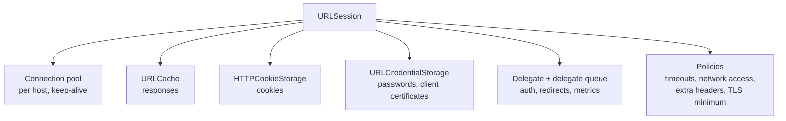
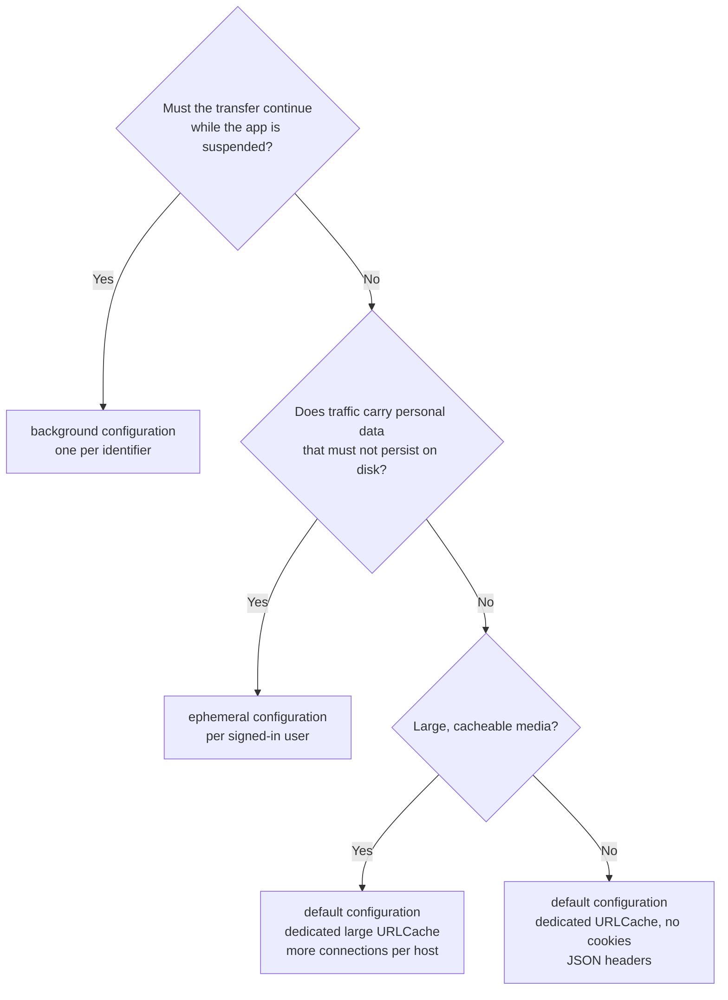

`URLSession.shared` is the first networking API most Swift developers meet, and for a quick request it is the right one. For an app's real traffic it makes a set of decisions on your behalf: it shares one cookie jar, one cache, and one credential store with everything else in the process; it allows six connections per host; it waits up to 60 seconds between packets and up to seven days in total; and it cannot have a delegate. Every one of those is a policy, and every policy is a configuration property.

A `URLSession` is less a request sender than a container of shared state and rules. Choosing a configuration means deciding which requests should share that state, and which must not. This article goes through what a configuration controls, measures the properties that most often surprise people, and ends with a small set of sessions that fit a typical app.

<!--more-->

The examples use Swift 6 language mode and were compiled and run with the Swift 6.4 toolchain from Xcode 27.1 on macOS 26. They send requests to `LocalServer`, the loopback HTTP server from the [appendix of the first article](/swift-http-methods-status-codes-headers/#appendix-the-local-server-used-in-this-series); paste that code first, then the blocks below in order, into one `main.swift`.

<!-- check-uses: local-server -->

## What a session owns

A session is created from a `URLSessionConfiguration`, and from then on it owns a fixed set of collaborators. Requests made through the same session share all of them.



Sharing is mostly a feature. Requests on one session reuse each other's connections, which saves a TCP and TLS handshake every time, and benefit from each other's cache entries. Sharing is also how state leaks: a cookie set by a response to one feature's request is sent with every other request to that domain, and a cached response for one user can be served after another user signs in.

The three factory methods give you starting points:

| Factory | Persistent storage | Use it for |
|---|---|---|
| `.default` | Shared disk cache, shared cookie jar, shared credential store | Ordinary API and content traffic |
| `.ephemeral` | Nothing on disk: memory-only cache, cookies, and credentials, private to the session | Sensitive traffic, signed-out or private browsing, test isolation |
| `.background(withIdentifier:)` | Transfers run in a system daemon, outside your process | Large uploads and downloads that must survive suspension (see [Background Transfers](/swift-background-transfers/)) |

Printing the defaults on macOS 26.6 shows what each starting point actually contains:

```swift
import Foundation

let standard = URLSessionConfiguration.default
let ephemeral = URLSessionConfiguration.ephemeral

assert(standard.urlCache === URLCache.shared)
assert(standard.httpCookieStorage === HTTPCookieStorage.shared)
assert(standard.urlCredentialStorage === URLCredentialStorage.shared)

assert(ephemeral.urlCache !== URLCache.shared && ephemeral.urlCache?.diskCapacity == 0)
assert(ephemeral.httpCookieStorage !== HTTPCookieStorage.shared)

assert(standard.httpMaximumConnectionsPerHost == 6)
assert(standard.timeoutIntervalForRequest == 60)
assert(standard.timeoutIntervalForResource == 7 * 24 * 60 * 60)
assert(standard.requestCachePolicy == .useProtocolCachePolicy)
assert(!standard.waitsForConnectivity)
assert(standard.tlsMinimumSupportedProtocolVersion == .TLSv12)

print(URLCache.shared.memoryCapacity, URLCache.shared.diskCapacity)  // 512000 20000000 here
```

The shared cache's capacities differ between platforms and processes. In this command-line tool they were 512 KB in memory and 20 MB on disk. Treat them as unknown and size your own cache when caching matters, as [HTTP Caching with `Cache-Control` and `ETag`](/swift-http-caching-etag/) does.

### A configuration is copied, once

Two details of the API trip people up. `URLSessionConfiguration.default` is a class property that returns a **new object on every call**, not a shared singleton. And the session **copies** its configuration when it is created, so changing the configuration object afterwards has no effect:

```swift
assert(URLSessionConfiguration.default !== URLSessionConfiguration.default)

let tuned = URLSessionConfiguration.default
let session = URLSession(configuration: tuned)
tuned.timeoutIntervalForRequest = 5          // too late: the session has its own copy
assert(session.configuration.timeoutIntervalForRequest == 60)
assert(session.configuration !== session.configuration)  // each read returns another copy
session.finishTasksAndInvalidate()
```

To change policy, create a new session. Sessions are cheap to create; what is expensive is creating one *per request*, because each new session starts with an empty connection pool and pays for new handshakes.

## The connection limit sets your throughput

`httpMaximumConnectionsPerHost` caps how many connections a session opens to one host. For HTTP/1.1, each connection carries one request at a time, so the cap is also the maximum number of requests in flight to that host. Further requests wait in a queue inside the session.

Little's law, introduced in [Concurrency vs. Parallelism](/swift-concurrency-vs-parallelism/), gives the consequence. With $$L$$ connections and a request duration of $$W$$, throughput $$X$$ cannot exceed:

$$
X \le \frac{L}{W}
\qquad\text{so a burst of } n \text{ requests takes at least}\qquad
T \approx \left\lceil \frac{n}{L} \right\rceil W
$$

The server below takes 300 ms to answer each request. A burst of 20 requests is sent through sessions with different limits, and the server records which connection each request arrived on:

```swift
let server = try await LocalServer.start { request in
    switch request.path {
    case "/slow": HTTPResponse(status: 200, body: [.bytes(Data("ok".utf8))], delay: .milliseconds(300))
    case "/hang": HTTPResponse(status: 200, delay: .seconds(30))
    case "/head": .text(request.head)
    case "/login": .text("welcome", headers: [("Set-Cookie", "session=abc123; Path=/; HttpOnly")])
    default: .text(request.header("Cookie") ?? "no cookie")
    }
}

func burst(_ n: Int, limit: Int) async throws -> (seconds: Double, connections: Int) {
    let configuration = URLSessionConfiguration.ephemeral
    configuration.httpMaximumConnectionsPerHost = limit
    let session = URLSession(configuration: configuration)
    defer { session.finishTasksAndInvalidate() }

    let before = server.requests.count
    let start = ContinuousClock.now
    try await withThrowingTaskGroup { group in
        for _ in 0..<n {
            group.addTask { _ = try await session.data(from: server.baseURL.appending(path: "slow")) }
        }
        try await group.waitForAll()
    }
    let elapsed = ContinuousClock.now - start
    let connections = Set(server.requests.dropFirst(before).map(\.connection)).count
    return (Double(elapsed.components.seconds) + Double(elapsed.components.attoseconds) / 1e18, connections)
}

for limit in [1, 2, 6, 20] {
    let result = try await burst(20, limit: limit)
    let predicted = Double((20 + limit - 1) / limit) * 0.3
    print("limit \(limit): \(result.connections) connections, \(result.seconds) s, predicted \(predicted) s")
    assert(result.connections == limit)
    assert(result.seconds >= predicted * 0.95 && result.seconds < predicted + 0.5)
}
```

| Limit $$L$$ | Connections used | Measured | $$\lceil 20/L \rceil \times 0.3\text{ s}$$ |
|---|---|---|---|
| 1 | 1 | 6.31 s | 6.0 s |
| 2 | 2 | 3.16 s | 3.0 s |
| 6 (default) | 6 | 1.27 s | 1.2 s |
| 20 | 20 | 0.34 s | 0.3 s |

The prediction holds to within a few percent; the rest is handshake and scheduling time. The default of six is a reasonable compromise inherited from browsers. It is too low for a screen that loads 40 thumbnails from one image host over HTTP/1.1, and too high for a fragile backend that you want to protect from a burst of client retries.

HTTP/2 and HTTP/3 change the picture: they multiplex many concurrent requests over a single connection, so the per-host connection count stops being the bottleneck. Most CDNs and modern API gateways speak HTTP/2, which is a good reason to measure with [`URLSessionTaskMetrics`](/swift-urlsessiontaskmetrics/) before tuning this value. The limit still matters for HTTP/1.1 servers, including most development servers and many internal services.

## Timeouts: two clocks with different meanings

A configuration has two timeouts, and their names hide an important difference:

- `timeoutIntervalForRequest` is an **idle** timeout. It restarts every time data arrives. A response that trickles one byte every 30 seconds never trips a 60-second request timeout.
- `timeoutIntervalForResource` is a **total** timeout for the whole transfer, including retries and, for sessions with `waitsForConnectivity`, time spent waiting. Its default is seven days.

[Timeouts, Cancellation, and Request Lifetimes](/swift-network-timeouts-cancellation/) measures both clocks. Here, the question is which value wins when a request sets its own `timeoutInterval`:

```swift
func timeToFail(sessionTimeout: TimeInterval, requestTimeout: TimeInterval?) async -> Double {
    let configuration = URLSessionConfiguration.ephemeral
    configuration.timeoutIntervalForRequest = sessionTimeout
    let session = URLSession(configuration: configuration)
    defer { session.invalidateAndCancel() }

    var request = URLRequest(url: server.baseURL.appending(path: "hang"))
    if let requestTimeout { request.timeoutInterval = requestTimeout }
    let start = ContinuousClock.now
    do {
        _ = try await session.data(for: request)
    } catch let error as URLError {
        assert(error.code == .timedOut)
    } catch {}
    let elapsed = ContinuousClock.now - start
    return Double(elapsed.components.seconds) + Double(elapsed.components.attoseconds) / 1e18
}

let sessionOnly = await timeToFail(sessionTimeout: 1, requestTimeout: nil)
let requestLonger = await timeToFail(sessionTimeout: 1, requestTimeout: 3)
let requestShorter = await timeToFail(sessionTimeout: 3, requestTimeout: 1)
assert(abs(sessionOnly - 1) < 0.3)
assert(abs(requestLonger - 3) < 0.3)
assert(abs(requestShorter - 1) < 0.3)
```

A request that does not set `timeoutInterval` uses the session's value. A request that sets it explicitly overrides the session in **both** directions, longer or shorter. That makes the session value the right place for a default and the request value the right place for exceptions, such as a search-as-you-type request that is useless after two seconds.

## Headers for every request

`httpAdditionalHeaders` adds header fields to every request the session sends. It is the natural home for fields that describe the client rather than the request: `Accept`, a versioned `User-Agent`, an API version header. A value set on the request itself wins:

```swift
let headerConfiguration = URLSessionConfiguration.ephemeral
headerConfiguration.httpAdditionalHeaders = [
    "Accept": "application/json",
    "User-Agent": "Library/2.3 (iOS)",
    "X-API-Version": "2026-09-01",
]
let headerSession = URLSession(configuration: headerConfiguration)

var versioned = URLRequest(url: server.baseURL.appending(path: "head"))
versioned.setValue("2025-01-01", forHTTPHeaderField: "X-API-Version")
let (sentHead, _) = try await headerSession.data(for: versioned)
let sentText = String(decoding: sentHead, as: UTF8.self)
assert(sentText.contains("Accept: application/json"))
assert(sentText.contains("User-Agent: Library/2.3 (iOS)"))
assert(sentText.contains("X-API-Version: 2025-01-01"))   // the request's value replaced the session's
assert(!sentText.contains("2026-09-01"))
headerSession.finishTasksAndInvalidate()
```

Do not put credentials in `httpAdditionalHeaders`. The value is fixed when the session is created, so a refreshed token would require a new session. More importantly, it is attached to every request, including requests to hosts that should never see it. [Authentication Headers and Credential Scope](/swift-authentication-headers-credential-scope/) covers where credentials belong.

## Storage: what one session tells another

The default configuration shares cookies and the cache with the whole process. An ephemeral configuration keeps them in memory and private to the session. The server's `/login` route sets a cookie, and its default route echoes the `Cookie` header it receives:

```swift
func cookieHeader(after login: URLSession, check: URLSession) async throws -> String {
    _ = try await login.data(from: server.baseURL.appending(path: "login"))
    let (data, _) = try await check.data(from: server.baseURL.appending(path: "whoami"))
    return String(decoding: data, as: UTF8.self)
}

let privateA = URLSession(configuration: .ephemeral)
let privateB = URLSession(configuration: .ephemeral)
let sameSession = try await cookieHeader(after: privateA, check: privateA)
let otherSession = try await cookieHeader(after: privateA, check: privateB)
assert(sameSession == "session=abc123")
assert(otherSession == "no cookie")

let sharedA = URLSession(configuration: .default)
let sharedB = URLSession(configuration: .default)
let acrossDefaults = try await cookieHeader(after: sharedA, check: sharedB)
assert(acrossDefaults == "session=abc123")  // both use HTTPCookieStorage.shared
assert(HTTPCookieStorage.shared.cookies(for: server.baseURL)?.first?.name == "session")
HTTPCookieStorage.shared.cookies(for: server.baseURL)?.forEach(HTTPCookieStorage.shared.deleteCookie)
```

Two default sessions are not isolated from each other at all. If you need two features to have separate cookie jars, give one of them an ephemeral configuration or a dedicated `HTTPCookieStorage`. The same applies to the cache: a default session's responses land in `URLCache.shared`, which also serves `URLSession.shared` and anything else in the process that uses it.

When sharing is wrong, say so in the configuration rather than relying on cleanup later:

| Property | Set to `nil` or a dedicated instance when |
|---|---|
| `urlCache` | Responses are personal, large, or must not outlive the session |
| `httpCookieStorage` | The API uses tokens, not cookies, or features must not share a jar |
| `urlCredentialStorage` | You manage credentials yourself and do not want the system to persist them |
| `httpShouldSetCookies` | `false` stops the session from sending stored cookies at all |

[Handling Logout During an In-Flight Request](/swift-logout-in-flight-requests/) builds on this: giving each signed-in user their own session makes "forget everything about this user" a matter of invalidating one session.

## Network access policies

Several properties restrict *which* networks a session may use. They matter on iOS, where the user can be on cellular data, a personal hotspot, or in Low Data Mode:

| Property | Default | When `false`, requests fail on… |
|---|---|---|
| `allowsCellularAccess` | `true` | Any cellular interface |
| `allowsExpensiveNetworkAccess` | `true` | Interfaces the system considers expensive: cellular and personal hotspots |
| `allowsConstrainedNetworkAccess` | `true` | Interfaces in Low Data Mode |
| `waitsForConnectivity` | `false` | (When `true`, waits for a usable network instead of failing at once) |

Apple recommends `allowsExpensiveNetworkAccess` and `allowsConstrainedNetworkAccess` over the blunt `allowsCellularAccess`, because "cellular" is not what the user cares about. A large prefetch of optional content should respect Low Data Mode; a user tapping "Send" should not be refused. When a request fails because of these policies, the `URLError` carries the reason in `networkUnavailableReason`, which lets the UI say "Turn off Low Data Mode to download" rather than "Network error." The [offline article](/swift-offline-reachability/) covers `waitsForConnectivity` in detail.

## Delegates keep sessions alive

A session with a delegate holds a **strong** reference to that delegate until the session is invalidated. This is documented, and it is the most common networking memory leak:

```swift
final class TransferDelegate: NSObject, URLSessionDelegate {}

weak var leaked: TransferDelegate?
weak var released: TransferDelegate?
do {
    let delegate = TransferDelegate()
    leaked = delegate
    _ = URLSession(configuration: .ephemeral, delegate: delegate, delegateQueue: nil)
}
do {
    let delegate = TransferDelegate()
    released = delegate
    let session = URLSession(configuration: .ephemeral, delegate: delegate, delegateQueue: nil)
    session.finishTasksAndInvalidate()
}
try await Task.sleep(for: .milliseconds(200))
assert(leaked != nil)    // the session, and its delegate, outlived every reference to them
assert(released == nil)  // invalidation released the delegate
```

The first session is unreachable from your code but still alive, together with its delegate and everything the delegate references, typically a view model or a view controller. Call `finishTasksAndInvalidate()` to let running tasks complete and then release everything, or `invalidateAndCancel()` to stop immediately. Sessions that live as long as the app, which is most of them, never need invalidating. The leak comes from sessions created per screen or per request.

`URLSession.shared` has no delegate and cannot be given one. The async methods accept a per-task `delegate:` parameter, which covers redirects, authentication challenges, and metrics for one request without creating a session.

## A set of sessions for a typical app

Putting the pieces together, most apps need two to four sessions, created once and owned by the networking layer:



In code, the sessions are plain constants built by small factory functions, so tests can construct the same configuration with a `URLProtocol` stub inserted, as [Isolating HTTP Fixtures with `URLProtocol`](/swift-urlprotocol-fixtures/) does:

```swift
enum Sessions {
    static func api(cache: URLCache? = URLCache(memoryCapacity: 4_000_000, diskCapacity: 50_000_000)) -> URLSessionConfiguration {
        let configuration = URLSessionConfiguration.default
        configuration.urlCache = cache
        configuration.httpCookieStorage = nil          // the API authenticates with tokens
        configuration.httpShouldSetCookies = false
        configuration.httpAdditionalHeaders = ["Accept": "application/json", "User-Agent": "Library/2.3"]
        configuration.timeoutIntervalForRequest = 20
        configuration.timeoutIntervalForResource = 120
        configuration.waitsForConnectivity = true
        return configuration
    }

    static func media() -> URLSessionConfiguration {
        let configuration = URLSessionConfiguration.default
        configuration.urlCache = URLCache(memoryCapacity: 20_000_000, diskCapacity: 250_000_000)
        configuration.httpMaximumConnectionsPerHost = 10
        configuration.allowsConstrainedNetworkAccess = false  // respect Low Data Mode for prefetching
        return configuration
    }

    static func personal() -> URLSessionConfiguration {
        let configuration = URLSessionConfiguration.ephemeral
        configuration.httpAdditionalHeaders = ["Accept": "application/json"]
        configuration.timeoutIntervalForRequest = 20
        return configuration
    }
}

let apiConfiguration = Sessions.api()
assert(apiConfiguration.httpCookieStorage == nil && apiConfiguration.urlCache !== URLCache.shared)
assert(Sessions.media().httpMaximumConnectionsPerHost == 10)
assert(Sessions.personal().urlCache?.diskCapacity == 0)
```

Each choice in that code is one of the decisions from this article, written down where reviewers can see it. `URLSession.shared` still has a place: one-off requests where the defaults are acceptable, and nothing personal is involved.

## Summary

- A session is a container of shared state (connections, cache, cookies, credentials) and policy. Requests on one session share all of it.
- `.default` shares storage with the whole process, `.ephemeral` keeps it in memory and private, `.background` hands transfers to the system.
- Configurations are copied at session creation, and `.default` returns a new object each time. To change policy, create a new session, but not one per request.
- `httpMaximumConnectionsPerHost` (default 6) bounds HTTP/1.1 throughput at $$L/W$$; the measured burst times matched $$\lceil n/L \rceil W$$.
- `timeoutIntervalForRequest` is an idle timeout, `timeoutIntervalForResource` a total one. An explicit `URLRequest.timeoutInterval` overrides the session's value in both directions.
- `httpAdditionalHeaders` is for client-describing fields; request values win, and credentials do not belong there.
- A session strongly retains its delegate until invalidated.

## Exercise

Build a small benchmark that loads 40 "thumbnails" from a `LocalServer` route that takes a random 100–400 ms. Run it with `httpMaximumConnectionsPerHost` set to 2, 6, 10, and 40, and record total time and the 95th-percentile time a single request spent waiting before the server received it (use `HTTPRequest.received`). Plot both against the Little's-law prediction. Then add a 2 MB response size and a `Network Link Conditioner`-style bandwidth cap of your choice in the server's `.pause` pieces, and explain why raising the connection count stops helping once bandwidth, rather than latency, is the bottleneck.

## Further reading

- Apple's [URLSessionConfiguration](https://developer.apple.com/documentation/foundation/urlsessionconfiguration) reference.
- [Accessing cached data](https://developer.apple.com/documentation/foundation/accessing-cached-data) and [Downloading files in the background](https://developer.apple.com/documentation/foundation/downloading-files-in-the-background) in the URL Loading System documentation.
- [Advances in Networking, Part 1](https://developer.apple.com/videos/play/wwdc2019/712/), WWDC19, which introduced expensive and constrained network access.

Previous: [URLs, Query Parameters, and Percent Encoding](/swift-urls-query-percent-encoding/). Next: [Requests and Responses with `async` and `await`](/swift-urlsession-async-await/).

Return to the [Networking roadmap](/swift-networking/).
