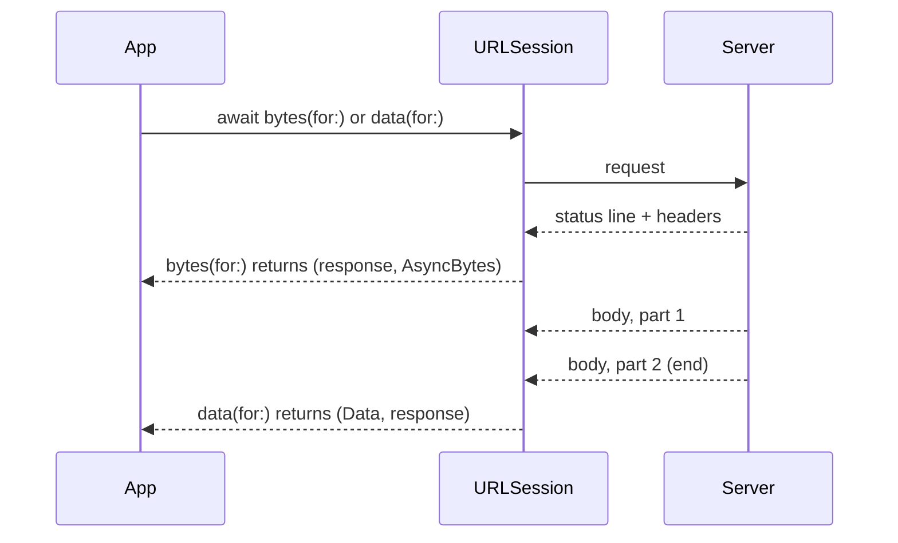
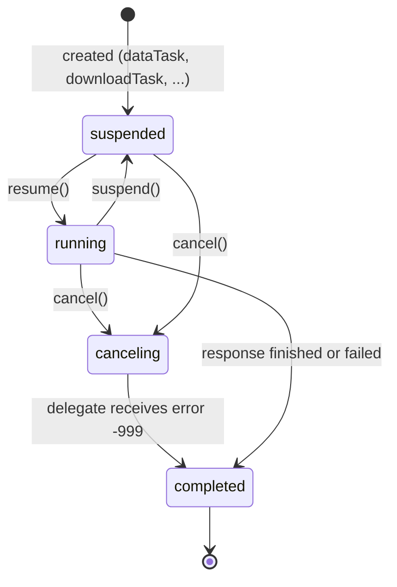

Before Swift concurrency, a network request was a callback that arrived on an unknown queue, at some point, maybe more than once if the code was wrong, and usually after a hop back to the main queue that someone forgot at least once. The `async` methods on `URLSession` replaced all of that with a function call that suspends. The surface looks simple: `let (data, response) = try await session.data(for: request)`.

The simplicity hides several decisions worth understanding. When exactly does each method return relative to what is happening on the wire? What happens to the underlying task when the calling Swift task is cancelled? Where does the code after `await` run? Where does a downloaded file live, and for how long? This article answers each question with a measurement, and then builds the small client wrapper the rest of the series uses.

<!--more-->

The examples use Swift 6 language mode and were compiled and run with the Swift 6.4 toolchain from Xcode 27.1 on macOS 26. They send requests to `LocalServer`, the loopback HTTP server from the [appendix of the first article](/swift-http-methods-status-codes-headers/#appendix-the-local-server-used-in-this-series); paste that code first, then the blocks below in order, into one `main.swift`. The [concurrency roadmap](/swift-concurrency-roadmap/) covers the language features used here in depth.

<!-- check-uses: local-server -->

## Four methods, four moments

`URLSession` has four families of `async` methods. They differ in where the response body goes, and therefore in *when* they return:

| Method | Body goes to | Returns when |
|---|---|---|
| `data(for:)` / `data(from:)` | Memory, as `Data` | The whole body has arrived |
| `upload(for:from:)` / `upload(for:fromFile:)` | Memory, as `Data` (the request body comes from the argument) | The whole response body has arrived |
| `download(for:)` / `download(from:)` | A temporary file on disk | The whole body is on disk |
| `bytes(for:)` / `bytes(from:)` | An `AsyncSequence` of bytes | The response headers have arrived (with a caveat below) |

Each returns the payload together with a `URLResponse`. For HTTP and HTTPS URLs the response is always an `HTTPURLResponse`, but the type system does not know that, so every client starts with a cast.



The server below makes these moments visible. Its `/slow-body` route waits 100 ms, sends headers and half of a six-byte body, pauses for 500 ms, and sends the rest:

```swift
import Foundation

func seconds(_ duration: Duration) -> Double {
    Double(duration.components.seconds) + Double(duration.components.attoseconds) / 1e18
}

let server = try await LocalServer.start { request in
    let firstHalf = Int(request.query["first"] ?? "3") ?? 3
    let type = request.query["type"]
    switch request.path {
    case "/slow-body":
        return HTTPResponse(status: 200,
                            headers: (type.map { [("Content-Type", $0)] } ?? []) + [("Content-Length", "\(firstHalf + 3)")],
                            body: [.bytes(Data(repeating: 65, count: firstHalf)), .pause(.milliseconds(500)),
                                   .bytes(Data("def".utf8))],
                            delay: .milliseconds(100))
    case "/hang":
        return HTTPResponse(status: 200, delay: .seconds(30))
    case "/book":
        return HTTPResponse(status: 200, body: [.bytes(Data(#"{"id":7,"title":"Dune"}"#.utf8))],
                            delay: .milliseconds(Int(request.query["delay"] ?? "0") ?? 0))
    case "/file":
        return .text(String(repeating: "x", count: 100_000))
    case "/upload":
        return .text("\(request.method) \(request.body.count) \(request.header("Content-Type") ?? "none")")
    default:
        return .text("not found", status: 404)
    }
}

func slowBody(type: String?, firstHalf: Int = 3) -> URL {
    var components = URLComponents(url: server.baseURL.appending(path: "slow-body"), resolvingAgainstBaseURL: false)!
    components.queryItems = [URLQueryItem(name: "first", value: "\(firstHalf)")] + (type.map { [URLQueryItem(name: "type", value: $0)] } ?? [])
    return components.url!
}

let dataStart = ContinuousClock.now
let (wholeBody, _) = try await URLSession.shared.data(from: slowBody(type: "application/json"))
let dataTime = seconds(ContinuousClock.now - dataStart)

let bytesStart = ContinuousClock.now
let (stream, streamResponse) = try await URLSession.shared.bytes(from: slowBody(type: "application/json"))
let headersTime = seconds(ContinuousClock.now - bytesStart)
var streamed = Data()
for try await byte in stream { streamed.append(byte) }
let streamTime = seconds(ContinuousClock.now - bytesStart)

assert(wholeBody.count == 6 && streamed == wholeBody)
assert((streamResponse as! HTTPURLResponse).statusCode == 200)
assert(dataTime > 0.55)                       // waited for the whole body
assert(headersTime < 0.3 && streamTime > 0.55) // returned at the headers, then streamed
print("data: \(dataTime) s; bytes: headers at \(headersTime) s, body at \(streamTime) s")
```

`bytes(for:)` returned about 0.11 s in, as soon as the headers arrived, while `data(for:)` returned only when the last byte did. That makes `bytes(for:)` the tool for reacting to a status code before downloading a large body, for showing progress, and for streaming formats, which [Streaming Responses and Incremental Parsing](/swift-streaming-responses/) builds on.

### The 512-byte caveat

Run the same measurement with a response that has no `Content-Type`, or one that says `text/plain`, and `bytes(for:)` no longer returns at the headers:

```swift
var delivery: [String: Double] = [:]
for (label, type, firstHalf) in [("none", nil, 3), ("text/plain", "text/plain", 3),
                                  ("text/plain, 512 bytes", "text/plain", 512),
                                  ("application/json", "application/json", 3)] as [(String, String?, Int)] {
    let start = ContinuousClock.now
    let (bytes, _) = try await URLSession.shared.bytes(from: slowBody(type: type, firstHalf: firstHalf))
    delivery[label] = seconds(ContinuousClock.now - start)
    for try await _ in bytes {}
}
print(delivery)
assert(delivery["none"]! > 0.55 && delivery["text/plain"]! > 0.55)
assert(delivery["text/plain, 512 bytes"]! < 0.3 && delivery["application/json"]! < 0.3)
```

| Response `Content-Type` | Bytes before the pause | `bytes(for:)` returned after |
|---|---|---|
| none | 3 | 0.65 s (end of body) |
| `text/plain` | 3 | 0.65 s (end of body) |
| `text/plain` | 511 | 0.61 s (end of body) |
| `text/plain` | 512 | 0.11 s |
| `text/plain` + `X-Content-Type-Options: nosniff` | 3 | 0.11 s |
| `application/json`, `application/octet-stream`, `text/event-stream`, `text/html` | 3 | 0.11 s |

The system performs **content sniffing** on responses whose declared type is missing or is the generic `text/plain`. It holds the response back until it has 512 bytes to inspect, or the body ends. In a regular request this costs nothing visible. In a streaming response, where the server sends a small event and then waits, it means the client sees nothing until 512 bytes have accumulated. The fix belongs on the server: declare a specific type, or send `X-Content-Type-Options: nosniff`. When you control only the client, knowing the threshold at least explains a stream that "starts" seconds late.

## The response is a `URLResponse`

Every client wraps the cast and the checks that follow it in one place. This version is the base the rest of the series builds on:

```swift
enum HTTPClientError: Error {
    case notHTTP(URLResponse)
}

struct HTTPClient: Sendable {
    var session: URLSession = .shared

    func send(_ request: URLRequest) async throws -> (Data, HTTPURLResponse) {
        let (data, response) = try await session.data(for: request)
        guard let http = response as? HTTPURLResponse else { throw HTTPClientError.notHTTP(response) }
        return (data, http)
    }
}

let client = HTTPClient()
let (bookData, bookResponse) = try await client.send(URLRequest(url: server.baseURL.appending(path: "book")))
assert(bookResponse.statusCode == 200 && bookData.count == 23)
```

It does not throw for a `404` or a `500`; as [the first article](/swift-http-methods-status-codes-headers/) showed, those are successful HTTP exchanges whose outcome the caller must classify. [Separating Transport Errors from Application Failures](/swift-transport-vs-application-errors/) adds that classification.

## Uploads: the body comes from the argument

The upload methods take the body as a separate argument, `Data` or a file URL, instead of `URLRequest.httpBody`. When both are present, the argument wins. As with any body, `URLSession` supplies a form-encoding `Content-Type` for a `POST` that does not declare one:

```swift
var post = URLRequest(url: server.baseURL.appending(path: "upload"))
post.httpMethod = "POST"
let (posted, _) = try await URLSession.shared.upload(for: post, from: Data("hello".utf8))
assert(String(decoding: posted, as: UTF8.self) == "POST 5 application/x-www-form-urlencoded")

var put = URLRequest(url: server.baseURL.appending(path: "upload"))
put.httpMethod = "PUT"
put.httpBody = Data("ignored".utf8)
put.setValue("application/json", forHTTPHeaderField: "Content-Type")
let (replaced, _) = try await URLSession.shared.upload(for: put, from: Data(#"{"title":"Dune"}"#.utf8))
assert(String(decoding: replaced, as: UTF8.self) == "PUT 16 application/json")
```

`upload(for:fromFile:)` streams the file from disk instead of holding it in memory, which matters for anything larger than a few megabytes. [Uploading Files and Multipart Form Data](/swift-multipart-uploads/) uses it to send multipart bodies built on disk.

## Downloads: the file is yours to move

`download(for:)` writes the body to a temporary file and returns its URL. The file is in the process's temporary directory with a `CFNetworkDownload_` prefix, and in this measurement it was still there two seconds after the call returned:

```swift
let (temporary, _) = try await URLSession.shared.download(from: server.baseURL.appending(path: "file"))
assert(temporary.lastPathComponent.hasPrefix("CFNetworkDownload_"))
try await Task.sleep(for: .seconds(2))
assert(FileManager.default.fileExists(atPath: temporary.path))
```

"Still there" is not a contract. Temporary files can be removed by the system at any time the app is not running, and on iOS when storage is low. The correct pattern is to move the file somewhere you own, immediately, in the same synchronous stretch of code that received the URL:

```swift
func downloadBook(_ url: URL, to directory: URL, session: URLSession = .shared) async throws -> URL {
    let (temporary, response) = try await session.download(from: url)
    guard let http = response as? HTTPURLResponse, http.statusCode == 200 else {
        try? FileManager.default.removeItem(at: temporary)
        throw URLError(.badServerResponse)
    }
    let destination = directory.appending(path: UUID().uuidString + ".txt")
    try FileManager.default.moveItem(at: temporary, to: destination)
    return destination
}

let library = FileManager.default.temporaryDirectory.appending(path: "library-\(UUID().uuidString)")
try FileManager.default.createDirectory(at: library, withIntermediateDirectories: true)
let saved = try await downloadBook(server.baseURL.appending(path: "file"), to: library)
assert((try? Data(contentsOf: saved))?.count == 100_000)
try FileManager.default.removeItem(at: library)
```

The status check comes first, and the temporary file is removed on failure. A download of a `404` page still produces a file, containing the error page; without the check, an app happily saves "Not Found" as a book. The delegate-based API is stricter: there, the file is deleted as soon as `urlSession(_:downloadTask:didFinishDownloadingTo:)` returns. [Download Progress, Resuming, and Temporary Files](/swift-download-progress-resume/) covers that API, progress, and resume data.

## Cancellation follows the Swift task

The async methods connect Swift task cancellation to the underlying `URLSessionTask`. Cancelling the Swift task cancels the network task, the connection is closed or returned to the pool, and the call throws. The error it throws is a `URLError` with code `.cancelled`, **not** a `CancellationError`:

```swift
let pending = Task { try await URLSession.shared.data(from: server.baseURL.appending(path: "hang")) }
try await Task.sleep(for: .milliseconds(200))
let cancelStart = ContinuousClock.now
pending.cancel()

do {
    _ = try await pending.value
    assertionFailure("the request should have been cancelled")
} catch let error as URLError {
    assert(error.code == .cancelled)  // -999
    assert(seconds(ContinuousClock.now - cancelStart) < 0.1)
} catch {
    assertionFailure("expected URLError, got \(type(of: error))")
}
```

If the Swift task is already cancelled when the method is called, no request is sent at all:

```swift
let preCancelled = Task {
    withUnsafeCurrentTask { $0?.cancel() }
    let before = server.requests.count
    let result = try? await URLSession.shared.data(from: server.baseURL.appending(path: "book"))
    return (result == nil, server.requests.count - before)
}
let (failed, sent) = await preCancelled.value
assert(failed && sent == 0)
```

Because the error type differs from the standard library's, code that wants to treat "the user navigated away" differently from "the request failed" must check both. One helper keeps that logic in one place:

```swift
extension Error {
    var isCancellation: Bool {
        if self is CancellationError { return true }
        if let url = self as? URLError, url.code == .cancelled { return true }
        return false
    }
}
```

A cancelled request is not a failure to show to the user. SwiftUI's `.task` modifier cancels its task when the view disappears, so every screen that loads data with it will see `URLError.cancelled` during normal navigation. [Timeouts, Cancellation, and Request Lifetimes](/swift-network-timeouts-cancellation/) builds deadlines and request ownership on this behavior.

## Where the code after `await` runs

The code after `await` resumes in the isolation domain of the caller. A function isolated to the main actor resumes on the main actor; there is no completion-handler queue to hop off and no `DispatchQueue.main.async` to forget:

```swift
@MainActor
final class BookViewModel {
    var title = ""

    func load() async throws {
        let (data, _) = try await client.send(URLRequest(url: server.baseURL.appending(path: "book")))
        MainActor.assertIsolated()
        title = try JSONDecoder().decode(BookDTO.self, from: data).title
    }
}

struct BookDTO: Decodable { let id: Int; let title: String }

let viewModel = BookViewModel()
try await viewModel.load()
let loadedTitle = viewModel.title
assert(loadedTitle == "Dune")
```

The waiting happens off the main actor; while the request is in flight, the main actor is free. The decoding, however, happens on it. For a 23-byte book that is irrelevant. For a multi-megabyte payload it is a dropped frame, and the fix is to decode in a function that runs on the concurrent pool, a pattern [Decoding JSON with `Codable`](/swift-decoding-json-codable/) measures.

## Running requests concurrently

Independent requests should run at the same time. With two requests whose durations are $$W_1$$ and $$W_2$$, sequential code takes $$W_1 + W_2$$ and concurrent code takes about $$\max(W_1, W_2)$$. `async let` expresses a fixed number of concurrent requests:

```swift
func book(delay: Int) -> URLRequest {
    var components = URLComponents(url: server.baseURL.appending(path: "book"), resolvingAgainstBaseURL: false)!
    components.queryItems = [URLQueryItem(name: "delay", value: "\(delay)")]
    return URLRequest(url: components.url!)
}

let sequentialStart = ContinuousClock.now
_ = try await client.send(book(delay: 300))
_ = try await client.send(book(delay: 200))
let sequential = seconds(ContinuousClock.now - sequentialStart)

let concurrentStart = ContinuousClock.now
async let first = client.send(book(delay: 300))
async let second = client.send(book(delay: 200))
let (firstResult, secondResult) = try await (first, second)
let concurrent = seconds(ContinuousClock.now - concurrentStart)

assert(firstResult.1.statusCode == 200 && secondResult.1.statusCode == 200)
assert(sequential > 0.5 && concurrent < 0.45)
print("sequential \(sequential) s, concurrent \(concurrent) s")
```

For a variable number of requests, use a task group, and bound how many run at once so a list of 500 items does not become 500 queued tasks. Each child returns its index along with its result, so the output keeps the input's order even though completions arrive in any order:

```swift
func fetchAll(_ requests: [URLRequest], limit: Int) async throws -> [Data] {
    try await withThrowingTaskGroup(of: (Int, Data).self) { group in
        var results = [Data?](repeating: nil, count: requests.count)
        var next = 0
        func startNext() {
            guard next < requests.count else { return }
            let index = next, request = requests[index]
            group.addTask { (index, try await client.send(request).0) }
            next += 1
        }
        for _ in 0..<min(limit, requests.count) { startNext() }
        while let (index, data) = try await group.next() {
            results[index] = data
            startNext()
        }
        return results.map { $0! }
    }
}

let manyStart = ContinuousClock.now
let many = try await fetchAll((0..<12).map { _ in book(delay: 100) }, limit: 4)
let manyTime = seconds(ContinuousClock.now - manyStart)
assert(many.count == 12 && manyTime > 0.29 && manyTime < 0.6)  // three waves of four
```

Twelve 100 ms requests with a limit of four take three waves, about 0.3 s, as Little's law from [Choosing a `URLSession` Configuration](/swift-urlsession-configuration/) predicts. Because `next()` rethrows the first child error, a failure cancels the remaining children through the group, and their requests are cancelled with them. The [task groups article](/swift-task-groups/) covers the alternatives when partial results are acceptable.

## Per-task delegates

Some features still need a delegate: refusing a redirect, answering an authentication challenge, collecting metrics, or observing upload progress. The async methods accept a per-task `delegate:` parameter, so you can attach one to a single request without creating a session for it. The session holds the delegate strongly until the task finishes, then releases it.

```swift
final class MetricsProbe: NSObject, URLSessionTaskDelegate, @unchecked Sendable {
    private(set) var duration: TimeInterval?

    func urlSession(_ session: URLSession, task: URLSessionTask, didFinishCollecting metrics: URLSessionTaskMetrics) {
        duration = metrics.taskInterval.duration
    }
}

let probe = MetricsProbe()
_ = try await URLSession.shared.data(for: book(delay: 50), delegate: probe)
assert(probe.duration.map { $0 >= 0.05 } == true)
```

The probe is marked `@unchecked Sendable` because the session calls it on its own delegate queue while the code above reads it afterwards. That is safe only because the read happens after the task has finished, which the `await` guarantees. A delegate that is read *while* the task runs needs a lock, as the [metrics article](/swift-urlsessiontaskmetrics/) shows.

## The task underneath

Every async call creates a `URLSessionTask`, and the older completion-handler and delegate APIs expose that task directly. Its states explain several behaviors above:



A task is created **suspended**. With the completion-handler API, forgetting `resume()` is a classic bug: nothing happens, no error is reported, and the completion handler is never called. The async methods create and resume the task for you, and cancel it when the Swift task is cancelled. They also guarantee that the continuation resumes exactly once, which hand-written bridges of the completion-handler API often got wrong, as [Continuation Ownership, Cancellation, and Double Resume](/swift-continuation-ownership/) explains.

Code that targets older APIs or needs the task object can still use the completion-handler form:

```swift
let legacy = URLSession.shared.dataTask(with: book(delay: 0)) { data, response, error in
    // Runs on the session's delegate queue, not the main thread.
}
assert(legacy.state == .suspended)
legacy.resume()
assert(legacy.state == .running)
```

## Summary

- `data`, `upload`, and `download` return when the whole body has arrived; `bytes` returns when the headers have arrived.
- Responses with no `Content-Type` or with `text/plain` are held back until 512 bytes arrive, because of content sniffing. A specific type or `X-Content-Type-Options: nosniff` avoids it.
- The response is a `URLResponse`; cast it once in a wrapper. Status codes do not throw.
- Upload methods take the body from their argument and ignore `httpBody`.
- Downloaded files live in a temporary directory; check the status and move the file immediately.
- Cancelling the Swift task cancels the request, which throws `URLError(.cancelled)`, not `CancellationError`. A task cancelled beforehand sends nothing.
- Code after `await` resumes in the caller's isolation. Waiting is off the main actor; decoding there is not.
- Use `async let` for a fixed set of concurrent requests and a bounded task group for a variable one.

## Exercise

Write `func firstAvailable(_ mirrors: [URL]) async throws -> Data` that requests the same resource from several mirrors concurrently, returns the first successful `200` body, and cancels the remaining requests. Add a `LocalServer` with one route per mirror, each delayed by a different amount, one of which returns `503`. Use the server's `requests` array and the `isCancellation` helper to assert that the losing requests were cancelled rather than completed, and measure how long the function takes compared with the fastest mirror.

## Further reading

- [Use async/await with URLSession](https://developer.apple.com/videos/play/wwdc2021/10095/), WWDC21.
- Apple's documentation for [`URLSession`](https://developer.apple.com/documentation/foundation/urlsession) and [`URLSession.AsyncBytes`](https://developer.apple.com/documentation/foundation/urlsession/asyncbytes).
- The WHATWG [MIME Sniffing Standard](https://mimesniff.spec.whatwg.org/), which describes why 512 bytes is the classic sniffing window.

Previous: [Choosing a `URLSession` Configuration](/swift-urlsession-configuration/). Next: [Separating Transport Errors from Application Failures](/swift-transport-vs-application-errors/).

Return to the [Networking roadmap](/swift-networking/).
