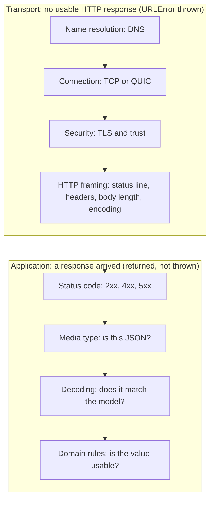
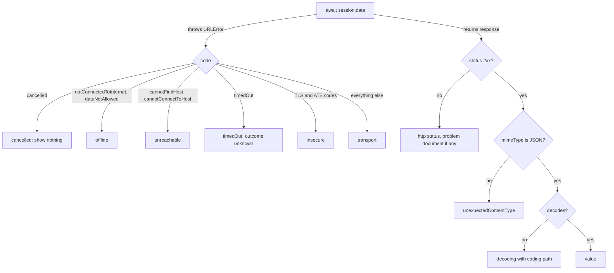

"Something went wrong. Please try again." is what an app says when its networking layer has collapsed every failure into one case. Sometimes trying again is exactly right. Sometimes the user is offline and trying again will fail the same way until they are not. Sometimes the server rejected the request because a field was invalid, and trying again will fail forever. And sometimes the request was cancelled because the user left the screen, and nothing should be shown at all.

A network request can fail at many layers, and each layer means something different to the user and to the code that decides whether to retry. This article splits failures into two families. **Transport failures** mean no usable HTTP response arrived. **Application failures** mean a response arrived and said no, or said something the client cannot use. It produces each failure for real against a local server, records the exact error it causes, and builds an error type that carries the distinctions the rest of the app needs.

<!--more-->

The examples use Swift 6 language mode and were compiled and run with the Swift 6.4 toolchain from Xcode 27.1 on macOS 26. They send requests to `LocalServer`, the loopback HTTP server from the [appendix of the first article](/swift-http-methods-status-codes-headers/#appendix-the-local-server-used-in-this-series); paste that code first, then the blocks below in order, into one `main.swift`.

<!-- check-uses: local-server -->

## A request crosses many layers

Between `try await session.data(for:)` and a value on screen, a request passes through a stack of layers, and each one can fail on its own terms:



The boundary between the families is also the boundary in the API. `URLSession` **throws** for everything in the transport family, as a `URLError`. It **returns** for everything in the application family: a `404` or a `503` is a successfully delivered HTTP response, and so is a `200` whose body is an HTML login page.

## Transport failures, measured

The server below has a route for each way an HTTP exchange can break below the application. A second server is started and then stopped, so that its port refuses connections:

```swift
import Foundation

let server = try await LocalServer.start { request in
    switch request.path {
    case "/hang":
        HTTPResponse(status: 200, delay: .seconds(30))
    case "/drop":
        .drop
    case "/truncated":
        HTTPResponse(status: 200, headers: [("Content-Length", "10")], body: [.bytes(Data("abc".utf8)), .close])
    case "/bad-chunk":
        HTTPResponse(status: 200, headers: [("Transfer-Encoding", "chunked"), ("Content-Length", "0")],
                     body: [.bytes(Data("zz\r\nhello\r\n".utf8))])
    case "/false-gzip":
        HTTPResponse(status: 200, headers: [("Content-Encoding", "gzip")], body: [.bytes(Data("plain text".utf8))])
    case "/bad-status":
        HTTPResponse(status: 1000, body: [.bytes(Data("x".utf8))])
    default:
        .text("ok")
    }
}

let gone = try await LocalServer.start { _ in .text("") }
let refusedURL = gone.baseURL
gone.stop()
try await Task.sleep(for: .milliseconds(100))

func failure(of url: URL, timeout: TimeInterval = 60) async -> URLError? {
    var request = URLRequest(url: url)
    request.timeoutInterval = timeout
    do {
        _ = try await URLSession.shared.data(for: request)
        return nil
    } catch {
        return error as? URLError
    }
}

let refused = await failure(of: refusedURL)
let unknownHost = await failure(of: URL(string: "https://library.invalid/books")!)
let timedOut = await failure(of: server.baseURL.appending(path: "hang"), timeout: 1)
let dropped = await failure(of: server.baseURL.appending(path: "drop"))
let truncated = await failure(of: server.baseURL.appending(path: "truncated"))
let badChunk = await failure(of: server.baseURL.appending(path: "bad-chunk"))
let falseGzip = await failure(of: server.baseURL.appending(path: "false-gzip"))
let badStatus = await failure(of: server.baseURL.appending(path: "bad-status"), timeout: 1)
let unsupported = await failure(of: URL(string: "mailto:books@example.com")!)

assert(refused?.code == .cannotConnectToHost)        // -1004
assert(unknownHost?.code == .cannotFindHost)         // -1003
assert(timedOut?.code == .timedOut)                  // -1001
assert(dropped?.code == .networkConnectionLost)      // -1005
assert(truncated?.code == .networkConnectionLost)    // -1005
assert(badChunk?.code == .cannotParseResponse)       // -1017
assert(falseGzip?.code == .cannotDecodeRawData)  // -1015
assert(badStatus?.code == .timedOut)                 // -1001, see below
assert(unsupported?.code == .unsupportedURL)         // -1002
```

| Cause | `URLError.Code` | Time to fail (measured) |
|---|---|---|
| Nothing listening on the port | `cannotConnectToHost` (-1004) | 28 ms |
| DNS name does not exist | `cannotFindHost` (-1003) | 108 ms |
| Server accepts, never answers | `timedOut` (-1001) | the request timeout |
| Connection closed before a response | `networkConnectionLost` (-1005) | 6 ms (after 3 attempts for `GET`) |
| Body shorter than `Content-Length` | `networkConnectionLost` (-1005) | 1 ms |
| Invalid chunk size | `cannotParseResponse` (-1017) | 6 ms |
| `Content-Encoding: gzip` on plain text | `cannotDecodeRawData` (-1015) | 1 ms |
| Four-digit status code | `timedOut` (-1001) | the request timeout |
| Scheme `URLSession` does not handle | `unsupportedURL` (-1002) | under 1 ms |

Two rows deserve a comment. A malformed status line does not produce a parse error: the response is never recognized as complete, so the task waits until its timeout, 60 seconds by default. And not every protocol violation fails. A `Content-Length` of `abc` was accepted, and the client received a `200` with an empty body. The transport layer is lenient in places, which is one reason the application layer has to check what it received.

Other codes you will see in production but cannot easily produce on a development machine: `notConnectedToInternet` (-1009) when no interface is up, `dataNotAllowed` (-1020) when cellular data is off for the app, `internationalRoamingOff` (-1018), `secureConnectionFailed` (-1200) and the `serverCertificate…` family (-1201 to -1206) for TLS failures, which [App Transport Security and TLS Trust](/swift-ats-tls-trust/) produces for real, and `appTransportSecurityRequiresSecureConnection` (-1022) when ATS blocks plain HTTP.

### What a `URLError` carries

A `URLError` is more than its code. It records the URL that failed, an underlying CFNetwork error, and for socket-level failures the stream error domain and code, which for the refused connection is POSIX error 61, `ECONNREFUSED`:

```swift
let detail = refused!
assert(detail.failingURL?.port == refusedURL.port)  // the URL as sent: "http://127.0.0.1:port/"
assert((detail.userInfo[NSUnderlyingErrorKey] as? NSError)?.domain == "kCFErrorDomainCFNetwork")
assert(detail.userInfo["_kCFStreamErrorDomainKey"] as? Int == 1)  // 1 is the POSIX domain
assert(detail.userInfo["_kCFStreamErrorCodeKey"] as? Int == 61)   // ECONNREFUSED
assert(detail.networkUnavailableReason == nil)
```

The underscored keys are not public API and are for logs, not logic. `networkUnavailableReason` is public: when a request fails because the session forbids cellular, expensive, or constrained networks, it is `.cellular`, `.expensive`, or `.constrained`, which is how the UI can say "Downloads are paused in Low Data Mode" instead of "No connection."

## Application failures arrive as responses

When a response arrives, the transport worked. What remains is deciding whether the response is something the caller can use, and if not, why not. There are three distinct ways it can fail:

1. **The status says no.** A `4xx` means the request was wrong for the server's current state; a `5xx` means the server failed to handle a valid request.
2. **The body is not what was asked for.** The media type is wrong (an HTML error page from a proxy), or the body does not decode into the expected model.
3. **The value is unusable.** It decoded, but violates a rule the app depends on. [Validating Decoded Data Before It Reaches the UI](/swift-validating-decoded-data/) covers this layer.

Servers that follow [RFC 9457](https://www.rfc-editor.org/rfc/rfc9457), *Problem Details for HTTP APIs*, describe the first kind in a standard JSON shape with the media type `application/problem+json`. The `type` is a URI that identifies the problem class, `title` is a short human-readable summary of it, `status` repeats the HTTP status, `detail` explains this occurrence, and any further members are problem-specific extensions:

```text
HTTP/1.1 403 Forbidden
Content-Type: application/problem+json

{
  "type": "https://library.example/problems/loan-limit",
  "title": "Loan limit reached",
  "status": 403,
  "detail": "You have 5 books on loan; the limit is 5.",
  "limit": 5
}
```

Decoding the standard members and keeping the extensions as raw JSON costs a few lines, and it gives the app a stable, machine-readable `type` to branch on instead of matching English strings:

```swift
struct Problem: Decodable, Equatable, Sendable {
    var type: URL
    var title: String?
    var status: Int?
    var detail: String?
    var extensions: [String: String] = [:]

    private struct Key: CodingKey {
        var stringValue: String
        var intValue: Int? { nil }
        init(stringValue: String) { self.stringValue = stringValue }
        init?(intValue: Int) { nil }
    }

    init(from decoder: any Decoder) throws {
        let container = try decoder.container(keyedBy: Key.self)
        // RFC 9457: a missing "type" means "about:blank".
        type = try container.decodeIfPresent(URL.self, forKey: Key(stringValue: "type")) ?? URL(string: "about:blank")!
        title = try container.decodeIfPresent(String.self, forKey: Key(stringValue: "title"))
        status = try container.decodeIfPresent(Int.self, forKey: Key(stringValue: "status"))
        detail = try container.decodeIfPresent(String.self, forKey: Key(stringValue: "detail"))
        for key in container.allKeys where !["type", "title", "status", "detail", "instance"].contains(key.stringValue) {
            if let text = try? container.decode(String.self, forKey: key) {
                extensions[key.stringValue] = text
            } else if let number = try? container.decode(Int.self, forKey: key) {
                extensions[key.stringValue] = String(number)
            }
        }
    }
}
```

Many APIs do not use RFC 9457, and some still use a proprietary error envelope. The pattern is the same: decode the error body when the status says failure and the media type matches, and keep it as optional detail rather than assuming it exists. A `502` from a load balancer will not have your API's error format, however carefully the API defines it.

## One error type with the distinctions that matter

The consumers of a networking error need answers to three questions: should anything be shown, can retrying help, and what should the user be told. The error type below is shaped around those questions rather than around the API that produced the failure:

```swift
enum APIError: Error, Sendable {
    // Transport family: no usable HTTP response
    case cancelled
    case offline(URLError)
    case unreachable(URLError)
    case timedOut(URLError)
    case insecure(URLError)
    case transport(URLError)
    // Application family: a response arrived
    case http(status: Int, problem: Problem?)
    case unexpectedContentType(String?)
    case decoding(DecodingError)

    init(_ error: URLError) {
        switch error.code {
        case .cancelled:
            self = .cancelled
        case .notConnectedToInternet, .dataNotAllowed, .internationalRoamingOff, .callIsActive:
            self = .offline(error)
        case .cannotFindHost, .cannotConnectToHost, .dnsLookupFailed:
            self = .unreachable(error)
        case .timedOut:
            self = .timedOut(error)
        case .secureConnectionFailed, .serverCertificateHasBadDate, .serverCertificateUntrusted,
             .serverCertificateHasUnknownRoot, .serverCertificateNotYetValid,
             .clientCertificateRejected, .clientCertificateRequired,
             .appTransportSecurityRequiresSecureConnection:
            self = .insecure(error)
        default:
            self = .transport(error)
        }
    }
}
```

`networkConnectionLost` deliberately falls into the generic `transport` case rather than `offline`. A lost connection means one connection died, which happens constantly on mobile networks as a device moves between cells or from Wi-Fi to cellular. It does not mean the device is offline, and treating it that way shows a misleading message.

The client wraps `data(for:)` and turns every outcome into either a decoded value or an `APIError`. The checks run in the order of the layers:

```swift
struct APIClient: Sendable {
    var session: URLSession = .shared
    var decoder = JSONDecoder()

    func send<Value: Decodable>(_ request: URLRequest, as type: Value.Type = Value.self) async throws(APIError) -> Value {
        let data: Data
        let response: URLResponse
        do {
            (data, response) = try await session.data(for: request)
        } catch let error as URLError {
            throw APIError(error)
        } catch is CancellationError {
            throw .cancelled
        } catch {
            throw .transport(URLError(.unknown, userInfo: [NSUnderlyingErrorKey: error]))
        }
        guard let http = response as? HTTPURLResponse else { throw .unexpectedContentType(response.mimeType) }

        guard (200..<300).contains(http.statusCode) else {
            let problem = http.mimeType == "application/problem+json"
                ? try? JSONDecoder().decode(Problem.self, from: data) : nil
            throw .http(status: http.statusCode, problem: problem)
        }
        guard http.mimeType == "application/json" else { throw .unexpectedContentType(http.mimeType) }
        do {
            return try decoder.decode(Value.self, from: data)
        } catch let error as DecodingError {
            throw .decoding(error)
        } catch {
            throw .decoding(.dataCorrupted(.init(codingPath: [], debugDescription: "\(error)")))
        }
    }
}
```

Typed throws, `throws(APIError)`, means callers receive an `APIError` in their `catch` without a cast, and the compiler checks that the function cannot leak any other error type. That is valuable at this one boundary, where the whole point is to translate everything into one vocabulary. Inside the app, plain `throws` is usually still the better default.

## Each failure, classified

A second server returns one application failure per route, so the client's classification can be checked end to end, together with the transport cases from before:

```swift
struct Book: Decodable, Equatable { let id: Int; let title: String }

let api = try await LocalServer.start { request in
    switch request.path {
    case "/books/7":
        .json(#"{"id":7,"title":"Dune"}"#)
    case "/books/8":
        .json(#"{"id":"eight","title":"Emma"}"#)
    case "/portal":
        HTTPResponse(status: 200, headers: [("Content-Type", "text/html")], body: [.bytes(Data("<html>".utf8))])
    case "/loans":
        HTTPResponse(status: 403, headers: [("Content-Type", "application/problem+json")],
                     body: [.bytes(Data(#"""
                     {"type":"https://library.example/problems/loan-limit","title":"Loan limit reached",
                      "status":403,"detail":"You have 5 books on loan; the limit is 5.","limit":5}
                     """#.utf8))])
    case "/gateway":
        HTTPResponse(status: 502, headers: [("Content-Type", "text/html")], body: [.bytes(Data("<h1>Bad Gateway</h1>".utf8))])
    default:
        .text("not found", status: 404)
    }
}

let client = APIClient()
func outcome(_ url: URL, timeout: TimeInterval = 5) async -> Result<Book, APIError> {
    var request = URLRequest(url: url)
    request.timeoutInterval = timeout
    do throws(APIError) {
        return .success(try await client.send(request, as: Book.self))
    } catch {
        return .failure(error)
    }
}

let found = await outcome(api.baseURL.appending(path: "books/7"))
assert((try? found.get()) == Book(id: 7, title: "Dune"))

guard case .failure(.decoding(.typeMismatch(_, let context))) = await outcome(api.baseURL.appending(path: "books/8")) else {
    fatalError("expected a type mismatch")
}
assert(context.codingPath.map(\.stringValue) == ["id"])

guard case .failure(.unexpectedContentType("text/html")) = await outcome(api.baseURL.appending(path: "portal")) else {
    fatalError("expected the portal page to be rejected")
}

guard case .failure(.http(403, let problem?)) = await outcome(api.baseURL.appending(path: "loans")) else {
    fatalError("expected a problem document")
}
assert(problem.type.absoluteString == "https://library.example/problems/loan-limit")
assert(problem.extensions["limit"] == "5")

guard case .failure(.http(502, nil)) = await outcome(api.baseURL.appending(path: "gateway")) else {
    fatalError("a gateway page has no problem document")
}
guard case .failure(.http(404, nil)) = await outcome(api.baseURL.appending(path: "books/999")) else {
    fatalError("expected 404")
}
guard case .failure(.unreachable) = await outcome(refusedURL) else { fatalError("expected unreachable") }
guard case .failure(.timedOut) = await outcome(server.baseURL.appending(path: "hang"), timeout: 1) else {
    fatalError("expected a timeout")
}
guard case .failure(.transport(let lost)) = await outcome(server.baseURL.appending(path: "drop")),
      lost.code == .networkConnectionLost else { fatalError("expected a lost connection") }
```

The decoding failure keeps the `DecodingError` and its coding path, `["id"]`. That one detail turns a support ticket that says "the app shows an error on some books" into a log line that says "`id` was a string in the response for book 8." The [Codable article](/swift-decoding-json-codable/) has more on reading decoding errors.

## Turning the type into decisions

With the distinctions in place, the decisions become properties. **Retryable** means retrying the same request, after a delay, might succeed:

```swift
extension APIError {
    var isRetryable: Bool {
        switch self {
        case .cancelled, .insecure, .decoding, .unexpectedContentType:
            false
        case .offline, .unreachable, .timedOut, .transport:
            true
        case .http(let status, _):
            status == 408 || status == 429 || status == 502 || status == 503 || status == 504
        }
    }

    /// Whether the server might have acted on a request whose response was lost.
    var outcomeIsUnknown: Bool {
        switch self {
        case .timedOut: true
        case .transport(let error): error.code == .networkConnectionLost
        default: false
        }
    }
}

assert(APIError.http(status: 503, problem: nil).isRetryable)
assert(!APIError.http(status: 400, problem: nil).isRetryable)
assert(!APIError.http(status: 500, problem: nil).isRetryable)
assert(APIError(URLError(.networkConnectionLost)).outcomeIsUnknown)
assert(!APIError(URLError(.cannotConnectToHost)).outcomeIsUnknown)
```

A `500` is not on the retryable list. It usually means a bug in the server's handling of this request, and the same request is likely to hit the same bug. `502`, `503`, and `504` describe a gateway or a service that is temporarily unavailable, which is the case retries exist for. The [retry article](/swift-retry-backoff-idempotency/) combines `isRetryable` with backoff and the request's idempotency.

`outcomeIsUnknown` captures the most dangerous ambiguity in client networking. When a `POST` times out or loses its connection *after* the request was sent, the client cannot know whether the server processed it. "Payment failed" is then a lie as often as it is the truth. The honest UI says "We couldn't confirm your payment" and checks the order's status before offering to pay again. A refused connection, by contrast, means the request never reached the server, so it is safe to say that nothing happened.

**Presentation** is the second decision. Each case maps to one of a small number of things the UI can do:

| Case | Show the user | Offer |
|---|---|---|
| `cancelled` | Nothing | Nothing |
| `offline` | "You're offline" (with `networkUnavailableReason` when present) | Retry when connectivity returns |
| `unreachable`, `timedOut`, `transport` | "Couldn't reach the library" | Retry |
| `insecure` | "A secure connection couldn't be established" | Nothing; never offer to bypass |
| `http(401, _)` | Nothing yet; [refresh credentials](/swift-token-refresh/) first | Sign in, if refresh fails |
| `http(4xx, problem)` | The problem's `title` or a message for its `type` | Fix the input |
| `http(5xx, _)` | "The library is having trouble" | Retry later |
| `unexpectedContentType`, `decoding` | "Something went wrong on our side" | Report; log details |

The last row is the one teams most often get wrong in the other direction: a decoding failure is a contract violation between client and server, not a user error and not a network problem. It belongs in your error reporting with the coding path, and it is a reason to read [Verifying Contracts Against a Controlled Server](/swift-contract-testing-controlled-server/).



## A note on `200` with an error inside

Some APIs report failures inside a successful response: `200 OK` with `{"success": false, "error": "LOAN_LIMIT"}`. GraphQL does this by design, returning `200` with an `errors` array for many failures. The client cannot use HTTP status to classify these, so the decoding layer has to. Model the envelope explicitly, decode it before the payload, and translate its error into the same `APIError.http`-like case the rest of the app understands. Do not let it reach the UI as a successful response with missing fields. For APIs you design, return the status that describes the outcome: caches, proxies, retry logic, and monitoring all rely on it.

## Summary

- Transport failures mean no usable HTTP response arrived; `URLSession` throws them as `URLError`. Application failures arrive as responses and must be detected by the client.
- Measured on macOS 26: a refused port is `cannotConnectToHost` (-1004) in about 30 ms, an unknown host `cannotFindHost` (-1003), a dropped or truncated response `networkConnectionLost` (-1005), a bad chunk `cannotParseResponse` (-1017), a false `Content-Encoding` `cannotDecodeRawData` (-1015). A malformed status line hangs until the timeout.
- RFC 9457 problem details give `4xx` and `5xx` responses a machine-readable `type`; decode them when present and never assume they are.
- Classify into a small set of cases shaped by what consumers decide: show or not, retry or not, and what to say.
- `networkConnectionLost` is not "offline". A timeout or lost connection after a `POST` leaves the outcome unknown, and the UI must say so.
- A `500` usually is not worth retrying; `502`, `503`, `504`, `408`, and `429` usually are.

## Exercise

Add an `.offline` reproduction to the tests: create a session with `allowsConstrainedNetworkAccess = false` and `allowsExpensiveNetworkAccess = false` and run it on a device in Low Data Mode, or, on a Mac, read the `URLError` you get with Wi-Fi turned off. Record `networkUnavailableReason` for each case. Then write a `userMessage` property on `APIError` that uses `Problem.type` for known problem types, falls back to `Problem.title`, and never shows `detail` without escaping, since it is server-controlled text. Add assertions for every row of the presentation table.

## Further reading

- [RFC 9457: Problem Details for HTTP APIs](https://www.rfc-editor.org/rfc/rfc9457).
- Apple's [URLError.Code](https://developer.apple.com/documentation/foundation/urlerror/code) reference.
- [Handling an Authentication Challenge](https://developer.apple.com/documentation/foundation/handling-an-authentication-challenge) for where TLS and credential failures originate.

Previous: [Requests and Responses with `async` and `await`](/swift-urlsession-async-await/). Next: [Building Typed Endpoints and Request Bodies](/swift-typed-endpoints/).

Return to the [Networking roadmap](/swift-networking/).
