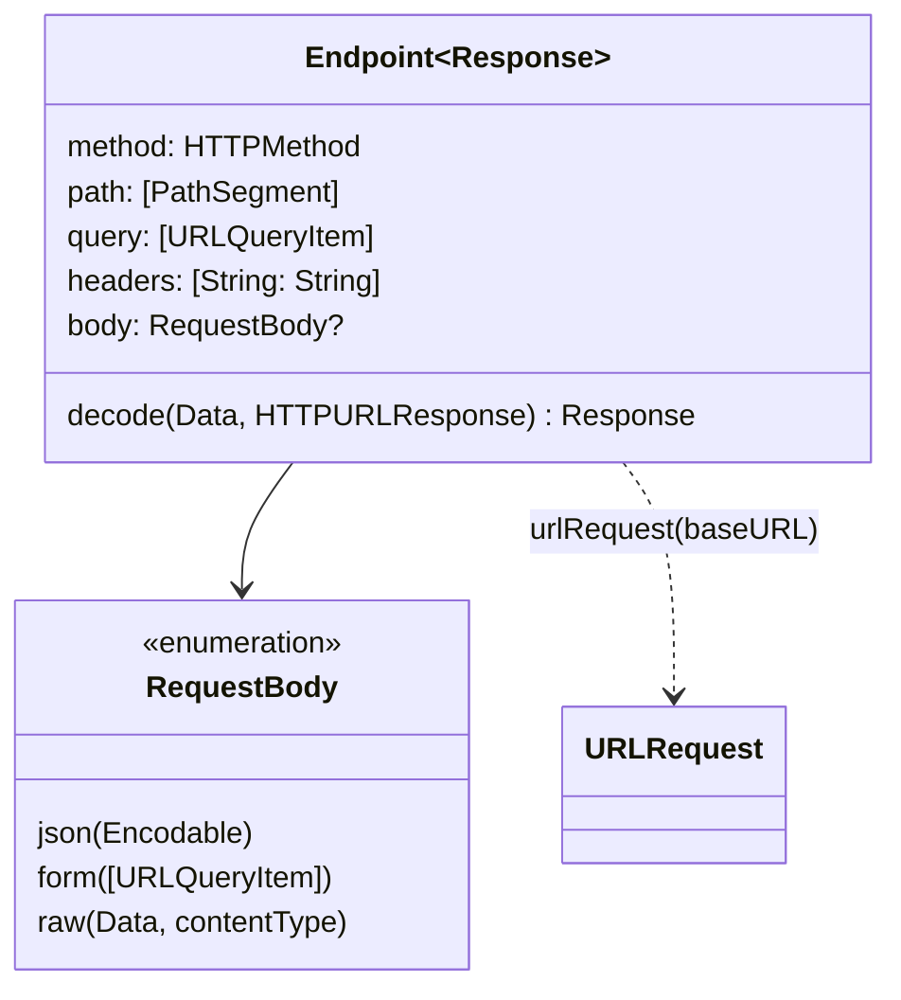

A networking layer built from `URLRequest` values scattered across view models has the same bug in twenty places. One call site forgets `Content-Type`, another builds its path with string interpolation, a third decodes the response into the wrong model because it copied the wrong line. None of these are hard problems. They are repeated problems, and the fix for a repeated problem is to describe each endpoint once, as a value, and let one piece of code turn every description into a request.

This article builds that description: a generic `Endpoint<Response>` type that ties a method, a path, a query, a body, and the expected response type together, so that the compiler checks what string-based code leaves to code review. It covers request bodies in detail, including the subtle difference between a missing field and a `null` one that every `PATCH` endpoint depends on.

<!--more-->

The examples use Swift 6 language mode and were compiled and run with the Swift 6.4 toolchain from Xcode 27.1 on macOS 26. They send requests to `LocalServer`, the loopback HTTP server from the [appendix of the first article](/swift-http-methods-status-codes-headers/#appendix-the-local-server-used-in-this-series); paste that code first, then the blocks below in order, into one `main.swift`.

<!-- check-uses: local-server -->

## What an endpoint is

From the client's point of view, an endpoint is a function from some inputs to a typed result, implemented by an HTTP exchange. Everything needed to perform that exchange is data:



The `Response` type parameter is a **phantom** in the request-building half: no stored property of the request depends on it. It exists so that `client.send(.book(id))` has the type `Book` and `client.send(.loans)` has the type `[Loan]`, without a cast, and without the possibility of decoding one into the other.

## Methods, segments, and IDs

Start with the vocabulary. `HTTPMethod` is a struct with static members rather than an enum, so an API with an unusual method can still be described, and it records whether the method has defined body semantics:

```swift
import Foundation

struct HTTPMethod: Hashable, Sendable {
    let rawValue: String
    let allowsBody: Bool

    static let get = HTTPMethod(rawValue: "GET", allowsBody: false)
    static let head = HTTPMethod(rawValue: "HEAD", allowsBody: false)
    static let delete = HTTPMethod(rawValue: "DELETE", allowsBody: false)
    static let post = HTTPMethod(rawValue: "POST", allowsBody: true)
    static let put = HTTPMethod(rawValue: "PUT", allowsBody: true)
    static let patch = HTTPMethod(rawValue: "PATCH", allowsBody: true)
}

enum PathSegment: Sendable, ExpressibleByStringLiteral {
    case literal(String)  // part of the route, written in code
    case value(String)    // data: encoded as exactly one segment

    init(stringLiteral value: String) { self = .literal(value) }
}
```

`PathSegment` comes from [URLs, Query Parameters, and Percent Encoding](/swift-urls-query-percent-encoding/), where it kept route templates and data apart. Conforming to `ExpressibleByStringLiteral` means routes read naturally: `["books", .value(id)]`.

Identifiers deserve their own type. When every ID is a `String` or an `Int`, nothing stops a call site from passing an author's ID where a book's ID was expected, and the server answers with a `404` or, worse, a different book. A generic `ID` type tagged with the entity it identifies makes that a compile error:

```swift
struct ID<Entity>: Hashable, Sendable, Codable, CustomStringConvertible {
    let rawValue: String
    init(_ rawValue: String) { self.rawValue = rawValue }

    init(from decoder: any Decoder) throws {
        rawValue = try decoder.singleValueContainer().decode(String.self)
    }
    func encode(to encoder: any Encoder) throws {
        var container = encoder.singleValueContainer()
        try container.encode(rawValue)
    }
    var description: String { rawValue }
}

struct Book: Codable, Equatable, Sendable {
    let id: ID<Book>
    var title: String
    var subtitle: String?
}

struct Author: Codable, Sendable {
    let id: ID<Author>
    var name: String
}
```

`ID<Book>` and `ID<Author>` are different types, though both wrap a string and both encode to a plain JSON string. Passing the wrong one is rejected:

```swift
// Does not compile: the identifier types differ.
func book(_ id: ID<Book>) {}
let author = Author(id: ID("a-1"), name: "Frank Herbert")
book(author.id)
// error: cannot convert value of type 'ID<Author>' to expected argument type 'ID<Book>'
```

Storing the raw value as a `String` even for APIs that use numeric IDs is deliberate. Numeric IDs above $$2^{53}$$ lose precision in JavaScript-based servers and tools, which is why many APIs send them as strings; [Decoding JSON with `Codable`](/swift-decoding-json-codable/) shows what happens to them in Swift.

## Request bodies

A body is bytes plus a `Content-Type` that tells the server how to read them. Keeping the two together in one type makes it impossible to set one and forget the other, which [the first article](/swift-http-methods-status-codes-headers/) showed `URLSession` would otherwise fill in as `application/x-www-form-urlencoded`:

```swift
enum RequestBody: Sendable {
    case json(any Encodable & Sendable)
    case form([URLQueryItem])
    case raw(Data, contentType: String)

    func encoded(with encoder: JSONEncoder) throws -> (data: Data, contentType: String) {
        switch self {
        case .json(let value):
            return (try encoder.encode(value), "application/json")
        case .form(let items):
            let pairs = items.map { item in
                let name = item.name.addingPercentEncoding(withAllowedCharacters: .urlUnreserved)!
                let value = (item.value ?? "").addingPercentEncoding(withAllowedCharacters: .urlUnreserved)!
                return "\(name)=\(value)"
            }
            return (Data(pairs.joined(separator: "&").utf8), "application/x-www-form-urlencoded")
        case .raw(let data, let contentType):
            return (data, contentType)
        }
    }
}

extension CharacterSet {
    /// RFC 3986 unreserved characters: the only ones that never need encoding.
    static let urlUnreserved = CharacterSet(charactersIn:
        "ABCDEFGHIJKLMNOPQRSTUVWXYZabcdefghijklmnopqrstuvwxyz0123456789-._~")
}
```

The form encoder uses the same strict character set as the query builder in the URL article, for the same reason: in a form body, `+` means a space, so a literal plus sign must be sent as `%2B`. OAuth token requests are the place most apps meet form bodies, so getting this wrong typically shows up as "invalid_client" for users whose client secret, or password, contains a `+`.

### Deterministic JSON

`JSONEncoder` does not promise any particular key order. Two encodings of the same value can differ byte for byte, which breaks request signing schemes that hash the body, golden-file tests, and HTTP caches keyed on the body. `.sortedKeys` makes output deterministic at a negligible cost:

```swift
func makeEncoder() -> JSONEncoder {
    let encoder = JSONEncoder()
    encoder.outputFormatting = [.sortedKeys, .withoutEscapingSlashes]
    encoder.dateEncodingStrategy = .iso8601
    return encoder
}

let encoder = makeEncoder()
let dune = Book(id: ID("b-7"), title: "Dune", subtitle: nil)
let encodedBook = String(decoding: try encoder.encode(dune), as: UTF8.self)
assert(encodedBook == #"{"id":"b-7","title":"Dune"}"#)
```

`.withoutEscapingSlashes` stops the encoder from writing `/` as `\/`, which is legal JSON but makes URLs in bodies harder to read in logs. Note also what the output does *not* contain: `subtitle` is `nil`, and the synthesized `Encodable` conformance omits it.

### Absent is not `null`

For `POST` and `PUT`, omitting `nil` properties is usually fine. For `PATCH` it is a bug waiting to happen. A partial update needs three states per field, and an optional has only two:

| Intent | JSON Merge Patch ([RFC 7396](https://www.rfc-editor.org/rfc/rfc7396)) | Synthesized `Encodable` with `String?` |
|---|---|---|
| Leave the subtitle unchanged | field absent | `nil` → absent |
| Remove the subtitle | `"subtitle": null` | not expressible |
| Set the subtitle | `"subtitle": "Book One"` | `"Book One"` |

A small enum supplies the missing state. Its encoding depends on its container: `.unchanged` must not produce a key at all, which only the enclosing type can arrange, so the patch type writes its own `encode(to:)`:

```swift
enum PatchField<Value: Encodable & Sendable>: Sendable {
    case unchanged
    case set(Value)
    case clear
}

extension KeyedEncodingContainer {
    mutating func encode<Value>(_ field: PatchField<Value>, forKey key: Key) throws {
        switch field {
        case .unchanged: break
        case .set(let value): try encode(value, forKey: key)
        case .clear: try encodeNil(forKey: key)
        }
    }
}

struct BookPatch: Encodable, Sendable {
    var title: PatchField<String> = .unchanged
    var subtitle: PatchField<String> = .unchanged

    enum CodingKeys: String, CodingKey { case title, subtitle }

    func encode(to encoder: any Encoder) throws {
        var container = encoder.container(keyedBy: CodingKeys.self)
        try container.encode(title, forKey: .title)
        try container.encode(subtitle, forKey: .subtitle)
    }
}

func json(_ value: some Encodable) throws -> String {
    String(decoding: try encoder.encode(value), as: UTF8.self)
}

assert((try? json(BookPatch(title: .set("Dune Messiah")))) == #"{"title":"Dune Messiah"}"#)
assert((try? json(BookPatch(subtitle: .clear))) == #"{"subtitle":null}"#)
assert((try? json(BookPatch())) == "{}")
```

The empty patch encodes to `{}`, which a merge-patch server treats as "change nothing." A model that used `String?` for the patch would have had to choose between never clearing a field and clearing every field the user did not touch.

## The endpoint type

With the parts in place, the endpoint itself is a plain value. The decode step is stored as a closure, so endpoints can describe a JSON payload, an empty `204`, or raw bytes:

```swift
struct Endpoint<Response: Sendable>: Sendable {
    var method: HTTPMethod
    var path: [PathSegment]
    var query: [URLQueryItem] = []
    var headers: [String: String] = [:]
    var body: RequestBody? = nil
    var decode: @Sendable (Data, HTTPURLResponse) throws -> Response
}

struct Empty: Sendable, Equatable {}

extension Endpoint where Response: Decodable {
    init(_ method: HTTPMethod, _ path: [PathSegment], query: [URLQueryItem] = [], body: RequestBody? = nil) {
        self.init(method: method, path: path, query: query, body: body,
                  decode: { data, _ in try JSONDecoder().decode(Response.self, from: data) })
    }
}

extension Endpoint where Response == Empty {
    init(_ method: HTTPMethod, _ path: [PathSegment], body: RequestBody? = nil) {
        self.init(method: method, path: path, body: body, decode: { _, _ in Empty() })
    }
}
```

Turning an endpoint into a `URLRequest` is the one place that knows the rules: values are encoded as single segments, dot segments are rejected, the query is strictly encoded and sorted, and a body is refused for methods that do not allow one. That last check catches at the source the `GET`-with-body error that `URLSession` reports as an opaque `-1103`:

```swift
enum EndpointError: Error, Equatable {
    case invalidSegment(String)
    case bodyNotAllowed(String)
}

extension Endpoint {
    func urlRequest(baseURL: URL, encoder: JSONEncoder = makeEncoder()) throws -> URLRequest {
        var url = baseURL
        for segment in path {
            switch segment {
            case .literal(let route):
                url.append(path: route)
            case .value(let value):
                guard !value.isEmpty, value != ".", value != ".." else { throw EndpointError.invalidSegment(value) }
                url.append(component: value, directoryHint: .notDirectory)
            }
        }
        if !query.isEmpty {
            var components = URLComponents(url: url, resolvingAgainstBaseURL: false)!
            components.percentEncodedQueryItems = query.sorted { $0.name < $1.name }.map { item in
                URLQueryItem(name: item.name.addingPercentEncoding(withAllowedCharacters: .urlUnreserved)!,
                             value: item.value?.addingPercentEncoding(withAllowedCharacters: .urlUnreserved))
            }
            url = components.url!
        }

        var request = URLRequest(url: url)
        request.httpMethod = method.rawValue
        request.setValue("application/json", forHTTPHeaderField: "Accept")
        if let body {
            guard method.allowsBody else { throw EndpointError.bodyNotAllowed(method.rawValue) }
            let (data, contentType) = try body.encoded(with: encoder)
            request.httpBody = data
            request.setValue(contentType, forHTTPHeaderField: "Content-Type")
        }
        for (name, value) in headers { request.setValue(value, forHTTPHeaderField: name) }
        return request
    }
}
```

Headers are applied last, so an endpoint can override `Accept` or `Content-Type` when it needs to, for example to send `application/merge-patch+json`, the registered media type for RFC 7396 patches.

## Describing an API

Endpoints are defined once, as static functions constrained to their response type. The definitions read like an API reference, and each one is a few lines:

```swift
struct Loan: Codable, Equatable, Sendable {
    let book: ID<Book>
    let due: Date
}

struct NewBook: Encodable, Sendable {
    var title: String
    var authorID: ID<Author>
}

extension Endpoint where Response == Book {
    static func book(_ id: ID<Book>) -> Self { Self(.get, ["books", .value(id.rawValue)]) }

    static func createBook(_ book: NewBook) -> Self { Self(.post, ["books"], body: .json(book)) }

    static func updateBook(_ id: ID<Book>, _ patch: BookPatch) -> Self {
        var endpoint = Self(.patch, ["books", .value(id.rawValue)], body: .json(patch))
        endpoint.headers["Content-Type"] = "application/merge-patch+json"
        return endpoint
    }
}

extension Endpoint where Response == [Book] {
    static func search(_ text: String, limit: Int = 20) -> Self {
        Self(.get, ["books"], query: [URLQueryItem(name: "q", value: text), URLQueryItem(name: "limit", value: "\(limit)")])
    }
}

extension Endpoint where Response == Empty {
    static func returnBook(_ id: ID<Book>) -> Self { Self(.delete, ["me", "loans", .value(id.rawValue)]) }
}
```

Because the endpoints are values, most of their behavior can be tested without any network at all:

```swift
let base = URL(string: "https://api.library.example/v2")!

let search = try Endpoint.search("c++ & rust").urlRequest(baseURL: base)
assert(search.url?.absoluteString == "https://api.library.example/v2/books?limit=20&q=c%2B%2B%20%26%20rust")
assert(search.httpMethod == "GET" && search.httpBody == nil)

let patch = try Endpoint.updateBook(ID("b/7"), BookPatch(subtitle: .clear)).urlRequest(baseURL: base)
assert(patch.url?.path(percentEncoded: true) == "/v2/books/b%2F7")
assert(patch.httpMethod == "PATCH")
assert(patch.value(forHTTPHeaderField: "Content-Type") == "application/merge-patch+json")
assert(patch.httpBody == Data(#"{"subtitle":null}"#.utf8))

do {
    _ = try Endpoint<Book>(.get, ["books"], body: .json(NewBook(title: "x", authorID: ID("a")))).urlRequest(baseURL: base)
    assertionFailure("a GET with a body must be rejected")
} catch {
    assert(error as? EndpointError == .bodyNotAllowed("GET"))
}

do {
    _ = try Endpoint.book(ID("..")).urlRequest(baseURL: base)
    assertionFailure("dot segments must be rejected")
} catch {
    assert(error as? EndpointError == .invalidSegment(".."))
}
```

These tests run in microseconds and pin down the exact bytes each endpoint produces. They do not prove that the server agrees with those bytes; [Verifying Contracts Against a Controlled Server](/swift-contract-testing-controlled-server/) closes that gap.

## Sending endpoints

The client is now generic over the endpoint, and its result type comes from the endpoint. It reuses the status and media-type checks from [Separating Transport Errors from Application Failures](/swift-transport-vs-application-errors/), simplified here to keep the focus on the endpoint:

```swift
struct StatusError: Error { let status: Int }

struct LibraryClient: Sendable {
    var baseURL: URL
    var session: URLSession = .shared

    func send<Response>(_ endpoint: Endpoint<Response>) async throws -> Response {
        let request = try endpoint.urlRequest(baseURL: baseURL)
        let (data, response) = try await session.data(for: request)
        guard let http = response as? HTTPURLResponse else { throw URLError(.badServerResponse) }
        guard (200..<300).contains(http.statusCode) else { throw StatusError(status: http.statusCode) }
        return try endpoint.decode(data, http)
    }
}
```

A server that records what it receives shows the whole path, from endpoint value to bytes on the wire and back to a typed result:

```swift
let server = try await LocalServer.start { request in
    switch (request.method, request.path) {
    case ("GET", "/books/b-7"):
        return .json(#"{"id":"b-7","title":"Dune"}"#)
    case ("GET", "/books"):
        return .json(#"[{"id":"b-7","title":"Dune"},{"id":"b-8","title":"Dune Messiah","subtitle":"Book Two"}]"#)
    case ("POST", "/books"):
        guard request.header("Content-Type") == "application/json",
              let new = try? JSONDecoder().decode([String: String].self, from: request.body),
              let title = new["title"] else { return .text("bad request", status: 400) }
        return .json(#"{"id":"b-9","title":"\#(title)"}"#, status: 201, headers: [("Location", "/books/b-9")])
    case ("PATCH", "/books/b-8"):
        return .json(#"{"id":"b-8","title":"Dune Messiah"}"#)
    case ("DELETE", "/me/loans/b-7"):
        return HTTPResponse(status: 204)
    default:
        return .text("not found", status: 404)
    }
}

let client = LibraryClient(baseURL: server.baseURL)

let fetched: Book = try await client.send(.book(ID("b-7")))
assert(fetched == Book(id: ID("b-7"), title: "Dune", subtitle: nil))

let results = try await client.send(.search("dune"))
assert(results.map(\.title) == ["Dune", "Dune Messiah"])

let created = try await client.send(.createBook(NewBook(title: "Children of Dune", authorID: ID("a-1"))))
assert(created.id == ID("b-9") && created.title == "Children of Dune")

let updated = try await client.send(.updateBook(ID("b-8"), BookPatch(subtitle: .clear)))
assert(updated.subtitle == nil)

let returned = try await client.send(.returnBook(ID("b-7")))
assert(returned == Empty())

let wire = server.requests.map { "\($0.method) \($0.target)" }
assert(wire == ["GET /books/b-7", "GET /books?limit=20&q=dune", "POST /books", "PATCH /books/b-8", "DELETE /me/loans/b-7"])
let sentPatch = server.requests[3]
assert(sentPatch.header("Content-Type") == "application/merge-patch+json")
assert(sentPatch.body == Data(#"{"subtitle":null}"#.utf8))
let sentPost = server.requests[2]
assert(String(decoding: sentPost.body, as: UTF8.self) == #"{"authorID":"a-1","title":"Children of Dune"}"#)
```

The type annotation on `fetched` is optional; it is there to show that the result is a `Book` because the endpoint said so. `client.send(.returnBook(...))` returns `Empty` without trying to decode the empty `204` body, which would have thrown "The data couldn't be read because it isn't in the correct format."

## What the types bought

Each mistake from the introduction now has a specific place where it cannot happen:

| Mistake | Where it is prevented |
|---|---|
| Missing or wrong `Content-Type` | `RequestBody` produces bytes and type together |
| Path built from unencoded user data | `PathSegment.value` is always one encoded segment |
| `GET` with a body | `urlRequest` throws `bodyNotAllowed` before sending |
| Wrong ID passed to an endpoint | `ID<Entity>` makes it a compile error |
| Response decoded into the wrong model | The endpoint's `Response` type fixes the decoder |
| `PATCH` that clears untouched fields | `PatchField` distinguishes absent from `null` |
| Nondeterministic bodies | One encoder with `.sortedKeys`, used everywhere |

There is a limit to how far types should go. It is possible to encode every API rule in the type system: path parameters as type-level lists, methods as phantom types, required headers as protocol requirements. Each step makes errors more precise and the code harder to read for the next person. A plain value with a single, well-tested `urlRequest` function catches the mistakes that actually happen, and keeps an endpoint definition short enough that reviewing a new one takes a minute.

## Summary

- Describe each endpoint once, as a value that holds method, path, query, headers, body, and how to decode the response.
- A phantom `Response` type parameter makes the result of `send` typed and prevents decoding into the wrong model.
- Tag identifiers with their entity, `ID<Book>`, so that mixing them up is a compile error.
- Keep body bytes and `Content-Type` in one type; encode form bodies with the unreserved set, so `+` survives.
- Use `.sortedKeys` for deterministic JSON. For `PATCH`, model absent, `null`, and set as three states.
- Build the `URLRequest` in exactly one function, and test it without a network.

## Exercise

Add pagination to `Endpoint.search` by returning a `Page<Book>` that includes a `next` cursor, and add an `Endpoint.nextPage(after:)` that reuses the original query. Then add an `Endpoint<Data>` for downloading a book's cover image that sets `Accept: image/*` and decodes nothing. Write tests that check the exact URL and headers of each new endpoint, and one end-to-end test against `LocalServer` that verifies the cover endpoint does not send `Accept: application/json`.

## Further reading

- [RFC 7396: JSON Merge Patch](https://www.rfc-editor.org/rfc/rfc7396) and [RFC 6902: JSON Patch](https://www.rfc-editor.org/rfc/rfc6902), the two standard `PATCH` formats.
- [RFC 5789: PATCH Method for HTTP](https://www.rfc-editor.org/rfc/rfc5789).
- Apple's [Encoding and Decoding Custom Types](https://developer.apple.com/documentation/foundation/encoding-and-decoding-custom-types).

Previous: [Separating Transport Errors from Application Failures](/swift-transport-vs-application-errors/). Next: [Decoding JSON with `Codable`](/swift-decoding-json-codable/).

Return to the [Networking roadmap](/swift-networking/).
